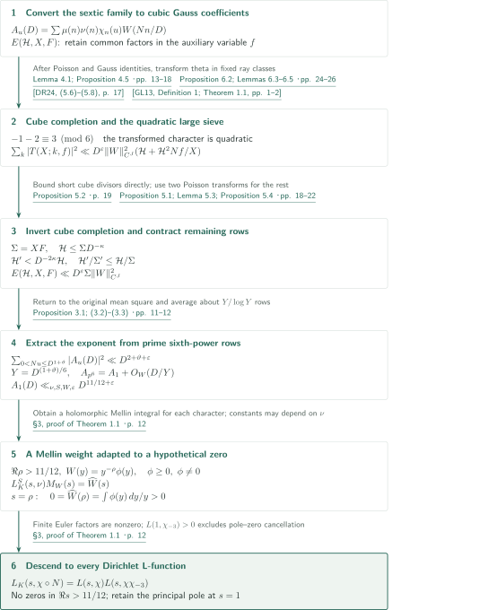
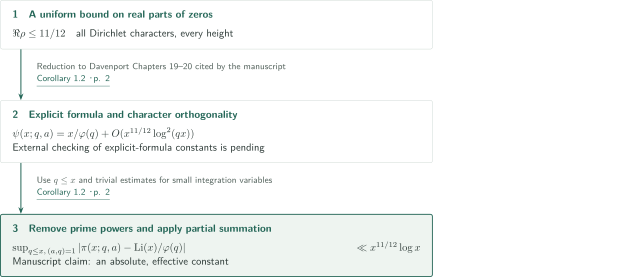

# The Quasi-Riemann Hypothesis

**Sextic mean squares, cubic theta transformation, and finite iteration after cube inversion**

The manuscript claims a zero-free half-plane for finite-order Hecke L-functions over $K=\mathbf Q(\sqrt{-3})$, with a boundary independent of conductor and height. It embeds a Möbius sum in a sextically twisted family and passes through cubic theta coefficients to a quadratic large sieve. This article describes the argument and its direct inputs; it does not certify an independent verification of the complete proof.

## 1. Main results

### Theorem 1.1 — A zero-free half-plane of fixed width

For every finite-order Hecke character $\nu$ over $K=\mathbf Q(\sqrt{-3})$, $L_K(s,\nu)$ has no zeros in
$$\operatorname{Re}s>\frac{11}{12}.$$
Consequently every Dirichlet L-function $L(s,\chi)$, including $\zeta(s)$, has no zeros in the same half-plane. There is no restriction on the imaginary part; the boundary line is excluded. For a principal character, $s=1$ is a pole: nonvanishing here does not assert holomorphy.

<!-- cite:main-result -->[Theorem 1.1 · p. 2](https://github.com/openai/math/blob/1581d4cbdd69a0faf34b2089614fe2a814316a6a/preprints/The-Quasi-Riemann-Hypothesis-October-5-2026/paper2.pdf)<!-- /cite -->

### Corollary 1.2 — A uniform prime-number estimate in progressions

Let $\pi(x;q,a)=\#\{p\le x:p\equiv a\pmod q\}$ and let $\varphi$ denote Euler's totient. For every $x\ge2$, the manuscript claims
$$\sup_{\substack{1\le q\le x\\(a,q)=1}}\left|\pi(x;q,a)-\frac1{\varphi(q)}\int_2^x\frac{dt}{\log t}\right|\ll x^{11/12}\log x,$$
with an absolute, effective implied constant.

<!-- cite:main-corollary -->[Corollary 1.2 · p. 2](https://github.com/openai/math/blob/1581d4cbdd69a0faf34b2089614fe2a814316a6a/preprints/The-Quasi-Riemann-Hypothesis-October-5-2026/paper2.pdf)<!-- /cite -->

## References on the arrows

<!-- reference-guide -->
Unprefixed theorem, lemma, section and equation numbers refer to [The Quasi-Riemann Hypothesis (alternate 11/12 proof)](https://github.com/openai/math/blob/1581d4cbdd69a0faf34b2089614fe2a814316a6a/preprints/The-Quasi-Riemann-Hypothesis-October-5-2026/paper2.pdf). External inputs use the following keys.

- [GL13](https://arxiv.org/pdf/1112.1642v2) Leo Goldmakher and Benoît Louvel — *A quadratic large sieve inequality over number fields*: Quadratic Hecke-family large sieve, applied to squarefree rows and columns in Lemma 6.5. arXiv:1112.1642v2, 31 May 2012 (published 2013).
- [DR24](https://arxiv.org/pdf/2109.07463v3) Alexander Dunn and Maksym Radziwiłł — *Bias in cubic Gauss sums: Patterson’s conjecture*: Cubic theta coefficients and cube completion; the GRH-conditional prime asymptotic is not an input. arXiv:2109.07463v3, 14 May 2024; preprint pagination.
- [D00](https://link.springer.com/book/9780387950976) Harold Davenport; revised by Hugh L. Montgomery — *Multiplicative Number Theory*: Explicit formula cited for Corollary 1.2; external text and constants remain unchecked. Third edition, Springer, 2000; external chapter text not checked.

Each citation gives the result and pages. When printed pagination differs from the PDF position, both are shown. GitHub previews do not automatically jump to the cited page.
<!-- /reference-guide -->

## 2. Proof of Theorem 1.1 — From a mean square to Mellin nonvanishing

<!-- proof-target:1 -->Proof target：[Theorem 1.1 · p. 2](https://github.com/openai/math/blob/1581d4cbdd69a0faf34b2089614fe2a814316a6a/preprints/The-Quasi-Riemann-Hypothesis-October-5-2026/paper2.pdf)<!-- /proof-target -->

**Proof route.** Poisson summation converts Möbius coefficients into cubic Gauss sums. A theta transformation controls a cube-completed sum; finite iteration removes the extra cubes. Prime sixth-power rows then extract the exponent $11/12$, and a Mellin transform excludes zeros. Write $N$ for the absolute norm, $S$ for a fixed set containing the primes above $2,3$ and the conductor of $\nu$, $\chi_n(u)=(u/n)_6$, and $W$ for a smooth weight of fixed compact support.

### 1. The theta transformation produces a quadratic large-sieve family

Set $A_u(D)=\sum_{(n,S)=1}\mu(n)\nu(n)\chi_n(u)W(Nn/D)$. Poisson summation in $u$, followed by the Gauss–Jacobi identities in Lemma 4.1, converts $\mu(n)\gamma_{-1}(n)$ into $a_\xi(n)=\overline{\alpha(n)}\gamma_2(n)\xi(n)$, with $\alpha(n)=n/|n|$ and $\xi$ a character of a fixed ray class group. Extracting common divisors introduces an auxiliary variable $f$. The exact family is
$$E(\mathcal H,X,F)=\frac1{XF}\sum_{Nf\asymp F}^{*}\sum_{0<Nk\le\mathcal H}\left|\sum_n^{*}a_\xi(n)\chi_n(k)\chi_n(f)^4W(Nn/X)\right|^2.$$
Stars restrict to squarefree primary elements coprime to $S$. Proposition 4.5 transfers a bound for this family back to the original mean square.

<!-- cite:poisson -->[Lemma 4.1; Proposition 4.5 · pp. 13–18](https://github.com/openai/math/blob/1581d4cbdd69a0faf34b2089614fe2a814316a6a/preprints/The-Quasi-Riemann-Hypothesis-October-5-2026/paper2.pdf)<!-- /cite -->

Cubic theta coefficients have squarefree-times-cube support $nb^3$. Adding the cube indices produces $T(X;k,f)$, to which theta automorphy applies. At each prime in the squarefree row, the transformed exponent is $-1-2\equiv3\pmod6$, hence quadratic. Lemma 6.3 fixes cusp coefficient sequences within each ray class before GL13 is applied. Lemma 6.5 checks squarefree rows and columns, finite reciprocity corrections, and primitive conductors. Separating repeated prime factors then gives
$$\sum_{0<Nk\ll\mathcal H}|T(X;k,f)|^2\ll D^\varepsilon\|W\|_{C^J}^2\left(\mathcal H+\frac{\mathcal H^2Nf}{X}\right).$$
DR24 supplies theta coefficients and the transformation framework; its GRH-conditional prime asymptotic is not used. The general sextic-twist transformation and its uniformity belong to the present manuscript's Proposition 6.2 and Lemma 6.3.

<!-- cite:completed -->[Proposition 5.2 · p. 19](https://github.com/openai/math/blob/1581d4cbdd69a0faf34b2089614fe2a814316a6a/preprints/The-Quasi-Riemann-Hypothesis-October-5-2026/paper2.pdf)<!-- /cite -->

<!-- cite:theta -->[Proposition 6.2; Lemmas 6.3–6.5 · pp. 24–26](https://github.com/openai/math/blob/1581d4cbdd69a0faf34b2089614fe2a814316a6a/preprints/The-Quasi-Riemann-Hypothesis-October-5-2026/paper2.pdf)<!-- /cite -->

<!-- cite:gl-input -->[&#91;GL13, Definition 1; Theorem 1.1, pp. 1–2&#93;](https://arxiv.org/pdf/1112.1642v2#page=1)<!-- /cite -->

<!-- cite:dr-coefficients -->[&#91;DR24, (5.6)–(5.8), p. 17&#93;](https://arxiv.org/pdf/2109.07463v3#page=17)<!-- /cite -->

### 2. Finite iteration closes the cube-inversion remainder

Cancellation prevents simply retaining the $b=1$ term of the completed sum. Complete multiplicativity allows Möbius inversion. The completed estimate handles inverse divisors up to $H_c^3=\min\{X,X^2/\mathcal H^2\}$. Larger cube factors leave a shorter column length $L_b=X/(Nb)^3$. Proposition 5.4 enlarges a nonnegative row range between two Poisson transformations. With target $\Sigma=XF$, the resulting family satisfies
$$\mathcal H'\le\frac{\mathcal H L_b}{\Sigma F},\qquad \frac{\mathcal H'}{\Sigma'}\le\frac{\mathcal H}{\Sigma},\qquad \Sigma'=X'F'\le L_b.$$
If $\mathcal H\le\Sigma D^{-\kappa}$, then $Nb>H_c$ implies $\mathcal H'<D^{-2\kappa}\mathcal H$. Section 5.5 inducts on $\mathcal H\le D^{j\kappa}$ to obtain $E\ll D^\varepsilon\Sigma\|W\|_{C^J}^2$. Support intervals enlarge and derivative orders increase, but the number of iterations depends only on $\kappa,C_0$. Section 5.6 takes $\kappa=\vartheta/2$ to recover the original mean square.

<!-- cite:iteration -->[Proposition 5.1; Lemma 5.3; Proposition 5.4 · pp. 18–22](https://github.com/openai/math/blob/1581d4cbdd69a0faf34b2089614fe2a814316a6a/preprints/The-Quasi-Riemann-Hypothesis-October-5-2026/paper2.pdf)<!-- /cite -->

<!-- cite:transfer -->[§7, Lemmas 7.1–7.3 · pp. 29–34](https://github.com/openai/math/blob/1581d4cbdd69a0faf34b2089614fe2a814316a6a/preprints/The-Quasi-Riemann-Hypothesis-October-5-2026/paper2.pdf)<!-- /cite -->

### 3. Sixth-power rows give $11/12$; a zero gives a contradiction

For fixed $0<\vartheta\le1/10$, Proposition 3.1 gives $\sum_{0<Nu\le D^{1+\vartheta}}|A_u(D)|^2\ll D^{2+\vartheta+\varepsilon}$. Put $Y=D^{(1+\vartheta)/6}$. For primary prime generators with $Y/2<Np\le Y$, the identity $\chi_n(p^6)=1_{p\nmid n}$ gives $A_{p^6}(D)=A_1(D)+O_W(D/Y)$. The prime ideal theorem in the fixed field supplies about $Y/\log Y$ rows, yielding
$$|A_1(D)|^2\ll D^{11/6+5\vartheta/6+\varepsilon}+D^{5/3-\vartheta/3}.$$
Choosing $\vartheta$ for each requested exponent loss gives $A_1(D)\ll_{\nu,S,W,\varepsilon}D^{11/12+\varepsilon}$. The constant may depend on $\nu$. The same exponent for each character, rather than a conductor-uniform mean-square constant, gives the final conductor-independent boundary.

<!-- cite:mobius -->[Proposition 3.1; (3.2)–(3.3) · pp. 11–12](https://github.com/openai/math/blob/1581d4cbdd69a0faf34b2089614fe2a814316a6a/preprints/The-Quasi-Riemann-Hypothesis-October-5-2026/paper2.pdf)<!-- /cite -->

If $\operatorname{Re}\rho>11/12$ were a zero, choose $W(y)=y^{-\rho}\phi(y)$ with $0\ne\phi\ge0$ and $\phi\in C_c^\infty((1,2))$. The Mellin integral $M_W(s)=\int_0^\infty A_1(D)D^{-s}\,dD/D$ is holomorphic in this half-plane. In $\operatorname{Re}s>1$ it satisfies $L_K^S(s,\nu)M_W(s)=\widehat W(s)$; meromorphic continuation and the identity theorem extend this relation. Evaluation at $\rho$ contradicts $0=\widehat W(\rho)=\int\phi(y)\,dy/y>0$. Removed Euler factors are nonzero for $\operatorname{Re}s>0$.

<!-- cite:mellin -->[§3, proof of Theorem 1.1 · p. 12](https://github.com/openai/math/blob/1581d4cbdd69a0faf34b2089614fe2a814316a6a/preprints/The-Quasi-Riemann-Hypothesis-October-5-2026/paper2.pdf)<!-- /cite -->

### 4. Descent to Dirichlet functions and the point $s=1$

Quadratic base change gives, up to finitely many Euler factors nonzero in $\operatorname{Re}s>0$,
$$L_K(s,\chi\circ N)=L(s,\chi)L(s,\chi\chi_{-3}).$$
Away from $s=1$ no pole can cancel a zero of either factor. At $s=1$, if one factor is principal, the other primitive function is $L(s,\chi_{-3})$; Dirichlet nonvanishing $L(1,\chi_{-3})>0$ excludes pole–zero cancellation. Extra Euler factors for imprimitive characters also do not vanish in this region.

<!-- cite:mellin -->[§3, proof of Theorem 1.1 · p. 12](https://github.com/openai/math/blob/1581d4cbdd69a0faf34b2089614fe2a814316a6a/preprints/The-Quasi-Riemann-Hypothesis-October-5-2026/paper2.pdf)<!-- /cite -->

## 3. Proof of Corollary 1.2 — The explicit-formula connection

<!-- proof-target:2 -->Proof target：[Corollary 1.2 · p. 2](https://github.com/openai/math/blob/1581d4cbdd69a0faf34b2089614fe2a814316a6a/preprints/The-Quasi-Riemann-Hypothesis-October-5-2026/paper2.pdf)<!-- /proof-target -->

The manuscript cites Chapters 19–20 of Davenport's third edition and supplies no separate proof section for this corollary. The diagram records the reduction. Checking the external explicit formula's edition, pages, and constants remains pending.

### 1. Character sums, prime powers, and partial summation

Inserting Theorem 1.1 into a truncated explicit formula gives the target error $O(x^{11/12}\log^2(qx))$ for $\psi(x,\chi)=\sum_{n\le x}\Lambda(n)\chi(n)$. Character orthogonality returns to $\psi(x;q,a)$, with the $\varphi(q)$ character sum compensated by $1/\varphi(q)$. Removing prime powers and partial summation pass to $\pi$ and save one logarithm. The condition $q\le x$, together with trivial treatment of small integration variables, is needed in obtaining the displayed uniform error. The manuscript's assertion of an absolute, effective constant includes the constants in the explicit formula and zero counting. This external input has not been independently rechecked here.

<!-- cite:main-corollary -->[Corollary 1.2 · p. 2](https://github.com/openai/math/blob/1581d4cbdd69a0faf34b2089614fe2a814316a6a/preprints/The-Quasi-Riemann-Hypothesis-October-5-2026/paper2.pdf)<!-- /cite -->

## 4. Which papers supply which steps

| Source and result | Used at | Role and hypotheses | Checking scope |
|---|---|---|---|
| GL13, Definition 1 and Theorem 1.1 | Lemmas 6.5–6.6 | Primitive quadratic Hecke families; squarefree rows and columns; fixed ray classes; $M+N$ bound | External statement and application conditions compared; external proof unchecked |
| DR24, (5.6)–(5.8) | §6.1 and Appendix A.2 | Cubic theta coefficients with squarefree-times-cube support | Coefficient statements checked; complete cusp calculations and uniformity not independently recomputed |
| DR24, Lemma 5.4 | Comparison with cube completion and inversion | Coefficient identity for primitive cubic twists | Statement checked; the manuscript's general twists do not follow from this lemma alone |
| Davenport, third edition, Chapters 19–20 | Corollary 1.2 | Dirichlet explicit formula, prime counting, constant control | Citation in the manuscript checked; external text and page mapping pending |

<!-- cite:gl-input -->[&#91;GL13, Definition 1; Theorem 1.1, pp. 1–2&#93;](https://arxiv.org/pdf/1112.1642v2#page=1)<!-- /cite -->

<!-- cite:dr-inversion -->[&#91;DR24, Lemma 5.4, p. 28&#93;](https://arxiv.org/pdf/2109.07463v3#page=28)<!-- /cite -->

The 7/8 manuscript is cited on p.2 for a stronger result; it does not supply Proposition 3.1. The 11/12 argument is organized to close within §§3–7 of the present manuscript.

## 5. Return to the sources

<!-- reading-list -->
- [Proposition 3.1; (3.2)–(3.3) · pp. 11–12](https://github.com/openai/math/blob/1581d4cbdd69a0faf34b2089614fe2a814316a6a/preprints/The-Quasi-Riemann-Hypothesis-October-5-2026/paper2.pdf) — Extract the exponent 11/12 from the mean square.
- [Proposition 5.1; Lemma 5.3; Proposition 5.4 · pp. 18–22](https://github.com/openai/math/blob/1581d4cbdd69a0faf34b2089614fe2a814316a6a/preprints/The-Quasi-Riemann-Hypothesis-October-5-2026/paper2.pdf) — Close cube-inversion remainders by finite iteration.
- [Proposition 6.2; Lemmas 6.3–6.5 · pp. 24–26](https://github.com/openai/math/blob/1581d4cbdd69a0faf34b2089614fe2a814316a6a/preprints/The-Quasi-Riemann-Hypothesis-October-5-2026/paper2.pdf) — The sextic-to-quadratic transform and its uniformity.
- [§7, Lemmas 7.1–7.3 · pp. 29–34](https://github.com/openai/math/blob/1581d4cbdd69a0faf34b2089614fe2a814316a6a/preprints/The-Quasi-Riemann-Hypothesis-October-5-2026/paper2.pdf) — Parameter contraction through two Poisson transformations.
- [Corollary 1.2 · p. 2](https://github.com/openai/math/blob/1581d4cbdd69a0faf34b2089614fe2a814316a6a/preprints/The-Quasi-Riemann-Hypothesis-October-5-2026/paper2.pdf) — The claimed prime-number estimate and its cited input.
<!-- /reading-list -->

The passages read cover exponent extraction and the Mellin contradiction in §3, the exact family, cube inversion, transfer conditions, and finite induction in §§4–5, the quadratic large-sieve application in §6, and the main transfer steps in §7. GL13's family conditions and theorem and DR24's theta coefficients and cube identity were compared with the external sources. The complete Appendix A.2 transformation, all of Lemma 6.3's uniformity proof, every common-factor term in §7, and the external explicit-formula constants for Corollary 1.2 were not independently verified. This is neither a certification of the full claims nor a completed peer review or numerical verification over all conductors.
