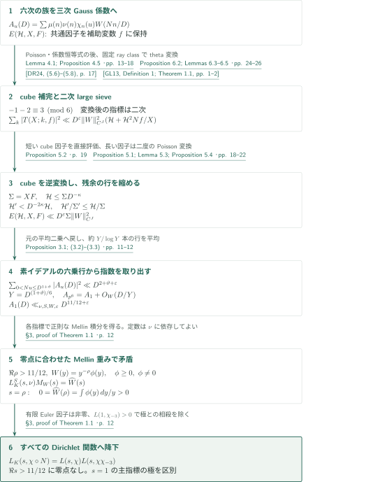
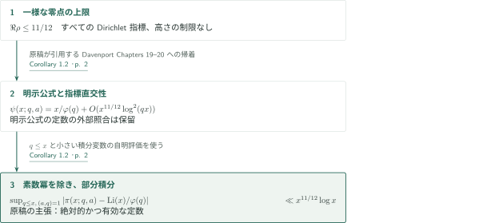

# The Quasi-Riemann Hypothesis

**六次指標の平均二乗、三次theta変換、cube逆変換の有限反復**

本原稿は $K=\mathbf Q(\sqrt{-3})$ 上の有限位数Hecke $L$ 関数について、導手と高さによらない無零半平面を主張する。証明はMöbius和を六次指標で捻った族に埋め込み、三次theta関数を経由して二次large sieveへ帰着する。以下は原稿の論証と直接入力の接続を整理した概説であり、全証明を独立検証した認定ではない。

## 1. 主要結果

### Theorem 1.1 — 固定幅の無零半平面

$K=\mathbf Q(\sqrt{-3})$ 上の任意の有限位数Hecke指標 $\nu$ に対し、$L_K(s,\nu)$ は
$$\operatorname{Re}s>\frac{11}{12}$$
に零点を持たない。したがって、任意のDirichlet指標 $\chi$ の $L(s,\chi)$、特に $\zeta(s)$ も同じ半平面に零点を持たない。虚部の制限はなく、境界線 $\operatorname{Re}s=11/12$ は含まない。主指標の場合の $s=1$ は極であり、ここでの無零という主張は正則性を意味しない。

<!-- cite:main-result -->[Theorem 1.1 · p. 2](https://github.com/openai/math/blob/1581d4cbdd69a0faf34b2089614fe2a814316a6a/preprints/The-Quasi-Riemann-Hypothesis-October-5-2026/paper2.pdf)<!-- /cite -->

### Corollary 1.2 — 等差数列の素数定理の一様誤差

$\pi(x;q,a)=\#\{p\le x:p\equiv a\pmod q\}$ とし、$\varphi$ をEuler関数とする。原稿はすべての $x\ge2$ に対し
$$\sup_{\substack{1\le q\le x\\(a,q)=1}}\left|\pi(x;q,a)-\frac1{\varphi(q)}\int_2^x\frac{dt}{\log t}\right|\ll x^{11/12}\log x$$
を主張し、暗黙定数は絶対的かつ有効であるとしている。

<!-- cite:main-corollary -->[Corollary 1.2 · p. 2](https://github.com/openai/math/blob/1581d4cbdd69a0faf34b2089614fe2a814316a6a/preprints/The-Quasi-Riemann-Hypothesis-October-5-2026/paper2.pdf)<!-- /cite -->

## 図の矢印に付した引用

<!-- reference-guide -->
略号のない定理・補題・節・式番号は本原稿 [The Quasi-Riemann Hypothesis (alternate 11/12 proof)](https://github.com/openai/math/blob/1581d4cbdd69a0faf34b2089614fe2a814316a6a/preprints/The-Quasi-Riemann-Hypothesis-October-5-2026/paper2.pdf) を指します。外部入力には次の略号を使います。

- [GL13](https://arxiv.org/pdf/1112.1642v2) Leo Goldmakher and Benoît Louvel — *A quadratic large sieve inequality over number fields*：二次Hecke族のlarge sieve。Lemma 6.5で平方因子のない行・列に適用。arXiv:1112.1642v2, 31 May 2012 (published 2013)。
- [DR24](https://arxiv.org/pdf/2109.07463v3) Alexander Dunn and Maksym Radziwiłł — *Bias in cubic Gauss sums: Patterson’s conjecture*：三次theta係数とcube補完の入力。GRHを仮定する素数上の主定理は使わない。arXiv:2109.07463v3, 14 May 2024; preprint pagination。
- [D00](https://link.springer.com/book/9780387950976) Harold Davenport; revised by Hugh L. Montgomery — *Multiplicative Number Theory*：Corollary 1.2が引用する明示公式。外部本文・定数管理は未確認。Third edition, Springer, 2000; external chapter text not checked。

各引用に結果番号とページを付します。誌面番号とPDF内の位置が異なる場合は両方を示します。GitHubの閲覧リンクではページ位置への自動移動を前提としません。
<!-- /reference-guide -->

## 2. Theorem 1.1 の証明 — 平均二乗からMellin変換へ

<!-- proof-target:1 -->証明対象：[Theorem 1.1 · p. 2](https://github.com/openai/math/blob/1581d4cbdd69a0faf34b2089614fe2a814316a6a/preprints/The-Quasi-Riemann-Hypothesis-October-5-2026/paper2.pdf)<!-- /proof-target -->

**証明の道筋。** Möbius係数をGauss和に変えるPoisson変換、cubeを加えたtheta和の評価、cubeを除く有限反復によって平均二乗を得る。素イデアルの六乗に対応する行を取り出して指数 $11/12$ を導き、Mellin変換で零点を排除する。$N$ は $K$ の絶対ノルム、$S$ は $2,3$ と $\nu$ の導手を含む固定素イデアル集合、$\chi_n(u)=(u/n)_6$、$W$ は固定コンパクト台を持つ滑らかな重みとする。

### 1. theta変換が二次large sieveを使える族を作る

$A_u(D)=\sum_{(n,S)=1}\mu(n)\nu(n)\chi_n(u)W(Nn/D)$ を考える。行変数 $u$ でPoisson和公式を使うと、Lemma 4.1のGauss–Jacobi恒等式が $\mu(n)\gamma_{-1}(n)$ を $a_\xi(n)=\overline{\alpha(n)}\gamma_2(n)\xi(n)$ に変える。ここで $\alpha(n)=n/|n|$、$\xi$ は固定ray class群の指標である。共通因子を抜き出す操作は補助変数 $f$ を生むため、正確な対象は単純な二変数族ではなく
$$E(\mathcal H,X,F)=\frac1{XF}\sum_{Nf\asymp F}^{*}\sum_{0<Nk\le\mathcal H}\left|\sum_n^{*}a_\xi(n)\chi_n(k)\chi_n(f)^4W(Nn/X)\right|^2$$
となる。星は $S$ と互いに素なsquarefree primary元への制限を表す。Proposition 4.5はこの族の評価を元の平均二乗へ戻す。

<!-- cite:poisson -->[Lemma 4.1; Proposition 4.5 · pp. 13–18](https://github.com/openai/math/blob/1581d4cbdd69a0faf34b2089614fe2a814316a6a/preprints/The-Quasi-Riemann-Hypothesis-October-5-2026/paper2.pdf)<!-- /cite -->

三次thetaの係数はsquarefree部分 $n$ とcube部分 $b^3$ に分かれる。cubeを加えた和 $T(X;k,f)$ はthetaの変換則を使える。変換でsquarefreeな行の素因子における指標指数が $-1-2\equiv3\pmod6$ となるため二次指標が現れる。Lemma 6.3でray classごとにcusp係数列を固定してから、GL13の二次Hecke族large sieveを適用する。squarefreeな行・列、固定された相互法則の補正、および原始導手の条件をLemma 6.5が確認している。重複素因子を分離した後に得る評価は
$$\sum_{0<Nk\ll\mathcal H}|T(X;k,f)|^2\ll D^\varepsilon\|W\|_{C^J}^2\left(\mathcal H+\frac{\mathcal H^2Nf}{X}\right).$$
DR24の主定理にあるGRH仮定付き素数漸近式は使わず、theta係数と変換の構造を使う。一般の六次捻りへの変換とその一様性は本稿のProposition 6.2・Lemma 6.3の仕事である。

<!-- cite:completed -->[Proposition 5.2 · p. 19](https://github.com/openai/math/blob/1581d4cbdd69a0faf34b2089614fe2a814316a6a/preprints/The-Quasi-Riemann-Hypothesis-October-5-2026/paper2.pdf)<!-- /cite -->

<!-- cite:theta -->[Proposition 6.2; Lemmas 6.3–6.5 · pp. 24–26](https://github.com/openai/math/blob/1581d4cbdd69a0faf34b2089614fe2a814316a6a/preprints/The-Quasi-Riemann-Hypothesis-October-5-2026/paper2.pdf)<!-- /cite -->

<!-- cite:gl-input -->[&#91;GL13, Definition 1; Theorem 1.1, pp. 1–2&#93;](https://arxiv.org/pdf/1112.1642v2#page=1)<!-- /cite -->

<!-- cite:dr-coefficients -->[&#91;DR24, (5.6)–(5.8), p. 17&#93;](https://arxiv.org/pdf/2109.07463v3#page=17)<!-- /cite -->

### 2. cube逆変換の残余を有限回で閉じる

cube補完の $b=1$ 項だけを捨て残すことはできない。完全乗法性を用いたMöbius逆変換で元の和を復元し、$H_c^3=\min\{X,X^2/\mathcal H^2\}$ までを完成和の評価で処理する。大きいcube因子には $L_b=X/(Nb)^3$ の短い列が残る。Proposition 5.4は二度のPoisson変換の間で非負の行和の範囲を拡張し、$\Sigma=XF$ を目標量として、新しい族を
$$\mathcal H'\le\frac{\mathcal H L_b}{\Sigma F},\qquad \frac{\mathcal H'}{\Sigma'}\le\frac{\mathcal H}{\Sigma},\qquad \Sigma'=X'F'\le L_b$$
に移す。$\mathcal H\le\Sigma D^{-\kappa}$ なら $Nb>H_c$ から $\mathcal H'<D^{-2\kappa}\mathcal H$。§5.5は $\mathcal H\le D^{j\kappa}$ に関する有限帰納法で $E\ll D^\varepsilon\Sigma\|W\|_{C^J}^2$ を得る。支持区間は転送ごとに拡大し、必要な導関数階数は増えるが、反復回数は $\kappa,C_0$ のみに依存する。§5.6で $\kappa=\vartheta/2$ として元の族へ戻す。

<!-- cite:iteration -->[Proposition 5.1; Lemma 5.3; Proposition 5.4 · pp. 18–22](https://github.com/openai/math/blob/1581d4cbdd69a0faf34b2089614fe2a814316a6a/preprints/The-Quasi-Riemann-Hypothesis-October-5-2026/paper2.pdf)<!-- /cite -->

<!-- cite:transfer -->[§7, Lemmas 7.1–7.3 · pp. 29–34](https://github.com/openai/math/blob/1581d4cbdd69a0faf34b2089614fe2a814316a6a/preprints/The-Quasi-Riemann-Hypothesis-October-5-2026/paper2.pdf)<!-- /cite -->

### 3. 六乗の行から $11/12$、零点から矛盾へ

Proposition 3.1は固定した $0<\vartheta\le1/10$ について $\sum_{0<Nu\le D^{1+\vartheta}}|A_u(D)|^2\ll D^{2+\vartheta+\varepsilon}$ を与える。$Y=D^{(1+\vartheta)/6}$、$Y/2<Np\le Y$ の素イデアルのprimary生成元 $p$ に対し、$\chi_n(p^6)=1_{p\nmid n}$ なので $A_{p^6}(D)=A_1(D)+O_W(D/Y)$。固定体 $K$ の素イデアル定理で約 $Y/\log Y$ 本の行を得て
$$|A_1(D)|^2\ll D^{11/6+5\vartheta/6+\varepsilon}+D^{5/3-\vartheta/3}.$$
任意の指数損失に合わせて $\vartheta$ を選べば $A_1(D)\ll_{\nu,S,W,\varepsilon}D^{11/12+\varepsilon}$。定数は $\nu$ に依存してよい。各指標で同じ指数が得られることが、最終的な無零半平面の導手一様性を与える。

<!-- cite:mobius -->[Proposition 3.1; (3.2)–(3.3) · pp. 11–12](https://github.com/openai/math/blob/1581d4cbdd69a0faf34b2089614fe2a814316a6a/preprints/The-Quasi-Riemann-Hypothesis-October-5-2026/paper2.pdf)<!-- /cite -->

仮に $\operatorname{Re}\rho>11/12$ が零点なら、$W(y)=y^{-\rho}\phi(y)$、$0\ne\phi\ge0$、$\phi\in C_c^\infty((1,2))$ と選ぶ。$M_W(s)=\int_0^\infty A_1(D)D^{-s}\,dD/D$ はその半平面で正則であり、$\operatorname{Re}s>1$ で $L_K^S(s,\nu)M_W(s)=\widehat W(s)$。有理型接続と一致の定理により零点で評価でき、$0=\widehat W(\rho)=\int\phi(y)\,dy/y>0$ に矛盾する。除いた有限Euler因子は $\operatorname{Re}s>0$ で消えない。

<!-- cite:mellin -->[§3, proof of Theorem 1.1 · p. 12](https://github.com/openai/math/blob/1581d4cbdd69a0faf34b2089614fe2a814316a6a/preprints/The-Quasi-Riemann-Hypothesis-October-5-2026/paper2.pdf)<!-- /cite -->

### 4. Dirichlet関数への降下と $s=1$

二次base changeにより、$\operatorname{Re}s>0$ で消えない有限Euler因子を除いて
$$L_K(s,\chi\circ N)=L(s,\chi)L(s,\chi\chi_{-3}).$$
$s\ne1$ では一方の零点を打ち消す極がない。$s=1$ で一方が主指標の関数となる場合、相手の原始関数は $L(s,\chi_{-3})$ であり、Dirichletの非消滅 $L(1,\chi_{-3})>0$ が極と零点の相殺を除く。非原始指標の追加Euler因子もこの領域では消えない。

<!-- cite:mellin -->[§3, proof of Theorem 1.1 · p. 12](https://github.com/openai/math/blob/1581d4cbdd69a0faf34b2089614fe2a814316a6a/preprints/The-Quasi-Riemann-Hypothesis-October-5-2026/paper2.pdf)<!-- /cite -->

## 3. Corollary 1.2 の証明 — 明示公式への接続

<!-- proof-target:2 -->証明対象：[Corollary 1.2 · p. 2](https://github.com/openai/math/blob/1581d4cbdd69a0faf34b2089614fe2a814316a6a/preprints/The-Quasi-Riemann-Hypothesis-October-5-2026/paper2.pdf)<!-- /proof-target -->

原稿はこの系をDavenport第3版のChapters 19–20の明示公式による帰結として掲げ、独立の証明節を設けていない。次図はその帰着を示す。外部明示公式の版・定数を逐一照合する作業は保留である。

### 1. 指標和、素数冪、部分積分

Theorem 1.1の境界を切断明示公式へ入れると、各指標の $\psi(x,\chi)=\sum_{n\le x}\Lambda(n)\chi(n)$ に対して目標となる誤差は $O(x^{11/12}\log^2(qx))$ である。指標直交性で $\psi(x;q,a)$ に戻すと、$\varphi(q)$ 個の和と正規化 $1/\varphi(q)$ が対応する。素数冪を除き、部分積分で $\pi$ に移すと対数一つ分を減らす。$q\le x$ と小さい積分変数の範囲の自明評価を組み合わせるのが、表示した一様誤差への最後の段階である。原稿の「絶対的かつ有効」という主張は、ここで使う明示公式・零点計数の定数管理を含む。今回、その外部入力を再検証済みとはしない。

<!-- cite:main-corollary -->[Corollary 1.2 · p. 2](https://github.com/openai/math/blob/1581d4cbdd69a0faf34b2089614fe2a814316a6a/preprints/The-Quasi-Riemann-Hypothesis-October-5-2026/paper2.pdf)<!-- /cite -->

## 4. どの論文が、どの段階を担うか

| 供給元と結果 | 利用箇所 | 使用内容・必要な仮定 | 確認範囲 |
|---|---|---|---|
| GL13, Definition 1・Theorem 1.1 | Lemma 6.5、Lemma 6.6 | 原始二次Hecke族、squarefree行・列、固定ray classで $M+N$ 型評価 | 外部記述と適用条件を照合。外部証明は未検証 |
| DR24, (5.6)–(5.8) | §6.1、Appendix A.2 | 三次thetaの係数、squarefree×cubeという支持 | 係数記述を照合。全cusp計算と一様性の独立再計算は保留 |
| DR24, Lemma 5.4 | cube補完・逆変換の比較 | 原始三次指標の場合の係数恒等式 | 記述を照合。本稿の一般捻りをこの補題だけから導いたとはしない |
| Davenport, 第3版Chapters 19–20 | Corollary 1.2 | Dirichlet明示公式による素数計数と定数管理 | 本稿の引用箇所を確認。外部本文・ページ対応は未確認 |

<!-- cite:gl-input -->[&#91;GL13, Definition 1; Theorem 1.1, pp. 1–2&#93;](https://arxiv.org/pdf/1112.1642v2#page=1)<!-- /cite -->

<!-- cite:dr-inversion -->[&#91;DR24, Lemma 5.4, p. 28&#93;](https://arxiv.org/pdf/2109.07463v3#page=28)<!-- /cite -->

7/8版は本稿のp.2でより強い結果として引用されるが、本稿のProposition 3.1を供給する直接入力ではない。11/12の証明は本稿の§§3–7で閉じる構成になっている。

## 5. 原典を読む入口と確認範囲

<!-- reading-list -->
- [Proposition 3.1; (3.2)–(3.3) · pp. 11–12](https://github.com/openai/math/blob/1581d4cbdd69a0faf34b2089614fe2a814316a6a/preprints/The-Quasi-Riemann-Hypothesis-October-5-2026/paper2.pdf) — 平均二乗から11/12を取り出す。
- [Proposition 5.1; Lemma 5.3; Proposition 5.4 · pp. 18–22](https://github.com/openai/math/blob/1581d4cbdd69a0faf34b2089614fe2a814316a6a/preprints/The-Quasi-Riemann-Hypothesis-October-5-2026/paper2.pdf) — cube逆変換の残余を閉じる有限反復。
- [Proposition 6.2; Lemmas 6.3–6.5 · pp. 24–26](https://github.com/openai/math/blob/1581d4cbdd69a0faf34b2089614fe2a814316a6a/preprints/The-Quasi-Riemann-Hypothesis-October-5-2026/paper2.pdf) — 六次指標が二次指標になる変換と一様性。
- [§7, Lemmas 7.1–7.3 · pp. 29–34](https://github.com/openai/math/blob/1581d4cbdd69a0faf34b2089614fe2a814316a6a/preprints/The-Quasi-Riemann-Hypothesis-October-5-2026/paper2.pdf) — 二度のPoisson変換によるパラメータ縮小。
- [Corollary 1.2 · p. 2](https://github.com/openai/math/blob/1581d4cbdd69a0faf34b2089614fe2a814316a6a/preprints/The-Quasi-Riemann-Hypothesis-October-5-2026/paper2.pdf) — 原稿が主張する等差数列の素数定理と引用範囲。
<!-- /reading-list -->

§3の指数抽出・Mellin矛盾、§§4–5の正確な族・cube逆変換・転送条件・有限帰納法、§6の二次large sieve適用と§7の転送の主要箇所を読んだ。GL13の族の条件と定理、DR24のtheta係数・cube恒等式を外部原典と照合した。Appendix A.2の全変換計算、Lemma 6.3の全一様性証明、§7の全共通因子項、Corollary 1.2の外部明示公式の定数管理は独立検証していない。主張全体の正しさ、査読完了、全導手での数値検証を意味しない。
