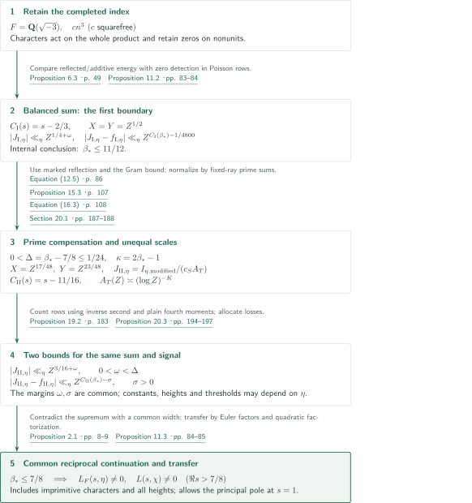
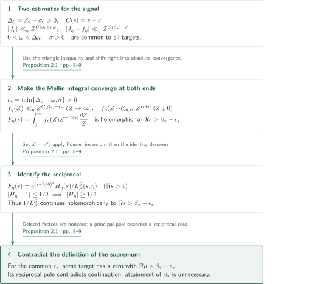
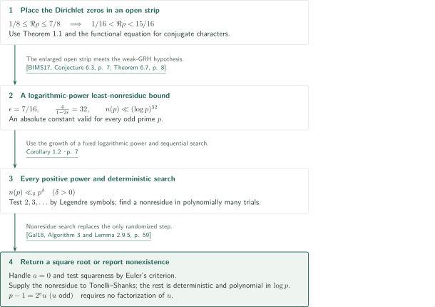

# The Quasi-Riemann Hypothesis: A Zero-Free Half-Plane Re s > 7/8

**Two representations of a completed cubic-theta sum give a continuation width common to the character family.**

The manuscript compares a direct bound from cubic-theta reflection with a Poisson representation containing the Mellin transform of a reciprocal Hecke L-function. It first obtains the boundary $11/12$ from an uncompensated sum, then improves it to $7/8$ using prime compensation and two moment estimates. This article presents the manuscript's claims and proof route; it does not independently verify the entire proof, including its long moment inductions.

## 1. Main results

### Theorem 1.1 — Zero exclusion for finite-order Hecke and Dirichlet families

Let $F=\mathbf Q(\sqrt{-3})$. For every finite-order Hecke character $\eta$ modulo any nonzero integral ideal, $L_F(s,\eta)$ has no zero in

$$\Re s>\frac78.$$

The same holds for $L(s,\chi)$ for every Dirichlet character $\chi$ modulo any positive integer, including $\zeta(s)$, corresponding to the character modulo $1$. A principal character's pole at $s=1$ is allowed.

A Hecke character here is a ray class group character extended by zero on ideals not coprime to its modulus. The character need not be primitive, and there is no conductor bound or restriction on the imaginary part. The Hecke base field is the fixed field $F$ above. The boundary $\Re s=7/8$ is excluded from the assertion. In particular, real zeros in $(7/8,1)$ are excluded; the theorem does not place all nontrivial zeros on the critical line.

<!-- cite:main-result -->[Theorem 1.1 · p. 4](https://github.com/openai/math/blob/1581d4cbdd69a0faf34b2089614fe2a814316a6a/preprints/The-Quasi-Riemann-Hypothesis-September-30-2026/paper.pdf)<!-- /cite -->

### Corollary 1.2 — Least quadratic nonresidues and deterministic square roots

There are absolute constants $A,C>0$ such that, for every odd prime $p$, the least positive quadratic nonresidue $n(p)$ satisfies

$$n(p)\le C(\log p)^A.$$

Consequently $n(p)\ll_\delta p^\delta$ for every $\delta>0$. Given an odd prime $p$ and $a\in\mathbf F_p$ in binary representation, a deterministic algorithm, polynomial in $\log p$, returns a square root of $a$ or reports that none exists. The manuscript's proof permits $A=32$.

<!-- cite:main-corollary -->[Corollary 1.2 · p. 7](https://github.com/openai/math/blob/1581d4cbdd69a0faf34b2089614fe2a814316a6a/preprints/The-Quasi-Riemann-Hypothesis-September-30-2026/paper.pdf)<!-- /cite -->

## References on the arrows

<!-- reference-guide -->
Unprefixed theorem, lemma, section and equation numbers refer to [The Quasi-Riemann Hypothesis: A Zero-Free Half-Plane Re s > 7/8](https://github.com/openai/math/blob/1581d4cbdd69a0faf34b2089614fe2a814316a6a/preprints/The-Quasi-Riemann-Hypothesis-September-30-2026/paper.pdf). External inputs use the following keys.

- [DR24](https://arxiv.org/pdf/2109.07463v3) Alexander Dunn and Maksym Radziwiłł — *Bias in cubic Gauss sums: Patterson’s conjecture*: Cubic-theta coefficients and transformations at fixed cusps. arXiv:2109.07463v3, 14 May 2024.
- [GL13](https://arxiv.org/pdf/1112.1642v2) Leo Goldmakher and Benoît Louvel — *A quadratic large sieve inequality over number fields*: Large sieve for quadratic Hecke families. arXiv:1112.1642v2, 31 May 2012.
- [TZ19](https://arxiv.org/pdf/1803.02823v3) Jesse Thorner and Asif Zaman — *A unified and improved Chebotarev density theorem*: Prime asymptotic in a fixed ray class and normalization. arXiv:1803.02823v3, 27 October 2018.
- [BIMS17](https://www.cse.iitk.ac.in/users/nitin/papers/irred-and-rth-root.pdf) Vishwas Bhargava, Gábor Ivanyos, Rajat Mittal, and Nitin Saxena — *Irreducibility and deterministic r-th root finding over finite fields*: Least nonresidues under weak GRH. ISSAC 2017 author manuscript, 8 PDF pages; no printed pagination.
- [Gal18](https://www.math.auckland.ac.nz/~sgal018/crypto-book/main.pdf) Steven D. Galbraith — *Mathematics of Public Key Cryptography*: Tonelli–Shanks after obtaining a nonresidue. Version 2.0, 31 October 2018.

Each citation gives the result and pages. When printed pagination differs from the PDF position, both are shown. GitHub previews do not automatically jump to the cited page.
<!-- /reference-guide -->

The BIMS17 author manuscript has no printed page numbers; its cited pages indicate PDF positions. In the other versions used here, the recorded printed pages agree with the PDF positions.

## 2. Proof of Theorem 1.1 — Two comparisons and transfer to the full families

<!-- proof-target:1 -->Proof target：[Theorem 1.1 · p. 4](https://github.com/openai/math/blob/1581d4cbdd69a0faf34b2089614fe2a814316a6a/preprints/The-Quasi-Riemann-Hypothesis-September-30-2026/paper.pdf)<!-- /proof-target -->

**Proof route.** Let $\beta_*$ be the supremum of $1/2$ and the real parts of zeros in $1/2\le\Re\rho\le1$, taken over all primitive finite-order Hecke characters. Poles are excluded. Part I proves $\beta_*\le11/12$. Part II works under that bound and contradicts $\Delta=\beta_*-7/8>0$. The common continuation principle concluding both stages is explained in the next section. Finite Euler factors and quadratic factorization then transfer the result to imprimitive Hecke characters and Dirichlet characters.

### 1. Retaining completed indices through reflection and the first half-plane

The base theta sum retains the index $cn^3$, with $c$ squarefree and $n$ unrestricted; they need not be coprime. Characters act on the whole product, retaining zero values on nonunits even when a local exponent is divisible by six. Proposition 5.1 derives the masked reflection from theta coefficients at three fixed cusps. The quadratic large sieve controls the quadratic character arising after reflection and yields a mean-square bound for completed rows.

<!-- cite:reflection -->[Proposition 5.1 · pp. 24–27; Equation (5.26) · p. 36](https://github.com/openai/math/blob/1581d4cbdd69a0faf34b2089614fe2a814316a6a/preprints/The-Quasi-Riemann-Hypothesis-September-30-2026/paper.pdf)<!-- /cite -->

In Part I, $X=Y=Z^{1/2}$. Cauchy–Schwarz combines reflected row energy with the mean square of an additive polynomial supported at distinct reduced fractions. Proposition 6.3 gives $I_\eta\ll_{\eta,\epsilon}Z^{1/4+\epsilon}$. Nonzero frequencies in the Poisson representation take the form $ua^6$, with $u$ sixth-power-free. The inverse polynomial supplied by the zero detector and the sextic large sieve of Lemma 9.1 count nonprincipal rows; residues of the principal row $u=1$ are extracted separately. For the normalization with $C_{\mathrm I}(s)=s-2/3$, this gives

$$|J_{\mathrm I,\eta}|\ll_\eta Z^{1/4+\omega},\qquad
|J_{\mathrm I,\eta}-f_{\mathrm I,\eta}|\ll_\eta Z^{\beta_*-2/3-1/4800}.$$

If $\beta_*>11/12$, one chooses a common $0<\omega<\beta_*-11/12$ and applies Proposition 2.1 to obtain Theorem 3.1. This is **Theorem 3.1 within the 199-page manuscript**, not an input from the separate 49-page paper in catalogue 003.

<!-- cite:balanced -->[Proposition 6.3 · p. 49; Lemma 9.1 · p. 61; Proposition 11.2 · pp. 83–84; Theorem 3.1, proof · p. 85](https://github.com/openai/math/blob/1581d4cbdd69a0faf34b2089614fe2a814316a6a/preprints/The-Quasi-Riemann-Hypothesis-September-30-2026/paper.pdf)<!-- /cite -->

### 2. The compensated low bound and principal normalization

Part II has $0<\Delta\le1/24$ and $\kappa=2\beta_*-1=3/4+2\Delta\le5/6$. It fixes

$$h=\frac{13}{16},\quad \ell=\frac16,\quad l_x=\frac{17}{48},\quad l_y=\frac{23}{48},\qquad X=Z^{l_x},\quad Y=Z^{l_y}.$$

Primes are chosen from disjoint windows. At each prime $\mathfrak p$, the operation subtracts a rescaled term from a term marked by $\mathfrak p\mid cn^3$. Defining this finite expression first ensures that the low and high estimates concern the same object. Proposition 15.3 combines marked reflected energy with an additive Gram bound to give $I_{\eta,\mathrm{modified}}\ll Z^{3/16+\epsilon}$.

<!-- cite:compensated-low -->[Equation (12.5) · p. 86; Proposition 15.3 · p. 107](https://github.com/openai/math/blob/1581d4cbdd69a0faf34b2089614fe2a814316a6a/preprints/The-Quasi-Riemann-Hypothesis-September-30-2026/paper.pdf)<!-- /cite -->

Contour moves use the full holomorphic correction in Equation (16.3); a quotient by an individual Euler factor is not used across a zero of that factor. The prime sums in the principal residue have positive main terms by prime counting in a **fixed** ray class. With an even number $K$ of windows, the normalizer $A_T(Z)\asymp(\log Z)^{-K}$ is nonzero for sufficiently large $Z$. With $c_S>0$, put

$$J_{\mathrm{II},\eta}(Z)=\frac{I_{\eta,\mathrm{modified}}(Z)}{c_S A_T(Z)},\qquad C_{\mathrm{II}}(s)=s-\frac{11}{16}.$$

Absorbing the logarithmic cost of $A_T^{-1}$ into an arbitrarily small positive power yields $|J_{\mathrm{II},\eta}|\ll_{\eta,\epsilon}Z^{3/16+\epsilon}$. The principal row, with this same normalization, supplies the Mellin signal of $1/L_F^S(s,\eta)$. No prime asymptotic uniform in a moving conductor is assumed.

<!-- cite:normalization -->[Equation (16.3) · p. 108; Section 20.1 · pp. 187–188](https://github.com/openai/math/blob/1581d4cbdd69a0faf34b2089614fe2a814316a6a/preprints/The-Quasi-Riemann-Hypothesis-September-30-2026/paper.pdf)<!-- /cite -->

### 3. Two witnesses, polynomial moments, and an exponent margin

The zero detector supplies a large inverse polynomial with Möbius coefficients and a large plain polynomial with one common row character and twist height. Lemma 17.1 estimates the second moment of the inverse polynomial with selected prime factors; Lemma 18.1 estimates the second moment of a product of two plain polynomials with selected prime factors. Applying the latter to two copies of the same plain witness gives its **fourth power** in the denominator of the row count.

Here the inverse column length is $Z^r$, the row norm cap is $Z^m$, and $z$ is the sum of the selected prime-slot log-lengths. The plain column lengths are $Z^{n_1},Z^{n_2}$; the effective width is $M=m+q$, where $Z^q$ bounds the norm of the union of prime supports of the displayed moving character factors. This counts their support before cancellation and retains all zero extensions.

The inverse lengths satisfy $r+2z\le m-c_1$ and $2r+8z\le3m-c_2$, with $c_1,c_2>0$. For positive prime length $z$, the plain moment requires $n_1+n_2+6\kappa z\le M$. Its additional zero bound when $\kappa<1$, namely $\beta_*\le(1+\kappa)/2$, holds by equality for $\kappa=2\beta_*-1$. Replacing this dynamic value prematurely by its upper bound $5/6$ loses the later capacity allocation.

<!-- cite:moments -->[Lemma 17.1 · pp. 114–115; Lemma 18.1 · pp. 152–154](https://github.com/openai/math/blob/1581d4cbdd69a0faf34b2089614fe2a814316a6a/preprints/The-Quasi-Riemann-Hypothesis-September-30-2026/paper.pdf)<!-- /cite -->

The two moments have separate inductions. The inverse argument uses two finite Poisson transforms to shorten rows and terminate at marked reflected energy. The plain argument decreases effective width and treats rows inducing a character in a fixed finite group $\Theta$ separately. With positive prime factors, the estimate excludes that family; with no prime factors it excludes only principal inducing characters. In the induction, common main terms on exceptional rows cancel in a difference of two products with the same profiles, character, mask, and product of scales. This cancellation does not apply to arbitrary uncentered products. The large physical rows ramify outside $S$, placing their inducing characters outside $\Theta$, and the selected prime factors have the required coefficient class.

<!-- cite:moment-reductions -->[Sections 17.5–17.6 · pp. 121, 142; Section 18.3 · p. 159; Section 18.8 · pp. 178–180; Section 19.2 · pp. 182–183](https://github.com/openai/math/blob/1581d4cbdd69a0faf34b2089614fe2a814316a6a/preprints/The-Quasi-Riemann-Hypothesis-September-30-2026/paper.pdf)<!-- /cite -->

Proposition 19.2 converts the moments into row counts, and Lemma 20.1 converts the counts and prime amplitudes into a high exponent. The endpoint calculation of Lemma 20.2 and the treatment of all frequency ranges give

$$E_{\mathrm{actual}}(h)-\Delta\le-\frac{49}{440640}-\frac{51}{64}\Delta+\epsilon_{\mathrm{total}}.$$

The comparison scale is $C(\beta_*)=C(7/8)+\Delta$. The required inequality is the negativity of this right side; the argument does not assert $E_{\mathrm{actual}}(h)<0$ for every $\Delta$. The floor bin, small rows, large rows, and the endpoint $\delta=5/6$ have separate estimates.

<!-- cite:high-exponents -->[Lemma 20.1 · pp. 189–190; Lemma 20.2 · pp. 192–193; Sections 20.3–20.5 · pp. 191–194](https://github.com/openai/math/blob/1581d4cbdd69a0faf34b2089614fe2a814316a6a/preprints/The-Quasi-Riemann-Hypothesis-September-30-2026/paper.pdf)<!-- /cite -->

### 4. A common continuation width and transfer to Dirichlet characters

Proposition 20.3 chooses the geometry, losses, slot mesh and number, bin width, and positive margins in terms of $\Delta$ **before fixing the target**. After fixing $\eta$ and its finite excluded set, it fixes finite height and scale orders $A_\eta,B_\eta$, then chooses $T_1=Z^{\tau_\eta}$ and an external tail order $N_\eta$. Lemma 11.1 converts

$$|J-f|\ll_{\eta,N}Z^{C(\beta_*)-m}(1+T_1)^{A_\eta}+Z^{B_\eta}T_1^{-N}$$

into $|J-f|\ll_\eta Z^{C(\beta_*)-m/2}$. The number $m>0$ is common to the targets; $\tau_\eta,N_\eta$, constants, and lower thresholds may depend on the target. Neither $J$ nor $f$ depends on $T_1$. Proposition 2.1 now gives $\beta_*\le7/8$.

<!-- cite:choice-order -->[Lemma 11.1 · pp. 82–83; Proposition 20.3 · pp. 194–197](https://github.com/openai/math/blob/1581d4cbdd69a0faf34b2089614fe2a814316a6a/preprints/The-Quasi-Riemann-Hypothesis-September-30-2026/paper.pdf)<!-- /cite -->

Imprimitive Hecke characters are handled by the nonvanishing of finitely many factors $1-\eta(\mathfrak p)(N\mathfrak p)^{-s}$ for $\Re s>0$. For a Dirichlet character $\chi$, take $\eta(\mathfrak a)=\chi(N\mathfrak a)$. Deleting Euler factors at primes dividing $3q$ gives

$$L_F^{S_F}(s,\eta)=L^{S_{\mathbf Q}}(s,\chi)L^{S_{\mathbf Q}}(s,\chi\chi_{-3}).$$

For $0<\Re s<1$ and for $s=1+it$, $t\ne0$, no pole on the right can cancel a zero. At $s=1$, if one primitive inducing character is principal, the other is $\chi_{-3}$, and $L(1,\chi_{-3})=\pi/(3\sqrt3)>0$. This separate treatment preserves the principal pole and proves the strict half-plane assertion for all Dirichlet characters and $\zeta$, at every height.

<!-- cite:transfer -->[Proposition 11.3 · pp. 84–85](https://github.com/openai/math/blob/1581d4cbdd69a0faf34b2089614fe2a814316a6a/preprints/The-Quasi-Riemann-Hypothesis-September-30-2026/paper.pdf)<!-- /cite -->

## 3. Proof of Proposition 2.1 — Continuing reciprocals by Mellin inversion

<!-- proof-target:2 -->Proof target：[Proposition 2.1 · pp. 8–9](https://github.com/openai/math/blob/1581d4cbdd69a0faf34b2089614fe2a814316a6a/preprints/The-Quasi-Riemann-Hypothesis-September-30-2026/paper.pdf)<!-- /proof-target -->

<!-- statement:proposition-2-1 -->
### Proposition 2.1 — Continuation from a common signal

Let $1/2<\sigma_0<1$, $\Delta_0=\beta_*-\sigma_0>0$, and $C(s)=s+c$ for a fixed real $c$. Suppose there are target-independent numbers $0<\omega<\Delta_0$ and $\sigma>0$, and, for each primitive finite-order Hecke character $\eta$, a finite set $S$, a holomorphic $H_\eta$ on $\Re s>\sigma_0$ with $|H_\eta-1|\le1/2$, and a function $J_\eta$ for sufficiently large real $Z$. Define

$$f_\eta(Z)=\frac{1}{2\pi i}\int_{\Re s=2}Z^{C(s)}e^{(s-5/6)^2}\frac{H_\eta(s)}{L_F^S(s,\eta)}\,ds.$$

If $|J_\eta|\ll_\eta Z^{C(\sigma_0)+\omega}$ and $|J_\eta-f_\eta|\ll_\eta Z^{C(\beta_*)-\sigma}$, these assumptions contradict $\Delta_0>0$. Constants, lower thresholds, $S$, and $H_\eta$ may depend on the target.

<!-- cite:continuation -->[Proposition 2.1 · pp. 8–9](https://github.com/openai/math/blob/1581d4cbdd69a0faf34b2089614fe2a814316a6a/preprints/The-Quasi-Riemann-Hypothesis-September-30-2026/paper.pdf)<!-- /cite -->
<!-- /statement -->

**Proof route.** The two bounds reduce the growth exponent of $f_\eta$, making its Mellin transform converge in a common half-plane. Fourier inversion on $\Re s=2$ identifies the transform with the reciprocal expression without shifting a contour through zeros.

### 1. Endpoint estimates and a holomorphic Mellin transform

Put $\epsilon_* =\min\{\Delta_0-\omega,\sigma\}>0$. The triangle inequality gives $|f_\eta(Z)|\ll_\eta Z^{C(\beta_*)-\epsilon_*}$. For $Z\downarrow0$, shifting the contour right to any fixed $B>2$ gives $f_\eta(Z)\ll_{\eta,B}Z^{B+c}$. Hence

$$F_\eta(s)=\int_0^\infty f_\eta(Z)Z^{-C(s)}\frac{dZ}{Z}$$

converges locally uniformly and is holomorphic on $\Re s>\beta_*-\epsilon_*$.

<!-- cite:continuation -->[Proposition 2.1 · pp. 8–9](https://github.com/openai/math/blob/1581d4cbdd69a0faf34b2089614fe2a814316a6a/preprints/The-Quasi-Riemann-Hypothesis-September-30-2026/paper.pdf)<!-- /cite -->

### 2. Identification with the reciprocal and contradiction to the supremum

Writing $Z=e^u$, Fourier inversion first gives $F_\eta(s)=e^{(s-5/6)^2}H_\eta(s)/L_F^S(s,\eta)$ on $\Re s=2$; the identity theorem extends the equality to $\Re s>1$. Because $|H_\eta|\ge1/2$, the function $e^{-(s-5/6)^2}F_\eta/H_\eta$ provides a holomorphic continuation of the reciprocal. The number $\epsilon_*$ is common to all targets. The supremum need not be attained: its definition supplies a target with a zero having real part greater than $\beta_*-\epsilon_*$, contradicting the pole of its reciprocal. A principal pole of the original L-function becomes a zero of its reciprocal and causes no obstruction.

<!-- cite:continuation -->[Proposition 2.1 · pp. 8–9](https://github.com/openai/math/blob/1581d4cbdd69a0faf34b2089614fe2a814316a6a/preprints/The-Quasi-Riemann-Hypothesis-September-30-2026/paper.pdf)<!-- /cite -->

## 4. Proof of Corollary 1.2 — From a zero strip to nonresidue search

<!-- proof-target:3 -->Proof target：[Corollary 1.2 · p. 7](https://github.com/openai/math/blob/1581d4cbdd69a0faf34b2089614fe2a814316a6a/preprints/The-Quasi-Riemann-Hypothesis-September-30-2026/paper.pdf)<!-- /proof-target -->

**Proof route.** Theorem 1.1 and the Dirichlet functional equation put the nontrivial zeros in a closed strip. A slightly larger open strip meets the weak-GRH input, yielding a logarithmic-power bound for the least nonresidue. Deterministic nonresidue search then replaces the random step in square-root extraction.

### 1. An open-strip margin and the two nonresidue bounds

Conjugate primitive Dirichlet characters belong to the same family. The functional equation therefore places nontrivial zeros in $1/8\le\Re\rho\le7/8$, contained in $1/16<\Re\rho<15/16$. This meets BIMS17's weak-GRH hypothesis with $\epsilon=7/16$. The exponent in Theorem 6.7 is $4/(1-2\epsilon)=32$, giving $n(p)\ll(\log p)^{32}$ with an absolute constant for all odd primes; finitely many small primes are absorbed into that constant. Since a fixed logarithmic power is $O_\delta(p^\delta)$ for every $\delta>0$, the second conclusion follows.

<!-- cite:weak-grh -->[&#91;BIMS17, Conjecture 6.3, p. 7; Theorem 6.7, p. 8&#93;](https://www.cse.iitk.ac.in/users/nitin/papers/irred-and-rth-root.pdf#page=7)<!-- /cite -->

### 2. Deterministic square roots and running time

Handle $a=0$ first and test a nonzero $a$ by Euler's criterion. For a square, inspect $2,3,\ldots$ by their Legendre symbols until the first nonresidue is found. The logarithmic-power bound makes the number of trials polynomial; the stopping rule requires no knowledge of $C$. With this nonresidue, the remaining Tonelli–Shanks steps are deterministic and polynomial-time. Writing $p-1=2^e u$ with $u$ odd only requires removing factors of two, not factoring $u$.

<!-- cite:square-root -->[&#91;Gal18, Algorithm 3 and Lemma 2.9.5, p. 59&#93;](https://www.math.auckland.ac.nz/~sgal018/crypto-book/main.pdf#page=59)<!-- /cite -->

## 5. Which papers supply which steps

| Source and result | Used at | Role and required hypotheses | Checking scope |
|---|---|---|---|
| DR24, §§5.1–5.2 and Appendix A | Proposition 5.1, especially p.27 | Cubic-theta coefficients and transformation rules at three cusps; the GRH-conditional prime asymptotic is not used | Input formulas and cusps 1, 10, and 19 checked; the full reflection calculation was not independently verified |
| GL13, Definition 1 and Theorem 1.1 | §5.4, Equation (5.26) | Quadratic large sieve on squarefree ideals; the manuscript checks primitive conductors, fixed ray sectors, and reciprocity conditions | Input and application explanation on p.36 compared; all local family calculations were not recomputed |
| TZ19, Theorem 1.1 | Lemma 13.1 and §20.1 | Prime asymptotic for the identity Frobenius class of a fixed abelian extension; no uniform error in a moving conductor is needed | Fixed-field decay of the exceptional-zero contribution and use in the positive normalizer checked |
| BIMS17, Conjecture 6.3 and Theorem 6.7 | Corollary 1.2 | Weak GRH with a fixed strip width bounds the least nonresidue | Open-strip hypothesis, exponent 32, and application compared |
| Gal18, Algorithm 3 and Lemma 2.9.5 | Corollary 1.2 | The deterministic part of Tonelli–Shanks after nonresidue search | Algorithm and the location of randomness in the complexity proof checked |

<!-- cite:external-theta -->[&#91;DR24, Sections 5.1–5.2, pp. 17–19; Appendix A, p. 78&#93;](https://arxiv.org/pdf/2109.07463v3#page=17)<!-- /cite -->

<!-- cite:external-sieve -->[&#91;GL13, Definition 1, pp. 1–2; Theorem 1.1, p. 2&#93;](https://arxiv.org/pdf/1112.1642v2#page=1)<!-- /cite -->

<!-- cite:external-primes -->[&#91;TZ19, Theorem 1.1, p. 2&#93;](https://arxiv.org/pdf/1803.02823v3#page=2)<!-- /cite -->

The sextic large sieve in §9 and the moments in §§17–18 are proved within this manuscript. Connections with earlier sieve and recursion methods do not establish direct dependencies on the other two papers in catalogue 003. No use of those two papers was identified in the main-theorem reductions, conclusions, and bibliography read here. An exhaustive citation audit of all 199 pages was not performed.

## 6. Return to the sources

<!-- reading-list -->
- [Theorem 1.1 · p. 4](https://github.com/openai/math/blob/1581d4cbdd69a0faf34b2089614fe2a814316a6a/preprints/The-Quasi-Riemann-Hypothesis-September-30-2026/paper.pdf) — Check the families, strict boundary, and principal pole
- [Proposition 2.1 · pp. 8–9](https://github.com/openai/math/blob/1581d4cbdd69a0faf34b2089614fe2a814316a6a/preprints/The-Quasi-Riemann-Hypothesis-September-30-2026/paper.pdf) — Follow the common exponent margin into reciprocal continuation
- [Proposition 6.3 · p. 49; Lemma 9.1 · p. 61; Proposition 11.2 · pp. 83–84; Theorem 3.1, proof · p. 85](https://github.com/openai/math/blob/1581d4cbdd69a0faf34b2089614fe2a814316a6a/preprints/The-Quasi-Riemann-Hypothesis-September-30-2026/paper.pdf) — Read the first low/high bounds and internal 11/12 conclusion
- [Equation (12.5) · p. 86; Proposition 15.3 · p. 107](https://github.com/openai/math/blob/1581d4cbdd69a0faf34b2089614fe2a814316a6a/preprints/The-Quasi-Riemann-Hypothesis-September-30-2026/paper.pdf) — Read the finite compensation and low bound for the same physical sum
- [Lemma 17.1 · pp. 114–115; Lemma 18.1 · pp. 152–154](https://github.com/openai/math/blob/1581d4cbdd69a0faf34b2089614fe2a814316a6a/preprints/The-Quasi-Riemann-Hypothesis-September-30-2026/paper.pdf) — Compare length, character-family, and uniformity conditions for the moments
- [Lemma 20.1 · pp. 189–190; Lemma 20.2 · pp. 192–193; Sections 20.3–20.5 · pp. 191–194](https://github.com/openai/math/blob/1581d4cbdd69a0faf34b2089614fe2a814316a6a/preprints/The-Quasi-Riemann-Hypothesis-September-30-2026/paper.pdf) — Follow row counts through the endpoint and frequency estimates
- [Lemma 11.1 · pp. 82–83; Proposition 20.3 · pp. 194–197](https://github.com/openai/math/blob/1581d4cbdd69a0faf34b2089614fe2a814316a6a/preprints/The-Quasi-Riemann-Hypothesis-September-30-2026/paper.pdf) — Separate common real parameters from target-dependent height choices
- [Proposition 11.3 · pp. 84–85](https://github.com/openai/math/blob/1581d4cbdd69a0faf34b2089614fe2a814316a6a/preprints/The-Quasi-Riemann-Hypothesis-September-30-2026/paper.pdf) — Check imprimitive transfer and the separate treatment of poles at one
- [Corollary 1.2 · p. 7](https://github.com/openai/math/blob/1581d4cbdd69a0faf34b2089614fe2a814316a6a/preprints/The-Quasi-Riemann-Hypothesis-September-30-2026/paper.pdf) — Follow all nonresidue and deterministic-algorithm conclusions
<!-- /reading-list -->

Editorial checking covered the hypotheses, families, and poles; the proof of Proposition 2.1; the first low bound and conclusion; the compensated low bound; principal normalization; moment statements and the beginnings and ends of their inductions; the passage from row counts to the final exponent; the order of choices; quadratic transfer; and every conclusion of Corollary 1.2. The external inputs above were checked at the level of their statements and application sites, without recursively verifying their full proofs.

**Core verification remains incomplete.** All finite Poisson transforms, local masks, and uniformity steps in §§17–18, the complete transformation calculation in Proposition 5.1, and every detector, contour, and tail estimate in §§8–10 have not been independently reverified. The uniform exponents and finite height orders supplied by those inputs were followed at the level of the manuscript's statements and use conditions. This article does not certify the claimed zero exclusion.
