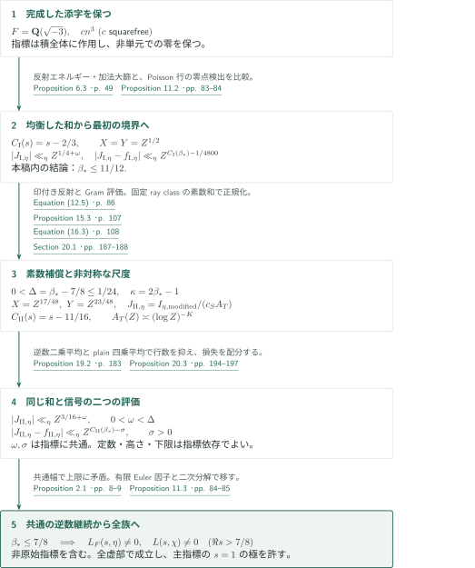
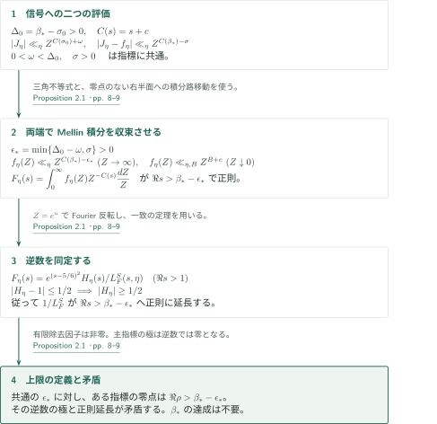
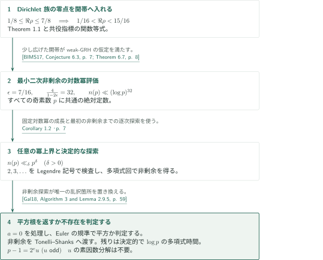

# The Quasi-Riemann Hypothesis: A Zero-Free Half-Plane Re s > 7/8

**完成した三次テータ和の二つの表示を、指標に共通の解析接続幅へつなぐ。**

本原稿は、アイゼンシュタイン体上の有限位数Hecke族について、反射公式から得る直接評価とPoisson表示から得る逆数のMellin積分を比較し、零点の実部の上限を押し下げる。まず無補償の和で $11/12$、次に素数による補償と二つのモーメント評価を加えて $7/8$ を得る構成である。以下は原稿の主張と証明経路の概説であり、長いモーメント帰納法を含む全証明の独立検証を意味しない。

## 1. 主要結果

### Theorem 1.1 — 有限位数Hecke族とDirichlet族の零点排除

$F=\mathbf Q(\sqrt{-3})$ とする。任意の非零整イデアルを法とする有限位数Hecke指標 $\eta$ に対し、$L_F(s,\eta)$ は

$$\Re s>\frac78$$

に零点を持たない。同じ結論が、任意の正整数を法とするすべてのDirichlet指標 $\chi$ の $L(s,\chi)$、特に法 $1$ の指標に対応する $\zeta(s)$ に成り立つ。主指標の $s=1$ における極は許す。

ここでHecke指標はray class groupの指標として、法と互いに素でないイデアルでは $0$ に延長する。指標は原始的でなくてもよく、導手の上限も虚部の制限もない。Hecke側の基礎体はこの固定された $F$ である。境界 $\Re s=7/8$ は結論に含まれない。従って実零点についても区間 $(7/8,1)$ は排除されるが、これは臨界線上への零点集中を主張するものではない。

<!-- cite:main-result -->[Theorem 1.1 · p. 4](https://github.com/openai/math/blob/1581d4cbdd69a0faf34b2089614fe2a814316a6a/preprints/The-Quasi-Riemann-Hypothesis-September-30-2026/paper.pdf)<!-- /cite -->

### Corollary 1.2 — 最小二次非剰余と決定的平方根抽出

絶対定数 $A,C>0$ が存在し、すべての奇素数 $p$ の最小正二次非剰余 $n(p)$ について

$$n(p)\le C(\log p)^A$$

が成り立つ。従って任意の $\delta>0$ に対して $n(p)\ll_\delta p^\delta$ である。また、二進表示で与えられた奇素数 $p$ と $a\in\mathbf F_p$ に対し、平方根を返すか平方根が存在しないと判定する、実行時間が $\log p$ の多項式で抑えられる決定的アルゴリズムが存在する。原稿の証明では $A=32$ を選べる。

<!-- cite:main-corollary -->[Corollary 1.2 · p. 7](https://github.com/openai/math/blob/1581d4cbdd69a0faf34b2089614fe2a814316a6a/preprints/The-Quasi-Riemann-Hypothesis-September-30-2026/paper.pdf)<!-- /cite -->

## 図の矢印に付した引用

<!-- reference-guide -->
略号のない定理・補題・節・式番号は本原稿 [The Quasi-Riemann Hypothesis: A Zero-Free Half-Plane Re s > 7/8](https://github.com/openai/math/blob/1581d4cbdd69a0faf34b2089614fe2a814316a6a/preprints/The-Quasi-Riemann-Hypothesis-September-30-2026/paper.pdf) を指します。外部入力には次の略号を使います。

- [DR24](https://arxiv.org/pdf/2109.07463v3) Alexander Dunn and Maksym Radziwiłł — *Bias in cubic Gauss sums: Patterson’s conjecture*：固定cuspの三次テータ係数と変換公式。arXiv:2109.07463v3, 14 May 2024。
- [GL13](https://arxiv.org/pdf/1112.1642v2) Leo Goldmakher and Benoît Louvel — *A quadratic large sieve inequality over number fields*：二次Hecke族の大篩。arXiv:1112.1642v2, 31 May 2012。
- [TZ19](https://arxiv.org/pdf/1803.02823v3) Jesse Thorner and Asif Zaman — *A unified and improved Chebotarev density theorem*：固定ray classの素数漸近と正規化。arXiv:1803.02823v3, 27 October 2018。
- [BIMS17](https://www.cse.iitk.ac.in/users/nitin/papers/irred-and-rth-root.pdf) Vishwas Bhargava, Gábor Ivanyos, Rajat Mittal, and Nitin Saxena — *Irreducibility and deterministic r-th root finding over finite fields*：weak-GRHから最小非剰余への帰結。ISSAC 2017 author manuscript, 8 PDF pages; no printed pagination。
- [Gal18](https://www.math.auckland.ac.nz/~sgal018/crypto-book/main.pdf) Steven D. Galbraith — *Mathematics of Public Key Cryptography*：非剰余取得後のTonelli–Shanks。Version 2.0, 31 October 2018。

各引用に結果番号とページを付します。誌面番号とPDF内の位置が異なる場合は両方を示します。GitHubの閲覧リンクではページ位置への自動移動を前提としません。
<!-- /reference-guide -->

BIMS17の著者公開稿は誌面のページ番号を持たないため、その引用のページはPDF内の位置を表す。その他のここで用いた版では、記録した箇所の誌面番号とPDF位置が一致する。

## 2. Theorem 1.1 の証明 — 二段階の和の比較と族全体への移行

<!-- proof-target:1 -->証明対象：[Theorem 1.1 · p. 4](https://github.com/openai/math/blob/1581d4cbdd69a0faf34b2089614fe2a814316a6a/preprints/The-Quasi-Riemann-Hypothesis-September-30-2026/paper.pdf)<!-- /proof-target -->

**証明の道筋。** 原始有限位数Hecke指標の全体について、$1/2$ と $1/2\le\Re\rho\le1$ にある零点の実部の上限を $\beta_*$ と置く。極はこの集合に含めない。Part Iは $\beta_*\le11/12$ を示し、Part IIはその上界の下で $\Delta=\beta_*-7/8>0$ を仮定して矛盾を導く。両段階を終える解析接続原理は次節で説明する。最後に有限Euler因子の除去と二次体の分解公式で、非原始Hecke指標とDirichlet指標へ移る。

### 1. 完成した添字を保つ反射と最初の半平面

基本のテータ和は、平方因子を持たない $c$ と一般の $n$ からなる添字 $cn^3$ を残す。両者が互いに素であるとは仮定しない。指標も $cn^3$ 全体に作用し、局所指数が $6$ の倍数でも非単元での値は $0$ のままである。Proposition 5.1は三つの固定cuspのテータ係数からこの零延長を保った反射を導く。反射後に現れる二次指標を二次大篩で評価し、完成した行の二乗平均を制御する。

<!-- cite:reflection -->[Proposition 5.1 · pp. 24–27; Equation (5.26) · p. 36](https://github.com/openai/math/blob/1581d4cbdd69a0faf34b2089614fe2a814316a6a/preprints/The-Quasi-Riemann-Hypothesis-September-30-2026/paper.pdf)<!-- /cite -->

$X=Y=Z^{1/2}$ としたPart Iでは、反射した行のエネルギーと、相異なる既約分数からなる加法多項式の二乗平均をCauchy–Schwarzで組み合わせる。Proposition 6.3は $I_\eta\ll_{\eta,\epsilon}Z^{1/4+\epsilon}$ を与える。一方、Poisson表示の非零周波数は $ua^6$（$u$ は六乗因子を持たない）に分かれる。零点検出器の逆数多項式とLemma 9.1の六次大篩を使って非主行を数え、主行 $u=1$ の留数を別に抽出する。これにより $C_{\mathrm I}(s)=s-2/3$ に対応する正規化和と信号が

$$|J_{\mathrm I,\eta}|\ll_\eta Z^{1/4+\omega},\qquad
|J_{\mathrm I,\eta}-f_{\mathrm I,\eta}|\ll_\eta Z^{\beta_*-2/3-1/4800}$$

を満たす。$\beta_*>11/12$ のとき $0<\omega<\beta_*-11/12$ を共通に選び、Proposition 2.1からTheorem 3.1を得る。ここで用いるTheorem 3.1は**この199ページ原稿内部の結果**であり、カタログ003の別の49ページ原稿を入力とする矢印ではない。

<!-- cite:balanced -->[Proposition 6.3 · p. 49; Lemma 9.1 · p. 61; Proposition 11.2 · pp. 83–84; Theorem 3.1, proof · p. 85](https://github.com/openai/math/blob/1581d4cbdd69a0faf34b2089614fe2a814316a6a/preprints/The-Quasi-Riemann-Hypothesis-September-30-2026/paper.pdf)<!-- /cite -->

### 2. 補償付き和の低い側と主行の正規化

Part IIでは $0<\Delta\le1/24$、$\kappa=2\beta_*-1=3/4+2\Delta\le5/6$ となる。幾何パラメータを

$$h=\frac{13}{16},\quad \ell=\frac16,\quad l_x=\frac{17}{48},\quad l_y=\frac{23}{48},\qquad X=Z^{l_x},\quad Y=Z^{l_y}$$

とし、**互いに重ならない素数窓**から素数を選ぶ。各素数 $\mathfrak p$ では、$\mathfrak p\mid cn^3$ という印を付けた項と尺度を変えた項との差を取る。この有限和を先に定義することが、低い側と高い側で同じ対象を比較するために必要になる。Proposition 15.3は、印付きの反射エネルギーと加法Gram評価から $I_{\eta,\mathrm{modified}}\ll Z^{3/16+\epsilon}$ を導く。

<!-- cite:compensated-low -->[Equation (12.5) · p. 86; Proposition 15.3 · p. 107](https://github.com/openai/math/blob/1581d4cbdd69a0faf34b2089614fe2a814316a6a/preprints/The-Quasi-Riemann-Hypothesis-September-30-2026/paper.pdf)<!-- /cite -->

高い側では、式(16.3)の完全な正則補正項を使ってから積分路を動かす。個別のEuler因子で割った式を、その因子の零点を越えて使うのではない。主行の留数に現れる素数和は、**固定した**ray classの素数定理により正の主項を持つ。偶数個 $K$ の窓を選ぶと、正規化因子 $A_T(Z)\asymp(\log Z)^{-K}$ は十分大きな $Z$ で非零である。$c_S>0$ と合わせて

$$J_{\mathrm{II},\eta}(Z)=\frac{I_{\eta,\mathrm{modified}}(Z)}{c_S A_T(Z)},\qquad C_{\mathrm{II}}(s)=s-\frac{11}{16}$$

とする。$A_T^{-1}$ の対数的損失を任意に小さい正の冪へ吸収すると $|J_{\mathrm{II},\eta}|\ll_{\eta,\epsilon} Z^{3/16+\epsilon}$。主行はこの同じ正規化で逆数 $1/L_F^S(s,\eta)$ のMellin信号になる。移動する導手に一様な素数漸近を仮定していない。

<!-- cite:normalization -->[Equation (16.3) · p. 108; Section 20.1 · pp. 187–188](https://github.com/openai/math/blob/1581d4cbdd69a0faf34b2089614fe2a814316a6a/preprints/The-Quasi-Riemann-Hypothesis-September-30-2026/paper.pdf)<!-- /cite -->

### 3. 二つの証人、多項式のモーメント、指数の余裕

零点検出器は、同じ行指標・同じ捻り高さで大きくなる、Möbius係数付き逆数多項式と係数なし多項式を同時に供給する。Lemma 17.1は逆数多項式と選択素数因子の二乗平均、Lemma 18.1は二つの係数なし多項式と選択素数因子の二乗平均を担う。後者を同じ係数なし証人の二つのコピーへ適用するため、行数評価の分母はその証人の**四乗**となる。

ここでは逆数多項式の列長を $Z^r$、行のノルム上限を $Z^m$、選択した素数slotの対数長の総和を $z$ とする。係数なし側では列長を $Z^{n_1},Z^{n_2}$ とし、表示された移動する指標因子の素数台の合併のノルムを $Z^q$ 以下とした有効幅が $M=m+q$ である。相殺前の台と零延長をこの幅に数える。

逆数側の長さ条件は $r+2z\le m-c_1$ と $2r+8z\le3m-c_2$（$c_1,c_2>0$）。係数なし側の正の素数長さ $z$ では $n_1+n_2+6\kappa z\le M$ が必要である。$\kappa<1$ の場合に必要な零点上界 $\beta_*\le(1+\kappa)/2$ は、ここでは $\kappa=2\beta_*-1$ の定義により等号で満たされる。$\kappa$ を早々に上界 $5/6$ に置き換えると、後の長さ配分を失う。

<!-- cite:moments -->[Lemma 17.1 · pp. 114–115; Lemma 18.1 · pp. 152–154](https://github.com/openai/math/blob/1581d4cbdd69a0faf34b2089614fe2a814316a6a/preprints/The-Quasi-Riemann-Hypothesis-September-30-2026/paper.pdf)<!-- /cite -->

二つのモーメントの帰納法は別物である。逆数側は二度の有限Poisson変換で行の長さを減らし、印付き反射エネルギーへ帰着する。係数なし側は有効幅を減らし、固定有限指標群 $\Theta$ を誘導する例外行を別扱いにする。正の素数因子がある評価ではその族を除外し、素数因子なしでは主指標だけを除外する。帰納法中の例外行では、同じ二つのprofile・同じ指標とmask・同じ尺度積を持つ二つの積の差を保持して主項を消す。この相殺を、任意の非中心化された積へ適用してはいけない。物理的な大きい行は $S$ 外で分岐するため $\Theta$ 外に入り、選択した素数因子は必要な係数条件を満たす。

<!-- cite:moment-reductions -->[Sections 17.5–17.6 · pp. 121, 142; Section 18.3 · p. 159; Section 18.8 · pp. 178–180; Section 19.2 · pp. 182–183](https://github.com/openai/math/blob/1581d4cbdd69a0faf34b2089614fe2a814316a6a/preprints/The-Quasi-Riemann-Hypothesis-September-30-2026/paper.pdf)<!-- /cite -->

Proposition 19.2がこれらの評価を行数へ変え、Lemma 20.1が行数と素数振幅を高い側の指数へ変える。Lemma 20.2の端点計算と各周波数範囲の処理から、実際の端点指数 $E_{\mathrm{actual}}(h)$ は

$$E_{\mathrm{actual}}(h)-\Delta\le-\frac{49}{440640}-\frac{51}{64}\Delta+\epsilon_{\mathrm{total}}$$

を満たす。比較する基準は $C(7/8)$ でなく $C(\beta_*)=C(7/8)+\Delta$ である。従って必要なのは右辺の負性であり、すべての $\Delta$ について $E_{\mathrm{actual}}(h)<0$ と主張してはいない。床のbin、小さい行、大きい行、$\delta=5/6$ の端点はそれぞれ別の評価で覆われる。

<!-- cite:high-exponents -->[Lemma 20.1 · pp. 189–190; Lemma 20.2 · pp. 192–193; Sections 20.3–20.5 · pp. 191–194](https://github.com/openai/math/blob/1581d4cbdd69a0faf34b2089614fe2a814316a6a/preprints/The-Quasi-Riemann-Hypothesis-September-30-2026/paper.pdf)<!-- /cite -->

### 4. 共通の解析接続幅とDirichlet族への移行

Proposition 20.3では、$\Delta$ に依存する幾何・損失・窓のmeshと個数・bin幅・正の余裕を**対象指標を固定する前**に選ぶ。その後 $\eta$ とその有限除外集合を固定し、有限の高さ次数 $A_\eta$、尺度次数 $B_\eta$ を確定してから $T_1=Z^{\tau_\eta}$ と外部の尾部次数 $N_\eta$ を選ぶ。Lemma 11.1が

$$|J-f|\ll_{\eta,N}Z^{C(\beta_*)-m}(1+T_1)^{A_\eta}+Z^{B_\eta}T_1^{-N}$$

を $|J-f|\ll_\eta Z^{C(\beta_*)-m/2}$ へ変える。$m>0$ は指標に共通だが、$\tau_\eta,N_\eta$、定数、開始尺度は指標依存でよい。$J$ と $f$ 自体は $T_1$ に依存しない。これでProposition 2.1が使え、$\beta_*\le7/8$ となる。

<!-- cite:choice-order -->[Lemma 11.1 · pp. 82–83; Proposition 20.3 · pp. 194–197](https://github.com/openai/math/blob/1581d4cbdd69a0faf34b2089614fe2a814316a6a/preprints/The-Quasi-Riemann-Hypothesis-September-30-2026/paper.pdf)<!-- /cite -->

非原始指標へは、有限個の因子 $1-\eta(\mathfrak p)(N\mathfrak p)^{-s}$ が $\Re s>0$ で非零であることを使う。Dirichlet指標 $\chi$ については $\eta(\mathfrak a)=\chi(N\mathfrak a)$ を取り、$3q$ を割る素数でEuler因子を除くと

$$L_F^{S_F}(s,\eta)=L^{S_{\mathbf Q}}(s,\chi)L^{S_{\mathbf Q}}(s,\chi\chi_{-3})$$

となる。$0<\Re s<1$ と $s=1+it$、$t\ne0$ では右辺の極による零点の相殺は起こらない。$s=1$ で片方が主指標なら、他方の原始指標は $\chi_{-3}$ であり、$L(1,\chi_{-3})=\pi/(3\sqrt3)>0$。この別処理によって主指標の極を許したまま、Dirichlet族・$\zeta$ の全虚部にわたる厳密な半平面の結論が得られる。

<!-- cite:transfer -->[Proposition 11.3 · pp. 84–85](https://github.com/openai/math/blob/1581d4cbdd69a0faf34b2089614fe2a814316a6a/preprints/The-Quasi-Riemann-Hypothesis-September-30-2026/paper.pdf)<!-- /cite -->

## 3. Proposition 2.1 の証明 — Mellin変換で逆数を延長する

<!-- proof-target:2 -->証明対象：[Proposition 2.1 · pp. 8–9](https://github.com/openai/math/blob/1581d4cbdd69a0faf34b2089614fe2a814316a6a/preprints/The-Quasi-Riemann-Hypothesis-September-30-2026/paper.pdf)<!-- /proof-target -->

<!-- statement:proposition-2-1 -->
### Proposition 2.1 — 共通の信号からの継続

$1/2<\sigma_0<1$、$\Delta_0=\beta_*-\sigma_0>0$、$C(s)=s+c$（固定した実数 $c$）とする。指標に依存しない $0<\omega<\Delta_0$、$\sigma>0$ があり、各原始有限位数Hecke指標 $\eta$ に対して有限集合 $S$、$\Re s>\sigma_0$ 上正則で $|H_\eta-1|\le1/2$ を満たす $H_\eta$、十分大きな実数 $Z$ 上の $J_\eta$ があるとする。

$$f_\eta(Z)=\frac{1}{2\pi i}\int_{\Re s=2}Z^{C(s)}e^{(s-5/6)^2}\frac{H_\eta(s)}{L_F^S(s,\eta)}\,ds$$

について $|J_\eta|\ll_\eta Z^{C(\sigma_0)+\omega}$、$|J_\eta-f_\eta|\ll_\eta Z^{C(\beta_*)-\sigma}$ が成り立つなら矛盾する。定数・下限・$S$・$H_\eta$ は指標依存でよい。

<!-- cite:continuation -->[Proposition 2.1 · pp. 8–9](https://github.com/openai/math/blob/1581d4cbdd69a0faf34b2089614fe2a814316a6a/preprints/The-Quasi-Riemann-Hypothesis-September-30-2026/paper.pdf)<!-- /cite -->
<!-- /statement -->

**証明の道筋。** 二つの評価から $f_\eta$ の成長次数を下げ、そのMellin変換をすべての指標に共通の半平面で収束させる。逆数との同定は、零点を横切る積分路の移動ではなく、$\Re s=2$ 上のFourier反転で行う。

### 1. 両端の評価と正則なMellin変換

$\epsilon_* =\min\{\Delta_0-\omega,\sigma\}>0$ と置くと、三角不等式は $|f_\eta(Z)|\ll_\eta Z^{C(\beta_*)-\epsilon_*}$ を与える。$Z\downarrow0$ では積分路を任意の固定した $B>2$ へ右に動かせるので $f_\eta(Z)\ll_{\eta,B}Z^{B+c}$。従って

$$F_\eta(s)=\int_0^\infty f_\eta(Z)Z^{-C(s)}\frac{dZ}{Z}$$

は $\Re s>\beta_*-\epsilon_*$ で局所一様に収束し正則になる。

<!-- cite:continuation -->[Proposition 2.1 · pp. 8–9](https://github.com/openai/math/blob/1581d4cbdd69a0faf34b2089614fe2a814316a6a/preprints/The-Quasi-Riemann-Hypothesis-September-30-2026/paper.pdf)<!-- /cite -->

### 2. 逆数との同定と上限への矛盾

$Z=e^u$ としたFourier反転から、まず $\Re s=2$ 上で $F_\eta(s)=e^{(s-5/6)^2}H_\eta(s)/L_F^S(s,\eta)$ を得て、$\Re s>1$ へ一致を延ばす。$|H_\eta|\ge1/2$ なので、$e^{-(s-5/6)^2}F_\eta/H_\eta$ が逆数の正則延長を与える。しかも $\epsilon_*$ は指標に共通である。$\beta_*$ が最大値として達成される必要はなく、その定義から実部が $\beta_*-\epsilon_*$ より大きい零点を持つ指標が存在し、逆数の極と矛盾する。元の $L$ の主極は逆数の零点となるため、この議論の障害ではない。

<!-- cite:continuation -->[Proposition 2.1 · pp. 8–9](https://github.com/openai/math/blob/1581d4cbdd69a0faf34b2089614fe2a814316a6a/preprints/The-Quasi-Riemann-Hypothesis-September-30-2026/paper.pdf)<!-- /cite -->

## 4. Corollary 1.2 の証明 — 零点帯から非剰余探索へ

<!-- proof-target:3 -->証明対象：[Corollary 1.2 · p. 7](https://github.com/openai/math/blob/1581d4cbdd69a0faf34b2089614fe2a814316a6a/preprints/The-Quasi-Riemann-Hypothesis-September-30-2026/paper.pdf)<!-- /proof-target -->

**証明の道筋。** Theorem 1.1をDirichlet関数の関数等式と合わせ、非自明零点を閉帯へ入れる。その帯を少し広げた開帯でweak-GRHの入力条件を満たし、最小非剰余の対数冪評価を得る。決定的な非剰余探索が平方根アルゴリズムの乱択部分を置き換える。

### 1. 開帯への余裕と二つの非剰余評価

原始Dirichlet指標の共役も同じ族に入るので、関数等式によって非自明零点は $1/8\le\Re\rho\le7/8$ に入る。これは $1/16<\Re\rho<15/16$ に含まれ、BIMS17のweak-GRHの条件を $\epsilon=7/16$ で満たす。Theorem 6.7の指数は $4/(1-2\epsilon)=32$ であり、奇素数 $p$ 全体に対する絶対定数付きの $n(p)\ll(\log p)^{32}$ を与える。有限個の小さい $p$ は定数へ吸収する。さらに固定した対数冪は任意の $p^\delta$ に対して $O_\delta(p^\delta)$ なので、第二の結論を得る。

<!-- cite:weak-grh -->[&#91;BIMS17, Conjecture 6.3, p. 7; Theorem 6.7, p. 8&#93;](https://www.cse.iitk.ac.in/users/nitin/papers/irred-and-rth-root.pdf#page=7)<!-- /cite -->

### 2. 平方根抽出の決定性と計算量

$a=0$ を先に処理し、$a\ne0$ はEulerの規準で平方か判定する。平方なら整数 $2,3,\ldots$ をLegendre記号で調べ、最初の非剰余を得るまで探索する。対数冪上界が探索回数を多項式で抑え、停止条件そのものは定数 $C$ の値を必要としない。得られた非剰余をTonelli–Shanksに渡すと、その後の処理は決定的で多項式時間となる。$p-1=2^e u$、$u$ 奇数、という分解には $2$ の因子だけを取り除けばよく、$u$ の素因数分解は要らない。

<!-- cite:square-root -->[&#91;Gal18, Algorithm 3 and Lemma 2.9.5, p. 59&#93;](https://www.math.auckland.ac.nz/~sgal018/crypto-book/main.pdf#page=59)<!-- /cite -->

## 5. どの論文が、どの段階を担うか

| 供給元と結果 | 利用箇所 | 使用内容・必要な仮定 | 確認範囲 |
|---|---|---|---|
| DR24の§5.1–5.2・Appendix A | Proposition 5.1、特にp.27 | 三つのcuspの三次テータ係数と変換則。GRHを仮定した素数漸近は使わない | 使用する公式とcusp 1・10・19を照合。反射公式全体の独立検証は未実施 |
| GL13のDefinition 1・Theorem 1.1 | §5.4、式(5.26) | 二次Hecke族の平方因子なしの大篩。原稿は原始導手・固定ray分割・相互法則の族条件を確認する | 入力定理とp.36の適用説明を照合。族構成の全局所計算は未再計算 |
| TZ19のTheorem 1.1 | Lemma 13.1、§20.1 | 固定したアーベル拡大の恒等Frobenius類の素数漸近。導手を動かした一様誤差は不要 | 定理の例外零点項も固定体では低次となること、正の正規化因子への使用を照合 |
| BIMS17のConjecture 6.3・Theorem 6.7 | Corollary 1.2 | 幅を固定したweak-GRHから最小非剰余を評価 | 開帯の条件・指数32と本稿の適用を照合 |
| Gal18のAlgorithm 3・Lemma 2.9.5 | Corollary 1.2 | 非剰余探索以外のTonelli–Shanksの決定的部分 | アルゴリズムと計算量証明の乱択箇所を照合 |

<!-- cite:external-theta -->[&#91;DR24, Sections 5.1–5.2, pp. 17–19; Appendix A, p. 78&#93;](https://arxiv.org/pdf/2109.07463v3#page=17)<!-- /cite -->

<!-- cite:external-sieve -->[&#91;GL13, Definition 1, pp. 1–2; Theorem 1.1, p. 2&#93;](https://arxiv.org/pdf/1112.1642v2#page=1)<!-- /cite -->

<!-- cite:external-primes -->[&#91;TZ19, Theorem 1.1, p. 2&#93;](https://arxiv.org/pdf/1803.02823v3#page=2)<!-- /cite -->

本稿§9の六次大篩と§§17–18のモーメント評価は本稿内で証明される入力である。先行する篩・再帰法との方法上の関係を、そのままカタログ内の他2本からの直接依存にはしない。読んだ主定理の帰着・終結箇所および参考文献には、その2本の利用を確認していない。全199ページを通した引用関係の網羅調査は未実施である。

## 6. 原典を読む入口と確認範囲

<!-- reading-list -->
- [Theorem 1.1 · p. 4](https://github.com/openai/math/blob/1581d4cbdd69a0faf34b2089614fe2a814316a6a/preprints/The-Quasi-Riemann-Hypothesis-September-30-2026/paper.pdf) — 対象となる族、厳密な半平面、主極を確認する
- [Proposition 2.1 · pp. 8–9](https://github.com/openai/math/blob/1581d4cbdd69a0faf34b2089614fe2a814316a6a/preprints/The-Quasi-Riemann-Hypothesis-September-30-2026/paper.pdf) — 共通の指数幅から逆数の解析接続へ進む
- [Proposition 6.3 · p. 49; Lemma 9.1 · p. 61; Proposition 11.2 · pp. 83–84; Theorem 3.1, proof · p. 85](https://github.com/openai/math/blob/1581d4cbdd69a0faf34b2089614fe2a814316a6a/preprints/The-Quasi-Riemann-Hypothesis-September-30-2026/paper.pdf) — 最初の低評価・高評価と原稿内部の11/12の終結
- [Equation (12.5) · p. 86; Proposition 15.3 · p. 107](https://github.com/openai/math/blob/1581d4cbdd69a0faf34b2089614fe2a814316a6a/preprints/The-Quasi-Riemann-Hypothesis-September-30-2026/paper.pdf) — 有限の補償操作と同じ物理和の低評価
- [Lemma 17.1 · pp. 114–115; Lemma 18.1 · pp. 152–154](https://github.com/openai/math/blob/1581d4cbdd69a0faf34b2089614fe2a814316a6a/preprints/The-Quasi-Riemann-Hypothesis-September-30-2026/paper.pdf) — 二つのモーメントの長さ・指標族・一様性条件
- [Lemma 20.1 · pp. 189–190; Lemma 20.2 · pp. 192–193; Sections 20.3–20.5 · pp. 191–194](https://github.com/openai/math/blob/1581d4cbdd69a0faf34b2089614fe2a814316a6a/preprints/The-Quasi-Riemann-Hypothesis-September-30-2026/paper.pdf) — 行数から高い側の指数へ進む端点・周波数の処理
- [Lemma 11.1 · pp. 82–83; Proposition 20.3 · pp. 194–197](https://github.com/openai/math/blob/1581d4cbdd69a0faf34b2089614fe2a814316a6a/preprints/The-Quasi-Riemann-Hypothesis-September-30-2026/paper.pdf) — 指標に共通の実パラメータと指標依存の高さの選択順
- [Proposition 11.3 · pp. 84–85](https://github.com/openai/math/blob/1581d4cbdd69a0faf34b2089614fe2a814316a6a/preprints/The-Quasi-Riemann-Hypothesis-September-30-2026/paper.pdf) — 非原始指標への移行とs=1の極の別処理
- [Corollary 1.2 · p. 7](https://github.com/openai/math/blob/1581d4cbdd69a0faf34b2089614fe2a814316a6a/preprints/The-Quasi-Riemann-Hypothesis-September-30-2026/paper.pdf) — 非剰余評価と決定的アルゴリズムへの全結論
<!-- /reading-list -->

編集側では、主張の仮定・範囲・極、Proposition 2.1の証明、最初の低評価と終結、補償付き低評価、主行の正規化、モーメントの記述と帰納法の入口・終結、行数から最終指数への接続、選択順、二次移行、Corollary 1.2の全結論を該当本文と照合した。上の外部入力は記述と使用箇所を確認したもので、その証明全体を再帰的に検証したものではない。

**未確認の核心は残る。** §§17–18のすべての有限Poisson変換・局所mask・帰納段階の一様性、Proposition 5.1の全変換計算、§§8–10のすべての検出器・積分路・尾部評価を独立に再検証していない。したがって、これらの入力が最終評価へ供給する一様な指数と有限高さ次数については、原稿の記述・使用条件を追った範囲に留まる。本記事は零点排除そのものを編集側で認定するものではない。
