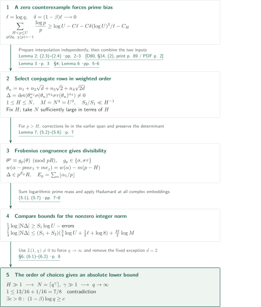
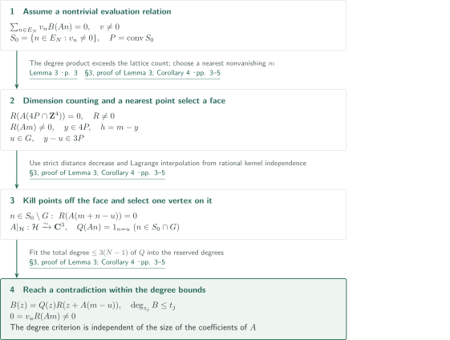

# Uniform exclusion of Landau–Siegel zeros

**Turn prime bias forced by a real zero into incompatible divisibility and size bounds for an interpolation determinant**

A zero too close to $1$ forces sufficient logarithmic mass on primes with $\chi(p)=-1$. The manuscript constructs a nonzero determinant from conjugates in a quartic field and compares divisibility at those primes with an Archimedean upper bound. The key points are interpolation constants independent of the field and a row selection that concentrates degree in one conjugate.

## 1. Main results

### Theorem 1 — A uniform zero gap on the logarithmic scale

The manuscript claims that an absolute constant $c>0$ exists such that, for every primitive nonprincipal real Dirichlet character $\chi$ of conductor $q\ge3$ and every real zero $\beta\in(0,1)$ of $L(s,\chi)$,
$$(1-\beta)\log q\ge c.$$
This excludes real zeros in a conductor-dependent interval of width $c/\log q$; it does not assert a complex zero-free half-plane of fixed width. The theorem specifies neither a numerical value nor effectivity for $c$.

<!-- cite:main-result -->[Theorem 1 · p. 1](https://github.com/openai/math/blob/1581d4cbdd69a0faf34b2089614fe2a814316a6a/preprints/Uniform-exclusion-of-Landau-Siegel-zeros-October-1-2026/paper.pdf)<!-- /cite -->

## References on the arrows

<!-- reference-guide -->
Unprefixed theorem, lemma, section and equation numbers refer to [Uniform exclusion of Landau–Siegel zeros](https://github.com/openai/math/blob/1581d4cbdd69a0faf34b2089614fe2a814316a6a/preprints/Uniform-exclusion-of-Landau-Siegel-zeros-October-1-2026/paper.pdf). External inputs use the following keys.

- [D80](https://page-one.springer.com/pdf/preview/10.1007/978-1-4757-5927-3_14) Harold Davenport; revised by Hugh L. Montgomery — *Multiplicative Number Theory*: Bound the logarithmic derivative for primitive characters by a zero sum; retain the real zero in Lemma 2. Second edition, Springer, 1980; publisher preview of §14, printed pp.88–89.

Each citation gives the result and pages. When printed pagination differs from the PDF position, both are shown. GitHub previews do not automatically jump to the cited page.
<!-- /reference-guide -->

## 2. Proof of Theorem 1 — Weighted row selection and a norm contradiction

<!-- proof-target:1 -->Proof target：[Theorem 1 · p. 1](https://github.com/openai/math/blob/1581d4cbdd69a0faf34b2089614fe2a814316a6a/preprints/Uniform-exclusion-of-Landau-Siegel-zeros-October-1-2026/paper.pdf)<!-- /proof-target -->

**Proof route.** Assume a counterexample sequence with $\delta=(1-\beta)\log q\to0$. Connect the prime-sum lower bound from a logarithmic derivative to a separately constructed determinant. A row order adapted to Frobenius congruences makes the leading coefficient $1$ in the norm lower bound compete with $3/4$ in the upper bound. Lemma 3, explained in the next section, supplies uniform interpolation.

### 1. A counterexample sequence and primes with negative character value

Put $\ell=\log q$ and $\delta=(1-\beta)\ell$. Primitivity allows the Hadamard product and functional equation to express the logarithmic derivative as a zero sum. For real $s>1$, every $\operatorname{Re}(s-\rho)^{-1}$ is nonnegative. Retain only $\beta$ and add $-\zeta'/\zeta(s)=1/(s-1)+O(1)$:
$$-\frac{\zeta'}\zeta(s)-\frac{L'}L(s,\chi)\le C\ell+\frac1{s-1}-\frac1{s-\beta}.$$
Taking $s=1+1/\log X$ and comparing the nonnegative Euler coefficients $\Lambda(n)(1+\chi(n))$ proves Lemma 2's bound $\sum_{p\le X,\,\chi(p)=1}\log p/p\ll\ell+\delta(\log X)^2/\ell$. Mertens' estimate then gives, for fixed $H\ge2$,
$$\sum_{\substack{H<p\le X\\p\nmid2q,\,\chi(p)=-1}}\frac{\log p}{p}\ge\log X-C\ell-C\frac{\delta(\log X)^2}{\ell}-C_H.$$
The zero-sum input was compared with D80, §14, (2). Lemma 2 derives the required prime sum within the manuscript.

<!-- cite:prime-bias -->[Lemma 2; (2.3)–(2.4) · pp. 2–3](https://github.com/openai/math/blob/1581d4cbdd69a0faf34b2089614fe2a814316a6a/preprints/Uniform-exclusion-of-Landau-Siegel-zeros-October-1-2026/paper.pdf)<!-- /cite -->

<!-- cite:log-derivative -->[&#91;D80, §14, (2), print p. 89 / PDF p. 2&#93;](https://page-one.springer.com/pdf/preview/10.1007/978-1-4757-5927-3_14)<!-- /cite -->

### 2. Field-uniform interpolation selects a nonzero determinant

Let $D$ be the fundamental discriminant corresponding to $\chi$ and write $\mathbf Q(\sqrt D)=\mathbf Q(\sqrt d)$ with $d$ squarefree. When $d\ne2$, put $a=\sqrt d$, $b=\sqrt2$, $K=\mathbf Q(a,b)$, and $R=\mathbf Z[a,b]$. Let $\sigma$ change the sign of $a$ and $\tau$ that of $b$. For $n\in E_N=\{0,\ldots,N-1\}^4$, set $\theta_n=n_1+n_2a+n_3b+n_4ab$. The map
$$An=(\theta_n,\sigma(\theta_n),\sigma\tau(\theta_n))$$
has kernel $\mathbf C(ab,b,-a,-1)$, whose coordinates are rationally independent.

Take integers $1\le H\le N$. With $U=N^{4/3}$ and $M=N^4=U^3$, Lemma 3 and Corollary 4 say that monomial evaluation rows of separate degree at most $32H^{2/3}U,32H^{-1/3}U,32H^{-1/3}U$ span the full column space. Scan all rows in increasing $w(\alpha)=\alpha_1+H\alpha_2+H\alpha_3$, retaining a row precisely when it increases rank. This gives $\Delta\in R\setminus\{0\}$. For fixed $H$ and $N$ sufficiently large in terms of $H$ alone, Lemma 6 bounds $S_1=\sum\alpha_1$ and $S_2=\sum(\alpha_2+\alpha_3)$ by
$$S_1\ge c_0MH^{2/3}U,\qquad S_2\le C_0MH^{-1/3}U,$$
so $S_2/S_1\ll H^{-1}$. The auxiliary interpolation coefficients do not enter $\Delta$, removing any need to bound their field-dependent size.

<!-- cite:determinant -->[§4; Lemma 6 · pp. 5–6](https://github.com/openai/math/blob/1581d4cbdd69a0faf34b2089614fe2a814316a6a/preprints/Uniform-exclusion-of-Landau-Siegel-zeros-October-1-2026/paper.pdf)<!-- /cite -->

### 3. Weight-decreasing row operations extract prime powers

If $p>H$, $p\nmid2q$, and $\chi(p)=-1$, then $\theta^p=g_p(\theta)$ in $R/pR$, where $g_p\in\{\sigma,\sigma\tau\}$. Write $\alpha_1=pk+r$ and replace the first factor by $\theta_n^r(\theta_n^p-g_p(\theta_n))^k$. Each correction row has weight lower by $m(p-H)>0$, hence lies in the $K$-span of earlier retained rows. The determinant is unchanged. Meanwhile each replacement entry belongs to $p^kR$, giving
$$\Delta\in p^{E_p}R,\qquad E_p=\sum_{\alpha\in P}\left\lfloor\frac{\alpha_1}{p}\right\rfloor.$$
The row-operation matrix need not be integral: divisibility follows directly from the replacement entries. Taking the nonzero integer norm and combining distinct primes, Lemma 2 and Chebyshev's estimate yield
$$\frac14\log|\mathrm N\Delta|\ge S_1\left(\log U-C\ell-C\frac{\delta(\log U)^2}{\ell}-C_H\right)-CMU.$$
For every complex embedding, $|\nu(\theta_n)|\le8N\sqrt q$, so Hadamard's inequality gives
$$\frac14\log|\mathrm N\Delta|\le\frac M2\log M+(S_1+S_2)\left(\log N+\tfrac12\ell+\log8\right).$$
The strict margin is $\log N=\tfrac34\log U$.

<!-- cite:divisibility -->[Lemma 7; (5.2)–(5.6) · p. 7](https://github.com/openai/math/blob/1581d4cbdd69a0faf34b2089614fe2a814316a6a/preprints/Uniform-exclusion-of-Landau-Siegel-zeros-October-1-2026/paper.pdf)<!-- /cite -->

<!-- cite:norm-bounds -->[(5.1), (5.7) · pp. 7–8](https://github.com/openai/math/blob/1581d4cbdd69a0faf34b2089614fe2a814316a6a/preprints/Uniform-exclusion-of-Landau-Siegel-zeros-October-1-2026/paper.pdf)<!-- /cite -->

### 4. Choose $H$, then $\gamma$, then take the counterexample limit

Negating the theorem gives a sequence with $\delta\to0$. Bounded conductors supply only finitely many characters, and $L(1,\chi)\ne0$ plus analyticity prevent their zeros from accumulating at $1$. Thus a subsequence has $q\to\infty$, also removing the fixed exceptional field $\mathbf Q(\sqrt2)$.

First fix an absolute large $H$ so that $S_2/S_1\le1/12$. Next set $N=\lceil q^\gamma\rceil$ and choose a fixed large $\gamma$ to control the term containing $\ell/\log U$. Only then let $q\to\infty$. Now $\delta\log U/\ell\to0$ and $C_H/\log U\to0$; Lemma 6 also makes $MU/(S_1\log U)$ and $M\log M/(S_1\log U)$ vanish. Equation (6.2) tends to the contradiction $1\le13/16+1/16=7/8$. This ordering establishes existence of an absolute positive lower bound, rather than a separate constant for each conductor.

<!-- cite:completion -->[§6; (6.1)–(6.2) · p. 8](https://github.com/openai/math/blob/1581d4cbdd69a0faf34b2089614fe2a814316a6a/preprints/Uniform-exclusion-of-Landau-Siegel-zeros-October-1-2026/paper.pdf)<!-- /cite -->

## 3. Proof of Lemma 3 — Uniform interpolation on a projected integer box

<!-- proof-target:2 -->Proof target：[Lemma 3 · p. 3](https://github.com/openai/math/blob/1581d4cbdd69a0faf34b2089614fe2a814316a6a/preprints/Uniform-exclusion-of-Landau-Siegel-zeros-October-1-2026/paper.pdf)<!-- /proof-target -->

<!-- statement:lemma-3 -->

### Lemma 3 — Surjectivity with separate degree bounds

Let $A:\mathbf C^4\to\mathbf C^3$ be surjective, with $\ker A=\mathbf Cc$, and suppose the four coordinates of $c$ are linearly independent over $\mathbf Q$. If integers $N\ge1$ and $t_1,t_2,t_3$ satisfy
$$t_j\ge3(N-1),\qquad\prod_{j=1}^3\bigl(t_j-3(N-1)+1\bigr)>(4N-3)^4,$$
then evaluation $B\mapsto(B(An))_{n\in E_N}$ maps polynomials with $\deg_{z_j}B\le t_j$ onto $\mathbf C^{E_N}$.

<!-- cite:interpolation -->[Lemma 3 · p. 3](https://github.com/openai/math/blob/1581d4cbdd69a0faf34b2089614fe2a814316a6a/preprints/Uniform-exclusion-of-Landau-Siegel-zeros-October-1-2026/paper.pdf)<!-- /cite -->
<!-- /statement -->

### 1. Push an evaluation relation onto a supporting face

Assume failure of surjectivity, giving a nonzero relation $\sum v_nB(An)=0$. Put $S_0=\{n\in E_N:v_n\ne0\}$ and $P=\operatorname{conv}S_0$. The product condition supplies a nonzero $R$, of separate degrees at most $t_j-3(N-1)$, vanishing at $A(4P\cap\mathbf Z^4)$. Choose an integer point $m$ with $R(Am)\ne0$ nearest to $4P$, let $y$ be its nearest point, and put $h=m-y$. A vertex $u$ on the supporting face $G$ can be selected with $y-u\in3P$. For $n\in S_0\setminus G$, the point $m+n-u$ is strictly closer to $4P$, so minimality forces $R(A(m+n-u))=0$.

### 2. Select a single vertex on the remaining face

The integer vertices of $G$ lie in a rational affine hyperplane $\mathcal H$. Rational independence of the kernel coordinates makes $A|_{\mathcal H}$ an affine isomorphism onto $\mathbf C^3$. Lagrange interpolation in three coordinates of its inverse gives $Q$, of total degree at most $3(N-1)$, selecting $u$ among points of $S_0\cap G$. Then $B(z)=Q(z)R(z+A(m-u))$ preserves the allowed separate degrees and reduces the relation to $0=v_uR(Am)\ne0$. The degree criterion does not involve the size of the coefficients of $A$, allowing the elongated degree box needed when $H$ is large.

<!-- cite:interpolation-proof -->[§3, proof of Lemma 3; Corollary 4 · pp. 3–5](https://github.com/openai/math/blob/1581d4cbdd69a0faf34b2089614fe2a814316a6a/preprints/Uniform-exclusion-of-Landau-Siegel-zeros-October-1-2026/paper.pdf)<!-- /cite -->

## 4. Which papers supply which steps

| Source and result | Used at | Role and hypotheses | Checking scope |
|---|---|---|---|
| D80, §14, (2) | Lemma 2, (2.3)–(2.4) | Primitive nonprincipal character, real $s>1$; nonnegative zero sum permits retaining one real zero | Publisher preview, printed p.89 / PDF p.2, compared with manuscript p.3 |
| Lemma 3 and Corollary 4 of this manuscript | Row selection in §4 | Rational independence of four kernel coordinates; field-independent separate degrees | Proof and application on pp.3–6 read |
| Lemma 7 of this manuscript | (5.6)–(5.7) | Weight decrease for $p>H$ and divisibility of replacement entries | Proof on pp.7–8 read |

<!-- cite:log-derivative -->[&#91;D80, §14, (2), print p. 89 / PDF p. 2&#93;](https://page-one.springer.com/pdf/preview/10.1007/978-1-4757-5927-3_14)<!-- /cite -->

Bost, Fischler, Laurent, and Philippon are cited for context. The main proof does not apply their general theorems: the manuscript establishes its required algebraic interpolation and divisibility estimates. No theorem from the 7/8 or 11/12 manuscripts appears as an input in the text.

## 5. Return to the sources

<!-- reading-list -->
- [Lemma 2; (2.3)–(2.4) · pp. 2–3](https://github.com/openai/math/blob/1581d4cbdd69a0faf34b2089614fe2a814316a6a/preprints/Uniform-exclusion-of-Landau-Siegel-zeros-October-1-2026/paper.pdf) — Convert the hypothetical zero into a prime-sum lower bound.
- [§3, proof of Lemma 3; Corollary 4 · pp. 3–5](https://github.com/openai/math/blob/1581d4cbdd69a0faf34b2089614fe2a814316a6a/preprints/Uniform-exclusion-of-Landau-Siegel-zeros-October-1-2026/paper.pdf) — Interpolation degree bounds independent of the map and field.
- [§4; Lemma 6 · pp. 5–6](https://github.com/openai/math/blob/1581d4cbdd69a0faf34b2089614fe2a814316a6a/preprints/Uniform-exclusion-of-Landau-Siegel-zeros-October-1-2026/paper.pdf) — Weighted selection and concentration of degree.
- [Lemma 7; (5.2)–(5.6) · p. 7](https://github.com/openai/math/blob/1581d4cbdd69a0faf34b2089614fe2a814316a6a/preprints/Uniform-exclusion-of-Landau-Siegel-zeros-October-1-2026/paper.pdf) — Extract prime powers while preserving the determinant.
- [§6; (6.1)–(6.2) · p. 8](https://github.com/openai/math/blob/1581d4cbdd69a0faf34b2089614fe2a814316a6a/preprints/Uniform-exclusion-of-Landau-Siegel-zeros-October-1-2026/paper.pdf) — Order the limits to obtain absolute constants and remove the exceptional field.
<!-- /reading-list -->

The complete proof text on pp.2–8 was read, comparing the theorem's quantifiers, Lemma 3's hypotheses, weighted row selection, Frobenius congruence, norm bounds, and ordering of parameter choices. The direct analytic input was checked against D80, §14, p.89. The full proof of Davenport's Hadamard-product formula, standard Mertens and Chebyshev estimates, and external proofs of $L(1,\chi)\ne0$ were not recursively verified. This does not constitute an independent recomputation of every auxiliary calculation or a certification of the complete claim.
