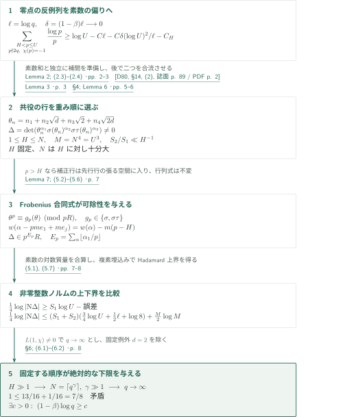
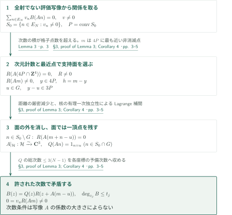

# Uniform exclusion of Landau–Siegel zeros

**実零点が強いる素数の偏りを、補間行列式の可除性と大きさの矛盾へ移す**

原稿は、実指標の零点が $1$ に近すぎれば $\chi(p)=-1$ の素数が十分な対数質量を持つことを使う。四次体の共役を評価点とする非零行列式を作り、その素数での可除性と複素絶対値の上界を比較する。補間に必要な定数を体に依存させないことと、行の次数を一つの共役へ偏らせることが核心となる。

## 1. 主要結果

### Theorem 1 — 対数尺度での一様な零点間隔

ある絶対定数 $c>0$ が存在し、すべての導手 $q\ge3$ の原始非主実Dirichlet指標 $\chi$ と、$L(s,\chi)$ のすべての実零点 $\beta\in(0,1)$ に対して
$$(1-\beta)\log q\ge c$$
が成り立つ、と原稿は主張する。これは導手に応じた幅 $c/\log q$ の実区間から零点を排除する命題であり、固定幅の複素無零半平面を主張するものではない。定理は $c$ の数値や有効性を明記していない。

<!-- cite:main-result -->[Theorem 1 · p. 1](https://github.com/openai/math/blob/1581d4cbdd69a0faf34b2089614fe2a814316a6a/preprints/Uniform-exclusion-of-Landau-Siegel-zeros-October-1-2026/paper.pdf)<!-- /cite -->

## 図の矢印に付した引用

<!-- reference-guide -->
略号のない定理・補題・節・式番号は本原稿 [Uniform exclusion of Landau–Siegel zeros](https://github.com/openai/math/blob/1581d4cbdd69a0faf34b2089614fe2a814316a6a/preprints/Uniform-exclusion-of-Landau-Siegel-zeros-October-1-2026/paper.pdf) を指します。外部入力には次の略号を使います。

- [D80](https://page-one.springer.com/pdf/preview/10.1007/978-1-4757-5927-3_14) Harold Davenport; revised by Hugh L. Montgomery — *Multiplicative Number Theory*：原始指標の対数微分を零点和で評価し、Lemma 2で実零点の項を残す。Second edition, Springer, 1980; publisher preview of §14, printed pp.88–89。

各引用に結果番号とページを付します。誌面番号とPDF内の位置が異なる場合は両方を示します。GitHubの閲覧リンクではページ位置への自動移動を前提としません。
<!-- /reference-guide -->

## 2. Theorem 1 の証明 — 重み付き行選択とノルムの矛盾

<!-- proof-target:1 -->証明対象：[Theorem 1 · p. 1](https://github.com/openai/math/blob/1581d4cbdd69a0faf34b2089614fe2a814316a6a/preprints/Uniform-exclusion-of-Landau-Siegel-zeros-October-1-2026/paper.pdf)<!-- /proof-target -->

**証明の道筋。** $\delta=(1-\beta)\log q\to0$ の反例列を仮定する。対数微分から得る素数和の下界と、独立に構成する行列式を接続する。Frobenius合同式に適した重みで行を選び、ノルムの下界の主係数 $1$ と上界の主係数 $3/4$ を比較する。補間の一様性は次節で示すLemma 3が供給する。

### 1. 反例列と負の指標値を持つ素数

$\ell=\log q$、$\delta=(1-\beta)\ell$ とおく。原始性の下でHadamard積と関数等式から得る零点和では、実 $s>1$ に対し各 $\operatorname{Re}(s-\rho)^{-1}$ が非負である。$\beta$ の項だけを残し、$-\zeta'/\zeta(s)=1/(s-1)+O(1)$ を加えると
$$-\frac{\zeta'}\zeta(s)-\frac{L'}L(s,\chi)\le C\ell+\frac1{s-1}-\frac1{s-\beta}.$$
$s=1+1/\log X$ として非負のEuler係数 $\Lambda(n)(1+\chi(n))$ と比較し、Lemma 2は $\sum_{p\le X,\,\chi(p)=1}\log p/p\ll\ell+\delta(\log X)^2/\ell$ を得る。Mertens評価を合わせると、固定 $H\ge2$ に対し
$$\sum_{\substack{H<p\le X\\p\nmid2q,\,\chi(p)=-1}}\frac{\log p}{p}\ge\log X-C\ell-C\frac{\delta(\log X)^2}{\ell}-C_H.$$
解析的入力の零点和評価はD80の§14, (2)と照合した。本稿のLemma 2はこの入力から必要な素数和を自ら導いている。

<!-- cite:prime-bias -->[Lemma 2; (2.3)–(2.4) · pp. 2–3](https://github.com/openai/math/blob/1581d4cbdd69a0faf34b2089614fe2a814316a6a/preprints/Uniform-exclusion-of-Landau-Siegel-zeros-October-1-2026/paper.pdf)<!-- /cite -->

<!-- cite:log-derivative -->[&#91;D80, §14, (2), 誌面 p. 89 / PDF p. 2&#93;](https://page-one.springer.com/pdf/preview/10.1007/978-1-4757-5927-3_14)<!-- /cite -->

### 2. 体に一様な補間から非零行列式を選ぶ

$\chi$ に対応する基本判別式を $D$、$\mathbf Q(\sqrt D)=\mathbf Q(\sqrt d)$、$d$ をsquarefreeとする。$d\ne2$ の場合、$a=\sqrt d$、$b=\sqrt2$、$K=\mathbf Q(a,b)$、$R=\mathbf Z[a,b]$ と置く。$\sigma$ は $a$ の符号、$\tau$ は $b$ の符号を変える。$E_N=\{0,\ldots,N-1\}^4$ の $n$ に対し $\theta_n=n_1+n_2a+n_3b+n_4ab$ とする。写像
$$An=(\theta_n,\sigma(\theta_n),\sigma\tau(\theta_n))$$
の核は $\mathbf C(ab,b,-a,-1)$ で、その座標は $\mathbf Q$ 上一次独立である。

整数 $1\le H\le N$ とする。Lemma 3とCorollary 4は、$U=N^{4/3}$、$M=N^4=U^3$ に対し、各次数上限 $32H^{2/3}U,32H^{-1/3}U,32H^{-1/3}U$ の単項式評価行が全列空間を張ることを与える。全単項式行を $w(\alpha)=\alpha_1+H\alpha_2+H\alpha_3$ の昇順に走査し、独立性を増す行だけを残す。こうして $\Delta\in R\setminus\{0\}$ を作る。残した指数に対する $S_1=\sum\alpha_1$、$S_2=\sum(\alpha_2+\alpha_3)$ は、$H$ を固定し $N$ を $H$ のみに依存して十分大きくすると、Lemma 6により
$$S_1\ge c_0MH^{2/3}U,\qquad S_2\le C_0MH^{-1/3}U,$$
したがって $S_2/S_1\ll H^{-1}$。補間の補助多項式の係数は $\Delta$ に入らないため、その体依存の大きさを評価する必要はない。

<!-- cite:determinant -->[§4; Lemma 6 · pp. 5–6](https://github.com/openai/math/blob/1581d4cbdd69a0faf34b2089614fe2a814316a6a/preprints/Uniform-exclusion-of-Landau-Siegel-zeros-October-1-2026/paper.pdf)<!-- /cite -->

### 3. 重みを下げる行操作が素数冪を取り出す

$p>H$、$p\nmid2q$、$\chi(p)=-1$ なら $R/pR$ で $\theta^p=g_p(\theta)$、$g_p\in\{\sigma,\sigma\tau\}$。$\alpha_1=pk+r$ として、第1因子を $\theta_n^r(\theta_n^p-g_p(\theta_n))^k$ に置き換える。展開の補正行の重みは $m(p-H)>0$ だけ小さい。そのためgreedyに選んだ前の行の $K$ 線形結合で補正でき、行列式は変わらない。他方、新しい行の成分自体が $p^kR$ に入るので
$$\Delta\in p^{E_p}R,\qquad E_p=\sum_{\alpha\in P}\left\lfloor\frac{\alpha_1}{p}\right\rfloor.$$
行操作行列の係数が整数である必要はない。可除性は置換後の行の成分から得る。非零整数 $\mathrm N_{K/\mathbf Q}(\Delta)$ に対して異なる素数の寄与を合算し、Lemma 2とChebyshev評価を使えば
$$\frac14\log|\mathrm N\Delta|\ge S_1\left(\log U-C\ell-C\frac{\delta(\log U)^2}{\ell}-C_H\right)-CMU.$$
一方、すべての複素埋込みで $|\nu(\theta_n)|\le8N\sqrt q$ なのでHadamard不等式は
$$\frac14\log|\mathrm N\Delta|\le\frac M2\log M+(S_1+S_2)\left(\log N+\tfrac12\ell+\log8\right)$$
を与える。ここで $\log N=\tfrac34\log U$ が厳密な余裕となる。

<!-- cite:divisibility -->[Lemma 7; (5.2)–(5.6) · p. 7](https://github.com/openai/math/blob/1581d4cbdd69a0faf34b2089614fe2a814316a6a/preprints/Uniform-exclusion-of-Landau-Siegel-zeros-October-1-2026/paper.pdf)<!-- /cite -->

<!-- cite:norm-bounds -->[(5.1), (5.7) · pp. 7–8](https://github.com/openai/math/blob/1581d4cbdd69a0faf34b2089614fe2a814316a6a/preprints/Uniform-exclusion-of-Landau-Siegel-zeros-October-1-2026/paper.pdf)<!-- /cite -->

### 4. $H$、$\gamma$、反例列の順で選ぶ

定理の否定から $\delta\to0$ の列を取る。導手有界なら指標は有限個で、各 $L(1,\chi)\ne0$ と解析性により零点は $1$ に集積できない。よって部分列で $q\to\infty$ とでき、固定された例外体 $\mathbf Q(\sqrt2)$ も消える。

まず $H$ を絶対的に大きく固定して $S_2/S_1\le1/12$ とする。次に $N=\lceil q^\gamma\rceil$ とし、固定した $\gamma$ を大きくして $\ell/\log U$ の項を抑える。その後で $q\to\infty$ とする。$\delta\log U/\ell\to0$、$C_H/\log U\to0$ であり、Lemma 6により $MU/(S_1\log U)$ と $M\log M/(S_1\log U)$ も消える。原稿の(6.2)は極限で $1\le13/16+1/16=7/8$ となって矛盾する。この順序により、$q$ ごとに選ぶ定数ではなく絶対的な正の下限の存在を得る。

<!-- cite:completion -->[§6; (6.1)–(6.2) · p. 8](https://github.com/openai/math/blob/1581d4cbdd69a0faf34b2089614fe2a814316a6a/preprints/Uniform-exclusion-of-Landau-Siegel-zeros-October-1-2026/paper.pdf)<!-- /cite -->

## 3. Lemma 3 の証明 — 射影された整数箱の一様補間

<!-- proof-target:2 -->証明対象：[Lemma 3 · p. 3](https://github.com/openai/math/blob/1581d4cbdd69a0faf34b2089614fe2a814316a6a/preprints/Uniform-exclusion-of-Landau-Siegel-zeros-October-1-2026/paper.pdf)<!-- /proof-target -->

<!-- statement:lemma-3 -->

### Lemma 3 — 座標別次数による評価写像の全射性

$A:\mathbf C^4\to\mathbf C^3$ を全射線形写像、$\ker A=\mathbf Cc$ とし、$c$ の4座標が $\mathbf Q$ 上一次独立であるとする。整数 $N\ge1$ と $t_1,t_2,t_3$ が
$$t_j\ge3(N-1),\qquad\prod_{j=1}^3\bigl(t_j-3(N-1)+1\bigr)>(4N-3)^4$$
を満たすとき、$\deg_{z_j}B\le t_j$ を満たす多項式の評価写像 $B\mapsto(B(An))_{n\in E_N}$ は $\mathbf C^{E_N}$ へ全射である。

<!-- cite:interpolation -->[Lemma 3 · p. 3](https://github.com/openai/math/blob/1581d4cbdd69a0faf34b2089614fe2a814316a6a/preprints/Uniform-exclusion-of-Landau-Siegel-zeros-October-1-2026/paper.pdf)<!-- /cite -->
<!-- /statement -->

### 1. 評価関係を支持面へ押し込む

全射でないと仮定し、非零係数 $v_n$ で $\sum v_nB(An)=0$ という関係を取る。$S_0=\{n\in E_N:v_n\ne0\}$、$P=\operatorname{conv}S_0$ と置く。次数の積の条件から、$R(Am)=0$（$m\in4P\cap\mathbf Z^4$）を満たす非零多項式 $R$ を、各次数 $t_j-3(N-1)$ 以下で選べる。$R(Am)\ne0$ となる整数点のうち $4P$ に最も近い $m$ を選び、最近点を $y$、$h=m-y$ とする。支持面 $G$ 上の頂点 $u$ を $y-u\in3P$ となるように選ぶ。$n\in S_0\setminus G$ では $m+n-u$ が $4P$ に厳密に近くなるため、最小性から $R(A(m+n-u))=0$。

### 2. 残った面で一頂点だけを選ぶ

整数頂点からなる $G$ は有理アフィン超平面 $\mathcal H$ に含まれる。核の座標の有理一次独立性により $A|_{\mathcal H}$ は $\mathbf C^3$ へのアフィン同型である。逆写像の3座標にLagrange補間を施し、$S_0\cap G$ 上で $u$ だけを選ぶ総次数 $3(N-1)$ 以下の $Q$ を作る。$B(z)=Q(z)R(z+A(m-u))$ は許された座標別次数を保ち、元の関係は $0=v_uR(Am)\ne0$ へ矛盾する。写像 $A$ の係数の大きさは次数条件に入らず、主証明で $H$ を大きくした長方形の次数領域を使える。

<!-- cite:interpolation-proof -->[§3, proof of Lemma 3; Corollary 4 · pp. 3–5](https://github.com/openai/math/blob/1581d4cbdd69a0faf34b2089614fe2a814316a6a/preprints/Uniform-exclusion-of-Landau-Siegel-zeros-October-1-2026/paper.pdf)<!-- /cite -->

## 4. どの論文が、どの段階を担うか

| 供給元と結果 | 利用箇所 | 使用内容・必要な仮定 | 確認範囲 |
|---|---|---|---|
| D80, §14, (2) | Lemma 2, (2.3)–(2.4) | 原始非主指標、実 $s>1$。零点和の非負性により実零点を一つ残す | 出版社previewの誌面p.89／PDF p.2と本稿p.3を照合 |
| 本稿Lemma 3・Corollary 4 | §4の行選択 | 核の4座標の有理一次独立、体に依存しない座標別次数 | 本文pp.3–6の証明と適用を読解 |
| 本稿Lemma 7 | (5.6)–(5.7) | $p>H$ の重み減少と置換行の成分の可除性 | 本文pp.7–8を読解 |

<!-- cite:log-derivative -->[&#91;D80, §14, (2), 誌面 p. 89 / PDF p. 2&#93;](https://page-one.springer.com/pdf/preview/10.1007/978-1-4757-5927-3_14)<!-- /cite -->

Bost、Fischler、Laurent、Philipponの文献は原稿が位置づけを説明するために引用する。主証明がそれらの一般定理を適用しているわけではなく、本稿は必要な代数的補間と可除性を証明する。7/8版・11/12版からの定理入力も本文には現れない。

## 5. 原典を読む入口と確認範囲

<!-- reading-list -->
- [Lemma 2; (2.3)–(2.4) · pp. 2–3](https://github.com/openai/math/blob/1581d4cbdd69a0faf34b2089614fe2a814316a6a/preprints/Uniform-exclusion-of-Landau-Siegel-zeros-October-1-2026/paper.pdf) — 零点の仮定を素数和の下界へ変換する。
- [§3, proof of Lemma 3; Corollary 4 · pp. 3–5](https://github.com/openai/math/blob/1581d4cbdd69a0faf34b2089614fe2a814316a6a/preprints/Uniform-exclusion-of-Landau-Siegel-zeros-October-1-2026/paper.pdf) — 写像や体に依存しない補間の次数条件。
- [§4; Lemma 6 · pp. 5–6](https://github.com/openai/math/blob/1581d4cbdd69a0faf34b2089614fe2a814316a6a/preprints/Uniform-exclusion-of-Landau-Siegel-zeros-October-1-2026/paper.pdf) — 重み付き選択と次数の偏り。
- [Lemma 7; (5.2)–(5.6) · p. 7](https://github.com/openai/math/blob/1581d4cbdd69a0faf34b2089614fe2a814316a6a/preprints/Uniform-exclusion-of-Landau-Siegel-zeros-October-1-2026/paper.pdf) — 行列式を保ったまま素数冪を取り出す。
- [§6; (6.1)–(6.2) · p. 8](https://github.com/openai/math/blob/1581d4cbdd69a0faf34b2089614fe2a814316a6a/preprints/Uniform-exclusion-of-Landau-Siegel-zeros-October-1-2026/paper.pdf) — 絶対定数と例外体を扱う極限の順序。
<!-- /reading-list -->

本稿の全証明本文pp.2–8を読み、主定理の量化、Lemma 3の仮定、重み付き行の選択、Frobenius合同式、ノルムの上下界、定数の選択順序を照合した。直接解析入力はD80の§14 p.89の記述と利用を確認した。D80のHadamard積の証明全体、標準的なMertens・Chebyshev評価および $L(1,\chi)\ne0$ の外部証明は再帰的に検証していない。すべての補助計算の独立再計算や主張全体の正しさの認定は行っていない。
