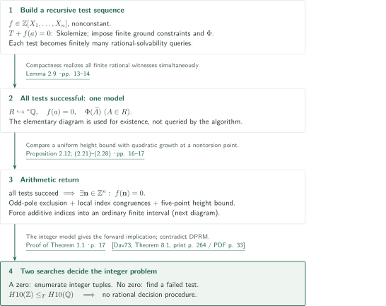
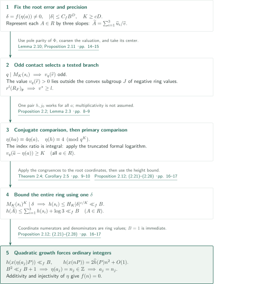
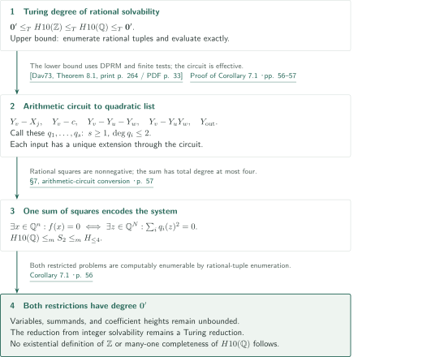

# Hilbert’s tenth problem over the rational numbers

**Finite rational tests, additive elliptic indices, and a uniform height contradiction**

The manuscript claims undecidability of rational polynomial solvability by a Turing reduction from integer solvability. Its argument does not construct an existential definition of the integers or a Diophantine model preserving multiplication. We distinguish the manuscript’s assertions from the inputs and applications checked for this account.

## 1. Main results

### Theorem 1.1 — Undecidability of rational solvability

There is no algorithm that, given $f\in\mathbb Z[X_1,\ldots,X_n]$, decides whether it has a zero in $\mathbb Q^n$. The number of variables $n$ is part of the input. The manuscript states this as a theorem without an additional conjectural assumption.

<!-- cite:main -->[Theorem 1.1 · p. 3](https://github.com/openai/math/blob/1581d4cbdd69a0faf34b2089614fe2a814316a6a/preprints/Hilberts-tenth-problem-over-the-rational-numbers-October-6-2026/main.pdf)<!-- /cite -->

### Corollary 7.1 — Turing degree and a quartic normal form

Under the usual effective coding, the set $H10(\mathbb Q)$ of integral polynomials with a rational zero has Turing degree $\mathbf0'$, the degree of the halting problem. The same holds for both restricted input problems:

1. Rational solvability of integral polynomials of total degree at most four.
2. Given a nonempty finite list $q_1,\ldots,q_s\in\mathbb Z[X_1,\ldots,X_N]$, each of total degree at most two, whether $\sum_{i=1}^s q_i^2$ has a rational zero.

There is no bound on the number of variables, the number of summands in (2), or coefficient heights.

<!-- cite:corollary -->[Corollary 7.1 · p. 56](https://github.com/openai/math/blob/1581d4cbdd69a0faf34b2089614fe2a814316a6a/preprints/Hilberts-tenth-problem-over-the-rational-numbers-October-6-2026/main.pdf)<!-- /cite -->

## References on the arrows

<!-- reference-guide -->
Unprefixed theorem, lemma, section and equation numbers refer to [Hilbert’s tenth problem over the rational numbers](https://github.com/openai/math/blob/1581d4cbdd69a0faf34b2089614fe2a814316a6a/preprints/Hilberts-tenth-problem-over-the-rational-numbers-October-6-2026/main.pdf). External inputs use the following keys.

- [OpenAI26P](https://github.com/openai/math/blob/1581d4cbdd69a0faf34b2089614fe2a814316a6a/preprints/A-pointwise-2-converse-for-elliptic-curves-with-rational-two-torsion-October-7-2026/paper.pdf) OpenAI — *A pointwise 2-converse for elliptic curves with rational two-torsion*: Finiteness of Sha from rational two-torsion and full 2-primary Selmer corank zero or one; direct input to Lemma 3.4. October 7, 2026; fixed commit 1581d4cbdd69a0faf34b2089614fe2a814316a6a.
- [OpenAI26F](https://github.com/openai/math/blob/1581d4cbdd69a0faf34b2089614fe2a814316a6a/preprints/Fontaine-Mazur-modularity-at-the-prime-2-October-6-2026/paper.pdf) OpenAI — *Fontaine–Mazur modularity at the prime 2*: Modularity of the odd regular two-dimensional 2-adic representation in §4.7, without residual-image restrictions. October 6, 2026; fixed commit 1581d4cbdd69a0faf34b2089614fe2a814316a6a.
- [Dav73](https://math.umd.edu/~mcl/Pubs/713/Diophantine.pdf) Martin Davis — *Hilbert’s tenth problem is unsolvable*: DPRM representation theorem used for undecidability and the degree of the integer problem. The American Mathematical Monthly 80(3) (1973), 233–269; source scan includes a leading JSTOR cover page.
- [PS99](https://math.mit.edu/~poonen/papers/sha.pdf) Bjorn Poonen; Michael Stoll — *The Cassels–Tate pairing on polarized abelian varieties*: Perfect alternating pairing on finite Sha and the rational-divisor condition on the polarization. Author version: November 6, 1998; minor correction August 23, 2014; published Annals of Mathematics 150 (1999), 1109–1149.

Each citation gives the result and pages. When printed pagination differs from the PDF position, both are shown. GitHub previews do not automatically jump to the cited page.
<!-- /reference-guide -->

## 2. Proof of Theorem 1.1 — Two searches through finite tests

<!-- proof-target:1 -->Proof target：[Theorem 1.1 · p. 3](https://github.com/openai/math/blob/1581d4cbdd69a0faf34b2089614fe2a814316a6a/preprints/Hilberts-tenth-problem-over-the-rational-numbers-October-6-2026/main.pdf)<!-- /proof-target -->

**Proof route.** For nonconstant $f$, construct a recursive sequence of finite tests such that integer solvability is equivalent to success of every test. Proposition 2.12, explained next, is the arithmetic core of the reverse implication. An oracle for rational solvability would decide each test; running integer-zero enumeration alongside a search for a failed test would then decide integer solvability.

### 1. Separate a first-order theory into finite existential queries

For fixed $F=\mathbb Q(\sqrt2)$, $d=75-53\sqrt2$, and $E:y^2=x^3-d^2x$, Proposition 2.1 supplies $m>0$ and a nontorsion point $P$ with $mE(F)=\mathbb ZP$. The theory $T$ requires a characteristic-zero integral domain $R$ with $\sqrt2\notin\operatorname{Frac}(R)$, assigning to each $a\in R$ a point $T_a\in mE(\operatorname{Frac}(R)(\sqrt2))$. It imposes $T_0=O,T_1=P,T_{a+a'}=T_a+T_{a'}$, and finite, nonzero coordinate conditions for nonzero $a$. Six $R$-valued functions record coordinate numerators and denominators.

For each ordinary integer $K\ge1$ and each $A\in R$, the theory also requires a three-slope representation $A=(u_1+u_2+u_3)/v$ and paired local comparisons at factors of the contact forms. The theory itself contains universal quantifiers; it does not define $R$ inside the rationals by one existential formula. The fixed finite data are independent of the input $f$ and can be hardcoded. Lemma 2.7 supplies an integer model with $T_a=aP$.

<!-- cite:theory -->[Proposition 2.1; §2.3; Lemma 2.7 · pp. 7, 11–12](https://github.com/openai/math/blob/1581d4cbdd69a0faf34b2089614fe2a814316a6a/preprints/Hilberts-tenth-problem-over-the-rational-numbers-October-6-2026/main.pdf)<!-- /cite -->

Adjoin $f(a)=0$, Skolemize, and enumerate ground terms. Assign rational variables to their values, and impose finite collections of constraints for ring operations, functionality on equal inputs, ground instances of universal axioms, and the positive existential condition $\Phi$ on every term value. Each finite collection is an existential Boolean combination of polynomial equations and inequations. Replacing $g\ne0$ by $gy=1$ and conjunctions by sums of squares reduces it to finitely many rational-solvability queries for integral polynomials. Auxiliary witnesses for $\Phi$ and inverse variables used in this translation are not added as new ground terms of the term-generated ring.

<!-- cite:tests -->[§2.4 · pp. 12–13](https://github.com/openai/math/blob/1581d4cbdd69a0faf34b2089614fe2a814316a6a/preprints/Hilberts-tenth-problem-over-the-rational-numbers-October-6-2026/main.pdf)<!-- /cite -->

### 2. Obtain a model from all successful tests and complete the failure search

An integer zero gives an integer model whose term values all satisfy $\Phi$, so every test succeeds. Conversely, if all tests succeed, compactness gives $R\hookrightarrow{}^*\mathbb Q$ and $f(a)=0$ inside one elementary extension of the ordinary structure carrying arithmetic, valuations, heights, and finite products. The elementary diagram is used only in this existence argument; the algorithm neither enumerates nor queries all true arithmetic sentences.

Proposition 2.12 extracts an ordinary integer zero from this model. Hence, when no integer zero exists, a finite test fails. Alternating the integer-zero enumeration with the failure search turns a hypothetical rational decision procedure into an integer decision procedure, contradicting DPRM. Constant polynomials are handled directly.

<!-- cite:compactness -->[Lemma 2.9 · pp. 13–14](https://github.com/openai/math/blob/1581d4cbdd69a0faf34b2089614fe2a814316a6a/preprints/Hilberts-tenth-problem-over-the-rational-numbers-October-6-2026/main.pdf)<!-- /cite -->

<!-- cite:termination -->[Proof of Theorem 1.1 · p. 17](https://github.com/openai/math/blob/1581d4cbdd69a0faf34b2089614fe2a814316a6a/preprints/Hilberts-tenth-problem-over-the-rational-numbers-October-6-2026/main.pdf)<!-- /cite -->

<!-- cite:dprm -->[&#91;Dav73, Theorem 8.1, print p. 264 / PDF p. 33&#93;](https://math.umd.edu/~mcl/Pubs/713/Diophantine.pdf#page=33)<!-- /cite -->

## 3. Proof of Proposition 2.12 — One error for every ring element

<!-- proof-target:2 -->Proof target：[Proposition 2.12; (2.21)–(2.28) · pp. 16–17](https://github.com/openai/math/blob/1581d4cbdd69a0faf34b2089614fe2a814316a6a/preprints/Hilberts-tenth-problem-over-the-rational-numbers-October-6-2026/main.pdf)<!-- /proof-target -->

<!-- statement:proposition-2-12 -->
### Proposition 2.12 — From all successful finite tests to an integer zero

Let $f\in\mathbb Z[X_1,\ldots,X_n]$ be nonconstant. If every finite system of rational constraints constructed for $f$ in §2.4 is solvable, then $f$ has a zero in $\mathbb Z^n$.

<!-- cite:height-contradiction -->[Proposition 2.12; (2.21)–(2.28) · pp. 16–17](https://github.com/openai/math/blob/1581d4cbdd69a0faf34b2089614fe2a814316a6a/preprints/Hilberts-tenth-problem-over-the-rational-numbers-October-6-2026/main.pdf)<!-- /cite -->
<!-- /statement -->

Tildes denote images in the elementary extension. The rule $\widetilde T_a=\eta(a)P$ defines an injective additive map $\eta:R\to{}^*\mathbb Z$ with $\eta(1)=1$, but multiplication is not yet preserved. For the fixed root $a=(a_j)$ put

$$\delta=f(\eta(a_1),\ldots,\eta(a_n)),\quad B=\max(1,|\eta(a_1)|,\ldots,|\eta(a_n)|),\quad D=\max(1,\deg f).$$

If $\delta=0$, elementarity already gives an ordinary integer zero. The diagram treats $\delta\ne0$.

### 1. Connect odd contact to a tested localization

Theorem 2.4 supplies five fixed points $C\subset\mathbb P^1(\mathbb Q)$ including infinity, a finite exceptional prime set $S$, and $H,c>0$. Choose primitive integral linear forms $L_b$ vanishing at these points. For $s=(u:v)\notin C$ set

$$M_S(s)=\prod_{q\notin S\, :\, \exists b\in C,\ v_q(L_b(u,v))-\min(v_q(u),v_q(v))\text{ odd}}q,\qquad h(s)\le HM_S(s)^c.$$

Here $h$ is logarithmic Weil height and the product has no repetitions. Enlarging the exceptional set changes only the constant, not $c$. Fix one ordinary $K\ge cD$ and choose representations for every $A\in R$ at this precision. Contact-form values have the shape $\varepsilon kr$, with $k$ in a fixed finite set; a contact prime $q$ makes the valuation of some $\widetilde r$ odd.

<!-- cite:five-point -->[Theorem 2.4; Corollary 2.5 · pp. 9–10](https://github.com/openai/math/blob/1581d4cbdd69a0faf34b2089614fe2a814316a6a/preprints/Hilberts-tenth-problem-over-the-rational-numbers-October-6-2026/main.pdf)<!-- /cite -->

The condition $\Phi$ holds on all integers and makes negative valuations outside $S_1$ even; it does not define integrality. Since every ring value satisfies $\Phi$, every ring valuation lying in the convex subgroup $J\subset{}^*\mathbb Z$ generated by negative ring valuations is even. Thus the odd value $v_q(\widetilde r)$ lies outside $J$ and is positive in the quotient valuation. Its center is one of the two branches of $R_F/rR_F\simeq(R/rR)^2$. Lemma 2.10 converts divisibility by $r^l$ in that tested localization into the actual extended-valuation bound $v^*\ge l$. The ring is not assumed to be $q$-integral at the start.

<!-- cite:branch -->[Lemma 2.10; Proposition 2.11 · pp. 14–15](https://github.com/openai/math/blob/1581d4cbdd69a0faf34b2089614fe2a814316a6a/preprints/Hilberts-tenth-problem-over-the-rational-numbers-October-6-2026/main.pdf)<!-- /cite -->

### 2. Use the conjugate comparison to establish integrality of the index ratio first

At the selected branch, the same nonzero $h,j_0\in R$ work for every $a\in R$. The formal-parameter comparison on the conjugate curve gives

$$\eta(ha)-4\eta(a)\equiv0\pmod{q^K},\qquad\eta(h)\equiv4\pmod{q^K}.$$

As $q\ne2$, the denominator $\eta(h)$ is a unit: $\eta(ha)/\eta(h)$ is integral and congruent to $\eta(a)$. Only after obtaining this integrality can one apply Proposition 2.2 to the truncated formal logarithm $\ell_K$ on the primary curve. Combining its estimate with the tested condition yields

$$v_q(\widetilde a-\eta(a))\ge K\quad(a\in R)$$

and integrality of $\widetilde a$. One never substitutes $\eta(ha)=\eta(h)\eta(a)$ by assuming multiplicativity. Transfer concerns evaluations of the fixed-degree polynomial $\ell_K$, not an infinite series in the elementary extension.

<!-- cite:local -->[Proposition 2.2; Lemma 2.3 · pp. 8–9](https://github.com/openai/math/blob/1581d4cbdd69a0faf34b2089614fe2a814316a6a/preprints/Hilberts-tenth-problem-over-the-rational-numbers-October-6-2026/main.pdf)<!-- /cite -->

### 3. Fix the root error and bound heights uniformly

Apply these congruences to the root coordinates at every contact prime of each slope $s_i=(\widetilde u_i:\widetilde v)$. They give $v_q(\delta)\ge K$, and transfer of finite-product divisibility gives $M_K(s_i)^K\mid\delta$. Since $|\delta|\le C_fB^D$,

$$h(s_i)\le H_K|\delta|^{c/K}\ll_f B,\qquad h(\widetilde A)\le\sum_{i=1}^3h(s_i)+\log3\ll_fB\quad(A\in R).$$

The constant is independent of $A$ and uniform in the root tuple. Apply the bound to the three ring values in $x(T_{a_j})=(x_0(a_j)+\sqrt2x_1(a_j))/x_2(a_j)$. For nonzero $a_j$ this gives $h(x(\eta(a_j)P))\ll_fB$. On the other hand, the canonical-height comparison at the fixed nontorsion point gives $h(x(nP))=2\widehat h(P)n^2+O(1)$ with $\widehat h(P)>0$. If $B>1$, choose a maximizing index to obtain $B^2\ll_fB+1$; the case $B=1$ is immediate. All indices therefore lie in an ordinary finite interval, so $\eta(a_j)=n_j\in\mathbb Z$. Additivity, $\eta(1)=1$, and injectivity force $a_j=n_j$, producing the ordinary integer zero.

<!-- cite:height-contradiction -->[Proposition 2.12; (2.21)–(2.28) · pp. 16–17](https://github.com/openai/math/blob/1581d4cbdd69a0faf34b2089614fe2a814316a6a/preprints/Hilberts-tenth-problem-over-the-rational-numbers-October-6-2026/main.pdf)<!-- /cite -->

## 4. Proof of Corollary 7.1 — Oracle reduction and arithmetic circuits

<!-- proof-target:3 -->Proof target：[Corollary 7.1 · p. 56](https://github.com/openai/math/blob/1581d4cbdd69a0faf34b2089614fe2a814316a6a/preprints/Hilberts-tenth-problem-over-the-rational-numbers-October-6-2026/main.pdf)<!-- /proof-target -->

We address [the three conclusions of Corollary 7.1](#corollary-7-1) in order. The parallel search above runs as a single machine with an $H10(\mathbb Q)$ oracle. The normal-form conversion is allowed to introduce more variables.

### 1. Bound the degree of rational solvability in both directions

DPRM makes the halting set Diophantine over the positive integers. Replace positive-integer witnesses by $1+u_1^2+u_2^2+u_3^2+u_4^2$ to obtain $\mathbf0'\le_T H10(\mathbb Z)$. The previous argument gives $H10(\mathbb Z)\le_T H10(\mathbb Q)$. Rational-tuple enumeration makes $H10(\mathbb Q)$ computably enumerable, giving the opposite upper bound. The arithmetic constants are hardcoded in one oracle machine, not chosen separately for each $f$.

<!-- cite:dprm -->[&#91;Dav73, Theorem 8.1, print p. 264 / PDF p. 33&#93;](https://math.umd.edu/~mcl/Pubs/713/Diophantine.pdf#page=33)<!-- /cite -->

<!-- cite:corollary-proof -->[Proof of Corollary 7.1 · pp. 56–57](https://github.com/openai/math/blob/1581d4cbdd69a0faf34b2089614fe2a814316a6a/preprints/Hilberts-tenth-problem-over-the-rational-numbers-October-6-2026/main.pdf)<!-- /cite -->

### 2. Record each operation by a quadratic equation

For every node in an arithmetic circuit for $f$, introduce a variable $Y_v$. Input, constant, sum, and product nodes give equations $Y_v-X_j=0$, $Y_v-c=0$, $Y_v-Y_u-Y_w=0$, and $Y_v-Y_uY_w=0$, respectively. Impose $Y_{\mathrm{out}}=0$ at the output. The resulting nonempty quadratic list $(q_i)$ uniquely extends every rational input tuple through the circuit equations. Nonnegativity of rational squares gives

$$\exists x\in\mathbb Q^n:f(x)=0\iff\exists z\in\mathbb Q^N:\bigwedge_iq_i(z)=0\iff\exists z\in\mathbb Q^N:\sum_iq_i(z)^2=0.$$

Consequently $H10(\mathbb Q)\le_m S_2\le_m H_{\le4}$. Both restricted problems are also computably enumerable and hence have degree $\mathbf0'$. The arrow from the integer problem to the rational problem remains a Turing reduction: neither many-one completeness of $H10(\mathbb Q)$ nor a single existential definition of $\mathbb Z\subset\mathbb Q$ follows. In $S_2$, the list presenting the sum of squares is part of the input, so recognizing such a presentation is unnecessary.

<!-- cite:normal-form -->[§7, arithmetic-circuit conversion · p. 57](https://github.com/openai/math/blob/1581d4cbdd69a0faf34b2089614fe2a814316a6a/preprints/Hilberts-tenth-problem-over-the-rational-numbers-October-6-2026/main.pdf)<!-- /cite -->

## 5. Which papers supply which steps

| Source and result | Used at | Role and required hypotheses | Checking scope |
|---|---|---|---|
| Pointwise 2-converse: citation below | Lemma 3.4; Proposition 2.8 | Full rational two-torsion of $E_l:y^2=x(x-l)(x+3l)$ and $s_2(E_l)\le1$ give finiteness of the whole Sha | Input Theorem 1.1 and the application on pp. 23–24 checked; its proof belongs to a separate article |
| Poonen–Stoll: citation below | Lemma 3.4 | Alternation for the principal polarization from the rational divisor $(O)$; a perfect alternating pairing on the finite 2-primary group forces $\dim\operatorname{Sha}[2]$ even | Author version §1 and the application hypotheses checked |
| Fontaine–Mazur at 2: citation below | §4.7 | Modularity of continuous, irreducible, odd, finitely ramified two-dimensional representations that are de Rham at 2 with distinct weights | Input Theorem 1.1 and hypothesis checks on p. 39 compared; no residual-image assumption |
| Davis: citation below | End of Theorem 1.1; Corollary 7.1 | Diophantine representation of computably enumerable sets and the degree of integer solvability | Theorem 8.1 and the change from positive-integer to integer witnesses checked |

<!-- cite:pointwise -->[&#91;OpenAI26P, Theorem 1.1, p. 2&#93;](https://github.com/openai/math/blob/1581d4cbdd69a0faf34b2089614fe2a814316a6a/preprints/A-pointwise-2-converse-for-elliptic-curves-with-rational-two-torsion-October-7-2026/paper.pdf)<!-- /cite -->

<!-- cite:pairing -->[&#91;PS99, §1, p. 2&#93;](https://math.mit.edu/~poonen/papers/sha.pdf#page=2)<!-- /cite -->

<!-- cite:fontaine -->[&#91;OpenAI26F, Theorem 1.1, p. 1&#93;](https://github.com/openai/math/blob/1581d4cbdd69a0faf34b2089614fe2a814316a6a/preprints/Fontaine-Mazur-modularity-at-the-prime-2-October-6-2026/paper.pdf)<!-- /cite -->

<!-- cite:dprm -->[&#91;Dav73, Theorem 8.1, print p. 264 / PDF p. 33&#93;](https://math.umd.edu/~mcl/Pubs/713/Diophantine.pdf#page=33)<!-- /cite -->

Integer witnesses for Proposition 2.8 realize one square class on two twists. The Selmer calculation in §3 gives $r+\dim_{\mathbb F_2}\operatorname{Sha}(E_l)[2]=1$. If the divisible part has corank $t$, then $t\le\dim\operatorname{Sha}[2]$, so $s_2=r+t\le1$ **before assuming finiteness**. The pointwise 2-converse then gives finiteness; the perfect alternating pairing forces $r=1$ and $\operatorname{Sha}[2]=0$, lifting the chosen Selmer class to a rational point. Apply the prime and square-class construction of Lemma 3.6 to both twists to obtain integer completeness of $\Phi$. Exclusion of negative odd valuations is the local calculation of Lemma 3.1. The unrestricted 2-converse is an alternative input in Remark 3.5, not an additional premise of the selected route.

<!-- cite:pole-input -->[Proposition 2.8; Lemmas 3.1, 3.4, 3.6 · pp. 12, 18–19, 23–26](https://github.com/openai/math/blob/1581d4cbdd69a0faf34b2089614fe2a814316a6a/preprints/Hilberts-tenth-problem-over-the-rational-numbers-October-6-2026/main.pdf)<!-- /cite -->

For Theorem 2.4, a cover ramified to order two at five points carries a family of quaternionic abelian surfaces. The odd-contact product $M$ controls ramification of the fiber. CM fibers have uniformly bounded height. In the non-CM case, resolving an isogeny descent obstruction produces a two-dimensional representation. Section 4.7 verifies irreducibility, oddness, and the de Rham condition before applying Fontaine–Mazur; the weights force weight two and Tate shift zero. Bounds $N\le CM^a$, $[L':\mathbb Q]\le CM$, the factorization $J_1(N)\sim_{L'}A\times D_0$, Jacobian-height bounds, and a quantitative isogeny estimate yield $h_F(A)\le CM^C$. Comparison with base height gives the required $h(s)\le HM^c$. This article does not independently verify all external theorems and constant estimates in that section.

<!-- cite:height-input -->[§4.7; Lemma 4.8; completion of Theorem 2.4 · pp. 39, 42–44](https://github.com/openai/math/blob/1581d4cbdd69a0faf34b2089614fe2a814316a6a/preprints/Hilberts-tenth-problem-over-the-rational-numbers-October-6-2026/main.pdf)<!-- /cite -->

Representations in the integer model come from the prime patterns of Lemma 6.1 and Corollary 6.2. For reduction-group orders $d_1,d_2$, the conditions $\gcd(d_1,d_2)\mid4$ and $r\nmid d_1d_2$ make $h\equiv0\pmod{d_1}$ and $h\equiv4\pmod{d_2r^K}$ compatible. They explain why the same $h,j_0=d_2$ work for every integer $a$. The full prime-pattern lower bound and the uniform sieve removing bad primes lie outside the checked scope.

<!-- cite:prime-input -->[Lemma 6.1; Corollary 6.2 · pp. 47–48](https://github.com/openai/math/blob/1581d4cbdd69a0faf34b2089614fe2a814316a6a/preprints/Hilberts-tenth-problem-over-the-rational-numbers-October-6-2026/main.pdf)<!-- /cite -->

## 6. Return to the sources

<!-- reading-list -->
- [§2.4 · pp. 12–13](https://github.com/openai/math/blob/1581d4cbdd69a0faf34b2089614fe2a814316a6a/preprints/Hilberts-tenth-problem-over-the-rational-numbers-October-6-2026/main.pdf) — Effectivity of finite tests and the scope of witness variables.
- [Proposition 2.2; Lemma 2.3 · pp. 8–9](https://github.com/openai/math/blob/1581d4cbdd69a0faf34b2089614fe2a814316a6a/preprints/Hilberts-tenth-problem-over-the-rational-numbers-October-6-2026/main.pdf) — Why the conjugate comparison first makes the index ratio integral.
- [Lemma 2.10; Proposition 2.11 · pp. 14–15](https://github.com/openai/math/blob/1581d4cbdd69a0faf34b2089614fe2a814316a6a/preprints/Hilberts-tenth-problem-over-the-rational-numbers-October-6-2026/main.pdf) — Select a tested branch using odd valuation and the center of a coarsening.
- [Proposition 2.12; (2.21)–(2.28) · pp. 16–17](https://github.com/openai/math/blob/1581d4cbdd69a0faf34b2089614fe2a814316a6a/preprints/Hilberts-tenth-problem-over-the-rational-numbers-October-6-2026/main.pdf) — Use one error δ for all ring values and compare with quadratic height growth.
- [Proposition 2.8; Lemmas 3.1, 3.4, 3.6 · pp. 12, 18–19, 23–26](https://github.com/openai/math/blob/1581d4cbdd69a0faf34b2089614fe2a814316a6a/preprints/Hilberts-tenth-problem-over-the-rational-numbers-October-6-2026/main.pdf) — Separate integer completeness from odd-pole exclusion.
- [§4.7; Lemma 4.8; completion of Theorem 2.4 · pp. 39, 42–44](https://github.com/openai/math/blob/1581d4cbdd69a0faf34b2089614fe2a814316a6a/preprints/Hilberts-tenth-problem-over-the-rational-numbers-October-6-2026/main.pdf) — The modularity, level, isogeny and base-height connections.
- [Lemma 6.1; Corollary 6.2 · pp. 47–48](https://github.com/openai/math/blob/1581d4cbdd69a0faf34b2089614fe2a814316a6a/preprints/Hilberts-tenth-problem-over-the-rational-numbers-October-6-2026/main.pdf) — The CRT construction of local witnesses working for all integers.
- [Proof of Corollary 7.1 · pp. 56–57](https://github.com/openai/math/blob/1581d4cbdd69a0faf34b2089614fe2a814316a6a/preprints/Hilberts-tenth-problem-over-the-rational-numbers-October-6-2026/main.pdf) — The different starting points of the Turing and many-one reductions.
<!-- /reading-list -->

The checked passages comprise the hypotheses and all conclusions of the main results; the finite tests, compactness, branch selection, index congruences, and height contradiction in §2; the Selmer-corank bound before the 2-converse in §3; the modularity connection in §4.7; the rank-one calculation and formal logarithm in §5; simultaneous local witnesses in §6; and each reduction direction in §7. The stated inputs from Pointwise 2-converse, Fontaine–Mazur, Davis, and Poonen–Stoll were compared with their source texts.

The complete Selmer-matrix calculations in §3; all external results and constants for the cover, descent, conductors, and heights in §4; the full prime-pattern and uniform-sieve proofs in §6; and a fresh source check of textbook inputs such as Silverman’s canonical-height comparison remain incomplete. Complete external proofs, expert peer review, and formal verification have not been undertaken. This account maps the manuscript’s argument and its checked scope; it does not independently certify the main claim.
