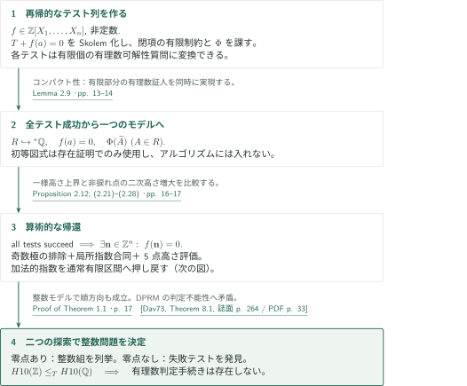
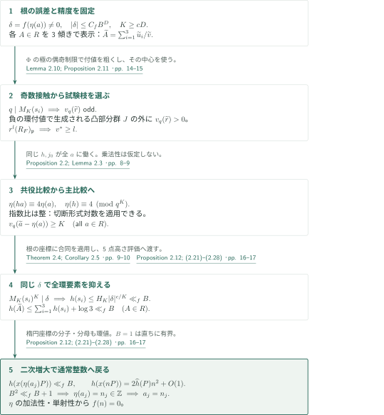
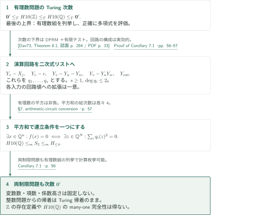

# Hilbert’s tenth problem over the rational numbers

**有限の有理数テスト、加法的な楕円曲線指数、一様な高さの矛盾**

本原稿は、有理数上の多項式可解性の判定不能性を、整数可解性からのTuring帰着によって主張する。整数全体の存在定義や、乗法まで保存するDiophantine modelを構成する論証ではない。以下では原稿の主張と、その直接入力・適用箇所を照合した範囲を区別する。

## 1. 主要結果

### Theorem 1.1 — 有理数可解性の判定不能性

整数係数多項式 $f\in\mathbb Z[X_1,\ldots,X_n]$ を入力し、$f$ が $\mathbb Q^n$ に零点を持つかを決定するアルゴリズムは存在しない。変数の個数 $n$ も入力の一部である。原稿はこの主張を追加の予想を仮定しない定理として述べる。

<!-- cite:main -->[Theorem 1.1 · p. 3](https://github.com/openai/math/blob/1581d4cbdd69a0faf34b2089614fe2a814316a6a/preprints/Hilberts-tenth-problem-over-the-rational-numbers-October-6-2026/main.pdf)<!-- /cite -->

### Corollary 7.1 — Turing次数と四次正規形

通常の実効的符号化で、有理数零点を持つ整数係数多項式の集合 $H10(\mathbb Q)$ のTuring次数は停止問題の次数 $\mathbf 0'$ に等しい。次の二つの入力制限でも同じ次数となる。

1. 総次数が高々4の整数係数多項式の有理数可解性。
2. 総次数が高々2の $q_1,\ldots,q_s\in\mathbb Z[X_1,\ldots,X_N]$ の空でない有限リストを入力し、$\sum_{i=1}^s q_i^2$ の有理数零点の存在を判定する問題。

変数数、(2)の項数、係数高さには上限を設けない。

<!-- cite:corollary -->[Corollary 7.1 · p. 56](https://github.com/openai/math/blob/1581d4cbdd69a0faf34b2089614fe2a814316a6a/preprints/Hilberts-tenth-problem-over-the-rational-numbers-October-6-2026/main.pdf)<!-- /cite -->

## 図の矢印に付した引用

<!-- reference-guide -->
略号のない定理・補題・節・式番号は本原稿 [Hilbert’s tenth problem over the rational numbers](https://github.com/openai/math/blob/1581d4cbdd69a0faf34b2089614fe2a814316a6a/preprints/Hilberts-tenth-problem-over-the-rational-numbers-October-6-2026/main.pdf) を指します。外部入力には次の略号を使います。

- [OpenAI26P](https://github.com/openai/math/blob/1581d4cbdd69a0faf34b2089614fe2a814316a6a/preprints/A-pointwise-2-converse-for-elliptic-curves-with-rational-two-torsion-October-7-2026/paper.pdf) OpenAI — *A pointwise 2-converse for elliptic curves with rational two-torsion*：有理2捩れと全2一次Selmer corankが0または1のときのSha有限性。Lemma 3.4への直接入力。October 7, 2026; fixed commit 1581d4cbdd69a0faf34b2089614fe2a814316a6a。
- [OpenAI26F](https://github.com/openai/math/blob/1581d4cbdd69a0faf34b2089614fe2a814316a6a/preprints/Fontaine-Mazur-modularity-at-the-prime-2-October-6-2026/paper.pdf) OpenAI — *Fontaine–Mazur modularity at the prime 2*：§4.7の奇・regularな2次元2進表現のモジュラー性。残余像の条件なし。October 6, 2026; fixed commit 1581d4cbdd69a0faf34b2089614fe2a814316a6a。
- [Dav73](https://math.umd.edu/~mcl/Pubs/713/Diophantine.pdf) Martin Davis — *Hilbert’s tenth problem is unsolvable*：整数問題の判定不能性と次数に使うDPRM表示定理。The American Mathematical Monthly 80(3) (1973), 233–269; source scan includes a leading JSTOR cover page。
- [PS99](https://math.mit.edu/~poonen/papers/sha.pdf) Bjorn Poonen; Michael Stoll — *The Cassels–Tate pairing on polarized abelian varieties*：有限Sha上の完全交代ペアリングと有理因子による偏極の条件。Author version: November 6, 1998; minor correction August 23, 2014; published Annals of Mathematics 150 (1999), 1109–1149。

各引用に結果番号とページを付します。誌面番号とPDF内の位置が異なる場合は両方を示します。GitHubの閲覧リンクではページ位置への自動移動を前提としません。
<!-- /reference-guide -->

## 2. Theorem 1.1 の証明 — 有限テストによる二つの探索

<!-- proof-target:1 -->証明対象：[Theorem 1.1 · p. 3](https://github.com/openai/math/blob/1581d4cbdd69a0faf34b2089614fe2a814316a6a/preprints/Hilberts-tenth-problem-over-the-rational-numbers-October-6-2026/main.pdf)<!-- /proof-target -->

**証明の道筋。** 非定数 $f$ から再帰的な有限テスト列を作り、「整数零点が存在する」と「すべてのテストが成功する」を同値にする。逆向きの算術的核心は次節のProposition 2.12である。各テストを有理数可解性のオラクルで決められれば、整数零点の列挙と失敗テストの探索を並行して整数問題を決定できる。

### 1. 一般一階理論を有限の存在的質問へ分解する

固定した $F=\mathbb Q(\sqrt2)$、$d=75-53\sqrt2$、$E:y^2=x^3-d^2x$ に対し、Proposition 2.1は $mE(F)=\mathbb ZP$ となる正整数 $m$ と非捩れ点 $P$ を供給する。理論 $T$ は標数0整域 $R$ に $\sqrt2\notin\operatorname{Frac}(R)$ を課し、各 $a\in R$ に $T_a\in mE(\operatorname{Frac}(R)(\sqrt2))$ を対応させる。$T_0=O,T_1=P,T_{a+a'}=T_a+T_{a'}$、非零 $a$ に対する有限・非零座標条件を課す。座標の分子・分母は六つの $R$ 値関数で記録する。

さらに各通常整数 $K\ge1$ と各 $A\in R$ について、$A=(u_1+u_2+u_3)/v$ という三つの傾きの表示と、接触形式の因子に対する二つの局所比較を要求する。理論そのものには全称量化があり、$R$ を有理数の中で単一の存在式により定義してはいない。固定有限データは入力 $f$ に依存せず、理論へ定数として組み込める。Lemma 2.7の整数モデルでは $T_a=aP$ である。

<!-- cite:theory -->[Proposition 2.1; §2.3; Lemma 2.7 · pp. 7, 11–12](https://github.com/openai/math/blob/1581d4cbdd69a0faf34b2089614fe2a814316a6a/preprints/Hilberts-tenth-problem-over-the-rational-numbers-October-6-2026/main.pdf)<!-- /cite -->

$f(a)=0$ を加えてSkolem化し、閉項を列挙する。各閉項へ有理数変数を割り当て、環演算、関数の同値な入力に対する整合性、全称公理の閉項代入、各項値の正の存在条件 $\Phi$ を有限個ずつ課す。有限部分は存在的な多項式等式・不等式のBoolean結合であり、$g\ne0$ を $gy=1$ へ、連言を平方和へ変換して、有限個の整数係数多項式の有理数可解性質問にできる。$\Phi$ の補助証人やこの逆元変数は項生成環の新しい閉項には加えない。

<!-- cite:tests -->[§2.4 · pp. 12–13](https://github.com/openai/math/blob/1581d4cbdd69a0faf34b2089614fe2a814316a6a/preprints/Hilberts-tenth-problem-over-the-rational-numbers-October-6-2026/main.pdf)<!-- /cite -->

### 2. 成功の全体からモデルを得て、失敗探索を完備にする

整数零点があれば整数モデルの全項値が $\Phi$ を満たし、すべてのテストは成功する。逆にすべて成功すれば、コンパクト性により、算術・付値・高さ・有限積を備えた通常構造の一つの初等拡大内に $R\hookrightarrow{}^*\mathbb Q$ と $f(a)=0$ を得る。ここで初等図式を使うのはモデルの存在証明のみであり、計算機が真の算術文を列挙したり照会したりするのではない。

Proposition 2.12はこのモデルから通常の整数零点を導く。したがって零点がなければ有限段階でテストが失敗する。整数零点列挙と失敗テスト探索を交互に進めると、仮定した有理数判定手続きから整数判定手続きを得てDPRMに矛盾する。定数多項式は直接処理する。

<!-- cite:compactness -->[Lemma 2.9 · pp. 13–14](https://github.com/openai/math/blob/1581d4cbdd69a0faf34b2089614fe2a814316a6a/preprints/Hilberts-tenth-problem-over-the-rational-numbers-October-6-2026/main.pdf)<!-- /cite -->

<!-- cite:termination -->[Proof of Theorem 1.1 · p. 17](https://github.com/openai/math/blob/1581d4cbdd69a0faf34b2089614fe2a814316a6a/preprints/Hilberts-tenth-problem-over-the-rational-numbers-October-6-2026/main.pdf)<!-- /cite -->

<!-- cite:dprm -->[&#91;Dav73, Theorem 8.1, 誌面 p. 264 / PDF p. 33&#93;](https://math.umd.edu/~mcl/Pubs/713/Diophantine.pdf#page=33)<!-- /cite -->

## 3. Proposition 2.12 の証明 — 同じ誤差をすべての環要素に使う

<!-- proof-target:2 -->証明対象：[Proposition 2.12; (2.21)–(2.28) · pp. 16–17](https://github.com/openai/math/blob/1581d4cbdd69a0faf34b2089614fe2a814316a6a/preprints/Hilberts-tenth-problem-over-the-rational-numbers-October-6-2026/main.pdf)<!-- /proof-target -->

<!-- statement:proposition-2-12 -->
### Proposition 2.12 — 全有限テストの成功から整数零点へ

$f\in\mathbb Z[X_1,\ldots,X_n]$ を非定数とする。原稿§2.4で $f$ から構成する有理数制約のすべての有限系が可解ならば、$f$ は $\mathbb Z^n$ に零点を持つ。

<!-- cite:height-contradiction -->[Proposition 2.12; (2.21)–(2.28) · pp. 16–17](https://github.com/openai/math/blob/1581d4cbdd69a0faf34b2089614fe2a814316a6a/preprints/Hilberts-tenth-problem-over-the-rational-numbers-October-6-2026/main.pdf)<!-- /cite -->
<!-- /statement -->

初等拡大への像にチルダを付ける。$\widetilde T_a=\eta(a)P$ によって得る $\eta:R\to{}^*\mathbb Z$ は単射・加法的で $\eta(1)=1$ だが、乗法保存はまだ分からない。固定された根 $a=(a_j)$ に対し

$$\delta=f(\eta(a_1),\ldots,\eta(a_n)),\quad B=\max(1,|\eta(a_1)|,\ldots,|\eta(a_n)|),\quad D=\max(1,\deg f)$$

と置く。$\delta=0$ なら初等性で通常整数の零点が得られる。図は $\delta\ne0$ の場合を示す。

### 1. 奇数接触を試験済みの局所環へ接続する

Theorem 2.4は、無限遠を含む固定5点 $C\subset\mathbb P^1(\mathbb Q)$、例外素数集合 $S$、$H,c>0$ を供給する。各点で消える原始整数一次形式 $L_b$ を選び、$s=(u:v)\notin C$ に対し

$$M_S(s)=\prod_{q\notin S\, :\, \exists b\in C,\ v_q(L_b(u,v))-\min(v_q(u),v_q(v))\text{ が奇数}}q,\qquad h(s)\le HM_S(s)^c.$$

$h$ は対数Weil高さで、積に重複はない。例外素数を有限個追加しても指数 $c$ は同じである。$K\ge cD$ を一つ固定し、すべての $A\in R$ の表示をこの精度で選ぶ。接触形式の値は $\varepsilon kr$（$k$ は固定有限集合）であり、接触素数 $q$ はある $\widetilde r$ の付値を奇数にする。

<!-- cite:five-point -->[Theorem 2.4; Corollary 2.5 · pp. 9–10](https://github.com/openai/math/blob/1581d4cbdd69a0faf34b2089614fe2a814316a6a/preprints/Hilberts-tenth-problem-over-the-rational-numbers-October-6-2026/main.pdf)<!-- /cite -->

$\Phi$ はすべての整数で成立し、$q\notin S_1$ での負の付値を偶数に制限するだけで、整数性そのものを定義しない。$R$ の各要素で $\Phi$ が成立することから、負の環付値が生成する凸部分群 $J\subset{}^*\mathbb Z$ に属する環付値はすべて偶数となる。したがって奇数の $v_q(\widetilde r)$ は $J$ の外にあり、商付値で正となる。その中心は、$R_F/rR_F\simeq(R/rR)^2$ の二つの枝の一つである。Lemma 2.10は、その試験済み局所環での $r^l$ 倍数条件を、実際の拡大付値での $v^*\ge l$ へ移す。$R$ が最初から $q$ 整であるとは仮定していない。

<!-- cite:branch -->[Lemma 2.10; Proposition 2.11 · pp. 14–15](https://github.com/openai/math/blob/1581d4cbdd69a0faf34b2089614fe2a814316a6a/preprints/Hilberts-tenth-problem-over-the-rational-numbers-October-6-2026/main.pdf)<!-- /cite -->

### 2. 共役側の比較が指数比の整性を先に与える

選ばれた枝では、同じ非零 $h,j_0\in R$ がすべての $a\in R$ に使える。共役曲線の形式パラメータ比較から

$$\eta(ha)-4\eta(a)\equiv0\pmod{q^K},\qquad\eta(h)\equiv4\pmod{q^K}$$

を得る。$q\ne2$ なので $\eta(h)$ は単元、$\eta(ha)/\eta(h)$ は整で $\eta(a)$ と合同である。この整性を得てから主曲線の切断形式対数 $\ell_K$ にProposition 2.2を適用し、試験条件と合わせて

$$v_q(\widetilde a-\eta(a))\ge K\quad(a\in R)$$

と $\widetilde a$ の整性を得る。指数写像の乗法性を使って $\eta(ha)=\eta(h)\eta(a)$ と置く操作は行わない。移送するのは固定次数の多項式 $\ell_K$ の評価であり、初等拡大上の無限級数ではない。

<!-- cite:local -->[Proposition 2.2; Lemma 2.3 · pp. 8–9](https://github.com/openai/math/blob/1581d4cbdd69a0faf34b2089614fe2a814316a6a/preprints/Hilberts-tenth-problem-over-the-rational-numbers-October-6-2026/main.pdf)<!-- /cite -->

### 3. 根の誤差を固定して高さを一様に抑える

各傾き $s_i=(\widetilde u_i:\widetilde v)$ のすべての接触素数で根の座標に上の合同を適用すると $v_q(\delta)\ge K$。有限積の移送から $M_K(s_i)^K\mid\delta$ となる。一方 $|\delta|\le C_fB^D$ なので

$$h(s_i)\le H_K|\delta|^{c/K}\ll_f B,\qquad h(\widetilde A)\le\sum_{i=1}^3h(s_i)+\log3\ll_fB\quad(A\in R).$$

この定数は $A$ に依存せず、根の組に対しても一様である。$x(T_{a_j})=(x_0(a_j)+\sqrt2x_1(a_j))/x_2(a_j)$ の三つの環値にも適用できるため、非零 $a_j$ について $h(x(\eta(a_j)P))\ll_fB$。他方、固定非捩れ点の標準高さ比較は $h(x(nP))=2\widehat h(P)n^2+O(1)$、$\widehat h(P)>0$ を与える。$B>1$ なら最大指数を選んで $B^2\ll_f B+1$、$B=1$ なら直ちに、全指数が通常有限区間に入る。したがって $\eta(a_j)=n_j\in\mathbb Z$。加法性・$\eta(1)=1$・単射性から $a_j=n_j$ となり、通常整数零点が得られる。

<!-- cite:height-contradiction -->[Proposition 2.12; (2.21)–(2.28) · pp. 16–17](https://github.com/openai/math/blob/1581d4cbdd69a0faf34b2089614fe2a814316a6a/preprints/Hilberts-tenth-problem-over-the-rational-numbers-October-6-2026/main.pdf)<!-- /cite -->

## 4. Corollary 7.1 の証明 — オラクル帰着と演算回路

<!-- proof-target:3 -->証明対象：[Corollary 7.1 · p. 56](https://github.com/openai/math/blob/1581d4cbdd69a0faf34b2089614fe2a814316a6a/preprints/Hilberts-tenth-problem-over-the-rational-numbers-October-6-2026/main.pdf)<!-- /proof-target -->

[Corollary 7.1の三つの結論](#corollary-7-1)を順に扱う。前節の並行探索は $H10(\mathbb Q)$ オラクルを用いる一つの機械として動く。正規形への変換では、新しい変数を増やすことを許す。

### 1. 有理数問題の次数を上下から決める

DPRMにより停止集合は正整数のDiophantine集合である。正整数証人を $1+u_1^2+u_2^2+u_3^2+u_4^2$ へ置き換えると $\mathbf0'\le_T H10(\mathbb Z)$。前節で $H10(\mathbb Z)\le_T H10(\mathbb Q)$、有理数組の列挙により $H10(\mathbb Q)$ は計算枚挙可能なので逆の上界も得る。固定算術データは $f$ ごとに選び直すのではなく、一つのオラクル機械へ組み込まれる。

<!-- cite:dprm -->[&#91;Dav73, Theorem 8.1, 誌面 p. 264 / PDF p. 33&#93;](https://math.umd.edu/~mcl/Pubs/713/Diophantine.pdf#page=33)<!-- /cite -->

<!-- cite:corollary-proof -->[Proof of Corollary 7.1 · pp. 56–57](https://github.com/openai/math/blob/1581d4cbdd69a0faf34b2089614fe2a814316a6a/preprints/Hilberts-tenth-problem-over-the-rational-numbers-October-6-2026/main.pdf)<!-- /cite -->

### 2. 各演算を二次方程式で記録する

$f$ の演算回路の各節点に変数 $Y_v$ を置き、入力・定数・和・積をそれぞれ $Y_v-X_j=0$、$Y_v-c=0$、$Y_v-Y_u-Y_w=0$、$Y_v-Y_uY_w=0$ で表す。出力には $Y_{\mathrm{out}}=0$ を課す。得られる非空の二次式リスト $(q_i)$ では、入力の各有理数組に対して回路方程式の拡張は一意である。平方の非負性から

$$\exists x\in\mathbb Q^n:f(x)=0\iff\exists z\in\mathbb Q^N:\bigwedge_iq_i(z)=0\iff\exists z\in\mathbb Q^N:\sum_iq_i(z)^2=0.$$

よって $H10(\mathbb Q)\le_m S_2\le_m H_{\le4}$。両制限問題も計算枚挙可能なので次数は $\mathbf0'$。ここで整数問題から有理数問題への矢印は依然としてTuring帰着であり、$H10(\mathbb Q)$ のmany-one完全性や、$\mathbb Z\subset\mathbb Q$ の単一の存在定義は結論ではない。$S_2$ は平方和のリストが入力される問題なので、その表示を認識する問題も生じない。

<!-- cite:normal-form -->[§7, arithmetic-circuit conversion · p. 57](https://github.com/openai/math/blob/1581d4cbdd69a0faf34b2089614fe2a814316a6a/preprints/Hilberts-tenth-problem-over-the-rational-numbers-October-6-2026/main.pdf)<!-- /cite -->

## 5. どの論文が、どの段階を担うか

| 供給元と結果 | 利用箇所 | 使用内容・必要な仮定 | 確認範囲 |
|---|---|---|---|
| Pointwise 2-converse：下記引用 | Lemma 3.4、Proposition 2.8 | $E_l:y^2=x(x-l)(x+3l)$ の全有理2捩れと $s_2(E_l)\le1$ から全Shaの有限性 | 入力Theorem 1.1とpp. 23–24の適用を照合。入力証明の再検証は別記事 |
| Poonen–Stoll：下記引用 | Lemma 3.4 | 有理因子 $(O)$ に由来する主偏極に対する交代性。有限2一次群の完全交代ペアリングから $\dim\operatorname{Sha}[2]$ は偶数 | 著者版§1と適用条件を照合 |
| Fontaine–Mazur at 2：下記引用 | §4.7 | 連続・既約・奇・有限分岐・2でde Rhamかつ相異なる重みの2次元表現のモジュラー性 | 入力Theorem 1.1とp. 39の仮定確認を照合。残余像の仮定はない |
| Davis：下記引用 | Theorem 1.1の終結、Corollary 7.1 | 計算枚挙可能集合のDiophantine表示と整数問題の次数 | Theorem 8.1、正整数証人と整数証人の変更を照合 |

<!-- cite:pointwise -->[&#91;OpenAI26P, Theorem 1.1, p. 2&#93;](https://github.com/openai/math/blob/1581d4cbdd69a0faf34b2089614fe2a814316a6a/preprints/A-pointwise-2-converse-for-elliptic-curves-with-rational-two-torsion-October-7-2026/paper.pdf)<!-- /cite -->

<!-- cite:pairing -->[&#91;PS99, §1, p. 2&#93;](https://math.mit.edu/~poonen/papers/sha.pdf#page=2)<!-- /cite -->

<!-- cite:fontaine -->[&#91;OpenAI26F, Theorem 1.1, p. 1&#93;](https://github.com/openai/math/blob/1581d4cbdd69a0faf34b2089614fe2a814316a6a/preprints/Fontaine-Mazur-modularity-at-the-prime-2-October-6-2026/paper.pdf)<!-- /cite -->

<!-- cite:dprm -->[&#91;Dav73, Theorem 8.1, 誌面 p. 264 / PDF p. 33&#93;](https://math.umd.edu/~mcl/Pubs/713/Diophantine.pdf#page=33)<!-- /cite -->

Proposition 2.8の整数側の証人は、二つのtwistに同じ平方類を実現することで作る。§3のSelmer計算は $r+\dim_{\mathbb F_2}\operatorname{Sha}(E_l)[2]=1$ を与える。可除部分のcorankを $t$ とすると $t\le\dim\operatorname{Sha}[2]$ なので、**有限性を先取りせず** $s_2=r+t\le1$ が従う。Pointwise 2-converseで有限性を得た後に完全交代ペアリングを使い、$r=1,\operatorname{Sha}[2]=0$ として選んだSelmer類を有理点へ持ち上げる。Lemma 3.6の素数・平方類の構成を両twistに適用して $\Phi$ の整数完全性を得る。一方、奇数の負付値の排除はLemma 3.1の局所計算である。一般の2-converseはRemark 3.5の代替入力で、採用経路の追加前提ではない。

<!-- cite:pole-input -->[Proposition 2.8; Lemmas 3.1, 3.4, 3.6 · pp. 12, 18–19, 23–26](https://github.com/openai/math/blob/1581d4cbdd69a0faf34b2089614fe2a814316a6a/preprints/Hilberts-tenth-problem-over-the-rational-numbers-October-6-2026/main.pdf)<!-- /cite -->

Theorem 2.4では、5点上で分岐指数2の被覆上に四元数乗法を持つアーベル曲面族を作る。奇数接触の積 $M$ がファイバーの分岐を制御し、CMの場合は高さを一様に抑える。非CMの場合はisogenyの降下障害を処理して2次元表現を得る。§4.7でその既約性・奇性・de Rham性を確認してFontaine–Mazurを使い、重みからweight 2かつTate twist 0とする。レベル $N\le CM^a$、$[L':\mathbb Q]\le CM$、$J_1(N)\sim_{L'}A\times D_0$、Jacobian高さと定量的isogeny評価を経て $h_F(A)\le CM^C$ を得る。底の高さとの比較が必要な $h(s)\le HM^c$ を与える。この節の全外部定理・定数評価は本記事で独立検証していない。

<!-- cite:height-input -->[§4.7; Lemma 4.8; completion of Theorem 2.4 · pp. 39, 42–44](https://github.com/openai/math/blob/1581d4cbdd69a0faf34b2089614fe2a814316a6a/preprints/Hilberts-tenth-problem-over-the-rational-numbers-October-6-2026/main.pdf)<!-- /cite -->

整数モデルの表示はLemma 6.1の素数パターンとCorollary 6.2から来る。還元群の位数 $d_1,d_2$ に対する $\gcd(d_1,d_2)\mid4$ と $r\nmid d_1d_2$ が、$h\equiv0\pmod{d_1}$、$h\equiv4\pmod{d_2r^K}$ を両立させ、同じ $h,j_0=d_2$ を全整数 $a$ に使える理由となる。素数パターンの下界と悪い素数を除く一様篩の全証明は確認範囲外である。

<!-- cite:prime-input -->[Lemma 6.1; Corollary 6.2 · pp. 47–48](https://github.com/openai/math/blob/1581d4cbdd69a0faf34b2089614fe2a814316a6a/preprints/Hilberts-tenth-problem-over-the-rational-numbers-October-6-2026/main.pdf)<!-- /cite -->

## 6. 原典を読む入口と確認範囲

<!-- reading-list -->
- [§2.4 · pp. 12–13](https://github.com/openai/math/blob/1581d4cbdd69a0faf34b2089614fe2a814316a6a/preprints/Hilberts-tenth-problem-over-the-rational-numbers-October-6-2026/main.pdf) — 有限テストの実効性と証人変数の範囲。
- [Proposition 2.2; Lemma 2.3 · pp. 8–9](https://github.com/openai/math/blob/1581d4cbdd69a0faf34b2089614fe2a814316a6a/preprints/Hilberts-tenth-problem-over-the-rational-numbers-October-6-2026/main.pdf) — 共役比較が指数比の整性を先に与える箇所。
- [Lemma 2.10; Proposition 2.11 · pp. 14–15](https://github.com/openai/math/blob/1581d4cbdd69a0faf34b2089614fe2a814316a6a/preprints/Hilberts-tenth-problem-over-the-rational-numbers-October-6-2026/main.pdf) — 奇数付値と粗い付値の中心で試験枝を選ぶ。
- [Proposition 2.12; (2.21)–(2.28) · pp. 16–17](https://github.com/openai/math/blob/1581d4cbdd69a0faf34b2089614fe2a814316a6a/preprints/Hilberts-tenth-problem-over-the-rational-numbers-October-6-2026/main.pdf) — 同じ誤差δを全環要素へ使い、二次高さ増大と比較する。
- [Proposition 2.8; Lemmas 3.1, 3.4, 3.6 · pp. 12, 18–19, 23–26](https://github.com/openai/math/blob/1581d4cbdd69a0faf34b2089614fe2a814316a6a/preprints/Hilberts-tenth-problem-over-the-rational-numbers-October-6-2026/main.pdf) — 存在条件の整数完全性と奇数極排除を分ける。
- [§4.7; Lemma 4.8; completion of Theorem 2.4 · pp. 39, 42–44](https://github.com/openai/math/blob/1581d4cbdd69a0faf34b2089614fe2a814316a6a/preprints/Hilberts-tenth-problem-over-the-rational-numbers-October-6-2026/main.pdf) — モジュラー性・レベル・isogeny・底高さの接続。
- [Lemma 6.1; Corollary 6.2 · pp. 47–48](https://github.com/openai/math/blob/1581d4cbdd69a0faf34b2089614fe2a814316a6a/preprints/Hilberts-tenth-problem-over-the-rational-numbers-October-6-2026/main.pdf) — 全整数に同時に働く局所証人のCRT構成。
- [Proof of Corollary 7.1 · pp. 56–57](https://github.com/openai/math/blob/1581d4cbdd69a0faf34b2089614fe2a814316a6a/preprints/Hilberts-tenth-problem-over-the-rational-numbers-October-6-2026/main.pdf) — Turing帰着とmany-one帰着の出発点の違い。
<!-- /reading-list -->

確認したのは、主結果の仮定と全結論、§2の有限テスト・コンパクト性・局所枝の選択・指数合同・高さ矛盾の本文、§3の2-converse適用前のcorank評価、§4.7のモジュラー性への接続、§5のrank-one計算と形式対数、§6の同時局所証人、§7の各帰着方向である。Pointwise 2-converse、Fontaine–Mazur、Davis、Poonen–Stollの上記入力記述を参照原典で照合した。

§3の全Selmer行列計算、§4の被覆・降下・導手・高さ評価の全外部結果と定数、§6の素数パターンと一様篩の全証明、および標準高さ比較を含むSilverman等の教科書入力の原典再照合は未完了である。外部定理の証明全体の検証、専門家査読、形式検証は行っていない。したがって本記事は原稿の論証と確認範囲を案内するもので、主張の正しさを独立に認定した表示ではない。
