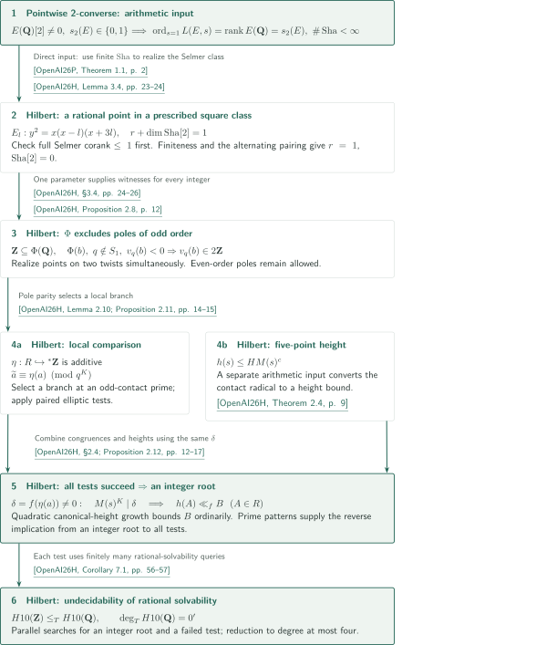

# Hilbert’s tenth problem over ℚ

**A pointwise 2-converse behind finite rational tests**

Catalogue 004 contains a manuscript on undecidability of rational solvability and a pointwise 2-converse for elliptic curves used to construct its local conditions. The final logical step is a Turing reduction from integer solvability to rational solvability; it does not establish an existential definition of the integers.

## 1. Papers in official catalogue order

CATALOGINVENTORYTOKEN

## References on the arrows

The following keys distinguish the two manuscripts. The diagram separates the direct input between manuscripts from subsequent uses within a single manuscript.

- **OpenAI26H**: OpenAI, *Hilbert’s tenth problem over the rational numbers*, October 6, 2026. Supplies finite rational tests, pole parity, the five-point contact-height bound and undecidability.

<!-- cite:hilbert-main -->[&#91;OpenAI26H, Theorem 1.1, p. 3&#93;](https://github.com/openai/math/blob/1581d4cbdd69a0faf34b2089614fe2a814316a6a/preprints/Hilberts-tenth-problem-over-the-rational-numbers-October-6-2026/main.pdf)<!-- /cite -->

- **OpenAI26P**: OpenAI, *A pointwise 2-converse for elliptic curves with rational two-torsion*, October 7, 2026. Supplies analytic and Mordell–Weil rank equality and finiteness of $\operatorname{Sha}$ when the full $2^\infty$-Selmer corank is zero or one.

<!-- cite:pointwise-main -->[&#91;OpenAI26P, Theorem 1.1, p. 2&#93;](https://github.com/openai/math/blob/1581d4cbdd69a0faf34b2089614fe2a814316a6a/preprints/A-pointwise-2-converse-for-elliptic-curves-with-rational-two-torsion-October-7-2026/paper.pdf)<!-- /cite -->

Printed pages agree with PDF positions. GitHub previews do not automatically jump to a cited page.

## 2. From a pointwise 2-converse to finite tests

### 1. Realizing a Selmer class by a prescribed rational point

The pointwise 2-converse directly enters Lemma 3.4 of the Hilbert manuscript. The curve is $E_l:y^2=x(x-l)(x+3l)$, and two-descent gives
\[
 r+\dim_{\mathbf F_2}\operatorname{Sha}(E_l/\mathbf Q)[2]=1.
\]
The proof first checks that the full $2^\infty$-Selmer corank is at most one. It then uses the finiteness of $\operatorname{Sha}$ supplied by the converse. Alternation of the Cassels–Tate pairing on the finite 2-primary group makes $\dim\operatorname{Sha}[2]$ even, giving $r=1$ and $\operatorname{Sha}[2]=0$. The selected Selmer class $\gamma=(\beta,1)$ is therefore represented by a rational point.

<!-- cite:hilbert-transfer -->[&#91;OpenAI26H, Lemma 3.4, pp. 23–24&#93;](https://github.com/openai/math/blob/1581d4cbdd69a0faf34b2089614fe2a814316a6a/preprints/Hilberts-tenth-problem-over-the-rational-numbers-October-6-2026/main.pdf)<!-- /cite -->

Lemma 3.6 supplies one parameter for two twists. Applying the rational-point conclusion to both gives a positive existential condition $\Phi$ that holds on every integer. Outside finitely many exceptional primes, $\Phi$ excludes poles of odd order but allows poles of even order. This one-sided condition is not a definition of $\mathbf Z$. See the [Hilbert article](../hilbert-tenth-rationals/article.en.md#dependencies) and the [2-converse article](../pointwise-2-converse-rational-two-torsion/article.en.md#results).

<!-- cite:hilbert-poles -->[&#91;OpenAI26H, Proposition 2.8, p. 12&#93;](https://github.com/openai/math/blob/1581d4cbdd69a0faf34b2089614fe2a814316a6a/preprints/Hilberts-tenth-problem-over-the-rational-numbers-October-6-2026/main.pdf)<!-- /cite -->

<!-- cite:hilbert-completion -->[&#91;OpenAI26H, §3.4, pp. 24–26&#93;](https://github.com/openai/math/blob/1581d4cbdd69a0faf34b2089614fe2a814316a6a/preprints/Hilberts-tenth-problem-over-the-rational-numbers-October-6-2026/main.pdf)<!-- /cite -->

### 2. Combining local comparisons and heights in one model

If all finite tests succeed, compactness produces a ring $R$ with a root in an elementary extension of the rational field. Its elliptic index map $\eta:R\hookrightarrow{}^*\mathbf Z$ is additive; multiplicativity has not been established. Pole parity selects an appropriate tested local branch at a contact prime, and paired elliptic local tests give congruences between ring values and their indices.

<!-- cite:hilbert-local -->[&#91;OpenAI26H, Lemma 2.10; Proposition 2.11, pp. 14–15&#93;](https://github.com/openai/math/blob/1581d4cbdd69a0faf34b2089614fe2a814316a6a/preprints/Hilberts-tenth-problem-over-the-rational-numbers-October-6-2026/main.pdf)<!-- /cite -->

Applying these congruences to the fixed root coordinates makes the $K$th power of each slope's contact radical divide the same $\delta=f(\eta(a))$. Together with the five-point estimate $h(s)\le H M(s)^c$, this yields a uniform height bound for all ring values when $\delta\ne0$. Quadratic growth of the elliptic canonical height forces the root indices into an ordinary finite interval; additivity and injectivity then recover an ordinary integer root. The prime-pattern construction supplies the ordinary model for the opposite implication: an integer root passes every test.

<!-- cite:hilbert-height -->[&#91;OpenAI26H, Theorem 2.4, p. 9&#93;](https://github.com/openai/math/blob/1581d4cbdd69a0faf34b2089614fe2a814316a6a/preprints/Hilberts-tenth-problem-over-the-rational-numbers-October-6-2026/main.pdf)<!-- /cite -->

<!-- cite:hilbert-tests -->[&#91;OpenAI26H, §2.4; Proposition 2.12, pp. 12–17&#93;](https://github.com/openai/math/blob/1581d4cbdd69a0faf34b2089614fe2a814316a6a/preprints/Hilberts-tenth-problem-over-the-rational-numbers-October-6-2026/main.pdf)<!-- /cite -->

### 3. Turning a hypothetical decision procedure into a contradiction

Assume a rational-solvability decider exists. Each finite test uses finitely many rational-solvability queries, so parallel searches for an integer zero and for a failed test would decide integer solvability. The proof distinguishes hardcoding finitely many fixed arithmetic data from computing them afresh for each input polynomial. The reduction and normalization to degree at most four are covered in the [Hilbert article](../hilbert-tenth-rationals/article.en.md#results).

<!-- cite:hilbert-degree -->[&#91;OpenAI26H, Corollary 7.1, pp. 56–57&#93;](https://github.com/openai/math/blob/1581d4cbdd69a0faf34b2089614fe2a814316a6a/preprints/Hilberts-tenth-problem-over-the-rational-numbers-October-6-2026/main.pdf)<!-- /cite -->

## 3. The direct input and its subsequent uses

| Input result | Used at | Role and conditions | Checking scope |
|---|---|---|---|
| Pointwise 2-converse, Theorem 1.1 | Hilbert, Lemma 3.4 | Nonzero rational two-torsion and full Selmer corank $\le1$ are checked before using finiteness of $\operatorname{Sha}$ | Statements and application passages checked in both sources |

The continuation through Proposition 2.8, local-branch selection and finite tests is a transitive route within the Hilbert manuscript. The 2-converse alone does not supply the height bound or effectiveness of the tests. Remark 3.5 of the Hilbert manuscript records replacement by a converse without the rational-two-torsion hypothesis; that alternative proof route is not checked here.

<!-- cite:hilbert-transfer -->[&#91;OpenAI26H, Lemma 3.4, pp. 23–24&#93;](https://github.com/openai/math/blob/1581d4cbdd69a0faf34b2089614fe2a814316a6a/preprints/Hilberts-tenth-problem-over-the-rational-numbers-October-6-2026/main.pdf)<!-- /cite -->

## 4. Sources and checking scope

The official subject is **Number theory**, covering entries 001–031. Entry 004 appears on p.2 of the *OpenAI Research Catalog*, in the manuscript order shown above. The official repository is fixed at commit `1581d4cbdd69a0faf34b2089614fe2a814316a6a`. The manuscript versions are October 6, 2026 and October 7, 2026 respectively.

<!-- cite:official -->[OpenAI Research Catalog · Catalogue 004 · p. 2](https://github.com/openai/math/blob/1581d4cbdd69a0faf34b2089614fe2a814316a6a/overview.pdf)<!-- /cite -->

- Hilbert manuscript: read §§2.4–2.7 for finite tests and recovery of an integer root, §§3.3–3.4 for the pointwise-converse application and simultaneous realization on two twists, and §7 for the Turing degree and normalization.
- Pointwise manuscript: check the full Selmer hypothesis of Theorem 1.1, then follow §9 through corank-zero interpolation, uniform odd normalization, and return to a corank-one curve using a fixed negative twist.

This guide checks the principal statements and connections against the proof text. It does not independently verify every integral interpolation and uniform estimate in the Pointwise manuscript, every height and sieve estimate in the Hilbert manuscript, or the complete proofs of external inputs. Each article records its reading and unresolved scope at the end.
