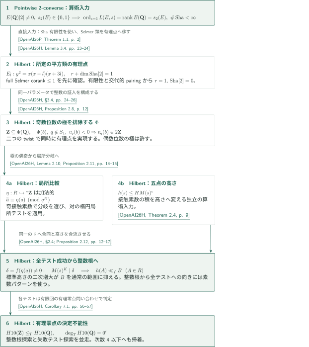

# 有理数体上のヒルベルト第10問題

**有限有理テストを支える楕円曲線の点別2-converse**

カタログ004は、有理零点の決定不能性を扱う原稿と、その局所条件の構成に使う楕円曲線の点別2-converseを収録する。論理の終点は整数零点問題から有理零点問題へのTuring帰着であり、整数の存在量化的定義を結論するものではない。

## 1. 公式順の記事一覧

CATALOGINVENTORYTOKEN

## 図の矢印に付した引用

本案内では各原稿の結果を次のキーで区別する。原稿間の直接入力と、一つの原稿内での後続段階への利用を図の中で区別する。

- **OpenAI26H**：OpenAI, *Hilbert’s tenth problem over the rational numbers*, October 6, 2026。有限有理テスト、極の偶奇、五点接触の高さ評価と決定不能性を扱う。

<!-- cite:hilbert-main -->[&#91;OpenAI26H, Theorem 1.1, p. 3&#93;](https://github.com/openai/math/blob/1581d4cbdd69a0faf34b2089614fe2a814316a6a/preprints/Hilberts-tenth-problem-over-the-rational-numbers-October-6-2026/main.pdf)<!-- /cite -->

- **OpenAI26P**：OpenAI, *A pointwise 2-converse for elliptic curves with rational two-torsion*, October 7, 2026。full $2^\infty$-Selmer corankが0または1の場合の解析的rank・Mordell–Weil rank・$\operatorname{Sha}$有限性を供給する。

<!-- cite:pointwise-main -->[&#91;OpenAI26P, Theorem 1.1, p. 2&#93;](https://github.com/openai/math/blob/1581d4cbdd69a0faf34b2089614fe2a814316a6a/preprints/A-pointwise-2-converse-for-elliptic-curves-with-rational-two-torsion-October-7-2026/paper.pdf)<!-- /cite -->

引用のページは誌面とPDF位置が一致する。GitHubの閲覧ページでは指定ページへの自動移動を前提としない。

## 2. 点別2-converseから有限テストへの接続

### 1. Selmer類を所定の有理点へ移す

有理2-torsionを持つ曲線への点別2-converseは、Hilbert原稿のLemma 3.4へ直接入力される。対象は$E_l:y^2=x(x-l)(x+3l)$であり、2-descentで得た
\[
 r+\dim_{\mathbf F_2}\operatorname{Sha}(E_l/\mathbf Q)[2]=1
\]
から、まずfull $2^\infty$-Selmer corankが高々1であることを確かめる。その後に2-converseの$\operatorname{Sha}$有限性を用いる。有限な2-primary群上のCassels–Tate pairingの交代性によって$\dim\operatorname{Sha}[2]$が偶数となり、$r=1$と$\operatorname{Sha}[2]=0$が従う。これにより選ばれたSelmer類$\gamma=(\beta,1)$が有理点で実現される。

<!-- cite:hilbert-transfer -->[&#91;OpenAI26H, Lemma 3.4, pp. 23–24&#93;](https://github.com/openai/math/blob/1581d4cbdd69a0faf34b2089614fe2a814316a6a/preprints/Hilberts-tenth-problem-over-the-rational-numbers-October-6-2026/main.pdf)<!-- /cite -->

Lemma 3.6は二つのtwistに同じパラメータを用意する。上の有理点を両方に適用して、整数では常に成立する正の存在量化的条件$\Phi$を得る。$\Phi$は有限個の例外素数以外で奇数位数の極を排除するが、偶数位数の極は許す。この片側条件を$\mathbf Z$の定義と読み替えてはならない。詳しくは[Hilbert原稿の記事](../hilbert-tenth-rationals/article.ja.md#dependencies)と[2-converseの記事](../pointwise-2-converse-rational-two-torsion/article.ja.md#results)を参照。

<!-- cite:hilbert-poles -->[&#91;OpenAI26H, Proposition 2.8, p. 12&#93;](https://github.com/openai/math/blob/1581d4cbdd69a0faf34b2089614fe2a814316a6a/preprints/Hilberts-tenth-problem-over-the-rational-numbers-October-6-2026/main.pdf)<!-- /cite -->

<!-- cite:hilbert-completion -->[&#91;OpenAI26H, §3.4, pp. 24–26&#93;](https://github.com/openai/math/blob/1581d4cbdd69a0faf34b2089614fe2a814316a6a/preprints/Hilberts-tenth-problem-over-the-rational-numbers-October-6-2026/main.pdf)<!-- /cite -->

### 2. 局所比較と高さを同じモデルへ集める

有限テストをすべて通ると、compactnessにより有理数体の初等拡大内に根を持つ環$R$が得られる。楕円点の添字写像$\eta:R\hookrightarrow{}^*\mathbf Z$は加法的であり、乗法的とはまだ分からない。極の偶奇条件は接触素数で適切な局所分岐を選ぶために使われ、対になった楕円局所テストが環の値と添字の合同を与える。

<!-- cite:hilbert-local -->[&#91;OpenAI26H, Lemma 2.10; Proposition 2.11, pp. 14–15&#93;](https://github.com/openai/math/blob/1581d4cbdd69a0faf34b2089614fe2a814316a6a/preprints/Hilberts-tenth-problem-over-the-rational-numbers-October-6-2026/main.pdf)<!-- /cite -->

この合同を固定した根座標へ適用することで、各斜率の接触素数積の$K$乗が同一の$\delta=f(\eta(a))$を割る。五点接触の高さ評価$h(s)\le H M(s)^c$と合わせ、$\delta\ne0$の場合には環全体の値の高さに一様な上界を得る。楕円点の標準高さの二次増大と比較すると根の添字は通常の有限区間に入り、加法性と単射性で通常の整数根に戻る。素数パターンの構成は、逆方向である「整数根があれば全テストを通る」ための通常モデルを供給する。

<!-- cite:hilbert-height -->[&#91;OpenAI26H, Theorem 2.4, p. 9&#93;](https://github.com/openai/math/blob/1581d4cbdd69a0faf34b2089614fe2a814316a6a/preprints/Hilberts-tenth-problem-over-the-rational-numbers-October-6-2026/main.pdf)<!-- /cite -->

<!-- cite:hilbert-tests -->[&#91;OpenAI26H, §2.4; Proposition 2.12, pp. 12–17&#93;](https://github.com/openai/math/blob/1581d4cbdd69a0faf34b2089614fe2a814316a6a/preprints/Hilberts-tenth-problem-over-the-rational-numbers-October-6-2026/main.pdf)<!-- /cite -->

### 3. 決定手続きの仮定を矛盾へ変える

有理零点の判定器があると仮定する。各有限テストは有限回の有理零点問い合わせで判定できるため、整数根の列挙と失敗テストの探索を並走させれば整数零点の有無を決定できる。固定された有限個の算術データをプログラムへ組み込むことと、それらを入力多項式ごとに計算することは区別されている。帰着の詳細と次数4以下への正規化は[Hilbert原稿の記事](../hilbert-tenth-rationals/article.ja.md#results)で扱う。

<!-- cite:hilbert-degree -->[&#91;OpenAI26H, Corollary 7.1, pp. 56–57&#93;](https://github.com/openai/math/blob/1581d4cbdd69a0faf34b2089614fe2a814316a6a/preprints/Hilberts-tenth-problem-over-the-rational-numbers-October-6-2026/main.pdf)<!-- /cite -->

## 3. 直接入力と、その先の利用

| 供給する結果 | 使用先 | 使用内容・条件 | 確認範囲 |
|---|---|---|---|
| Pointwise 2-converse, Theorem 1.1 | Hilbert, Lemma 3.4 | 非零有理2-torsionとfull Selmer corank $\le1$を先に確認し、$\operatorname{Sha}$有限性を使う | 両原典の主張と適用箇所を照合 |

この直接辺からProposition 2.8、局所分岐の選択、有限テストへ続く経路はHilbert原稿内の推移的な利用である。2-converseだけで高さ評価や有限テストの有効性が得られるわけではない。Hilbert原稿Remark 3.5は有理2-torsionを仮定しない別のconverseでも置換できると記すが、その別経路の証明は本案内では照合していない。

<!-- cite:hilbert-transfer -->[&#91;OpenAI26H, Lemma 3.4, pp. 23–24&#93;](https://github.com/openai/math/blob/1581d4cbdd69a0faf34b2089614fe2a814316a6a/preprints/Hilberts-tenth-problem-over-the-rational-numbers-October-6-2026/main.pdf)<!-- /cite -->

## 4. 原典への入口と確認範囲

公式分野は **Number theory（数論）**、番号範囲は001–031。本項004は *OpenAI Research Catalog* のp.2にあり、掲載順は上表の通りである。参照する公式リポジトリはcommit `1581d4cbdd69a0faf34b2089614fe2a814316a6a`。論文本文の版はそれぞれOctober 6, 2026とOctober 7, 2026。

<!-- cite:official -->[OpenAI Research Catalog · Catalogue 004 · p. 2](https://github.com/openai/math/blob/1581d4cbdd69a0faf34b2089614fe2a814316a6a/overview.pdf)<!-- /cite -->

- Hilbert原稿：§2.4–2.7で有限テストの構成から整数根への帰還、§3.3–3.4で点別2-converseの適用と二つのtwistへの同時実現、§7でTuring次数と正規化を読む。
- Pointwise原稿：Theorem 1.1のfull Selmer条件を確認してから、§9でcorank zeroの補間、奇側の一様な正規化、固定された負twistを使うcorank oneの帰還を追う。

本案内は主結果と主要な接続を原典本文で照合した解説である。Pointwise原稿の全整数的補間・一様評価、Hilbert原稿の全高さ・篩評価、外部入力の全証明を独立に検証したものではない。個別記事末尾に、読んだ箇所と未確認範囲を記す。
