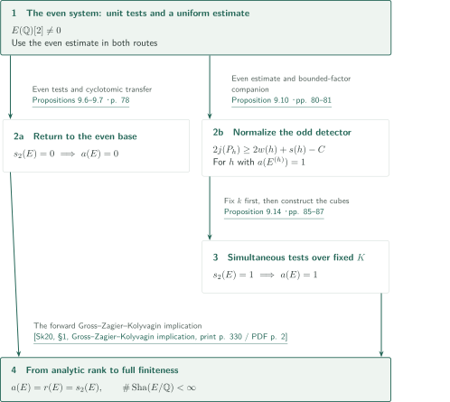
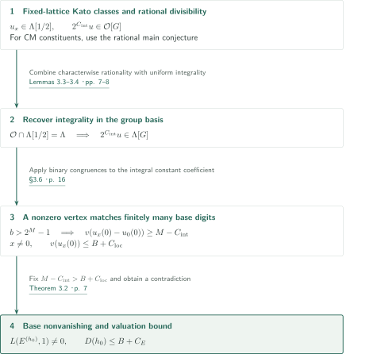
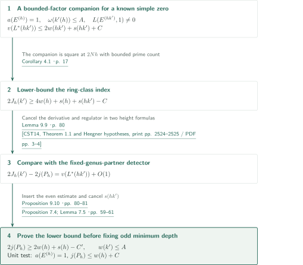
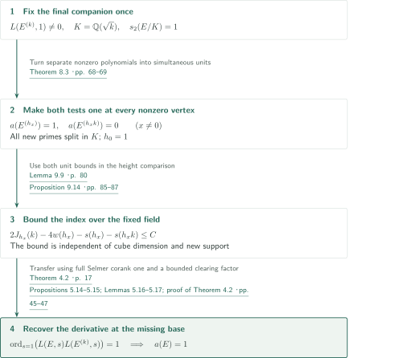

# A pointwise 2-converse for elliptic curves with rational two-torsion

**Recovering a missing vertex by integral interpolation on binary cubes**

The manuscript determines the analytic rank of each elliptic curve with rational two-torsion from its low $2^\infty$-Selmer corank. It constructs auxiliary quadratic twists with simultaneous nonvanishing at every nonzero vertex, bounds their normalized valuations uniformly, and transfers this information to the prescribed curve. This account organizes the manuscript’s argument and its direct inputs; it is not an independent verification of the entire new integral construction.

## 1. Main results

### Theorem 1.1 — The rational-two-torsion pointwise 2-converse

Let $E/\mathbb Q$ satisfy $E(\mathbb Q)[2]\ne0$. For the **full** Selmer group with the usual local Kummer conditions at every place, assume

$$
s_2(E)=\operatorname{corank}_{\mathbb Z_2}\operatorname{Sel}_{2^\infty}(E/\mathbb Q)\in\{0,1\}.
$$

The manuscript proves

$$
\operatorname{ord}_{s=1}L(E,s)=\operatorname{rank}_{\mathbb Z}E(\mathbb Q)=s_2(E),
\qquad \operatorname{Sha}(E/\mathbb Q)\text{ is finite}.
$$

There is no reduction restriction at 2. The result includes one rational two-torsion line, full rational two-torsion, and CM curves. The BSD leading-coefficient formula is not part of the conclusion.

<!-- cite:main -->[Theorem 1.1 · p. 2](https://github.com/openai/math/blob/1581d4cbdd69a0faf34b2089614fe2a814316a6a/preprints/A-pointwise-2-converse-for-elliptic-curves-with-rational-two-torsion-October-7-2026/paper.pdf)<!-- /cite -->

Neither $\operatorname{rank}E(\mathbb Q)\le1$ nor a finite 2-Selmer dimension can replace the hypothesis. The Kummer exact sequence gives

$$
s_2(E)=\operatorname{rank}_{\mathbb Z}E(\mathbb Q)
 +\operatorname{corank}_{\mathbb Z_2}\operatorname{Sha}(E/\mathbb Q)[2^\infty].
$$

In particular, corank one does not already supply a nontorsion rational point. Corank zero initially gives finiteness of $\operatorname{Sha}[2^\infty]$; finiteness of the whole group follows after determining the analytic rank.

<!-- cite:ranks -->[Lemma 2.1; §2 · pp. 4–6](https://github.com/openai/math/blob/1581d4cbdd69a0faf34b2089614fe2a814316a6a/preprints/A-pointwise-2-converse-for-elliptic-curves-with-rational-two-torsion-October-7-2026/paper.pdf)<!-- /cite -->

## References on the arrows

<!-- reference-guide -->
Unprefixed theorem, lemma, section and equation numbers refer to [A pointwise 2-converse for elliptic curves with rational two-torsion](https://github.com/openai/math/blob/1581d4cbdd69a0faf34b2089614fe2a814316a6a/preprints/A-pointwise-2-converse-for-elliptic-curves-with-rational-two-torsion-October-7-2026/paper.pdf). External inputs use the following keys.

- [Kat04](https://www.numdam.org/article/AST_2004__295__117_0.pdf) Kazuya Kato — *p-adic Hodge theory and values of zeta functions of modular forms*: Trace to the fixed eigenform lattice, explicit reciprocity, and divisibility after inverting 2. Astérisque 295 (2004), pp. 117–290; NUMDAM scan with cover.
- [BT25](https://arxiv.org/pdf/2506.03465v1) Ashay A. Burungale; Ye Tian — *A rank zero p-converse to a theorem of Gross–Zagier, Kolyvagin and Rubin*: Rational main conjecture for CM newforms at every prime; not an integral version. arXiv:2506.03465v1, 4 June 2025 (numbering cited by the manuscript).
- [CST14](https://msp.org/ant/2014/8-10/ant-v8-n10-p05-s.pdf) Li Cai; Jie Shu; Ye Tian — *Explicit Gross–Zagier and Waldspurger formulae*: Height formula and conductor-factor comparison under split Heegner conditions. Algebra & Number Theory 8(10) (2014), pp. 2523–2572; publisher PDF with cover.
- [Sk20](https://annals.math.princeton.edu/wp-content/uploads/annals-v191-n2-p01-s.pdf) Christopher Skinner — *A converse to a theorem of Gross, Zagier, and Kolyvagin*: The forward Gross–Zagier–Kolyvagin statement recorded in the introduction; not its converse theorem. Annals of Mathematics 191(2) (2020), pp. 329–354; published version.

Each citation gives the result and pages. When printed pagination differs from the PDF position, both are shown. GitHub previews do not automatically jump to the cited page.
<!-- /reference-guide -->

## 2. Theorem 1.1 — Proof overview of the main theorem

<!-- proof-target:1 -->Proof target：[Theorem 1.1 · p. 2](https://github.com/openai/math/blob/1581d4cbdd69a0faf34b2089614fe2a814316a6a/preprints/A-pointwise-2-converse-for-elliptic-curves-with-rational-two-torsion-October-7-2026/paper.pdf)<!-- /proof-target -->

**Proof route.** The even-sign coefficient system first proves the corank-zero case and a uniform central-value estimate. That estimate then normalizes the odd-sign Heegner-point detector, allowing interpolation over a fixed imaginary quadratic field. In the diagram, $a(E)$ denotes analytic rank and $r(E)$ denotes Mordell–Weil rank.

### 1. The even construction has two outputs

Arrange quadratic twists as $h_x=h_0\prod_q(q^*)^{\lambda_q(x)}$ for $x\in\mathbb F_2^b$, with linear forms $\lambda_q$. Here $q^*=(-1/q)q$, the new primes avoid a fixed finite support, and all vertices have the same sign and fixed local squareclasses. Binary tests at minimum normalized coefficient depth, together with finite prime networks, provide nonvanishing and a uniform valuation upper bound at every $x\ne0$. Theorem 3.2 returns them to the base. Proposition 9.7 handles $h_0=1$ with $s_2(E)=0$; Proposition 9.6 supplies a uniform estimate for twists having an appropriate partition certificate, needed later on the odd side.

<!-- cite:even-assembly -->[Propositions 9.6–9.7 · p. 78](https://github.com/openai/math/blob/1581d4cbdd69a0faf34b2089614fe2a814316a6a/preprints/A-pointwise-2-converse-for-elliptic-curves-with-rational-two-torsion-October-7-2026/paper.pdf)<!-- /cite -->

### 2. The order of the odd-side companion choices matters

The fixed $h_*$ defines the Heegner-point detector $P_h$. The varying $k'(h)$, with uniformly bounded prime count, is used only to prove a divisibility lower bound for $P_h$. Afterwards, a separate $k$ is fixed once and for all for the final interpolation over $K=\mathbb Q(\sqrt k)$. Treating $h_*$, $k'(h)$, and $k$ as interchangeable auxiliary twists would use the estimate needed for odd normalization circularly. See the sections on [Proposition 9.10](#proof-2) and [Proposition 9.14](#proof-3).

<!-- cite:odd-lower -->[Proposition 9.10 · pp. 80–81](https://github.com/openai/math/blob/1581d4cbdd69a0faf34b2089614fe2a814316a6a/preprints/A-pointwise-2-converse-for-elliptic-curves-with-rational-two-torsion-October-7-2026/paper.pdf)<!-- /cite -->

### 3. Rank equality and finiteness of the entire Shafarevich–Tate group

The two interpolation arguments first give $a(E)=s_2(E)\in\{0,1\}$. The established Gross–Zagier–Kolyvagin forward implication then yields $r(E)=a(E)$ and finiteness of the **whole** group $\operatorname{Sha}(E/\mathbb Q)$. The forward statement recorded in Skinner’s introduction adds no reduction restriction here. The semistability and other conditions in that paper’s converse theorem are not hypotheses of this forward step.

<!-- cite:forward -->[&#91;Sk20, §1, Gross–Zagier–Kolyvagin implication, print p. 330 / PDF p. 2&#93;](https://annals.math.princeton.edu/wp-content/uploads/annals-v191-n2-p01-s.pdf#page=2)<!-- /cite -->

<!-- cite:assembly-end -->[Proof of Theorem 1.1; Remark 9.15 · pp. 87–88](https://github.com/openai/math/blob/1581d4cbdd69a0faf34b2089614fe2a814316a6a/preprints/A-pointwise-2-converse-for-elliptic-curves-with-rational-two-torsion-October-7-2026/paper.pdf)<!-- /cite -->

## 3. Theorem 3.2 — Recovering the central value by cyclotomic interpolation

<!-- proof-target:2 -->Proof target：[Theorem 3.2 · p. 7](https://github.com/openai/math/blob/1581d4cbdd69a0faf34b2089614fe2a814316a6a/preprints/A-pointwise-2-converse-for-elliptic-curves-with-rational-two-torsion-October-7-2026/paper.pdf)<!-- /proof-target -->

<!-- statement:theorem-3-2 -->
### Theorem 3.2 — Transfer to the missing vertex

Fix $E$, the local squareclasses at $2N$, and the real sign. Let $h$ be a product of distinct signed good odd primes $q^*$, and put

$$
t_q=\dim_{\mathbb F_2}E[2]^{\mathrm{Fr}_q},\quad
w(h)=\tfrac12\sum_{q\mid h}t_q,\quad
L^*(h)=\frac{\sqrt{|h|}L(E^{(h)},1)}{\Omega_E^{\operatorname{sgn}(h)}}.
$$

Write $s(h)=\operatorname{length}_{\mathbb Z_2}\operatorname{Sha}(E^{(h)}/\mathbb Q)[2^\infty]$ when finite, distinguishing this length from $s_2$. Normalize $v(2)=1$, and set $D(h)=v(L^*(h))-2w(h)-s(h)$ when the value is nonzero. Suppose an allowed $h_0$ satisfies $s_2(E^{(h_0)})=0$. Assume that for arbitrarily large $b$ there are families of the above form, using distinct $q\nmid2Nh_0$ and linear forms $\lambda_q$, all vertices retaining the fixed local classes and sign, such that a family-independent $B$ satisfies

$$
L(E^{(h_x)},1)\ne0,\quad D(h_x)\le B\qquad(x\ne0).
$$

Then $L(E^{(h_0)},1)\ne0$ and $D(h_0)\le B+C_E$. The constant $C_E$ is independent of $h_0$, the prime set, and $b$. The required dimension threshold may depend on the precision being tested.

<!-- cite:cyclo-transfer -->[Theorem 3.2 · p. 7](https://github.com/openai/math/blob/1581d4cbdd69a0faf34b2089614fe2a814316a6a/preprints/A-pointwise-2-converse-for-elliptic-curves-with-rational-two-torsion-October-7-2026/paper.pdf)<!-- /cite -->
<!-- /statement -->

### 1. Separate rational divisibility from uniform integrality

Put $\Lambda=\mathbb Z_2[[t]]$, $\mathcal O=\widehat{\Lambda_{(2)}}$, and $G=(\mathbb Z/2)^b$. The manuscript writes the wedge of the real-place class and a Kato class as a scalar $u$ in the determinant of the positive global complex. Tracing into the lattice of one fixed weight-two eigenform constructs $2^{C_{\rm int}}u\in\mathcal O[G]$ with an exponent independent of the number of auxiliary primes. This does not uniformly identify the integral lattices of varying twisted eigenforms.

Kato’s Theorem 12.5(3) supplies height-one divisibility after inverting 2; Burungale–Tian’s Theorem 2.6 supplies the CM case. Including corrections at the fixed bad primes gives $u_x\in\Lambda[1/2]$ for every character constituent. Kato’s stronger integral statement 12.5(4), which requires $p\ne2$ and an image condition, is not used. Finally Lemma 3.3 applies $\mathcal O\cap\Lambda[1/2]=\Lambda$ to each group-basis coefficient, with no additional $|G|$ loss, to obtain

$$2^{C_{\rm int}}u\in\Lambda[G].$$

Central evaluation is performed on $\Lambda[1/2]$ first; there is no evaluation at $t=0$ on the whole completed localization $\mathcal O$.

<!-- cite:kato-trace -->[&#91;Kat04, §§8.9–8.12, print pp. 185–186 / PDF pp. 70–71&#93;](https://www.numdam.org/article/AST_2004__295__117_0.pdf#page=70)<!-- /cite -->

<!-- cite:kato-rational -->[&#91;Kat04, Theorem 12.5(3)–(4), print p. 222 / PDF p. 107&#93;](https://www.numdam.org/article/AST_2004__295__117_0.pdf#page=107)<!-- /cite -->

<!-- cite:bt-rational -->[&#91;BT25, Theorem 2.6; Remark 2.7, p. 5&#93;](https://arxiv.org/pdf/2506.03465v1#page=5)<!-- /cite -->

<!-- cite:scalar -->[§§3.3–3.5; Proposition 3.7 · pp. 10–15](https://github.com/openai/math/blob/1581d4cbdd69a0faf34b2089614fe2a814316a6a/preprints/A-pointwise-2-converse-for-elliptic-curves-with-rational-two-torsion-October-7-2026/paper.pdf)<!-- /cite -->

### 2. A sufficiently large cube has another vertex with the base’s finite digits

At a corank-zero constituent, Proposition 3.7 identifies the vanishing of $u_x(0)$ with that of $L^*(h_x)$ and gives $|v(u_x(0))-D(h_x)|\le C_{\rm loc}$. The nonzero vertices have corank zero by the known analytic-rank-zero theorem; the base has it by hypothesis. Fix $M-C_{\rm int}>B+C_{\rm loc}$ and apply Lemma 3.4 to the constant coefficient of $2^{C_{\rm int}}u$. For $b>2^M-1$, some $x\ne0$ satisfies

$$v(u_x(0)-u_0(0))\ge M-C_{\rm int}.$$

If $u_0(0)=0$, or if its valuation exceeds the upper bound, this contradicts $v(u_x(0))\le B+C_{\rm loc}$. Thus the base is nonvanishing too. Uniformity concerns $C_{\rm int},C_{\rm loc},B$, not the prime sizes or the precision needed to realize a family.

<!-- cite:binary -->[Lemmas 3.3–3.4 · pp. 7–8](https://github.com/openai/math/blob/1581d4cbdd69a0faf34b2089614fe2a814316a6a/preprints/A-pointwise-2-converse-for-elliptic-curves-with-rational-two-torsion-October-7-2026/paper.pdf)<!-- /cite -->

<!-- cite:cyclo-proof -->[§3.6 · p. 16](https://github.com/openai/math/blob/1581d4cbdd69a0faf34b2089614fe2a814316a6a/preprints/A-pointwise-2-converse-for-elliptic-curves-with-rational-two-torsion-October-7-2026/paper.pdf)<!-- /cite -->

### 3. Supplying the upper bound at all nonzero vertices

Proposition 7.1 compares central values with squares of weight-$3/2$ coefficients; Theorem 3.1 supplies the lower bound that fixes their minimum normalized depth. A unit test gives $L^*(h)\ne0$ and $v(L^*(h))\le2w(h)+C$. The finite networks of Proposition 7.9 and Theorem 8.3 turn differences in quadratic-residue edge bits into contractions of prime labels and make the test equal to one at every nonzero address. Subtracting $s(h_x)\ge0$ gives the required upper bound for $D(h_x)$. No prescribed curve is discarded into a density-zero exceptional set.

<!-- cite:coefficients -->[Proposition 7.1 · pp. 53–54; Lemma 7.5 · pp. 60–61](https://github.com/openai/math/blob/1581d4cbdd69a0faf34b2089614fe2a814316a6a/preprints/A-pointwise-2-converse-for-elliptic-curves-with-rational-two-torsion-October-7-2026/paper.pdf)<!-- /cite -->

<!-- cite:address -->[Theorem 8.3 · pp. 68–69](https://github.com/openai/math/blob/1581d4cbdd69a0faf34b2089614fe2a814316a6a/preprints/A-pointwise-2-converse-for-elliptic-curves-with-rational-two-torsion-October-7-2026/paper.pdf)<!-- /cite -->

## 4. Proposition 9.10 — A uniform lower bound for odd normalization

<!-- proof-target:3 -->Proof target：[Proposition 9.10 · pp. 80–81](https://github.com/openai/math/blob/1581d4cbdd69a0faf34b2089614fe2a814316a6a/preprints/A-pointwise-2-converse-for-elliptic-curves-with-rational-two-torsion-October-7-2026/paper.pdf)<!-- /proof-target -->

<!-- statement:proposition-9-10 -->
### Proposition 9.10 — Two-divisibility of the Heegner-point detector

Fix the prepared positive odd-sign filter of Lemma 9.8. It includes the finite coefficient and class-group support; a negative genus partner $h_*$ with $L(E^{(h_*)},1)\ne0$ has been fixed and its prime divisors excluded. Let $P_h$ denote the conductor-one genus-character Heegner sum over $\mathbb Q(\sqrt{hh_*})$, and let $j(P_h)$ be its 2-adic index in the corresponding free rank-one lattice. There is a constant $C$, independent of $h$ and its prime count, such that, for every analytically rank-one $h$ in this filter,

$$2j(P_h)\ge2w(h)+s(h)-C.$$

In particular, $j(P_h)\ge w(h)-C'$ uniformly.

<!-- cite:odd-lower -->[Proposition 9.10 · pp. 80–81](https://github.com/openai/math/blob/1581d4cbdd69a0faf34b2089614fe2a814316a6a/preprints/A-pointwise-2-converse-for-elliptic-curves-with-rational-two-torsion-October-7-2026/paper.pdf)<!-- /cite -->
<!-- /statement -->

### 1. A varying companion supplies an already nonvanishing central value

For each $h$ already known to have analytic rank one, Lemma 9.8 chooses a negative odd fundamental discriminant $k'=k'(h)$. It satisfies $(k',2Nh)=1$, is a square at all places dividing $2Nh$, has $\omega(k')\le A$, and defines neither an extra-unit field nor the CM field of $E$. Bounded-factor completion in Proposition 6.2 and finite label preparations control this prime count. Apply Proposition 9.6 to the nonvanishing parameter $hk'$ to obtain

$$v(L^*(hk'))\le2w(hk')+s(hk')+C.$$

The actual prime sizes may depend on $h$. No odd minimum-depth normalization has been used at this point.

<!-- cite:companion -->[Lemma 9.8 · pp. 79–80; Proposition 6.2 · p. 48](https://github.com/openai/math/blob/1581d4cbdd69a0faf34b2089614fe2a814316a6a/preprints/A-pointwise-2-converse-for-elliptic-curves-with-rational-two-torsion-October-7-2026/paper.pdf)<!-- /cite -->

### 2. Height comparison cancels the additional Sha term

Write $J_h(k')$ for the index of the conductor-$|h|$ ring-class sum over $\mathbb Q(\sqrt{k'})$. Corollary 4.1 and Lemma 9.9 give

$$
2J_h(k')\ge4w(h)+s(h)+s(hk')-C,
$$
$$
2J_h(k')-2j(P_h)=v(L^*(hk'))+O(1).
$$

The second identity applies Cai–Shu–Tian’s Theorem 1.1 to the two sums. The level primes split and the conductor is coprime to the level. The original formula’s $c\sqrt{|D|}$ factor differs precisely between conductor $|h|$ and conductor one. Cancelling the derivative and common rank-one regulator leaves the variable factor already included in the normalization of $L^*(hk')$. Excluding extra-unit fields fixes the unit factor as well.

Combine the three inequalities using $w(hk')=w(h)+w(k')$ and $w(k')\le A$:

$$2j(P_h)\ge2w(h)+s(h)-2w(k')-C\ge2w(h)+s(h)-C'.$$

Only now apply Lemma 7.5. An odd unit simultaneously detects analytic rank one and the upper bound $j(P_h)\le w(h)+C$.

<!-- cite:ring-lower -->[Corollary 4.1 · p. 17](https://github.com/openai/math/blob/1581d4cbdd69a0faf34b2089614fe2a814316a6a/preprints/A-pointwise-2-converse-for-elliptic-curves-with-rational-two-torsion-October-7-2026/paper.pdf)<!-- /cite -->

<!-- cite:height -->[Lemma 9.9 · p. 80](https://github.com/openai/math/blob/1581d4cbdd69a0faf34b2089614fe2a814316a6a/preprints/A-pointwise-2-converse-for-elliptic-curves-with-rational-two-torsion-October-7-2026/paper.pdf)<!-- /cite -->

<!-- cite:cst-height -->[&#91;CST14, Theorem 1.1 and Heegner hypotheses, print pp. 2524–2525 / PDF pp. 3–4&#93;](https://msp.org/ant/2014/8-10/ant-v8-n10-p05-s.pdf#page=3)<!-- /cite -->

<!-- cite:odd-coefficients -->[Proposition 7.4; Lemma 7.5 · pp. 59–61](https://github.com/openai/math/blob/1581d4cbdd69a0faf34b2089614fe2a814316a6a/preprints/A-pointwise-2-converse-for-elliptic-curves-with-rational-two-torsion-October-7-2026/paper.pdf)<!-- /cite -->

## 5. Proposition 9.14 — Returning from a fixed imaginary quadratic field to corank one

<!-- proof-target:4 -->Proof target：[Proposition 9.14 · pp. 85–87](https://github.com/openai/math/blob/1581d4cbdd69a0faf34b2089614fe2a814316a6a/preprints/A-pointwise-2-converse-for-elliptic-curves-with-rational-two-torsion-October-7-2026/paper.pdf)<!-- /proof-target -->

<!-- statement:proposition-9-14 -->
### Proposition 9.14 — The odd original base

Let $E/\mathbb Q$ satisfy $E(\mathbb Q)[2]\ne0$ and $s_2(E)=1$. Then $a(E)=1$. Again the Selmer group uses Kummer local conditions everywhere; neither Mordell–Weil rank one nor finiteness of Sha at the base is assumed.

<!-- cite:rank-one -->[Proposition 9.14 · pp. 85–87](https://github.com/openai/math/blob/1581d4cbdd69a0faf34b2089614fe2a814316a6a/preprints/A-pointwise-2-converse-for-elliptic-curves-with-rational-two-torsion-October-7-2026/paper.pdf)<!-- /cite -->
<!-- /statement -->

### 1. Fix the final companion before the cube dimension

If the prepared odd detector detects the base, the argument is finished. Otherwise take its nonempty minimum seed. A separate even test selects a negative discriminant $k$ with $L(E^{(k)},1)\ne0$. It is a square at $2N$, avoids the old support and required torsion ramification, and excludes the exceptional imaginary fields. Keep $K=\mathbb Q(\sqrt k)$ fixed thereafter. Require every new prime in $h$ to split in $K$. The forward theorem gives $s_2(E^{(k)})=0$, so the quadratic corank identity yields

$$s_2(E/K)=s_2(E)+s_2(E^{(k)})=1.$$

This is not an integral direct-sum decomposition of Selmer groups.

<!-- cite:coranks -->[Lemma 2.2 · p. 5](https://github.com/openai/math/blob/1581d4cbdd69a0faf34b2089614fe2a814316a6a/preprints/A-pointwise-2-converse-for-elliptic-curves-with-rational-two-torsion-October-7-2026/paper.pdf)<!-- /cite -->

### 2. Make separately nonzero polynomials units at the same vertex

The even test reads $hk$, while the odd test reads $h$. Separate nonzero terminal polynomials at an address need not admit the same nonzero assignment of residue symbols. Theorem 8.3 adds primary prime networks and makes both tests equal to one on the same finite graph. No new prime is active at $x=0$.

When the residual fields are quadratic, the two sides of a rational 2-isogeny supply good simple primes and donors. Full rational two-torsion needs a separate argument: Lemma 9.12 ensures a nonempty witness for the even test restricted to $K$-split primes, and Lemma 9.13 corrects the oriented total. These are substantive steps beyond generic prime selection.

After choosing $b$ and the networks, select an actual stage of the odd coefficients realizing the required test tables and precision on that finite weight range. The moving detecting prime $\ell$ and the precision may change; the minimum normalized depth, fixed $k$, and valuation bound do not. A single stage for all cube dimensions is unnecessary.

<!-- cite:address -->[Theorem 8.3 · pp. 68–69](https://github.com/openai/math/blob/1581d4cbdd69a0faf34b2089614fe2a814316a6a/preprints/A-pointwise-2-converse-for-elliptic-curves-with-rational-two-torsion-October-7-2026/paper.pdf)<!-- /cite -->

<!-- cite:split-witness -->[Lemmas 9.12–9.13 · pp. 82–85](https://github.com/openai/math/blob/1581d4cbdd69a0faf34b2089614fe2a814316a6a/preprints/A-pointwise-2-converse-for-elliptic-curves-with-rational-two-torsion-October-7-2026/paper.pdf)<!-- /cite -->

<!-- cite:odd-assembly -->[§§9.5–9.7 · pp. 81–87](https://github.com/openai/math/blob/1581d4cbdd69a0faf34b2089614fe2a814316a6a/preprints/A-pointwise-2-converse-for-elliptic-curves-with-rational-two-torsion-October-7-2026/paper.pdf)<!-- /cite -->

### 3. Feed the index upper bound into ring-class interpolation

At every nonzero vertex, $a(E^{(h)})=1$ and $a(E^{(hk)})=0$. The two unit bounds and the height comparison for fixed $k$ give

$$2J_h(k)\le4w(h)+C.$$

The finite lengths $s(h),s(hk)$ are nonnegative, so $2J_h(k)-4w(h)-s(h)-s(hk)\le C$. These are the inputs of Theorem 4.2: for a fixed nonexceptional $K$ satisfying the split Heegner condition at $2N$, full Selmer corank one at the base, and arbitrarily large cubes whose nonzero vertices have a simple product zero and this uniform upper bound, the base product $L(E,s)L(E^{(k)},s)$ has a simple zero.

The interpolation uses complexes retaining full Kummer conditions and actual maps to Galois cochains to produce an integral family with a bounded clearing factor, $f_xu_x=d_x$. Proposition 5.14 uniformly controls the valuation of $f_0(0)\ne0$ and the negative Laurent degrees at finite precision. Lemma 5.17 matches finitely many coefficient digits with the base. A vanishing base derivative would give $u_0(0)=0$, contradicting the known valuation bound at a nonzero vertex. As the manuscript emphasizes, general Selmer duality or the Gross–Zagier formula alone does not supply this simultaneous integral family.

Finally $L(E^{(k)},1)\ne0$ gives $a(E)=1$. The passage to finiteness of all of Sha is the [last step of the main theorem](#proof-overview-step-3).

<!-- cite:ring-transfer -->[Theorem 4.2 · p. 17](https://github.com/openai/math/blob/1581d4cbdd69a0faf34b2089614fe2a814316a6a/preprints/A-pointwise-2-converse-for-elliptic-curves-with-rational-two-torsion-October-7-2026/paper.pdf)<!-- /cite -->

<!-- cite:ring-proof -->[Propositions 5.14–5.15; Lemmas 5.16–5.17; proof of Theorem 4.2 · pp. 45–47](https://github.com/openai/math/blob/1581d4cbdd69a0faf34b2089614fe2a814316a6a/preprints/A-pointwise-2-converse-for-elliptic-curves-with-rational-two-torsion-October-7-2026/paper.pdf)<!-- /cite -->

## 6. External inputs and their scope

| Source | Used at | Content and applicability | Checked here |
|---|---|---|---|
| Kato’s fixed-lattice trace, explicit reciprocity, rational divisibility | §§3.3–3.5 | Weight two, $r=r'=1$; trace from auxiliary level to the fixed eigenform. Distinguish rational 12.5(3) from integral 12.5(4) | Statements in §§8.9–8.12, Theorems 9.7 and 12.5(3)–(4), and the manuscript’s use. Uniform integrality for varying support is an additional construction in this manuscript |
| Burungale–Tian | §3.4 | The main conjecture over $\Lambda\otimes\mathbb Q$ for CM newforms, at every prime including 2 | Theorem 2.6 and Remark 2.7; no integral version is quoted from them |
| Cai–Shu–Tian | Lemma 9.9 and the proof of Theorem 4.2 | Primitive ring-class character, $(c,N)=1$, split level primes, and $\pi(\infty)=0$; index comparison and vanishing of the base derivative | Formula and assumptions of Theorem 1.1. Not an independent verification of every local comparison |
| Gross–Zagier–Kolyvagin, in Skinner’s combined formulation | Lemma 2.1 and the final main-theorem step | Analytic rank zero or one implies rank equality and finiteness of all of Sha | Forward statement and its use; proofs not recursively verified |

<!-- cite:kato-reciprocity -->[&#91;Kat04, Theorem 9.7, print p. 189 / PDF p. 74&#93;](https://www.numdam.org/article/AST_2004__295__117_0.pdf#page=74)<!-- /cite -->

<!-- cite:bt-rational -->[&#91;BT25, Theorem 2.6; Remark 2.7, p. 5&#93;](https://arxiv.org/pdf/2506.03465v1#page=5)<!-- /cite -->

<!-- cite:cst-height -->[&#91;CST14, Theorem 1.1 and Heegner hypotheses, print pp. 2524–2525 / PDF pp. 3–4&#93;](https://msp.org/ant/2014/8-10/ant-v8-n10-p05-s.pdf#page=3)<!-- /cite -->

<!-- cite:forward -->[&#91;Sk20, §1, Gross–Zagier–Kolyvagin implication, print p. 330 / PDF p. 2&#93;](https://annals.math.princeton.edu/wp-content/uploads/annals-v191-n2-p01-s.pdf#page=2)<!-- /cite -->

The manuscript mentions the broader *Goldfeld’s analytic density conjecture and the 2-converse for elliptic curves* as background, explicitly stating that its converse is not an input. No direct dependency from another paper in catalogue 004 was identified in the principal routes and bibliography examined here. This does not mean that all potential relationships have been investigated.

## 7. Return to the sources

<!-- reading-list -->
- [Theorem 1.1 · p. 2](https://github.com/openai/math/blob/1581d4cbdd69a0faf34b2089614fe2a814316a6a/preprints/A-pointwise-2-converse-for-elliptic-curves-with-rational-two-torsion-October-7-2026/paper.pdf) — Read the full Selmer hypothesis and the conclusion for all of Sha
- [§§3.3–3.5; Proposition 3.7 · pp. 10–15](https://github.com/openai/math/blob/1581d4cbdd69a0faf34b2089614fe2a814316a6a/preprints/A-pointwise-2-converse-for-elliptic-curves-with-rational-two-torsion-October-7-2026/paper.pdf) — Separate rational divisibility from uniform integrality
- [§3.6 · p. 16](https://github.com/openai/math/blob/1581d4cbdd69a0faf34b2089614fe2a814316a6a/preprints/A-pointwise-2-converse-for-elliptic-curves-with-rational-two-torsion-October-7-2026/paper.pdf) — See how finite-digit congruences force base nonvanishing
- [Propositions 5.14–5.15; Lemmas 5.16–5.17; proof of Theorem 4.2 · pp. 45–47](https://github.com/openai/math/blob/1581d4cbdd69a0faf34b2089614fe2a814316a6a/preprints/A-pointwise-2-converse-for-elliptic-curves-with-rational-two-torsion-October-7-2026/paper.pdf) — Follow the simultaneous arithmetic construction and bounded clearing factor
- [Lemma 9.8 · pp. 79–80; Proposition 6.2 · p. 48](https://github.com/openai/math/blob/1581d4cbdd69a0faf34b2089614fe2a814316a6a/preprints/A-pointwise-2-converse-for-elliptic-curves-with-rational-two-torsion-October-7-2026/paper.pdf) — Check the uniform prime-count bound versus variable prime sizes
- [Lemma 9.9 · p. 80](https://github.com/openai/math/blob/1581d4cbdd69a0faf34b2089614fe2a814316a6a/preprints/A-pointwise-2-converse-for-elliptic-curves-with-rational-two-torsion-October-7-2026/paper.pdf) — Compare the conductor-one and conductor-|h| sums
- [§§9.5–9.7 · pp. 81–87](https://github.com/openai/math/blob/1581d4cbdd69a0faf34b2089614fe2a814316a6a/preprints/A-pointwise-2-converse-for-elliptic-curves-with-rational-two-torsion-October-7-2026/paper.pdf) — Follow normalization, the fixed-K choice and simultaneous tests
- [Proof of Theorem 1.1; Remark 9.15 · pp. 87–88](https://github.com/openai/math/blob/1581d4cbdd69a0faf34b2089614fe2a814316a6a/preprints/A-pointwise-2-converse-for-elliptic-curves-with-rational-two-torsion-October-7-2026/paper.pdf) — Pass from both analytic-rank cases to rank equality and full finiteness
<!-- /reading-list -->

For the October 7, 2026 version, the reading covered the main statement; the interpolation route in §§2–3; the interfaces and final transfer in §§4–5; the normalization hypotheses in §7; the address-lemma statement and forest construction in §8; and the assembly in §9. Valuation conventions, the three companions, the order of fixed and varying choices, CM and full rational two-torsion, and the scope of final finiteness were compared with the source.

Outstanding work includes an independent construction of all cochain limits, simultaneous evaluation maps and determinant switches in §§4–5; all uniform moment and sieve estimates in §6; the complete theta weights and local trace identities in §7; and every network coefficient calculation in §8. For Ferrero–Washington’s residual cyclotomic input, Monsky’s parity theorem, Nekovář’s duality, and the Waldspurger and related coefficient inputs, the manuscript’s citations and roles were examined, but the relevant external source passages were not rechecked here. This account therefore does not certify the correctness of the full proof including these connections.
