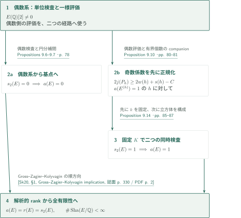
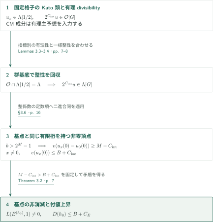
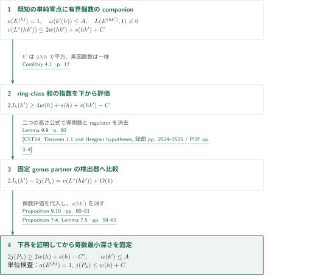
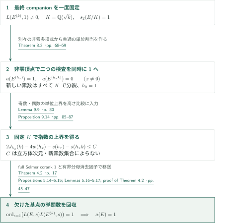

# A pointwise 2-converse for elliptic curves with rational two-torsion

**二進立方体の欠けた頂点を、整係数補間で回収する**

原稿は、有理2捩れ点を持つ個々の楕円曲線について、低い $2^\infty$-Selmer corankから解析的rankを決定する。中心となるのは、補助二次捩れの非消滅をすべての非零頂点で同時に実現し、その正規化された付値を一様に抑えて、指定された曲線へ戻す構成である。以下は原稿の論証と直接入力の接続を整理した概説であり、新しい整係数構成全体の独立検証を意味しない。

## 1. 主要結果

### Theorem 1.1 — 有理2捩れを持つ曲線の点ごとの2-converse

$E/\mathbb Q$ を $E(\mathbb Q)[2]\ne0$ を満たす楕円曲線とする。すべての場所で通常のKummer局所条件を課した **full** Selmer群について

$$
s_2(E)=\operatorname{corank}_{\mathbb Z_2}\operatorname{Sel}_{2^\infty}(E/\mathbb Q)\in\{0,1\}
$$

と仮定すると、原稿は

$$
\operatorname{ord}_{s=1}L(E,s)=\operatorname{rank}_{\mathbb Z}E(\mathbb Q)=s_2(E),
\qquad \operatorname{Sha}(E/\mathbb Q)\text{ は有限}
$$

を示す。2での還元型に制約はなく、有理2捩れが1本の場合と全2捩れが有理な場合、CMの場合も含む。先頭係数のBSD公式は結論に含まれない。

<!-- cite:main -->[Theorem 1.1 · p. 2](https://github.com/openai/math/blob/1581d4cbdd69a0faf34b2089614fe2a814316a6a/preprints/A-pointwise-2-converse-for-elliptic-curves-with-rational-two-torsion-October-7-2026/paper.pdf)<!-- /cite -->

$\operatorname{rank}E(\mathbb Q)\le1$ や有限2-Selmer群の次元を、この仮定へ置き換えることはできない。Kummer完全列により

$$
s_2(E)=\operatorname{rank}_{\mathbb Z}E(\mathbb Q)
 +\operatorname{corank}_{\mathbb Z_2}\operatorname{Sha}(E/\mathbb Q)[2^\infty].
$$

特にcorank 1は非捩れ有理点の存在を先取りしない。corank 0から初めに得られる有限性は $\operatorname{Sha}[2^\infty]$ のものであり、全群の有限性は解析的rankを決めた後に得る。

<!-- cite:ranks -->[Lemma 2.1; §2 · pp. 4–6](https://github.com/openai/math/blob/1581d4cbdd69a0faf34b2089614fe2a814316a6a/preprints/A-pointwise-2-converse-for-elliptic-curves-with-rational-two-torsion-October-7-2026/paper.pdf)<!-- /cite -->

## 図の矢印に付した引用

<!-- reference-guide -->
略号のない定理・補題・節・式番号は本原稿 [A pointwise 2-converse for elliptic curves with rational two-torsion](https://github.com/openai/math/blob/1581d4cbdd69a0faf34b2089614fe2a814316a6a/preprints/A-pointwise-2-converse-for-elliptic-curves-with-rational-two-torsion-October-7-2026/paper.pdf) を指します。外部入力には次の略号を使います。

- [Kat04](https://www.numdam.org/article/AST_2004__295__117_0.pdf) Kazuya Kato — *p-adic Hodge theory and values of zeta functions of modular forms*：固定固有形式の格子へのtrace、明示相互法則、2を反転したdivisibility。Astérisque 295 (2004), pp. 117–290; NUMDAM scan with cover。
- [BT25](https://arxiv.org/pdf/2506.03465v1) Ashay A. Burungale; Ye Tian — *A rank zero p-converse to a theorem of Gross–Zagier, Kolyvagin and Rubin*：CM新形式の全素数での有理主予想。整係数版ではない。arXiv:2506.03465v1, 4 June 2025 (numbering cited by the manuscript)。
- [CST14](https://msp.org/ant/2014/8-10/ant-v8-n10-p05-s.pdf) Li Cai; Jie Shu; Ye Tian — *Explicit Gross–Zagier and Waldspurger formulae*：分裂Heegner条件下の高さ公式と導手因子の比較。Algebra & Number Theory 8(10) (2014), pp. 2523–2572; publisher PDF with cover。
- [Sk20](https://annals.math.princeton.edu/wp-content/uploads/annals-v191-n2-p01-s.pdf) Christopher Skinner — *A converse to a theorem of Gross, Zagier, and Kolyvagin*：序論に記されたGross–Zagier–Kolyvaginの順方向。逆方向の定理は使わない。Annals of Mathematics 191(2) (2020), pp. 329–354; published version。

各引用に結果番号とページを付します。誌面番号とPDF内の位置が異なる場合は両方を示します。GitHubの閲覧リンクではページ位置への自動移動を前提としません。
<!-- /reference-guide -->

## 2. Theorem 1.1 — 主定理の証明概略

<!-- proof-target:1 -->証明対象：[Theorem 1.1 · p. 2](https://github.com/openai/math/blob/1581d4cbdd69a0faf34b2089614fe2a814316a6a/preprints/A-pointwise-2-converse-for-elliptic-curves-with-rational-two-torsion-October-7-2026/paper.pdf)<!-- /proof-target -->

**証明の道筋。** 偶数符号の係数系からcorank 0の場合と一様な中心値評価を先に得る。後者を使って奇数符号のHeegner点検出器を正規化し、固定した虚二次体上の補間へ進む。図の $a(E)$ は解析的rank、$r(E)$ はMordell–Weil rankである。

### 1. 偶数側の構成が二つの仕事を担う

二次捩れを $h_x=h_0\prod_q(q^*)^{\lambda_q(x)}$、$x\in\mathbb F_2^b$ で配置し、$\lambda_q$ を線形形式とする。$q^*=(-1/q)q$、新しい素数は固定有限集合の外にあり、符号と固定場所の平方類は全頂点で同じにする。係数の最小正規化深さから得る二値検査と有限素数ネットワークにより、$x\ne0$ のすべてで非消滅と付値の一様上界を得る。Theorem 3.2がこれを基点へ戻す。Proposition 9.7は $h_0=1, s_2(E)=0$ を処理し、Proposition 9.6は後の奇数側に使う、適切な分割証明を持つ捩れに対する一様評価を与える。

<!-- cite:even-assembly -->[Propositions 9.6–9.7 · p. 78](https://github.com/openai/math/blob/1581d4cbdd69a0faf34b2089614fe2a814316a6a/preprints/A-pointwise-2-converse-for-elliptic-curves-with-rational-two-torsion-October-7-2026/paper.pdf)<!-- /cite -->

### 2. 奇数側では補助判別式を選ぶ順序が重要になる

固定 $h_*$ はHeegner点検出器 $P_h$ の定義に使う。変動する $k'(h)$ は、素因数数を一様に制限して $P_h$ の可除性の下界を証明するためだけに使う。その後、別の $k$ を一度固定し、$K=\mathbb Q(\sqrt k)$ 上で最終補間を行う。$h_*$、$k'(h)$、$k$ を同じ役割の「補助捩れ」とまとめると、奇数係数の正規化に必要な評価を循環的に使うことになる。詳細は[Proposition 9.10の節](#proof-2)と[Proposition 9.14の節](#proof-3)で説明する。

<!-- cite:odd-lower -->[Proposition 9.10 · pp. 80–81](https://github.com/openai/math/blob/1581d4cbdd69a0faf34b2089614fe2a814316a6a/preprints/A-pointwise-2-converse-for-elliptic-curves-with-rational-two-torsion-October-7-2026/paper.pdf)<!-- /cite -->

### 3. rankの一致と全Shafarevich–Tate群の有限性

二つの場合の補間がまず $a(E)=s_2(E)\in\{0,1\}$ を与える。ここで既知のGross–Zagier–Kolyvaginの順方向を適用し、$r(E)=a(E)$ と **全** $\operatorname{Sha}(E/\mathbb Q)$ の有限性を得る。Skinnerの序論に記された順方向は、この適用に追加の還元仮定を課さない。同論文の逆方向の定理に付く半安定性等の条件を、ここへ持ち込まない。

<!-- cite:forward -->[&#91;Sk20, §1, Gross–Zagier–Kolyvagin implication, 誌面 p. 330 / PDF p. 2&#93;](https://annals.math.princeton.edu/wp-content/uploads/annals-v191-n2-p01-s.pdf#page=2)<!-- /cite -->

<!-- cite:assembly-end -->[Proof of Theorem 1.1; Remark 9.15 · pp. 87–88](https://github.com/openai/math/blob/1581d4cbdd69a0faf34b2089614fe2a814316a6a/preprints/A-pointwise-2-converse-for-elliptic-curves-with-rational-two-torsion-October-7-2026/paper.pdf)<!-- /cite -->

## 3. Theorem 3.2 — 円分補間による中心値の回収

<!-- proof-target:2 -->証明対象：[Theorem 3.2 · p. 7](https://github.com/openai/math/blob/1581d4cbdd69a0faf34b2089614fe2a814316a6a/preprints/A-pointwise-2-converse-for-elliptic-curves-with-rational-two-torsion-October-7-2026/paper.pdf)<!-- /proof-target -->

<!-- statement:theorem-3-2 -->
### Theorem 3.2 — 欠けた頂点への移送

$E$ と $2N$ での局所平方類・実符号を固定する。$h$ は異なる良い奇素数の $q^*$ の積とし、

$$
t_q=\dim_{\mathbb F_2}E[2]^{\mathrm{Fr}_q},\quad
w(h)=\tfrac12\sum_{q\mid h}t_q,\quad
L^*(h)=\frac{\sqrt{|h|}L(E^{(h)},1)}{\Omega_E^{\operatorname{sgn}(h)}}.
$$

$s(h)=\operatorname{length}_{\mathbb Z_2}\operatorname{Sha}(E^{(h)}/\mathbb Q)[2^\infty]$ は有限な場合の長さであり、$s_2$ と区別する。$v(2)=1$ とし、非消滅時に $D(h)=v(L^*(h))-2w(h)-s(h)$ と置く。許された $h_0$ が $s_2(E^{(h_0)})=0$ を満たすとする。任意に大きい $b$ に対し、相異なる $q\nmid2Nh_0$ と線形形式 $\lambda_q$ による上記の族が存在し、全頂点が固定局所類・符号を保ち、族によらない $B$ に対して

$$
L(E^{(h_x)},1)\ne0,\quad D(h_x)\le B\qquad(x\ne0)
$$

ならば $L(E^{(h_0)},1)\ne0$ かつ $D(h_0)\le B+C_E$。$C_E$ は $h_0$、素数集合、$b$ に依存しない。必要な次元の閾値は試す精度に依存してよい。

<!-- cite:cyclo-transfer -->[Theorem 3.2 · p. 7](https://github.com/openai/math/blob/1581d4cbdd69a0faf34b2089614fe2a814316a6a/preprints/A-pointwise-2-converse-for-elliptic-curves-with-rational-two-torsion-October-7-2026/paper.pdf)<!-- /cite -->
<!-- /statement -->

### 1. 有理divisibilityと一様な整性を別々に確保する

$\Lambda=\mathbb Z_2[[t]]$、$\mathcal O=\widehat{\Lambda_{(2)}}$、$G=(\mathbb Z/2)^b$ とする。原稿は正の大域複体のdeterminant内で、実場所の類とKato類の外積を $u$ と書く。固定した重さ2の固有形式の格子へtraceを戻すことで、補助素数の個数によらない $2^{C_{\rm int}}u\in\mathcal O[G]$ を構成する。ここは変動する捩れ固有形式の整格子を一律に同一視する議論ではない。

KatoのTheorem 12.5(3)は2を反転した高さ1のdivisibilityに使い、CMの場合はBurungale–TianのTheorem 2.6を使う。固定悪素数での補正も含めて、各指標成分で $u_x\in\Lambda[1/2]$ を得る。Katoの、$p\ne2$ と像条件を要する強い整係数版12.5(4)は使わない。最後に $\mathcal O\cap\Lambda[1/2]=\Lambda$ というLemma 3.3を群基底の各係数へ適用し、$|G|$ による損失を増やさず

$$2^{C_{\rm int}}u\in\Lambda[G]$$

を得る。局所化完備環 $\mathcal O$ 全体に $t=0$ の評価を定義するのではなく、中心評価は $\Lambda[1/2]$ 上で先に行う。

<!-- cite:kato-trace -->[&#91;Kat04, §§8.9–8.12, 誌面 pp. 185–186 / PDF pp. 70–71&#93;](https://www.numdam.org/article/AST_2004__295__117_0.pdf#page=70)<!-- /cite -->

<!-- cite:kato-rational -->[&#91;Kat04, Theorem 12.5(3)–(4), 誌面 p. 222 / PDF p. 107&#93;](https://www.numdam.org/article/AST_2004__295__117_0.pdf#page=107)<!-- /cite -->

<!-- cite:bt-rational -->[&#91;BT25, Theorem 2.6; Remark 2.7, p. 5&#93;](https://arxiv.org/pdf/2506.03465v1#page=5)<!-- /cite -->

<!-- cite:scalar -->[§§3.3–3.5; Proposition 3.7 · pp. 10–15](https://github.com/openai/math/blob/1581d4cbdd69a0faf34b2089614fe2a814316a6a/preprints/A-pointwise-2-converse-for-elliptic-curves-with-rational-two-torsion-October-7-2026/paper.pdf)<!-- /cite -->

### 2. 任意に大きい立方体は、基点と同じ有限桁を持つ別頂点を含む

corank 0の成分ではProposition 3.7が $u_x(0)$ と $L^*(h_x)$ の同時消滅および $|v(u_x(0))-D(h_x)|\le C_{\rm loc}$ を与える。$x\ne0$ は既知の解析的rank 0からcorank 0となり、基点は仮定による。$M-C_{\rm int}>B+C_{\rm loc}$ を固定し、Lemma 3.4を $2^{C_{\rm int}}u$ の定数項へ適用する。$b>2^M-1$ なら、ある $x\ne0$ で

$$v(u_x(0)-u_0(0))\ge M-C_{\rm int}.$$

$u_0(0)=0$、またはその付値が上界を超えるなら、$v(u_x(0))\le B+C_{\rm loc}$ と矛盾する。従って基点も非消滅となる。一様性を担うのは $C_{\rm int},C_{\rm loc},B$ であり、素数の大きさや族の実現に要る精度ではない。

<!-- cite:binary -->[Lemmas 3.3–3.4 · pp. 7–8](https://github.com/openai/math/blob/1581d4cbdd69a0faf34b2089614fe2a814316a6a/preprints/A-pointwise-2-converse-for-elliptic-curves-with-rational-two-torsion-October-7-2026/paper.pdf)<!-- /cite -->

<!-- cite:cyclo-proof -->[§3.6 · p. 16](https://github.com/openai/math/blob/1581d4cbdd69a0faf34b2089614fe2a814316a6a/preprints/A-pointwise-2-converse-for-elliptic-curves-with-rational-two-torsion-October-7-2026/paper.pdf)<!-- /cite -->

### 3. すべての非零頂点で上界を作る

Proposition 7.1の中心値と重さ $3/2$ の係数の平方比較、Theorem 3.1の下界から、最小正規化深さを固定できる。単位検査は $L^*(h)\ne0$ と $v(L^*(h))\le2w(h)+C$ を与える。Propositions 7.9、Theorem 8.3の有限ネットワークは、辺の二次剰余記号の差分を素数ラベルの縮約に変換し、各非零アドレスの検査を1にする。$s(h_x)\ge0$ を引けば必要な $D(h_x)$ の上界となる。これは特定の曲線を密度0の例外へ除外する議論ではない。

<!-- cite:coefficients -->[Proposition 7.1 · pp. 53–54; Lemma 7.5 · pp. 60–61](https://github.com/openai/math/blob/1581d4cbdd69a0faf34b2089614fe2a814316a6a/preprints/A-pointwise-2-converse-for-elliptic-curves-with-rational-two-torsion-October-7-2026/paper.pdf)<!-- /cite -->

<!-- cite:address -->[Theorem 8.3 · pp. 68–69](https://github.com/openai/math/blob/1581d4cbdd69a0faf34b2089614fe2a814316a6a/preprints/A-pointwise-2-converse-for-elliptic-curves-with-rational-two-torsion-October-7-2026/paper.pdf)<!-- /cite -->

## 4. Proposition 9.10 — 奇数検出器を正規化する一様下界

<!-- proof-target:3 -->証明対象：[Proposition 9.10 · pp. 80–81](https://github.com/openai/math/blob/1581d4cbdd69a0faf34b2089614fe2a814316a6a/preprints/A-pointwise-2-converse-for-elliptic-curves-with-rational-two-torsion-October-7-2026/paper.pdf)<!-- /proof-target -->

<!-- statement:proposition-9-10 -->
### Proposition 9.10 — Heegner点の2可除性

Lemma 9.8の準備済み正の奇数符号filterを固定する。これは係数系・類群の有限supportを含み、$L(E^{(h_*)},1)\ne0$ を満たす負のgenus partner $h_*$ を固定してその素因数を除外したものである。$P_h$ は $\mathbb Q(\sqrt{hh_*})$ 上の導手1のgenus-character Heegner和、$j(P_h)$ は対応する自由rank 1格子での2進指数とする。$h$ およびその素因数数によらない定数 $C$ が存在し、このfilterの解析的rank 1のすべての $h$ に対して

$$2j(P_h)\ge2w(h)+s(h)-C.$$

特に $j(P_h)\ge w(h)-C'$ が一様に成立する。

<!-- cite:odd-lower -->[Proposition 9.10 · pp. 80–81](https://github.com/openai/math/blob/1581d4cbdd69a0faf34b2089614fe2a814316a6a/preprints/A-pointwise-2-converse-for-elliptic-curves-with-rational-two-torsion-October-7-2026/paper.pdf)<!-- /cite -->
<!-- /statement -->

### 1. 変動するcompanionで、既に非消滅な中心値を用意する

Lemma 9.8は、既に解析的rank 1と分かっている各 $h$ に対して、負の奇基本判別式 $k'=k'(h)$ を選ぶ。$(k',2Nh)=1$、$k'$ は $2Nh$ の各場所で平方、$\mathbb Q(\sqrt{k'})$ は余分な単数を持つ体および $E$ のCM体ではなく、$\omega(k')\le A$ とする。Proposition 6.2のbounded-factor completionと有限のラベル準備がこの素因数数を制御する。非消滅を確保した $hk'$ にProposition 9.6を使い、

$$v(L^*(hk'))\le2w(hk')+s(hk')+C$$

を得る。素数の実際の大きさは $h$ に依存してよい。原稿はこの段階に奇数係数の最小深さを使っていない。

<!-- cite:companion -->[Lemma 9.8 · pp. 79–80; Proposition 6.2 · p. 48](https://github.com/openai/math/blob/1581d4cbdd69a0faf34b2089614fe2a814316a6a/preprints/A-pointwise-2-converse-for-elliptic-curves-with-rational-two-torsion-October-7-2026/paper.pdf)<!-- /cite -->

### 2. 高さ比較で余分なSha項を消す

$J_h(k')$ を $\mathbb Q(\sqrt{k'})$ 上、導手 $|h|$ のring-class和の指数と書く。Corollary 4.1とLemma 9.9は

$$
2J_h(k')\ge4w(h)+s(h)+s(hk')-C,
$$
$$
2J_h(k')-2j(P_h)=v(L^*(hk'))+O(1)
$$

を与える。後者はCai–Shu–TianのTheorem 1.1を二つの和へ適用して高さを比較するもの。レベル素数は分裂し、導手とレベルは互いに素であり、原典公式の $c\sqrt{|D|}$ が、導手 $|h|$ の場合と導手1の場合で正確に異なる。導関数と共通rank 1のregulatorを消去すると、残る可変因子は $L^*(hk')$ の正規化に入る。余分な単数の体を除くことで単数因子も固定される。

上の3式を合わせ、$w(hk')=w(h)+w(k')$ と $w(k')\le A$ を使えば

$$2j(P_h)\ge2w(h)+s(h)-2w(k')-C\ge2w(h)+s(h)-C'.$$

この下界を得てからLemma 7.5を適用する。奇数検出器の単位は、解析的rank 1と $j(P_h)\le w(h)+C$ を同時に検出する。

<!-- cite:ring-lower -->[Corollary 4.1 · p. 17](https://github.com/openai/math/blob/1581d4cbdd69a0faf34b2089614fe2a814316a6a/preprints/A-pointwise-2-converse-for-elliptic-curves-with-rational-two-torsion-October-7-2026/paper.pdf)<!-- /cite -->

<!-- cite:height -->[Lemma 9.9 · p. 80](https://github.com/openai/math/blob/1581d4cbdd69a0faf34b2089614fe2a814316a6a/preprints/A-pointwise-2-converse-for-elliptic-curves-with-rational-two-torsion-October-7-2026/paper.pdf)<!-- /cite -->

<!-- cite:cst-height -->[&#91;CST14, Theorem 1.1 and Heegner hypotheses, 誌面 pp. 2524–2525 / PDF pp. 3–4&#93;](https://msp.org/ant/2014/8-10/ant-v8-n10-p05-s.pdf#page=3)<!-- /cite -->

<!-- cite:odd-coefficients -->[Proposition 7.4; Lemma 7.5 · pp. 59–61](https://github.com/openai/math/blob/1581d4cbdd69a0faf34b2089614fe2a814316a6a/preprints/A-pointwise-2-converse-for-elliptic-curves-with-rational-two-torsion-October-7-2026/paper.pdf)<!-- /cite -->

## 5. Proposition 9.14 — 固定した虚二次体からcorank 1の基点へ戻る

<!-- proof-target:4 -->証明対象：[Proposition 9.14 · pp. 85–87](https://github.com/openai/math/blob/1581d4cbdd69a0faf34b2089614fe2a814316a6a/preprints/A-pointwise-2-converse-for-elliptic-curves-with-rational-two-torsion-October-7-2026/paper.pdf)<!-- /proof-target -->

<!-- statement:proposition-9-14 -->
### Proposition 9.14 — 奇数側の元の曲線

$E/\mathbb Q$ は $E(\mathbb Q)[2]\ne0$ を満たし、$s_2(E)=1$ とする。このとき $a(E)=1$。ここでのSelmer群も全場所のKummer局所条件を用い、基点のMordell–Weil rank 1やSha有限性は仮定しない。

<!-- cite:rank-one -->[Proposition 9.14 · pp. 85–87](https://github.com/openai/math/blob/1581d4cbdd69a0faf34b2089614fe2a814316a6a/preprints/A-pointwise-2-converse-for-elliptic-curves-with-rational-two-torsion-October-7-2026/paper.pdf)<!-- /cite -->
<!-- /statement -->

### 1. 最終companionを立方体次元より先に固定する

準備済み奇数検出器が基点を検出すれば終わる。それ以外では非空の最小seedを取り、独立した偶数検査により負の判別式 $k$ を $L(E^{(k)},1)\ne0$ となるように選ぶ。$k$ は $2N$ で平方で、既存supportや必要な捩れ分岐を避け、例外的虚二次体を避ける。以後 $K=\mathbb Q(\sqrt k)$ を固定する。新しい $h$ の素数はすべて $K$ で分裂させる。順方向の定理から $s_2(E^{(k)})=0$ となるので、二次体上のcorank恒等式が

$$s_2(E/K)=s_2(E)+s_2(E^{(k)})=1$$

を与える。これはSelmer群の整係数直和分解を主張する式ではない。

<!-- cite:coranks -->[Lemma 2.2 · p. 5](https://github.com/openai/math/blob/1581d4cbdd69a0faf34b2089614fe2a814316a6a/preprints/A-pointwise-2-converse-for-elliptic-curves-with-rational-two-torsion-October-7-2026/paper.pdf)<!-- /cite -->

### 2. 別々の非零多項式を、同じ頂点で同時に単位にする

偶数検査は $hk$、奇数検査は $h$ を読む。各アドレスでそれぞれ非零多項式と分かるだけでは、同じ剰余記号の割当で両方が非零とはいえない。Theorem 8.3は新しいprimary素数ネットワークを加え、共通の有限グラフ上で両検査を同時に1へする。$x=0$ では新しい素数を活性化しない。

有理2捩れが1本の二次残余体の場合、2-isogenyの両側の体を使ってgood simple素数とdonorを用意する。全2捩れが有理な場合は別処理が必要で、Lemma 9.12は $K$-分裂素数に制限した偶数検査に非空witnessを確保し、Lemma 9.13は向きの総和を補正する。これらを省いて「一般的な素数選択」で済ませない。

$b$ とネットワークを選んだ後に、その有限weight範囲の検査表と精度条件を満たす実際の奇数係数の段階を選ぶ。動く検出素数 $\ell$ と精度は変わってよいが、最小正規化深さ、固定 $k$、付値上界は変えない。全次元に同じ一段階を使う必要はない。

<!-- cite:address -->[Theorem 8.3 · pp. 68–69](https://github.com/openai/math/blob/1581d4cbdd69a0faf34b2089614fe2a814316a6a/preprints/A-pointwise-2-converse-for-elliptic-curves-with-rational-two-torsion-October-7-2026/paper.pdf)<!-- /cite -->

<!-- cite:split-witness -->[Lemmas 9.12–9.13 · pp. 82–85](https://github.com/openai/math/blob/1581d4cbdd69a0faf34b2089614fe2a814316a6a/preprints/A-pointwise-2-converse-for-elliptic-curves-with-rational-two-torsion-October-7-2026/paper.pdf)<!-- /cite -->

<!-- cite:odd-assembly -->[§§9.5–9.7 · pp. 81–87](https://github.com/openai/math/blob/1581d4cbdd69a0faf34b2089614fe2a814316a6a/preprints/A-pointwise-2-converse-for-elliptic-curves-with-rational-two-torsion-October-7-2026/paper.pdf)<!-- /cite -->

### 3. 指数上界をring-class補間へ入力する

全非零頂点で $a(E^{(h)})=1$、$a(E^{(hk)})=0$ を得る。二つの単位上界と固定 $k$ での高さ比較から

$$2J_h(k)\le4w(h)+C,$$

従って有限で非負な $s(h),s(hk)$ を引いても $2J_h(k)-4w(h)-s(h)-s(hk)\le C$。これはTheorem 4.2の入力である。同定理は、固定された非例外的 $K$ が $2N$ でsplit Heegner条件を満たし、基点のfull Selmer corankが1、任意に大きい立方体の全非零頂点で積の単純零点とこの一様上界があるとき、基点の積 $L(E,s)L(E^{(k)},s)$ の単純零点を与える。

補間の機構は、full Kummer条件を保った複体と実際のGalois cochainへの写像から、$f_xu_x=d_x$ という有界な分母消去因子付きの整係数族を作ることにある。Proposition 5.14は $f_0(0)\ne0$ の付値と有限精度での負のLaurent次数を一様に制御する。Lemma 5.17で有限個の係数桁を基点に一致させると、基点の導関数が0なら $u_0(0)=0$ となり、既知の非零頂点の付値上界に矛盾する。一般的なSelmer双対性やGross–Zagier公式だけで、この同時整係数族が得られるとは原稿も述べていない。

最後に $L(E^{(k)},1)\ne0$ を用いて $a(E)=1$ を得る。全Sha有限性への接続は[主定理の最終段階](#proof-overview-step-3)である。

<!-- cite:ring-transfer -->[Theorem 4.2 · p. 17](https://github.com/openai/math/blob/1581d4cbdd69a0faf34b2089614fe2a814316a6a/preprints/A-pointwise-2-converse-for-elliptic-curves-with-rational-two-torsion-October-7-2026/paper.pdf)<!-- /cite -->

<!-- cite:ring-proof -->[Propositions 5.14–5.15; Lemmas 5.16–5.17; proof of Theorem 4.2 · pp. 45–47](https://github.com/openai/math/blob/1581d4cbdd69a0faf34b2089614fe2a814316a6a/preprints/A-pointwise-2-converse-for-elliptic-curves-with-rational-two-torsion-October-7-2026/paper.pdf)<!-- /cite -->

## 6. 直接入力と、その使用範囲

| 供給元 | 利用箇所 | 使用内容・適用条件 | 今回の照合 |
|---|---|---|---|
| Katoの固定格子のtrace、明示相互法則、有理divisibility | §§3.3–3.5 | 重さ2、$r=r'=1$。補助levelのtraceを固定固有形式へ戻す。有理版12.5(3)と整係数版12.5(4)を区別 | §§8.9–8.12、Theorem 9.7、12.5(3)–(4)の記述と原稿の使用を照合。可変support全体の整性は本原稿の追加構成 |
| Burungale–Tian | §3.4 | CM新形式に対する、全素数での $\Lambda\otimes\mathbb Q$ 上の主予想。$p=2$を含む | Theorem 2.6、Remark 2.7を照合。整係数版はここから引用しない |
| Cai–Shu–Tian | Lemma 9.9、Theorem 4.2の証明 | primitive ring-class character、$(c,N)=1$、レベル素数の分裂、$\pi(\infty)=0$。指数比較と基点導関数の消滅判定 | Theorem 1.1の公式・前提を照合。全局所比較の独立検証は未実施 |
| Gross–Zagier–Kolyvagin（Skinner §1の統合記述） | Lemma 2.1、主定理の最後 | 解析的rank 0または1からrank一致と全Sha有限性 | 順方向の主張と用途を照合。証明の再帰的検証は未実施 |

<!-- cite:kato-reciprocity -->[&#91;Kat04, Theorem 9.7, 誌面 p. 189 / PDF p. 74&#93;](https://www.numdam.org/article/AST_2004__295__117_0.pdf#page=74)<!-- /cite -->

<!-- cite:bt-rational -->[&#91;BT25, Theorem 2.6; Remark 2.7, p. 5&#93;](https://arxiv.org/pdf/2506.03465v1#page=5)<!-- /cite -->

<!-- cite:cst-height -->[&#91;CST14, Theorem 1.1 and Heegner hypotheses, 誌面 pp. 2524–2525 / PDF pp. 3–4&#93;](https://msp.org/ant/2014/8-10/ant-v8-n10-p05-s.pdf#page=3)<!-- /cite -->

<!-- cite:forward -->[&#91;Sk20, §1, Gross–Zagier–Kolyvagin implication, 誌面 p. 330 / PDF p. 2&#93;](https://annals.math.princeton.edu/wp-content/uploads/annals-v191-n2-p01-s.pdf#page=2)<!-- /cite -->

本原稿は、より広い *Goldfeld’s analytic density conjecture and the 2-converse for elliptic curves* を背景として挙げるが、そのconverseは本証明の入力ではないと明記する。カタログ004の別論文からの直接依存は、今回読んだ主要経路・参考文献では確認していない。この記録を、すべての潜在的関係の調査済みという意味には用いない。

## 7. 原典を読む入口と確認範囲

<!-- reading-list -->
- [Theorem 1.1 · p. 2](https://github.com/openai/math/blob/1581d4cbdd69a0faf34b2089614fe2a814316a6a/preprints/A-pointwise-2-converse-for-elliptic-curves-with-rational-two-torsion-October-7-2026/paper.pdf) — 仮定はfull Selmer corankであり、結論は全Sha有限性まで含む
- [§§3.3–3.5; Proposition 3.7 · pp. 10–15](https://github.com/openai/math/blob/1581d4cbdd69a0faf34b2089614fe2a814316a6a/preprints/A-pointwise-2-converse-for-elliptic-curves-with-rational-two-torsion-October-7-2026/paper.pdf) — 有理divisibilityと一様整性の二つの経路を区別する
- [§3.6 · p. 16](https://github.com/openai/math/blob/1581d4cbdd69a0faf34b2089614fe2a814316a6a/preprints/A-pointwise-2-converse-for-elliptic-curves-with-rational-two-torsion-October-7-2026/paper.pdf) — 有限桁の合同が基点の非消滅を強制する箇所
- [Propositions 5.14–5.15; Lemmas 5.16–5.17; proof of Theorem 4.2 · pp. 45–47](https://github.com/openai/math/blob/1581d4cbdd69a0faf34b2089614fe2a814316a6a/preprints/A-pointwise-2-converse-for-elliptic-curves-with-rational-two-torsion-October-7-2026/paper.pdf) — 同時算術構成と有界分母消去がtransferへ入る箇所
- [Lemma 9.8 · pp. 79–80; Proposition 6.2 · p. 48](https://github.com/openai/math/blob/1581d4cbdd69a0faf34b2089614fe2a814316a6a/preprints/A-pointwise-2-converse-for-elliptic-curves-with-rational-two-torsion-October-7-2026/paper.pdf) — 素因数数は一様、素数の大きさは可変という量化を確認する
- [Lemma 9.9 · p. 80](https://github.com/openai/math/blob/1581d4cbdd69a0faf34b2089614fe2a814316a6a/preprints/A-pointwise-2-converse-for-elliptic-curves-with-rational-two-torsion-October-7-2026/paper.pdf) — 導手1と導手|h|の高さ比を確認する
- [§§9.5–9.7 · pp. 81–87](https://github.com/openai/math/blob/1581d4cbdd69a0faf34b2089614fe2a814316a6a/preprints/A-pointwise-2-converse-for-elliptic-curves-with-rational-two-torsion-October-7-2026/paper.pdf) — oddの正規化後に固定Kを選び、同時検査から戻す
- [Proof of Theorem 1.1; Remark 9.15 · pp. 87–88](https://github.com/openai/math/blob/1581d4cbdd69a0faf34b2089614fe2a814316a6a/preprints/A-pointwise-2-converse-for-elliptic-curves-with-rational-two-torsion-October-7-2026/paper.pdf) — 二つの解析的rankの場合からrank一致と全有限性へ進む
<!-- /reading-list -->

October 7, 2026版の主要結果、§§2–3の補間経路、§§4–5の入出力と最終transfer、§7の係数正規化条件、§8のaddress lemmaの記述とforest構成、§9の組立てを読んだ。付値の定義、3種類のcompanion、fixed/variableの順序、CMと全有理2捩れの扱い、最終的な有限性の範囲を照合した。

未確認として、§§4–5の全cochain極限・同時評価写像・determinant switchの独立構成、§6の一様moment誤差とsieveの全評価、§7の全theta重み・局所trace恒等式、§8の全ネットワーク係数計算を残す。Ferrero–Washingtonによる残余円分cohomology、Monskyのparity、Nekovářの双対性、Waldspurger等の係数入力は原稿内の引用・用途を確認した範囲であり、今回は各外部原典の該当箇所まで再照合していない。従って本稿は、これらの接続を含む全証明の正しさを認定するものではない。
