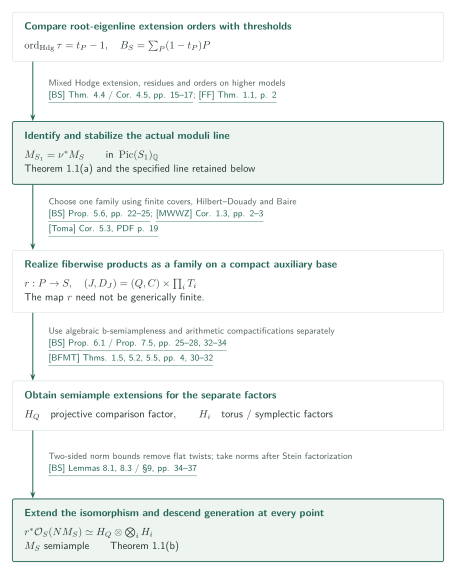
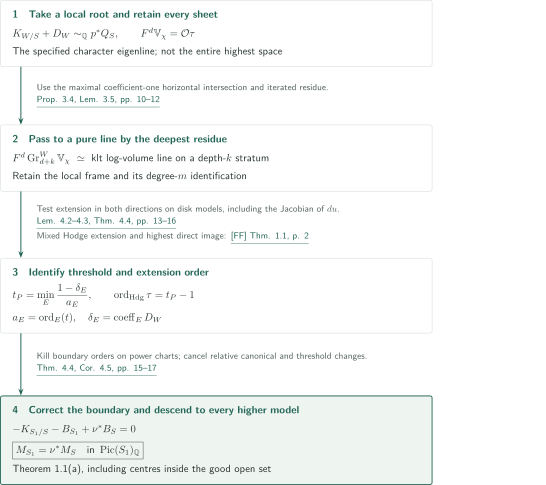
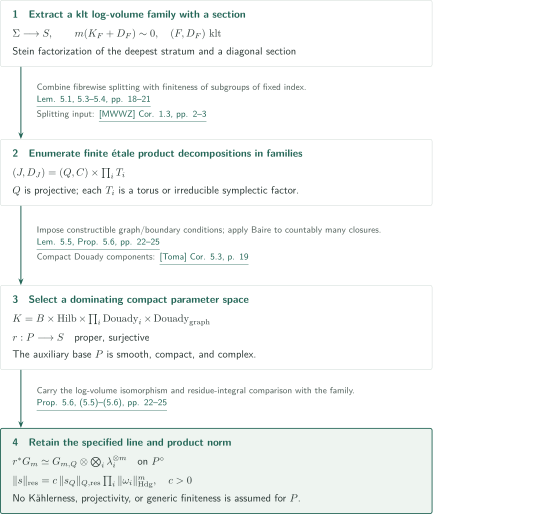
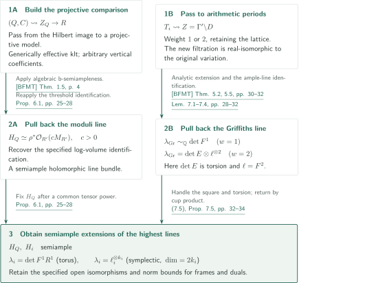
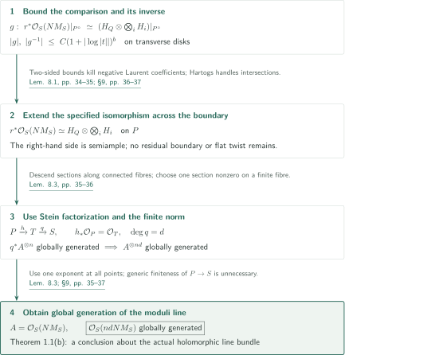

# B-semiampleness for compact log-smooth Kähler fibrations

**From threshold orders to global generation through a family of product decompositions**

The manuscript claims stabilization and semiampleness of the moduli b-line for compact log-smooth Kähler fibrations, allowing boundary coefficients equal to one. Its central steps identify the extension order of a local root eigenline with the log canonical threshold, then descend global generation of a specified holomorphic line bundle from a product family over a compact auxiliary base.

## 1. Main results

The following is the manuscript's claim. Spaces and maps are complex analytic. Equality in $\operatorname{Pic}(X)_{\mathbb Q}=\operatorname{Pic}(X)\otimes_{\mathbb Z}\mathbb Q$ means an isomorphism of holomorphic line bundles after a common positive integral multiple.

Let $f:Y\to X$ be a surjective holomorphic map with connected fibres between smooth compact connected Kähler manifolds. Let $\Delta$ be an effective rational SNC divisor with coefficients in $[0,1]$, and assume

$$
K_Y+\Delta\sim_{\mathbb Q}f^*L,\qquad L\in\operatorname{Pic}(X)_{\mathbb Q}.
$$

For a smooth compact Kähler modification $\mu:X'\to X$, resolve the main component to obtain $f':Y'\to X'$ and $h:Y'\to Y$, and set $\Delta'=h^*\Delta-K_{Y'/Y}$. For a prime divisor $P$ on $X'$, define

$$
t_P=\inf_{E\mapsto P}\frac{a(E;Y',\Delta')}{\operatorname{ord}_E((f')^*P)},\qquad
B_{X'}=\sum_P(1-t_P)P,\qquad
M_{X'}=\mu^*L-K_{X'}-B_{X'}.
$$

The infimum ranges over all divisorial valuations dominating $P$ with positive denominator; $a$ is log discrepancy. Exceptional coefficients of $\Delta'$ may be negative. This is the threshold discriminant, distinct from the inf-multiplicity divisor of an orbifold base.

[§1.1, (1.1)–(1.3) · pp. 2–3][BS]

### Theorem 1.1 — Stabilization and global generation

Under these assumptions there is a smooth compact Kähler modification $\mu_0:S\to X$ with the following properties.

(a) For every smooth compact Kähler modification $\nu:S_1\to S$,

$$
M_{S_1}=\nu^*M_S\quad\text{in }\operatorname{Pic}(S_1)_{\mathbb Q}.
$$

(b) For some positive integer $m$, the actual holomorphic line bundle representing $mM_S$ is globally generated.

The statement includes a point base and relative dimension zero. No projectivity of $f,X,Y$ is assumed.

[Theorem 1.1 · p. 3][BS]

## References on the arrows

Unprefixed result numbers refer to [BS]. External keys are [FF] for Fujino–Fujisawa, [MWWZ] for Matsumura–Wang–Wu–Zhang, [BFMT] for Bakker–Filipazzi–Mauri–Tsimerman, and [Toma] for Toma. Article Section 7 records the checks. Diagram citations link to the sources; GitHub PDF page numbers are specified in the labels.

## 2. Overview of Theorem 1.1

**Goal.** Retain the actual moduli line stabilized in (a) and obtain global generation at every point in (b). The two main parts are the threshold calculation and the product/norm comparison on an auxiliary base $P$.

### 1. Fix the stabilized line by a local calculation

Compare the root-eigenline extension order with the lct and obtain pullback identities on every higher model. Track the specified holomorphic line, not only its numerical class.

[Theorem 4.4, Corollary 4.5 · pp.15–17][BS]

### 2. Realize a product family and handle the factors separately

On a compact auxiliary base, separate the projective factor from the torus and symplectic factors. The former uses b-semiampleness for a projective comparison family; the latter use arithmetic period compactifications. Retain the same specified line and product norm.

[Proposition 5.6, Proposition 6.1, Proposition 7.5 · pp.22–34][BS]

### 3. Extend the specified isomorphism and descend generation everywhere

Two-sided norm bounds remove poles from both the isomorphism and its inverse, leaving neither boundary nor flat twists. Norms after the Stein factorization of a proper surjection give generation by one common multiple.

[Lemmas 8.1, 8.3, §9 · pp.34–37][BS]

**Use of the output.** Together (a) and (b) prove Theorem 1.1. The detailed diagrams below expand stabilization, family construction, semiampleness of the factors, and descent of the isomorphism and sections.

## 3. Theorem 1.1(a) — Read thresholds as extension orders

**Goal.** Let $p:W\to S$ be a model with SNC boundary, let $D_W$ be the crepant boundary, and put $Q_S=\mu_0^*L-K_S$. Fix $\mathcal O_W(m(K_{W/S}+D_W))\simeq p^*\mathcal O_S(mQ_S)$ for sufficiently divisible $m$. The cover obtained by taking an $m$th root of a local generator retains every component, even if disconnected.

### 1. Isolate the relevant line in the mixed Hodge structure

For the character $\chi$ of the tautological root $\tau$, the line $F^d\mathbb V_\chi=\mathcal O\tau$ has rank one. This does not assert rank one for the highest space of the entire variation. Let $k$ be the largest number of horizontal coefficient-one components meeting on a good fibre. The line lies in $\operatorname{Gr}_{d+k}^W$, and after removing the Tate twist, iterated residue identifies it with the pure eigenline of a klt log-volume on a depth-$k$ stratum. The local frame and its degree-$m$ identification are retained. If $k=0$, no residue operation is needed.

[Proposition 3.4, Lemma 3.5 · pp. 10–12][BS]

### 2. Determine the extension order in both directions

Above $P=(t=0)$, put $a_E=\operatorname{ord}_E(t)$ and $\delta_E=\operatorname{coeff}_E D_W$. The minimum on an SNC resolution equals the threshold defined using all divisorial valuations. The manuscript uses normalized root models over a disk and mixed Hodge extensions to prove

$$
t_P=\min_E\frac{1-\delta_E}{a_E},\qquad
\operatorname{ord}_{\mathrm{Hdg}}\tau
=\min_E\frac{l_E+1-a_E}{a_E}=t_P-1,\qquad l_E=-\delta_E.
$$

The Hodge order is normalized by dividing by the ramification index of the base change. After $t=u^N$, test $u^{-Nb}\tau$. Transforming the total form introduces the Jacobian of $du$. Extension holds when every $\alpha_E=l_E+1-a_E(1+b)$ is nonnegative; a negative value produces a pole on a retained component over $E$. Thus the calculation establishes necessity as well as sufficiency. The direct-image identification from [FF] applies to disk models whose strata dominate the base and are Kähler. Dualizing the lower compact-support extension gives the upper highest-line extension in ordinary cohomology.

[Lemmas 4.1–4.3, Theorem 4.4 · pp. 12–16][BS] · [FF, Theorem 1.1 · p. 2][FF]

### 3. Glue the boundary correction as an actual line bundle

If $B_S=\sum b_i(t_i=0)$, the corrected frame $\prod_iw_i^{N_ib_i}\pi^*\tau$ has order zero on a power chart $t_i=w_i^{N_i}$. A tensor power removes roots-of-units ambiguities, and Hartogs extension handles crossings. The prescribed identification extends to $\pi^*\mathcal O_S(amM_S)\simeq E_\chi^{\otimes am}$. On a higher model, retain $Q_{S_1}=\nu^*Q_S-K_{S_1/S}$ in the same calculation. Relative canonical orders cancel the change of thresholds, yielding

$$
-K_{S_1/S}-B_{S_1}+\nu^*B_S=0.
$$

This includes modifications with centres inside the good open set and proves (a).

[Theorem 4.4, Corollary 4.5 · pp. 15–17][BS]

**Use of the output.** Retain the stabilized moduli line and its specified log-volume identification; this fixes the object compared by the ensuing product decomposition.

[BS, Corollaries 4.5–4.6 · pp. 16–18][BS]

## 4. Preparing Theorem 1.1(b) — Turn fibrewise decompositions into a family

**Goal.** The deepest stratum supplies a family with klt log Calabi–Yau good fibres. Write $G_m$ for its degree-$m$ log-plurivolume line. Beyond a decomposition of each fibre, the proof needs a single family carrying both a line identification and its norm.

### 1. Enumerate product decompositions as families of finite covers

Stein factorization of the deepest stratum and resolution of a graph produce a family with a diagonal section. The finite étale decomposition supplied by [MWWZ] separates each klt fibre into a projective factor $(Q,C)$ and torus or irreducible holomorphic symplectic factors $T_i$. All boundary lies on $Q$, which may be a point. The section expresses the fundamental group as a semidirect product. Finiteness of subgroups of fixed index in the finitely generated fibre group then spreads each finite étale cover after a finite base cover.

[Lemmas 5.1, 5.3–5.4 · pp. 18–21][BS] · [MWWZ, Corollary 1.3 · pp. 2–3][MWWZ]

### 2. Use compact parameter spaces and Baire to choose one family

Hilbert schemes record the projective factor; Douady components in fixed compact Kähler spaces record the $T_i$ and the product graph. Graph, étaleness, and boundary conditions are imposed as analytically constructible conditions. Torus/symplectic type, expressed by Hodge numbers and cup-product ranks, persists along a stratum containing one point of the desired type. Countably many compact closures have images covering the good base, so Baire selects a dominating one. Its resolution gives a proper surjection $r:P\to S$. The smooth compact complex manifold $P$ is not assumed Kähler, projective, or generically finite over $S$.

[Lemma 5.5, Proposition 5.6 · pp. 22–25][BS] · [Toma, Corollary 5.3 · PDF p. 19][Toma]

### 3. Carry the specified line and norm along the decomposition

Over a dense open set $P^\circ$, the chosen finite étale cover is a family satisfying

$$
(J,D_J)=(Q,C)\times_{P^\circ}\prod_iT_i,\qquad
r^*G_m\simeq G_{m,Q}\otimes\bigotimes_i\lambda_i^{\otimes m},
$$

where $\lambda_i$ is the highest line of the corresponding factor. The residue-integral norm agrees with the product norm up to a positive constant depending only on the cover degree. This **specified isomorphism**, together with its norm, is passed to the next steps; a comparison only of numerical classes or up to an unspecified flat twist would not suffice.

[Corollary 4.6 · pp. 17–18; Proposition 5.6, (5.5)–(5.6) · pp. 22–25][BS]

**Use of the output.** The product decomposition and product norm on the same auxiliary base $P$ enter the separate treatments of the projective and torus/symplectic factors.

[BS, Proposition 5.6・§§6–7 · pp. 22–34][BS]

## 5. Obtain semiample extensions from the factors

**Goal.** Different inputs treat the projective pair $(Q,C)$ and the possibly nonprojective $T_i$. In this section, $P$ also denotes the auxiliary base after finite covers, graph resolutions, and a common tensor power.

### 1. Apply algebraic b-semiampleness to the projective factor

The compact image of $P$ in a Hilbert scheme is projective by Chow. The universal family over a projective model $R$ yields a projective lc-trivial fibration with generically effective klt boundary. Vertical coefficients in the auxiliary boundary defined by a rational frame may be negative. Pull back the line supplied by algebraic b-semiampleness in [BFMT], then reapply the manuscript's local threshold calculation to recover the specified log-volume identification and two-sided norm estimates. This does not require a global rational frame on the original nonprojective space.

[Proposition 6.1 · pp. 25–28][BS] · [BFMT, Theorem 1.5, Definition 6.18, Theorem 6.28 · pp. 4, 42, 44][BFMT]

### 2. Replace the real polarization and pass to arithmetic period quotients

Since the $T_i$ occur inside a fixed compact Kähler space, its Kähler class supplies flat real polarizations. Lemma 7.1 uses a nearby rational monodromy-invariant form and a commuting real automorphism to change the filtration while retaining the lattice. It does not make the original fibres rationally polarized, but a real isomorphism compares the holomorphic Hodge bundles and their extensions. Weight $1$ for tori and weight $2$ with $h^{2,0}=1$ for symplectic factors give maps to neat Siegel or type IV arithmetic quotients. Analytic extension of the period map, with the Griffiths-line identification, pulls back sections of an ample line on the compactification.

[Lemmas 7.1–7.4 · pp. 28–32][BS] · [BFMT, Theorems 5.2, 5.5 · pp. 30–32][BFMT]

### 3. Recover the required highest lines from Griffiths lines

For a torus, $\lambda_i\simeq\det F^1R^1$. For a symplectic factor of dimension $2k_i$, put $\ell_i=F^2R^2$; cup product gives $\lambda_i\simeq\ell_i^{\otimes k_i}$. The weight-$2$ Griffiths line is $\det E\otimes\ell_i^{\otimes2}$. Its **square** and the finite-order factor $\det E$ must be handled before concluding semiampleness of $\ell_i$. A common finite cover treats all monodromies; compatibility of extensions with tensor and cup products yields semiample extensions $H_Q,H_i$ of the specified lines.

[Lemma 7.3, §7.4, Proposition 7.5, (7.5) · pp. 30, 32–34][BS]

**Use of the output.** Tensor the semiample extensions and retain the two-sided norm bounds needed to extend the specified isomorphism across the boundary.

[BS, Lemma 8.1・§9 · pp. 34–37][BS]

## 6. Theorem 1.1(b) — Extend the specified isomorphism and descend sections

**Goal.** The preceding identifications initially live on $P^\circ$. First extend them without a residual boundary twist; then descend global generation through a proper surjection.

### 1. Exclude poles of both the isomorphism and its inverse

Corollary 4.6 and Propositions 6.1 and 7.5 bound norms of local frames and their duals by powers of logarithms. The product-norm identity therefore bounds the coefficient $g$ of the comparison and $g^{-1}$ on transverse disks by logarithmic powers. Negative Laurent coefficients vanish, so both extend holomorphically. Holomorphic dependence in tangential directions and Hartogs extension handle intersections. For a common sufficiently divisible $N>0$, this gives an actual holomorphic line-bundle isomorphism

$$
r^*\mathcal O_S(NM_S)\simeq H_Q\otimes\bigotimes_iH_i.
$$

The right-hand factors absorb the required common tensor powers. Extending the specified open isomorphism also excludes an invisible flat twist.

[Lemma 8.1 · pp. 34–35; §9 · pp. 36–37][BS]

### 2. Descend generation by norms without generic finiteness

Write the Stein factorization as $P\xrightarrow{h}T\xrightarrow{q}S$ with $\deg q=d$. Since $h_*\mathcal O_P=\mathcal O_T$, sections descend to $T$. If $q^*A^{\otimes n}$ is globally generated, for every $s\in S$ choose a single section nonzero at all points of the finite set $q^{-1}(s)$. Its norm is a section of $A^{\otimes nd}$ nonzero at $s$. Even if $q$ is not flat, the generic product extends by normality. The same $n,d$ work at every point, so $A$ is semiample. Apply this to $A=\mathcal O_S(NM_S)$ to obtain (b).

[Lemma 8.3 · pp. 35–36; §9 · pp. 36–37][BS]

**Use of the output.** One common multiple is generated at every point of $S$. Together with pullback stability in (a), this proves semiampleness of the moduli b-line. No direct dependency with another 033 paper is inferred from this conclusion.

[BS, Theorem 1.1・§9 · pp. 3, 36–37][BS]

## 7. Which papers supply which steps

| Input | Use and role | Check performed |
|---|---|---|
| [FF, Theorem 1.1][FF], v3, p. 2 | §3 and Lemma 4.2: mixed Hodge extension and highest direct image for SNC families with Kähler strata | Statement and application model compared |
| [MWWZ, Corollary 1.3][MWWZ], v1, pp. 2–3 | Lemma 5.3: finite étale splitting of effective klt fibres with numerically trivial log canonical class | Statement and hypotheses compared |
| [Toma, Corollary 5.3][Toma], v3, PDF p. 19 | Proposition 5.6: compact Douady components in fixed compact Kähler spaces | Statement and use compared |
| [BFMT, Theorem 1.5 / Definition 6.18 / Theorem 6.28][BFMT], v2, pp. 4, 42, 44 | Proposition 6.1: projective comparison and Hodge/threshold moduli | Generic effectivity, rank condition, and use compared |
| [BFMT, Theorems 5.2, 5.5][BFMT], v2, pp. 30–32 | Lemma 7.4: analytic pullback of an ample Griffiths extension | Statements and local liftability compared |

These are direct inputs to auxiliary results in [BS]. Their complete proofs were not verified. Uses of Baily–Borel algebraicity, Fujiki countability, compactification of finite covers, and general pure Hodge extension theory were read in [BS], but the corresponding external passages remain unchecked. The statement on p. 3 that the Campana orbifold Iitaka theorem is not used does not exclude other external dependencies. Direct dependencies involving other Catalog 033 papers or Catalog 034 remain uninvestigated.

## 8. Return to the sources

The source is OpenAI's September 10, 2026 manuscript, 38 pages, pinned at commit `fd4aeeb2ee4fc729c18d98444fed42fd0529eeeb`. Follow [§§3–4, pp. 6–18][BS] for eigenlines and thresholds, [Proposition 5.6, pp. 22–25][BS] for the family construction, and [§§6–9, pp. 25–37][BS] for factor semiampleness and descent.

The editorial reading covered the setup and both conclusions of Theorem 1.1, the cited proof passages, and the listed external statements at their applications. It does not certify the complete proof. The construction of mixed Hodge extensions, all details of the Hilbert–Douady parameter spaces, and the change of real polarization with all extension compatibilities were not independently proved. Connections whose external sources remain unchecked are left pending and distinguished from the author's claims.

[BS]: https://github.com/openai/math/blob/fd4aeeb2ee4fc729c18d98444fed42fd0529eeeb/preprints/B-semiampleness-for-compact-log-smooth-Kahler-fibrations-September-10-2026/paper.pdf
[BFMT]: https://arxiv.org/pdf/2508.19215v2
[FF]: https://arxiv.org/pdf/2304.00672v3
[MWWZ]: https://arxiv.org/pdf/2506.23218v1
[Toma]: https://arxiv.org/pdf/1103.5835v3
