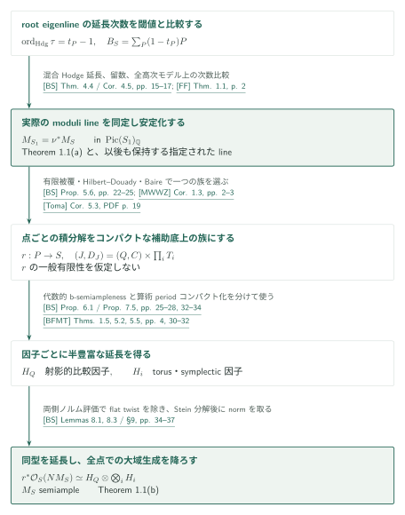
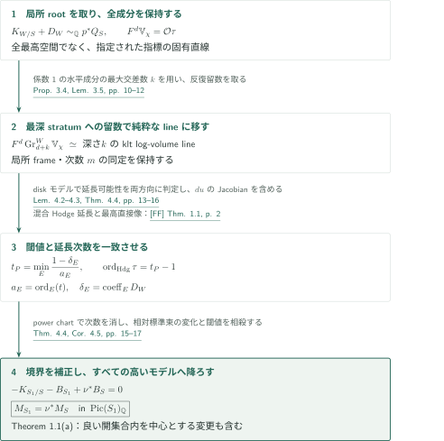
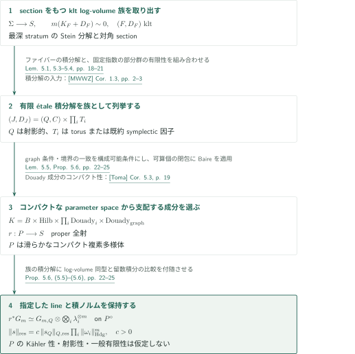
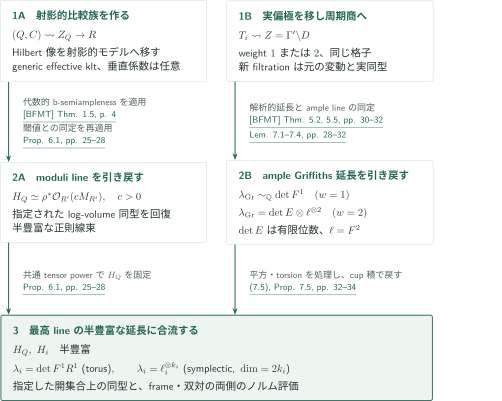
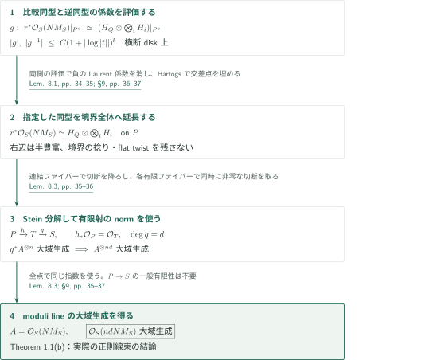

# B-semiampleness for compact log-smooth Kähler fibrations

**閾値とHodge延長の一致から、積分解を介した大域生成へ**

本稿は、係数1の境界を許すコンパクトlog-smooth Kähler fibrationについて、moduli b-lineの安定化と半豊富性を主張する。証明の核心は、局所的なroot eigenlineの延長次数をlog canonical thresholdと一致させ、別途構成するコンパクトな補助底上の積分解から、指定された正則線束の大域生成を降ろすことである。

## 1. 主要結果

以下は原稿の主張である。すべて複素解析的な空間・写像とし、$\operatorname{Pic}(X)_{\mathbb Q}=\operatorname{Pic}(X)\otimes_{\mathbb Z}\mathbb Q$の等号は、共通の正整数倍を取った正則線束の同型を意味する。

$f:Y\to X$を滑らかなコンパクト連結Kähler多様体間の、連結ファイバーをもつ全射正則写像とする。$\Delta$は有効有理SNC因子で、係数は$[0,1]$に属し、

$$
K_Y+\Delta\sim_{\mathbb Q}f^*L,\qquad L\in\operatorname{Pic}(X)_{\mathbb Q}
$$

を仮定する。滑らかなコンパクトKähler modification $\mu:X'\to X$に対し、主成分の解消$f':Y'\to X'$、$h:Y'\to Y$を取り、$\Delta'=h^*\Delta-K_{Y'/Y}$とする。$X'$の素因子$P$に対して

$$
t_P=\inf_{E\mapsto P}\frac{a(E;Y',\Delta')}{\operatorname{ord}_E((f')^*P)},\qquad
B_{X'}=\sum_P(1-t_P)P,\qquad
M_{X'}=\mu^*L-K_{X'}-B_{X'}
$$

と定める。分母が正で、$P$を支配するすべての因子的付値を走らせ、$a$はlog discrepancyを表す。例外成分上の$\Delta'$は負になり得る。これは閾値によるdiscriminantであり、orbifold基底のinf-multiplicity divisorとは異なる。

[§1.1, (1.1)–(1.3) · pp. 2–3][BS]

### Theorem 1.1 — 安定化と大域生成

上の仮定のもとで、滑らかなコンパクトKähler modification $\mu_0:S\to X$が存在し、次の二つが成り立つ。

(a) 任意の滑らかなコンパクトKähler modification $\nu:S_1\to S$に対し、

$$
M_{S_1}=\nu^*M_S\quad\text{in }\operatorname{Pic}(S_1)_{\mathbb Q}.
$$

(b) ある正整数$m$に対して、$mM_S$を表す実際の正則線束が大域生成される。

点を底とする場合と相対次元$0$も含む。$f,X,Y$の射影性は仮定しない。

[Theorem 1.1 · p. 3][BS]

## 図の矢印に付した引用

略号なしの結果番号は本稿[BS]を指す。[FF]＝Fujino–Fujisawa、[MWWZ]＝Matsumura–Wang–Wu–Zhang、[BFMT]＝Bakker–Filipazzi–Mauri–Tsimerman、[Toma]＝Toma。外部入力の照合範囲は第7節に記す。図の引用は原典にリンクし、GitHub閲覧URLのページは表示ラベルで指定する。

## 2. Theorem 1.1の全体像

**目標。** (a)で安定化する実際のmoduli lineを最後まで保持し、(b)の大域生成を全点で得る。閾値計算と、補助底$P$上での積分解・ノルムの比較が二つの主要部分である。

### 1. 安定化するlineを局所計算で固定する

root eigenlineの延長次数をlctと比較し、任意の高いモデルに対する引戻し恒等式を得る。数値類ではなく指定した正則lineを追跡する。

[Theorem 4.4・Corollary 4.5 · pp.15–17][BS]

### 2. 積分解を族にし、因子ごとに半豊富性を得る

コンパクトな補助底上で射影的因子とtorus・symplectic因子へ分解する。前者は射影的比較族のb-semiampleness、後者は算術periodコンパクト化を使う。同じ指定lineと積ノルムを保持する。

[Proposition 5.6・Proposition 6.1・Proposition 7.5 · pp.22–34][BS]

### 3. 指定同型を延長して全点での生成を降ろす

両側のノルム評価で同型と逆同型の極を除き、境界とflat twistを残さない。proper全射のStein分解後にnormを取り、一つの共通倍での大域生成を得る。

[Lemmas 8.1, 8.3・§9 · pp.34–37][BS]

**得られた結果の使い道。** (a)と(b)を合わせてTheorem 1.1を得る。以後の詳細図では、安定化、族の構成、因子の半豊富性、同型と切断の降下を順に展開する。

## 3. Theorem 1.1(a) — 閾値を延長次数として読む

**目標。** $p:W\to S$をSNC境界をもつモデルとし、$D_W$をcrepant境界、$Q_S=\mu_0^*L-K_S$とする。十分可除な$m$について$\mathcal O_W(m(K_{W/S}+D_W))\simeq p^*\mathcal O_S(mQ_S)$を固定する。局所生成元の$m$乗根から作る被覆は、非連結でもすべての成分を保持する。

### 1. 混合Hodge構造から使う直線だけを取り出す

tautological root $\tau$の指標を$\chi$とすると、$F^d\mathbb V_\chi=\mathcal O\tau$はrank oneである。これは変動全体の最高空間のrank one性ではない。良いファイバー上で係数1の水平成分が同時に交わる最大数を$k$とすると、この直線は$\operatorname{Gr}_{d+k}^W$に入り、反復留数によって、Tate twistを除けば深さ$k$のstratum上のklt log-volumeの純粋な固有直線に移る。局所frameとその次数$m$の同定も保持される。$k=0$なら留数操作は不要である。

[Proposition 3.4, Lemma 3.5 · pp. 10–12][BS]

### 2. 延長可能な次数を上下から決める

$P=(t=0)$の上で$a_E=\operatorname{ord}_E(t)$、$\delta_E=\operatorname{coeff}_E D_W$とする。SNC解消上の最小値は、すべての因子的付値で定めた閾値に一致する。原稿は、disk上の正規化rootモデルと混合Hodge延長を使い、

$$
t_P=\min_E\frac{1-\delta_E}{a_E},\qquad
\operatorname{ord}_{\mathrm{Hdg}}\tau
=\min_E\frac{l_E+1-a_E}{a_E}=t_P-1,\qquad l_E=-\delta_E
$$

を示す。Hodge次数は基底変更の分岐指数で割った正規化次数である。$t=u^N$の後に$u^{-Nb}\tau$を試すと、全形式の変換に$du$のJacobianが入る。各$\alpha_E=l_E+1-a_E(1+b)$が非負なら延長し、負のものがあればその上の成分を残した被覆で極が生じるため延長しない。十分性だけでなく必要性を確保する計算である。[FF]の直接像同定は、全stratumが底を支配しKählerであるdiskモデルに適用される。compact-support側のlower延長を双対化してordinary cohomology側のupper最高lineを読む。

[Lemmas 4.1–4.3, Theorem 4.4 · pp. 12–16][BS] · [FF, Theorem 1.1 · p. 2][FF]

### 3. 境界補正を実際の線束として貼り合わせる

$B_S=\sum b_i(t_i=0)$なら、power chart $t_i=w_i^{N_i}$上で$\prod_iw_i^{N_ib_i}\pi^*\tau$は次数$0$になる。十分なtensor powerでroot of unitの曖昧さを消し、Hartogs延長で交差点も埋めると、指定した開集合上の同定が$\pi^*\mathcal O_S(amM_S)\simeq E_\chi^{\otimes am}$へ延長する。さらに$S_1\to S$では$Q_{S_1}=\nu^*Q_S-K_{S_1/S}$を保って同じ計算を行う。相対標準束の次数と新しい閾値の差が相殺され、

$$
-K_{S_1/S}-B_{S_1}+\nu^*B_S=0
$$

を得る。中心が良い開集合の内部にあるmodificationも含まれ、これが(a)を与える。

[Theorem 4.4, Corollary 4.5 · pp. 15–17][BS]

**得られた結果の使い道。** 安定化したmoduli lineと、指定されたlog-volume lineの同定を以後も保持する。次の積分解で比較する対象がこれで固定される。

[BS, Corollaries 4.5–4.6 · pp. 16–18][BS]

## 4. Theorem 1.1(b)の準備 — 点ごとの積分解を族にする

**目標。** 前節の深いstratumから、良いファイバーがklt log Calabi–Yauとなる族を取り出す。$G_m$は次数$m$のlog-plurivolume lineである。必要なのは、ファイバーごとの分解に加えて、lineの同定とノルムを保持する一つの族である。

### 1. 積分解を有限被覆の族として列挙する

最深stratumのStein分解とgraphの解消を用いて、対角sectionをもつ族を作る。各kltファイバーは[MWWZ]の有限étale積分解をもち、射影的な因子をまとめた$(Q,C)$とtorus・既約holomorphic symplectic因子$T_i$に分かれる。境界は$Q$側に集まり、$Q$が点の場合も許す。sectionにより基本群を半直積として記述でき、有限生成なファイバー基本群の固定指数部分群が有限個であることから、有限底被覆の後に各有限étale被覆を族へ広げる。

[Lemmas 5.1, 5.3–5.4 · pp. 18–21][BS] · [MWWZ, Corollary 1.3 · pp. 2–3][MWWZ]

### 2. コンパクトなparameter spaceとBaireで一つの族を選ぶ

射影的因子はHilbert schemeで、$T_i$と分解のgraphは固定コンパクトKähler空間のDouady成分で記録する。積のgraph・étale性・境界の一致を解析的構成可能条件として課す。Hodge数とcup積のrankで指定するtorus/symplectic型は、正しい一点を含むstratum上で維持する。可算個のコンパクトな閉包の像が良い底を覆うため、Baireによって一つが支配し、その解消からproper全射$r:P\to S$を得る。$P$は滑らかなコンパクト複素多様体だが、Kähler・射影的・$S$上一般有限とは仮定しない。

[Lemma 5.5, Proposition 5.6 · pp. 22–25][BS] · [Toma, Corollary 5.3 · PDF p. 19][Toma]

### 3. 分解とともに指定したlineとノルムを運ぶ

稠密開集合$P^\circ$上で、選んだ有限étale被覆は族として

$$
(J,D_J)=(Q,C)\times_{P^\circ}\prod_iT_i,\qquad
r^*G_m\simeq G_{m,Q}\otimes\bigotimes_i\lambda_i^{\otimes m}
$$

を満たす。ここで$\lambda_i$は各因子の最高lineである。留数積分で定めたノルムは、被覆次数だけから来る正定数を除いて右辺の積ノルムと一致する。この**特定の同型**とノルムを次節以降へ渡すことが、数値類や不特定のflat twistを残す比較との違いである。

[Corollary 4.6 · pp. 17–18; Proposition 5.6, (5.5)–(5.6) · pp. 22–25][BS]

**得られた結果の使い道。** 同じ補助底$P$上の積分解と積ノルムを、射影的因子とtorus・symplectic因子の個別処理へ渡す。

[BS, Proposition 5.6・§§6–7 · pp. 22–34][BS]

## 5. 各因子から半豊富な延長を得る

**目標。** 射影的な$(Q,C)$と、非射影的でもよい$T_i$には異なる入力を使う。以下では有限被覆・graphの解消・共通tensor powerを取った後の補助底も$P$と書く。

### 1. 射影的因子にだけ代数的b-semiamplenessを適用する

$P$からHilbert schemeへの像はコンパクトであり、Chowの定理により射影的である。その射影的モデル$R$上の普遍族から、generic kltでgeneric boundaryが有効なprojective lc-trivial fibrationを作る。rational frameから定める補助境界の垂直成分は負でもよい。[BFMT]の代数的b-semiamplenessで得たlineを引き戻し、本稿の局所閾値計算を再適用して、元の指定されたlog-volume lineとの同定と両側のノルム評価を回復する。原来の非射影的空間に大域的有理frameを仮定する手順ではない。

[Proposition 6.1 · pp. 25–28][BS] · [BFMT, Theorem 1.5, Definition 6.18, Theorem 6.28 · pp. 4, 42, 44][BFMT]

### 2. 実偏極を有理偏極へ移して周期商に写す

$T_i$は固定コンパクトKähler空間内の部分多様体なので、固定Kähler類からflatな実偏極を得る。本稿Lemma 7.1は、近い有理モノドロミー不変形式と可換な実自己同型を用い、同じ格子をもつ別のfiltrationへ移す。元の各ファイバーが有理偏極されるという主張ではないが、実同型によって正則Hodge束とその延長を比較できる。torusにはweight $1$、symplectic因子には$h^{2,0}=1$のweight $2$を用い、neat levelでSiegel / type IVの算術商へ写す。解析的period mapの境界延長とGriffiths lineの同定を使って、コンパクト化上のample lineの切断を引き戻す。

[Lemmas 7.1–7.4 · pp. 28–32][BS] · [BFMT, Theorems 5.2, 5.5 · pp. 30–32][BFMT]

### 3. Griffiths lineから必要な最高lineへ戻す

torusでは$\lambda_i\simeq\det F^1R^1$である。symplectic因子の次元を$2k_i$、$\ell_i=F^2R^2$とすると、cup積により$\lambda_i\simeq\ell_i^{\otimes k_i}$となる。weight $2$のGriffiths lineは$\det E\otimes\ell_i^{\otimes2}$なので、この**平方**と$\det E$の有限位数を処理してから$\ell_i$の半豊富性を得る。共通有限被覆で全因子のモノドロミーを処理し、延長のtensor/cup積との整合性を使うと、指定したlineに半豊富な延長$H_Q,H_i$が得られる。

[Lemma 7.3, §7.4, Proposition 7.5, (7.5) · pp. 30, 32–34][BS]

**得られた結果の使い道。** 得た半豊富な延長をテンソル積にし、指定された同型を境界を越えて延長するための両側ノルム評価とともに次節へ渡す。

[BS, Lemma 8.1・§9 · pp. 34–37][BS]

## 6. Theorem 1.1(b) — 指定した同型を延長して切断を降ろす

**目標。** 前節までの同型は$P^\circ$上で与えられている。これを境界の捻りを残さずに延長する段階と、proper全射から大域生成を降ろす段階を分ける。

### 1. 同型と逆同型の両方から極を排除する

Corollary 4.6、Proposition 6.1、Proposition 7.5は、局所frameとその双対にlogの冪によるノルム評価を与える。積ノルムの一致により、比較同型の係数$g$と$g^{-1}$は境界に横断的なdisk上でともにlogの冪で抑えられる。Laurent展開の負の係数は消え、両者が正則に延びる。横方向の正則性とHartogs延長により交差点も処理され、共通の十分可除な$N>0$について

$$
r^*\mathcal O_S(NM_S)\simeq H_Q\otimes\bigotimes_iH_i
$$

という実際の正則線束の同型になる。右辺には必要な共通tensor powerを吸収した。開集合上の指定した同型を延ばすため、見えないflat twistも残らない。

[Lemma 8.1 · pp. 34–35; §9 · pp. 36–37][BS]

### 2. 一般有限性を仮定せずnormで大域生成を降ろす

$r$のStein分解を$P\xrightarrow{h}T\xrightarrow{q}S$、$\deg q=d$とする。$h_*\mathcal O_P=\mathcal O_T$により、引き戻しlineの切断は$T$へ降りる。$q^*A^{\otimes n}$が大域生成なら、任意の$s\in S$に対して有限集合$q^{-1}(s)$のすべてで非零な一つの切断を選べる。そのnormは$A^{\otimes nd}$の切断となり$s$で非零である。$q$がflatでなくても、一般点での積を正規性により延長できる。同じ$n,d$が全点で使えるので、$A$は半豊富となる。$A=\mathcal O_S(NM_S)$に適用して(b)が従う。

[Lemma 8.3 · pp. 35–36; §9 · pp. 36–37][BS]

**得られた結果の使い道。** ある一つの共通倍が$S$の全点で生成され、(a)の引戻し安定性と合わせてmoduli b-lineの半豊富性を得る。他の033稿への直接依存はこの結論から推定しない。

[BS, Theorem 1.1・§9 · pp. 3, 36–37][BS]

## 7. どの論文が、どの段階を担うか

| 入力 | 使用箇所と役割 | 今回の照合 |
|---|---|---|
| [FF, Theorem 1.1][FF]、v3、p. 2 | §3、Lemma 4.2：Kähler stratumをもつSNC族の混合Hodge延長と最高直接像 | 定理文・適用モデルを照合 |
| [MWWZ, Corollary 1.3][MWWZ]、v1、pp. 2–3 | Lemma 5.3：数値的に自明なlog canonical classをもつeffective kltファイバーの有限étale積分解 | 定理文・仮定を照合 |
| [Toma, Corollary 5.3][Toma]、v3、PDF p. 19 | Proposition 5.6：固定コンパクトKähler空間のDouady成分のコンパクト性 | 記述・使用箇所を照合 |
| [BFMT, Theorem 1.5 / Definition 6.18 / Theorem 6.28][BFMT]、v2、pp. 4, 42, 44 | Proposition 6.1：射影的比較族の半豊富性とHodge/threshold moduliの比較 | generic effectivity・rank条件・用途を照合 |
| [BFMT, Theorems 5.2, 5.5][BFMT]、v2、pp. 30–32 | Lemma 7.4：ample Griffiths延長を算術商から解析的に引き戻す | 定理文・局所liftabilityを照合 |

これらは本稿の補助結果に対する直接入力である。外部定理の証明全体は検証していない。Baily–Borelの算術商の代数性、Fujikiの可算性、有限被覆のコンパクト化、純Hodge延長の一般理論については、本稿内の用途を読んだが外部原典の該当箇所の照合を残した。本稿p. 3の「Campana orbifold Iitaka theoremを使わない」という記述から、他の外部依存まで排除しない。カタログ033の他稿および034との直接依存は未調査である。

## 8. 原典を読む入口と確認範囲

原典はOpenAI、2026年9月10日稿、全38ページ。上記[BS]はcommit `fd4aeeb2ee4fc729c18d98444fed42fd0529eeeb`の固定版である。[§§3–4 · pp. 6–18][BS]で固有直線と閾値の接続、[Proposition 5.6 · pp. 22–25][BS]で族の構成、[§§6–9 · pp. 25–37][BS]で因子の半豊富性から降下までを辿れる。

編集側ではTheorem 1.1の設定・二つの結論、上記の証明箇所、外部入力の記述と適用箇所を読んで照合した。これは原稿の全証明が数学的に正しいと認証するものではない。混合Hodge延長の構成、Hilbert–Douadyによる全parameter-space構成の細部、実偏極の変更と全延長の整合性は独立した証明検証をしていない。外部原典を未照合とした接続は保留し、定理の著者の主張と区別する。

[BS]: https://github.com/openai/math/blob/fd4aeeb2ee4fc729c18d98444fed42fd0529eeeb/preprints/B-semiampleness-for-compact-log-smooth-Kahler-fibrations-September-10-2026/paper.pdf
[BFMT]: https://arxiv.org/pdf/2508.19215v2
[FF]: https://arxiv.org/pdf/2304.00672v3
[MWWZ]: https://arxiv.org/pdf/2506.23218v1
[Toma]: https://arxiv.org/pdf/1103.5835v3
