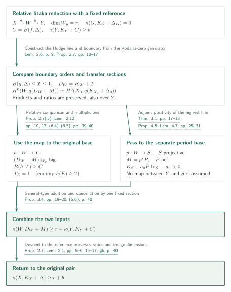
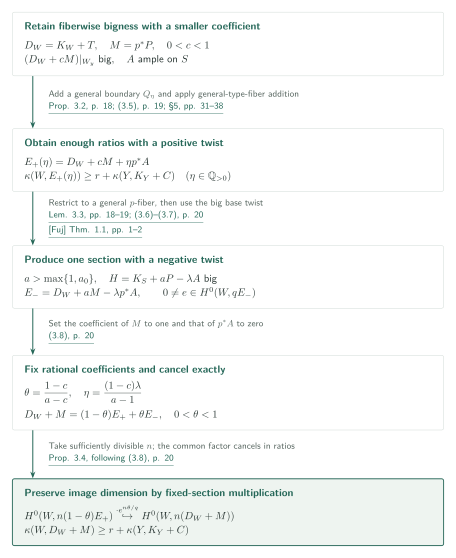
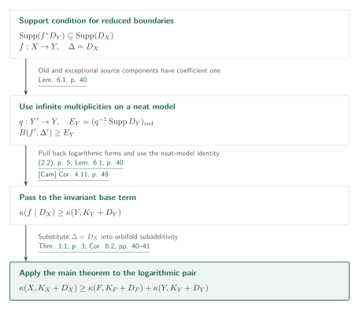
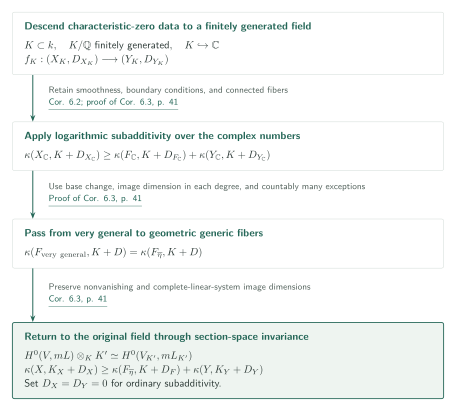

# Orbifold and logarithmic Iitaka subadditivity

**Exact section comparison on the relative Iitaka base and two positivity inputs**

The manuscript asserts orbifold subadditivity for rational SNC pairs in Fujiki class C, including boundary coefficient one. Its argument retains the original logarithmic pluricanonical sections on a relative Iitaka base and combines adjoint positivity of a Hodge line with addition for log-general-type fibers. A fixed section removes the final ample twist by multiplication.

## 1. Main results

### Theorem 1.1 — Orbifold subadditivity

Let $X$ be a smooth compact connected complex manifold in Fujiki class C, and let $\Delta$ be an SNC boundary with coefficients in $\mathbb Q\cap[0,1]$. Let $f:X\to Y$ be a surjective holomorphic map with connected fibers onto a normal compact irreducible complex space. For a very general smooth fiber $F$ and $\Delta_F=\Delta|_F$, the manuscript proves

$$
\kappa(X,K_X+\Delta)\geq \kappa(F,K_F+\Delta_F)+\kappa(f\mid\Delta).
$$

A point has Iitaka dimension zero, and $(-\infty)+a=-\infty$, including $a=-\infty$.

On a smooth-base model, put

$$
m_\Delta(E)=\frac1{1-\Delta_E},\qquad
m(f,\Delta;D)=\min_{E\mapsto D}\operatorname{ord}_E(f^*D)m_\Delta(E),
$$

$$
B(f,\Delta)=\sum_D\left(1-\frac1{m(f,\Delta;D)}\right)D.
$$

Here $1/0=\infty$ and $1/\infty=0$; no divisibility condition is imposed. The base term in the theorem is the invariant

$$
\kappa(f\mid\Delta)=\inf_{f'\sim f}\kappa(Y',K_{Y'}+B(f',\Delta'))
$$

over the orbifold birational equivalence allowed by (1.2), rather than the dimension of the orbifold base on an arbitrary model. For a normal singular base, resolve the base and the main component, using the strict transform of $\Delta$ plus the reduced divisor exceptional over the original source.

[Theorem 1.1 · (1.1)–(1.4) · pp. 2–3][OI]

### Corollary 6.2 — Logarithmic subadditivity

Let $f:X\to Y$ be a surjective morphism with connected fibers between smooth connected projective complex varieties. Let $D_X,D_Y$ be reduced SNC divisors, allowing zero, and assume

$$
\operatorname{Supp}(f^*D_Y)\subseteq\operatorname{Supp}(D_X).
$$

For a very general fiber $F$ and $D_F=D_X|_F$,

$$
\kappa(X,K_X+D_X)\geq\kappa(F,K_F+D_F)+\kappa(Y,K_Y+D_Y).
$$

The same statement holds for holomorphic fibrations between smooth compact manifolds in Fujiki class C.

[Corollary 6.2 · pp. 40–41][OI]

### Corollary 6.3 — Ordinary subadditivity in characteristic zero

Let $k$ be an algebraically closed field of characteristic zero, and let $f:X\to Y$ be a surjective morphism with connected fibers between smooth connected projective $k$-varieties. For its geometric generic fiber $F$,

$$
\kappa(X)\geq\kappa(F)+\kappa(Y).
$$

More generally, the logarithmic inequality holds over $k$ under the same boundary hypotheses as Corollary 6.2, again replacing a very general complex fiber by the geometric generic fiber.

[Corollary 6.3 · p. 41][OI]

## References on the arrows

Unprefixed result numbers refer to this manuscript [OI]. The main external inputs use the following keys.

- [Fuj] Fujino: weak positivity. Author version 0.54 (June 30, 2015).
- [FF] Fujino–Fujisawa: canonical extensions. Author version 0.55 (March 11, 2025).
- [Vil] Villadsen: compactification. arXiv v1.
- [BC] Brunebarbe–Cadorel: logarithmic general type. arXiv v1.
- [BT] Bakker–Tsimerman: Ax–Schanuel. arXiv v1.
- [KP] Kovács–Patakfalvi: stable-family positivity. The 62-page author manuscript.
- [Cam] Campana: the orbifold base. arXiv v8.

Page locators are displayed in the links; GitHub PDF previews are not assumed to navigate to a specified page automatically.

## 2. Proof of Theorem 1.1 — Transfer to the relative Iitaka base

**Proof route.** The main proof combines exact section comparison on the relative Iitaka base with two positivity inputs. The next section expands the final [cancellation of the ample twist](#proof-2); the resulting lower bound then yields [logarithmic subadditivity](#proof-3) and the [characteristic-zero statement](#proof-4). The [additional inputs to WV](#proof-5) form a separate part of the article.

Exclude the automatic case where either right-hand term is $-\infty$, and put $r=\kappa(F,K_F+\Delta_F)\geq0$ and $b=\kappa(f\mid\Delta)\geq0$. Below, $X,W,Y$ denote allowed common models; $(X_0,\Delta_0)$ is the fixed smooth reference pair to which sections descend. The map $h:W\to Y$ retains the original base, while $p:W\to S$ is a separate map arising from periods.

### 1. Preserve exceptional coefficients and fix the original base

Resolve the base and flatten before resolving the source. Source primes mapping into base codimension at least two become exceptional over a fixed smooth reference. Taking the strict transform plus reduced exceptional boundary makes the difference of log canonical divisors effective and exceptional; pluricanonical sections, products, and ratios are preserved. Fix the resulting smooth base $Y$ and set $C=B(f,\Delta)$. Further changes of $W$ retain $C$ and the coefficient-one condition, together with $\kappa(Y,K_Y+C)\geq b$.

[Lemma 2.1 · Corollaries 2.3, 2.5 · Lemmas 2.4, 2.6 · pp. 5–9; §6 · p. 39][OI]

### 2. Replace the Kodaira-zero fiber by an actual Hodge line

The relative Iitaka factorization $X\xrightarrow{g}W\xrightarrow{h}Y$ has $\dim W_y=r$ and logarithmic Iitaka dimension zero on a very general $g$-fiber $G$. Take a root of a relative generating form $s$ in a sufficiently divisible degree and use the highest Hodge part of its distinguished character. This does not assert that the entire highest Hodge space is a line. Coefficient-one boundary requires the mixed Hodge structure of an open fiber and passage to the unique nonzero pure weight grade. The extension theorem [FF] retains this identification at the boundary.

[Lemmas 2.6, 2.8–2.10 · pp. 9–15][OI] · [FF, Theorem 1.1(ii), (iv) · p. 2][FF]

The boundary $T$ compares the original form's allowed poles with its Hodge-extension order. In the notation of §2.6.3,

$$
\alpha_D=\min_{E\mapsto D}\frac{l_E+\Delta_E}{a_E},\qquad
\beta_D=\min_{E\mapsto D}\frac{l_E+1-a_E}{a_E},\qquad T_D=\alpha_D-\beta_D.
$$

Here $a_E=\operatorname{ord}_E(g^*D)$ and $l_E=m^{-1}\operatorname{ord}_E(s\wedge g^*\omega^m)$, where $\omega$ is a local ordinary base volume form. The minima include every component of the prepared SNC source. This gives $B(g,\Delta)\leq T\leq1$ and, in sufficiently divisible degrees $q$,

$$
H^0(W,q(K_W+T+M))\simeq H^0(X_0,q(K_{X_0}+\Delta_0)).
$$

The untested primes mapping into base codimension at least two are exceptional over the reference. Descend first to $X_0$, then extend across codimension two. Specifying this reference is the bridge from a generic formula to actual global section spaces.

[Proposition 2.7 · (2.12), (2.14), (2.16) · pp. 10, 13–17][OI]

### 3. Recover the hypotheses for addition from relative section comparison

Proposition 2.7(iv) also identifies direct images over $Y$ and preserves section ratios. The relative Iitaka image has dimension $r=\dim W_y$, so $K_W+T+M$ is big on very general $h$-fibers. Independently, the multiplication of weighted orders in Lemma 2.12 gives $B(h,T)\geq C$ and coefficient one on every prime of $W$ mapping into codimension at least two in $Y$. Both are hypotheses required for addition.

[Proposition 2.7(iv) · Lemma 2.12 · pp. 10, 17; (6.3)–(6.5) · pp. 39–40][OI]

### 4. Supply adjoint positivity on the period base

Theorem 3.1 starts with the highest Hodge line of a complex direct summand of a pure real-polarizable variation. After modification it supplies a smooth projective $S$ with $M=p^*P$, $P$ nef, and $K_S+a_0P$ big. The integral lattice belongs to the ambient variation; the chosen complex summand need not be rational.

The proof constructs a quotient from the full periods of rational adjoint factors. Compactification [Vil] and the Moishezon criterion [BC] provide a projective model. If $D_S$ marks nonidentity local monodromy, including finite nonidentity monodromy, then $K_S+D_S$ is big. Lemma 4.6 uses [BT] and other inputs to assert $\nu(P|_{D_i})<\nu(P)$ for each component. In Lemma 4.7, the available section count has degree $\nu(P)$ in the coefficient $t$, whereas the boundary loss has smaller degree. This makes $K_S+a_0P$ big. The rank of the chosen-line map is distinguished from the rank of the full period map.

[Theorem 3.1 · pp. 17–18; Proposition 4.5 · Lemmas 4.6–4.7 · pp. 25–31][OI] · [Vil, Theorem 2.19 · p. 16][Vil] · [BC, Theorem 1.1 / Corollary 1.3 · pp. 1–2][BC] · [BT, Theorem 1.1 · p. 2][BT]

### 5. Apply addition and return the sections to the original source

All hypotheses of Proposition 3.4 now hold. The section operation explained below gives

$$
\kappa(W,K_W+T+M)\geq r+\kappa(Y,K_Y+C)\geq r+b.
$$

Proposition 2.7 and exceptional descent return these systems to the original $(X,\Delta)$. Ratios and image dimensions are preserved throughout, transferring the lower bound to the theorem's left side. If $S$ is a point, $M$ is rationally trivial and Proposition 3.2 applies directly.

[Propositions 3.2, 3.4 · pp. 18–20; §6 · (6.6) · p. 40][OI]

[Section 4](#proof-3) transfers this lower bound to a logarithmic base. The intermediate Theorem 3.1 also supplies WV’s restricted Hodge comparison.

[OI, §6 · pp. 39–41][OI] · [WV, Theorem 3.8 / Proposition 3.9 · p. 21][WV]

## 3. The core of Proposition 3.4 — Cancel the ample twist with a fixed section

Write $D_W=K_W+T$ and $M=p^*P$. Start from bigness of $D_W+M$ on the fibers of $h$. The argument fixes rational coefficients and multiplies two systems; it makes no limiting-continuity assertion for $\kappa$.

### 1. Construct the positively twisted systems by general-type addition

Openness of the big cone gives $0<c<1$ with $D_W+cM$ still big on very general $h$-fibers. For an ample divisor $A$ on $S$ and any rational $\eta>0$, the divisor $cP+\eta A$ is ample. A general rational member $Q_\eta\sim_{\mathbb Q}cM+\eta p^*A$ leaves $T+Q_\eta$ an SNC boundary, preserves old coefficient-one components, and retains the orbifold base lower bound. Proposition 3.2 gives

$$
\kappa(W,D_W+cM+\eta p^*A)\geq r+\kappa(Y,K_Y+C).
$$

To prove Proposition 3.2 over a nonprojective base, §5 slightly decreases only the horizontal boundary, obtaining klt general fibers. Lemma 5.2 compares these with a projective stable family of maximal variation. Theorem 8.1 and Corollary 8.3 of [KP] supply bigness of its relative log canonical divisor. Forms obtained on a finite cover descend through finite-group invariants; Lemma 5.4 retains their fiberwise image dimension. For the products with base sections, $C\leq B(h,T)$ controls poles above base divisors and $T_E=1$ handles higher-codimension images. The original projective positivity theorem is thus applied to an auxiliary stable family.

[Proposition 3.2 · p. 18; (3.5) · p. 19; Lemmas 5.2–5.5 · pp. 32–38][OI] · [KP, Theorem 8.1 / Corollary 8.3 · p. 40][KP]

### 2. Obtain one negatively twisted section by weak positivity

Restrict a nonzero section from the previous step to a very general $p$-fiber. The pulled-back twists disappear, giving relative nonvanishing for $D_W$. Choose $a>\max\{1,a_0\}$ and a small positive rational $\lambda$ so that $H=K_S+aP-\lambda A$ is big. Lemma 3.3 uses [Fuj] to give a nonzero section of a positive multiple of

$$
E_-=D_W+aM-\lambda p^*A=K_{W/S}+T+p^*H.
$$

After flattening, the possible remaining poles are exceptional over the original smooth $W$, allowing descent to that fixed space.

[Lemma 3.3 · pp. 18–19; (3.6)–(3.7) · p. 20][OI] · [Fuj, Theorem 1.1 · pp. 1–2][Fuj]

### 3. Cancel exactly and preserve ratios

Set

$$
\theta=\frac{1-c}{a-c},\qquad
\eta=\frac{(1-c)\lambda}{a-1},\qquad
E_+=D_W+cM+\eta p^*A.
$$

Then $0<\theta<1$ and

$$
D_W+M=(1-\theta)E_++\theta E_-.
$$

Fix $0\ne e\in H^0(W,qE_-)$. For sufficiently divisible $n$, multiplication by $e^{n\theta/q}$ gives

$$
H^0(W,n(1-\theta)E_+)\hookrightarrow H^0(W,n(D_W+M)).
$$

Away from the zeros of $e$, the common factor cancels from every ratio. The image dimension of the earlier systems is retained. Semiampleness of $P$ is not required for this step.

[Proposition 3.4 · (3.8) and the following multiplication · p. 20][OI]

Multiplication by a fixed section preserves image dimension, allowing the two positivity inputs in [Section 2](#proof-1) to produce the main lower bound.

[OI, Proposition 3.4・§6 · pp. 19–20, 40][OI]

## 4. Proof of Corollary 6.2 — Compare with the logarithmic base

One needs both the inclusion of the prescribed boundary on a model and its transfer to the invariant $\kappa(f\mid D_X)$.

### 1. Pull back logarithmic systems on a neat model

In Lemma 6.1 take a neat model $f':(X',\Delta')\to Y'$, with $q:Y'\to Y$, and put $E_Y=(q^{-1}\operatorname{Supp}D_Y)_{\mathrm{red}}$. Every source prime dominating a component of $E_Y$ has coefficient one, so $B(f',\Delta')\geq E_Y$. Pullback of logarithmic volume forms preserves section ratios. The neat-model identity from [Cam] gives

$$
\kappa(f\mid D_X)\geq\kappa(Y,K_Y+D_Y).
$$

[Lemma 6.1 · p. 40; (2.2) · p. 5][OI] · [Cam, Corollary 4.11 · p. 49][Cam]

### 2. Substitute into the main theorem and pass to open varieties

Apply Theorem 1.1 with $\Delta=D_X$. For a dominant morphism $U\to V$ of smooth quasi-projective varieties with geometrically connected general fiber, resolution of the graph and boundaries yields compatible compactifications satisfying Corollary 6.2. Thus $\bar\kappa(U)\geq\bar\kappa(U_v)+\bar\kappa(V)$ for very general $v$. Zero boundaries give ordinary subadditivity over $\mathbb C$.

[Proof of Corollary 6.2 and the following discussion · pp. 40–41][OI]

This lower bound is used in WV’s parameter-field construction and in the corollary turning RA’s independent upper bound into equality.

[WV, Theorem 2.1 · p. 6][WV] · [RA, Corollary 1.2 / §7.6 · pp. 2, 50][RA]

## 5. Proof of Corollary 6.3 — Geometric generic fibers and field extension

Section spaces on the geometric generic fiber transfer the inequality from very general complex fibers to algebraically closed fields of characteristic zero.

### 1. Compare sections and image dimensions degree by degree

For a complex projective family, apply cohomology and base change in every divisible degree, and choose opens on which the relative rational maps have constant fiberwise image dimension. Outside a countable union of exceptional sets, the very general and geometric generic fibers have the same Iitaka dimension. For a field extension $K\subseteq K'$,

$$
H^0(V,\mathcal O_V(mL))\otimes_KK'
\simeq H^0(V_{K'},\mathcal O_{V_{K'}}(mL_{K'}))
$$

preserves nonvanishing and the image dimension of the complete linear system.

[Proof of Corollary 6.3 · p. 41][OI]

### 2. Descend to a finitely generated field and apply the complex inequality

Descend $f$, its projective embeddings, and boundaries to a subfield $K\subset k$ finitely generated over $\mathbb Q$, and choose $K\hookrightarrow\mathbb C$. Smoothness, geometric integrality, and boundary conditions descend, as does $f_*\mathcal O_X=\mathcal O_Y$ by faithful flatness. Apply the complex logarithmic inequality and identify all three Iitaka dimensions with those over $k$ by field-extension invariance.

[Proof of Corollary 6.3 · p. 41][OI]

Ordinary and logarithmic subadditivity are now available over algebraically closed fields of characteristic zero. PH’s ordinary subadditivity is a separate proof.

[OI, Corollary 6.3 · p. 41][OI] · [PH, Theorem 1.1 · p. 2][PH]

## 6. Additional results supplied to whole-fiber variation

Section 7 is an additional route following the main theorem. Lemma 7.1 concerns a smooth geometrically integral projective pair $(J,D)$ over a field $K$ of characteristic zero, with reduced SNC $D$ and $\kappa(J_{\overline K},K_{J_{\overline K}}+D_{\overline K})=0$. Taking a root of a form in the least nonvanishing degree $p$ gives a cover with an appropriate pole boundary $D_{\widetilde N}$ and

$$
H^0(\widetilde N,m(K_{\widetilde N}+D_{\widetilde N}))=K\Omega^m\qquad(m\geq1).
$$

Corollary 7.2 realizes this **entire highest piece** in a pure integral variation and identifies the normalization of its rational extension with $M_W$. This strengthens the character-line conclusion of Proposition 2.7 for general rational boundaries, but requires reducedness. In Remark 7.3, five points of coefficient $2/5$ on $\mathbb P^1$ give a root cover with six-dimensional highest space.

[§7 · Lemma 7.1 · Corollary 7.2 · Remark 7.3 · pp. 43–46][OI]

Proposition 9.1 of [WV] uses these results together with Proposition 2.7 and Lemma 7.4 for an additional relative Iitaka construction. The separately checked inputs to its main route are the lower bound from Corollary 6.2 and adjoint positivity from Theorem 3.1. Theorem 6.28 of [BFMT] used to identify the moduli divisor in §7, the full valuation comparison of Lemma 7.4, and the complete arguments of [WV] §§8–9 remain unchecked here. BFMT's separate semiampleness theorem should not be substituted for this identification.

[WV, Theorem 2.1 · p. 6; Theorem 3.8 / Proposition 3.9 · p. 21; Proposition 9.1 · pp. 69–70][WV] · [OI, Corollary 7.2 · pp. 45–46][OI]

Lemma 7.4 compares the minimum over actual source components with the lct allowing valuations on higher models, on the same SNC preparation. WV Proposition 9.1 uses this statement to normalize the initial boundary so that section comparison and the entire highest line are handled on the same preparation. The input statement and this use were compared; the unverified scope above concerns the full valuation and model-change arguments.

[OI, Lemma 7.4 · pp. 46–47][OI] · [WV, proof of Proposition 9.1 · p. 70][WV]

## 7. Which papers supply which steps

| Input | Use and role in this manuscript | Scope checked here |
|---|---|---|
| [FF] Theorem 1.1(ii), (iv), p. 2 | §2.6.4–5, pp. 13–15: canonical extension of the logarithmic highest part and passage to a pure weight grade | Statement and application compared; the full semistable construction is unchecked |
| [Vil] Theorem 2.19, p. 16 | Proposition 4.5, pp. 25–26: compactification of the class-C period quotient | Statement and application compared |
| [BC] Theorem 1.1 / Corollary 1.3, pp. 1–2 | Proposition 4.5 and proof of Theorem 3.1, pp. 26, 30–31: projective model and $K_S+D_S$ big | Statements and stated application hypotheses compared |
| [BT] Theorem 1.1, p. 2 | Lemma 4.6, p. 27: expected dimension on the Zariski closure of a line-map fiber | Statement and application compared; the full rank-loss argument is unchecked |
| [KP] Corollaries 6.19, 7.3, pp. 28–29; Theorem 8.1 / Corollary 8.3, p. 40 | Lemmas 5.2, 5.4, pp. 34, 36: projective stable family and bigness of its relative log canonical divisor | Statements, maximal variation, and klt general-fiber conditions compared |
| [Fuj] Theorem 1.1, pp. 1–2 | Lemma 3.3, pp. 18–19: nonvanishing after a big base twist | Statement and class-C lc-pair/projective-base hypotheses compared |
| [Cam] Corollary 4.11, p. 49 | (2.2), p. 5; Lemma 6.1, p. 40: invariant base term on a neat model | Statement and application compared; the full neat-model theory is unchecked |

Within catalogue 033, [OI] Corollary 6.2 supplies [WV] Theorem 2.1, and [OI] Theorem 3.1 supplies [WV] Theorem 3.8. In [RA], Corollary 6.2 is used only for the additivity conclusion of Corollary 1.2, not for the upper inequality in Theorem 1.1. [PH] is presented as an alternative ordinary proof. Connections to [LA] and the Kähler manuscripts in catalogue 034 should remain attached to individual results; the path OI→LA→Schnell is not a direct OI→Schnell dependency.

[WV · pp. 6, 21, 69–70][WV] · [RA · pp. 2, 50][RA] · [OI · pp. 5, 41][OI]

## 8. Return to the sources

The manuscript is by OpenAI, dated September 26, 2026, with 55 pages including references. The reference commit is `fd4aeeb2ee4fc729c18d98444fed42fd0529eeeb`. Start with the assembly in §6, pp. 39–40, then return to the fixed-reference section comparison in Proposition 2.7, pp. 10–17, and cancellation in Proposition 3.4, pp. 19–20. The two positivity inputs are proved in §4, pp. 20–31, and §5, pp. 31–38.

The passages read here cover the model convention, relative Iitaka reduction, order comparison and descent in §2; effectivity and cancellation in §3; the period quotient, the application portion of rank loss, and boundary section counting in §4; the stable-family statement and main construction steps, finite descent and pole tests in §5; and the main proof and Corollaries 6.2–6.3 in §6. For §7, the statements and proof routes of Lemma 7.1 and Corollary 7.2 were read. Statements and applications of the external inputs in the table were compared.

The complete rational-adjoint construction, all of Lemma 4.6 including finite monodromy, technical connections in semistable reduction and canonical extension, the full parameter-space construction for stable-family comparison, Lemma 7.4 and Appendix A, the complete proofs of the core consequences in Corollaries 6.4–6.5, and the external proofs themselves have not been independently verified. This draft explains the manuscript's claims and argument; it does not certify the correctness of the full proof. Unrecorded relations between papers remain uninvestigated.

[Complete manuscript][OI]

[OI]: https://github.com/openai/math/blob/fd4aeeb2ee4fc729c18d98444fed42fd0529eeeb/preprints/Orbifold-and-logarithmic-Iitaka-subadditivity-September-26-2026/paper.pdf
[Fuj]: https://www.math.kyoto-u.ac.jp/~fujino/weak-posi11.pdf
[FF]: https://www.math.kyoto-u.ac.jp/~fujino/vmhs-applications8.pdf
[Vil]: https://arxiv.org/pdf/2401.09544v1
[BC]: https://arxiv.org/pdf/1707.01327v1
[BT]: https://arxiv.org/pdf/1712.05088v1
[KP]: https://sites.math.washington.edu/~kovacs/2013/papers/Kovacs_Patakfalvi__Projectivity.pdf
[Cam]: https://arxiv.org/pdf/0705.0737v8
[WV]: https://github.com/openai/math/blob/fd4aeeb2ee4fc729c18d98444fed42fd0529eeeb/preprints/Logarithmic-Kodaira-dimension-and-whole-fiber-variation-September-26-2026/paper.pdf
[RA]: https://github.com/openai/math/blob/fd4aeeb2ee4fc729c18d98444fed42fd0529eeeb/preprints/The-reverse-logarithmic-Kodaira-inequality-and-additivity-September-26-2026/paper.pdf
[PH]: https://github.com/openai/math/blob/fd4aeeb2ee4fc729c18d98444fed42fd0529eeeb/preprints/Projective-Hodge-lines-and-ordinary-Iitaka-subadditivity-September-27-2026/paper.pdf
[LA]: https://github.com/openai/math/blob/adc7f1241b42e322a6451854ab7e4b4c146bf78a/preprints/Log-abundance-in-characteristic-zero-September-24-2026/paper.pdf
[BFMT]: https://arxiv.org/pdf/2508.19215v2
