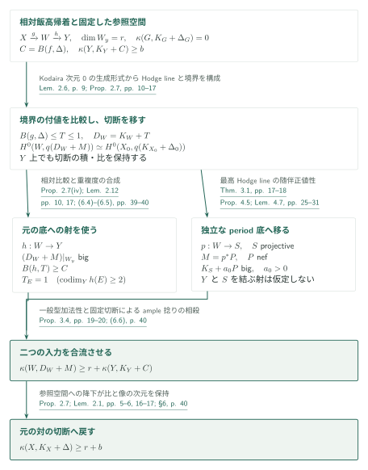
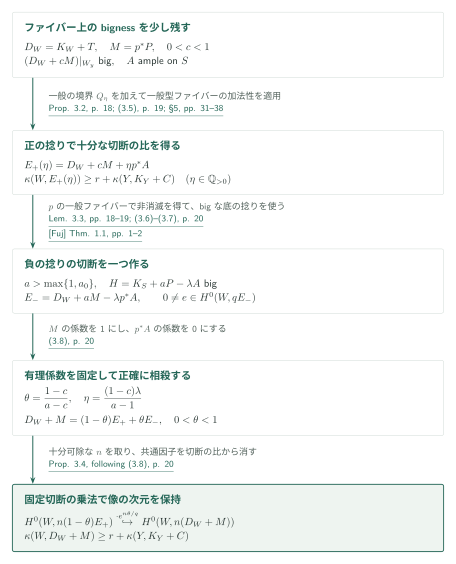
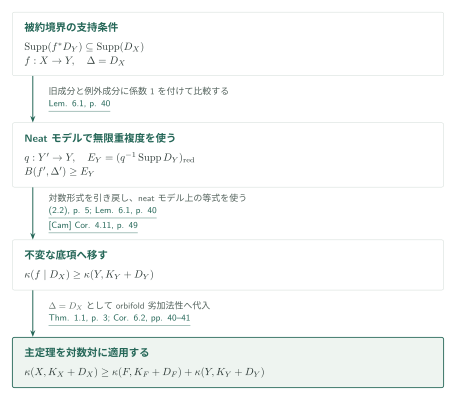
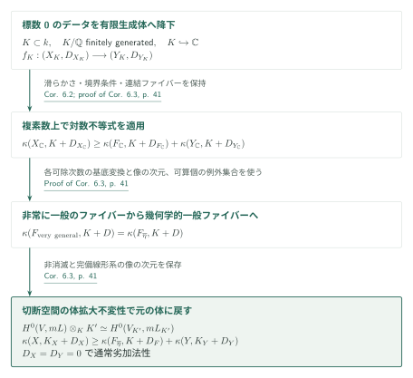

# Orbifold and logarithmic Iitaka subadditivity

**相対飯高底の切断比較と、二つの正値性入力の合流**

原稿は、Fujiki class C の有理SNC対に対するorbifold劣加法性を、係数1の境界も含めて主張する。証明の軸は、相対飯高底上で元の対数多重標準切断を保持し、Hodge lineの随伴正値性と一般型ファイバーの加法性を組み合わせることである。最後のample捻りの除去は、固定切断による乗法として行われる。

## 1. 主要結果

### Theorem 1.1 — Orbifold劣加法性

$X$を滑らかなコンパクト連結複素多様体でFujiki class Cに属するもの、$\Delta$を係数が$\mathbb Q\cap[0,1]$にあるSNC境界とする。$f:X\to Y$を、正規コンパクト既約複素空間への連結ファイバーを持つ全射正則写像とする。非常に一般の滑らかなファイバー$F$と$\Delta_F=\Delta|_F$について、原稿は

$$
\kappa(X,K_X+\Delta)\geq \kappa(F,K_F+\Delta_F)+\kappa(f\mid\Delta)
$$

を示す。点の飯高次元は0、$(-\infty)+a=-\infty$とし、$a=-\infty$の場合も含む。

底が滑らかなモデル上では

$$
m_\Delta(E)=\frac1{1-\Delta_E},\qquad
m(f,\Delta;D)=\min_{E\mapsto D}\operatorname{ord}_E(f^*D)m_\Delta(E),
$$

$$
B(f,\Delta)=\sum_D\left(1-\frac1{m(f,\Delta;D)}\right)D
$$

と置く。$1/0=\infty$、$1/\infty=0$であり、可除性条件は課さない。定理の底項は任意のモデルの$\kappa(Y,K_Y+B(f,\Delta))$ではなく、原典(1.2)のorbifold双有理同値で許されるモデルにわたる

$$
\kappa(f\mid\Delta)=\inf_{f'\sim f}\kappa(Y',K_{Y'}+B(f',\Delta'))
$$

である。正規な特異底では、底と主成分を解消し、元の$\Delta$の狭義変換に全空間の被約例外境界を加えて定義する。

[Theorem 1.1・(1.1)–(1.4)・pp. 2–3][OI]

### Corollary 6.2 — 対数劣加法性

$f:X\to Y$を滑らかな連結射影複素多様体間の連結ファイバーを持つ全射射とする。$D_X,D_Y$を被約SNC因子とし、零因子も許して

$$
\operatorname{Supp}(f^*D_Y)\subseteq\operatorname{Supp}(D_X)
$$

を仮定する。非常に一般のファイバー$F$と$D_F=D_X|_F$に対して

$$
\kappa(X,K_X+D_X)\geq\kappa(F,K_F+D_F)+\kappa(Y,K_Y+D_Y).
$$

同じ結論はFujiki class Cの滑らかなコンパクト多様体間の正則ファイブレーションにも成立する。

[Corollary 6.2・pp. 40–41][OI]

### Corollary 6.3 — 標数0での通常劣加法性

$k$を標数0の代数閉体、$f:X\to Y$を滑らかな連結射影$k$多様体間の連結ファイバーを持つ全射射とする。幾何学的一般ファイバー$F$について

$$
\kappa(X)\geq\kappa(F)+\kappa(Y).
$$

さらに、Corollary 6.2と同じ境界条件で対数不等式も$k$上成立する。この場合も非常に一般の複素ファイバーを幾何学的一般ファイバーに置き換える。

[Corollary 6.3・p. 41][OI]

## 図の矢印に付した引用

略号のない結果番号は本原稿[OI]を指す。外部入力は、[Fuj] Fujinoの弱正値性、[FF] Fujino–Fujisawaの標準延長、[Vil] Villadsenのコンパクト化、[BC] Brunebarbe–Cadorelの対数一般型性、[BT] Bakker–TsimermanのAx–Schanuel、[KP] Kovács–Patakfalviの安定族の正値性、[Cam] Campanaのorbifold基底を表す。外部原典は[Fuj]著者版0.54（2015年6月30日）、[FF]著者版0.55（2025年3月11日）、[Vil]・[BC]・[BT]はarXiv v1、[KP]は62ページの著者版、[Cam]はarXiv v8を参照する。各リンクの表示にページを付す。GitHubのPDF閲覧リンクではページ位置への自動移動を前提としない。

## 2. Theorem 1.1の証明 — 相対飯高底への移送

**目標。** 右辺のいずれかが$-\infty$の場合を除き、$r=\kappa(F,K_F+\Delta_F)\geq0$、$b=\kappa(f\mid\Delta)\geq0$と置く。以下の$X,W,Y$は許された共通モデルを表し、切断を戻す滑らかな参照対を$(X_0,\Delta_0)$とする。$h:W\to Y$は元の底を保持し、$p:W\to S$はperiodに由来する別の射である。

### 1. 例外因子の係数を保ち、元の底を固定する

底を解消し、平坦化を全空間の解消より先に行う。底の余次元2以上へ落ちる素因子は固定した滑らかな参照空間に対して例外的となる。境界を狭義変換と被約例外因子の和にすると、対数標準因子の差は有効例外的で、多重標準切断とその積・比が保存される。ここで滑らかな底$Y$を固定し、$C=B(f,\Delta)$とする。その後の$W$の変更でも$C$と係数1の条件を保持でき、$\kappa(Y,K_Y+C)\geq b$が残る。

[Lemma 2.1・Corollaries 2.3, 2.5・Lemmas 2.4, 2.6・pp. 5–9; §6・p. 39][OI]

### 2. Kodaira次元0のファイバーを、実際のHodge lineに置き換える

相対飯高写像を$X\xrightarrow{g}W\xrightarrow{h}Y$とすると、$\dim W_y=r$、非常に一般の$g$ファイバー$G$の対数飯高次元は0となる。十分可除な次数の相対生成形式$s$の根を取り、その固有指標の最高Hodge部分を使う。これは全最高Hodge空間が1次元という主張ではない。係数1がある場合には開ファイバーの混合Hodge構造を使い、唯一の非零純粋重み部分へ移す。[FF]の延長定理は、この同定を境界上でも保持するために使われる。

[Lemmas 2.6, 2.8–2.10・pp. 9–15][OI] · [FF, Theorem 1.1(ii), (iv)・p. 2][FF]

境界$T$は、元の形式の許容極とHodge延長の二つの付値を比較して決める。原典§2.6.3の記号で

$$
\alpha_D=\min_{E\mapsto D}\frac{l_E+\Delta_E}{a_E},\qquad
\beta_D=\min_{E\mapsto D}\frac{l_E+1-a_E}{a_E},\qquad T_D=\alpha_D-\beta_D.
$$

ここで$a_E=\operatorname{ord}_E(g^*D)$、$l_E=m^{-1}\operatorname{ord}_E(s\wedge g^*\omega^m)$で、$\omega$は底の局所的な通常の体積形式である。SNCに整えた全空間の全成分を最小値に含める。これにより$B(g,\Delta)\leq T\leq1$となり、十分可除な$q$について

$$
H^0(W,q(K_W+T+M))\simeq H^0(X_0,q(K_{X_0}+\Delta_0))
$$

が得られる。底の余次元2以上へ落ちる未検査の素因子は参照空間上で例外的であるため、まず$X_0$へ降下し、余次元2を越えて延長する。この参照空間の指定が、一般点の公式から実際の切断空間へ戻る接続を担う。

[Proposition 2.7・(2.12), (2.14), (2.16)・pp. 10, 13–17][OI]

### 3. 相対的な切断比較から、一般型ファイバーの加法性に必要な条件を得る

Proposition 2.7(iv)は$Y$上の直像も同定し、切断の比を保つ。相対飯高像の次元が$r=\dim W_y$なので、$K_W+T+M$は非常に一般の$h$ファイバー上でbigとなる。一方、Lemma 2.12の重み付き重複度の積の比較は$B(h,T)\geq C$を与え、$Y$の余次元2以上へ落ちる$W$の素因子にも係数1を与える。どちらも加法性の適用仮定である。

[Proposition 2.7(iv)・Lemma 2.12・pp. 10, 17; (6.3)–(6.5)・pp. 39–40][OI]

### 4. Period底上の随伴正値性を供給する

Theorem 3.1は、純粋・実偏極可能な変動の複素直和因子に属する最高Hodge lineから、変更後に$M=p^*P$、$P$ nef、$K_S+a_0P$ bigとなる滑らかな射影底$S$を与える。整格子は周囲の変動に要求され、複素直和因子自体が有理的である必要はない。

証明では有理随伴因子の全periodから商を作る。[Vil]のコンパクト化と[BC]のMoishezon性を用いて射影モデルへ移り、非自明な局所モノドロミーを持つ被約境界$D_S$について$K_S+D_S$ bigを得る。有限で非自明なモノドロミーもこの境界に含める。Lemma 4.6は[BT]等を用い各成分で$\nu(P|_{D_i})<\nu(P)$を主張する。Lemma 4.7の切断数評価では、$t$に関する主項の次数$\nu(P)$が境界除去で失う項の次数を上回り、$K_S+a_0P$のbignessが得られる。選んだlineの写像の階数と、全period写像の階数は区別されている。

[Theorem 3.1・pp. 17–18; Proposition 4.5・Lemmas 4.6–4.7・pp. 25–31][OI] · [Vil, Theorem 2.19・p. 16][Vil] · [BC, Theorem 1.1 / Corollary 1.3・pp. 1–2][BC] · [BT, Theorem 1.1・p. 2][BT]

### 5. 加法性を適用して、切断を元の空間に戻す

以上でProposition 3.4の仮定が揃い、次節の切断操作が

$$
\kappa(W,K_W+T+M)\geq r+\kappa(Y,K_Y+C)\geq r+b
$$

を与える。Proposition 2.7と例外的降下でこの線形系を元の$(X,\Delta)$へ戻す。全段階で切断の比と像の次元を保持するので、同じ下界が主定理の左辺に移る。$S$が点の場合は$M$が有理的に自明となり、Proposition 3.2を直接用いる。

[Propositions 3.2, 3.4・pp. 18–20; §6・(6.6)・p. 40][OI]

**得られた結果の使い道。** 得た下界を対数的底へ移すのが第4節である。途中のTheorem 3.1はWVの制限上のHodge比較にも渡される。

[OI, §6 · pp. 39–41][OI] · [WV, Theorem 3.8 / Proposition 3.9 · p. 21][WV]

## 3. Proposition 3.4の核心 — Ample捻りを固定切断で消す

**目標。** $D_W=K_W+T$、$M=p^*P$とする。$h$のファイバー上で$D_W+M$がbigであることから出発する。原稿は$\kappa$の極限連続性を使わず、係数を有理数で固定して二つの線形系を掛け合わせる。

### 1. 一般型加法性で、正の捻りを持つ線形系を作る

big錐の開性から$0<c<1$を選び、$D_W+cM$を非常に一般の$h$ファイバー上でbigに保つ。$S$上のample因子$A$と任意の有理数$\eta>0$について、$cP+\eta A$はampleである。一般の有理因子$Q_\eta\sim_{\mathbb Q}cM+\eta p^*A$を選ぶと$T+Q_\eta$はSNC境界のままで、既存の係数1とorbifold基底の下界を保つ。Proposition 3.2により

$$
\kappa(W,D_W+cM+\eta p^*A)\geq r+\kappa(Y,K_Y+C).
$$

このProposition 3.2を非射影底上で示すため、§5では水平境界だけを少し減らしてklt一般ファイバーにし、Lemma 5.2で射影的な最大変動安定族へ比較する。[KP]のTheorem 8.1とCorollary 8.3が相対対数標準因子のbignessを供給する。有限被覆上で得た形式は有限群の不変式により降下し、Lemma 5.4がファイバー上の像の次元を保つ。底の因子上では$C\leq B(h,T)$、余次元2以上では$T_E=1$が積の極を許容範囲に収める。§5の加法性は、射影的な原定理を元のclass C族へそのまま適用しているわけではない。

[Proposition 3.2・p. 18; (3.5)・p. 19; Lemmas 5.2–5.5・pp. 32–38][OI] · [KP, Theorem 8.1 / Corollary 8.3・p. 40][KP]

### 2. 弱正値性で、負の捻りの切断を一つ確保する

前段の非零切断を非常に一般の$p$ファイバーへ制限すると、底からの捻りが消え、$D_W$の相対非消滅が得られる。$a>\max\{1,a_0\}$と十分小さい有理数$\lambda>0$を選び、$H=K_S+aP-\lambda A$をbigにする。Lemma 3.3は[Fuj]の弱正値性を用いて

$$
E_-=D_W+aM-\lambda p^*A=K_{W/S}+T+p^*H
$$

の正の倍に非零切断を与える。平坦化後に残る極が元の滑らかな$W$上で例外的であることを使い、ここでも固定空間へ降下する。

[Lemma 3.3・pp. 18–19; (3.6)–(3.7)・p. 20][OI] · [Fuj, Theorem 1.1・pp. 1–2][Fuj]

### 3. 二つの捻りを正確に相殺し、切断の比を保存する

$$
\theta=\frac{1-c}{a-c},\qquad
\eta=\frac{(1-c)\lambda}{a-1},\qquad
E_+=D_W+cM+\eta p^*A
$$

と置くと、$0<\theta<1$で

$$
D_W+M=(1-\theta)E_++\theta E_-.
$$

$0\ne e\in H^0(W,qE_-)$を一つ固定する。十分可除な$n$について$e^{n\theta/q}$による乗法は

$$
H^0(W,n(1-\theta)E_+)\hookrightarrow H^0(W,n(D_W+M))
$$

を与える。$e$の零点の外では共通因子が比から消えるため、前段の像の次元がそのまま残る。$P$のsemiamplenessを経由する必要はない。

[Proposition 3.4・(3.8)と直後の乗法・p. 20][OI]

**得られた結果の使い道。** 固定切断による乗法が像の次元を保つため、第2節の二つの正値性入力を主定理の下界へ合流できる。

[OI, Proposition 3.4・§6 · pp. 19–20, 40][OI]

## 4. Corollary 6.2の証明 — 対数的底との比較

**目標。** 必要なのは$D_Y$を一つのモデルの境界に含めることに加え、その比較を不変量$\kappa(f\mid D_X)$に移すことである。

### 1. Neatモデルで対数多重標準切断を引き戻す

Lemma 6.1でneatモデル$f':(X',\Delta')\to Y'$を取り、$q:Y'\to Y$、$E_Y=(q^{-1}\operatorname{Supp}D_Y)_{\mathrm{red}}$とする。$E_Y$の各成分を支配する全空間の素因子には係数1が付くので$B(f',\Delta')\geq E_Y$である。対数体積形式の引き戻しは切断の比を保存する。[Cam]のneatモデル上の等式により

$$
\kappa(f\mid D_X)\geq\kappa(Y,K_Y+D_Y)
$$

となる。

[Lemma 6.1・p. 40; (2.2)・p. 5][OI] · [Cam, Corollary 4.11・p. 49][Cam]

### 2. 主定理へ代入し、開多様体へ移す

Theorem 1.1に$\Delta=D_X$を代入する。滑らかな準射影多様体$U\to V$の優越射で一般ファイバーが幾何学的連結なら、グラフと境界を解消した整合的コンパクト化によりCorollary 6.2の仮定を満たす。従って非常に一般の$v$について$\bar\kappa(U)\geq\bar\kappa(U_v)+\bar\kappa(V)$を得る。境界を0とすれば複素数上の通常劣加法性となる。

[Corollary 6.2の証明と直後の議論・pp. 40–41][OI]

**得られた結果の使い道。** この下界はWVのparameter field構成と、RAの独立した上界を等号にする帰結で使う。

[WV, Theorem 2.1 · p. 6][WV] · [RA, Corollary 1.2 / §7.6 · pp. 2, 50][RA]

## 5. Corollary 6.3の証明 — 幾何学的一般ファイバーと体の変更

**目標。** 複素数上の非常に一般のファイバーで得た不等式を、幾何学的一般ファイバーの切断空間を介して標数0の代数閉体へ移す。

### 1. 各次数の切断と像の次元を比較する

複素射影族で各可除次数にコホモロジーと基底変換を適用し、相対有理写像の像の次元が一定となる開集合を選ぶ。可算個の例外集合を除けば、非常に一般のファイバーと幾何学的一般ファイバーの飯高次元が一致する。体拡大$K\subseteq K'$については

$$
H^0(V,\mathcal O_V(mL))\otimes_KK'
\simeq H^0(V_{K'},\mathcal O_{V_{K'}}(mL_{K'}))
$$

により、非消滅と完備線形系の像の次元が保たれる。

[Corollary 6.3の証明・p. 41][OI]

### 2. 有限生成体上に降下して複素不等式を適用する

$f$、射影埋込み、境界を$\mathbb Q$上有限生成な部分体$K\subset k$へ降下し、$K\hookrightarrow\mathbb C$を選ぶ。滑らかさ・幾何学的整性・境界条件に加え、$f_*\mathcal O_X=\mathcal O_Y$も忠実平坦降下で保持する。複素数上の対数不等式を適用し、三つの飯高次元を体拡大不変性で$k$上へ戻す。

[Corollary 6.3の証明・p. 41][OI]

**得られた結果の使い道。** 通常・対数的な劣加法性を標数0の代数閉体上へ適用できる。PHの通常劣加法性とは別証明として比較する。

[OI, Corollary 6.3 · p. 41][OI] · [PH, Theorem 1.1 · p. 2][PH]

## 6. Whole-fiber variationへ渡す追加結果

§7は主定理後の追加経路である。Lemma 7.1は、標数0の体$K$上の滑らかな幾何学的整射影対$(J,D)$で$D$が被約SNC、$\kappa(J_{\overline K},K_{J_{\overline K}}+D_{\overline K})=0$の場合を扱う。最小の非消滅次数$p$の形式の根から被覆を作り、適切な極境界$D_{\widetilde N}$について

$$
H^0(\widetilde N,m(K_{\widetilde N}+D_{\widetilde N}))=K\Omega^m\qquad(m\geq1)
$$

を示す。Corollary 7.2はこの**全最高部分**を整純粋変動のlineとして実現し、$M_W$の有理延長との正規化を同定する。有理境界一般についてProposition 2.7が与える固有指標lineより強いが、被約性が必要である。Remark 7.3の$\mathbb P^1$上の5点・係数$2/5$の例では、根被覆の最高空間は6次元になる。

[§7・Lemma 7.1・Corollary 7.2・Remark 7.3・pp. 43–46][OI]

[WV]のProposition 9.1はこれらをProposition 2.7、Lemma 7.4と併用する追加の相対飯高構成である。[WV]の主経路への入力として確認したものは、別にCorollary 6.2による下界とTheorem 3.1による随伴正値性である。§7のmoduli divisorとの同定に使う[BFMT]のTheorem 6.28、Lemma 7.4の全付値比較、および[WV] §§8–9の全証明は今回未確認とする。BFMTの別のsemiampleness定理を、この同定の入力と解釈しない。

[WV, Theorem 2.1・p. 6; Theorem 3.8 / Proposition 3.9・p. 21; Proposition 9.1・pp. 69–70][WV] · [OI, Corollary 7.2・pp. 45–46][OI]

Lemma 7.4は、実際の成分上の最小値と高いモデル上の全付値を許すlctを同じSNCモデルで比較する。WV Proposition 9.1はこの記述を初期境界の正規化に使い、切断比較と全最高lineを同じ準備の上で扱う。入力の記述とこの用途は照合した。上で未確認とした範囲は付値比較・モデル変更の全証明である。

[OI, Lemma 7.4 · pp. 46–47][OI] · [WV, Proposition 9.1の証明 · p. 70][WV]

## 7. どの論文が、どの段階を担うか

| 入力 | 本稿での使用箇所と役割 | 今回の照合範囲 |
|---|---|---|
| [FF] Theorem 1.1(ii), (iv), p. 2 | §2.6.4–5, pp. 13–15：対数最高部分の標準延長と純粋重み部分への移行 | 記述・使用箇所を照合。半安定化全体は未検証 |
| [Vil] Theorem 2.19, p. 16 | Proposition 4.5, pp. 25–26：class Cのperiod商をコンパクト化 | 記述・使用箇所を照合 |
| [BC] Theorem 1.1 / Corollary 1.3, pp. 1–2 | Proposition 4.5およびTheorem 3.1の証明, pp. 26, 30–31：射影モデルと$K_S+D_S$ big | 記述・適用仮定を照合 |
| [BT] Theorem 1.1, p. 2 | Lemma 4.6, p. 27：line写像のファイバーのZariski閉包で期待次元を強制 | 記述・適用箇所を照合。rank-loss証明全体は未検証 |
| [KP] Corollaries 6.19, 7.3, pp. 28–29; Theorem 8.1 / Corollary 8.3, p. 40 | Lemmas 5.2, 5.4, pp. 34, 36：射影安定族の用意と相対対数標準因子のbigness | 記述・最大変動・klt一般ファイバーの適用条件を照合 |
| [Fuj] Theorem 1.1, pp. 1–2 | Lemma 3.3, pp. 18–19：bigな底の捻りを加えた非消滅 | 記述・class Cのlc対／射影底の条件を照合 |
| [Cam] Corollary 4.11, p. 49 | (2.2), p. 5; Lemma 6.1, p. 40：neatモデルで不変な底項を計算 | 記述・使用箇所を照合。neat-model理論全体は未検証 |

カタログ033では[OI] Corollary 6.2から[WV] Theorem 2.1へ、[OI] Theorem 3.1から[WV] Theorem 3.8へ入力する。[RA]ではCorollary 6.2をCorollary 1.2の加法性にだけ使用し、上界Theorem 1.1の入力とはしない。[PH]は通常劣加法性の別証明として紹介されている。034の[LA]やKähler原稿への接続は別の結果単位で扱い、OI→LA→SchnellをOI→Schnellの直接依存に置き換えない。

[WV・pp. 6, 21, 69–70][WV] · [RA・pp. 2, 50][RA] · [OI・pp. 5, 41][OI]

## 8. 原典を読む入口と確認範囲

原稿はOpenAI、2026年9月26日版、参考文献込み55ページ。参照commitは`fd4aeeb2ee4fc729c18d98444fed42fd0529eeeb`。まず§6 pp. 39–40で入力の合流を読み、Proposition 2.7 pp. 10–17の固定参照空間への切断比較、Proposition 3.4 pp. 19–20の相殺へ戻ると論証を追いやすい。二つの正値性入力は§4 pp. 20–31と§5 pp. 31–38で証明される。

今回読解した核心は、§2のモデル規約・相対飯高帰着・付値比較と降下、§3の効果性と相殺、§4のperiod商・rank-lossの適用部分・境界切断数評価、§5の安定族比較の記述と構成の主要段階・有限降下・極の検査、§6の主定理とCorollaries 6.2–6.3の証明である。§7はLemma 7.1とCorollary 7.2の主張・証明経路を読んだ。上表の外部入力は記述と使用箇所を照合した。

有理随伴因子の構成全体、Lemma 4.6の有限モノドロミーを含む全rank-loss論証、半安定化と全ての標準延長の技術的接続、安定族比較の全パラメータ空間構成、Lemma 7.4・Appendix A、coreのCorollaries 6.4–6.5の全証明、外部文献の証明全体は独立検証していない。この概説は原稿の主張と論証を案内する初稿であり、全証明の正しさの認定を意味しない。記録していない論文間の関係は未調査である。

[原稿全体][OI]

[OI]: https://github.com/openai/math/blob/fd4aeeb2ee4fc729c18d98444fed42fd0529eeeb/preprints/Orbifold-and-logarithmic-Iitaka-subadditivity-September-26-2026/paper.pdf
[Fuj]: https://www.math.kyoto-u.ac.jp/~fujino/weak-posi11.pdf
[FF]: https://www.math.kyoto-u.ac.jp/~fujino/vmhs-applications8.pdf
[Vil]: https://arxiv.org/pdf/2401.09544v1
[BC]: https://arxiv.org/pdf/1707.01327v1
[BT]: https://arxiv.org/pdf/1712.05088v1
[KP]: https://sites.math.washington.edu/~kovacs/2013/papers/Kovacs_Patakfalvi__Projectivity.pdf
[Cam]: https://arxiv.org/pdf/0705.0737v8
[WV]: https://github.com/openai/math/blob/fd4aeeb2ee4fc729c18d98444fed42fd0529eeeb/preprints/Logarithmic-Kodaira-dimension-and-whole-fiber-variation-September-26-2026/paper.pdf
[RA]: https://github.com/openai/math/blob/fd4aeeb2ee4fc729c18d98444fed42fd0529eeeb/preprints/The-reverse-logarithmic-Kodaira-inequality-and-additivity-September-26-2026/paper.pdf
[PH]: https://github.com/openai/math/blob/fd4aeeb2ee4fc729c18d98444fed42fd0529eeeb/preprints/Projective-Hodge-lines-and-ordinary-Iitaka-subadditivity-September-27-2026/paper.pdf
[LA]: https://github.com/openai/math/blob/adc7f1241b42e322a6451854ab7e4b4c146bf78a/preprints/Log-abundance-in-characteristic-zero-September-24-2026/paper.pdf
[BFMT]: https://arxiv.org/pdf/2508.19215v2
