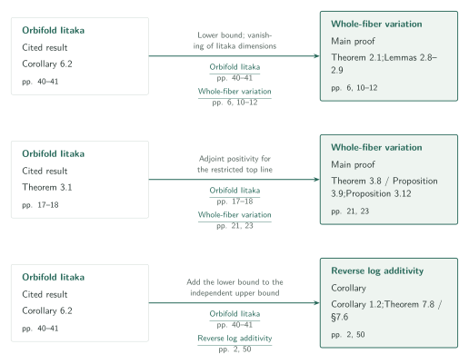
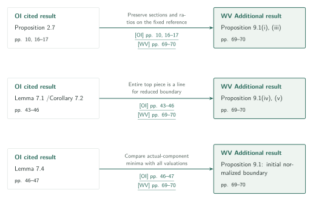
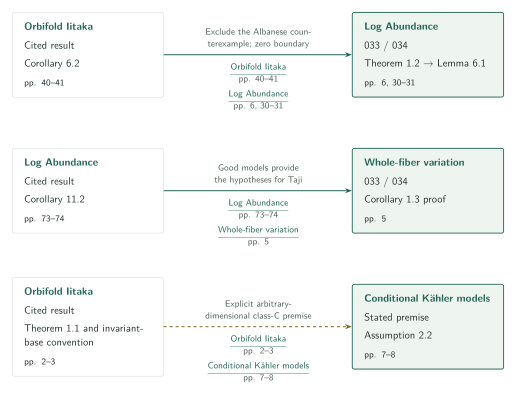
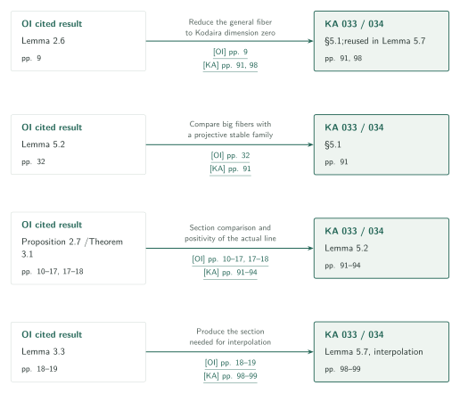

# Campana's orbifold Iitaka conjecture and logarithmic subadditivity

**Catalogue 033 synthesis: connect lower bounds, variation and upper bounds at the level of results**

The five papers do not form a single chain of Hodge-theoretic inputs. OI supplies a lower bound and adjoint positivity at different stages of WV. RA proves its upper bound independently and adds OI only for additivity. PH gives a separate proof of ordinary subadditivity, while BS concerns semiampleness of the actual moduli line. This synthesis matches the manuscripts’ claims with the articles and specifies what each input supplies at its point of use.

## 1. Articles in official order

The official field is **Algebraic and complex geometry**. The page title follows overview entry 033; CONTENTS uses the alternative heading *Iitaka subadditivity, variation, and logarithmic additivity*. There are five papers and 259 pages including references. Each title links to its English article.

| Order / article | Version / pages | Role |
|---|---|---|
| 01 [Orbifold and logarithmic Iitaka subadditivity](../orbifold-logarithmic-iitaka/article.en.md) [OI] | 2026-09-26 · 55 pages · [Source][OI] | Supplies orbifold and logarithmic lower bounds and adjoint positivity of Hodge lines. |
| 02 [Logarithmic Kodaira dimension and whole-fiber variation](../whole-fiber-variation/article.en.md) [WV] | 2026-09-26 · 75 pages · [Source][WV] | Descends the whole fiber to the parameter field, giving a lower bound involving variation. |
| 03 [The reverse logarithmic Kodaira inequality and additivity](../reverse-logarithmic-additivity/article.en.md) [RA] | 2026-09-26 · 51 pages · [Source][RA] | Proves the upper bound under stratum smoothness, then combines it with OI’s lower bound. |
| 04 [Projective Hodge lines and ordinary Iitaka subadditivity](../projective-hodge-lines/article.en.md) [PH] | 2026-09-27 · 40 pages · [Source][PH] | A separate route from projective Hodge lines to ordinary subadditivity. |
| 05 [B-semiampleness for compact log-smooth Kähler fibrations](../kahler-b-semiampleness/article.en.md) [BS] | 2026-09-10 · 38 pages · [Source][BS] | Identifies the lct moduli line and proves semiampleness by decomposition, extension and norm descent. |

Each paper has Japanese and English articles with proof diagrams. OI and RA retain their main-proof overview diagrams. WV now has a map from the parameter field to whole-fiber descent, and BS one from stabilization to semiampleness. Diagram counts follow the arguments.

[Official overview · PDF p. 5][OV] · [Official CONTENTS][CONTENTS]

## References on the arrows

OI, WV, RA, PH and BS denote the five papers above. In catalogue 034, LA is *Log abundance in characteristic zero*, KA is *Log abundance for compact Kähler spaces under logarithmic Iitaka subadditivity*, and CK is *Conditional good minimal models for compact Kähler fourfolds*.

Solid arrows record inputs actually used by the specified receiving result. Corollary and additional-result inputs are not moved into the main proof. Dashed arrows match an explicitly stated premise. Alternative proofs, similar methods and background are discussed separately, without dependency arrows. Citations link to pinned sources; page numbers are given in the labels.

## 2. From lower bounds to variation, and then to additivity

**Goal.** Separate WV’s two OI inputs from the OI input used after RA’s upper bound is complete. The two WV boxes represent different stages of one main proof; the RA box represents the additivity corollary.

### 1. Measure the parameter field using logarithmic subadditivity

WV restates OI Corollary 6.2 as Theorem 2.1. Compatible projective SNC compactifications satisfy the inverse-boundary support condition and give $\bar\kappa(U)\geq d+\bar\kappa(V)$ when $d=\kappa(F)\geq0$. On an Iitaka fiber, two nonnegative Kodaira dimensions must then vanish. Proportional logarithmic forms measure the family of images. Proposition 2.10 produces $\mathbb C(T_0)\subseteq\mathbb C(Y)$ and $\bar\kappa(U)=d+\dim T_0$. Constancy of the whole fiber has not yet been used.

[OI, Corollary 6.2 · pp. 40–41][OI] · [WV, Theorem 2.1, Lemmas 2.8–2.9, Proposition 2.10 · pp. 6, 10–14][WV]

### 2. Use the restricted Hodge line for the first constancy step

OI Theorem 3.1 supplies adjoint positivity for a complex summand of an integral ambient variation. WV has an entire highest line and reapplies the theorem to the variation restricted to an Iitaka fiber. The upper bound on the section dimension of $K+B+M$, together with nonvanishing of $K+B$, excludes a positive-dimensional adjoint base and makes $M$ rationally trivial. Finite character, analytic birational constancy, markings, cocycles and descent of finite covers remain distinct subsequent steps. Period-image dimension is not identified with whole-fiber variation.

[OI, Theorem 3.1 · pp. 17–18][OI] · [WV, Theorem 3.8, Propositions 3.9, 3.12, Corollary 3.16 · pp. 21–25; §§4–7 · pp. 25–59][WV]

### 3. Add the lower bound for the same pair to RA’s upper bound

RA Theorem 1.1 proves an upper bound when all boundary strata are smooth over the open base. OI enters only in Corollary 1.2: substitute $D_X=E,D_Y=D$ into Corollary 6.2 for the same pair and very general fiber. Finite bounds give equality. If a term on the right is $-\infty$, vanishing in every positive degree comes from RA’s upper bound.

[RA, Theorem 1.1, Corollary 1.2 · p. 2; Theorem 7.8, §7.6 · p. 50][RA] · [OI, Corollary 6.2 · pp. 40–41][OI]

**Use of the output.** Whole-function-field descent proves $\operatorname{Var}(f)\leq\dim T_0$ for WV. Combining this with the dimension identity gives its main inequality. A separate route compares RA additivity with WV Theorem 1.1: for a smooth family with $\kappa(F)\geq0$ and $\bar\kappa(V)\geq0$, it yields $\operatorname{Var}(f)\leq\bar\kappa(V)$. This does not cover the negative-base branch or every special base.

[WV, §7.4 · pp. 58–59; comparison after Corollary 1.3 · p. 5][WV]

## 3. Three inputs for the additional relative Iitaka construction

**Goal.** WV §§8–9 form an additional route. Retain the section ring of the original $X$ while obtaining the entire highest line of a pure integral variation on the ordinary relative Iitaka base. The diagram separates three inputs to Proposition 9.1.

### 1. Return sections and ratios to the fixed reference space

WV uses OI Proposition 2.7 with the original $X$ as reference. Preservation of section-image dimension on the generic fiber gives both bigness of $K_W+B+M$ over $Y$ and comparison with the original pluricanonical systems.

[OI, Proposition 2.7 · pp. 10, 16–17][OI] · [WV, Proposition 9.1(i), (iii) and proof · pp. 69–70][WV]

### 2. Obtain the entire highest line for a reduced boundary

OI Lemma 7.1 and Corollary 7.2 use the least-index root cover of a reduced SNC pair of logarithmic Kodaira dimension zero. The entire highest piece, not only a character eigenspace, is rank one; $M$ is identified with its parabolic extension. Reducedness is essential and cannot be dropped for general rational coefficients.

[OI, Lemma 7.1, Corollary 7.2, Remark 7.3 · pp. 43–46][OI] · [WV, Proposition 9.1(iv), (v) · pp. 69–70][WV]

### 3. Normalize the boundary while distinguishing the two minima

OI Lemma 7.4 compares the minimum over actual source components with the lct allowing valuations on higher models, on the same SNC preparation. WV uses it to normalize the initial boundary. This synthesis compared the statement and receiving use; the full valuation and model-change arguments were not independently verified.

[OI, Lemma 7.4 · pp. 46–47][OI] · [WV, proof of Proposition 9.1 · p. 70][WV]

**Use of the output.** The data enter WV Theorem 8.1. Corollaries 9.2–9.4 connect the second Iitaka base to the definition field of the original whole fiber. Intermediate volume and degree estimates in §8 and the complete argument of §9 remain only partially studied.

## 4. Connect models in 034 with consequences in 033

**Goal.** The uses of OI in 034 differ from the return input from LA into WV. The dashed CK edge records a match to an explicit premise.

### 1. LA uses subadditivity only in its Albanese reduction

Under the lower-dimensional good-model induction hypothesis, LA Lemma 6.1 considers the Albanese map of a hypothetical nonvanishing counterexample. The smooth base maps generically finitely to a subvariety of an abelian variety and has nonnegative Kodaira dimension. The fiber has nonnegative Kodaira dimension by induction. OI Corollary 6.2 with zero boundaries contradicts nonvanishing failure. This is LA’s sole use of subadditivity. LA p.6 explicitly records an alternative using Hacon–Popa–Schnell for this particular application.

[LA, Theorem 1.2 · p. 6; Lemma 6.1 · pp. 30–31][LA] · [OI, Corollary 6.2 · pp. 40–41][OI]

### 2. WV’s smooth-family corollary takes good models as input

In WV Corollary 1.3, BDPP turns non-uniruledness of each closed fiber into pseudo-effectivity of $K_F$. LA Corollary 11.2 supplies a semiample model and an effective exceptional comparison. The comparison gives canonical singularities, permitting Taji’s theorem to yield the two variation branches and the special-base conclusion. LA is not an input to WV Theorem 1.1.

[LA, Corollary 11.2 · pp. 73–74][LA] · [WV, Corollary 1.3 and proof · p. 5][WV]

### 3. Preserve CK’s conditional framework

CK Assumption 2.2 explicitly requires arbitrary-dimensional class-C orbifold subadditivity, including coefficient one and the invariant-base/neat-model conventions. OI Theorem 1.1 and its base definition match that premise. CK’s other assumptions on the MMP and abundance after nonvanishing are not thereby discharged.

[OI, definitions and Theorem 1.1 · pp. 2–3][OI] · [CK, Assumption 2.2, (2)–(5) · pp. 7–8][CK]

**Use of the output.** LA’s good model is also used by Schnell, whose direct input is LA Corollary 11.2. The path OI → LA → Schnell is not collapsed to a direct OI → Schnell edge. The versions and conditional scope of the existing 034 articles are retained.

## 5. Supply specific auxiliary results to the Kähler paper

**Goal.** The pinned KA manuscript uses separate OI results for reduction, comparison and positivity. The aim is to identify these uses rather than label all of them consequences of subadditivity.

### 1. Reduce to a Kodaira-zero general fiber

KA §5.1 uses OI Lemma 2.6 to pass to the relative Iitaka base and return to the lower-dimensional Proposition 5.1. The strict-plus-reduced-exceptional boundary convention preserves the logarithmic Kodaira-zero condition needed for subsequent comparisons.

[OI, Lemma 2.6 · p. 9][OI] · [KA, §5.1 · p. 91; Lemma 5.7 · p. 98][KA]

### 2. Exclude the big case by stable-family comparison

Slightly lowering horizontal coefficients preserves fiberwise bigness. KA applies OI Lemma 5.2 to compare with a projective stable family. Algebraic dimension zero forces its projective parameter base to be a point; rational functions on the positive-dimensional projective factor then give a contradiction.

[OI, Lemma 5.2 · p. 32][OI] · [KA, §5.1 · p. 91][KA]

### 3. Compare actual lines and section spaces together

KA Lemma 5.2 combines OI Proposition 2.7 with Theorem 3.1. The output is an identity of rational lines $M=p^*P_S$ and bigness of $K_S+a_0P_S$, not only an equality of numerical classes. Descent to the original reference space gives the comparison of complete section spaces. No additional sign assertion is made here for residual terms mapping into codimension at least two.

[OI, Proposition 2.7, Theorem 3.1 · pp. 10–18][OI] · [KA, Lemma 5.2 · pp. 91–94][KA]

### 4. Produce a section for interpolation using a big base twist

At p.99, KA Lemma 5.7 explicitly checks OI Lemma 3.3’s nonzero relative system, SNC boundary and projective-base hypotheses. Rational interpolation combines the resulting effective divisor with a negative ample twist and another with a positive twist, forcing positive Kodaira dimension.

[OI, Lemma 3.3 · pp. 18–19][OI] · [KA, Lemma 5.7 · pp. 98–99][KA]

**Use of the output.** These results enter KA’s dimension induction and adjoint calculations on the base. KA Assumption 1.1 and the other external inputs remain part of the argument; OI alone is not asserted to imply the whole paper.

## 6. PH and BS, alternatives, and method comparisons

### 1. PH gives a separate route to ordinary subadditivity

PH uses BBT’s full period image and BC’s logarithmic general type in Theorem 1.2. It combines Fujino–Mori/Ambro canonical-bundle comparisons, Fujino weak positivity and Hashizume’s general-type-fiber subadditivity in §§6–7. Result numbers, versions and uses appear in [PH article §5](../projective-hodge-lines/article.en.md). Theorem 1.1 and OI Corollary 6.3 are separate proofs of ordinary subadditivity.

PH Lemma 8.4/Theorem 8.1 is an alternative adjoint comparison in WV Remark 3.17. Tensor replacement must be performed anew on the restricted variation; no common exponent is required. This is distinct from WV’s chosen direct comparison.

[PH, Theorems 1.1–1.2 · p. 2; Theorem 8.1, Lemma 8.4 · pp. 28–29][PH] · [WV, Remark 3.17 · p. 25][WV]

### 2. BS uses different inputs to obtain semiampleness

BS uses Fujino–Fujisawa extension for the moduli-line identification in §§3–4, and Matsumura–Wang–Wu–Zhang decomposition plus Toma compactness for the family in §5. In §§6–7, BFMT’s algebraic b-semiampleness is applied to the projective comparison factor, while arithmetic period compactifications handle torus and symplectic factors. Norms extend the specified isomorphism, and descent gives global generation at every point. Exact inputs and hypotheses are in [BS article §7](../kahler-b-semiampleness/article.en.md).

BS p.3 explicitly says that the orbifold Iitaka theorem is not used. No direct edge to another 033 paper has been added here; this is not an exhaustive assertion of independence.

[BS, Theorem 1.1 and proof outline · p. 3; §§5–9 · pp. 18–37][BS]

### 3. Separate similar methods from background

OI and PH both use weak positivity and rational interpolation, but OI’s complex summand and PH’s entire highest line have different hypotheses. OI and BS both track root eigenlines, boundary orders and actual line bundles, but the orbifold inf-multiplicity base differs from the lct discriminant. These are editorial comparisons of methods, not dependency claims.

RA’s article treats the Ax–Schanuel source for the connection-form argument as methodological background: supplying the needed semisimple argument in the manuscript is distinguished from taking an external theorem directly as input.

[OI, Proposition 3.4 · pp. 19–20][OI] · [PH, §7.3 · pp. 25–26][PH] · [BS, §§3–4 · pp. 6–18][BS] · [RA, §5.1, Lemma 5.1 · pp. 26–28][RA]

## 7. Checked direct dependencies

These twelve interfaces cover main proofs, corollaries and additional results and use the same records as the diagrams. Input statements, receiving uses and corresponding articles were compared; full input proofs were not independently verified. The CK premise, three alternatives, two method comparisons and one background relation are kept outside this solid-arrow list.

| ID / kind | Input result | Receiving use | What it supplies |
|---|---|---|---|
| c01 · direct | [OI Corollary 6.2 · pp. 40–41][OI] | [WV Theorem 2.1; Lemmas 2.8–2.9 · pp. 6, 10–12][WV] | Supplies the logarithmic lower bound and forces two nonnegative terms on an Iitaka fiber to vanish, enabling the parameter-field construction. |
| c02 · direct | [OI Theorem 3.1 · pp. 17–18][OI] | [WV Theorem 3.8 / Proposition 3.9; Proposition 3.12 · pp. 21, 23][WV] | Gives adjoint positivity for the restricted Hodge line. The section bound forces its adjoint base to be a point and makes M rationally trivial. |
| c03 · consequence | [OI Corollary 6.2 · pp. 40–41][OI] | [RA Corollary 1.2; Theorem 7.8 / §7.6 · pp. 2, 50][RA] | Supplies the lower bound for the same pair and very general fiber; combining it with RA’s upper bound gives additivity. |
| c04 · consequence | [OI Proposition 2.7 · pp. 10, 16–17][OI] | [WV Proposition 9.1(i), (iii) · pp. 69–70][WV] | Preserves relative and absolute section systems and their ratios on the fixed original X, giving relative bigness in the additional ordinary construction. |
| c05 · consequence | [OI Lemma 7.1 / Corollary 7.2 · pp. 43–46][OI] | [WV Proposition 9.1(iv), (v) · pp. 69–70][WV] | For a reduced boundary, the least-index root cover makes the entire top piece rank one and realizes the normalized M as a line in a pure integral variation. |
| c06 · consequence | [OI Lemma 7.4 · pp. 46–47][OI] | [WV Proposition 9.1: initial normalized boundary · pp. 69–70][WV] | Normalizes B by comparing the minimum over actual source components with the lct over all valuations, on the same model as the section and Hodge-line comparison. |
| c07 · direct | [OI Corollary 6.2 · pp. 40–41][OI] | [LA Theorem 1.2 → Lemma 6.1 · pp. 6, 30–31][LA] | Applied with zero boundaries to the Albanese fibration, it forces irregularity zero for a nonvanishing counterexample; this is LA’s sole use of subadditivity. |
| c08 · direct | [OI Lemma 2.6 · pp. 9][OI] | [KA §5.1; reused in Lemma 5.7 · pp. 91, 98][KA] | Passes to the relative Iitaka base with Kodaira-zero general fiber so that lower-dimensional induction can continue. |
| c09 · direct | [OI Lemma 5.2 · pp. 32][OI] | [KA §5.1 · pp. 91][KA] | Compares the big fibers, after lowering the horizontal boundary, with a projective stable family, excluding the big case at algebraic dimension zero. |
| c10 · direct | [OI Proposition 2.7 / Theorem 3.1 · pp. 10–17, 17–18][OI] | [KA Lemma 5.2 · pp. 91–94][KA] | Compares section spaces and the actual rational Hodge line, giving M=p*P and adjoint bigness on the projective base; signs above codimension two require separate work. |
| c11 · direct | [OI Lemma 3.3 · pp. 18–19][OI] | [KA Lemma 5.7, interpolation · pp. 98–99][KA] | Produces a section after a big base twist; interpolation with another effective divisor forces positive Kodaira dimension. |
| c12 · consequence | [LA Corollary 11.2 · pp. 73–74][LA] | [WV Corollary 1.3 proof · pp. 5][WV] | Provides a semiample good model and effective exceptional comparison for each closed fiber whose canonical class is pseudo-effective by BDPP; canonicality then permits Taji’s theorem. |

## 8. Source versions and remaining checks

The 033 commit pinned on 2026-10-08 is `fd4aeeb2ee4fc729c18d98444fed42fd0529eeeb`. The 034 recipients retain the published articles’ commit `adc7f1241b42e322a6451854ab7e4b4c146bf78a`: LA 2026-09-24, KA 2026-10-04 and CK 2026-10-05. The October 6 KA/CK revisions are outside this synthesis. Cached PDFs for all five 033 papers and these three 034 papers were rehashed against the inventories.

| Article | Principal remaining checks |
|---|---|
| OI | Complete rank-loss and stable-family arguments, full BFMT interfaces and valuation comparisons in §7, and core corollaries. Checking Lemma 7.4’s statement and use does not verify its full proof. |
| WV | Full regularization and L² estimates, original Hanamura and SGA1 purity statements, intermediate §8 estimates and complete §9. The additional OI statements and uses were compared in this synthesis. |
| RA | Homogeneous replacement, compact flags, finite monodromy, all boundary estimates and representation theory, and full external proofs. |
| PH | Multivariable Hodge extensions, all auxiliary proofs, and the alternative arguments in §§8–9. The WV alternative is a statement/use comparison. |
| BS | Complete parameter-space constructions, polarization changes and extension compatibility, and external arithmetic-quotient/compactification theory. |

The articles’ external-input tables distinguish statement/application comparisons from recipient-only readings. This synthesis retains those limits. Unlisted relations are unexamined or unrecorded; the diagrams do not claim to exhaust all dependencies.

[OI]: https://github.com/openai/math/blob/fd4aeeb2ee4fc729c18d98444fed42fd0529eeeb/preprints/Orbifold-and-logarithmic-Iitaka-subadditivity-September-26-2026/paper.pdf
[WV]: https://github.com/openai/math/blob/fd4aeeb2ee4fc729c18d98444fed42fd0529eeeb/preprints/Logarithmic-Kodaira-dimension-and-whole-fiber-variation-September-26-2026/paper.pdf
[RA]: https://github.com/openai/math/blob/fd4aeeb2ee4fc729c18d98444fed42fd0529eeeb/preprints/The-reverse-logarithmic-Kodaira-inequality-and-additivity-September-26-2026/paper.pdf
[PH]: https://github.com/openai/math/blob/fd4aeeb2ee4fc729c18d98444fed42fd0529eeeb/preprints/Projective-Hodge-lines-and-ordinary-Iitaka-subadditivity-September-27-2026/paper.pdf
[BS]: https://github.com/openai/math/blob/fd4aeeb2ee4fc729c18d98444fed42fd0529eeeb/preprints/B-semiampleness-for-compact-log-smooth-Kahler-fibrations-September-10-2026/paper.pdf
[LA]: https://github.com/openai/math/blob/adc7f1241b42e322a6451854ab7e4b4c146bf78a/preprints/Log-abundance-in-characteristic-zero-September-24-2026/paper.pdf
[KA]: https://github.com/openai/math/blob/adc7f1241b42e322a6451854ab7e4b4c146bf78a/preprints/Log-abundance-for-compact-Kahler-spaces-under-logarithmic-Iitaka-subadditivity-October-4-2026/main.pdf
[CK]: https://github.com/openai/math/blob/adc7f1241b42e322a6451854ab7e4b4c146bf78a/preprints/Conditional-good-minimal-models-for-compact-Kahler-fourfolds-October-5-2026/paper.pdf
[OV]: https://github.com/openai/math/blob/fd4aeeb2ee4fc729c18d98444fed42fd0529eeeb/overview.pdf
[CONTENTS]: https://github.com/openai/math/blob/fd4aeeb2ee4fc729c18d98444fed42fd0529eeeb/CONTENTS.md
