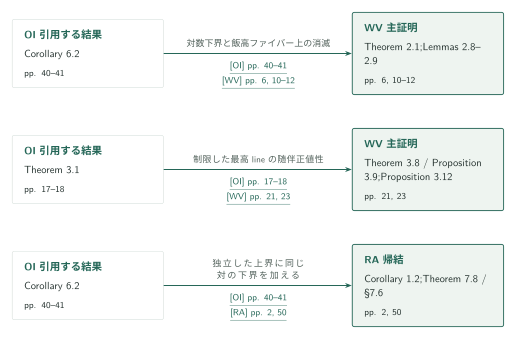
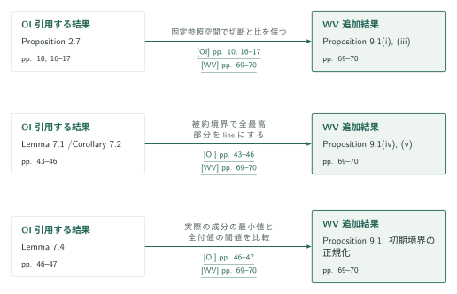
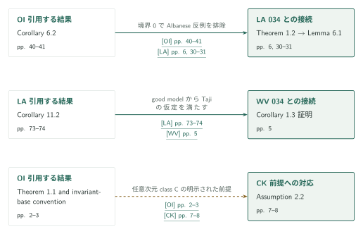
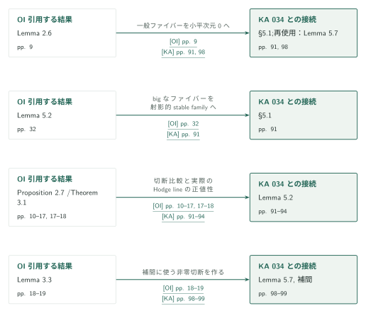

# Campana's orbifold Iitaka conjecture and logarithmic subadditivity

**カタログ033の総括　下界、variation、上界を結果単位でつなぐ**

033の5篇は、同じHodge的道具を一列に積み重ねる構成ではない。OIの下界と随伴正値性はWVの別々の段階へ入り、RAは独立に上界を示した後でOIの下界を合わせる。PHは通常劣加法性の別証明を与え、BSは実際のmoduli lineの半豊富性を扱う。以下では、原稿が主張する結果と記事の説明を対応させ、どの結果がどの段階に何を渡すかを示す。

## 1. 公式順の記事一覧

分野は **Algebraic and complex geometry**。公式overviewの033見出しをページ名とし、CONTENTSの別表記は *Iitaka subadditivity, variation, and logarithmic additivity* である。5篇、参考文献込み259ページ。各タイトルから日本語概説へ進める。

| 順序と記事 | 原稿版・ページ数 | 役割 |
|---|---|---|
| 01 [Orbifold and logarithmic Iitaka subadditivity](../orbifold-logarithmic-iitaka/article.ja.md) [OI] | 2026-09-26 · 55 ページ · [原典][OI] | orbifold下界、対数下界、Hodge lineの随伴正値性を供給。 |
| 02 [Logarithmic Kodaira dimension and whole-fiber variation](../whole-fiber-variation/article.ja.md) [WV] | 2026-09-26 · 75 ページ · [原典][WV] | parameter fieldへ全ファイバーを降下し、variationを含む下界を得る。 |
| 03 [The reverse logarithmic Kodaira inequality and additivity](../reverse-logarithmic-additivity/article.ja.md) [RA] | 2026-09-26 · 51 ページ · [原典][RA] | stratum smoothnessの下で独立に上界を示し、OIの下界と合わせる。 |
| 04 [Projective Hodge lines and ordinary Iitaka subadditivity](../projective-hodge-lines/article.ja.md) [PH] | 2026-09-27 · 40 ページ · [原典][PH] | 射影的Hodge lineから通常劣加法性へ進む別証明。 |
| 05 [B-semiampleness for compact log-smooth Kähler fibrations](../kahler-b-semiampleness/article.ja.md) [BS] | 2026-09-10 · 38 ページ · [原典][BS] | lct moduli lineを同定し、積分解・延長・norm降下で半豊富性を得る。 |

各篇には日英概説と証明図がある。OI・RAの主定理の全体図を残し、WVにはparameter fieldから全ファイバー降下まで、BSには安定化から半豊富性までの全体図を加えた。図の数は論証に応じて異なる。

[公式overview · PDF p. 5][OV] · [公式CONTENTS][CONTENTS]

## 図の矢印に付した引用

OI・WV・RA・PH・BSは上の5篇。034のLAは *Log abundance in characteristic zero*、KAは *Log abundance for compact Kähler spaces under logarithmic Iitaka subadditivity*、CKは *Conditional good minimal models for compact Kähler fourfolds* を指す。

実線は図に指定した結果の証明へ実際に使う入力である。「帰結」「追加」の入力を主定理の必須経路へ移さない。破線は受け手が明記する前提への対応。別証明・類似手法・背景は後の文章で扱い、依存の矢印には含めない。各矢印の引用は固定原典へリンクする。ページ番号はラベルで確認する。

## 2. 下界からvariationへ進み、独立した上界と合わせる

**目標。** WVに必要な二つのOI入力と、RAの上界が完成した後に使うOI入力を分離する。図のWV側の二つの箱は同じ主定理の異なる証明段階であり、RA側は加法性の帰結を表す。

### 1. 対数劣加法性でparameter fieldの次元を測る

WVはOI Corollary 6.2をTheorem 2.1として再掲する。射影的なSNCコンパクト化で逆像境界の支持条件を満たし、$d=\kappa(F)\geq0$の場合に$\bar\kappa(U)\geq d+\bar\kappa(V)$を得る。さらに飯高ファイバー上で二つの非負な小平次元が0となり、対数形式の比例性から像の族を測る。WV Proposition 2.10が得るのは、元の底の関数体に入る$\mathbb C(T_0)$と$\bar\kappa(U)=d+\dim T_0$である。全ファイバーの一定性はまだ使わない。

[OI, Corollary 6.2 · pp. 40–41][OI] · [WV, Theorem 2.1・Lemmas 2.8–2.9・Proposition 2.10 · pp. 6, 10–14][WV]

### 2. 制限したHodge lineから最初のconstancyへ進む

OI Theorem 3.1は、整格子を持つ周囲の変動の複素直和因子に対する随伴正値性を与える。WVではroot coverの全最高部分がlineであり、これを飯高ファイバーへ制限した変動に適用し直す。$K+B+M$の切断次元の上界と$K+B$の非消滅を合わせると、正次元の随伴比較の底は排除され、$M$が有理的に自明になる。有限指標、解析的な双有理的constancy、marking、cocycleと有限被覆の降下は、その後に必要な別の段階である。period像の次元だけをwhole-fiber variationと同一視しない。

[OI, Theorem 3.1 · pp. 17–18][OI] · [WV, Theorem 3.8・Propositions 3.9, 3.12・Corollary 3.16 · pp. 21–25; §§4–7 · pp. 25–59][WV]

### 3. RAの上界に、同じ対の下界を加える

RA Theorem 1.1は、境界の全stratumが開いた底上で滑らかな場合の上界を与える。OIを使うのはCorollary 1.2であり、$D_X=E,D_Y=D$として同じ対・同じ非常に一般のファイバーへCorollary 6.2を適用する。両辺が有限なら等号を得る。右辺に$-\infty$があれば、RAの上界が与える全正次数での切断消滅が等号の内容を担う。

[RA, Theorem 1.1・Corollary 1.2 · p. 2; Theorem 7.8・§7.6 · p. 50][RA] · [OI, Corollary 6.2 · pp. 40–41][OI]

**得られた結果の使い道。** WVでは$\operatorname{Var}(f)\leq\dim T_0$を全関数体の降下で示し、上の次元等式と組み合わせる。RAの加法性とWV Theorem 1.1を比較する別経路では、smoothな族で$\kappa(F)\geq0$、$\bar\kappa(V)\geq0$のときに$\operatorname{Var}(f)\leq\bar\kappa(V)$を得る。この別経路は負の底の分岐やすべてのspecial baseを扱うものではない。

[WV, §7.4 · pp. 58–59; Corollary 1.3後の比較 · p. 5][WV]

## 3. 追加の相対飯高構成へ渡す三つの入力

**目標。** WV §§8–9は主証明とは別の経路である。元の$X$の切断環を保持したまま、通常の相対飯高底上で整純粋変動の全最高lineを使える形に整えること。図はProposition 9.1に実際に渡される三つの役割を分けて示す。

### 1. 固定参照空間へ切断と比を戻す

OI Proposition 2.7の相対比較は、WVの元の$X$を参照空間として使う。一般ファイバー上で切断の像の次元が保たれるため、$K_W+B+M$の$Y$上のbignessと元の多重標準系との比較が同時に得られる。

[OI, Proposition 2.7 · pp. 10, 16–17][OI] · [WV, Proposition 9.1(i), (iii)と証明 · pp. 69–70][WV]

### 2. 被約境界で全最高部分をlineにする

OI Lemma 7.1とCorollary 7.2は、対数的小平次元0の被約SNC対の最小指数root coverを用いる。固有指標の部分だけでなく全最高部分がrank oneとなり、$M$をそのparabolic延長として同定する。一般の有理境界ではこの全最高部分の主張は成立しないため、被約性を残す。

[OI, Lemma 7.1・Corollary 7.2・Remark 7.3 · pp. 43–46][OI] · [WV, Proposition 9.1(iv), (v) · pp. 69–70][WV]

### 3. 二種類の最小値を区別して境界を正規化する

OI Lemma 7.4は、切断の正則性を測る実際の成分上の最小値と、高いモデルの付値も許すlctを同じSNCモデルで比較する。WVはこの結果で初期境界を正規化する。今回、入力の記述と受け手の用途を照合したが、付値比較と全モデル変更の証明全体を独立検証したわけではない。

[OI, Lemma 7.4 · pp. 46–47][OI] · [WV, Proposition 9.1の証明 · p. 70][WV]

**得られた結果の使い道。** WV Theorem 8.1へ入れるデータを揃え、Corollaries 9.2–9.4で第二の飯高底と元の全ファイバーの定義体を結び付ける。§8の中間の体積・次数評価と§9全体は部分調査であり、この図を追加経路全体の証明検証とは扱わない。

## 4. 034のモデル存在と033の帰結をつなぐ

**目標。** OIの劣加法性が034へ渡る用途と、034のLAからWVへ戻る用途を分ける。下図のCKは、受け手が掲げた前提との対応として破線で示す。

### 1. LAではAlbanese帰着に限って使う

LA Lemma 6.1は、下の次元でのgood modelを帰納的に仮定し、仮想的な非消滅反例のAlbanese写像を考える。滑らかな底はabelian varietyの部分多様体へ一般有限に写るため小平次元が非負である。ファイバーも帰納法で非負となり、境界0のOI Corollary 6.2が全空間の非消滅を与えて矛盾する。これがLAにおける劣加法性の唯一の使用箇所である。LA p.6はこの用途をHacon–Popa–Schnellの結果でも賄えると明記する。

[LA, Theorem 1.2 · p. 6; Lemma 6.1 · pp. 30–31][LA] · [OI, Corollary 6.2 · pp. 40–41][OI]

### 2. WVのsmooth familyの帰結ではgood modelを入力する

WV Corollary 1.3では、各閉ファイバーのnon-unirulednessからBDPPで$K_F$の擬有効性を得る。LA Corollary 11.2がsemiampleなモデルと有効例外差を供給し、その比較からcanonical singularitiesを確認する。そこでTajiの結果を適用し、variationの二つの分岐とspecial baseの帰結を得る。LAをWV Theorem 1.1の入力に移さない。

[LA, Corollary 11.2 · pp. 73–74][LA] · [WV, Corollary 1.3と証明 · p. 5][WV]

### 3. CKの条件付き前提の範囲を保持する

CK Assumption 2.2は、係数1を含む任意次元class Cのorbifold劣加法性と、不変な底・neatモデルの規約を明記する。OI Theorem 1.1と底の定義はこの前提に対応する。CKの他のMMP・非消滅後のabundanceの前提まで解消したとは扱わない。

[OI, 定義・Theorem 1.1 · pp. 2–3][OI] · [CK, Assumption 2.2・(2)–(5) · pp. 7–8][CK]

**得られた結果の使い道。** LAのgood modelはSchnellにも使われるが、その直接入力はLA Corollary 11.2である。OI → LA → SchnellをOI → Schnellの一本の直接辺へ置き換えない。034の版と条件付きの範囲は既存記事のまま保持する。

## 5. Kähler稿の具体的な補助結果へ渡す

**目標。** KAの旧固定版では、OIの全主定理だけでなく、帰着・比較・正値性を担う補助結果が別々に使われる。目標はそれらを「劣加法性からの帰結」という一語でまとめないことである。

### 1. 相対飯高帰着で小平次元0のファイバーへ移る

KA §5.1はOI Lemma 2.6を用いて相対飯高底へ移り、低次元のProposition 5.1へ戻る。狭義変換と被約例外境界の規約を保つため、ファイバーの対数的小平次元0という条件が後の比較にも使える。

[OI, Lemma 2.6 · p. 9][OI] · [KA, §5.1 · p. 91; Lemma 5.7 · p. 98][KA]

### 2. bigな場合をstable familyとの比較で排除する

水平境界の係数を少し下げてもファイバー上のbignessは残る。KAはこの条件でOI Lemma 5.2を適用し、射影的stable familyへ比較する。代数次元0ならその射影的parameter底は点となり、正次元の射影因子の有理関数が矛盾を与える。

[OI, Lemma 5.2 · p. 32][OI] · [KA, §5.1 · p. 91][KA]

### 3. 実際のlineと切断空間を同時に比較する

KA Lemma 5.2はOI Proposition 2.7のHodge lineと切断比較、Theorem 3.1の随伴正値性を組み合わせる。結論は数値類だけでなく$M=p^*P_S$という有理lineの同定と$K_S+a_0P_S$のbignessである。元の参照空間への降下が全切断空間の比較を担う。底の余次元2以上へ落ちる残余項の符号は、この段階の結論に追加しない。

[OI, Proposition 2.7・Theorem 3.1 · pp. 10–18][OI] · [KA, Lemma 5.2 · pp. 91–94][KA]

### 4. bigな底の捻りから補間用の切断を得る

KA Lemma 5.7のp.99は、相対系の非消滅・SNC境界・射影的な底というOI Lemma 3.3の仮定を列挙して適用する。得た負の豊富捻りを持つ有効因子を、正の捻りを持つ別の有効因子と有理係数で補間し、正の小平次元を強制する。

[OI, Lemma 3.3 · pp. 18–19][OI] · [KA, Lemma 5.7 · pp. 98–99][KA]

**得られた結果の使い道。** これらはKAの次元帰納法と底上の随伴計算へ入る。KA Assumption 1.1と他の外部入力を保持し、OIだけからKA全体が従うとは記載しない。

## 6. PHとBSの役割と直接辺にしない比較

### 1. PHは通常劣加法性への別経路を与える

PHはBBTによるfull period image、BCによる対数一般型性をTheorem 1.2の随伴正値性へ使い、Fujino–Mori／Ambroの標準束比較、Fujinoの弱正値性、Hashizumeの一般型ファイバーの劣加法性を§§6–7で組み合わせる。各入力の結果番号・版・使用箇所は[PH記事§5](../projective-hodge-lines/article.ja.md)にまとめた。Theorem 1.1とOI Corollary 6.3は通常劣加法性の別証明である。

PH Lemma 8.4／Theorem 8.1はWV Remark 3.17で別の随伴比較として挙がる。制限した変動にtensor replacementを作り直す必要があり、共通tensor指数は要求しない。WVが実際に採用する直接比較とは分ける。

[PH, Theorems 1.1–1.2 · p. 2; Theorem 8.1・Lemma 8.4 · pp. 28–29][PH] · [WV, Remark 3.17 · p. 25][WV]

### 2. BSは半豊富性へ進むための異なる入力を使う

BSはFujino–Fujisawaの延長を§§3–4のmoduli line同定に、Matsumura–Wang–Wu–Zhangの積分解とTomaのコンパクト性を§5の族の構成に使う。§§6–7ではBFMTの代数的b-semiamplenessを射影的比較因子に、算術periodコンパクト化をtorus・symplectic因子に分けて適用する。最後はノルムで指定した同型を延長し、全点での大域生成を降ろす。結果番号・仮定・使用箇所は[BS記事§7](../kahler-b-semiampleness/article.ja.md)を参照する。

BS p.3はorbifold Iitaka theoremを入力としないと明記する。今回の確認では他の033稿への直接辺を追加していないが、これは全関係を調べて依存がないと証明した意味ではない。

[BS, Theorem 1.1・証明概観 · p. 3; §§5–9 · pp. 18–37][BS]

### 3. 類似手法と背景を分ける

OIとPHは弱正値性と有理係数の補間を使うが、OIのcomplex summandとPHのentire highest lineでは仮定が異なる。OIとBSはroot eigenline・境界次数・実際の線束を追跡するが、orbifold inf-multiplicityの底とlct discriminantは同じものではない。これらは記事と原典箇所からの編集上の手法比較であり、依存の主張ではない。

RA記事が扱うAx–Schanuelのconnection-form論証の出典は方法の背景に分類する。本文内で必要な半単純の場合を論じることと、外部論文の定理をそのまま入力することを区別する。

[OI, Proposition 3.4 · pp. 19–20][OI] · [PH, §7.3 · pp. 25–26][PH] · [BS, §§3–4 · pp. 6–18][BS] · [RA, §5.1・Lemma 5.1 · pp. 26–28][RA]

## 7. 確認した直接依存の一覧

主証明・帰結・追加結果を合わせた12件を、図と同じ結果単位で示す。いずれも入力の記述、受け手の使用箇所、対応する記事を照合したもの。入力定理の証明全体の検証とは区別する。CKの前提対応1件、別経路3件、類似手法2件、背景1件はこの実線の一覧に混ぜない。

| ID・種別 | 入力結果 | 使用箇所 | 渡す内容と目的 |
|---|---|---|---|
| c01 · 直接入力 | [OI Corollary 6.2 · pp. 40–41][OI] | [WV Theorem 2.1; Lemmas 2.8–2.9 · pp. 6, 10–12][WV] | 通常の対数下界を与え、飯高ファイバー上で二つの非負な項を0にする。parameter fieldの構成に使う。 |
| c02 · 直接入力 | [OI Theorem 3.1 · pp. 17–18][OI] | [WV Theorem 3.8 / Proposition 3.9; Proposition 3.12 · pp. 21, 23][WV] | 制限した変動のHodge lineに随伴正値性を与える。切断次元の上界と合わせて随伴比較の底を点にし、Mの有理自明性を得る。 |
| c03 · 帰結への入力 | [OI Corollary 6.2 · pp. 40–41][OI] | [RA Corollary 1.2; Theorem 7.8 / §7.6 · pp. 2, 50][RA] | 同じ対と非常に一般のファイバーに下界を与え、RAの上界と合わせて加法性にする。 |
| c04 · 追加結果への入力 | [OI Proposition 2.7 · pp. 10, 16–17][OI] | [WV Proposition 9.1(i), (iii) · pp. 69–70][WV] | 元のXを参照空間に固定し、相対・絶対の切断と比を保持する。追加の通常相対飯高構成で相対bignessを得る。 |
| c05 · 追加結果への入力 | [OI Lemma 7.1 / Corollary 7.2 · pp. 43–46][OI] | [WV Proposition 9.1(iv), (v) · pp. 69–70][WV] | 被約境界と最小指数のroot coverから全最高部分をrank oneにし、正規化済みMを純粋整変動のlineとして実現する。 |
| c06 · 追加結果への入力 | [OI Lemma 7.4 · pp. 46–47][OI] | [WV Proposition 9.1: 初期境界の正規化 · pp. 69–70][WV] | 実際のsource成分での最小値と全付値のlctを区別してBを正規化する。切断比較とHodge lineを同じモデル上で使う。 |
| c07 · 直接入力 | [OI Corollary 6.2 · pp. 40–41][OI] | [LA Theorem 1.2 → Lemma 6.1 · pp. 6, 30–31][LA] | 境界0のAlbaneseファイブレーションに適用し、非消滅反例のirregularityを0にする。LAでの劣加法性の用途はここに限る。 |
| c08 · 直接入力 | [OI Lemma 2.6 · pp. 9][OI] | [KA §5.1; Lemma 5.7 · pp. 91, 98][KA] | 相対飯高底へ移して一般ファイバーを小平次元0にし、低次元への帰納法を続ける。 |
| c09 · 直接入力 | [OI Lemma 5.2 · pp. 32][OI] | [KA §5.1 · pp. 91][KA] | 水平境界を少し下げたbigなファイバーを射影的stable familyに比較し、代数次元0でbigな場合を排除する。 |
| c10 · 直接入力 | [OI Proposition 2.7 / Theorem 3.1 · pp. 10–17, 17–18][OI] | [KA Lemma 5.2 · pp. 91–94][KA] | 切断空間と実際の有理Hodge lineを比較し、M=p*Pと底の随伴bignessを得る。余次元2へ落ちる項の符号は別途扱う。 |
| c11 · 直接入力 | [OI Lemma 3.3 · pp. 18–19][OI] | [KA Lemma 5.7の補間 · pp. 98–99][KA] | bigな底の捻りから非零切断を作り、別の有効因子と補間して正の小平次元を強制する。 |
| c12 · 帰結への入力 | [LA Corollary 11.2 · pp. 73–74][LA] | [WV Corollary 1.3の証明 · pp. 5][WV] | BDPPで擬有効となる各閉ファイバーにsemiampleなgood modelと有効例外差を与える。canonical性を確認してTajiを適用する。 |

## 8. 原典の版と残る確認範囲

033は2026-10-08に固定したcommit `fd4aeeb2ee4fc729c18d98444fed42fd0529eeeb`。034の接続先は公開記事と同じ `adc7f1241b42e322a6451854ab7e4b4c146bf78a` で、LAは2026-09-24、KAは2026-10-04、CKは2026-10-05版を使う。KA・CKの10月6日版への更新はここに含めない。5篇と今回照合した034の3篇は保存PDFのSHA-256を既存台帳と再照合した。

| 記事 | 残る主要な未確認範囲 |
|---|---|
| OI | 全rank-loss論証、安定族比較の全構成、§7のBFMTとの全接続・全付値比較、coreの帰結。今回のLemma 7.4の記述・使用照合を全証明確認に拡大しない。 |
| WV | 正則化・L²評価の全独立検算、Hanamuraの原定理、SGA1のpurity原文、§8の中間評価と§9全体。OI追加入力の記述・用途は今回補った。 |
| RA | 斉次置換・compact flag・有限monodromy、全境界評価と表現論、入力文献の全証明。 |
| PH | 多変数のHodge延長、全補助結果、§§8–9の別証明。WVとの代替関係は記述と用途の確認。 |
| BS | 全parameter-space構成、偏極の変更と延長の全整合性、外部の算術商・コンパクト化理論。 |

各記事の外部入力表には、原典記述と適用箇所を照合したものと受け手のみを読んだものが分けてある。本総括はその確認範囲を保持する。図にない関係は未調査・未記録であり、全依存の網羅を意味しない。

[OI]: https://github.com/openai/math/blob/fd4aeeb2ee4fc729c18d98444fed42fd0529eeeb/preprints/Orbifold-and-logarithmic-Iitaka-subadditivity-September-26-2026/paper.pdf
[WV]: https://github.com/openai/math/blob/fd4aeeb2ee4fc729c18d98444fed42fd0529eeeb/preprints/Logarithmic-Kodaira-dimension-and-whole-fiber-variation-September-26-2026/paper.pdf
[RA]: https://github.com/openai/math/blob/fd4aeeb2ee4fc729c18d98444fed42fd0529eeeb/preprints/The-reverse-logarithmic-Kodaira-inequality-and-additivity-September-26-2026/paper.pdf
[PH]: https://github.com/openai/math/blob/fd4aeeb2ee4fc729c18d98444fed42fd0529eeeb/preprints/Projective-Hodge-lines-and-ordinary-Iitaka-subadditivity-September-27-2026/paper.pdf
[BS]: https://github.com/openai/math/blob/fd4aeeb2ee4fc729c18d98444fed42fd0529eeeb/preprints/B-semiampleness-for-compact-log-smooth-Kahler-fibrations-September-10-2026/paper.pdf
[LA]: https://github.com/openai/math/blob/adc7f1241b42e322a6451854ab7e4b4c146bf78a/preprints/Log-abundance-in-characteristic-zero-September-24-2026/paper.pdf
[KA]: https://github.com/openai/math/blob/adc7f1241b42e322a6451854ab7e4b4c146bf78a/preprints/Log-abundance-for-compact-Kahler-spaces-under-logarithmic-Iitaka-subadditivity-October-4-2026/main.pdf
[CK]: https://github.com/openai/math/blob/adc7f1241b42e322a6451854ab7e4b4c146bf78a/preprints/Conditional-good-minimal-models-for-compact-Kahler-fourfolds-October-5-2026/paper.pdf
[OV]: https://github.com/openai/math/blob/fd4aeeb2ee4fc729c18d98444fed42fd0529eeeb/overview.pdf
[CONTENTS]: https://github.com/openai/math/blob/fd4aeeb2ee4fc729c18d98444fed42fd0529eeeb/CONTENTS.md
