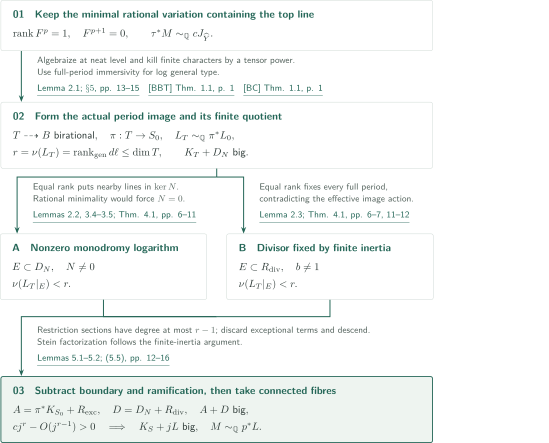
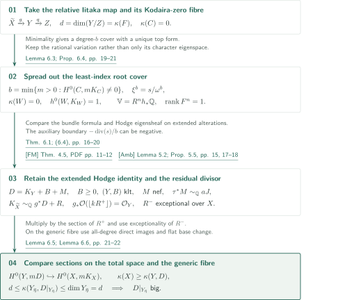
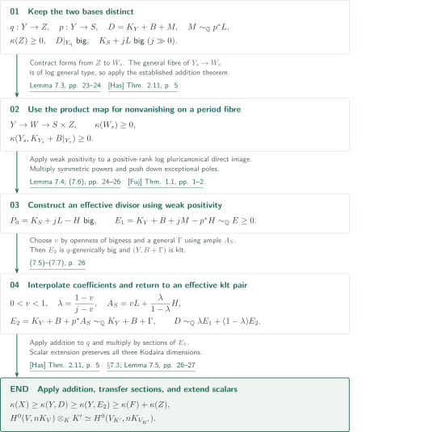

# Projective Hodge lines and ordinary Iitaka subadditivity

**From rank loss of the highest Hodge line to ordinary Iitaka subadditivity**

The manuscript claims ordinary Iitaka subadditivity by combining adjoint positivity for an entire rank-one highest Hodge piece with a canonical bundle formula and weak positivity. Its central mechanism separates the dimension of the full period image from the rank of the highest-line map, removes boundary and finite-quotient ramification, and constructs sections without assuming semiampleness.

## 1. Main results

The following statements report the manuscript's claims in their original order and with their hypotheses.

### Theorem 1.1 — Ordinary Iitaka subadditivity

Let $k$ be an algebraically closed field of characteristic $0$, and let $f:X\to Z$ be a surjective projective morphism with connected fibres between smooth connected projective $k$-varieties. For its geometric generic fibre $F$,

$$
\kappa(X)\geq\kappa(F)+\kappa(Z).
$$

Use $(-\infty)+a=-\infty$ and $\kappa(\mathrm{point})=0$.

[Theorem 1.1 · p. 2][PH]

### Theorem 1.2 — Projective adjoint positivity

Let $Y$ be a smooth connected projective complex variety, $U\subset Y$ a dense Zariski open subset, and $\mathbb V$ a rationally polarized integral pure variation of Hodge structure on $U$. Assume that its **entire highest nonzero Hodge filtration step is a line**: $F^{p+1}=0$ and $\operatorname{rank}F^p=1$. Let $M\in\operatorname{Pic}(Y)\otimes\mathbb Q$. Assume that, after a smooth projective birational modification if needed, a smooth projective alteration $\tau:\widehat Y\to Y$ and $c\in\mathbb Q_{>0}$ exist such that the pulled-back variation has unipotent monodromy along an SNC boundary and its extended highest Hodge line satisfies

$$
\tau^*M\sim_{\mathbb Q}cJ_{\widehat Y}.
$$

After further smooth projective birational modification, there are a surjective morphism $p:Y\to S$ with connected fibres onto a smooth projective variety and a nef rational line $L$ such that

$$
M\sim_{\mathbb Q}p^*L,\qquad K_S+jL\text{ is big for every sufficiently large integer }j.
$$

If $S$ is a point, the conclusion is $M\sim_{\mathbb Q}0$.

[Theorem 1.2 · p. 2][PH]

## References on the arrows

Unprefixed result numbers refer to [PH]. The main external inputs use the following keys.

- [BBT] Bakker–Brunebarbe–Tsimerman.
- [BC] Brunebarbe–Cadorel.
- [FM] Fujino–Mori.
- [Amb] Ambro.
- [Fuj] Fujino.
- [Has] Hashizume.

The [dependency table](#dependencies) records versions and checking scope. Citations link to the sources; page numbers for GitHub previews are given in the labels.

## 2. Theorem 1.2 — Removing boundary and ramification from the period image

**Proof route.** Two preparatory arguments meet in Theorem 1.1. This section establishes the adjoint positivity of Theorem 1.2; the [canonical bundle formula supplies the section comparison](#proof-2). The final [two-base argument and interpolation](#proof-3) combine them to prove ordinary Iitaka subadditivity.

Let $T$ be a smooth projective model of the actual full period image at neat level, $J$ its extended highest line, and $L_T=cJ$. Write $D_N$ for the boundary with nonzero monodromy logarithm, $R_{\rm div}$ for divisorial ramification over the finite quotient, and $R_{\rm exc}$ for the Jacobian components exceptional over the quotient base. The number $r=\nu(J)$ measures the highest-line map and need not equal $\dim T$.

### 1. Retain the finite action on the actual period image

Replace the variation by its smallest rational subvariation containing the highest line. A generic Hodge structure is then rationally generated by that line, allowing one to eliminate rational normal monodromy subgroups fixing it. Algebraize the period image at neat level and retain the function field of its normalization when taking the finite quotient. Tensor powers kill the finite stabilizer characters on the line, permitting rational line-bundle descent. The identity with the original $M$ is obtained by comparing extensions on a common alteration and applying a norm; it is not inferred solely from the open locus.

[Lemmas 2.1–2.3 · pp. 5–7; §5, (5.1) · pp. 13–15][PH] · [BBT, Theorem 1.1 · p. 1][BBT]

### 2. Treat the nilpotent and finite obstructions separately

The nef line satisfies $\nu(J)=\operatorname{rank}_{\rm gen}d\ell$. If its numerical dimension did not drop on a divisor $E$, the tangential limiting map would have rank $r$. Lemma 3.4 would then put the nearby line image inside that limiting image. For $N\ne0$, it lies in $\mathbb P(\ker N)$, contradicting rational minimality. For finite inertia it lies in a single eigenspace; Lemma 2.3 then forces every full period to be fixed. The final contradiction uses the fact that $\mathbb C(T)$ is the **function field of the actual period image**. Passing first to an arbitrary finite cover or Stein factor would lose this argument.

[Proposition 3.2 · pp. 7–8; Lemmas 3.4–3.5 · pp. 9–10; Theorem 4.1 · pp. 11–12][PH] · [BBT, Lemma 6.17 · pp. 43–44][BBT]

### 3. Remove both divisors by comparing degrees of section growth

After extending the variation across components with $N=0$, generic immersivity of the full period map makes $K_T+D_N$ big. Apply Lemma 5.1 with

$$
A=K_T-R_{\rm div}=\pi^*K_{S_0}+R_{\rm exc},\qquad D=D_N+R_{\rm div},\qquad J=L_T.
$$

An ample perturbation yields interior section growth of degree $r$ in $j$, whereas restrictions to the removed divisors have degree at most $r-1$. Thus $A+jL_T$ is big. Removing the exceptional part and descending through the generically finite map makes $K_{S_0}+jL_0$ big. Connected-fibre factorization is performed only afterwards; its effective Jacobian preserves bigness of $K_S+jL$.

[Lemmas 5.1–5.2 · pp. 12–13; (5.2)–(5.5) · pp. 15–16][PH] · [BC, Theorem 1.1 · p. 1][BC]

The identity $M=p^*L$ and adjoint bigness on the base enter the weak-positivity and interpolation argument of [Section 4](#proof-3). Semiampleness of $M$ is not concluded here.

[PH, §7.3 · pp. 25–26][PH]

## 3. The canonical bundle formula — Preparing the line and the section comparison

Put $d=\kappa(F)\geq0$ and write the relative Iitaka factorization as $\widetilde X\xrightarrow{g}Y\xrightarrow{q}Z$. Then $\dim(Y/Z)=d$, and the geometric generic fibre $C$ of $g$ has Kodaira dimension $0$. The construction must retain both the line required by Theorem 1.2 and its comparison with the original pluricanonical sections.

### 1. Use the least index to obtain the entire rank-one top piece

Let $b=\min\{m>0:H^0(C,mK_C)\ne0\}$. Its unique section $s$ defines the root cover by $\xi^b=s/\omega^b$. Lemma 6.3 proves $\kappa(W)=0$ and $h^0(W,K_W)=1$ for a resolution $W$. Spreading out the construction makes the entire top piece of $R^nh_*\mathbb Q$ rank one. Even when the cyclic character is not rational, the full rational variation is retained.

[Lemma 6.3, (6.4) · pp. 19–20][PH]

### 2. Separate the negative auxiliary boundary from the residual divisor

With $B\geq0$, $(Y,B)$ klt, and $M$ nef, the formula gives

$$
K_{\widetilde X}\sim_{\mathbb Q}g^*(K_Y+B+M)+R,\qquad
g_*\mathcal O_{\widetilde X}(\lfloor kR^+\rfloor)=\mathcal O_Y\quad(k>0).
$$

The image of $R^-$ has codimension at least two on the base, and $R^-$ is also exceptional over the original $X$. The latter property requires flattening; it does not follow just from the image dimension. On the generic fibre the auxiliary sub-pair has boundary $-\operatorname{div}(s)/b$, which need not be effective. The argument uses nefness and the extended Hodge-line identification, without importing moduli abundance that requires an effective generic boundary.

[Theorem 6.1, Remark 6.2 · pp. 16–19][PH] · [FM, Theorem 4.5 · PDF pp. 11–12][FM] · [Amb, Lemma 5.2(4)–(5), Proposition 5.5 · pp. 15, 17–18][Amb]

### 3. Compare sections on the total space and on the generic fibre

Set $D=K_Y+B+M$. Exceptionality of $R^-$ identifies the sections of $K_{\widetilde X}+R^-$ with the original pluricanonical sections. Multiplication by the section of $R^+$ injects $H^0(Y,mD)$ into that space. On the geometric generic $q$-fibre, flat base change and the all-degree direct-image condition give

$$
\kappa(X)\geq\kappa(Y,D),\qquad
 d=\kappa(F)\leq\kappa(Y_{\bar\eta},D|_{Y_{\bar\eta}})\leq\dim Y_{\bar\eta}=d.
$$

Thus $D|_{Y_{\bar\eta}}$ is big. Subsequent birational modifications use the positive part of the crepant boundary and an effective exceptional correction to preserve these comparisons.

[Proposition 6.4, Lemmas 6.5–6.6 · pp. 20–22][PH]

[Section 4](#proof-3) uses both $q$ to the original base and $p$ to the period base. The section injection is retained to transfer the final lower bound back to $X$.

[PH, Proposition 6.4・§7.3 · pp. 20–21, 25–26][PH]

## 4. Theorem 1.1 — Two bases and an interpolation identity

Assume $\kappa(Z)\geq0$. The identity $M=p^*L$ from Theorem 1.2 does not supply a factorization between $p:Y\to S$ and $q:Y\to Z$. If $S$ is a point, apply log-general-type-fibre subadditivity directly to $q$. The remaining argument treats $\dim S>0$.

### 1. Obtain nonvanishing on a period fibre through the product map

Resolve the Stein factorization of the image of $(p,q)$ as $Y\to W\to S\times Z$. A general $W_s$ is generically finite onto its image in $Z$, while $W\to Z$ is dominant. Contracting top forms with the exterior base-direction factor turns a pluricanonical section on $Z$ into a nonzero section on $W_s$. On the general fibre of $Y_s\to W_s$, the line $M$ becomes trivial, so bigness of $D$ becomes log-canonical bigness. A first use of log-general-type-fibre subadditivity gives log nonvanishing on the geometric generic $p$-fibre.

[Lemma 7.3 · pp. 23–24][PH] · [Has, Theorem 2.11 · p. 5][Has]

### 2. Use weak positivity to construct an effective divisor with a negative ample twist

Choose $j>1$ and an ample rational divisor $H$ with $K_S+jL-H$ big. The preceding nonvanishing makes a relative log pluricanonical direct image have positive rank, allowing weak positivity. Multiplying sections of symmetric powers and pushing down exceptional poles after flattening yields

$$
E_1:=K_Y+B+jM-p^*H\sim_{\mathbb Q}\text{an effective divisor}.
$$

The extension and pushdown in Lemma 7.4 connect generic generation to effectivity on the whole total space.

[Theorem 7.2, Lemma 7.4, (7.6) · pp. 23–26][PH] · [Fuj, Theorem 1.1 · pp. 1–2][Fuj]

### 3. Balance coefficients and reduce to an effective klt pair

Openness of the big cone allows $0<v<1$ with $(K_Y+B+vM)|_{Y_{\bar\eta}}$ big. Set

$$
\lambda=\frac{1-v}{j-v},\quad A_S=vL+\frac{\lambda}{1-\lambda}H,\quad
E_2=K_Y+B+p^*A_S,\quad D\sim_{\mathbb Q}\lambda E_1+(1-\lambda)E_2.
$$

These choices simultaneously balance the coefficient of $M$ and cancel the ample twist. Since $A_S$ is ample, a sufficiently divisible general section gives $\Gamma\sim_{\mathbb Q}p^*A_S$ with $(Y,B+\Gamma)$ klt. The divisor $E_2$ is its log canonical class and is big on the generic $q$-fibre. Apply subadditivity a second time and multiply by sections of $E_1$ to obtain

$$
\kappa(X)\geq\kappa(Y,D)\geq\kappa(Y,E_2)\geq d+\kappa(Z).
$$

Finally descend the data to a finitely generated field $K/\mathbb Q$ and choose $K\hookrightarrow\mathbb C$. Flat base change for every pluricanonical space, including those of the geometric generic fibre, transfers the result to any algebraically closed characteristic-zero field.

[§7.3, (7.5)–(7.7) · pp. 25–26; Lemma 7.5, §7.4 · p. 27][PH]

This yields ordinary subadditivity, Theorem 1.1. WV’s alternative adjoint comparison concerns the separate results of §8; this main theorem is not substituted as a required WV input.

[PH, Theorem 1.1 · p. 2; Theorem 8.1 · p. 28][PH] · [WV, Remark 3.17 · p. 25][WV]

## 5. Which papers supply which steps

| Input | Use and role | Checking scope |
|---|---|---|
| [BBT] arXiv:1811.12230v3, Theorem 1.1 / Lemma 6.17 (pp. 1, 43–44) | Period image in §5; nefness and numerical rank in §3 | Statements compared with uses |
| [BC] arXiv:1707.01327v1, Theorem 1.1 (p. 1) | Bigness of $K_T+D_N$ in §5 p.15 | Statement, immersivity, and choice of boundary compared |
| [FM] JDG 56 (2000), Theorem 4.5 (PDF pp. 11–12; journal pp. 177–178) | Residual divisor and sections in Theorem 6.1 | Statement and boundary-zero use compared; complete model construction unchecked |
| [Amb] arXiv:math/0210271v1, Theorem 4.4, Lemma 5.2(4)–(5), Proposition 5.5 (pp. 12–15, 17–18) | Hodge eigensheaf and pullback in Theorem 6.1 and (6.4) | Relevant statements compared; full cited package and base-change proofs unchecked |
| [Fuj] 2015-06-30, v0.54, Theorem 1.1 (pp. 1–2) | Theorem 7.2 → effectivity in Lemma 7.4 | Statement and application to the projective klt pair compared |
| [Has] arXiv:1902.10923v2, Theorem 2.11 (p. 5) | Addition in Lemma 7.3 and §7.3 | Statement compared; no abundance of the base canonical class required |

These are direct inputs to the main route. The uses of the fixed-part theorem, monodromy normality, and nilpotent-orbit and extension theory were read in [PH], but their external source statements have not all been checked. Within catalogue 033, [WV, Remark 3.17 · p. 25][WV] cites Lemma 8.4 / Theorem 8.1 as an alternative adjoint comparison. WV explicitly uses its direct comparison in its own proof, so this relationship is `alternative`. The ordinary-subadditivity comparison with OI is likewise treated as a separate proof route; no direct PH→OI edge is asserted. Other relationships remain unexamined.

## 6. Return to the sources

- [§§2–5 · pp. 5–16][PH]: rational minimality, tangential limits, the two rank losses, quotient descent, and volume estimates.
- [§6 · pp. 16–22][PH]: the least-index root cover, the Hodge identification across the boundary, and residual section comparisons.
- [§7 · pp. 22–27][PH]: the product map, effectivity from weak positivity, interpolation, and scalar extension.
- [§§8–9 · pp. 27–39][PH]: alternative boundary estimates by integral tensor replacement and Thom forms, separate from the main route.

The reading covers Theorems 1.1–1.2, Lemmas 2.1–2.3 / 3.4, Theorem 4.1, descent and volume estimates in §5, and the central proof passages of §§6–7. Section 5 specifies which input statements and applications were compared. Only the statements of Theorem 8.1 / Lemma 8.4 and the corresponding WV comparison were read. The boundary mixed-Hodge identification, multivariable extensions, every auxiliary proof, the alternative proofs in §§8–9, and full external proofs have not been independently verified. This is an AI-generated account of the authors' argument, not certification of the manuscript or expert peer review. The source is the 40-page version of 2026-09-27, pinned to commit `fd4aeeb2ee4fc729c18d98444fed42fd0529eeeb`.

[PH]: https://github.com/openai/math/blob/fd4aeeb2ee4fc729c18d98444fed42fd0529eeeb/preprints/Projective-Hodge-lines-and-ordinary-Iitaka-subadditivity-September-27-2026/paper.pdf
[BBT]: https://arxiv.org/pdf/1811.12230v3
[BC]: https://arxiv.org/pdf/1707.01327v1
[FM]: https://www.math.kyoto-u.ac.jp/~fujino/Canonical.pdf
[Amb]: https://arxiv.org/pdf/math/0210271v1
[Fuj]: https://www.math.kyoto-u.ac.jp/~fujino/weak-posi11.pdf
[Has]: https://arxiv.org/pdf/1902.10923v2
[WV]: https://github.com/openai/math/blob/fd4aeeb2ee4fc729c18d98444fed42fd0529eeeb/preprints/Logarithmic-Kodaira-dimension-and-whole-fiber-variation-September-26-2026/paper.pdf
