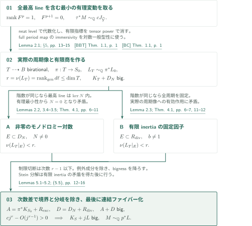
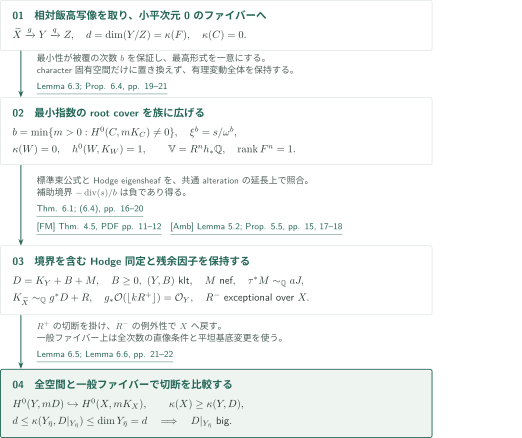
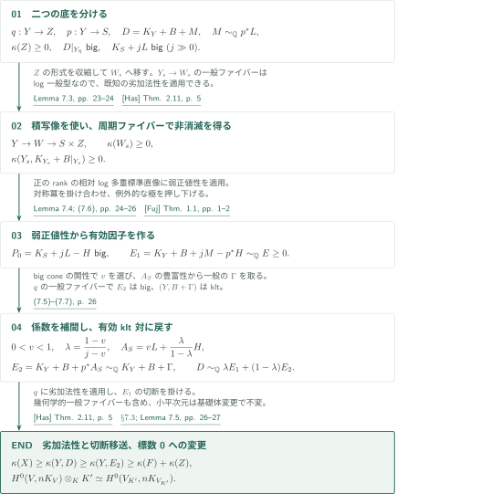

# Projective Hodge lines and ordinary Iitaka subadditivity

**最高Hodge lineの境界での階数低下から、通常の飯高劣加法性へ**

本稿は、全最高Hodge空間が1次元である有理偏極付き整純Hodge構造の変動から随伴正値性を導き、標準束公式と弱正値性を介して通常の飯高劣加法性を示すと主張する。論証の要点は、full period imageの次元とhighest-line mapの階数を区別したまま境界・有限商の分岐を除き、半豊富性を仮定せずに切断を作ることである。

## 1. 主要結果

以下の定理文は原稿の主張を、その順序と仮定に従って記す。

### Theorem 1.1 — 通常の飯高劣加法性

$k$を標数$0$の代数閉体とし、$f:X\to Z$を滑らかな連結射影$k$多様体間の、連結ファイバーをもつ全射射影射とする。$F$をその幾何学的一般ファイバーとすると、

$$
\kappa(X)\geq\kappa(F)+\kappa(Z).
$$

$(-\infty)+a=-\infty$、$\kappa(\mathrm{point})=0$とする。

[Theorem 1.1 · p. 2][PH]

### Theorem 1.2 — 射影的随伴正値性

$Y$を滑らかな連結射影複素多様体、$U\subset Y$を稠密Zariski開集合、$\mathbb V$を$U$上の有理偏極付き整純Hodge構造の変動とする。**全体の最高非零Hodge filtrationがline**、すなわち$F^{p+1}=0$、$\operatorname{rank}F^p=1$であると仮定する。$M\in\operatorname{Pic}(Y)\otimes\mathbb Q$について、必要なら$Y$を滑らかな射影双有理モデルに替え、滑らかな射影alteration $\tau:\widehat Y\to Y$と$c\in\mathbb Q_{>0}$が存在し、引き戻した変動のSNC境界まわりのモノドロミーがunipotentで、延長最高Hodge line $J_{\widehat Y}$に対して

$$
\tau^*M\sim_{\mathbb Q}cJ_{\widehat Y}
$$

が成り立つとする。さらに滑らかな射影双有理変更を行うと、滑らかな射影多様体$S$への連結ファイバーをもつ全射$p:Y\to S$とnefな有理line $L$が存在し、

$$
M\sim_{\mathbb Q}p^*L,\qquad K_S+jL\text{ は十分大きいすべての整数 }j\text{ に対して big}
$$

となる。$S$が点の場合は$M\sim_{\mathbb Q}0$を結論する。

[Theorem 1.2 · p. 2][PH]

## 図の矢印に付した引用

略号のない結果番号は本稿[PH]を指す。主要な外部入力には次の略号を使う。

- [BBT] Bakker–Brunebarbe–Tsimerman。
- [BC] Brunebarbe–Cadorel。
- [FM] Fujino–Mori。
- [Amb] Ambro。
- [Fuj] Fujino。
- [Has] Hashizume。

各版・照合範囲は[依存する結果の一覧](#dependencies)に記す。図の引用先は原典であり、GitHub閲覧URLのページはリンク表示中の番号で参照する。

## 2. Theorem 1.2 — 周期像から境界と分岐を除く

**証明の道筋。** Theorem 1.1には二つの準備を合流させる。本節でTheorem 1.2の随伴正値性を示し、[標準束公式による切断比較](#proof-2)を用意してから、[二つの底の比較と補間](#proof-3)で通常の飯高劣加法性を導く。

$T$をneat levelでの実際のfull period imageの滑らかな射影モデルとし、$J$を延長最高line、$L_T=cJ$とする。$D_N$はモノドロミー対数が非零の境界、$R_{\rm div}$は有限商の余次元1の分岐、$R_{\rm exc}$は商の底上で例外的なJacobian成分である。$r=\nu(J)$はhighest-line mapの階数であり、$\dim T$と同じとは限らない。

### 1. 実際の周期像上で有限群の作用を保持する

最高lineを含む最小の有理部分変動に替えると、一般のHodge構造はそのlineで有理的に生成される。これにより、lineを固定する有理正規モノドロミー部分群を排除できる。neat levelで周期像を代数化し、その正規化の関数体を保ったまま有限群作用を考える。lineの有限安定化群の指標はtensor powerで消し、商の上に有理lineを降ろす。原来の$M$との同一視は共通alteration上の延長同士を比較し、normで降ろすので、開集合上だけの同一視ではない。

[Lemmas 2.1–2.3 · pp. 5–7; §5, (5.1) · pp. 13–15][PH] · [BBT, Theorem 1.1 · p. 1][BBT]

### 2. 境界と有限分岐で別々に階数を落とす

nef lineの数値次元は$\nu(J)=\operatorname{rank}_{\rm gen}d\ell$である。境界$E$で数値次元が落ちないと仮定すると、接方向の極限の階数も$r$となり、Lemma 3.4により近傍のline像が極限像に含まれる。$N\ne0$ならその像は$\mathbb P(\ker N)$に入り、有理最小性に矛盾する。有限inertiaの場合は一つの固有空間に入り、Lemma 2.3から全周期を固定する。この最後の矛盾には$\mathbb C(T)$が**実際の周期像の関数体**であることが必要で、先に任意の有限被覆やStein分解へ替えることはできない。

[Proposition 3.2 · pp. 7–8; Lemmas 3.4–3.5 · pp. 9–10; Theorem 4.1 · pp. 11–12][PH] · [BBT, Lemma 6.17 · pp. 43–44][BBT]

### 3. 切断数の次数差で二つの障害を同時に除く

$N=0$の成分を越えて変動を延長した後、full period mapの一般的なimmersivityから$K_T+D_N$のbignessを得る。Lemma 5.1に

$$
A=K_T-R_{\rm div}=\pi^*K_{S_0}+R_{\rm exc},\qquad D=D_N+R_{\rm div},\qquad J=L_T
$$

を代入する。豊富な摂動を加えた内部の切断数は$j^r$で増え、取り除く各因子への制限は高々$j^{r-1}$なので、$A+jL_T$がbigになる。例外成分を除き、一般有限射で降下して$K_{S_0}+jL_0$をbigにする。連結ファイバー化はこの後に行い、有効Jacobianを加えることで$K_S+jL$のbignessを保つ。

[Lemmas 5.1–5.2 · pp. 12–13; (5.2)–(5.5) · pp. 15–16][PH] · [BC, Theorem 1.1 · p. 1][BC]

得た$M=p^*L$と底の随伴bignessを、[第4節の弱正値性・補間](#proof-3)へ渡す。ここで$M$の半豊富性は結論していない。

[PH, §7.3 · pp. 25–26][PH]

## 3. 標準束公式 — 最高lineと切断比較を用意する

$d=\kappa(F)\geq0$とし、相対飯高写像を$\widetilde X\xrightarrow{g}Y\xrightarrow{q}Z$と書く。$\dim(Y/Z)=d$で、$g$の幾何学的一般ファイバー$C$は小平次元$0$である。ここでTheorem 1.2に入るlineと、元の多重標準切断との比較を同時に保持する。

### 1. 最小指数root coverで全最高空間を1次元にする

$b=\min\{m>0:H^0(C,mK_C)\ne0\}$とし、その一意な切断$s$から$\xi^b=s/\omega^b$でroot coverを作る。Lemma 6.3はその解消$W$について$\kappa(W)=0$、$h^0(W,K_W)=1$を示す。これを族に広げると$R^nh_*\mathbb Q$の全最高空間がrank oneになる。cyclic characterが有理的でなくても、変動全体は有理のまま保持される。

[Lemma 6.3, (6.4) · pp. 19–20][PH]

### 2. 負の補助境界と残余因子を区別する

標準束公式は、$B\geq0$、$(Y,B)$ klt、$M$ nefとして

$$
K_{\widetilde X}\sim_{\mathbb Q}g^*(K_Y+B+M)+R,\qquad
g_*\mathcal O_{\widetilde X}(\lfloor kR^+\rfloor)=\mathcal O_Y\quad(k>0)
$$

を与える。$R^-$は底上で余次元2以上へ写り、かつ元の$X$上で例外的である。後者は単なる像の次元からは従わず、flatteningを用いて確保される。補助sub-pairの一般ファイバー境界は$-\operatorname{div}(s)/b$なので、有効とは限らない。本稿が使うのはnefnessと延長Hodge lineの同定であり、その境界の有効性を要するmoduliのabundanceを入力にしない。

[Theorem 6.1, Remark 6.2 · pp. 16–19][PH] · [FM, Theorem 4.5 · PDF pp. 11–12][FM] · [Amb, Lemma 5.2(4)–(5), Proposition 5.5 · pp. 15, 17–18][Amb]

### 3. 全空間への単射と一般ファイバー上のbigness

$D=K_Y+B+M$とする。$R^-$の例外性により$K_{\widetilde X}+R^-$の切断は$X$の標準切断と一致し、$R^+$の切断を掛けると$H^0(Y,mD)$がそこへ入る。一方、$q$の幾何学的一般ファイバーへの平坦な基底変更と全次数の直像条件から

$$
\kappa(X)\geq\kappa(Y,D),\qquad
 d=\kappa(F)\leq\kappa(Y_{\bar\eta},D|_{Y_{\bar\eta}})\leq\dim Y_{\bar\eta}=d
$$

となり、$D|_{Y_{\bar\eta}}$はbigである。以後の双有理変更ではcrepant境界の正部分を取り、有効例外因子を加えてこの比較を保つ。

[Proposition 6.4, Lemmas 6.5–6.6 · pp. 20–22][PH]

[第4節](#proof-3)では元の底への$q$とperiod底への$p$を同時に使う。切断単射は最後に下界を元の$X$へ戻すために保持する。

[PH, Proposition 6.4・§7.3 · pp. 20–21, 25–26][PH]

## 4. Theorem 1.1 — 二つの底と補間

$\kappa(Z)\geq0$とする。Theorem 1.2で$M=p^*L$と書けても、$p:Y\to S$と$q:Y\to Z$の間に因子化は仮定できない。$S$が点なら一般型ファイバーの劣加法性を$q$に直接適用する。以下は$\dim S>0$の場合である。

### 1. 積写像から周期ファイバーの非消滅を得る

$(p,q)$の像のStein分解と解消を$Y\to W\to S\times Z$とする。一般の$W_s$は$Z$の像に一般有限で、全体として$W\to Z$は支配的である。底方向の外積因子で収縮した標準形式は、$Z$の多重標準切断から$W_s$の非零切断を与える。$Y_s\to W_s$の一般ファイバーでは$M$が消え、$D$のbignessがlog canonical classのbignessになる。一般型ファイバーの劣加法性をここで一度用い、$p$の幾何学的一般ファイバーのlog非消滅を得る。

[Lemma 7.3 · pp. 23–24][PH] · [Has, Theorem 2.11 · p. 5][Has]

### 2. 弱正値性から底の豊富な捻りを差し引いた有効因子を作る

$K_S+jL-H$がbigとなる$j>1$と豊富な有理因子$H$を取る。前段の非消滅により相対log多重標準直像は正のrankをもち、弱正値性を適用できる。対称冪の切断を掛け合わせ、flattening後に生じる例外的な極を押し下げると

$$
E_1:=K_Y+B+jM-p^*H\sim_{\mathbb Q}\text{有効因子}
$$

を得る。Lemma 7.4の延長・押し下げが、一般点での生成から全空間の有効性への接続である。

[Theorem 7.2, Lemma 7.4, (7.6) · pp. 23–26][PH] · [Fuj, Theorem 1.1 · pp. 1–2][Fuj]

### 3. 係数を合わせ、有効klt対へ帰着する

big coneの開性により$0<v<1$で$(K_Y+B+vM)|_{Y_{\bar\eta}}$をbigに保つ。次の選択で$M$の係数と$H$の捻りを同時に合わせる。

$$
\lambda=\frac{1-v}{j-v},\quad A_S=vL+\frac{\lambda}{1-\lambda}H,\quad
E_2=K_Y+B+p^*A_S,\quad D\sim_{\mathbb Q}\lambda E_1+(1-\lambda)E_2.
$$

$A_S$は豊富なので、十分割り切れる一般の切断から$\Gamma\sim_{\mathbb Q}p^*A_S$を取り、$(Y,B+\Gamma)$をkltにできる。$E_2$はこの有効対のlog canonical classで、$q$の一般ファイバー上でbigである。劣加法性を再び適用し、$E_1$の切断を掛けて

$$
\kappa(X)\geq\kappa(Y,D)\geq\kappa(Y,E_2)\geq d+\kappa(Z)
$$

を得る。最後にデータを有限生成体$K/\mathbb Q$へ降ろし$K\hookrightarrow\mathbb C$を選ぶ。各次数の$H^0$の平坦基底変更を、幾何学的一般ファイバーにも適用し、標数$0$の任意の代数閉体へ戻す。

[§7.3, (7.5)–(7.7) · pp. 25–26; Lemma 7.5, §7.4 · p. 27][PH]

通常劣加法性Theorem 1.1を得る。WVが挙げる代替の随伴比較は§8の別結果であり、この主定理をWVの必須入力に置き換えない。

[PH, Theorem 1.1 · p. 2; Theorem 8.1 · p. 28][PH] · [WV, Remark 3.17 · p. 25][WV]

## 5. どの論文が、どの段階を担うか

| 入力 | 使用箇所と役割 | 今回の照合 |
|---|---|---|
| [BBT] arXiv:1811.12230v3, Theorem 1.1 / Lemma 6.17（pp. 1, 43–44） | §5の周期像、§3のnefnessと数値的rank | 入力記述と適用箇所を照合 |
| [BC] arXiv:1707.01327v1, Theorem 1.1（p. 1） | §5 p.15で$K_T+D_N$をbigにする | 入力記述とimmersivity・境界の選択を照合 |
| [FM] JDG 56 (2000), Theorem 4.5（PDF pp. 11–12、誌面pp. 177–178） | Theorem 6.1の残余因子・切断比較 | 定理記述と境界$0$での利用を照合。全モデル構成は未検証 |
| [Amb] arXiv:math/0210271v1, Theorem 4.4, Lemma 5.2(4)–(5), Proposition 5.5（pp. 12–15, 17–18） | Theorem 6.1、(6.4)のHodge eigensheafとpullback | 関連記述を照合。引用群全体・基底変更の全証明は未検証 |
| [Fuj] 2015-06-30, v0.54, Theorem 1.1（pp. 1–2） | Theorem 7.2 → Lemma 7.4の有効性 | 入力記述と射影的klt対への適用を照合 |
| [Has] arXiv:1902.10923v2, Theorem 2.11（p. 5） | Lemma 7.3と§7.3の加法性 | 入力記述を照合。底のcanonical classのabundanceは要しない |

これらは主経路の直接入力である。固定部分定理、モノドロミー正規性、nilpotent-orbit・延長理論については本稿の使用箇所を読んだが、各外部原典の全照合は未了である。033内では、[WV, Remark 3.17 · p. 25][WV]が本稿Lemma 8.4 / Theorem 8.1を別の随伴比較として挙げる。WV自身の証明は直接比較を使うと明記されており、この関係は`alternative`である。OIとの通常劣加法性の関係も別証明として扱い、PH→OIの直接辺は作らない。他の関係は未調査である。

## 6. 原典を読む入口と確認範囲

- [§§2–5 · pp. 5–16][PH]：有理最小化、接方向の極限、二種類のrank loss、商の降下、体積評価。
- [§6 · pp. 16–22][PH]：最小指数root cover、境界を含むHodge同定、残余因子による切断比較。
- [§7 · pp. 22–27][PH]：積写像、弱正値性からの有効化、係数補間、基礎体変更。
- [§§8–9 · pp. 27–39][PH]：integral tensor replacementとThom形式による別の境界評価。主経路とは区別する。

今回はTheorems 1.1–1.2、Lemmas 2.1–2.3 / 3.4、Theorem 4.1、§5の降下と体積評価、§§6–7の核心の証明を読んだ。第5節の入力は記述と使用箇所を照合した範囲を示す。Theorem 8.1 / Lemma 8.4は記述のみを読み、WVの比較箇所を確認した。境界のmixed Hodge構造の同定・多変数の延長、全補助定理の証明、§§8–9の別証明、全外部文献の証明は独立検証していない。本記事は著者の論証をたどるAI生成の概説であり、原稿全体の正しさの認定や専門家査読ではない。原稿は2026-09-27版、40ページ、参照commitは`fd4aeeb2ee4fc729c18d98444fed42fd0529eeeb`に固定する。

[PH]: https://github.com/openai/math/blob/fd4aeeb2ee4fc729c18d98444fed42fd0529eeeb/preprints/Projective-Hodge-lines-and-ordinary-Iitaka-subadditivity-September-27-2026/paper.pdf
[BBT]: https://arxiv.org/pdf/1811.12230v3
[BC]: https://arxiv.org/pdf/1707.01327v1
[FM]: https://www.math.kyoto-u.ac.jp/~fujino/Canonical.pdf
[Amb]: https://arxiv.org/pdf/math/0210271v1
[Fuj]: https://www.math.kyoto-u.ac.jp/~fujino/weak-posi11.pdf
[Has]: https://arxiv.org/pdf/1902.10923v2
[WV]: https://github.com/openai/math/blob/fd4aeeb2ee4fc729c18d98444fed42fd0529eeeb/preprints/Logarithmic-Kodaira-dimension-and-whole-fiber-variation-September-26-2026/paper.pdf
