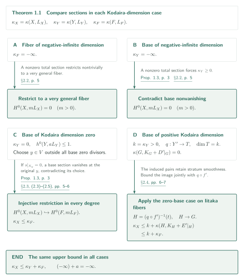
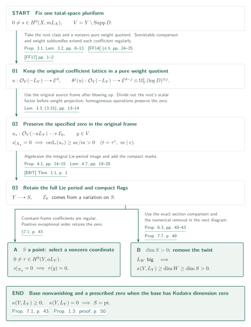
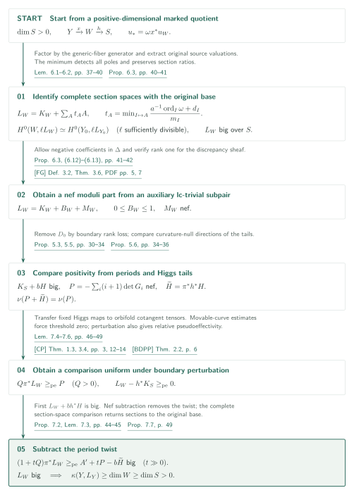
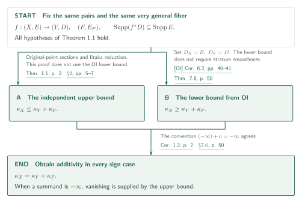

# The reverse logarithmic Kodaira inequality and additivity

**Sections retaining a prescribed zero, and removal of the period twist**

For projective pairs whose total space and all boundary strata are smooth over the open base, the manuscript proves an upper bound for logarithmic Kodaira dimension. Its central construction, Proposition 1.3, turns a total-space pluriform into a pluriform on the original base and transfers vanishing on a specified fiber to vanishing at the specified base point. We first follow the independent upper-bound argument and then treat additivity, which additionally uses the lower bound from [OI].

## 1. Main results

### Theorem 1.1 — Reverse logarithmic Kodaira inequality

Let $X,Y$ be smooth connected projective complex varieties and let $f:X\to Y$ be surjective with connected fibers. Let $E\subset X$ and $D\subset Y$ be reduced SNC divisors, either of which may be zero, satisfying

$$
\operatorname{Supp}(f^*D)\subseteq\operatorname{Supp}(E).
$$

Set $V=Y\setminus\operatorname{Supp}D$. Assume that $X$, and **every irreducible component of every nonempty intersection** of components of $E$, restricted to $f^{-1}(V)$, are smooth over $V$. For very general $y\in V$, put $F=X_y$, $E_F=E|_F$, and write

$$
L_X=K_X+E,\qquad L_Y=K_Y+D,\qquad L_F=K_F+E_F.
$$

Then

$$
\kappa(X,L_X)\leq\kappa(Y,L_Y)+\kappa(F,L_F).
$$

If either term on the right is $-\infty$, then $H^0(X,mL_X)=0$ for every integer $m>0$. A point has Kodaira dimension $0$, and $(-\infty)+a=-\infty$, including $a=-\infty$. The boundary condition concerns supports and does not discard the multiplicities of $f^*D$. No smoothness over $D$, abundance, semiampleness, or good minimal model is assumed.

[Theorem 1.1 and (1.1)–(1.2) · p. 2][RA]

### Corollary 1.2 — Logarithmic additivity

For the same pairs, morphism, and stratum-smoothness assumptions as in Theorem 1.1, with the same $-\infty$ convention,

$$
\kappa(X,K_X+E)=\kappa(Y,K_Y+D)+\kappa(F,K_F+E_F).
$$

This combines the upper bound with [OI, Corollary 6.2]. The proof of the upper bound in Theorem 1.1 does not use [OI].

[Corollary 1.2 · p. 2; §7.6 · p. 50][RA] · [OI, Corollary 6.2 · pp. 40–41][OI]

### Proposition 1.3 — A section on the original base with a prescribed zero

Suppose $f,E,D$ satisfy the hypotheses of Theorem 1.1 and $0\ne s\in H^0(X,mL_X)$ for some integer $m>0$. Then $\kappa(Y,L_Y)\geq0$. If, moreover, $\kappa(Y,L_Y)=0$ and $s|_{X_y}=0$ for some $y\in V$, there are an integer $a>0$ and a section

$$
0\ne\tau\in H^0(Y,aL_Y),\qquad \tau(y)=0.
$$

The point $y$ may be any such point of the original $V$: it need not lie in the smooth locus of the cyclic-cover family constructed from $s$.

[Proposition 1.3 · p. 3][RA]

## References on the arrows

Unprefixed numbers refer to [RA]. The diagrams retain the Proposition / Lemma / Corollary labels at the statements. Some later cross-references in the manuscript instead call these results “Theorem.” GitHub preview links do not guarantee navigation to a PDF page; page numbers appear explicitly in the labels.

- [OI]: *Orbifold and logarithmic Iitaka subadditivity*, pinned 2026-09-26 manuscript.
- [FF14]: Fujino–Fujisawa, *Variations of mixed Hodge structure and semipositivity theorems*, author manuscript dated 2014-03-17. [FF17] is their supplement dated 2017-07-07.
- [BBT]: Bakker–Brunebarbe–Tsimerman, *o-minimal GAGA and a conjecture of Griffiths*, arXiv v3.
- [FG]: Fujino–Gongyo, *On the moduli b-divisors of lc-trivial fibrations*, published version, 2014.
- [CP]: Campana–Păun, *Foliations with positive slopes and birational stability of orbifold cotangent bundles*, checked in arXiv v4.
- [BDPP]: Boucksom–Demailly–Păun–Peternell, *The pseudo-effective cone of a compact Kähler manifold and varieties of negative Kodaira dimension*, arXiv v1.

## 2. Proof of Theorem 1.1 — Reduction by Kodaira dimension

**Goal.** Write $\kappa_X,\kappa_Y,\kappa_F$ for the logarithmic Kodaira dimensions of the respective pairs. Given Proposition 1.3, the upper bound follows from restriction of sections and the logarithmic Iitaka fibration of the base.

### 1. Treat both negative-infinity cases as vanishing statements

If $\kappa_F=-\infty$, the nonvanishing locus of a hypothetical nonzero total-space section has image containing a dense open subset of the base. Restriction and adjunction would give $H^0(F,mL_F)\ne0$ on a very general fiber, a contradiction. If $\kappa_Y=-\infty$, Proposition 1.3 instead contradicts the existence of a total-space section by producing base nonvanishing. Both arguments exclude sections in every positive degree.

[§2.2 · p. 5][RA]

### 2. Obtain restriction injectivity in every degree at one fiber

When $\kappa_Y=0$, one has $h^0(Y,aL_Y)\leq1$. Each degree therefore contributes at most one zero divisor of a nonzero section. Choose $y$ outside their countable union, also making all fiber plurigenera attain their very general values. A nonzero $s$ in the restriction kernel would, by Proposition 1.3, produce a nonzero base section vanishing at $y$, contradicting this choice. Hence

$$
H^0(X,mL_X)\hookrightarrow H^0(F,mL_F)\quad(m>0),
\qquad \kappa_X\leq\kappa_F.
$$

The essential point is that Proposition 1.3 applies at the specified point of the **original $V$**, independently of the auxiliary open set attached to each section. Finite generation of the section rings is unnecessary.

[§2.3 and (2.3)–(2.5) · pp. 5–6][RA]

### 3. Reduce positive base dimension to zero on an Iitaka fiber

For $k=\kappa_Y>0$, resolve the logarithmic Iitaka map to $q:Y'\to T$ with $\dim T=k$. Use strict-transform boundaries plus reduced exceptional divisors and make a compatible resolution $f':X'\to Y'$; logarithmic section spaces are unchanged. A very general fiber $G$ of $q$ has $\kappa(G,K_G+D'|_G)=0$. The induced morphism from $H=(q\circ f')^{-1}(t)$ to $G$ retains the required smoothness with its boundary strata, so the preceding case applies:

$$
\kappa(H,K_H+E'|_H)\leq\kappa_F,
\qquad
\kappa_X\leq\dim T+\kappa(H,K_H+E'|_H)\leq k+\kappa_F.
$$

The last upper bound is the image-dimension estimate for a total-space linear system combined with $q\circ f'$. It includes the case where $G$ is a point. If $H$ has Kodaira dimension $-\infty$, restriction excludes all total-space sections instead.

[§2.1 and (2.1) · p. 5; §2.4 · pp. 6–7][RA]

**Use of the output.** Section 5 combines this independent upper bound with OI’s logarithmic lower bound. Its key input is Proposition 1.3, developed next.

[RA, §2・§7.6 · pp. 5–7, 50][RA]

## 3. Proof of Proposition 1.3 — From a Hodge vector to a base section

**Goal.** Fix a nonzero section $s$. The constructed Hodge vector need not generate the whole highest Hodge bundle. The argument therefore retains its coefficients and the compact flags determined by its projective direction. Below, $\mathcal E_0$ denotes the highest Hodge bundle, distinct from the boundary $E$.

### 1. Keep new cyclic-cover discriminants out of the base pole divisor

Taking an $m$th root of $s$ produces a logarithmic mixed Hodge class; projection to a suitable pure weight quotient remains nonzero. The coefficients of the resulting $u:\mathcal O_Y(-L_Y)\dashrightarrow\mathcal E^d$ and its Higgs iterates are measured in the original $\Omega_Y^1(\log D)$ frames. Proposition 3.1 proves their regularity in the unipotent Hodge extension on each prescribed higher model.

In transverse-curve tests, the cotangent tensor frames remain frames of an external pullback bundle. They are not replaced by differentials on the testing curve and then divided back. Thus an extra cyclic-cover discriminant inside the original $V$ introduces no new allowed poles. Regular projection to a pure weight quotient uses the subbundle property of Lemma 3.2, with the semistable logarithmic de Rham/canonical-extension comparison from [FF14] and the strictness supplement [FF17].

[Proposition 3.1 and Lemma 3.2 · pp. 8–13][RA] · [FF14, §4.9 and Lemma 4.10, Step 1 · pp. 24–31][FF14] · [FF17 · pp. 1–2][FF17]

### 2. Retain the original source frame when blowing up the specified point

If $s|_{X_y}=0$, its coefficient near the smooth relative SNC fiber belongs to $\mathfrak m_y\mathcal O_X$. Blow up $y$, take a transverse parameter $t$ at the exceptional divisor, and set $t=\tau^e$ with $m\mid e$. In the original $L_X$ frame, the root $r$ satisfies

$$
(r/\tau^{e/m})^m=s/\tau^e.
$$

The right-hand side is regular, and normality makes $r/\tau^{e/m}$ regular. The weight-subbundle property in Lemma 3.2 allows this scalar factor to be divided out before projection. After a homogeneous tensor operation of degree $a$, the vanishing order is still at least $ae/m>0$ in the pulled-back original $\mathcal O_Y(-aL_Y)$ frame. Replacing it by the new logarithmic canonical frame on the blowup would lose the prescribed-point information.

[Lemma 3.3 and (3.15) · pp. 13–14][RA]

### 3. Extract a scalar coordinate for a point quotient; prove positivity otherwise

Proposition 4.1 constructs a homogeneous replacement $u_*:\mathcal O_Y(-aL_Y)\dashrightarrow\mathcal E_0$ and a connected quotient $S$ retaining the full Lie period and compact flags. [BBT, Theorem 1.1] algebraizes the period image of the full Lie variation, in which an integral lattice has been retained. The quotient is not obtained merely from the determinant of the highest Hodge bundle.

If $S$ is a point, the descended variation is constant. In a constant frame, each coordinate of $u_*$ is a rational section of $aL_Y$. Divisorial regularity and normality make it global; choose a nonzero coordinate as $\tau$. The positive exceptional order from the preceding step is the vanishing order at the original $y$, so $s|_{X_y}=0$ implies $\tau(y)=0$. When $\dim S>0$, the next section gives $\kappa_Y>0$. Consequently only the point case can occur for $\kappa_Y=0$, proving both conclusions of Proposition 1.3.

[Proposition 4.1 · pp. 14–15; Lemma 4.7 · pp. 19–20; §7.1 and Proposition 7.1 · p. 43; §7.5 · pp. 49–50][RA] · [BBT, Theorem 1.1 · p. 1][BBT]

**Use of the output.** A base section vanishing at the specified point makes restriction to one fiber injective in every degree when the base has Kodaira dimension zero. The next section handles the positive-dimensional period quotient.

[RA, §2.3・proof of Proposition 1.3 · pp. 5–6, 50][RA]

## 4. A positive-dimensional period quotient — Remove the twist and recover sections

**Goal.** Assume $\dim S>0$. Write $Y\xrightarrow{x}W\xrightarrow{h}S$ on suitably prepared models; the section comparison always returns to a fixed original pair. The notation $\geq_{\mathrm{pe}}$ means that the difference is pseudoeffective.

### 1. Construct a divisor representing the complete section spaces

The coefficient system is constant on the generic fiber over $S$, so a nonzero logarithmic section exists there and its Iitaka dimension is nonnegative. Form its relative Iitaka fibration. The unique degree-$a$ generator $\omega$ on the generic $x$-fiber $J$ factors $u_*=\omega x^*u_W$. For a prime $A$ on $W$, define

$$
t_A=\min_{I\mapsto A}\frac{a^{-1}\operatorname{ord}_I(\omega)+d_I}{m_I},
\quad m_I=\operatorname{ord}_I(x^*A),\quad d_I=\operatorname{coeff}_I D_Y,
\qquad L_W=K_W+\sum_A t_AA.
$$

Here $D_Y$ is the reduced boundary on this model. If a prime on the original source is contracted to codimension at least two on a temporary base, its restricted valuation is first extracted on the base. The minimum rule then yields, in all sufficiently divisible degrees $\ell$, an isomorphism

$$
H^0(W,\ell L_W)\xrightarrow{\;\sigma\mapsto\omega^{\ell/a}x^*\sigma\;}H^0(Y_0,\ell L_{Y_0})
$$

preserving section ratios. The fixed model $Y_0$ has the same section spaces as the original $(Y,D)$. Moreover, $L_W$ is big over $S$.

[Lemmas 6.1–6.2 and (6.5)–(6.6); Proposition 6.3 and (6.8) · pp. 37–41][RA]

### 2. Check the auxiliary subpair's rank condition before applying b-nefness

The manuscript sets $\Delta=-a^{-1}\operatorname{div}_{aK_{Y/W}}(\omega)+x^*\sum t_AA$, obtaining $K_Y+\Delta\sim_{\mathbb Q}x^*L_W$; negative coefficients of $\Delta$ are allowed. The logarithmic zero divisor $Z_J$ on the generic fiber has Iitaka dimension zero. Sections of the discrepancy sheaf are bounded above by sections of $\mathcal O_J(NZ_J)$ and below by the constant section, giving

$$
\operatorname{rank}x_*\mathcal O_Y(\lceil\mathbf A^*(Y,\Delta)\rceil)=1.
$$

[FG, Definition 3.2 / Theorem 3.6] now applies. On a suitable model,

$$
L_W=K_W+B_W+M_W,\qquad 0\leq B_W\leq1,\quad M_W\ \text{nef}.
$$

The lower bound on $B_W$ comes from testing the discriminant threshold at the same prime attaining the minimum for $t_A$. The external input supplies b-nefness, without requiring semiampleness of the moduli part.

[Proposition 6.3 and (6.9)–(6.15) · pp. 41–43][RA] · [FG, Definition 3.2 and Theorem 3.6 · PDF pp. 5, 7 (printed pp. 1724, 1726)][FG]

### 3. Account for the period directions in the Higgs-tail numerical dimension

On each component of the boundary $D_0$ with nonidentity Lie monodromy, the period line satisfies $\nu(H|_{D_i})<\nu(H)$. Comparing growth orders of sections removes this boundary and makes $K_S+bH$ big. Let $G_i$ be generated by all contractions of the $i$th Higgs iterate of $u_W$. On a unipotent cover followed by resolution, $\pi:\widehat W\to W$, put

$$
P=-\sum_i(i+1)\det G_i,\qquad \widetilde H=\pi^*h^*H.
$$

Proposition 5.6 proves that $P$ is nef and $\nu(P+\widetilde H)=\nu(P)$. A curvature-null direction fixes the chosen line and its compact flags; an orbit calculation and the representation-theoretic Lemma 5.7 then show that it fixes the whole highest Hodge space. The chosen vector is not assumed to span that space.

[Proposition 5.3 · pp. 30–33; Lemma 5.4 and Proposition 5.5 · pp. 33–34; Proposition 5.6 and (5.11)–(5.18) · pp. 34–36][RA]

### 4. Obtain a fixed comparison from estimates uniform in the boundary

Lemma 7.4 uses the minimizing prime for $t_A$ and the discriminant estimate together to transfer Higgs determinants into orbifold cotangent tensors. Represent $M_W+\epsilon A$ by a general effective $\Lambda_\epsilon$ and apply [CP, Theorem 1.3] whenever $K_W+B_W+\Lambda_\epsilon\sim_{\mathbb Q}L_W+\epsilon A$ is pseudoeffective. [BDPP, Theorem 2.2] converts movable-curve degree inequalities into

$$
C(L_W+\epsilon A)+RL_W\geq_{\mathrm{pe}}P_W,
$$

with $C\geq0$ and $R>0$ independent of $\epsilon$. A positive pseudoeffective threshold $t_0$ would satisfy $t_0\leq Ct_0/(C+R)<t_0$, so $t_0=0$. Taking limits and using $\pi^*P_W\geq_{\mathrm{pe}}P$ gives $Q\pi^*L_W\geq_{\mathrm{pe}}P$ for the fixed $Q=C+R>0$. Applying [CP, Theorem 3.4] to the same perturbed pairs and pushing down from good models also gives $L_W-h^*K_S\geq_{\mathrm{pe}}0$.

[Lemmas 7.4–7.6 and (7.5)–(7.11) · pp. 46–49][RA] · [CP, Theorems 1.3, 3.4 and Remarks 3.3, 3.6 · pp. 3, 12–14][CP] · [BDPP, Theorem 2.2 · p. 6][BDPP]

### 5. Subtract the numerical twist and return to the original base

Relative bigness, $L_W-h^*K_S\geq_{\mathrm{pe}}0$, and bigness of $K_S+bH$ first make $L_W+bh^*H$ big. After pullback, choose an ample lower bound $A'$ and add the fixed comparison from the preceding step:

$$
(1+tQ)\pi^*L_W\geq_{\mathrm{pe}}A'+tP-b\widetilde H.
$$

In Lemma 7.3, the equality $\nu(P+\widetilde H)=\nu(P)$ makes the loss term in the nef Morse inequality have smaller degree in $t$ than the supply term. The right-hand side is therefore big for $t\gg0$, and Proposition 7.2 makes $L_W$ itself big. The **complete section-space isomorphism** from Step 1 returns these systems to the original base and gives $\kappa_Y\geq\dim W\geq\dim S>0$. No equality between numerical and Iitaka dimensions of an arbitrary pseudoeffective divisor is assumed.

[Proposition 7.2 and Lemma 7.3 · pp. 44–45; Proposition 7.7 · p. 49; proof of Proposition 1.3 · p. 50][RA]

**Use of the output.** Positive base Kodaira dimension excludes this branch when the base has Kodaira dimension zero. This completes Proposition 1.3 and returns to the upper-bound argument in Section 2.

[RA, Propositions 7.7, 1.3 · pp. 49–50][RA]

## 5. Proof of Corollary 1.2 — Add the lower bound

**Goal.** Only here does the other catalogue-033 manuscript [OI] enter. The notation $\kappa_X,\kappa_Y,\kappa_F$ and the $-\infty$ convention are unchanged from Section 2.

### 1. Match the boundary condition and the very general fiber

Apply [OI, Corollary 6.2] with $D_X=E$ and $D_Y=D$. Smooth connected projective complex varieties, connected fibers, reduced SNC boundaries, and support inclusion are all supplied by Theorem 1.1. The lower bound does not require stratum smoothness, and its very general pair is exactly $(F,E_F)$. The manuscript restates it as Theorem 7.8.

[Theorem 7.8 and §7.6 · p. 50][RA] · [OI, Corollary 6.2 · pp. 40–41][OI]

### 2. Keep the vanishing supplied by the upper bound in the negative-infinity case

When both summands are finite, the two inequalities give equality. If either is $-\infty$, the lower bound is automatic; the content of equality is the vanishing $H^0(X,mL_X)=0$ supplied by Theorem 1.1. This vanishing is not extracted from the proof in [OI].

[Theorem 1.1 · p. 2; §2.2 · p. 5; §7.6 · p. 50][RA] · [OI, proof of Corollary 6.2 · p. 41][OI]

**Use of the output.** For smooth families with nonnegative fiber and base Kodaira dimensions, comparison with WV Theorem 1.1 gives an alternative upper bound on variation.

[WV, comparison after Corollary 1.3 · p. 5][WV]

## 6. Which papers supply which steps

| Input | Use in this manuscript | Role and checking scope |
|---|---|---|
| [OI, Corollary 6.2 · pp. 40–41][OI] | [Corollary 1.2 and Theorem 7.8 · pp. 2, 50][RA] | **Input to a consequence**: lower bound for the same boundaries and fiber. Compared the statement, short corollary proof, and application; the complete OI proof is not verified. |
| [FF14, §4.9 and Lemma 4.10, Step 1 · pp. 24–31][FF14]; [FF17 · pp. 1–2][FF17] | [Lemma 3.2 · pp. 12–13][RA] | Hodge extension and regular weight projection. Compared the statements and the local-freeness/strictness interface; the full proofs back to Steenbrink and Deligne are not traced. |
| [BBT, Theorem 1.1 · p. 1][BBT] | [Lemma 4.7 · pp. 19–20][RA] | Algebraizes the full integral Lie-period image. Compared the input statement and object to which it is applied; compact-mark construction and finite-monodromy descent are not fully independently checked. |
| [FG, Definition 3.2 and Theorem 3.6 · PDF pp. 5, 7][FG] | [Proposition 6.3 · pp. 41–43][RA] | b-nefness after checking rank one for the auxiliary subpair, allowing negative coefficients. Compared the definition and theorem with (6.12)–(6.13); input proof not verified. |
| [CP, Theorems 1.3, 3.4 · pp. 3, 12–14][CP] | [Lemmas 7.5–7.6 · pp. 47–49][RA] | Orbifold cotangent quotient degrees and relative pseudoeffectivity. Compared perturbed pairs, good models, and pushdown at the application; complete input proofs not verified. |
| [BDPP, Theorem 2.2 · p. 6][BDPP] | [Lemma 7.5 and (7.10) · p. 48][RA] | Passes from movable-curve degrees to pseudoeffectivity. Compared the projective statement and its application; complete input proof not verified. |

[AS, Theorem A · pp. 1–2][AS] is cited for the connection-form argument in [§5.1 and Lemma 5.1 · pp. 26–28][RA]. The manuscript supplies the needed semisimple argument itself; we distinguish this as a relation of proof method. Theorem A and the manuscript's stated use were compared, without tracing the full proof in [AS]. Other relations within catalogue 033 remain unexamined or unrecorded; a missing arrow does not mean absence of dependence.

## 7. Return to the sources

- [§2 · pp. 5–7][RA]: all sign cases of the upper bound, using Proposition 1.3 alone.
- [Proposition 3.1 and Lemmas 3.2–3.3 · pp. 8–14][RA]: the original coefficient lattice and prescribed zero.
- [Proposition 4.1 and Lemma 4.7 · pp. 14–15, 19–20][RA]; [Propositions 5.3, 5.5–5.6 · pp. 30–36][RA]: the marked quotient, boundary rank loss, and Higgs tails.
- [§6 · pp. 37–43][RA]: relative Iitaka, extraction of source valuations, exact section comparison, and lc-trivial conditions.
- [§7 · pp. 43–50][RA]: constant coordinates, twist removal, return to the original base, and addition of the lower bound.

**Checked in this draft:** the main hypotheses and conclusions and the selected proof passages above, concentrating on §§2–3, the valuation and rank conditions in §6, and the threshold and numerical removal in §7. In §§4–5, the quotient/descent passages, boundary-drop and Higgs-tail statements, their later uses, and selected proof paragraphs were read. External statements and applications were compared as specified in the table.

**Not checked:** an independent verification of the full homogeneous-replacement/compact-flag construction in §4.1–4.2, all metric estimates in §4.4, or all boundary-degeneration and representation-theoretic calculations in §5. Complete external proofs, recursive verification of their references, an exhaustive dependency audit, expert review, and formal verification have not been performed. The diagrams organize the manuscript's argument and do not certify its full correctness.

The manuscript and [OI] are pinned to commit `fd4aeeb2ee4fc729c18d98444fed42fd0529eeeb`, version 2026-09-26. Page numbers refer to the linked PDFs; [FG] includes a cover, so PDF and printed page numbers are distinguished.

[RA]: https://github.com/openai/math/blob/fd4aeeb2ee4fc729c18d98444fed42fd0529eeeb/preprints/The-reverse-logarithmic-Kodaira-inequality-and-additivity-September-26-2026/paper.pdf
[OI]: https://github.com/openai/math/blob/fd4aeeb2ee4fc729c18d98444fed42fd0529eeeb/preprints/Orbifold-and-logarithmic-Iitaka-subadditivity-September-26-2026/paper.pdf
[FF14]: https://www.math.kyoto-u.ac.jp/~fujino/vmhs-sp108.pdf
[FF17]: https://www.math.kyoto-u.ac.jp/~fujino/fujino-fujisawa-memo2.pdf
[BBT]: https://arxiv.org/pdf/1811.12230v3
[FG]: https://www.numdam.org/item/10.5802/aif.2894.pdf
[CP]: https://arxiv.org/pdf/1508.02456v4
[BDPP]: https://arxiv.org/pdf/math/0405285v1
[AS]: https://arxiv.org/pdf/2102.03384v5

[WV]: https://github.com/openai/math/blob/fd4aeeb2ee4fc729c18d98444fed42fd0529eeeb/preprints/Logarithmic-Kodaira-dimension-and-whole-fiber-variation-September-26-2026/paper.pdf
