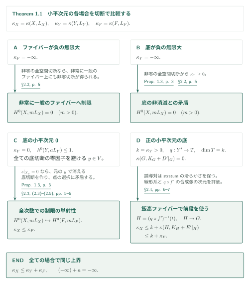
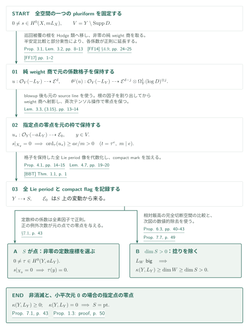
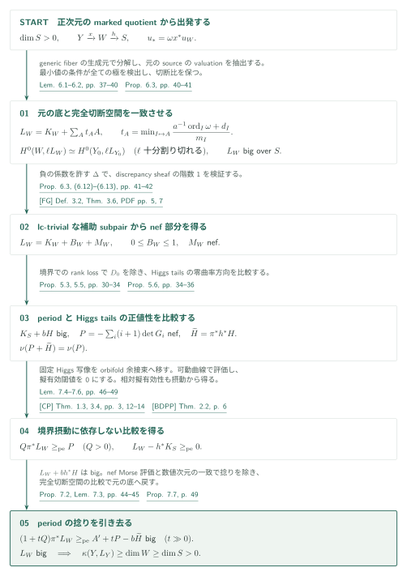
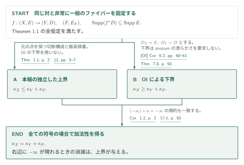

# The reverse logarithmic Kodaira inequality and additivity

**指定点での零点を保つ切断構成と、period twistの除去**

開いた底の上で全境界stratumまで滑らかな射影的対に対し、原稿は対数的小平次元の上界を示す。核心は、全空間の一つのpluriformから元の底のpluriformを作り、指定ファイバー上の消滅を底の指定点での消滅へ移すProposition 1.3にある。上界の論証を先に追い、[OI]の下界を加える加法性は最後に分けて扱う。

## 1. 主要結果

### Theorem 1.1 — 逆向きの対数的小平次元不等式

$X,Y$を滑らかな連結射影的複素多様体、$f:X\to Y$を連結ファイバーをもつ全射とする。$E\subset X$と$D\subset Y$はreduced SNC因子で、零因子も許し、

$$
\operatorname{Supp}(f^*D)\subseteq\operatorname{Supp}(E)
$$

を仮定する。$V=Y\setminus\operatorname{Supp}D$上では、$X$と、$E$の成分の任意の非空な共通部分の**各既約成分**を$f^{-1}(V)$に制限したものが、すべて$V$上滑らかであるとする。非常に一般の$y\in V$に対して$F=X_y$、$E_F=E|_F$と置き、

$$
L_X=K_X+E,\qquad L_Y=K_Y+D,\qquad L_F=K_F+E_F
$$

と書く。このとき

$$
\kappa(X,L_X)\leq\kappa(Y,L_Y)+\kappa(F,L_F).
$$

右辺のどちらかの項が$-\infty$なら、すべての整数$m>0$について$H^0(X,mL_X)=0$である。点の小平次元を$0$、$(-\infty)+a=-\infty$（$a=-\infty$も含む）とする。境界条件は台の包含であり、$f^*D$の重複度を捨てる条件ではない。$D$上の滑らかさ、abundance、semiampleness、good minimal modelは仮定しない。

[Theorem 1.1・(1.1)–(1.2) · p. 2][RA]

### Corollary 1.2 — 対数的加法性

Theorem 1.1と同じ対・射・stratumの滑らかさの仮定、および同じ$-\infty$の規約の下で、

$$
\kappa(X,K_X+E)=\kappa(Y,K_Y+D)+\kappa(F,K_F+E_F).
$$

これは上界に[OI, Corollary 6.2]を加えた帰結である。[OI]はTheorem 1.1の上界には使われない。

[Corollary 1.2 · p. 2、§7.6 · p. 50][RA] · [OI, Corollary 6.2 · pp. 40–41][OI]

### Proposition 1.3 — 元の底上の切断と指定点での零点

$f,E,D$はTheorem 1.1の仮定を満たし、ある整数$m>0$について$0\ne s\in H^0(X,mL_X)$が存在するとする。このとき$\kappa(Y,L_Y)\geq0$である。さらに$\kappa(Y,L_Y)=0$かつ、ある$y\in V$について$s|_{X_y}=0$なら、ある整数$a>0$と切断

$$
0\ne\tau\in H^0(Y,aL_Y),\qquad \tau(y)=0
$$

が存在する。$y$は元の$V$の任意の該当点でよく、$s$から作る巡回被覆の滑らかな開集合に属する必要はない。

[Proposition 1.3 · p. 3][RA]

## 図の矢印に付した引用

略号のない番号は本稿[RA]を指す。図では記述箇所に従いProposition / Lemma / Corollaryを区別する。原稿の後方参照では、これらが一律に「Theorem」と呼ばれる箇所がある。GitHub閲覧リンクではページ移動を保証せず、参照するPDFページをラベルに明記する。

- [OI]：*Orbifold and logarithmic Iitaka subadditivity*、2026-09-26固定版。
- [FF14]：Fujino–Fujisawa、*Variations of mixed Hodge structure and semipositivity theorems*、2014-03-17著者稿。[FF17]は2017-07-07の補足。
- [BBT]：Bakker–Brunebarbe–Tsimerman、*o-minimal GAGA and a conjecture of Griffiths*、arXiv v3。
- [FG]：Fujino–Gongyo、*On the moduli b-divisors of lc-trivial fibrations*、2014年刊行版。
- [CP]：Campana–Păun、*Foliations with positive slopes and birational stability of orbifold cotangent bundles*、照合版はarXiv v4。
- [BDPP]：Boucksom–Demailly–Păun–Peternell、*The pseudo-effective cone of a compact Kähler manifold and varieties of negative Kodaira dimension*、arXiv v1。

## 2. Theorem 1.1の証明 — 小平次元の符号による帰着

**証明の道筋。** まずProposition 1.3を入力として上界を導く。その入力の証明を[Hodgeベクトルから切断を構成する段階](#proof-2)と、[正次元period商の捻りを除く段階](#proof-3)に分けて展開する。OIの下界を使うのは、最後の[加法性の帰結](#proof-4)である。

$\kappa_X,\kappa_Y,\kappa_F$はそれぞれの対の対数的小平次元を表す。Proposition 1.3を入力とすれば、上界は切断の制限と底の対数的飯高ファイブレーションから得られる。

### 1. 負の無限大の二つの場合を切断の消滅として処理する

$\kappa_F=-\infty$のとき、非零の全空間切断があれば、その非消滅集合の像は底の稠密開集合を含む。非常に一般のファイバーへの制限と随伴により$H^0(F,mL_F)\ne0$となり矛盾する。一方、$\kappa_Y=-\infty$のときは、非零の全空間切断から底の非消滅を与えるProposition 1.3に矛盾する。どちらも全正次数での消滅を示している。

[§2.2 · p. 5][RA]

### 2. 小平次元0の底で、同じファイバーへの制限を全次数で単射にする

$\kappa_Y=0$なら$h^0(Y,aL_Y)\leq1$である。非零切断の零因子は各次数で高々一つなので、全次数にわたるそれらの可算和を避け、ファイバーの各plurigenusも非常に一般の値を取る点$y$を選べる。制限の核に非零の$s$があれば、Proposition 1.3が$y$で消える非零の底切断を作り、選び方に反する。したがって

$$
H^0(X,mL_X)\hookrightarrow H^0(F,mL_F)\quad(m>0),
\qquad \kappa_X\leq\kappa_F.
$$

ここで必要なのは、切断ごとに変わる被覆の開集合ではなく、**元の$V$の指定点**でProposition 1.3が使えることである。切断環の有限生成性は用いない。

[§2.3・(2.3)–(2.5) · pp. 5–6][RA]

### 3. 正の小平次元を、飯高ファイバー上の小平次元0へ帰着する

$k=\kappa_Y>0$とし、対数的飯高写像を解消して$q:Y'\to T$、$\dim T=k$を得る。境界には狭義変換と被約例外因子を取り、全空間側も対応する解消$f':X'\to Y'$を行う。対数的切断空間は変わらない。非常に一般の$q$-ファイバー$G$は$\kappa(G,K_G+D'|_G)=0$である。$H=(q\circ f')^{-1}(t)$から$G$への射も、誘導境界を含めて必要な滑らかさを保つため、前段が適用できる。

$$
\kappa(H,K_H+E'|_H)\leq\kappa_F,
\qquad
\kappa_X\leq\dim T+\kappa(H,K_H+E'|_H)\leq k+\kappa_F.
$$

最後の上界は全空間の線形系と$q\circ f'$を組み合わせた像の次元評価である。$G$が点の場合も含む。$H$の小平次元が$-\infty$なら、制限により全空間の切断そのものを排除する。

[§2.1・(2.1) · p. 5、§2.4 · pp. 6–7][RA]

この独立した上界を、[第5節](#proof-4)でOIの対数下界と合わせる。上界の核心は次節以降のProposition 1.3である。

[RA, §2・§7.6 · pp. 5–7, 50][RA]

## 3. Proposition 1.3の証明 — Hodgeベクトルから元の底の切断へ

非零切断$s$を固定する。構成するHodgeベクトルは最高Hodge束全体を生成するとは限らない。このため、ベクトルの係数と、その射影方向が決めるcompact flagを保持する。以下の$\mathcal E_0$は最高Hodge束であり、境界$E$とは別の記号である。

### 1. 巡回被覆の新しい判別式を、底の極に加えない

$s$の$m$乗根を取る被覆から対数的混合Hodge類を作り、非零となる純weight商へ射影する。得られる$u:\mathcal O_Y(-L_Y)\dashrightarrow\mathcal E^d$とそのHiggs反復は、元の$\Omega_Y^1(\log D)$の枠で係数を測る。原稿のProposition 3.1は、任意の所定の高いモデルでも、この係数がunipotent化後のHodge延長内で正則であることを示す。

横断曲線で試す際、余接テンソルの枠は外部の引戻し束の枠として残す。被覆側の微分へ置き換えて割り戻さないので、元の$V$内に現れた被覆の判別式が新たな極を生まない。純weightへの射影の正則性はLemma 3.2の部分束性に依存する。その入力は[FF14]の半安定対数的de Rhamとcanonical extensionの比較、および[FF17]が補うstrictnessである。

[Proposition 3.1・Lemma 3.2 · pp. 8–13][RA] · [FF14, §4.9・Lemma 4.10, Step 1 · pp. 24–31][FF14] · [FF17 · pp. 1–2][FF17]

### 2. 指定点のblowupでは、元のsource lineの枠を保つ

$s|_{X_y}=0$なら、相対SNCな滑らかなファイバーの近傍で$s$の係数は$\mathfrak m_y\mathcal O_X$に属する。$y$をblowupし、例外因子に横断的な座標$t$を取り、$t=\tau^e$、$m\mid e$とする。元の$L_X$の枠で測る根$r$は

$$
(r/\tau^{e/m})^m=s/\tau^e
$$

を満たし、右辺は正則である。正規性から$r/\tau^{e/m}$も正則となる。weight商へ移す前にこの因子を割り出せるのはLemma 3.2の部分束性による。次数$a$の斉次テンソル操作後にも、元の$\mathcal O_Y(-aL_Y)$の引戻し枠で少なくとも$ae/m>0$の零点が残る。blowup後の新しい対数的標準束の枠へ置き換えると、この指定点の情報を失う。

[Lemma 3.3・(3.15) · pp. 13–14][RA]

### 3. period商が点なら係数を取り出し、正次元なら底の正の小平次元を示す

Proposition 4.1は斉次置換$u_*:\mathcal O_Y(-aL_Y)\dashrightarrow\mathcal E_0$と、全Lie periodおよびcompact flagを記録する連結商$S$を作る。[BBT, Theorem 1.1]は、格子を保持した全Lie変動のperiod像の代数性に使う。最高Hodge束の行列式だけをperiod商として用いるわけではない。

$S$が点なら降下した変動は定数となる。定数枠での$u_*$の各座標は$aL_Y$の有理切断であり、全素因子での係数正則性と正規性から大域切断になる。非零座標を$\tau$に選ぶ。前段の正の例外因子次数は元の点$y$での消滅次数なので、$s|_{X_y}=0$なら$\tau(y)=0$である。正次元の$S$に対しては次節が$\kappa_Y>0$を与える。したがって$\kappa_Y=0$なら点商の場合だけが残り、Proposition 1.3の両結論が得られる。

[Proposition 4.1 · pp. 14–15、Lemma 4.7 · pp. 19–20、§7.1・Proposition 7.1 · p. 43、§7.5 · pp. 49–50][RA] · [BBT, Theorem 1.1 · p. 1][BBT]

指定点で消える底切断は、小平次元0の底で同じファイバーへの制限を全次数で単射にする。正次元period商の分岐は次節で処理する。

[RA, §2.3・Proposition 1.3の証明 · pp. 5–6, 50][RA]

## 4. 正次元period商 — 捻りを除いて実際の切断へ戻す

$\dim S>0$とする。以下では適切なモデル上で$Y\xrightarrow{x}W\xrightarrow{h}S$と書くが、切断の比較先は固定した元の対である。$\geq_{\mathrm{pe}}$は差が擬有効であることを表す。

### 1. 相対飯高底に、切断空間を正確に表す因子を作る

$S$のgeneric fiberでは係数系が定数なので非零の対数的切断が得られ、そこでの飯高次元は非負になる。相対飯高ファイブレーションを取り、$x$のgeneric fiber $J$上の次数$a$の一意的な生成元$\omega$によって$u_*=\omega x^*u_W$と分解する。$W$の素因子$A$に対し

$$
t_A=\min_{I\mapsto A}\frac{a^{-1}\operatorname{ord}_I(\omega)+d_I}{m_I},
\quad m_I=\operatorname{ord}_I(x^*A),\quad d_I=\operatorname{coeff}_I D_Y,
\qquad L_W=K_W+\sum_A t_AA
$$

を定める。$D_Y$はこのモデルの被約境界である。元のsource上の素因子が一時的な底の余次元2以上へ潰れる場合、その制限valuationを底に抽出してから最小値を計算する。この操作により、十分割り切れる$\ell$について

$$
H^0(W,\ell L_W)\xrightarrow{\;\sigma\mapsto\omega^{\ell/a}x^*\sigma\;}H^0(Y_0,\ell L_{Y_0})
$$

は同型となり、切断比を保つ。$Y_0$は固定モデルで、その切断空間は元の$(Y,D)$と同じである。また$L_W$は$S$上相対的にbigである。

[Lemmas 6.1–6.2・(6.5)–(6.6)、Proposition 6.3・(6.8) · pp. 37–41][RA]

### 2. 補助subpairの階数条件を確かめてmoduli部分のnef性を得る

原稿は$\Delta=-a^{-1}\operatorname{div}_{aK_{Y/W}}(\omega)+x^*\sum t_AA$を使い、$K_Y+\Delta\sim_{\mathbb Q}x^*L_W$とする。$\Delta$には負の係数を許す。generic fiber上の対数的零因子$Z_J$の小平次元が0であることから、discrepancy sheafの切断を$\mathcal O_J(NZ_J)$の切断で上から抑え、定数切断で下から抑える。こうして

$$
\operatorname{rank}x_*\mathcal O_Y(\lceil\mathbf A^*(Y,\Delta)\rceil)=1
$$

を確認し、[FG, Definition 3.2 / Theorem 3.6]を適用する。必要なモデル上で

$$
L_W=K_W+B_W+M_W,\qquad 0\leq B_W\leq1,\quad M_W\ \text{nef}
$$

を得る。$B_W\geq0$は、$t_A$の最小値を実現する同じ素因子でdiscriminant thresholdを評価して示す。ここで使う外部結果はb-nef性であり、moduli部分のsemiamplenessではない。

[Proposition 6.3・(6.9)–(6.15) · pp. 41–43][RA] · [FG, Definition 3.2・Theorem 3.6 · PDF pp. 5, 7（刊行pp. 1724, 1726）][FG]

### 3. period方向をHiggs tailsの数値次元の中へ収める

period側では、非自明なLie monodromyをもつ境界$D_0$の各成分で$\nu(H|_{D_i})<\nu(H)$となる。切断の増大次数を比較してこの境界を取り除き、$K_S+bH$をbigにする。一方、$u_W$のHiggs反復の全収縮が生成する束を$G_i$とし、unipotentな有限被覆と解消の合成$\pi:\widehat W\to W$上で

$$
P=-\sum_i(i+1)\det G_i,\qquad \widetilde H=\pi^*h^*H
$$

と置く。Proposition 5.6は$P$のnef性と$\nu(P+\widetilde H)=\nu(P)$を示す。曲率が零の方向で選んだ直線とcompact flagが固定されることに加え、orbit計算と表現論のLemma 5.7で最高Hodge空間全体も固定されることが必要である。選んだベクトルがその空間全体を生成するという仮定は置かない。

[Proposition 5.3 · pp. 30–33、Lemma 5.4・Proposition 5.5 · pp. 33–34、Proposition 5.6・(5.11)–(5.18) · pp. 34–36][RA]

### 4. 境界に一様な余接束評価から、固定した比較式を得る

Lemma 7.4は、$t_A$の最小値を実現する成分とdiscriminant係数の評価を併用して、Higgs行列式をorbifold余接テンソルへ移す。$M_W+\epsilon A$を一般の有効な$\Lambda_\epsilon$で表し、$K_W+B_W+\Lambda_\epsilon\sim_{\mathbb Q}L_W+\epsilon A$が擬有効な範囲で[CP, Theorem 1.3]を適用する。[BDPP, Theorem 2.2]で可動曲線との次数評価を擬有効な因子の比較へ戻すと、$\epsilon$に依存しない$C\geq0,R>0$について

$$
C(L_W+\epsilon A)+RL_W\geq_{\mathrm{pe}}P_W.
$$

擬有効閾値$t_0$が正なら$t_0\leq Ct_0/(C+R)<t_0$となるので、$t_0=0$である。極限を取り、$\pi^*P_W\geq_{\mathrm{pe}}P$と合わせて、固定した$Q=C+R>0$に対する$Q\pi^*L_W\geq_{\mathrm{pe}}P$を得る。同じ摂動対に[CP, Theorem 3.4]を適用し、good modelから押し戻して$L_W-h^*K_S\geq_{\mathrm{pe}}0$も得る。

[Lemmas 7.4–7.6・(7.5)–(7.11) · pp. 46–49][RA] · [CP, Theorems 1.3, 3.4・Remarks 3.3, 3.6 · pp. 3, 12–14][CP] · [BDPP, Theorem 2.2 · p. 6][BDPP]

### 5. 数値的な捻りを引き去り、元の底の小平次元へ戻す

相対bigness、$L_W-h^*K_S\geq_{\mathrm{pe}}0$、$K_S+bH$のbignessから、まず$L_W+bh^*H$がbigになる。引戻し後に豊富な$A'$を下から取り、前段の固定した比較式を足すと

$$
(1+tQ)\pi^*L_W\geq_{\mathrm{pe}}A'+tP-b\widetilde H.
$$

Lemma 7.3では$\nu(P+\widetilde H)=\nu(P)$により、nef Morse不等式の損失項の$t$次数が供給項より小さくなり、右辺が$t\gg0$でbigになる。Proposition 7.2はここから$L_W$のbignessを得る。第1段の**完全切断空間の同型**で元の底へ戻し、$\kappa_Y\geq\dim W\geq\dim S>0$を得る。一般の擬有効因子について数値次元と飯高次元の一致を仮定する段階はない。

[Proposition 7.2・Lemma 7.3 · pp. 44–45、Proposition 7.7 · p. 49、Proposition 1.3の証明 · p. 50][RA]

底の正の小平次元が従うため、底の小平次元0の場合には点商だけが残る。これでProposition 1.3を閉じ、[第2節の上界](#proof-1)へ戻る。

[RA, Propositions 7.7, 1.3 · pp. 49–50][RA]

## 5. Corollary 1.2の証明 — 上界に下界を加える

ここで初めて033内の別稿[OI]を使う。$\kappa_X,\kappa_Y,\kappa_F$の記号と$-\infty$の規約は第2節と同じである。

### 1. 下界の境界条件と非常に一般のファイバーを一致させる

[OI, Corollary 6.2]に$D_X=E,D_Y=D$を代入する。滑らかな連結射影的複素多様体、連結ファイバー、被約SNC境界と台の包含はすべてTheorem 1.1の仮定から従う。下界側はstratumの滑らかさを要求せず、使う非常に一般の対も$(F,E_F)$で一致する。原稿はこれをTheorem 7.8として再掲する。

[Theorem 7.8・§7.6 · p. 50][RA] · [OI, Corollary 6.2 · pp. 40–41][OI]

### 2. 負の無限大でも、上界が与える消滅を保つ

両項が有限なら、上界と下界を合わせて等号を得る。どちらかが$-\infty$なら下界は自動的な不等式となり、Theorem 1.1が与えた$H^0(X,mL_X)=0$が等号の内容を担う。[OI]の証明から、この消滅結論を引き出しているわけではない。

[Theorem 1.1 · p. 2、§2.2 · p. 5、§7.6 · p. 50][RA] · [OI, Corollary 6.2の証明 · p. 41][OI]

smooth族でファイバーと底の小平次元が非負なら、WV Theorem 1.1との比較でvariationの上界を得る別経路になる。

[WV, Corollary 1.3後の比較 · p. 5][WV]

## 6. どの論文が、どの段階を担うか

| 入力結果 | 本稿の使用箇所 | 役割・今回の照合範囲 |
|---|---|---|
| [OI, Corollary 6.2 · pp. 40–41][OI] | [Corollary 1.2・Theorem 7.8 · pp. 2, 50][RA] | **帰結への入力**。同じ境界・ファイバーの下界。記述・短い帰結証明と適用を照合。OI全体の証明は未検証。 |
| [FF14, §4.9・Lemma 4.10, Step 1 · pp. 24–31][FF14]、[FF17 · pp. 1–2][FF17] | [Lemma 3.2 · pp. 12–13][RA] | Hodge延長とweight射影の正則性の入力。記述と局所自由性・strictnessの接続を照合。Steenbrink・Deligneまでの全証明は未追跡。 |
| [BBT, Theorem 1.1 · p. 1][BBT] | [Lemma 4.7 · pp. 19–20][RA] | 格子をもつ全Lie period像を代数化。入力の記述と適用対象を照合。compact markの全構成・有限monodromyの降下は独立検証未完了。 |
| [FG, Definition 3.2・Theorem 3.6 · PDF pp. 5, 7][FG] | [Proposition 6.3 · pp. 41–43][RA] | 負の係数を許す補助subpairの階数1条件からb-nef性。定義・定理文と(6.12)–(6.13)を照合。入力定理の証明は未検証。 |
| [CP, Theorems 1.3, 3.4 · pp. 3, 12–14][CP] | [Lemmas 7.5–7.6 · pp. 47–49][RA] | orbifold余接商の次数評価と相対擬有効性。摂動対・good model・押戻しの使用箇所を照合。入力の全証明は未検証。 |
| [BDPP, Theorem 2.2 · p. 6][BDPP] | [Lemma 7.5・(7.10) · p. 48][RA] | 可動曲線との次数から擬有効性への移行。射影的な定理の記述と適用を照合。入力の全証明は未検証。 |

[AS, Theorem A · pp. 1–2][AS]は、[§5.1・Lemma 5.1 · pp. 26–28][RA]のconnection-form論証の出典である。本稿は必要な半単純の場合の議論を本文で与えているため、ここでは証明方法の関係として区別する。Theorem Aの記述と本稿の位置付けを比較したが、[AS]の全証明は追跡していない。その他の033内の関係は未調査・未記録であり、矢印がないことを「依存なし」と解釈しない。

## 7. 原典を読む入口と確認範囲

- [§2 · pp. 5–7][RA]：Proposition 1.3だけを用いた全符号の場合の上界。
- [Proposition 3.1・Lemmas 3.2–3.3 · pp. 8–14][RA]：元の係数格子と指定点の零点。
- [Proposition 4.1・Lemma 4.7 · pp. 14–15, 19–20][RA]、[Propositions 5.3, 5.5–5.6 · pp. 30–36][RA]：marked quotient、境界でのrank loss、Higgs tails。
- [§6 · pp. 37–43][RA]：相対飯高、source valuationの抽出、正確な切断比較、lc-trivial条件。
- [§7 · pp. 43–50][RA]：定数係数の場合、捻りの除去、元の底への復帰、下界の追加。

**今回の確認**：主結果の仮定・結論と上記の選択した証明箇所を読み、§§2–3、§6のvaluation・階数条件、§7の閾値と数値的除去を中心に接続を確認した。§§4–5については商の記述・降下箇所、boundary dropとHiggs tailsの記述、後段への使用箇所、および選択した証明段落を確認した。表に示す外部入力の記述と適用を照合した。

**未確認**：§4.1–4.2の斉次置換・compact flag構成、§4.4の全計量評価、§5の境界退化と表現論の全計算は独立検証未完了である。外部定理の全証明、その先の文献の再帰的検証、全依存関係の網羅、専門家査読・形式検証は行っていない。図は原稿の論証を整理したものであり、その全正当性を認定するものではない。

本稿と[OI]はcommit `fd4aeeb2ee4fc729c18d98444fed42fd0529eeeb`、2026-09-26版に固定した。ページ番号は各リンク先PDFに対応し、[FG]には表紙があるためPDF番号と刊行ページを併記した。

[RA]: https://github.com/openai/math/blob/fd4aeeb2ee4fc729c18d98444fed42fd0529eeeb/preprints/The-reverse-logarithmic-Kodaira-inequality-and-additivity-September-26-2026/paper.pdf
[OI]: https://github.com/openai/math/blob/fd4aeeb2ee4fc729c18d98444fed42fd0529eeeb/preprints/Orbifold-and-logarithmic-Iitaka-subadditivity-September-26-2026/paper.pdf
[FF14]: https://www.math.kyoto-u.ac.jp/~fujino/vmhs-sp108.pdf
[FF17]: https://www.math.kyoto-u.ac.jp/~fujino/fujino-fujisawa-memo2.pdf
[BBT]: https://arxiv.org/pdf/1811.12230v3
[FG]: https://www.numdam.org/item/10.5802/aif.2894.pdf
[CP]: https://arxiv.org/pdf/1508.02456v4
[BDPP]: https://arxiv.org/pdf/math/0405285v1
[AS]: https://arxiv.org/pdf/2102.03384v5

[WV]: https://github.com/openai/math/blob/fd4aeeb2ee4fc729c18d98444fed42fd0529eeeb/preprints/Logarithmic-Kodaira-dimension-and-whole-fiber-variation-September-26-2026/paper.pdf
