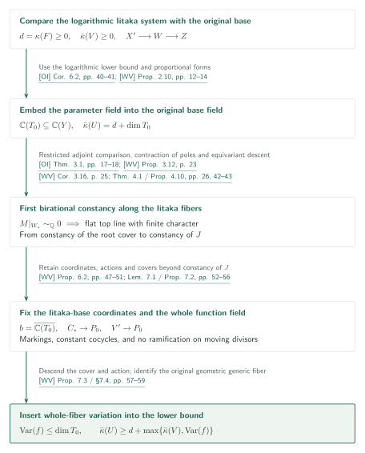
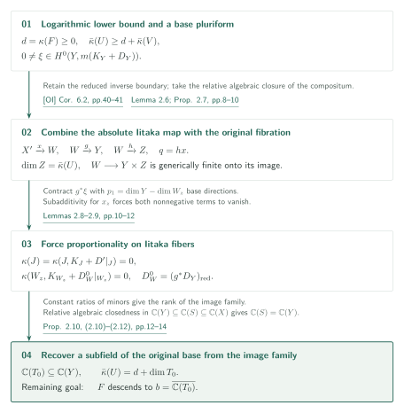
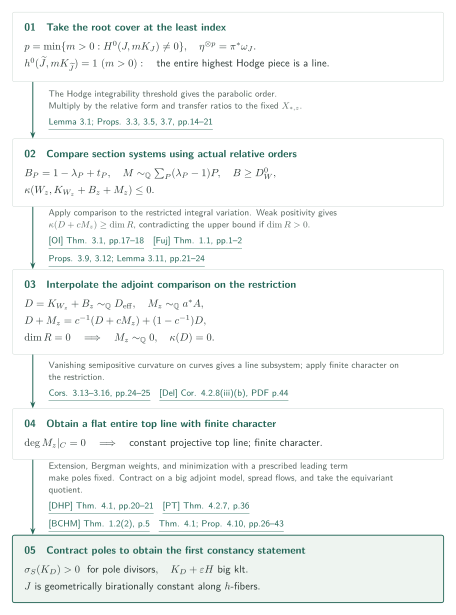
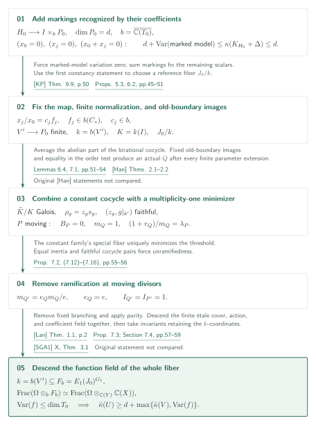
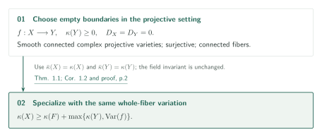
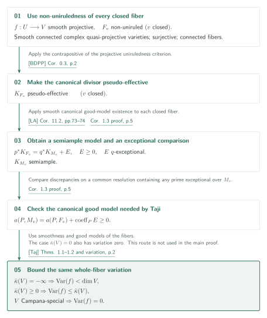

# Logarithmic Kodaira dimension and whole-fiber variation

**From a field detected by logarithmic Iitaka systems to a field of definition of the whole fiber**

For a projective fibration over a base of nonnegative logarithmic Kodaira dimension, the manuscript adds whole-fiber variation to the Kodaira-dimension lower bound. Its argument constructs a parameter field from logarithmic sections, establishes birational constancy of a minimal-index root cover, fixes a finite normalization of the relative Iitaka base using markings, and descends a finite cover.

## 1. Main results

These are the manuscript's claims, with its numbering, hypotheses, and conclusions retained. Fix $\Omega=\overline{\mathbb C(V)}$ and let $F$ be the geometric generic fiber. The variation is

$$
\operatorname{Var}(f)=\min_{\substack{\mathbb C\subseteq L\subseteq\Omega\\L\text{ algebraically closed}}}
\left\{\operatorname{trdeg}_{\mathbb C}L:\ F\text{ is birational to }(F_L)_\Omega\text{ for some }F_L/L\right\}.
$$

It measures the function field of the entire $F$. Variation of a period image, a canonical model, or the relative Iitaka base alone is a different invariant.

[Equation (1.1) · p.2][WV]

### Theorem 1.1 — Logarithmic variation

Let $f:U\to V$ be a projective surjection with connected fibers between smooth connected complex quasi-projective varieties. If $\bar\kappa(V)\geq0$, then

$$
\bar\kappa(U)\geq\kappa(F)+\max\{\bar\kappa(V),\operatorname{Var}(f)\}.
$$

The morphism need not be smooth. No abundance or good-minimal-model hypothesis is imposed on $F$. When $\kappa(F)=-\infty$, the assertion uses the manuscript's convention $(-\infty)+a=-\infty$.

[Theorem 1.1 · p.2][WV]

### Corollary 1.2 — Projective Iitaka–Viehweg inequality

Let $f:X\to Y$ be a surjection with connected fibers between smooth connected complex projective varieties, and assume $\kappa(Y)\geq0$. Then

$$
\kappa(X)\geq\kappa(F)+\max\{\kappa(Y),\operatorname{Var}(f)\}.
$$

[Corollary 1.2 · p.2][WV]

### Corollary 1.3 — Variation and birational isotriviality

Let $f:U\to V$ be a **smooth projective** surjection with connected fibers between smooth connected complex quasi-projective varieties. Assume every closed fiber is non-uniruled. Then

$$
\begin{aligned}
\bar\kappa(V)=-\infty&\ \Longrightarrow\ \operatorname{Var}(f)<\dim V,\\
\bar\kappa(V)\geq0&\ \Longrightarrow\ \operatorname{Var}(f)\leq\bar\kappa(V).
\end{aligned}
$$

If $V$ is Campana-special, $\operatorname{Var}(f)=0$. In particular, $\bar\kappa(V)=0$ implies birational isotriviality. Here isotriviality means variation zero; no trivialization of the family by isomorphisms is asserted. This corollary additionally uses [LA] and Taji and is not an input to Theorem 1.1.

[Corollary 1.3 and its proof · p.5][WV]

## References on the arrows

Unprefixed result, equation, and section numbers refer to [WV]. GitHub links open a fixed-commit manuscript preview; consult the PDF pages given in the labels.

- [OI]: *Orbifold and logarithmic Iitaka subadditivity*, 2026-09-26. Subadditivity and adjoint positivity.
- [Fuj]: Fujino, *Notes on the weak positivity theorems*, 2015-06-30, version 0.54.
- [Del]: Deligne, *Théorie de Hodge II*, 1971. Finite characters and invariant cycles.
- [DHP]: Demailly–Hacon–Păun, *Extension theorems, non-vanishing and the existence of good minimal models*, arXiv v2.
- [PT]: Păun–Takayama, *Positivity of twisted relative pluricanonical bundles and their direct images*, arXiv v1.
- [BCHM]: Birkar–Cascini–Hacon–McKernan, *Existence of minimal models for varieties of log general type*, the 81-page arXiv v2.
- [KP]: Kovács–Patakfalvi, *Projectivity of the moduli space of stable log-varieties and subadditivity of log-Kodaira dimension*, the 62-page author manuscript.
- [Han]: Hanamura, *Structure of birational automorphism groups, I: non-uniruled varieties*, 1988. The original theorem statements were not compared in this reading.
- [SGA1]: *Revêtements étales et groupe fondamental*, 2003 re-edition. The original purity statement was not compared in this reading.
- [Lan]: Landesman, *Invariance of the tame fundamental group under base change between algebraically closed fields*, arXiv v3.
- [BDPP]: Boucksom–Demailly–Păun–Peternell, *The pseudo-effective cone of a compact Kähler manifold and varieties of negative Kodaira dimension*, arXiv v1.
- [LA]: *Log abundance in characteristic zero*, 2026-09-24. [Taj]: Taji, *Birational geometry of smooth families of varieties admitting good minimal models*, arXiv v4.

## 2. Overview of Theorem 1.1

**Proof route.** The main theorem has three stages: [construct the parameter field](#proof-2), [establish constancy of the Kodaira-zero fibre](#proof-3), and [descend the original whole fibre](#proof-4). The [empty-boundary corollary](#proof-5) and the [smooth-family consequence using LA and Taji](#proof-6) are treated separately after the main proof.

For $d=\kappa(F)\geq0$, make the field $b=\overline{\mathbb C(T_0)}$ detected by section systems into a birational definition field of the original whole geometric generic fiber $F$. The Kodaira-zero relative Iitaka fiber $J$ is distinct from $F$.

### 1. Obtain the candidate field from section systems

OI’s logarithmic lower bound yields $\mathbb C(T_0)\subseteq\mathbb C(Y)$ and $\bar\kappa(U)=d+\dim T_0$. The next section develops this construction.

[Proposition 2.10, Remark 2.11 · pp.12–14][WV] · [OI, Corollary 6.2 · pp.40–41][OI]

### 2. Turn Hodge-line triviality into birational constancy

Apply OI’s adjoint comparison to the restricted root-cover variation to make its entire top line flat with finite character. Contraction of poles and local flows make $J$ constant; article Section 4 develops this step.

[Propositions 3.9, 3.12, Corollary 3.16, Proposition 4.10 · pp.21–25, 42–43][WV] · [OI, Theorem 3.1 · pp.17–18][OI]

### 3. Return to the whole fiber while retaining coordinates and actions

Markings fix Iitaka-base coordinates and a finite normalization. Constant cocycles and inertia at moving divisors allow descent of covers and actions and identification of the original function field. Article Section 5 obtains $\operatorname{Var}(f)\leq\dim T_0$.

[Proposition 6.2, Propositions 7.2–7.3, §7.4 · pp.47–59][WV]

Combine this bound with the section-system dimension identity to obtain Theorem 1.1. Corollary 1.2 sets the boundaries to zero; Corollary 1.3 is a separate consequence using LA and Taji. The diagrams for the [parameter field](#proof-2), [first constancy](#proof-3), and [whole-fibre descent](#proof-4) expand these three stages.

## 3. Theorem 1.1: constructing the parameter field

Assume $d=\kappa(F)\geq0$. The first task is to compare the absolute logarithmic Iitaka base $Z$ and the original base $Y$ inside the same function field, producing a subfield of $\mathbb C(Y)$ of transcendence degree $\bar\kappa(U)-d$. No constancy assertion is used at this stage.

### 1. Combine the two maps while retaining coefficient-one boundary

Choose SNC compactifications $(X,D_X)\to(Y,D_Y)$ with $f^{-1}(V)=U$. Applying [OI] Corollary 6.2 gives $\bar\kappa(U)\geq d+\bar\kappa(V)$. Resolve the absolute Iitaka map of $K_X+D_X$ as $q:X'\to Z$. The relative algebraic closure of $\mathbb C(Y)\mathbb C(Z)$ in $\mathbb C(X)$ defines $X'\xrightarrow{x}W\xrightarrow{h}Z$ and $g:W\to Y$. The map $W\to Y\times Z$ is generically finite onto its image, and the relevant generic fibers are geometrically integral.

[Lemma 2.6, Proposition 2.7 · pp.8–10][WV] · [OI, Corollary 6.2 · pp.40–41][OI]

### 2. Contract logarithmic forms to compute the rank of the image family

Fix $0\ne\xi\in H^0(Y,m(K_Y+D_Y))$. Set $r=\dim W_z$ and $p_1=\dim Y-r$. Contracting $g^*\xi$ against $p_1$ directions from $Z$ produces a nonzero logarithmic pluricanonical form on $W_z$. Since $X'_z$ has logarithmic Kodaira dimension zero, subadditivity for $x_z$ gives

$$
\kappa(W_z,K_{W_z}+D_W^0|_{W_z})=0,
\qquad \kappa(J)=\kappa(J,K_J+D'|_J)=0,
\qquad D_W^0=(g^*D_Y)_{\mathrm{red}}.
$$

Here $J$ is the geometric generic fiber of $x$. The contracted sections in a fixed degree are proportional. Consequently the ratios of maximal minors of the normal deformation map $T_zZ\to N_{g(W_z)/Y,y}$ do not depend on $y$. Its constant kernel gives rank $p_1$ for the differential of the Hilbert parameter map.

[Lemmas 2.8–2.9, proof of Proposition 2.10 · pp.10–13][WV]

### 3. Embed the parameter field in the original base field

Take the relative algebraic closure in $\mathbb C(Z)$ of the parameter field of the image family $g(W_z)$, and call its smooth model $T_0$. The resolved universal image family $S$ maps generically finitely to $Y$. In the tower

$$
\mathbb C(Y)\subseteq\mathbb C(S)\subseteq\mathbb C(W)\subseteq\mathbb C(X),
$$

the first extension is algebraic, while $\mathbb C(Y)$ is relatively algebraically closed in $\mathbb C(X)$. Thus $\mathbb C(S)=\mathbb C(Y)$, an identification stronger than a dimension count. Together with $\dim(W/Y)=d$, it gives

$$
\mathbb C(T_0)\subseteq\mathbb C(Y),\qquad
\bar\kappa(U)=\dim Z=d+\dim T_0.
$$

It remains to descend the entire fiber to $b=\overline{\mathbb C(T_0)}\subseteq\Omega$.

[Proposition 2.10, Remark 2.11 · pp.12–14][WV]

Fix the resulting $b=\overline{\mathbb C(T_0)}$ as the candidate definition field. Constancy of $J$, followed by markings and descent of finite covers, must still recover the original $F$.

[WV, §§3–7 · pp. 14–59][WV]

## 4. Theorem 1.1: the root cover and the first constancy statement

The least ordinary pluricanonical index makes the **entire** highest Hodge piece rank one, rather than just an eigenspace. Manuscript Section 4 supplies the analytic passage from its flatness to birational constancy.

### 1. Relate actual relative-form orders to the Hodge line

The connected cyclic cover obtained from the least $p>0$ and $0\ne\omega_J\in H^0(J,pK_J)$ has a resolution $\widetilde J$ with $h^0(\widetilde J,mK_{\widetilde J})=1$ for every $m>0$. Its root form spans the entire top-form space. For a base divisor $P$, distinguish the minimum $t_P$ on actual source components from the threshold $\lambda_P$ on all higher models:

$$
t_P=\min_{Q\subset X',\ Q\mapsto P}\frac{r_Q+d_Q}{m_Q},\qquad
\lambda_P=\inf_{Q\mapsto P}\frac{1+r_Q}{m_Q},\qquad
B_P=1-\lambda_P+t_P.
$$

Here $m_Q=\operatorname{ord}_Q(x^*P)$, $r_Q=p^{-1}\operatorname{ord}_Q(\omega_J)$ is measured in the actual relative canonical bundle, and $d_Q=\operatorname{coeff}_Q(D')$. The integrability exponent of the Hodge norm identifies the parabolic order of its line $M$ as $\lambda_P-1$. Thus $T=\sum t_PP\sim_{\mathbb Q}B+M$, $0\leq B\leq1$, and $B\geq D_W^0$.

[Lemma 3.1, Propositions 3.3 and 3.5 · pp.14–19][WV]

### 2. Apply adjoint comparison anew to the restricted variation

Multiplication by the relative generator transfers sections to the fixed $X_{*,z}$ while preserving their ratios, giving

$$
\kappa(W_z,K_{W_z}+B|_{W_z}+M|_{W_z})\leq0.
$$

Meanwhile $D=K_{W_z}+B|_{W_z}$ is rationally effective. Apply [OI] Theorem 3.1 to the **restricted integral variation** to obtain $M|_{W_z}\sim_{\mathbb Q}a^*A$ with $K_R+cA$ big. Weak positivity from [Fuj] and section transfer give $\kappa(D+cM)\geq\dim R$. For $c\geq1$,

$$
D+M=c^{-1}(D+cM)+(1-c^{-1})D
$$

transfers that lower bound to $D+M$, forcing $R$ to be a point. Hence $M|_{W_z}\sim_{\mathbb Q}0$ and $\kappa(W_z,D)=0$. Curvature on test curves and [Del]'s finite-character theorem, applied on the restriction, give a flat entire top line with finite monodromy.

[Propositions 3.7, 3.9 and 3.12, Lemma 3.11, Corollaries 3.13–3.16 · pp.20–25][WV] · [OI, Theorem 3.1 · pp.17–18][OI] · [Fuj, Theorem 1.1 · pp.1–2][Fuj] · [Del, Corollary 4.2.8(iii)(b) · printed p.47 / PDF p.44][Del]

### 3. Contract poles of the lifted vector field

Over a curve, kill the finite character and lift the invariant class to a global form $\Theta$. Its kernel defines a rational vector field with $d\pi(v)=\partial_t$ and $\iota_v\Theta=0$. Poles may remain along the zero divisor of the relative top form. Lemma 4.4 uses [DHP] extension, while Lemmas 4.6–4.7 use [PT] relative Bergman weights. These lead to positive limiting fixed order $\sigma_S(K_D)>0$ at every pole divisor $S$. The weight is constructed before the final fiber is selected, and the regularization, degree, and cutoff limits have a prescribed order.

[Sections 4.1–4.5 · pp.26–40][WV] · [DHP, Theorem 4.1 · pp.20–21][DHP] · [PT, Theorem 4.2.7 and Remark 4.3.1 · pp.36–37][PT]

Choose one small $\varepsilon>0$ for all the finitely many poles. The big klt adjoint model of $K_D+\varepsilon H$, supplied by [BCHM], contracts their positive fixed orders. Normality extends the resulting regular vector field across codimension two. Local flows and algebraic spreading of graphs give birational constancy after a finite field extension. Applying this equivariantly to the root cover and taking invariant function fields makes $J$ constant in the $h$-fiber directions. Descending the original whole $F$ still requires the next step.

[Proof of Theorem 4.1, Corollary 4.9, Proposition 4.10 · pp.40–43][WV] · [BCHM, Theorem 1.2(2) · p.5][BCHM]

This fixes the Kodaira-zero fiber $J$. The [next descent](#proof-4) retains Iitaka-base coordinates and group actions to fix the entire geometric generic fiber.

[WV, §6 introduction・§7.4 · pp. 46, 58–59][WV]

## 5. Theorem 1.1: descend the whole fiber with its Iitaka-base coordinates

Put $b=\overline{\mathbb C(T_0)}$ and denote the geometric generic fibers of $W,S,Z$ over $T_0$ by $H_0,I,P_0$. Write $p_I:H_0\to I$ and $a_0:H_0\to P_0$ for the induced maps. The map $H_0\to I\times_bP_0$ is generically finite and $\dim P_0=d$. Constancy of $J$ must now be made compatible with the coordinates of $P_0$.

### 1. Recover the finite normalization using coordinate and sum markings

For an embedding of $P_0$ with coordinates $x_0,\ldots,x_N$, label the pullbacks of $x_0=0$, $x_j=0$, and $x_0+x_j=0$ by distinct small coefficients. Slightly decrease the old boundary to make the generic pair klt, and add further general markings to make it big. The added line bundles restrict trivially to $a_0$-fibers, preserving the upper bound $\kappa(H_0,K_{H_0}+\Delta)\leq d$. Proposition 5.3, using [KP], gives the lower bound $d+\operatorname{Var}(\text{marked model})$. The marked model is therefore constant after a finite parameter extension. Let $C_*$ be the underlying normal projective variety of this model pair over $b$.

[Proposition 5.3, Proposition 6.2 · pp.45–50][WV] · [KP, Theorem 9.9 · p.50][KP]

Coordinate divisors determine $x_j/x_0=c_jf_j$ with $f_j\in b(C_*)$; the sum divisors force $c_j\in b$. The morphism $C_*\to P_0$ itself descends, fixing the normalization $V'\to P_0$ in its function field. Images of positive old-boundary components become fixed $b$-divisors as well. With $k=b(V')$ and $K=k(I)$, the preceding constancy statement supplies a reference variety $J_0/k$. The markings are auxiliary identifiers and are discarded from the final fiber.

[Proposition 6.2, especially (6.12) · pp.47–51][WV]

### 2. Remove the nonconstant cocycle and the inertia at moving divisors

Lemma 7.1 uses [Han]'s structure theorem for birational automorphism groups. The abelian identity component and the unique divisibility of $A_1(\overline K)/A_1(\overline k)$ allow averaging over a finite quotient to remove the nonconstant cocycle as a coboundary. The resulting finite Galois splitting has a constant cocycle with faithful pairs $(z_g,g|_{k'})$.

[Lemma 7.1 · pp.52–54][WV]

Comparison with the original [Han] statements remains pending.

At a moving divisor $P$, the old boundary coefficient is $B_P=0$. Equality in the order inequalities produces an **actual source component** $Q$ with $m_Q=1$ attaining $\lambda_P$. On the split constant family the special fiber is the unique minimizing divisor. The identities

$$
m_{Q'}=\frac{e_Qm_Q}{e},\qquad
\frac{1+r_{Q'}}{m_{Q'}}=e\frac{1+r_Q}{m_Q}-(e-1)
$$

give $e_Q=e$. Total and base inertia coincide, and faithfulness of the constant cocycle makes inertia trivial. Repeating the argument after every finite parameter extension is needed to control all moving divisors over the algebraic closure.

[Corollary 3.4 · p.18, Lemma 6.4 · pp.51–52, Proposition 7.2 · pp.55–56][WV]

### 3. Descend the cover, its action, and its coefficient field together

Remove the fixed branch divisors and singular locus to obtain $O\subset V'$. The manuscript invokes purity to make the splitting cover finite étale over $O$. In characteristic zero, [Lan]'s base-change invariance descends covers and their morphisms, retaining both the group action and the map carrying $k'$. For the field $E_1$ of a connected component and its stabilizer $G_1$, set

$$
F_b=E_1(J_0)^{G_1},\qquad k=b(V')\subseteq F_b.
$$

Commutation of finite-group invariants with field extension and identification of the original field tower give

$$
\operatorname{Frac}(\Omega\otimes_bF_b)
\simeq\operatorname{Frac}(\Omega\otimes_{\mathbb C(Y)}\mathbb C(X)).
$$

The right side is the function field of the entire original geometric generic fiber. Hence $\operatorname{Var}(f)\leq\operatorname{trdeg}_{\mathbb C}b=\dim T_0$. Combine this with the dimension identity and subadditivity from article Section 3 to obtain Theorem 1.1.

[Proposition 7.3 and Section 7.4 · pp.57–59][WV] · [Lan, Theorem 1.1 and Remark 1.5 · pp.2–3][Lan]

For purity, only the receiving argument and its stated hypotheses were checked; the original [SGA1] statement was not rechecked.

This completes the lower bound involving variation in Theorem 1.1. Corollary 1.2 uses this output with empty boundaries.

[WV, Theorem 1.1 / Corollary 1.2 · p. 2; §7.4 · p. 59][WV]

## 6. Corollary 1.2: take empty boundaries

For projective $X,Y$, use empty compactification boundaries. The geometric generic fiber and its field-of-definition invariant are unchanged.

### 1. Replace logarithmic by ordinary Kodaira dimensions

With $D_X=D_Y=0$, one has $\bar\kappa(X)=\kappa(X)$ and $\bar\kappa(Y)=\kappa(Y)$. The hypothesis $\kappa(Y)\geq0$ is exactly the base hypothesis of Theorem 1.1, so its inequality gives Corollary 1.2 immediately.

[Proof of Corollary 1.2 · p.2, Section 7.4 · p.59][WV]

The ordinary Iitaka–Viehweg inequality applies to projective fibrations over a base of nonnegative Kodaira dimension. The additional relative-Iitaka route is not a premise of this proof.

[WV, Corollary 1.2 · p. 2; §9 introduction · p. 69][WV]

## 7. Corollary 1.3: good models for a smooth family

This route uses smoothness of the family and non-uniruledness of every closed fiber. It does not enter the proof of the main theorem.

### 1. Obtain canonical good models from LA's comparison

For every closed fiber $F_v$, [BDPP] makes $K_{F_v}$ pseudo-effective. [LA] Corollary 11.2 supplies a semiample $K_{M_v}$ and a common-resolution identity

$$
p^*K_{F_v}=q^*K_{M_v}+E,\qquad E\geq0,\quad E\text{ is }q\text{-exceptional}.
$$

For every prime $P$ exceptional over $M_v$,

$$
a(P,M_v)=a(P,F_v)+\operatorname{coeff}_P E\geq0.
$$

Thus $M_v$ is canonical and gives a good minimal model in the sense used by Taji.

[Proof of Corollary 1.3 · p.5][WV] · [BDPP, Corollary 0.3 · p.2][BDPP] · [LA, Corollary 11.2 · pp.73–74][LA]

### 2. Apply Taji with whole-fiber variation

For smooth projective families whose fibers have good minimal models, [Taj] Theorems 1.1–1.2 supply isotriviality over special bases and the two variation bounds according to the sign of the base's logarithmic Kodaira dimension. Taji's definition on p.2 also uses a birational field of definition of the entire fiber. When $\bar\kappa(V)=0$, combine the bound with $\operatorname{Var}(f)\geq0$.

[Corollary 1.3 · p.5][WV] · [Taj, Theorems 1.1–1.2 and definition of variation · p.2][Taj]

For a smooth family with $\kappa(F)\geq0$ and $\bar\kappa(V)\geq0$, comparing [RA] Corollary 1.2's additivity with Theorem 1.1 gives the same upper bound. This alternative does not cover the negative-base branch or all special bases.

[Comparison paragraph · p.5][WV] · [RA, Corollary 1.2 · p.2][RA]

A base of logarithmic Kodaira dimension zero gives birational isotriviality. For the negative-base and special-base conclusions, retain the hypotheses of the LA–Taji route.

[WV, Corollary 1.3 · p. 5][WV]

## 8. Additional results in Sections 8–9

The main proof ends in Section 7.4. Theorem 8.1 replaces the Hodge contribution by an arbitrary nef pullback $M=h^*A$, for morphisms $g:W\to Y$ and $h:W\to Z$, an effective SNC rational boundary $B\geq(g^*D_Y)_{\mathrm{red}}$, and $\kappa(Y,K_Y+D_Y)\geq0$. The varieties are smooth complex projective, both morphisms are surjective with connected fibers, $D_Y$ is reduced SNC, the coefficients of $B$ lie in $[0,1]$, and here $d=\dim(W/Y)$. If $K_Z+aA$ is big for all sufficiently large rational $a$ and $K_W+B+M$ is big over $Y$, it asserts a second Iitaka base $U_2$ (called $U$ in the manuscript) satisfying

$$
\kappa(W,K_W+B+M)=\dim U_2=d+\dim T_0,
\qquad \kappa(Y,K_Y+D_Y)\leq\dim T_0.
$$

The final interpolation compares $P_{U_2}(c)$ and $P_{U_2}(a)$ on one fixed model. This reading covered the statement and the final proof passage, not Section 8's intermediate volume and effective finite-group degree estimates.

[Theorem 8.1 · pp.59–60, final proof passage · p.69][WV]

Section 9 applies this construction to the ordinary relative Iitaka fibration. It cites [OI] Proposition 2.7, Lemma 7.1, Corollary 7.2, and Lemma 7.4 for section comparison and the reduced-root entire top line. Corollary 9.4 identifies the absolute Iitaka field and the intermediate field, recovering $\mathbb C(T_0)=\mathbb C(Y)\cap\mathbb C(U_2)$ inside $\mathbb C(X)$ before applying Proposition 7.3. The additional [OI] statements and their use in Proposition 9.1 were compared. Their full proofs and the complete arguments of §§8–9 were not independently verified.

[Proposition 9.1, Corollaries 9.2–9.4 · pp.69–72][WV]

## 9. Which papers supply which steps

| Input | Use and role in this manuscript | Relation and comparison scope |
|---|---|---|
| [OI] Corollary 6.2, pp.40–41 | Theorem 2.1, Section 2: logarithmic lower bounds and zero-dimensional Iitaka systems | `direct`; input statement and applications compared |
| [OI] Theorem 3.1, pp.17–18 | Theorem 3.8, Propositions 3.9 and 3.12: restricted adjoint comparison | `direct`; integral ambient and complex-summand hypotheses compared |
| [Fuj] Theorem 1.1, pp.1–2 | Lemma 3.11, pp.22–23: sections after a big base twist | `direct`; lc, Cartier multiple, and projective-base hypotheses compared |
| [Del] Corollary 4.2.8(iii)(b), printed p.47 | Corollaries 3.14–3.16: finite character of a rank-one subsystem | `direct`; statement and use compared; invariant-cycle citation separately unverified |
| [DHP] Theorem 4.1, pp.20–21 | Lemma 4.4, pp.30–31: extension under a putatively nonzero restriction to the zero divisor | `direct`; conditions (19)–(23) compared with the application |
| [PT] Theorem 4.2.7 and Remark 4.3.1, pp.36–37 | Lemma 4.6, pp.34–35: relative Bergman weight and uniform upper bound | `direct`; statement and use compared |
| [BCHM] Theorem 1.2(2), p.5 | Section 4.6, p.40, Section 6, p.48: big klt adjoint models | `direct`; model-existence statement and uses compared; auxiliary ample-model locators unverified |
| [KP] Theorem 9.9, p.50 | Proposition 5.3, p.46 → Proposition 6.2: lower bound for marked-model variation | `direct`; auxiliary base divisor $M=0$ and klt big generic pair compared |
| [Han] Theorems 2.1–2.2 | Lemma 7.1, p.53: birational identity component and cocycle | `direct`; receiving citation and argument read; original statements not compared |
| [SGA1] X, Théorème 3.1 | Proposition 7.3, p.57: purity for a finite normalization unramified in height one | `direct`; hypotheses as listed by the receiving paper checked |
| [Lan] Theorem 1.1 and Remark 1.5, pp.2–3 | Proposition 7.3, pp.57–58: descent of finite étale covers and morphisms | `direct`; characteristic-zero specialization and use compared |
| [BDPP] Corollary 0.3, [LA] Corollary 11.2, [Taj] Theorems 1.1–1.2 | Corollary 1.3, p.5 | `consequence`; input statements and interfaces compared; not used in the main theorem |
| [PH] Lemma 8.4 and Theorem 8.1 | Remark 3.17, p.25 | `alternative`; input statements and use compared, including checks recorded in the PH article; input proofs unverified |
| [OI] Proposition 2.7, Lemma 7.1, Corollary 7.2, Lemma 7.4 | Proposition 9.1, pp.69–70 | `consequence` (directly used by the additional result); statements and uses compared, full proofs unverified |

Unrecorded relations remain unexamined. Comparing an input's statement with its application is distinct from verifying the input theorem's entire proof.

## 10. Return to the sources

- Embedded parameter field: Proposition 2.10, equation (2.12), pp.12–14.
- Actual minimum versus all-valuation threshold: Propositions 3.3 and 3.5, pp.17–19, returning in Lemma 6.4's multiplicity-one minimizer.
- First constancy statement: Proposition 3.12, Theorem 4.1, Lemmas 4.6–4.7, Proposition 4.8, pp.23–43.
- Second constancy statement and the whole field: Proposition 6.2, Lemma 6.4, Propositions 7.2–7.3, pp.47–59.

This reading covered the main statements and corollaries, Section 2's parameter field, Section 3's root cover, orders, and restricted triviality, the principal analytic constancy argument of Section 4, and the marked models and descent in Sections 5–7. The external interfaces compared are listed in the table. This is an account of the argument's route, not an independent verification of every inference.

Remaining work includes the full regularization and $L^2$ estimates of Section 4, external Hodge-extension and boundary-growth inputs, Hanamura's original statements, the original SGA1 purity statement, Section 8's intermediate proofs, and full proofs of Section 9's additional [OI] inputs. The full proofs of external inputs, expert review, and formal verification have not been completed. The separate scope for Sections 8–9 is stated above.

The catalogue-033 manuscripts, including [WV] and [OI], use commit `fd4aeeb2ee4fc729c18d98444fed42fd0529eeeb`. [LA] uses `adc7f1241b42e322a6451854ab7e4b4c146bf78a`, matching the existing catalogue-034 article. Page locators refer to the respective PDFs; Deligne's printed pagination is additionally indicated.

For the additional route, the statements of [OI] Proposition 2.7, Lemma 7.1, Corollary 7.2 and Lemma 7.4 were compared with their use in Proposition 9.1. Complete valuation comparisons, all BFMT interfaces and the full proofs of §§8–9 remain unverified.

[OI, Proposition 2.7・Lemma 7.1・Corollary 7.2・Lemma 7.4 · pp.10–17, 43–47][OI] · [WV, Proposition 9.1 · pp.69–70][WV]

[WV]: https://github.com/openai/math/blob/fd4aeeb2ee4fc729c18d98444fed42fd0529eeeb/preprints/Logarithmic-Kodaira-dimension-and-whole-fiber-variation-September-26-2026/paper.pdf
[OI]: https://github.com/openai/math/blob/fd4aeeb2ee4fc729c18d98444fed42fd0529eeeb/preprints/Orbifold-and-logarithmic-Iitaka-subadditivity-September-26-2026/paper.pdf
[PH]: https://github.com/openai/math/blob/fd4aeeb2ee4fc729c18d98444fed42fd0529eeeb/preprints/Projective-Hodge-lines-and-ordinary-Iitaka-subadditivity-September-27-2026/paper.pdf
[RA]: https://github.com/openai/math/blob/fd4aeeb2ee4fc729c18d98444fed42fd0529eeeb/preprints/The-reverse-logarithmic-Kodaira-inequality-and-additivity-September-26-2026/paper.pdf
[LA]: https://github.com/openai/math/blob/adc7f1241b42e322a6451854ab7e4b4c146bf78a/preprints/Log-abundance-in-characteristic-zero-September-24-2026/paper.pdf
[Fuj]: https://www.math.kyoto-u.ac.jp/~fujino/weak-posi11.pdf
[Del]: https://www.numdam.org/item/PMIHES_1971__40__5_0.pdf
[DHP]: https://arxiv.org/pdf/1012.0493v2
[PT]: https://arxiv.org/pdf/1409.5504v1
[BCHM]: https://arxiv.org/pdf/math/0610203v2
[KP]: https://sites.math.washington.edu/~kovacs/2013/papers/Kovacs_Patakfalvi__Projectivity.pdf
[Han]: https://doi.org/10.1007/BF01394338
[SGA1]: https://arxiv.org/abs/math/0206203v2
[Lan]: https://arxiv.org/pdf/2005.09690v3
[BDPP]: https://arxiv.org/pdf/math/0405285v1
[Taj]: https://arxiv.org/pdf/2005.01025v4
