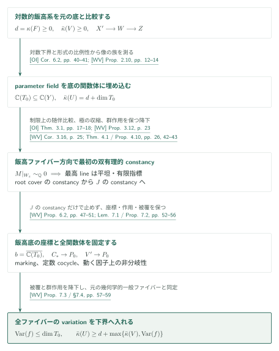
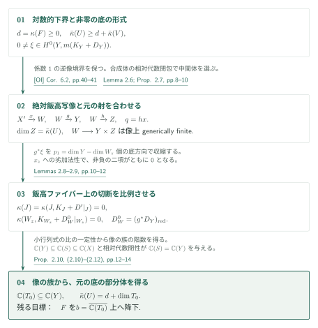
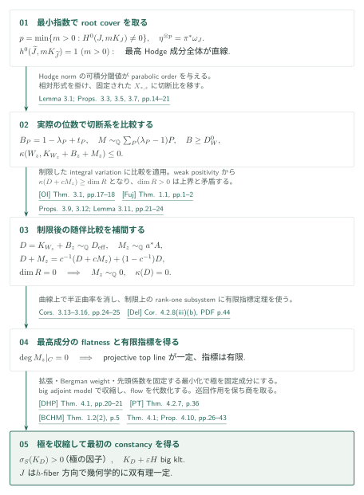
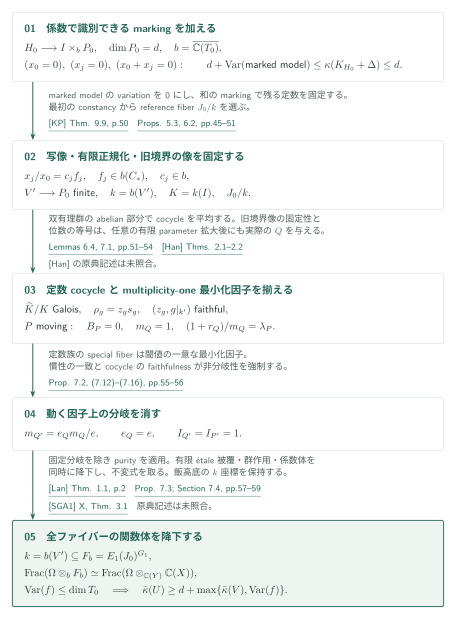
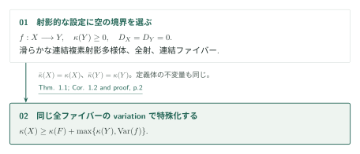
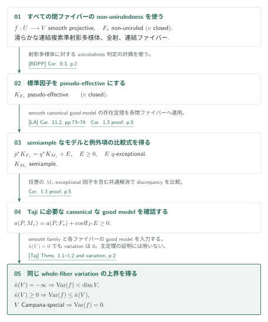

# Logarithmic Kodaira dimension and whole-fiber variation

**対数的飯高系が検出する体から、全ファイバーの双有理的定義体へ**

非負の対数的小平次元を持つ底上の射影的ファイブレーションについて、原稿は小平次元の下界に全幾何学的一般ファイバーのvariationを加える。証明は、対数的切断からparameter fieldを構成し、最小指数のroot coverの双有理的constancy、markingによる飯高底の固定、有限被覆の降下を順に組み合わせる。

## 1. 主要結果

以下は原稿の主張であり、番号・仮定・結論を原典に合わせる。$\Omega=\overline{\mathbb C(V)}$ を固定し、$F$ を幾何学的一般ファイバーとする。variationは

$$
\operatorname{Var}(f)=\min_{\substack{\mathbb C\subseteq L\subseteq\Omega\\L\text{ algebraically closed}}}
\left\{\operatorname{trdeg}_{\mathbb C}L:\ F\text{ is birational to }(F_L)_\Omega\text{ for some }F_L/L\right\}.
$$

これは $F$ 全体の関数体を測る。period像、canonical model、相対飯高底だけのvariationとは区別する。

[式(1.1) · p.2][WV]

### Theorem 1.1 — Logarithmic variation

$f:U\to V$ を滑らかな連結複素準射影多様体の間の、連結ファイバーを持つ射影的全射とする。$\bar\kappa(V)\geq0$ ならば

$$
\bar\kappa(U)\geq\kappa(F)+\max\{\bar\kappa(V),\operatorname{Var}(f)\}.
$$

$f$ のsmoothness、$F$ のabundanceやgood minimal modelの存在は仮定しない。$\kappa(F)=-\infty$ の場合は原稿の $(-\infty)+a=-\infty$ の規約による。

[Theorem 1.1 · p.2][WV]

### Corollary 1.2 — Projective Iitaka–Viehweg inequality

$f:X\to Y$ を滑らかな連結複素射影多様体の間の、連結ファイバーを持つ全射とし、$\kappa(Y)\geq0$ とする。このとき

$$
\kappa(X)\geq\kappa(F)+\max\{\kappa(Y),\operatorname{Var}(f)\}.
$$

[Corollary 1.2 · p.2][WV]

### Corollary 1.3 — Variation and birational isotriviality

$f:U\to V$ を滑らかな連結複素準射影多様体の間の、連結ファイバーを持つ**smooth projective**な全射とする。すべての閉ファイバーがnon-uniruledならば

$$
\begin{aligned}
\bar\kappa(V)=-\infty&\ \Longrightarrow\ \operatorname{Var}(f)<\dim V,\\
\bar\kappa(V)\geq0&\ \Longrightarrow\ \operatorname{Var}(f)\leq\bar\kappa(V).
\end{aligned}
$$

さらに $V$ がCampana-specialならば $\operatorname{Var}(f)=0$。特に $\bar\kappa(V)=0$ ならば双有理的にisotrivialである。ここでisotrivialityはvariationが0という意味であり、族の同型による自明化は主張しない。この帰結は[LA]とTajiの定理を追加で使い、Theorem 1.1の証明には入らない。

[Corollary 1.3と証明 · p.5][WV]

## 図の矢印に付した引用

略号のない結果・式・節番号は本稿[WV]を指す。GitHubの原稿リンクは固定commitの閲覧ページであり、PDFページは表示ラベルから参照する。

- [OI]：*Orbifold and logarithmic Iitaka subadditivity*、2026-09-26。劣加法性と随伴正値性。
- [Fuj]：Fujino、*Notes on the weak positivity theorems*、2015-06-30、version 0.54。
- [Del]：Deligne、*Théorie de Hodge II*、1971。有限指標と不変サイクル。
- [DHP]：Demailly–Hacon–Păun、*Extension theorems, non-vanishing and the existence of good minimal models*、arXiv v2。
- [PT]：Păun–Takayama、*Positivity of twisted relative pluricanonical bundles and their direct images*、arXiv v1。
- [BCHM]：Birkar–Cascini–Hacon–McKernan、*Existence of minimal models for varieties of log general type*、81ページのarXiv v2。
- [KP]：Kovács–Patakfalvi、*Projectivity of the moduli space of stable log-varieties and subadditivity of log-Kodaira dimension*、62ページの著者稿。
- [Han]：Hanamura、*Structure of birational automorphism groups, I: non-uniruled varieties*、1988。原典の定理文は今回未照合。
- [SGA1]：*Revêtements étales et groupe fondamental*、2003年復刻版。purityの原典記述は今回未照合。
- [Lan]：Landesman、*Invariance of the tame fundamental group under base change between algebraically closed fields*、arXiv v3。
- [BDPP]：Boucksom–Demailly–Păun–Peternell、*The pseudo-effective cone of a compact Kähler manifold and varieties of negative Kodaira dimension*、arXiv v1。
- [LA]：*Log abundance in characteristic zero*、2026-09-24。[Taj]：Taji、*Birational geometry of smooth families of varieties admitting good minimal models*、arXiv v4。

## 2. Theorem 1.1の全体像

**証明の道筋。** 主定理は、[parameter fieldの構成](#proof-2)、[小平次元0のファイバーのconstancy](#proof-3)、[元の全ファイバーの降下](#proof-4)の三段階からなる。[境界を空にする帰結](#proof-5)と、LA・Tajiを使う[smooth familyの帰結](#proof-6)は、主定理の後で分けて扱う。

$d=\kappa(F)\geq0$の場合に、切断系から得た体$b=\overline{\mathbb C(T_0)}$を、元の全幾何学的一般ファイバー$F$の双有理的定義体にする。$J$は相対飯高写像の小平次元0のファイバーであり、$F$全体とは区別する。

### 1. 切断系から候補の体を得る

OIの対数下界を使い、$\mathbb C(T_0)\subseteq\mathbb C(Y)$と$\bar\kappa(U)=d+\dim T_0$を示す。これは次節で扱う構成である。

[Proposition 2.10・Remark 2.11 · pp.12–14][WV] · [OI, Corollary 6.2 · pp.40–41][OI]

### 2. Hodge lineの自明性を双有理的constancyへ移す

制限したroot-cover変動にOIの随伴比較を適用し、その全最高lineを平坦・有限指標にする。極の収縮と局所flowを経て$J$を一定にする部分は第4節の核心である。

[Propositions 3.9, 3.12・Corollary 3.16・Proposition 4.10 · pp.21–25, 42–43][WV] · [OI, Theorem 3.1 · pp.17–18][OI]

### 3. 座標・群作用を保って全ファイバーへ戻る

markingは飯高底の座標と有限正規化を固定する。定数cocycleと動く因子の慣性を処理して被覆・作用を降下し、元の$F$の関数体を同定する。第5節で$\operatorname{Var}(f)\leq\dim T_0$を得る。

[Proposition 6.2・Propositions 7.2–7.3・§7.4 · pp.47–59][WV]

この不等式を切断系の次元等式と合わせてTheorem 1.1を得る。Corollary 1.2は境界0の特殊化、Corollary 1.3はLA・Tajiを加える別の帰結である。以下の[parameter field](#proof-2)、[最初のconstancy](#proof-3)、[全ファイバーの降下](#proof-4)の各図で、この三段階を展開する。

## 3. Theorem 1.1：parameter fieldの構成

$d=\kappa(F)\geq0$ とする。まず絶対対数的飯高底 $Z$ と元の底 $Y$ を同じ関数体の中で比較し、$\bar\kappa(U)-d$ 次元の体を $\mathbb C(Y)$ の部分体として得る。この段階ではファイバーのconstancyを使わない。

### 1. 係数1の境界を保って二つの写像を合わせる

$f^{-1}(V)=U$ となるSNCコンパクト化 $(X,D_X)\to(Y,D_Y)$ を選ぶ。[OI] Corollary 6.2を使うと $\bar\kappa(U)\geq d+\bar\kappa(V)$。$K_X+D_X$ の絶対飯高写像を解消して $q:X'\to Z$ とし、$\mathbb C(Y)\mathbb C(Z)$ の $\mathbb C(X)$ 内での相対代数閉包を使って $X'\xrightarrow{x}W\xrightarrow{h}Z$、$g:W\to Y$ を構成する。これにより $W\to Y\times Z$ は像上generically finiteとなり、各写像の一般ファイバーの幾何学的整性も保たれる。

[Lemma 2.6、Proposition 2.7 · pp.8–10][WV] · [OI, Corollary 6.2 · pp.40–41][OI]

### 2. 対数的な形式の収縮で像の族の階数を測る

$0\ne\xi\in H^0(Y,m(K_Y+D_Y))$ を固定する。$r=\dim W_z$、$p_1=\dim Y-r$ とすると、$p_1$ 個の $Z$ 方向による $g^*\xi$ の収縮は $W_z$ 上の非零対数的多重標準形式になる。$X'_z$ の対数的小平次元は0なので、劣加法性を $x_z$ に使うと

$$
\kappa(W_z,K_{W_z}+D_W^0|_{W_z})=0,
\qquad \kappa(J)=\kappa(J,K_J+D'|_J)=0,
\qquad D_W^0=(g^*D_Y)_{\mathrm{red}}.
$$

ここで $J$ は $x$ の幾何学的一般ファイバーである。収縮で得た同次数の切断は比例するため、正規変形写像 $T_zZ\to N_{g(W_z)/Y,y}$ の最大小行列式の比は $y$ に依存しない。その核の一定性がHilbert parameter mapの微分階数 $p_1$ を与える。

[Lemmas 2.8–2.9、Proposition 2.10の証明 · pp.10–13][WV]

### 3. parameter fieldを元の底の中に埋め込む

像の族 $g(W_z)$ のparameter fieldを $\mathbb C(Z)$ 内で相対代数閉包にして $T_0$ を得る。普遍像の族の解消 $S$ は $Y$ にgenerically finiteだが、

$$
\mathbb C(Y)\subseteq\mathbb C(S)\subseteq\mathbb C(W)\subseteq\mathbb C(X)
$$

の最初の拡大が代数的であり、$\mathbb C(Y)$ は $\mathbb C(X)$ 内で相対代数閉だから $\mathbb C(S)=\mathbb C(Y)$。これが単なる次元計算より強い接続である。$\dim(W/Y)=d$ と合わせて

$$
\mathbb C(T_0)\subseteq\mathbb C(Y),\qquad
\bar\kappa(U)=\dim Z=d+\dim T_0
$$

を得る。残る目標は $b=\overline{\mathbb C(T_0)}\subseteq\Omega$ 上への全ファイバーの降下である。

[Proposition 2.10、Remark 2.11 · pp.12–14][WV]

得られた$b=\overline{\mathbb C(T_0)}$を全ファイバーの定義体候補に固定する。次に$J$のconstancyを示し、markingと有限被覆の降下で元の$F$まで戻る。

[WV, §§3–7 · pp. 14–59][WV]

## 4. Theorem 1.1：root coverから最初のconstancyへ

$J$ の最小のordinary pluricanonical indexを使うことにより、固有成分だけでなく最高Hodge成分**全体**をrank oneにする。その平坦性から双有理的constancyへ進む箇所が§4の解析的議論である。

### 1. 相対形式の実際の位数をHodge lineに結び付ける

最小の $p>0$ と $0\ne\omega_J\in H^0(J,pK_J)$ から作る連結巡回被覆の解消 $\widetilde J$ は $h^0(\widetilde J,mK_{\widetilde J})=1$ をすべての $m>0$ で満たす。root formが最高形式空間全体を生成する。各底因子 $P$ に対し、実際のsource成分での最小値 $t_P$ と、上位モデルも含む閾値 $\lambda_P$ を分ける：

$$
t_P=\min_{Q\subset X',\ Q\mapsto P}\frac{r_Q+d_Q}{m_Q},\qquad
\lambda_P=\inf_{Q\mapsto P}\frac{1+r_Q}{m_Q},\qquad
B_P=1-\lambda_P+t_P.
$$

$m_Q=\operatorname{ord}_Q(x^*P)$、$r_Q=p^{-1}\operatorname{ord}_Q(\omega_J)$ は実際の相対標準束で測り、$d_Q=\operatorname{coeff}_Q(D')$。Hodge normの可積分指数からparabolic line $M$ の位数は $\lambda_P-1$ となる。したがって $T=\sum t_PP\sim_{\mathbb Q}B+M$、$0\leq B\leq1$、$B\geq D_W^0$ が得られる。

[Lemma 3.1、Propositions 3.3・3.5 · pp.14–19][WV]

### 2. 制限したvariationに随伴比較を適用し直す

$\omega_J$ を掛けて切断を固定された $X_{*,z}$ に移すと、切断比を保つ比較から

$$
\kappa(W_z,K_{W_z}+B|_{W_z}+M|_{W_z})\leq0.
$$

一方、$D=K_{W_z}+B|_{W_z}$ は有理的にeffective。[OI] Theorem 3.1を**制限後のintegral variation**に適用して $M|_{W_z}\sim_{\mathbb Q}a^*A$、$K_R+cA$ bigを得る。[Fuj]によるweak positivityと切断の移送から $\kappa(D+cM)\geq\dim R$。$c\geq1$ に対する

$$
D+M=c^{-1}(D+cM)+(1-c^{-1})D
$$

はこの下界を $D+M$ にも移すので、$R$ は点でなければならない。結果は $M|_{W_z}\sim_{\mathbb Q}0$ と $\kappa(W_z,D)=0$。曲線上の曲率と[Del]の有限指標定理を制限上で使い、entire top lineのflatnessとfinite monodromyを得る。

[Propositions 3.7・3.9・3.12、Lemma 3.11、Corollaries 3.13–3.16 · pp.20–25][WV] · [OI, Theorem 3.1 · pp.17–18][OI] · [Fuj, Theorem 1.1 · pp.1–2][Fuj] · [Del, Corollary 4.2.8(iii)(b) · printed p.47／PDF p.44][Del]

### 3. 平坦な最高形式から、極を収縮する双有理的モデルへ

曲線上で有限指標を消し、不変サイクルから得る大域形式 $\Theta$ のkernelを使って $d\pi(v)=\partial_t$、$\iota_v\Theta=0$ となる有理ベクトル場を作る。$v$ は相対最高形式の零因子に極を持ちうる。[DHP]の拡張を用いるLemma 4.4と、[PT]のrelative Bergman weightを用いるLemmas 4.6–4.7が、極を持つ因子 $S$ には正の漸近固定次数 $\sigma_S(K_D)>0$ があることを導く。特に重みは最後のファイバーを選ぶ前に構成され、正則化、次数、cutoffの極限の順序が固定される。

[§§4.1–4.5 · pp.26–40][WV] · [DHP, Theorem 4.1 · pp.20–21][DHP] · [PT, Theorem 4.2.7・Remark 4.3.1 · pp.36–37][PT]

有限個の極に共通の小さい $\varepsilon>0$ を選び、$K_D+\varepsilon H$ のbig klt adjoint modelを[BCHM]で作る。正の固定次数を持つ極は収縮され、正規性によってベクトル場は余次元2以上にも延びる。その局所flowとgraphの代数的spreadingから、有限体拡大後の双有理的constancyを得る。巡回群作用を保ってこれをroot coverに適用し、不変関数体を取ると $J$ が $h$-fiber方向に一定となる。ここまでで固定したのは $J$ であり、元の $F$ 全体の降下は次節に残る。

[Theorem 4.1の証明、Corollary 4.9、Proposition 4.10 · pp.40–43][WV] · [BCHM, Theorem 1.2(2) · p.5][BCHM]

固定されたのは小平次元0の$J$である。[次の降下](#proof-4)では、飯高底の座標と群作用を保持して全幾何学的一般ファイバーを固定する。

[WV, §6導入・§7.4 · pp. 46, 58–59][WV]

## 5. Theorem 1.1：飯高底を残した全ファイバーの降下

$b=\overline{\mathbb C(T_0)}$ とし、$W,S,Z$ の $T_0$ 上の幾何学的一般ファイバーを $H_0,I,P_0$ と書く。$p_I:H_0\to I$、$a_0:H_0\to P_0$ を誘導射とする。$H_0\to I\times_bP_0$ はgenerically finite、$\dim P_0=d$ である。目標は $J$ のconstancyを $P_0$ の座標と両立させることである。

### 1. 座標と和のmarkingで有限正規化を回復する

$P_0$ の埋込みの座標 $x_0,\ldots,x_N$ に対し、$x_0=0$、$x_j=0$、$x_0+x_j=0$ の引戻しに区別可能な小さい係数を付ける。旧境界を少し下げてgeneric pairをkltにし、さらに一般のmarkingを加えてbigにする。$a_0$ のファイバー上では追加した線束は自明なので、上界 $\kappa(H_0,K_{H_0}+\Delta)\leq d$ は残る。[KP]を使うProposition 5.3は $d+\operatorname{Var}(\text{marked model})$ という下界を与えるため、marked modelは有限parameter拡大後に一定となる。この$b$上のmarked model pairの台となる正規射影多様体を$C_*$と置く。

[Proposition 5.3、Proposition 6.2 · pp.45–50][WV] · [KP, Theorem 9.9 · p.50][KP]

座標因子は $x_j/x_0=c_jf_j$、$f_j\in b(C_*)$ までを固定し、和の因子が $c_j\in b$ を強制する。したがって写像 $C_*\to P_0$ 自体が降下し、その関数体での正規化 $V'\to P_0$ も固定される。旧境界の正係数の像も $b$ 上の因子になる。ここで $k=b(V')$、$K=k(I)$ と置くと、前節のconstancyを使ってreference variety $J_0/k$ が得られる。markingはこの識別のための補助であり、最終的なファイバーには加えない。

[Proposition 6.2、特に式(6.12) · pp.47–51][WV]

### 2. 非定数のcocycleを除き、動く因子の慣性を消す

Lemma 7.1は[Han]の双有理自己同型群の構造を入力とする。恒等成分がabelian varietyであることと、$A_1(\overline K)/A_1(\overline k)$ の一意可除性を使い、有限商上の平均でcocycleの非定数部分をcoboundaryにする。得られる有限Galois splittingと定数cocycleはfaithfulな組 $(z_g,g|_{k'})$ を持つ。

[Lemma 7.1 · pp.52–54][WV]

この[Han]の原定理の照合は保留している。

動く因子 $P$ では旧境界係数 $B_P=0$。位数公式の等号から、$m_Q=1$ で閾値 $\lambda_P$ を達成する**実際のsource成分** $Q$ が存在する。splitting後の定数族ではspecial fiberが一意の最小化因子であり、

$$
m_{Q'}=\frac{e_Qm_Q}{e},\qquad
\frac{1+r_{Q'}}{m_{Q'}}=e\frac{1+r_Q}{m_Q}-(e-1)
$$

より $e_Q=e$。全空間と底の慣性が一致し、定数cocycleのfaithfulnessから慣性は自明となる。この議論を任意の有限parameter拡大後にも行うことが、代数閉包上のすべての動く因子を扱うために必要になる。

[Corollary 3.4 · p.18、Lemma 6.4 · pp.51–52、Proposition 7.2 · pp.55–56][WV]

### 3. 被覆・作用・係数体をまとめて降下する

固定された分岐因子と特異部分を除いた $O\subset V'$ 上で、原稿はpurityによりsplitting coverを有限étaleとする。[Lan]の標数0での基底拡大不変性は被覆だけでなくその射も降下させるので、群作用と $k'$ への写像を一緒に保持できる。連結成分の体 $E_1$、その安定化群 $G_1$ を使って

$$
F_b=E_1(J_0)^{G_1},\qquad k=b(V')\subseteq F_b,
$$

を得る。有限群の不変式と体拡大の可換性、元のfield towerの同定により

$$
\operatorname{Frac}(\Omega\otimes_bF_b)
\simeq\operatorname{Frac}(\Omega\otimes_{\mathbb C(Y)}\mathbb C(X)).
$$

右辺は元の全幾何学的一般ファイバーの関数体である。従って $\operatorname{Var}(f)\leq\operatorname{trdeg}_{\mathbb C}b=\dim T_0$。第3節の次元等式と劣加法性の下界を合わせてTheorem 1.1に到達する。

[Proposition 7.3・§7.4 · pp.57–59][WV] · [Lan, Theorem 1.1・Remark 1.5 · pp.2–3][Lan]

purityについては利用先の仮定確認までで、[SGA1]の原典記述の再照合は未実施である。

Theorem 1.1のvariationを含む下界が完成する。境界を空にしたCorollary 1.2はこの出力をそのまま使う。

[WV, Theorem 1.1 / Corollary 1.2 · p. 2; §7.4 · p. 59][WV]

## 6. Corollary 1.2：境界を空にする

射影的な $X,Y$ には空のコンパクト化境界を用いる。variationを定義する幾何学的一般ファイバーとその定義体は変わらない。

### 1. 対数的小平次元を通常の小平次元に置き換える

$D_X=D_Y=0$ ならば $\bar\kappa(X)=\kappa(X)$、$\bar\kappa(Y)=\kappa(Y)$。仮定 $\kappa(Y)\geq0$ はTheorem 1.1の底の条件そのものなので、その不等式が直ちにCorollary 1.2となる。

[Corollary 1.2の証明 · p.2、§7.4 · p.59][WV]

非負の小平次元の底を持つ射影的族に、通常のIitaka–Viehweg不等式を適用できる。追加の相対飯高経路を主証明の前提にする必要はない。

[WV, Corollary 1.2 · p. 2; §9導入 · p. 69][WV]

## 7. Corollary 1.3：good modelを介するsmooth familyの帰結

ここではすべての閉ファイバーのnon-unirulednessと、族のsmoothnessを使う。主定理の証明にこの経路を逆向きに組み込まない。

### 1. LAの比較式からcanonicalなgood modelを得る

各閉ファイバー $F_v$ に[BDPP]を適用すると $K_{F_v}$ はpseudo-effective。[LA] Corollary 11.2はsemiampleな $K_{M_v}$ と共通解消上の

$$
p^*K_{F_v}=q^*K_{M_v}+E,\qquad E\geq0,\quad E\text{ is }q\text{-exceptional}
$$

を供給する。さらに任意の $M_v$-exceptionalな素因子 $P$ に対して

$$
a(P,M_v)=a(P,F_v)+\operatorname{coeff}_P E\geq0
$$

なので $M_v$ はcanonicalとなり、Tajiの意味でのgood minimal modelを得る。

[Corollary 1.3の証明 · p.5][WV] · [BDPP, Corollary 0.3 · p.2][BDPP] · [LA, Corollary 11.2 · pp.73–74][LA]

### 2. whole-fiber variationについてTajiを適用する

[Taj] Theorems 1.1–1.2は、good minimal modelを持つsmooth projective familyに、special baseでの双有理的isotrivialityと対数的小平次元による二分岐の上界を与える。Tajiのp.2の定義も全ファイバーの双有理的定義体を測るため、不変量を取り替えず適用できる。$\bar\kappa(V)=0$ では非負性 $\operatorname{Var}(f)\geq0$ と合わせて0となる。[Corollary 1.3 · p.5][WV] · [Taj, Theorems 1.1–1.2とvariationの定義 · p.2][Taj]

smoothな場合で $\kappa(F)\geq0$、$\bar\kappa(V)\geq0$ に限れば、[RA] Corollary 1.2の加法性とTheorem 1.1を比較しても同じ上界が得られる。これは別経路であり、負の底やすべてのspecial baseの分岐を代替しない。

[比較段落 · p.5][WV] · [RA, Corollary 1.2 · p.2][RA]

底の対数的小平次元0では双有理的isotrivialityを得る。負の底やspecial baseまで含む主張には、この節のLA・Taji経路の仮定を保持する。

[WV, Corollary 1.3 · p. 5][WV]

## 8. §§8–9の追加結果

主定理は§7.4で完結する。Theorem 8.1は、$g:W\to Y$、$h:W\to Z$、effective SNC rational boundary $B\geq(g^*D_Y)_{\mathrm{red}}$、$\kappa(Y,K_Y+D_Y)\geq0$ の下で、$M=h^*A$ を任意のnef rational divisorの引戻しに一般化する。ここで多様体は滑らかな複素射影多様体、両射は連結ファイバーを持つ全射、$D_Y$ はreduced SNC、$B$ の係数は $[0,1]$ に属し、ここでは $d=\dim(W/Y)$ とする。$K_Z+aA$ が十分大きい有理数 $a$ でbig、$K_W+B+M$ が $Y$ 上bigならば、第二飯高底 $U_2$（原稿では $U$）を構成し

$$
\kappa(W,K_W+B+M)=\dim U_2=d+\dim T_0,
\qquad \kappa(Y,K_Y+D_Y)\leq\dim T_0
$$

を得ると主張する。最後の補間は同じモデル上の $P_{U_2}(c)$ と $P_{U_2}(a)$ を用いる。今回読んだのは定理文と証明末尾であり、§8のvolume評価・有限群のeffective actionの次数評価の証明は未読である。

[Theorem 8.1 · pp.59–60、証明末尾 · p.69][WV]

§9は通常の相対飯高写像にこの構成を適用する。[OI] Proposition 2.7、Lemma 7.1、Corollary 7.2、Lemma 7.4が、section comparisonとreduced-rootのentire top lineを供給する引用先として指定される。Corollary 9.4は絶対飯高体と中間体を同定し、$\mathbb C(T_0)=\mathbb C(Y)\cap\mathbb C(U_2)$ を $\mathbb C(X)$ 内で回復してProposition 7.3につなぐ。追加の[OI]入力は、定理文とProposition 9.1での使用箇所を照合した。これらの入力の全証明および§§8–9の全推論は独立検証していない。

[Proposition 9.1、Corollaries 9.2–9.4 · pp.69–72][WV]

## 9. どの論文が、どの段階を担うか

| 入力結果 | 本稿での使用箇所・役割 | 関係と確認範囲 |
|---|---|---|
| [OI] Corollary 6.2, pp.40–41 | Theorem 2.1、§2：対数的下界と0次元の飯高ファイバー | `direct`。入力の記述・適用を照合 |
| [OI] Theorem 3.1, pp.17–18 | Theorem 3.8、Propositions 3.9・3.12：制限上の随伴比較 | `direct`。integral ambientとcomplex summandの条件を照合 |
| [Fuj] Theorem 1.1, pp.1–2 | Lemma 3.11, pp.22–23：bigな底の捻りで切断を作る | `direct`。lc・Cartier倍・射影的な底の条件を照合 |
| [Del] Corollary 4.2.8(iii)(b), printed p.47 | Corollaries 3.14–3.16：rank-one subsystemの有限指標 | `direct`。該当記述と適用を照合。不変サイクルの引用は別途未照合 |
| [DHP] Theorem 4.1, pp.20–21 | Lemma 4.4, pp.30–31：零因子への制限が非零という仮定から切断を拡張 | `direct`。条件(19)–(23)と適用を照合 |
| [PT] Theorem 4.2.7・Remark 4.3.1, pp.36–37 | Lemma 4.6, pp.34–35：relative Bergman weightと一様上界 | `direct`。定理文と適用箇所を照合 |
| [BCHM] Theorem 1.2(2), p.5 | §4.6, p.40、§6, p.48：big klt adjoint model | `direct`。モデル存在の記述と適用を照合。ample modelの補助番号は未照合 |
| [KP] Theorem 9.9, p.50 | Proposition 5.3, p.46 → Proposition 6.2：marked modelのvariationの下界 | `direct`。補助底因子 $M=0$、klt big generic pairの条件を照合 |
| [Han] Theorems 2.1–2.2 | Lemma 7.1, p.53：双有理群の恒等成分とcocycle | `direct`。利用先の引用・論証を確認。原典の記述は未照合 |
| [SGA1] X, Théorème 3.1 | Proposition 7.3, p.57：高さ1で非分岐な有限正規化にpurityを適用 | `direct`。利用先の仮定提示のみ確認 |
| [Lan] Theorem 1.1・Remark 1.5, pp.2–3 | Proposition 7.3, pp.57–58：有限étale被覆と射の降下 | `direct`。標数0への特殊化と使用を照合 |
| [BDPP] Corollary 0.3、[LA] Corollary 11.2、[Taj] Theorems 1.1–1.2 | Corollary 1.3, p.5 | `consequence`。入力の記述・接続を照合。主定理には使わない |
| [PH] Lemma 8.4・Theorem 8.1 | Remark 3.17, p.25 | `alternative`。入力記述と使用箇所を照合。PH記事の確認記録を含む。入力の証明は未検証 |
| [OI] Proposition 2.7、Lemma 7.1、Corollary 7.2、Lemma 7.4 | Proposition 9.1, pp.69–70 | `consequence`（追加結果内の直接入力）。入力記述・使用箇所を照合。全証明は未検証 |

未記録の関係は未調査であり、依存なしを意味しない。入力の記述と適用の照合は、その入力定理自体の全証明検証とは区別する。

## 10. 原典を読む入口と確認範囲

- parameter fieldの埋込み：Proposition 2.10、式(2.12)、pp.12–14。
- actual minimumとall-valuation threshold：Propositions 3.3・3.5、pp.17–19。これがLemma 6.4のmultiplicity-one minimizerに戻る。
- 第一のconstancy：Proposition 3.12、Theorem 4.1、Lemmas 4.6–4.7、Proposition 4.8、pp.23–43。
- 第二のconstancyと全関数体：Proposition 6.2、Lemma 6.4、Propositions 7.2–7.3、pp.47–59。

今回、主定理・帰結の定理文、§2のparameter field、§3のroot cover・位数比較・制限上の自明性、§4の解析的constancyの主要論証、§§5–7のmarked modelと降下を読んだ。表に示した外部結果は記述と使用箇所を照合した。これは論証の経路の概説であり、全推論の独立検証ではない。

§4の正則化・$L^2$解法の全見積り、Hodge extensionと境界成長の外部結果、Hanamuraの原定理、SGA1のpurityの原典、§8の中間証明、§9の追加[OI]入力の全証明検証は残る。外部入力の全証明、専門家査読、形式検証は未実施。§§8–9の確認範囲は主証明と分けて上記に記した。

[WV]と[OI]等の033原稿はcommit `fd4aeeb2ee4fc729c18d98444fed42fd0529eeeb`、[LA]は既存034記事と同じcommit `adc7f1241b42e322a6451854ab7e4b4c146bf78a` に固定した。ページは各PDFのページ番号であり、Deligneのみ誌面番号も併記する。

追加経路では[OI] Proposition 2.7、Lemma 7.1、Corollary 7.2、Lemma 7.4の記述と本稿Proposition 9.1での使用箇所を照合した。全付値比較・BFMTとの全接続・§§8–9の全証明は未検証である。

[OI, Proposition 2.7・Lemma 7.1・Corollary 7.2・Lemma 7.4 · pp.10–17, 43–47][OI] · [WV, Proposition 9.1 · pp.69–70][WV]

[WV]: https://github.com/openai/math/blob/fd4aeeb2ee4fc729c18d98444fed42fd0529eeeb/preprints/Logarithmic-Kodaira-dimension-and-whole-fiber-variation-September-26-2026/paper.pdf
[OI]: https://github.com/openai/math/blob/fd4aeeb2ee4fc729c18d98444fed42fd0529eeeb/preprints/Orbifold-and-logarithmic-Iitaka-subadditivity-September-26-2026/paper.pdf
[PH]: https://github.com/openai/math/blob/fd4aeeb2ee4fc729c18d98444fed42fd0529eeeb/preprints/Projective-Hodge-lines-and-ordinary-Iitaka-subadditivity-September-27-2026/paper.pdf
[RA]: https://github.com/openai/math/blob/fd4aeeb2ee4fc729c18d98444fed42fd0529eeeb/preprints/The-reverse-logarithmic-Kodaira-inequality-and-additivity-September-26-2026/paper.pdf
[LA]: https://github.com/openai/math/blob/adc7f1241b42e322a6451854ab7e4b4c146bf78a/preprints/Log-abundance-in-characteristic-zero-September-24-2026/paper.pdf
[Fuj]: https://www.math.kyoto-u.ac.jp/~fujino/weak-posi11.pdf
[Del]: https://www.numdam.org/item/PMIHES_1971__40__5_0.pdf
[DHP]: https://arxiv.org/pdf/1012.0493v2
[PT]: https://arxiv.org/pdf/1409.5504v1
[BCHM]: https://arxiv.org/pdf/math/0610203v2
[KP]: https://sites.math.washington.edu/~kovacs/2013/papers/Kovacs_Patakfalvi__Projectivity.pdf
[Han]: https://doi.org/10.1007/BF01394338
[SGA1]: https://arxiv.org/abs/math/0206203v2
[Lan]: https://arxiv.org/pdf/2005.09690v3
[BDPP]: https://arxiv.org/pdf/math/0405285v1
[Taj]: https://arxiv.org/pdf/2005.01025v4
