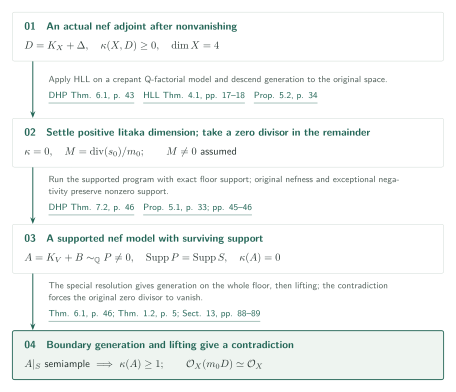
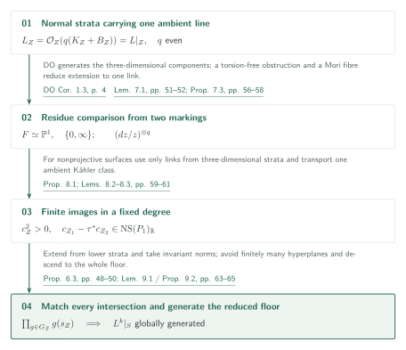
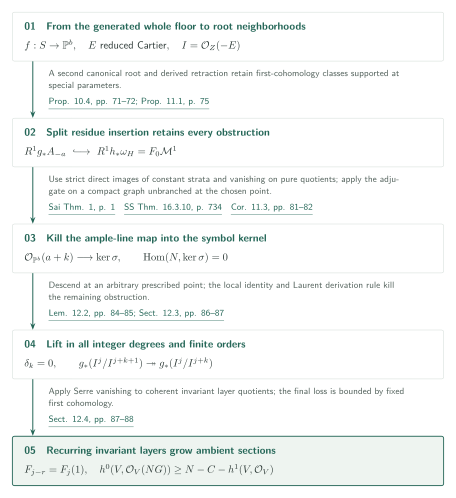

# Abundance after nonvanishing for compact Kähler fourfolds

**From generation on the entire boundary to lifting in finite orders**

The manuscript treats nef klt adjoints already possessing a nonzero section. Positive Iitaka dimension reduces to an existing Kähler theorem. In Iitaka dimension zero, generation on the entire supported dlt boundary and subsequent growth of ambient sections give a contradiction.

## 1. Main results

### Theorem 1.1 — Abundance after nonvanishing

Let $X$ be a normal connected compact Kähler complex space of dimension $\dim X=4$. Let $\Delta$ be an effective rational Weil divisor such that $(X,\Delta)$ is klt and the actual adjoint $D=K_X+\Delta$ is $\mathbb Q$-Cartier. If $D$ is analytically nef and $\kappa(X,D)\geq0$, there is an integer $m>0$ such that $mD$ is Cartier and

$$H^0(X,\mathcal O_X(mD))\otimes_{\mathbb C}\mathcal O_X\longrightarrow\mathcal O_X(mD)$$

is surjective everywhere. If $\kappa(X,D)=0$, one can moreover arrange $\mathcal O_X(mD)\simeq\mathcal O_X$.

There is no projectivity, $\mathbb Q$-factoriality or numerical-dimension assumption on the original $X$. Nonvanishing is a hypothesis. The “actual adjoint” uses the holomorphic line $(\omega_X^{[r]}\otimes\mathcal O_X(r\Delta))^{**}$, for a coefficient-clearing index $r$, and its tensor powers (equation (2.1), p. 6). Neither $K_X$ nor $\Delta$ need be separately $\mathbb Q$-Cartier. Comparisons concern this line itself: equality of numerical classes would leave a possible flat-line difference.

[Theorem 1.1・(2.1) · pp. 3, 6][K4N]

### Theorem 1.2 — Supported lifting

Let $(V,B)$ be a normal irreducible compact Kähler dlt pair of positive dimension, with effective rational boundary and actual $\mathbb Q$-Cartier adjoint $A=K_V+B$. Suppose an effective nonzero rational $\mathbb Q$-Cartier divisor $P$ satisfies

$$P\sim_{\mathbb Q}A,\qquad\operatorname{Supp}P=\operatorname{Supp}\lfloor B\rfloor.$$

If the actual restriction $A|_S$ to the **entire** reduced subspace $S=\lfloor B\rfloor$ is semiample, then $\kappa(V,A)\geq1$. This theorem is dimension-free and assumes neither nefness of $A$ nor Q-factoriality of $V$. The support equality is essential and is not replaced by inclusion.

[Theorem 1.2 · p. 5][K4N]

## References on the arrows

Unprefixed references denote this manuscript. External keys and checked versions are as follows.

- [HLL][HLL]: Höring–Lazić–Lehn (arXiv:2508.14634v2).
- [DHP][DHP]: Das–Hacon–Păun (arXiv:2205.12205v3).
- [DO][DO]: Das–Ou (arXiv:2306.00671v4).
- [FT][FT]: Fujino, Vanishing theorems for projective morphisms between complex analytic spaces (arXiv:2205.14801v7).
- [Sai][Sai]: Saito, Some remarks on decomposition theorem for proper Kähler morphisms (arXiv:2204.09026v5).
- [SS][SS]: Sabbah–Schnell, mixed Hodge module project, Version 2, Chapter 16.
- [FG][FG]: Fujino–Gongyo, log pluricanonical representations (final author PDF).

## 2. Proof of Theorem 1.1

Use the assumed nonvanishing to choose an effective representative, and separate positive Iitaka dimension from zero. If its zero divisor is nonzero in the latter case, construct a supported nef model with surviving support; boundary generation and Theorem 1.2 then give a contradiction.

### 1. Descend generation to the original space in positive Iitaka dimension

For $\kappa(X,D)\geq1$, take the crepant ordinary Q-factorial Kähler model of [DHP, Theorem 6.1, p. 43][DHP]. Since the original pair is klt, so is the output; [HLL, Theorem 4.1, pp. 17–18][HLL] supplies semiampleness. Normality and the projection formula show that every section is pulled back from $X$, and evaluation surjectivity descends to $X$ ([K4N, Proposition 5.2, p. 34][K4N]). Generation on a birational model alone is not the endpoint.

[Proposition 5.2 · p. 34][K4N]

### 2. Match the zero divisor support with a dlt floor

In the remaining case, let $M=\operatorname{div}(s_0)/m_0$ be the normalized zero divisor of a nonzero section. Suppose $M\neq0$. On a log resolution, raise the coefficients of its strict transforms and the exceptional primes to one. With $G_Y$ the crepant boundary, the effective representative in Lemma 5.3 (pp. 34–35) is $P_Y=p^*M+(B_Y-G_Y)$. Its support is exactly the floor, and comparison with exceptional divisors preserves Iitaka dimension zero.

[Lemma 5.3 · pp. 34–35][K4N]

### 3. Ensure that contraction targets remain Kähler

Kählerness of the targets of projective MMP steps cannot be obtained from projectivity of the original space. Following the supported construction of [DHP, Theorem 7.2, p. 46][DHP], the manuscript prepares threefold floor contractions (Proposition 3.1, p. 9) and their extension to the ambient space (Proposition 4.3, p. 24). The latter uses conormal vanishing and **finite analytic thickenings**. Claim 5.4 (pp. 37–42) verifies nefness of the descended Bott–Chern class, a current dominating a positive Hermitian form, and positive top intersections on every positive-dimensional subspace, thereby obtaining a Kähler target. The full analytic contraction constructions are outside the checks completed for this draft.

[Propositions 3.1, 4.3・Claim 5.4 · pp. 9, 24, 37–42][K4N]

### 4. Preserve nonzero support using the original nefness

Proposition 5.1 (p. 33) produces an ordinary Q-factorial Kähler dlt fourfold $(V,B)$, a nef $A=K_V+B$, nonzero $P\sim_{\mathbb Q}A$, $\operatorname{Supp}P=\operatorname{Supp}S$, and $\kappa(V,A)=0$. Survival of $P$ uses **nefness of the original $D$**: if it disappeared, the pullback of $M$ on a common resolution would be nonzero, effective, nef and exceptional, contradicting negativity (pp. 45–46).

[Proposition 5.1・§5.3 · pp. 33, 45–46][K4N]

### 5. Combine whole-floor generation with supported lifting

Lemma 5.6 also gives a special projective resolution: its strict boundary and exceptional support have globally smooth distinct SNC components, exceptional crepant coefficients are below one, and it is generically an isomorphism on the image of each intersection component of distinct strict floor primes. **Under this resolution condition**, Theorem 6.1 (p. 46) generates $A|_S$. Theorem 1.2 then yields $\kappa(V,A)\geq1$, a contradiction. Thus $M=0$; normality makes $s_0$ nowhere vanishing, and it trivializes the original holomorphic line (§13, pp. 88–89).

[Lemma 5.6・Theorem 6.1・§13 · pp. 43–46, 88–89][K4N]

## 3. Generating the entire boundary

Work with the dlt fourfold model possessing the special resolution in Theorem 6.1. Threefold abundance supplies sections componentwise. The goal is to make them agree on every intersection through actual residue identifications.

### 1. Identify stratum adjoint lines with ambient restrictions

Proposition 6.3 (pp. 48–50) identifies adjoints on normal Kähler dlt strata indexed by intersections with restrictions of one ambient holomorphic line. Sufficiently divisible even degrees remove iterated-residue signs. Sections agreeing on every subordinate stratum descend uniquely to the entire reduced floor. Apply [DO, Corollary 1.3, p. 4][DO] to three-dimensional strata through small models; lower strata inherit generation by restriction (K4N §7.1, pp. 50–51). Componentwise generation does not supply agreement on intersections.

[Proposition 6.3・§7.1 · pp. 48–51][K4N]

### 2. Reduce extension to the residue comparison of two markings

Proposition 7.3 (pp. 56–58) reduces extension from the floor of a stratum to at most one residue comparison. Torsion-freeness of $R^1f_*\mathcal O_T(-\lfloor G\rfloor)$ in Lemma 7.1 (pp. 51–52) extends generic-fibre matching over every parameter. When a comparison is necessary, a general $\mathbb P^1$ fibre of a perturbed Mori contraction has two coefficient-one markings. When both come from one prime, use the degree-two exchange on the **normal finite Stein space of its normalization**. On a common graph, the invertible adjoint subsheaves inside meromorphic pluriforms agree; abstract Q-linear equivalence would not suffice.

[Lemma 7.1・Proposition 7.3 · pp. 51–52, 56–58][K4N]

### 3. Use the common Kähler class for fixed-degree finite images

On nonprojective surfaces, the action of all birational self-maps on pluriforms need not have finite image. Section 8 restricts to the groupoid generated by links of three-dimensional strata and their inverses. Restrictions of a single ambient Kähler form give classes $c_Z^2>0$ on smooth minimal surfaces. Lemma 8.2 (p. 60) shows that links preserve these classes modulo the real Néron–Severi space. In algebraic dimension zero, Lemma 8.3 (p. 61) bounds volume-character orders by $\varphi(n)\leq b_2$; algebraic dimension one is treated separately through the elliptic fibration. Proposition 8.1 (p. 59) asserts finite image on section spaces in **each fixed degree**, not finiteness of the groupoid.

[Proposition 8.1・Lemmas 8.2–8.3 · pp. 59–61][K4N]

### 4. Build compatible sections by norm products and descend to the floor

Proposition 9.2 (pp. 64–65) proceeds from points to three-dimensional strata. Extend an already compatible lower collection, then in the curve and surface stages take norm products of finitely many transports to enforce invariance. Lemma 9.1 preserves lower residues even when a surface link contracts a floor curve to a point. Avoiding finitely many hyperplanes chooses a section satisfying all required nonvanishing conditions, preserving generation. Proposition 6.3 finally descends the tuples to the floor. No new ambient section on $V$ has yet been constructed.

[Lemma 9.1・Proposition 9.2 · pp. 63–65][K4N]

## 4. Proof of Theorem 1.2

For Theorem 1.2 return to a standard dlt pair in arbitrary dimension. No special resolution from the preceding application is added as a hypothesis. Starting from generation on the entire reduced support $S$, prove growth of ambient sections by connecting root neighborhoods, split residues and vanishing over a projective parameter space.

### 1. Formulate the finite-neighborhood lifting target precisely

The generated restriction $\mathcal O_V(G)|_S$, with $G=qP$, gives $f:S\to T=\mathbb P^b$ and an actual identity $\mathcal O_V(G)|_S\simeq f^*\mathcal O_T(1)$. Near each compact fibre, a root pair and a full normalized cyclic cover produce a reduced Cartier divisor $E$, with $I=\mathcal O_Z(-E)$ and $g:E\to U$. Proposition 10.2 (p. 68) seeks

$$g_*(I^j/I^{j+k+1})\longrightarrow g_*(I^j/I^{j+k})\quad\text{surjective}\qquad(j\in\mathbb Z,\ k\geq1).$$

These are sheaves of complex vector spaces on the underlying support of $E$. No holomorphic map from the thickening to $U$, or $\mathcal O_U$-coherence of its pushforward, is assumed. Neighborhoods for lifting a section germ may depend on the order.

[Proposition 10.2 · p. 68][K4N]

### 2. Retain special-support obstructions through split residues

A second canonical root and residue give a **split injection** from the obstruction sheaf $R^1g_*A_{-a}$ into $R^1h_*\omega_H$ for an SNC support (Proposition 10.4, pp. 71–72). The derived retraction retains classes supported at special parameters. Proposition 11.1 (p. 75) identifies the latter with the lowest step $F_0\mathcal M^1$ of a right filtered $\mathcal D$-module. Apply [Sai, Theorem 1, p. 1][Sai] to constant real Hodge modules on smooth SNC strata and assemble a finite strict filtration with pure quotients. The proof does not assume a blanket Kähler direct-image theorem for arbitrary mixed Hodge modules.

[Propositions 10.4, 11.1 · pp. 71–72, 75–80][K4N]

### 3. Exclude maps from ample lines on the projective base

Lemma 11.2 (pp. 80–81) supplies the filtered comparison needed to transfer vanishing from [SS, Theorem 16.3.10, printed p. 734 / chapter PDF p. 16][SS]. Corollary 11.3 (pp. 81–82) then gives, on the projective parameter space,

$$\operatorname{Hom}(N,\ker\sigma)=0,\qquad\sigma:F_0\mathcal M^1\otimes T_T\longrightarrow\operatorname{gr}^F_1\mathcal M^1$$

for every ample $N$, including torsion in the kernel.

[Lemma 11.2・Corollary 11.3 · pp. 80–82][K4N]

### 4. Kill the obstruction at an arbitrary prescribed point

Assuming shorter lifting orders, the current connecting map becomes a degree-$k$ derivation $\delta_k$ on the Laurent graded algebra (Lemma 12.1, pp. 82–83). The adjugate identity in Lemma 12.2 (pp. 84–85) turns its values on base coordinates into a map to the symbol kernel **without inverting the Jacobian** of the parameter change. Proposition 10.5 (pp. 73–74) supplies a projective coordinate-power cover, unbranched over an arbitrarily prescribed $t_*$, and one compact SNC graph. Section 12.3 (pp. 86–87) kills the resulting ample-line map by vanishing and descends the result at $t_*$. Since that point was arbitrary, special-support obstructions disappear as well.

[Proposition 10.5・Lemmas 12.1–12.2・§12.3 · pp. 73–74, 82–87][K4N]

### 5. Turn lifting in all integer degrees into section growth

The order-zero part of the same local identity and the split injection then kill negative-degree obstructions. The derivation rule for an invertible Laurent frame extends this to every integer degree, closing finite lifting induction. Finally cyclic invariants yield coherent layer quotients of $J_j=\mathcal O_V(-\lceil jG/r\rceil)$. Their direct images $F_j=f_*(J_j/J_{j+1})$ satisfy $F_{j-r}=F_j\otimes\mathcal O_T(1)$. Serre vanishing is applied to these coherent layer quotients. Euler characteristics of finite filtrations give at least $N-C$ quotient sections, and the final loss in passing to ambient sections is bounded by the fixed $h^1(V,\mathcal O_V)$. Some degree therefore has two independent sections, proving $\kappa(V,A)\geq1$ (pp. 87–88). Convergence of an infinite thickening is unnecessary.

[§§12.3–12.4 · pp. 87–88][K4N]

## 5. Which papers supply which steps

- **[HLL]** Theorem 4.1 (v2, pp. 17–18): semiampleness for Q-factorial Kähler klt pairs of positive Iitaka dimension, unconditional through dimension four. Used in K4N Proposition 5.2 (p. 34).
- **[DHP]** Theorem 6.1 (v3, p. 43), Theorem 7.2 (p. 46): crepant dlt models and the supported fourfold program, used in K4N §§5.1, 5.3. Its floor contraction and Kähler targets are discussed together with K4N §§3–4 and Claim 5.4.
- **[DO]** Corollary 1.3 (v4, p. 4; actual-adjoint conventions pp. 5–6): semiampleness of nef lc Kähler threefold adjoints, applied to strata in K4N §7.1 (pp. 50–51).
- **[FT]** Theorem 2.9, Proposition 2.11 (v7, pp. 6–7): canonical direct-image torsion-freeness from smooth Kähler sources and local Kählerness, used in K4N Lemma 7.1 and Proposition 10.4.
- **[Sai] / [SS]** Constant-source strict direct image and projective vanishing as above: inputs to K4N §11. The filtered comparison for pure real Hodge modules is K4N's own Lemma 11.2.
- **[FG]** Theorem 1.1 (final author manuscript, p. 1): finiteness of pluricanonical representations of projective lc pairs with semiample adjoint. Applied only to projective surfaces in K4N §8.1 (p. 59).
- **[SL] and [LA]** are cited as projective context on K4N p. 6, not as direct inputs to its two analytic boundary theorems. Swapnajit Das's slc Kähler threefold abundance is likewise prior methodological work; K4N p. 5 explicitly excludes its main theorem as an input.

## 6. Return to the sources

The source is the [fixed K4N PDF][K4N], commit `adc7f1241b42e322a6451854ab7e4b4c146bf78a`. Unless specified otherwise, page references use printed PDF pages. GitHub links do not retain page positions; use the stated page and result numbers.

The editors read the main statements, actual-line conventions, supported-model preparation and survival of the support, adjunction and descent on strata, two-marking comparisons, the common Kähler class and fixed-degree finite images, norm-product induction, split residue insertion, filtered direct-image and vanishing statements and connections, the adjugate identity and its application to obstructions, layer growth, and final assembly. The stated HLL, DHP, DO, FT, Sai, SS and FG inputs were compared with their source statements and use sites.

**Unresolved:** complete analytic contraction constructions in §§3–4 and Claim 5.4; all external relative MMP, rationality and current-descent inputs; all root-neighborhood gluing and functorial principalization; independent reconstruction of the filtered comparison between real Hodge-module theories in §11; the full Čech differentiation calculation in Lemma 12.2; and proofs of external theorems. These connections are not claimed to be independently verified.

**Version note:** Sai v5 Theorem 1 displays weight $j-n$, whereas K4N p. 78 treats this as a sign typo, using constant-module conventions and the identity map. This discrepancy is retained in the verification record. SS was checked in the Version 2 chapter PDF available on the access date, not a fixed-commit source.

[K4N]: https://github.com/openai/math/blob/adc7f1241b42e322a6451854ab7e4b4c146bf78a/preprints/Abundance-after-nonvanishing-for-compact-Kahler-fourfolds-September-27-2026/paper.pdf
[HLL]: https://arxiv.org/pdf/2508.14634v2
[DO]: https://arxiv.org/pdf/2306.00671v4
[DHP]: https://arxiv.org/pdf/2205.12205v3
[FT]: https://arxiv.org/pdf/2205.14801v7
[Sai]: https://arxiv.org/pdf/2204.09026v5
[SS]: https://perso.pages.math.cnrs.fr/users/claude.sabbah/MHMProject/mhm_chap16.pdf
[FG]: https://www.math.kyoto-u.ac.jp/~fujino/fg-comp-final.pdf
[SL]: https://github.com/openai/math/blob/adc7f1241b42e322a6451854ab7e4b4c146bf78a/preprints/Lifting-sections-from-the-reduced-support-of-an-adjoint-September-27-2026/paper.pdf
[LA]: https://github.com/openai/math/blob/adc7f1241b42e322a6451854ab7e4b4c146bf78a/preprints/Log-abundance-in-characteristic-zero-September-24-2026/paper.pdf
