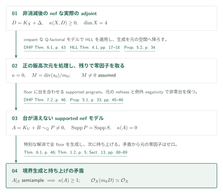
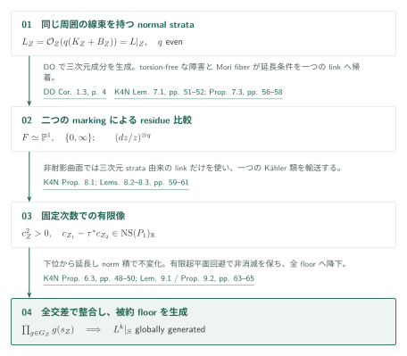
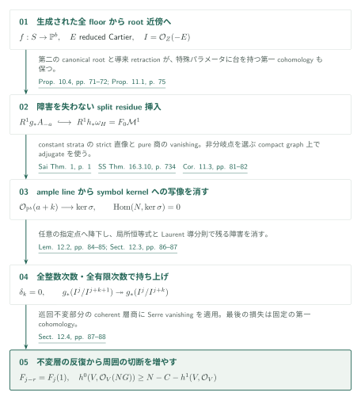

# Kähler四次元の非消滅後のabundance：境界の整合と有限次数の持ち上げ

Abundance after nonvanishing for compact Kähler fourfolds — 2026年9月27日版、92頁。公式カタログ034内の掲載順14、記事ID `abundance-after-nonvanishing`。

この原稿は、既に非零切断を持つnefなklt adjointを扱う。正の飯高次元は既存のKähler定理に帰着し、飯高次元ゼロでは、切断の零因子を支えるdlt境界全体の生成と、そこからの切断数の増大を組み合わせて矛盾を導く。

> AI生成の概説初稿。以下は著者の定理と証明戦略の紹介であり、証明全体の独立な正しさの認定ではない。原典の確認箇所と未確認の接続を末尾に示す。数学的な利用には原典を確認されたい。

## 主結果（原典順）

**Theorem 1.1（[K4N, p. 3][K4N]）.** $X$ を正規連結コンパクトKähler複素空間、$\dim X=4$ とする。有効有理Weil因子 $\Delta$ に対し $(X,\Delta)$ がkltで、実際のadjoint $D=K_X+\Delta$ が $\mathbb Q$-Cartierであるとする。$D$ が解析的にnefで $\kappa(X,D)\geq0$ なら、ある $m>0$ に対し $mD$ がCartierで、評価写像

$$H^0(X,\mathcal O_X(mD))\otimes_{\mathbb C}\mathcal O_X\longrightarrow\mathcal O_X(mD)$$

は全点で全射となる。さらに $\kappa(X,D)=0$ なら $\mathcal O_X(mD)\simeq\mathcal O_X$ とできる。

元の $X$ に射影性・$\mathbb Q$-factoriality・数値次元の条件はない。非消滅は結論ではなく仮定である。「実際のadjoint」は、係数を払う $r$ に対する $(\omega_X^{[r]}\otimes\mathcal O_X(r\Delta))^{**}$ とそのテンソル冪で定めた正則線束を指す（式(2.1), p. 6）。$K_X$ と $\Delta$ を個別に $\mathbb Q$-Cartierとする必要はない。比較するのはこの線束そのものであり、数値類の一致だけではflatな差を排除できない。

**Theorem 1.2（Supported lifting；[K4N, p. 5][K4N]）.** $(V,B)$ を正次元の正規既約コンパクトKähler dlt対、$B$ を有効有理境界、$A=K_V+B$ を実際の $\mathbb Q$-Cartier adjointとする。有効非零の有理 $\mathbb Q$-Cartier因子 $P$ が

$$P\sim_{\mathbb Q}A,\qquad\operatorname{Supp}P=\operatorname{Supp}\lfloor B\rfloor$$

を満たすとき、被約部分空間 $S=\lfloor B\rfloor$ **全体**への実際の制限 $A|_S$ がsemiampleなら $\kappa(V,A)\geq1$ である。この定理は任意次元であり、$A$ のnefnessも $V$ のQ-factorialityも仮定しない。台の等号は重要で、単なる包含に置き換えない。

## Theorem 1.1：正の飯高次元と、境界を持つゼロ次元の場合

$\kappa(X,D)\geq1$ では [DHP, Theorem 6.1, p. 43][DHP] のcrepantなordinary Q-factorial Kählerモデルを取る。元の対がkltなので出力もkltとなり、[HLL, Theorem 4.1, pp. 17–18][HLL] が半豊富性を与える。全切断が元の $X$ からの引戻しであることをnormalityと射影公式で確認し、評価全射を $X$ へ降ろす（[K4N, Proposition 5.2, p. 34][K4N]）。これは有理モデル上の生成だけで終了する議論ではない。

残りでは非零切断 $s_0$ の正規化零因子 $M=\operatorname{div}(s_0)/m_0$ を取る。$M\neq0$ と仮定し、log resolution上でその厳密変換と例外素因子の係数を1へ上げる。Lemma 5.3（pp. 34–35）の有効代表は、crepant境界を $G_Y$ として $P_Y=p^*M+(B_Y-G_Y)$ である。台はちょうどfloorで、例外因子との比較が飯高次元ゼロを保つ。

ここで射影的なMMP段階の行先がKählerであることは、元の空間の射影性からは得られない。原稿は [DHP, Theorem 7.2, p. 46][DHP] のsupported constructionに沿い、三次元のfloor収縮（Proposition 3.1, p. 9）とその周囲への延長（Proposition 4.3, p. 24）を用意する。後者ではconormal層の消滅と**有限の解析的thickening**を使う。Claim 5.4（pp. 37–42）は降下したBott–Chern類についてnefness、正のHermitian形式を支配するcurrent、全正次元部分空間上の正の最高次交点を確認し、行先のKähler性へつなぐ。これらの解析的収縮の詳細は初稿で全検証した範囲に含めない。

Proposition 5.1（p. 33）の出力はordinary Q-factorial Kähler dlt四次元対 $(V,B)$、nefな $A=K_V+B$、非零 $P\sim_{\mathbb Q}A$、$\operatorname{Supp}P=\operatorname{Supp}S$、$\kappa(V,A)=0$ である。$P$ が消えないことには**元の $D$ のnefness**を使う。消えたなら共通解消上の $M$ の引戻しが非零有効・nef・例外的となり、negativityに矛盾する（pp. 45–46）。

さらにLemma 5.6の特別な射影的解消は、厳密境界と例外台の大域的に滑らかで異なるSNC成分、1未満の例外crepant係数、および異なる厳密floor成分の交差の各像の一般点での同型性を持つ。Theorem 6.1（p. 46）は**この解消条件の下で** $A|_S$ を生成する。Theorem 1.2が $\kappa(V,A)\geq1$ を与え、矛盾する。従って $M=0$ であり、normalityによって $s_0$ は全点で消えず、元の正則線束を自明化する（§13, pp. 88–89）。

## 境界全体の生成：成分ごとのabundanceから整合する切断へ

Proposition 6.3（pp. 48–50）は、添字付き交差から得られるnormal Kähler dlt strataのadjointを、同じ周囲の正則線束の制限として同定する。十分可除な偶数次数で反復residueの符号を消し、すべての下位stratumで一致する切断は被約floor全体へ一意に降下する。三次元strataにはsmall modelを介して [DO, Corollary 1.3, p. 4][DO] を適用し、下位strataの生成はその制限で得る（K4N §7.1, pp. 50–51）。成分上の生成だけでは交差上の一致は従わない。

Proposition 7.3（pp. 56–58）は、stratumのfloor上の切断を親へ延長する条件を、多くても一つのresidue比較へ帰着する。Lemma 7.1（pp. 51–52）の $R^1f_*\mathcal O_T(-\lfloor G\rfloor)$ のtorsion-freenessが、一般ファイバーでの一致を全パラメータへ広げる。比較が必要な場合、摂動したMori収縮の一般 $\mathbb P^1$ ファイバーに係数1の二つのmarkingが現れる。同じ素因子から二点が来る場合は、その**正規化のnormal finite Stein空間**の次数2交換を使う。共通グラフ上で一致するのはmeromorphic pluriformsの中の可逆adjoint部分層であり、抽象的なQ線形同値だけではない。

非射影的曲面には、全双自己写像のpluriform作用が有限という主張は使えない。§8は三次元strataのlinkとその逆写像から生成されるgroupoidに限定する。同じ周囲のKähler形式の制限から、滑らかな極小曲面上に $c_Z^2>0$ を持つ類を作り、linkがこれをNéron–Severi実空間を法として保つことをLemma 8.2（p. 60）で示す。代数次元ゼロではLemma 8.3（p. 61）が体積形式の指標の位数に $\varphi(n)\leq b_2$ を与え、代数次元1では楕円ファイブレーションへの作用を別に処理する。Proposition 8.1（p. 59）の結論は、**各固定次数**の切断空間上での有限像であり、groupoid自体の有限性ではない。

Proposition 9.2（pp. 64–65）は点から三次元strataまで帰納する。下位の整合集合をまず延長し、曲線・曲面段階では有限個の移送のnorm積を取って不変性を課す。Lemma 9.1は、曲面linkがfloor曲線を点へ潰す場合も下位residueを保存する。有限個の非消滅条件を同時に満たす切断を有限個の超平面の回避で選び、生成性を保つ。最後にProposition 6.3でfloorへ降ろす。この時点では周囲 $V$ への新しい切断はまだ作っていない。

## Theorem 1.2：障害を全有限次数で消し、切断数を増大させる

生成された制限 $\mathcal O_V(G)|_S$（$G=qP$）から $f:S\to T=\mathbb P^b$ と実際の同型 $\mathcal O_V(G)|_S\simeq f^*\mathcal O_T(1)$ を作る。各compact fiberの近傍でroot pairと完全な正規化巡回被覆を取り、$E$ を被約Cartier因子、$I=\mathcal O_Z(-E)$、$g:E\to U$ とする。Proposition 10.2（p. 68）の目標は

$$g_*(I^j/I^{j+k+1})\longrightarrow g_*(I^j/I^{j+k})\quad\text{surjective}\qquad(j\in\mathbb Z,\ k\geq1).$$

これらは $E$ の台上の複素ベクトル空間の層として扱う。厚み付き空間から $U$ への正則写像や、その押出しの $\mathcal O_U$-coherenceは仮定しない。切断germを持ち上げる近傍は次数ごとに変わってよい。

第二のcanonical rootとresidueにより、Proposition 10.4（pp. 71–72）は障害の属する $R^1g_*A_{-a}$ をSNC台の $R^1h_*\omega_H$ へ**split injection**で入れる。導来圏でのretractionがあるため、特殊パラメータに台を持つ類も失われない。Proposition 11.1（p. 75）は後者を右filtered $\mathcal D$-moduleの最低段 $F_0\mathcal M^1$ と同定する。smoothなSNC strata上のconstant real Hodge moduleに [Sai, Theorem 1, p. 1][Sai] を適用し、有限のstrict filtrationとpure商を組み立てる。任意のmixed Hodge moduleのKähler直像定理を一括して仮定してはいない。

[SS, Theorem 16.3.10, 印刷p. 734／章PDF p. 16][SS] のvanishingを実際のfiltered componentへ移す比較がLemma 11.2（pp. 80–81）である。その後、Corollary 11.3（pp. 81–82）は射影的パラメータ空間上で

$$\operatorname{Hom}(N,\ker\sigma)=0,\qquad\sigma:F_0\mathcal M^1\otimes T_T\longrightarrow\operatorname{gr}^F_1\mathcal M^1$$

をすべてのampleな $N$ に対して得る。kernelがtorsionを持つ場合も含む。

短い次数が持ち上がると仮定すると、現在の接続準同型はLaurent graded algebra上の次数 $k$ の導分 $\delta_k$ になる（Lemma 12.1, pp. 82–83）。Lemma 12.2（pp. 84–85）のadjugate identityは、パラメータ変換のJacobianの**逆行列を取らず**に、導分のbase座標上の値からsymbol kernelへの写像を作る。任意に指定した $t_*$ 上で非分岐となる射影的な座標冪被覆と一つのcompact SNC graphをProposition 10.5（pp. 73–74）で用意する。§12.3（pp. 86–87）ではample lineからkernelへのこの写像をvanishingでゼロにし、$t_*$ で降下する。$t_*$ は任意なので、特殊な台の障害も消える。

次に同じ局所恒等式の零階部分とsplit injectionに戻って負次数の障害を消し、可逆Laurent frameの導分則から全整数次数へ広げる。これで有限持ち上げの帰納が閉じる。最後に巡回不変部分を取ると、$J_j=\mathcal O_V(-\lceil jG/r\rceil)$ のcoherentな層商が現れ、$F_j=f_*(J_j/J_{j+1})$ は $F_{j-r}=F_j\otimes\mathcal O_T(1)$ を満たす。Serre vanishingを適用するのはこのcoherentな層商である。有限filtrationのEuler標数から商切断が少なくとも $N-C$ 個に増え、周囲への最後の持ち上げの損失は固定値 $h^1(V,\mathcal O_V)$ 以下となる。従ってある次数に独立な二切断が生じ、$\kappa(V,A)\geq1$ となる（pp. 87–88）。無限thickeningの収束を示す必要はない。

## 外部入力とカタログ内の関係

- **[HLL]** Theorem 4.1（v2, pp. 17–18）：Q-factorial Kähler klt対の正の飯高次元での半豊富性。四次元以下では無条件。K4N Proposition 5.2（p. 34）で使用。
- **[DHP]** Theorem 6.1（v3, p. 43）とTheorem 7.2（p. 46）：crepant dltモデルとsupported四次元プログラム。K4N §§5.1, 5.3で使用。後者のfloor収縮・行先のKähler性はK4N §§3–4・Claim 5.4の構成と合わせて説明する。
- **[DO]** Corollary 1.3（v4, p. 4；実際のadjointの規約はpp. 5–6）：nef lc Kähler三次元adjointの半豊富性。K4N §7.1（pp. 50–51）のstrataに適用。
- **[FT]** Theorem 2.9・Proposition 2.11（v7, pp. 6–7）：滑らかなKähler sourceからの標準層直像のtorsion-freenessと局所Kähler性。K4N Lemma 7.1、Proposition 10.4で使用。
- **[Sai] / [SS]** 上記constant-sourceのstrict直像とprojective vanishing：K4N §11の入力。純粋実Hodge moduleのfiltered比較はK4N自身のLemma 11.2。
- **[FG]** Theorem 1.1（最終著者稿p. 1）：projective lc対のsemiample adjointのpluricanonical表現の有限性。K4N §8.1（p. 59）では射影的曲面にのみ適用。
- **[SL]・[LA]** はK4N p. 6で射影的背景として引用される。K4Nの二つの解析的境界定理への直接入力の辺は作らない。Swapnajit Dasのslc Kähler三次元abundanceも、原稿p. 5が明記するように先行手法であり、その主定理を入力としていない。

## 原典・確認範囲

出典は [K4N固定版PDF][K4N]、commit `adc7f1241b42e322a6451854ab7e4b4c146bf78a`。SHA-256・詳細頁・外部版は `sources.json`。頁は特記しない限り印刷PDF頁。GitHubのPDFリンクは頁位置を保持しないため、記載頁と番号を用いる。

編集側は主定理、actual-line規約、supported modelの準備と台の生存、strataのadjunctionと降下、二つのmarkingの比較、共通Kähler類と固定次数有限像、norm積の帰納、split residue insertion、filtered直像とvanishingの記述・接続、adjugate identityの記述と障害消滅への適用、層の増大と最終組立てを読んだ。上記のHLL・DHP・DO・FT・Sai・SS・FGの入力の記述と使用箇所を照合した。

**未確認**：解析的収縮の §§3–4 とClaim 5.4の全構成、relative MMP・rationality・current降下の全外部結果、root近傍の全gluingとfunctorial principalization、§11の実Hodge module間のfiltered比較の独立な再構成、Lemma 12.2の全Čech微分計算、外部定理自体の証明。これらの接続を独立に検証済みとはしない。

**版の注意**：Sai v5 Theorem 1の表示ではweightが $j-n$ だが、K4N p. 78はconstant moduleの規約と恒等写像を根拠に符号の誤記と扱う。この相違を確認記録に残した。SSの照合は参照時のVersion 2の章PDFであり、固定commitの資料ではない。日英の図・数式・リンクの実施確認は `status.md` に記録し、サイト組込み後の画面確認は本部へ引き渡す。

[K4N]: https://github.com/openai/math/blob/adc7f1241b42e322a6451854ab7e4b4c146bf78a/preprints/Abundance-after-nonvanishing-for-compact-Kahler-fourfolds-September-27-2026/paper.pdf
[HLL]: https://arxiv.org/pdf/2508.14634v2
[DO]: https://arxiv.org/pdf/2306.00671v4
[DHP]: https://arxiv.org/pdf/2205.12205v3
[FT]: https://arxiv.org/pdf/2205.14801v7
[Sai]: https://arxiv.org/pdf/2204.09026v5
[SS]: https://perso.pages.math.cnrs.fr/users/claude.sabbah/MHMProject/mhm_chap16.pdf
[FG]: https://www.math.kyoto-u.ac.jp/~fujino/fg-comp-final.pdf
[SL]: https://github.com/openai/math/blob/adc7f1241b42e322a6451854ab7e4b4c146bf78a/preprints/Lifting-sections-from-the-reduced-support-of-an-adjoint-September-27-2026/paper.pdf
[LA]: https://github.com/openai/math/blob/adc7f1241b42e322a6451854ab7e4b4c146bf78a/preprints/Log-abundance-in-characteristic-zero-September-24-2026/paper.pdf
