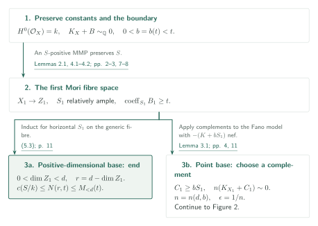
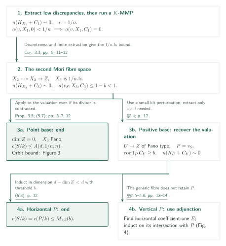
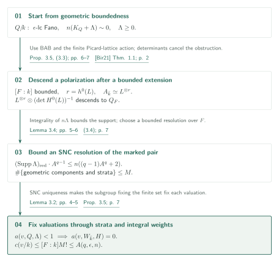
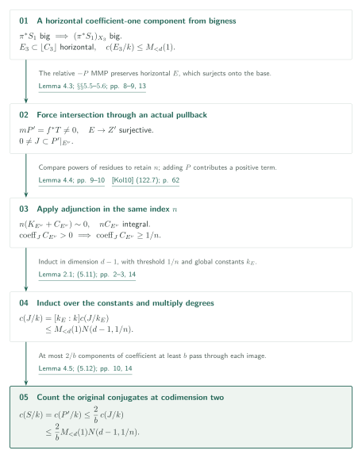

# Arithmetic Stein-degree bounds for log Calabi–Yau pairs

**MMP induction, Galois orbits of valuations, and adjunction in the same index**

The manuscript bounds the degree of the constant field of a boundary component using only the ambient dimension and a positive lower bound for its coefficient. Its proof combines induction through Mori fibre spaces with two additional arguments: converting geometric Fano boundedness into arithmetic bounds on valuation orbits, and making a vertical component accessible to divisorial adjunction.

## 1. Main results

### Theorem 1.1 ([SD], p. 1)

Fix an integer $d\ge1$ and a real number $t>0$. Let $(X,B)$ be a projective lc $\mathbb Q$-pair over any characteristic-zero field $k$, with $X$ normal and integral, $B\ge0$, and

$$
\dim X=d,\qquad H^0(X,\mathcal O_X)=k,\qquad K_X+B\sim_{\mathbb Q}0.
$$

If $S$ is a prime component with $\operatorname{coeff}_S B\ge t$, and $k_S$ is the relative algebraic closure of $k$ in $k(S)$, there is an integer $N(d,t)$ depending only on $d,t$ such that

$$
c(S/k):=[k_S:k]\le N(d,t).
$$

For the normalization $S^\nu$, this implies

$$
\operatorname{sdeg}(S/\operatorname{Spec}k)
=\dim_kH^0(S,\mathcal O_S)
\le\dim_kH^0(S^\nu,\mathcal O_{S^\nu})=c(S/k)\le N(d,t).
$$

This is the contraction-to-a-point statement for ordinary pairs. It is not a statement for generalized pairs or arbitrary relative Stein degrees. The case $t>1$ is vacuous; no fixed coefficient set is assumed.

[Theorem 1.1 · p. 1][SD]

### Proposition 3.5 (arithmetic input to the proof; [SD], pp. 6–7)

Fix $q\ge1$, $\epsilon>0$, and $n\ge1$. Let $Q/k$ be a normal geometrically integral projective $\epsilon$-lc Fano variety of dimension $q$, and assume $(Q,\Lambda)$ is lc, $\Lambda\ge0$, and $n(K_Q+\Lambda)\sim0$. Every divisorial valuation with $a(v,Q,\Lambda)<1$ has constant-field degree bounded by $A(q,\epsilon,n)$. The valuation need not survive as a divisor on $Q$.

[Proposition 3.5 · pp. 6–7][SD]

## References on the arrows

Unprefixed result numbers refer to this manuscript [SD]. External inputs use [Bir19] for complements, [Bir21] for BAB, [LM26] for MMP and extraction, and [Kol10] for differents and residues. The final section distinguishes checking statements and applications from checking entire proofs.

- [Bir19, Theorem 1.7 · arXiv v4][Bir19] / [Bir21, Theorem 1.1 · arXiv v2][Bir21]
- [LM26, arXiv v4][LM26]
- [Kol10, Canonical models · June 1, 2010 draft][Kol10]

## 2. Proof of Theorem 1.1: the first MMP

**Proof route.** The [first MMP](#proof-1) closes by induction over a positive-dimensional base; only a point base leads to the [second MMP](#proof-2). Its exits are the [arithmetic valuation-orbit bound](#proof-3), induction for horizontal components, and [adjunction for vertical components](#proof-4). The [four bounds are combined at the end](#proof-4-step-6).

Induct on dimension, treating all positive coefficient thresholds simultaneously. For $d=1$, $\deg B=2$ gives $tc(S/k)\le2$. Henceforth let $d\ge2$, write $M_{<d}(u)=\max_{1\le r<d}N(r,u)$, and fix a rational $0<b=b(t)<t$. The first MMP preserves $S$ and makes it relatively ample.

### 1. Preserve the constants and the boundary component

Lemma 2.1 identifies $c(S/k)$ with the number of geometric components, so tracking the same divisorial valuation through birational operations preserves this degree. Lemma 4.1 supplies a $\mathbb Q$-factorial klt model with effective crepant boundary. Run the MMP for $K+B-bS\sim_{\mathbb Q}-bS$. Every contracted extremal ray is positive for $S$, and negativity prevents $S$ from being contracted. On the resulting $X_1\to Z_1$, the transform $S_1$ is relatively ample and retains its coefficient lower bound $t$.

[Lemmas 2.1, 4.1–4.2 · pp. 2–3, 7–8][SD]

### 2. End on the generic fibre when the base has positive dimension

If $\dim Z_1>0$, relative ampleness makes $S_1$ horizontal. The generic fibre has global function field $k(Z_1)$ and is an lc log Calabi–Yau pair of dimension $r=d-\dim Z_1<d$ with threshold $t$. Induction and the comparison of constants for horizontal components give $c(S/k)\le M_{<d}(t)$. This branch needs neither a complement nor the second MMP.

[Lemma 2.1; §5.2, (5.3) · pp. 2–3, 11][SD]

### 3. Choose a bounded-index complement when the base is a point

If $Z_1=\operatorname{Spec}k$, then $X_1$ is Fano and $-(K_{X_1}+bS_1)$ is nef. Lemma 3.1 applies bounded complements with the fixed coefficient $b$, then chooses a general member of a linear system over $k$. It gives an lc boundary $C_1\ge bS_1$ with $n(K_{X_1}+C_1)\sim0$. First choose $b=b(t)$, then $n=n(d,b)$. The next step uses this $n$ to control singularities without depending on the original boundary denominators.

[Lemma 3.1; §5.2, (5.4) · pp. 4, 11][SD] · [Bir19, Theorem 1.7 · p. 4][Bir19]

## 3. Proof of Theorem 1.1: three exits from the second MMP

Set $\epsilon=1/n$. Extract the low-discrepancy valuations before running a $K$-MMP, producing an $\epsilon$-lc Mori fibre space. Tracking the original valuation $v_S$ leads to three cases, even if $S$ no longer survives as a divisor.

### 1. Turn index discreteness into a uniform discrepancy bound

Corollary 3.3 makes the valuations with $a(v,X_1,0)<1/n$ a finite set. Their log discrepancies for the complement are nonnegative multiples of $1/n$, no larger than their original discrepancies, so they are all lc places. Extract exactly these valuations to obtain a $1/n$-lc variety $X_2$; every extracted divisor has coefficient one in $C_2$. After a $K$-MMP, $X_3$ remains $1/n$-lc, retains an lc complement of the same index, and satisfies $a(v_S,X_3,C_3)\le1-b<1$.

[Corollary 3.3; §5.3, (5.5)–(5.6) · pp. 5, 11–12][SD]

### 2. End with the valuation-orbit bound over a point

If $\dim Z=0$, then $X_3$ is a $1/n$-lc Fano variety. Proposition 3.5 applies with $q=d$, $\epsilon=1/n$, and boundary $C_3$, giving $c(S/k)\le A(d,1/n,n)$. Its input is a valuation satisfying $a(v_S,X_3,C_3)<1$, so the strict transform of $S$ may already have been contracted. Section 4 explains this arithmetic bound.

[Proposition 3.5; §5.3, (5.7) · pp. 6–7, 12][SD]

This exit uses the [arithmetic proof of Proposition 3.5](#proof-3).

### 3. Recover the original valuation over a positive-dimensional base

If $\dim Z>0$, choose $\Gamma=(1-\lambda)C_3$ for sufficiently small $\lambda>0$. This is klt with relatively ample anti-log-canonical divisor. Extract only $v_S$ if it is exceptional; otherwise use the divisor already present. On the resulting model $U\to Z$ of relative Fano type, the prime $P$ satisfies $c(P/k)=c(S/k)$ and has coefficient at least $b$. The relation $n(K_U+C_U)\sim0$ is preserved.

[§5.4 · p. 12][SD] · [LM26, Theorem 22.1 · p. 87][LM26]

### 4. Use induction for a horizontal prime and adjunction for a vertical prime

If $P$ is horizontal, apply induction with threshold $b$ on the generic fibre of dimension $d-\dim Z<d$, obtaining $c(S/k)\le M_{<d}(b)$. A vertical $P$ disappears on that fibre, so the same induction cannot apply. Section 5 constructs a different horizontal coefficient-one component and transfers the intersection with $P$ to its normalization.

[§5.4, (5.8); §§5.5–5.6 · pp. 12–14][SD]

For the vertical case, continue to [adjunction retaining the same index](#proof-4).

## 4. Proof of Proposition 3.5: from geometric boundedness to arithmetic orbits

Geometric boundedness from BAB must be converted into a bound on the constant field of a valuation over $k$. Descend a polarization after a bounded extension, then construct a finite Galois set using a bounded SNC resolution.

### 1. Remove the polarization's descent obstruction after a bounded extension

BAB supplies a bounded very ample bundle $L$ over $\bar k$. The manuscript embeds the Picard group into a lattice of bounded rank and bounds its finite Galois image, obtaining a bounded extension $F/k$ fixing the class of $L$. Fixing a class does not finish descent of the bundle. With $r=h^0(L)$, the following determinant factor cancels the scalar two-cocycle and supplies a bounded very ample bundle $A$ on $Q_F$.

$$
L^{\otimes r}\otimes\bigl(\det H^0(L)\bigr)^{-1}.
$$

[Proposition 3.5, (3.3) · pp. 6–7][SD] · [Bir21, Theorem 1.1 · p. 2][Bir21]

### 2. Bound a resolution containing the boundary support

Integrality of $n\Lambda$ and $n(K_Q+\Lambda)\sim0$ bound the degree of the boundary support with respect to $A$. Apply Lemma 3.4 to this embedding and support to obtain a resolution over $F$ and a reduced SNC divisor $H$ containing the boundary. A uniform bound $M$ on its geometric components and strata supplies the finite set needed in the group-action argument.

[Lemma 3.4; Proposition 3.5, (3.4) · pp. 5–7][SD]

### 3. Fix each valuation by fixing components and strata

If $a(v,Q,\Lambda)<1$, then $a(v,W_{\bar k},H)$ is a nonnegative integer less than one, hence zero. Lemma 3.2 uniquely determines this valuation from its centre stratum and positive integral weights. Thus the Galois subgroup fixing every element of the finite set fixes each valuation, and its orbit has size at most $[F:k]M!\le A(q,\epsilon,n)$. There is no need to bound the total number of valuations.

[Lemma 3.2; Proposition 3.5 · pp. 4–5, 7][SD]

## 5. Proof of Theorem 1.1: bringing the vertical component into adjunction

Consider the vertical branch of the second MMP. Construct a nonzero intersection $J$ of $P$ with a horizontal coefficient-one component $E$, combine the two lower-dimensional bounds for $E$ and $J$, and return to the number of conjugates of $P$.

### 1. Recover a horizontal coefficient-one component from earlier bigness

Since $S_1$ is ample on the Fano variety $X_1$, the divisor $\pi^*S_1$ on $X_2$ is effective and big. Its pushforward to $X_3$ remains big: the map extracts no divisors and preserves the required growth of sections. A divisor supported only in vertical components cannot restrict to a big class on the positive-dimensional generic fibre. The original $S$ has vertical centre, so a horizontal component $E_3$ comes from an extracted exceptional divisor and has coefficient one in $C_3$. Generic-fibre induction for this component gives $c(E_3/k)\le M_{<d}(1)$.

[§5.5, (5.9)–(5.10) · p. 13][SD]

### 2. Use a relative MMP to force a nonzero intersection

On the relative Fano type model $U$, verticality of $P$ makes $-P$ relatively pseudo-effective. The big-boundary MMP of Lemma 4.3 preserves $P$ and the horizontal $E$, and basepoint freeness makes $-P'$ semiample. For its contraction $f:U'\to Z'$, the map $Z'\to Z$ is birational. Descending the canonical section gives the actual divisor identity $mP'=f^*T$, where $T\ne0$ is effective Cartier. Since $E$ is proper and horizontal, it surjects onto $Z'$; hence $P'|_{E^\nu}\ne0$. Choose a prime component $J$ of this restriction.

[Lemma 4.3; §5.6 · pp. 8–9, 13][SD]

### 3. Preserve the index by residue and discretize positive coefficients

The effective lc pair $(U',C')$ has coefficient one along $E$, coefficient $\beta\ge b$ along $P'$, and $n(K_{U'}+C')\sim0$. Lemma 4.4 gives an effective lc different with $n(K_{E^\nu}+C_{E^\nu})\sim0$ for the same $n$. The manuscript's additional argument takes the residue of a rational $n$-canonical form over $k$ and recovers the degree-$n$ divisor identity from an identity for a sufficiently divisible power.

Equation (122.7) of [Kol10] supplies the residue isomorphism used in this comparison. Equation (122.10) also assumes that $K+E$ itself is $\mathbb Q$-Cartier, so that formula alone does not settle the general case. The manuscript compares residues before and after adding $\beta P'$ at a common Cartier multiple, obtaining $C_{E^\nu}\ge\beta P'|_{E^\nu}$. Thus $J$ has positive coefficient; integrality of $nC_{E^\nu}$ makes it at least $1/n$.

[Lemma 4.4, (4.2) · pp. 9–10][SD] · [Kol10, Definition 122, Proposition 123, Lemma 125 · pp. 61–64][Kol10]

### 4. Induct over the component's own constants and multiply degrees

Let $k_E$ be the constant field of $E^\nu$. Lemma 2.1 makes $E^\nu/k_E$ normal and geometrically integral with $H^0(\mathcal O_{E^\nu})=k_E$. This finite separable extension preserves the canonical divisor, so induction in dimension $d-1$ with threshold $1/n$ applies to the adjunction pair. Since $k_E\subset k(J)$, the bound for the horizontal component gives

$$
c(J/k)=[k_E:k]c(J/k_E)
\le M_{<d}(1)N(d-1,1/n).
$$

[Lemma 2.1; §5.6, (5.11) · pp. 2–3, 13–14][SD]

### 5. Count at codimension two and return to the original component

Over $\bar k$, the image of a component of $J$ has codimension two in $U'$. The geometric components of $P'$ form one Galois orbit, and each contains the image of a conjugate of $J$. Lemma 4.5 bounds by $2/b$ the number of components of coefficient at least $b$ through each image. It cuts down to a klt surface quotient and blows up a point on a smooth cover, bounding the boundary multiplicity by two. Consequently,

$$
c(S/k)=c(P'/k)\le\frac2b\,M_{<d}(1)N(d-1,1/n).
$$

[Lemma 4.5; §5.6, (5.12) · pp. 10, 14][SD]

### 6. Combine the four bounds and close the induction

The positive-dimensional base of the first MMP, the point base of the second, horizontal $P$, and vertical $P$ give four bounds. Choose an integer satisfying

$$
N(d,t)\ge\max\left\{M_{<d}(t),M_{<d}(b),A(d,1/n,n),
\frac2b M_{<d}(1)N(d-1,1/n)\right\}.
$$

First fix $b=b(t)$, then $n=n(d,b)$; every occurrence of $N$ on the right is already known in lower dimension. The original boundary denominators, the field, and the number of extracted divisors do not enter the dependence of the bound.

[§5.7, (5.13) · p. 14][SD]

## 6. Which papers supply which steps

**Use in normal lc indices.** [Proposition 3.2 of Uniform Iitaka (pp. 7–8)](https://masataka123.github.io/OpenAI-Math-Digest/en/papers/uniform-pluricanonical-iitaka/#proof-4-step-2) applies Theorem 1.1 over the generic-fibre field $k(Z)$ with threshold $t=1$. The bound on the finite Stein degree enters the norm identity, giving a uniform principal multiple of the original adjoint.

| Input | Use and hypotheses | Checks performed |
|---|---|---|
| [Bir19, Theorem 1.7, arXiv p. 4][Bir19] | Lemma 3.1 (p. 4): bounded complements for fixed rational $b$, Fano type, lc singularities, and nef $-(K+bS)$. The full original coefficient set need not be fixed. | Statement and application compared; proof not independently checked. |
| [Bir21, Theorem 1.1, arXiv p. 2][Bir21] | Proposition 3.5 (pp. 6–7): geometric boundedness of $\epsilon$-lc Fanos. Arithmetic descent is supplied inside this manuscript. | Statement and use compared. |
| [LM26, Corollaries 21.9–21.10, pp. 86–87; Theorem 22.1, p. 87][LM26] | Lemmas 4.1–4.3 and §§5.3–5.4: termination of klt MMPs and extraction of specified valuations. | Relevant statements compared. LM26 discrepancy $\le0$ corresponds to log discrepancy $\le1$ here. The basepoint-free input from Theorem 11.1 was located only through this manuscript's citation. |
| [Kol10, Definition 122, (122.7)–(122.10), Proposition 123, Lemma 125, pp. 61–64][Kol10] | Lemma 4.4 (pp. 9–10): differents and pluriresidues. | Compared the June 1, 2010 draft's statements and application. Retaining the same index and adding one component are additional arguments in this manuscript; the external proofs are not independently verified. |
| [BMT11][BMT11] and [KM98][KM98] | Lemma 3.4: resolution over the field of definition; Lemma 4.5: quotient description of klt surface singularities. | Use located in the manuscript; external theorem texts not checked. |

Within Catalog 034, [Uniform log Iitaka][ULI], Theorem 2.3 (p. 5), restates this theorem. Lemma 4.6 (pp. 10–11) applies it over $k=\mathbb C(C)$ with coefficient lower bound one. It bounds the degree of the Stein curve $C_S\to C$ of a horizontal coefficient-one component. After residue, weights change by $w\mapsto ew$; the resulting denominators are cleared using $\operatorname{lcm}(1,\ldots,N(s,1))$. This direct application was compared with the theorem. The norm-descent use in Uniform Iitaka described above was also checked at the level of the input statement and application. The Birkar–Qu strategy is background, not an input theorem in a dependency arrow here.

## 7. Return to the sources

Read Theorem 1.1, Lemmas 2.1–2.2, and the proof text of §§3–5 (pp. 2–14), with attention to Proposition 3.5, Lemmas 4.3–4.5, and §§5.5–5.7. Visually checked the constant-field product, the factor $2/b$, and the recursion on PDF p. 14. This revision rechecked the MMP branches and the vertical argument, and compared the residue construction, effectivity, and discrepancy statements in [Kol10], pp. 61–64. The Japanese and English versions retain the same hypotheses, formulas, diagrams, and verification scope.

These checks concern reductions and cited applications. They do not independently establish the construction of resolution families, the external adjunction and quotient-singularity theorems, or every MMP input. Some internal cross-references in the source call lemmas or propositions “Theorem”; this article uses the actual headings, such as Lemma 3.1 and Proposition 3.5. Catalog-source links use the fixed-commit GitHub viewer, with pages in their labels.

[SD]: https://github.com/openai/math/blob/adc7f1241b42e322a6451854ab7e4b4c146bf78a/preprints/Arithmetic-Stein-degree-bounds-for-log-Calabi-Yau-pairs-September-25-2026/paper.pdf
[ULI]: https://github.com/openai/math/blob/adc7f1241b42e322a6451854ab7e4b4c146bf78a/preprints/Uniform-log-Iitaka-fibrations-and-bounded-moduli-denominators-October-4-2026/uniform-log-iitaka.pdf
[Bir19]: https://arxiv.org/pdf/1603.05765v4
[Bir21]: https://arxiv.org/pdf/1609.05543v2
[LM26]: https://arxiv.org/pdf/2209.08732v4
[Kol13]: https://doi.org/10.1017/CBO9781139547895
[BMT11]: https://doi.org/10.4310/AJM.2011.v15.n2.a5
[KM98]: https://doi.org/10.1017/CBO9780511662560

[Kol10]: https://web.math.princeton.edu/~kollar/book/chap2.pdf#page=61
