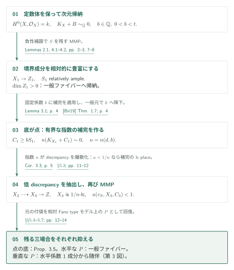
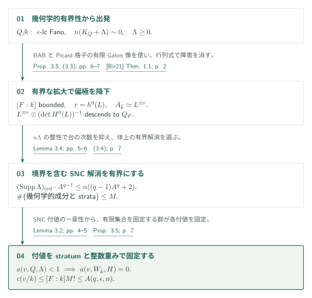
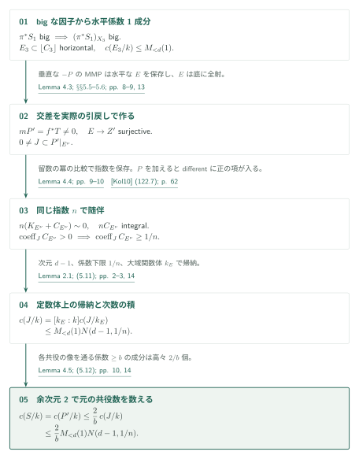

# Log Calabi–Yau対の算術的Stein次数

**原典**: OpenAI, *Arithmetic Stein-degree bounds for log Calabi–Yau pairs*, 2026-09-25版、15ページ。カタログ034内の掲載順12、内部ID `arithmetic-stein-degree`。参照commitは `adc7f1241b42e322a6451854ab7e4b4c146bf78a`。

> AI生成の概説。以下は原稿の主張と証明戦略の紹介であり、証明全体の正しさを認定するものではない。重要な主張・証明は[原論文][SD]で確認されたい。

境界成分の係数を下から抑えると、その成分の定数体の次数を次元と係数下限だけで抑えられる、というのが本稿の主張である。証明はMMPによる次元帰納を骨格とし、幾何学的なFano有界性を算術的な付値の軌道評価へ移す議論と、垂直成分を随伴に乗せる議論を追加する。

## 主要結果

### Theorem 1.1（[SD] p. 1）

整数 $d\ge1$ と実数 $t>0$ を固定する。標数0の任意の体 $k$ 上の射影的lc $\mathbb Q$-対 $(X,B)$ について、$X$ は正規かつ整、$B\ge0$、

$$
\dim X=d,\qquad H^0(X,\mathcal O_X)=k,\qquad K_X+B\sim_{\mathbb Q}0.
$$

と仮定する。$S$ が $\operatorname{coeff}_S B\ge t$ を満たす素成分なら、$k_S$ を $k(S)$ における $k$ の相対代数閉包として、$d,t$ のみで決まる整数 $N(d,t)$ が存在し、

$$
c(S/k):=[k_S:k]\le N(d,t).
$$

特に、正規化 $S^\nu$ に対して

$$
\operatorname{sdeg}(S/\operatorname{Spec}k)
=\dim_kH^0(S,\mathcal O_S)
\le\dim_kH^0(S^\nu,\mathcal O_{S^\nu})=c(S/k)\le N(d,t).
$$

これは通常の対についての点への縮約の場合である。一般化対や任意の相対Stein次数定理まで主張を拡張しない。$t>1$ は空虚であり、係数集合を固定する仮定はない。

### Proposition 3.5（証明の算術的入力、[SD] pp. 6–7）

$q\ge1$、$\epsilon>0$、$n\ge1$ を固定する。$Q/k$ を正規・幾何学的整・射影的な $\epsilon$-lc Fano多様体、$\dim Q=q$ とし、$(Q,\Lambda)$ はlc、$\Lambda\ge0$、$n(K_Q+\Lambda)\sim0$ とする。すると、$a(v,Q,\Lambda)<1$ を満たす任意の因子的付値の定数体次数には、一様上界 $A(q,\epsilon,n)$ がある。付値が $Q$ 上の因子として残る必要はない。

## Theorem 1.1：二度のMMPと場合分け

Lemma 2.1（pp. 2–3）により $c(S/k)$ は幾何学的成分の個数でもあり、双有理不変である。底が幾何学的整なら、水平成分について $c(S/k)\le c(S_\eta/k(Z))$ となる。$H^0(\mathcal O_X)=k$ は、Moriファイバー空間の底および一般ファイバーで、この定数体の取り扱いを可能にする仮定である。

$d=1$ では $\deg B=2$ から $tc(S/k)\le2$。$d\ge2$ では、Lemma 4.1で有効なcrepant境界を持つ $\mathbb Q$-factorial kltモデルへ移り、$0<b=b(t)<t$ を有理数として固定する。Lemma 4.2の $S$ に正なMMPにより $S_1$ を相対的に豊富にする。正次元の底なら $S_1$ は水平で、すぐに一般ファイバーの帰納法へ帰着する。

底が点なら $X_1$ はFanoである。Lemma 3.1は、幾何学的な有界補完を $k$ 上の線形系の一般元として取り直し、$C_1\ge bS_1$、$n(K_{X_1}+C_1)\sim0$ を与える。$n=n(d,b)$ によってdiscrepancyが $\frac1n\mathbb Z$ に入るので、$a(v,X_1,0)<1/n$ の付値はすべて $(X_1,C_1)$ のlc placeである。これらを抽出してから $K$-MMPを実行すると、$\epsilon=1/n$-lcのMoriファイバー空間 $X_3\to Z$ が得られる。$\dim Z=0$ はProposition 3.5、$\dim Z>0$ で元の $S$ の付値を実現する $P$ が水平なら再び一般ファイバーへの帰納で処理する。残る垂直の場合が第3図である（§§5.2–5.4、pp. 11–12）。

## Proposition 3.5：幾何学的有界性を算術的軌道へ移す

BABから得るのは $\bar k$ 上の有界な非常に豊富な束 $L$ であり、直ちに $k$ 上の埋め込みが得られるわけではない。原稿はPicard群を有界階数の格子に埋め込み、その有限Galois像の位数を抑えて、$L$ の類を固定する有界次数拡大 $F/k$ を選ぶ。さらに $r=h^0(L)$ とすると、

$$
L^{\otimes r}\otimes\bigl(\det H^0(L)\bigr)^{-1}.
$$

でスカラーの2-cocycleが相殺され、有界な非常に豊富な束が $Q_F$ に降下する。$n\Lambda$ が整であることから $\operatorname{Supp}\Lambda$ の次数も有界となり、Lemma 3.4の有界な解消を適用できる。

解消上で、境界を含む被約SNC因子を $H$ とする。$a(v,Q,\Lambda)<1$ なら $a(v,W_{\bar k},H)$ は非負整数で1未満なので0である。Lemma 3.2は、この付値が中心stratumと正の整数重みで一意に決まることを示す。したがって、成分とstrataをすべて固定するGalois部分群は各付値を固定する。成分・strataの総数を $M$ とすると軌道は $[F:k]M!$ 以下になる。全付値の個数を有界とする議論ではなく、各軌道の大きさを抑えている（pp. 6–7）。

## 垂直の場合：水平成分との交差から随伴する

最初のMMPで得た $S_1$ のbignessが、ここで再び必要になる。$X_2$ 上の $\pi^*S_1$ は有効かつbigで、$X_3$ へのpushforwardもbigである。正次元の一般ファイバー上で垂直成分だけの因子はbigになれない。$S$ 自身の中心は垂直なので、抽出した例外因子のうち少なくとも一つが水平であり、補完境界の係数は1である。これを $E_3$ とする（§5.5、p. 13）。

Lemma 4.3は、相対Fano typeモデル上で $-P$ のMMPを使い、$mP'=f^*T$（$T$ は非零有効Cartier因子）とする。水平成分 $E$ は残り、$E^\nu\to Z'$ の全射性から $P'|_{E^\nu}\ne0$。その素成分 $J$ は、Lemma 4.4によりdifferent内で係数が少なくとも $1/n$ になる。ここでは随伴後も**同じ**指数 $n$ の主因子関係を保つことが必要で、原稿は有理pluriresidueをその次数で構成して確認する。

$M_{<d}(u)=\max_{1\le r<d}N(r,u)$ と書くと、水平な $E$ の定数体 $k_E$ と、$k_E$ 上の随伴対への帰納から

$$
c(J/k)=[k_E:k]c(J/k_E)
\le M_{<d}(1)N(d-1,1/n).
$$

Lemma 4.5は、余次元2の中心を通る係数 $\ge b$ の幾何学的境界成分数を $2/b$ 以下とする。$P'$ の各幾何学的成分は $J$ の共役の像を含むため、

$$
c(S/k)=c(P'/k)\le\frac2b\,M_{<d}(1)N(d-1,1/n).
$$

従って四つの場合の最大値

$$
N(d,t)\ge\max\left\{M_{<d}(t),M_{<d}(b),A(d,1/n,n),
\frac2b M_{<d}(1)N(d-1,1/n)\right\}.
$$

の整数上界を取ればよい。原境界の分母、体、抽出した因子の個数はこの再帰式に入らない（§§5.6–5.7、pp. 13–14）。

## 外部入力とカタログ内の接続

| 入力 | 本稿での用途・仮定 | 今回の確認 |
|---|---|---|
| [Bir19, Theorem 1.7, arXiv版 p. 4][Bir19] | Lemma 3.1（p. 4）。固定有理数 $b$、Fano type、lc、$-(K+bS)$ nefから有界補完。元の係数集合全体を固定する必要はない。 | 定理の記述と適用を照合。証明全体は未検証。 |
| [Bir21, Theorem 1.1, arXiv版 p. 2][Bir21] | Proposition 3.5（pp. 6–7）。$\epsilon$-lc Fanoの幾何学的有界性。算術的降下は本稿内の追加議論。 | 記述と用途を照合。 |
| [LM26, Corollaries 21.9–21.10, pp. 86–87; Theorem 22.1, p. 87][LM26] | Lemmas 4.1–4.3、§§5.3–5.4。klt MMPの停止と指定付値の抽出。 | 対応する記述を照合。LM26のdiscrepancy $\le0$ は本稿のlog discrepancy $\le1$ に対応。Theorem 11.1のbasepoint-free入力は本稿の引用まで。 |
| Kol10, Definition 122、式(122.7)–(122.10) / [Kol13][Kol13] | Lemma 4.4（pp. 9–10）のdifferentとpluriresidue。 | 本稿の指数保持の計算を読解。外部原典の指定箇所は未照合。 |
| [BMT11][BMT11]、[KM98][KM98] | Lemma 3.4の体上の解消、Lemma 4.5のklt曲面の商表示。 | 本稿の使用箇所を確認。外部定理本文は未照合。 |

カタログ内では、[Uniform log Iitaka][ULI] のTheorem 2.3（p. 5）が本定理を再掲し、Lemma 4.6（pp. 10–11）が $k=\mathbb C(C)$、係数下限1で適用する。水平係数1成分のStein曲線 $C_S\to C$ の次数を抑え、留数後の重み $w\mapsto ew$ の分母を $\operatorname{lcm}(1,\ldots,N(s,1))$ で処理するための直接入力である。この記述と適用箇所を照合した。指数のノルム降下へのその他の接続は今回未調査であり、依存なしとは扱わない。Birkar–Quの手法は背景であって、その主定理を本稿の主定理の入力として矢印にしない。

## 原典と確認範囲

[SD]のTheorem 1.1、Lemmas 2.1–2.2、§§3–5の証明本文（pp. 2–14）を読み、特にProposition 3.5、Lemmas 4.3–4.5、§§5.5–5.7を追った。PDF p. 14で定数体の積、係数 $2/b$、再帰式を画像照合した。日英本文は同じ仮定・数式・図・確認範囲を持つ。

これは帰着と引用の接続の確認である。解消の族の構成、外部の随伴・商特異点定理、すべてのMMP技術を独立に再証明したものではない。原稿は内部参照でLemma / Propositionを “Theorem” と記す箇所があるが、本文見出しに従いLemma 3.1、Proposition 3.5等として引用した。原典リンクは固定commitのGitHub閲覧ページであり、ページは引用ラベルで示す。

[SD]: https://github.com/openai/math/blob/adc7f1241b42e322a6451854ab7e4b4c146bf78a/preprints/Arithmetic-Stein-degree-bounds-for-log-Calabi-Yau-pairs-September-25-2026/paper.pdf
[ULI]: https://github.com/openai/math/blob/adc7f1241b42e322a6451854ab7e4b4c146bf78a/preprints/Uniform-log-Iitaka-fibrations-and-bounded-moduli-denominators-October-4-2026/uniform-log-iitaka.pdf
[Bir19]: https://arxiv.org/pdf/1603.05765v4
[Bir21]: https://arxiv.org/pdf/1609.05543v2
[LM26]: https://arxiv.org/pdf/2209.08732v4
[Kol13]: https://doi.org/10.1017/CBO9781139547895
[BMT11]: https://doi.org/10.4310/AJM.2011.v15.n2.a5
[KM98]: https://doi.org/10.1017/CBO9780511662560
