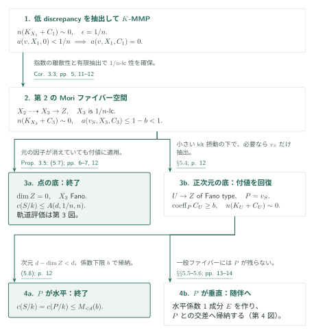

# Arithmetic Stein-degree bounds for log Calabi–Yau pairs

**MMPの次元帰納、付値のGalois軌道、同じ指数での随伴**

境界成分の係数を下から抑えると、その成分の定数体の次数を次元と係数下限だけで抑えられる、というのが本稿の主張である。証明はMMPによる次元帰納を骨格とし、幾何学的なFano有界性を算術的な付値の軌道評価へ移す議論と、垂直成分を随伴に乗せる議論を追加する。

## 1. 主要結果

### Theorem 1.1（[SD] p. 1）

整数 $d\ge1$ と実数 $t>0$ を固定する。標数0の任意の体 $k$ 上の射影的lc $\mathbb Q$-対 $(X,B)$ について、$X$ は正規かつ整、$B\ge0$、

$$
\dim X=d,\qquad H^0(X,\mathcal O_X)=k,\qquad K_X+B\sim_{\mathbb Q}0.
$$

と仮定する。$S$ が $\operatorname{coeff}_S B\ge t$ を満たす素成分なら、$k_S$ を $k(S)$ における $k$ の相対代数閉包として、$d,t$ のみで決まる整数 $N(d,t)$ が存在し、

$$
c(S/k):=[k_S:k]\le N(d,t).
$$

特に、正規化 $S^\nu$ に対して

$$
\operatorname{sdeg}(S/\operatorname{Spec}k)
=\dim_kH^0(S,\mathcal O_S)
\le\dim_kH^0(S^\nu,\mathcal O_{S^\nu})=c(S/k)\le N(d,t).
$$

これは通常の対についての点への縮約の場合である。一般化対や任意の相対Stein次数定理まで主張を拡張しない。$t>1$ は空虚であり、係数集合を固定する仮定はない。

[Theorem 1.1 · p. 1][SD]

### Proposition 3.5（証明の算術的入力、[SD] pp. 6–7）

$q\ge1$、$\epsilon>0$、$n\ge1$ を固定する。$Q/k$ を正規・幾何学的整・射影的な $\epsilon$-lc Fano多様体、$\dim Q=q$ とし、$(Q,\Lambda)$ はlc、$\Lambda\ge0$、$n(K_Q+\Lambda)\sim0$ とする。すると、$a(v,Q,\Lambda)<1$ を満たす任意の因子的付値の定数体次数には、一様上界 $A(q,\epsilon,n)$ がある。付値が $Q$ 上の因子として残る必要はない。

[Proposition 3.5 · pp. 6–7][SD]

## 図の矢印に付した引用

略号なしの結果番号は本原稿 [SD] を指す。外部入力は [Bir19]（有界補完）、[Bir21]（BAB）、[LM26]（MMP・抽出）、[Kol10]（differentと留数）と表す。定理の記述・適用と、その証明全体の確認は末尾で区別する。

- [Bir19, Theorem 1.7 · arXiv v4][Bir19] / [Bir21, Theorem 1.1 · arXiv v2][Bir21]
- [LM26, arXiv v4][LM26]
- [Kol10, Canonical models · 2010年6月1日稿][Kol10]

## 2. Theorem 1.1の証明：最初のMMP

次元について、すべての正の係数下限を同時に帰納する。$d=1$ は $\deg B=2$ から $tc(S/k)\le2$ で終わる。以下 $d\ge2$ とし、$M_{<d}(u)=\max_{1\le r<d}N(r,u)$、有理数 $0<b=b(t)<t$ を固定する。最初のMMPでは、$S$ を残して相対的に豊富にする。

### 1. 定数体を保ち、境界成分を残す

Lemma 2.1は $c(S/k)$ を幾何学的成分数と同一視するので、同じ因子的付値を追う双有理操作で次数は変わらない。Lemma 4.1により有効なcrepant境界を持つ $\mathbb Q$-factorial kltモデルへ移る。そこで $K+B-bS\sim_{\mathbb Q}-bS$ のMMPを行うと、各極射線で $S$ が正であり、負性補題が $S$ の縮約を防ぐ。得られる $X_1\to Z_1$ では $S_1$ が相対的に豊富で、元の係数下限 $t$ が残る。

[Lemmas 2.1, 4.1–4.2 · pp. 2–3, 7–8][SD]

### 2. 底が正次元なら、低次元の一般ファイバーで終える

$\dim Z_1>0$ のとき、相対的に豊富な $S_1$ は水平である。縮約の一般ファイバーは $k(Z_1)$ 上で大域関数体が $k(Z_1)$ となり、次元 $r=d-\dim Z_1<d$、係数下限 $t$ のlc log Calabi–Yau対である。帰納仮定と水平成分の定数体比較から $c(S/k)\le M_{<d}(t)$。この枝では補完も第2のMMPも不要となる。

[Lemma 2.1; §5.2, (5.3) · pp. 2–3, 11][SD]

### 3. 底が点なら、有界指数の補完を選ぶ

$Z_1=\operatorname{Spec}k$ の場合は $X_1$ がFanoで、$-(K_{X_1}+bS_1)$ がnefである。Lemma 3.1は固定係数 $b$ に有界補完を適用し、体 $k$ 上の線形系の一般元を用いて、lc境界 $C_1\ge bS_1$ と $n(K_{X_1}+C_1)\sim0$ を与える。選択順は $b=b(t)$、次に $n=n(d,b)$。元の境界の係数分母に依存させず、この $n$ で特異点を制御するのが次の段階である。

[Lemma 3.1; §5.2, (5.4) · pp. 4, 11][SD] · [Bir19, Theorem 1.7 · p. 4][Bir19]

## 3. Theorem 1.1の証明：第2のMMPの三つの出口

$\epsilon=1/n$ と置く。低discrepancyの付値を先に抽出してから $K$-MMPを行い、$\epsilon$-lcのMoriファイバー空間を得る。元の $S$ がこの途中で因子として残らなくても、付値 $v_S$ を追うことで次の三場合に分けられる。

### 1. 指数による離散性を、特異点の一様下界へ変える

Corollary 3.3により $a(v,X_1,0)<1/n$ の付値は有限個である。補完に対するlog discrepancyは非負かつ $\frac1n\mathbb Z$ に属し、元のもの以下なので、これらはすべてlc placeである。正確にこれらを抽出した $X_2$ は $1/n$-lcとなり、抽出因子は $C_2$ の係数1成分になる。$K$-MMP後も $X_3$ は $1/n$-lcで、同じ指数のlc補完と $a(v_S,X_3,C_3)\le1-b<1$ が残る。

[Corollary 3.3; §5.3, (5.5)–(5.6) · pp. 5, 11–12][SD]

### 2. 底が点なら、付値の軌道評価で終える

$\dim Z=0$ なら $X_3$ は $1/n$-lc Fanoである。従ってProposition 3.5を $q=d$、$\epsilon=1/n$、境界 $C_3$ に適用して、$c(S/k)\le A(d,1/n,n)$ を得る。適用対象は $a(v_S,X_3,C_3)<1$ を満たす付値なので、$S$ の狭義変換が既に縮約されていてもよい。その算術的議論は第4節に分けて説明する。

[Proposition 3.5; §5.3, (5.7) · pp. 6–7, 12][SD]

### 3. 底が正次元なら、元の付値を因子として回復する

$\dim Z>0$ の場合、$\Gamma=(1-\lambda)C_3$ を小さい $\lambda>0$ で選ぶとkltとなり、反対数標準因子は相対的に豊富である。$v_S$ が例外的ならそれだけを抽出し、既に因子ならそのまま使う。得られる相対Fano typeモデル $U\to Z$ 上の素因子 $P$ は $c(P/k)=c(S/k)$ と係数下限 $b$ を持ち、$n(K_U+C_U)\sim0$ も保たれる。

[§5.4 · p. 12][SD] · [LM26, Theorem 22.1 · p. 87][LM26]

### 4. 水平なら帰納法、垂直なら随伴へ進む

$P$ が水平なら、次元 $d-\dim Z<d$ の一般ファイバーで係数下限 $b$ の帰納仮定を使い、$c(S/k)\le M_{<d}(b)$ を得る。$P$ が垂直なら一般ファイバーから $P$ が消えるため、この帰納は適用できない。第5節で別の水平係数1成分を作り、その正規化上に $P$ の交差を移す。

[§5.4, (5.8); §§5.5–5.6 · pp. 12–14][SD]

## 4. Proposition 3.5の証明：幾何学的有界性から算術的軌道へ

BABが与える幾何学的な有界性を、体 $k$ 上の付値の定数体次数へ変える必要がある。偏極を有界拡大で降下し、有界なSNC解消上でGalois群が作用する有限集合を作る。

### 1. 有界拡大で偏極の降下障害を消す

BABから $\bar k$ 上の有界な非常に豊富な束 $L$ を選ぶ。原稿はPicard群を有界階数の格子に埋め込み、有限Galois像の位数を抑えて、$L$ の類を固定する有界次数拡大 $F/k$ を得る。類が固定されるだけでは束の降下は終わらない。$r=h^0(L)$ とすると、次の行列式因子がスカラーの2-cocycleを相殺し、有界な非常に豊富な束 $A$ を $Q_F$ 上に与える。

$$
L^{\otimes r}\otimes\bigl(\det H^0(L)\bigr)^{-1}.
$$

[Proposition 3.5, (3.3) · pp. 6–7][SD] · [Bir21, Theorem 1.1 · p. 2][Bir21]

### 2. 境界の台を含む解消を有界にする

$n\Lambda$ の整性と $n(K_Q+\Lambda)\sim0$ を使うと、$A$ に関する境界の台の次数も有界になる。Lemma 3.4をこの埋込みと境界の台に適用し、$F$ 上の解消と、境界を含む被約SNC因子 $H$ を選ぶ。幾何学的な成分とstrataの総数を一様な $M$ で抑えることが、次の群作用の有限性に必要である。

[Lemma 3.4; Proposition 3.5, (3.4) · pp. 5–7][SD]

### 3. 成分とstrataを固定して各付値を固定する

$a(v,Q,\Lambda)<1$ なら、解消上の $a(v,W_{\bar k},H)$ は非負整数で1未満なので0である。Lemma 3.2により、その付値は中心stratumと正の整数重みで一意に定まる。従って有限集合の全要素を固定するGalois部分群は各付値も固定し、軌道は $[F:k]M!\le A(q,\epsilon,n)$ 以下になる。全付値の個数を抑える必要はない。

[Lemma 3.2; Proposition 3.5 · pp. 4–5, 7][SD]

## 5. Theorem 1.1の証明：垂直成分を随伴に乗せる

第2のMMPの垂直の場合を扱う。目標は、係数1の水平成分 $E$ 上に $P$ の非零な交差 $J$ を作り、$E$ と $J$ の二つの低次元評価を合わせて $P$ の共役数へ戻すことである。

### 1. 以前のbignessから水平係数1成分を取り出す

$S_1$ はFano多様体 $X_1$ 上で豊富なので、$X_2$ 上の $\pi^*S_1$ は有効かつbigである。因子を抽出しない $X_2\dashrightarrow X_3$ へのpushforwardも切断の増大度を保ち、bigとなる。正次元の一般ファイバーに制限すると、垂直成分だけではbigになれない。一方、元の $S$ の中心は垂直である。従って水平成分 $E_3$ は抽出した例外因子から来て、$C_3$ 内の係数は1である。一般ファイバーの帰納法をこの成分に適用し、$c(E_3/k)\le M_{<d}(1)$ を得る。

[§5.5, (5.9)–(5.10) · p. 13][SD]

### 2. 相対MMPで水平成分との非零な交差を作る

相対Fano typeモデル $U$ 上で $P$ は垂直なので、$-P$ は相対的に擬有効である。Lemma 4.3のbig境界を用いるMMPは $P$ と水平な $E$ を残し、basepoint-free定理から $-P'$ の半豊富性を得る。対応する縮約 $f:U'\to Z'$ では $Z'\to Z$ が双有理で、標準切断の降下により実際の因子として $mP'=f^*T$、$T\ne0$ 有効Cartierとなる。$E$ は固有かつ水平なので $Z'$ に全射し、$P'|_{E^\nu}\ne0$。その素成分を $J$ とする。

[Lemma 4.3; §5.6 · pp. 8–9, 13][SD]

### 3. 留数で同じ指数を保ち、正の係数を離散化する

$(U',C')$ は有効lc対で、$E$ の係数は1、$P'$ の係数は $\beta\ge b$、かつ $n(K_{U'}+C')\sim0$ である。Lemma 4.4は正規化上に有効lc differentを与え、同じ $n$ について $n(K_{E^\nu}+C_{E^\nu})\sim0$ を示す。本稿の追加論証は、$k$ 上で有理 $n$-標準形式の留数を取り、十分可除な冪での因子等式を $n$ の次数へ戻す点にある。

[Kol10]の(122.7)はこの比較に使う留数同型である。(122.10)は $K+E$ 自体の $\mathbb Q$-Cartier性も仮定するため、それだけで一般の場合を済ませない。本稿は $\beta P'$ を除いた対と加えた対の留数を共通Cartier倍で比較して $C_{E^\nu}\ge\beta P'|_{E^\nu}$ を得る。従って $J$ の係数は正で、$nC_{E^\nu}$ の整性から少なくとも $1/n$ となる。

[Lemma 4.4, (4.2) · pp. 9–10][SD] · [Kol10, Definition 122, Proposition 123, Lemma 125 · pp. 61–64][Kol10]

### 4. 自身の定数体上で帰納し、次数を掛ける

$k_E$ を $E^\nu$ の定数体とする。Lemma 2.1により $E^\nu/k_E$ は正規・幾何学的整で、$H^0(\mathcal O_{E^\nu})=k_E$。有限分離拡大で標準因子は変わらないので、次元 $d-1$、係数下限 $1/n$ の帰納仮定を随伴対に適用できる。$k_E\subset k(J)$ と前段の水平成分の評価を合わせると、

$$
c(J/k)=[k_E:k]c(J/k_E)
\le M_{<d}(1)N(d-1,1/n).
$$

[Lemma 2.1; §5.6, (5.11) · pp. 2–3, 13–14][SD]

### 5. 余次元2で数え、元の成分数へ戻す

$\bar k$ 上で $J$ の一成分の像は $U'$ 内の余次元2の部分多様体である。$P'$ の幾何学的成分は一つのGalois軌道をなし、それぞれが $J$ の共役の像を含む。Lemma 4.5は各像を通る係数 $\ge b$ の成分数を $2/b$ 以下とする。これはklt曲面の商表示へ切り下げ、滑らかな被覆上の点のblow-upで境界の重複度を2以下とする議論である。よって

$$
c(S/k)=c(P'/k)\le\frac2b\,M_{<d}(1)N(d-1,1/n).
$$

[Lemma 4.5; §5.6, (5.12) · pp. 10, 14][SD]

### 6. 四つの上界をまとめて帰納法を閉じる

最初の正次元の底、二度目の点の底、水平な $P$、垂直な $P$ の各評価をまとめ、次を満たす整数を選べばよい。

$$
N(d,t)\ge\max\left\{M_{<d}(t),M_{<d}(b),A(d,1/n,n),
\frac2b M_{<d}(1)N(d-1,1/n)\right\}.
$$

先に $b=b(t)$、次に $n=n(d,b)$ を固定し、右辺の $N$ はすべて低次元で既知である。原境界の分母、基礎体、抽出した因子の個数は定数の依存先に入らない。

[§5.7, (5.13) · p. 14][SD]

## 6. どの論文が、どの段階を担うか

| 入力 | 本稿での用途・仮定 | 今回の確認 |
|---|---|---|
| [Bir19, Theorem 1.7, arXiv版 p. 4][Bir19] | Lemma 3.1（p. 4）。固定有理数 $b$、Fano type、lc、$-(K+bS)$ nefから有界補完。元の係数集合全体を固定する必要はない。 | 定理の記述と適用を照合。証明全体は未検証。 |
| [Bir21, Theorem 1.1, arXiv版 p. 2][Bir21] | Proposition 3.5（pp. 6–7）。$\epsilon$-lc Fanoの幾何学的有界性。算術的降下は本稿内の追加議論。 | 記述と用途を照合。 |
| [LM26, Corollaries 21.9–21.10, pp. 86–87; Theorem 22.1, p. 87][LM26] | Lemmas 4.1–4.3、§§5.3–5.4。klt MMPの停止と指定付値の抽出。 | 対応する記述を照合。LM26のdiscrepancy $\le0$ は本稿のlog discrepancy $\le1$ に対応。Theorem 11.1のbasepoint-free入力は本稿の引用まで。 |
| [Kol10, Definition 122、式(122.7)–(122.10)、Proposition 123、Lemma 125, pp. 61–64][Kol10] | Lemma 4.4（pp. 9–10）のdifferentとpluriresidue。 | 2010年6月1日稿の記述・適用を再照合。同じ指数の保持と一成分を加える比較は本稿の追加論証。外部の全証明は未検証。 |
| [BMT11][BMT11]、[KM98][KM98] | Lemma 3.4の体上の解消、Lemma 4.5のklt曲面の商表示。 | 本稿の使用箇所を確認。外部定理本文は未照合。 |

カタログ内では、[Uniform log Iitaka][ULI] のTheorem 2.3（p. 5）が本定理を再掲し、Lemma 4.6（pp. 10–11）が $k=\mathbb C(C)$、係数下限1で適用する。水平係数1成分のStein曲線 $C_S\to C$ の次数を抑え、留数後の重み $w\mapsto ew$ の分母を $\operatorname{lcm}(1,\ldots,N(s,1))$ で処理するための直接入力である。この記述と適用箇所を照合した。指数のノルム降下へのその他の接続は今回未調査であり、依存なしとは扱わない。Birkar–Quの手法は背景であって、その主定理を本稿の主定理の入力として矢印にしない。

## 7. 原典を読む入口と確認範囲

[SD]のTheorem 1.1、Lemmas 2.1–2.2、§§3–5の証明本文（pp. 2–14）を読み、特にProposition 3.5、Lemmas 4.3–4.5、§§5.5–5.7を追った。PDF p. 14で定数体の積、係数 $2/b$、再帰式を画像照合した。今回の改訂では二度のMMPの各分岐と垂直成分の接続を再照合し、[Kol10] pp. 61–64の留数構成・有効性・discrepancy比較の記述を確認した。日英本文は同じ仮定・数式・図・確認範囲を持つ。

これは帰着と引用の接続の確認である。解消の族の構成、外部の随伴・商特異点定理、すべてのMMP技術を独立に再証明したものではない。原稿は内部参照でLemma / Propositionを “Theorem” と記す箇所があるが、本文見出しに従いLemma 3.1、Proposition 3.5等として引用した。原典リンクは固定commitのGitHub閲覧ページであり、ページは引用ラベルで示す。

[SD]: https://github.com/openai/math/blob/adc7f1241b42e322a6451854ab7e4b4c146bf78a/preprints/Arithmetic-Stein-degree-bounds-for-log-Calabi-Yau-pairs-September-25-2026/paper.pdf
[ULI]: https://github.com/openai/math/blob/adc7f1241b42e322a6451854ab7e4b4c146bf78a/preprints/Uniform-log-Iitaka-fibrations-and-bounded-moduli-denominators-October-4-2026/uniform-log-iitaka.pdf
[Bir19]: https://arxiv.org/pdf/1603.05765v4
[Bir21]: https://arxiv.org/pdf/1609.05543v2
[LM26]: https://arxiv.org/pdf/2209.08732v4
[Kol13]: https://doi.org/10.1017/CBO9781139547895
[BMT11]: https://doi.org/10.4310/AJM.2011.v15.n2.a5
[KM98]: https://doi.org/10.1017/CBO9780511662560

[Kol10]: https://web.math.princeton.edu/~kollar/book/chap2.pdf#page=61
