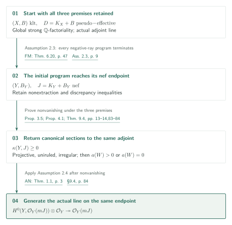
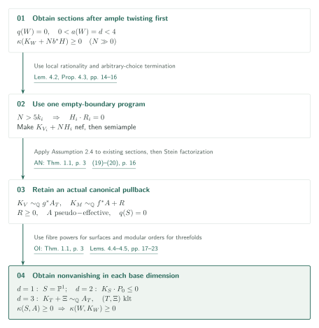
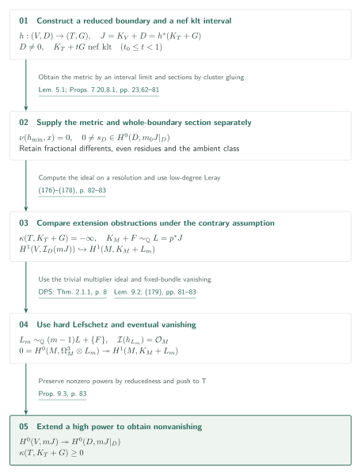
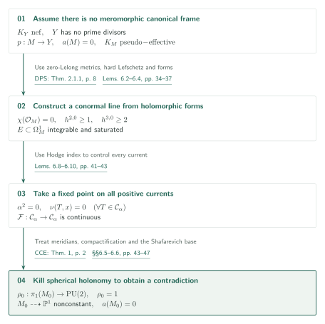

# Conditional good models for Kähler fourfolds: obtaining a first section on the nef endpoint

Catalog 034, item 03 / Internal ID: `conditional-kahler-fourfolds`

Source: OpenAI, *Conditional good minimal models for compact Kähler fourfolds*, October 5, 2026, 138 pages; [fixed PDF][C]. Page references agree with PDF pagination. This AI-generated exposition distinguishes the manuscript's conditional assertions from the editorial checks recorded below. Consult the source for mathematical use.

## Theorems 1.1–1.2: return nonvanishing to the specified nef endpoint

**Assumptions 2.2, 2.3 and 2.4 are all retained.** [Theorem 1.1, p.4][C] concerns a normal connected compact Kähler fourfold $X$ and an effective rational Weil divisor $B$ such that $(X,B)$ is klt. The space is globally strongly $\mathbb Q$-factorial, and the actual adjoint $D=K_X+B$ is $\mathbb Q$-Cartier and analytically pseudo-effective.

The conclusion is a normal connected globally strongly $\mathbb Q$-factorial compact Kähler fourfold $Y$ and a bimeromorphic map $\phi:X\dashrightarrow Y$ such that:

1. $\phi$ extracts no prime divisor and $B_Y=\phi_*B$.
2. $(Y,B_Y)$ is klt, and the actual $\mathbb Q$-Cartier adjoint $D_Y=K_Y+B_Y$ is analytically nef.
3. Every prime divisor over the models satisfies $a(E;Y,B_Y)\geq a(E;X,B)$, strictly for primes on $X$ contracted by $\phi$.
4. Some $mD_Y$ is Cartier and $\mathcal O_Y(mD_Y)$ is globally generated.

There is no uniform bound on $m$. Global strong $\mathbb Q$-factoriality in Definition 2.1, p.7, means that **every coherent rank-one reflexive sheaf on the whole space has an invertible positive reflexive power**. It is not replaced by local analytic $\mathbb Q$-factoriality. Likewise, $\sim_{\mathbb Q}$ denotes an actual holomorphic line-bundle isomorphism after taking powers; equality of Bott–Chern classes is insufficient.

Under the same three premises, [Theorem 1.2, p.4][C] asserts $\kappa(Y,J)\geq0$ for an ordinary klt pair $(Y,\Delta)$ on a normal connected globally strongly $\mathbb Q$-factorial compact Kähler fourfold, with $\Delta$ effective and rational and actual $\mathbb Q$-Cartier adjoint $J=K_Y+\Delta$ analytically nef. Apply this theorem to the pair produced by the initial MMP, then apply Assumption 2.4.

Assumption 2.3 already gives properties (i)–(iii), but gives no section. Section 3 handles the projective, uniruled and irregular cases, reducing to canonical nonvanishing on a smooth non-uniruled, non-Moishezon fourfold $W$ with $q(W)=0$. Proposition 4.1 treats $a(W)>0$ and Theorem 9.4 treats $a(W)=0$. Push the canonical section from $W$ to $Y$ and multiply by the effective boundary section to obtain a section of **the original nef pair's $J$**. The final semiampleness assertion applies Assumption 2.4 to that same $J$. [Proposition 3.5, pp.13–14; §9.4, p.84][C]

## The three premises that must be retained

| Premise | Required scope | Supplier and check |
|---|---|---|
| Assumption 2.2, pp.7–8 | Full orbifold Iitaka subadditivity in arbitrary dimensions, Fujiki class $\mathcal C$, rational SNC coefficients in $[0,1]$, holomorphic surjections with connected fibres | OI, catalog 033, Thm.1.1 p.3 and invariant-base definitions pp.2–3 compared; proof unchecked |
| Assumption 2.3, pp.8–9 | A program starting on the specified pseudo-effective ordinary klt fourfold, permitting any negative extremal ray and continuation after every finite prefix, with termination of every such program | FM, catalog 056, Thm.6.20 p.47; Prop.3.4 pp.12–14; Lem.3.2 p.11 and relevant proof passages compared; full termination proof unchecked |
| Assumption 2.4, p.9 | Generation of an actual nef $\mathbb Q$-Cartier klt adjoint once $\kappa\geq0$; no strong factoriality requirement | AN, item 14 of catalog 034, Thm.1.1 p.3 compared; a first section is a hypothesis |

The inequality in Assumption 2.2 is
\[
\kappa(Z,K_Z+\Gamma)\geq
\kappa(F,K_F+\Gamma|_F)+\kappa(g\mid\Gamma).
\]
It uses the invariant in equations (2)–(5), rather than the orbifold divisor of an arbitrary base model:
$m(g,\Gamma;P)=\min_{E\mapsto P}\{\operatorname{ord}_E(g^*P)/(1-\gamma_E)\}$ and
$B(g,\Gamma)=\sum_P(1-1/m(g,\Gamma;P))P$, followed by the infimum of $\kappa(K_S+B)$ over the stipulated orbifold-model equivalence class. Coefficient one means infinite multiplicity. Existence of suitable neat models and computation there are included. The fibre powers in §4 require dimensions larger than four. [pp.7–8,18][C] [OI pp.2–3][OI]

Assumption 2.3 inserts no initial modification. It requires a nef supporting class with a Kähler margin, projective bimeromorphic contractions with connected fibres, negative-side relative Bott–Chern dimension one, and, for small contractions, the relative analytic Proj of the actual canonical algebra. It preserves klt singularities, the Kähler and global strong categories, and pseudo-effectivity, with nonextraction and discrepancy comparison. It does not grant all non-pseudo-effective, dlt or generalized-pair programs. Comparing the suppliers' statements does not turn this exposition into an unconditional certification of the three premises.

## Positive algebraic dimension: construct an actual canonical pullback

In the projective branch, Lemma 3.1 derives logarithmic Iitaka subadditivity from Assumption 2.2 and applies the manuscript's Theorem A.2, p.85. Appendices A–I prove that conditional projective abundance statement; it is not another independent premise. The uniruled branch uses the rational quotient, and the irregular branch the Albanese map, with nonvanishing in dimension at most three. [Ou Theorem 1.1, p.1][Ou] relates non-uniruledness to canonical pseudo-effectivity for smooth compact Kähler manifolds. [§3, pp.10–14][C]

For $0<a(W)=d<4$, resolve algebraic reduction and choose a very ample $H$ on its projective base $S_0$. Lower-dimensional fibre nonvanishing and ample twisting first give $\kappa(K_W+Nb^*H)\geq0$ for every sufficiently large integer $N$. At each stage choose $N>5k_i$, where $k_i$ is the current canonical Cartier index. Local rationality forces $H_i\cdot R_i=0$ for a ray negative for $K_{V_i}+NH_i$, so its step also belongs to a single empty-boundary $K$-program. Rechoosing $N$ does not change that program's boundary. Arbitrary termination and Assumption 2.4 make the twist semiample; Stein factorization yields actual line-bundle identities
\[
K_V\sim_{\mathbb Q}g^*A_T,\qquad
K_M\sim_{\mathbb Q}f^*A+R,\quad R\geq0.
\]
Here $S\to T$ is a smooth projective resolution, $A$ is the pullback of $A_T$, $q(S)=0$, and $A$ is pseudo-effective. [Proposition 4.3, pp.15–16][C]

For $d=1$, $S=\mathbb P^1$. For $d=2$, apply Assumption 2.2 to $r$-fold fibre powers over a curve. Fix the local form $t=x^e$ and the exceptional coefficient $h$ before varying $r$; the base coefficient has pole bound $mrh/e$. Letting $r\to\infty$ gives
\[
\left(A-K_S+\sum_{P\ {\rm exceptional}}c_PP\right)\cdot H'\geq0
\]
(Lemma 4.4, pp.17–19). For the Zariski decomposition $A=P_0+N_0$, the remaining case $P_0^2=0$ gives $K_S\cdot P_0\leq0$; Riemann–Roch and $q(S)=0$ then produce sections.

For $d=3$, the generic fibre has genus one. Identify its Hodge line by
$\mathcal H^{\otimes m}\simeq\mathcal O_S(m(A-K_S))$, and use the modular sections $E_4^{m/4}$ and $\Delta_{\rm mod}^{m/12}$ with $12\mid m$. Their common divisorial order $\ell_P$ satisfies $\ell_P/m=1-t_P$, where
\[
t_P=\min_{E\mapsto P}\frac{1+\operatorname{coeff}_E R}
{\operatorname{ord}_E(f^*P)}.
\]
The integrability calculation proves this **on every required model, including exceptional base valuations**. A general linear combination supplies an effective $\Xi$ on the original normal base $T$ such that $(T,\Xi)$ is klt and $K_T+\Xi\sim_{\mathbb Q}A_T$. No separate $\mathbb Q$-Cartier hypothesis on $K_T$ is imposed. Projective threefold nonvanishing supplies the section to pull back. [Lemma 4.5 and §4.4, pp.19–23][C]

## Algebraic dimension zero: extension from the whole reduced boundary

Work on smooth models with $a=q=0$. Lemma 9.1, p.81, gives finitely many prime divisors with linearly independent real cohomology classes. If $\kappa(M,L)=-\infty$, then every fixed vector bundle $\mathcal E$ satisfies
$H^0(M,\mathcal E\otimes\mathcal O_M(mL))=0$ for all sufficiently large divisible $m$ (Lemma 9.2, pp.81–82). Take determinants of sections of maximal generic rank and compare their nonnegative integral coefficients on the finite set of primes. No global meromorphic frame is assumed at the start.

Proposition 7.20, pp.62–65, takes a reduced-boundary pair $(T_0,G_0)$ to a nonextracting model $(T,G)$ with
\[
A=K_T+G\ {\rm nef},\qquad
K_T+tG\ {\rm nef\ and\ klt}\quad(t_0\leq t<1),
\]
and a projective crepant dlt modification
$h:(V,D)\to(T,G)$ with $J=K_V+D=h^*A$. It uses the special-termination arguments of §7 and reduction to ordinary klt programs; it does not add fourfold dlt termination to the premises. Apply the zero-Lelong minimal-metric Lemma 5.1, p.23, inside this interval, add $(1-t)G$, and let $t\to1$ to obtain a zero-Lelong metric on the pullback of $J$.

Lemma 5.1 is proved analytically in §5. Volume-normalized capacity, differentiation of a Monge–Ampère equation and a Bochner estimate retaining its residual term are combined. Equation (89) cancels the residual measure on the same sublevel set; after taking the limit at fixed $t$, the Lelong upper bound (90) contradicts the positive lower bound (93). [pp.25–33][C] This is not a direct application of the projective MM theorem to a nonprojective space.

Proposition 8.1, pp.65–81, gives $H^0(D,\mathcal O_D(mJ))\ne0$ when $D\ne0$. Full differents, including fractional coefficients, are retained on the normalization components. [Das–Ou Corollary 1.3, p.4][DO] supplies their semiample systems, but componentwise abundance alone does not glue sections. Choose components with maximal system dimension; match even residues on clusters of dominant conductor branches and arrange vanishing on nondominant branches. Lemma 8.4 multiplies all transported sections under a finite loop action, preserving nonzeroness and the required zeros.

For a nonprojective torsion cluster, transport **one ambient Kähler class on $V$** to the relevant surfaces. For the cycle automorphism $\varphi$ and a class $v$ of positive square, the construction gives
$\varphi^*v-v\in\operatorname{NS}(Q)_{\mathbb R}$. Hodge index and integral lattice actions make the top-form multiplier a root of unity, permitting matching after a common power. This does not assert finite characters for arbitrary automorphisms of Kähler surfaces. [Lemma 8.9, pp.73–74][C] Extend by zero on other clusters, and descend to the entire $D$ by codimension-one matching and $S_2$. [Lemma 8.2 and §8.6, pp.66–67,81][C]

Proposition 9.3 assumes $\kappa(T,A)=-\infty$ to kill the extension obstruction. On $p:M\to V$, write $K_M+F\sim_{\mathbb Q}L=p^*J$, where $F$ has SNC support and coefficients at most one, allowing negative coefficients. The key comparisons are
\[
p_*\mathcal O_M(mL-\lfloor F\rfloor)
=\mathcal I_D\otimes\mathcal O_V(mJ),
\]
\[
H^1(V,\mathcal I_D(mJ))
\hookrightarrow H^1(M,K_M+L_m),\qquad
L_m\sim_{\mathbb Q}(m-1)L+\{F\}.
\]
The injection is low-degree Leray and needs no higher-direct-image vanishing. Zero Lelong numbers and the integrability margin of $\{F\}$ make the multiplier ideal trivial. [DPS hard Lefschetz][DPS] gives
$H^0(M,\Omega_M^3\otimes L_m)\twoheadrightarrow H^1(M,K_M+L_m)$.
Lemma 9.2 kills the source. High powers of the nonzero section on the whole reduced $D$ therefore extend to $V$, contradicting the assumption. [Equations (176)–(179), pp.82–83][C]

## Finish by separating the existence of a canonical frame

Theorem 9.4, pp.83–84, separates the existence of a nonzero meromorphic pluricanonical tensor from its absence. In the latter case, include every prime in $G_0$ and use Proposition 7.20. A nonzero $G$ would supply a section that, after dividing out divisor factors, gives the prohibited tensor. Thus $G=0$, leaving a model with no prime divisors and nef canonical line; Proposition 6.1 excludes it.

Proposition 6.1 starts with a zero-Lelong metric and DPS to obtain $\chi(\mathcal O_M)=0$, $h^{2,0}\geq1$ and $h^{3,0}\geq2$. Two- and three-forms produce an integrable saturated conormal line. Hodge index for positive currents gives $\alpha^2=0$ and, under the contradiction hypothesis, zero Lelong numbers for **every** positive current in $\alpha$. This permits a continuous self-map of the full compact convex set of positive currents. Its fixed point supplies a transverse spherical structure. [§§6.1–6.4, pp.34–43][C]

Index charts give finite holonomy for boundary meridians. A Selberg cover and compactification produce a torsion-free $\operatorname{PU}(2)$ representation. In the Zariski-dense case, the projective Shafarevich base from [Campana–Claudon–Eyssidieux Theorem 1, p.2][CCE] contradicts $a=0$. A proper closure is virtually solvable; $q=0$ on every finite étale cover makes the image finite and hence trivial. Extending the developing map meromorphically by local charts and trace produces a nonconstant function, again contradicting $a=0$. [§§6.5–6.6, pp.43–47][C]

If a meromorphic frame exists, write $K_{T_0}\sim_{\mathbb Q}P-N$, with $P,N\geq0$ and disjoint supports, and use $G_0=(\operatorname{Supp}P)_{\rm red}$. If $G=0$, pseudo-effectivity forces $N_T=0$. Otherwise the boundary-extension section and uniqueness of its meromorphic divisor when $a(T)=0$ give the same conclusion. Run the MMP on $(T,0)$ and use Assumption 2.4 to make the canonical line actually torsion. On a resolution, the signed exceptional divisor is effective by the support of a positive current and independence of prime classes. This returns canonical nonvanishing to the smooth model. [Equations (180)–(181), p.84][C]

## Inputs, sources and scope

| Result | Use | Check performed |
|---|---|---|
| [OI Thm.1.1, p.3][OI] | Assumption 2.2, §§3–4, Lemmas 6.2 and 8.3: subadditivity with invariant orbifold base | Statement, base definition and stated uses compared; neat-model theory and input proof unchecked |
| [FM Thm.6.20, p.47; Prop.3.4, pp.12–14][FM] | Assumption 2.3, Props.4.3 and 7.20, §9.4 | Arbitrary-ray termination, canonical algebra and preservation of the global strong condition compared; full termination dependencies outside scope |
| [AN Thm.1.1, p.3][AN] | Assumption 2.4, Prop.4.3, Thm.9.4 and final step of Thm.1.1 | Applications after obtaining $\kappa\geq0$ compared; AN proof outside scope |
| [Ou Thm.1.1, p.1][Ou] | Prop.3.5 and §8: smooth Kähler canonical pseudo-effectivity | Specified v1 statement compared |
| [DO Cor.1.3, p.4][DO] | Lemma 8.3: semiample systems on normal threefold components | Specified v4 statement compared; companion dlt-modification theorem not compared |
| [DPS hard Lefschetz][DPS] | Lemma 6.3 and Prop.9.3: twisted forms surject onto cohomology | Compared in arXiv v2, unnumbered introductory theorem p.2 / Thm.2.1.1 p.8; target cites published Thm.0.1 |
| [CCE Thm.1, p.2][CCE] | Lemma 6.13: projective base for semisimple holonomy | arXiv v3 statement and torsion-free condition compared |

Source commit: `adc7f1241b42e322a6451854ab7e4b4c146bf78a`. SHA-256: `ac000b352a0abe8e1a2dfd99bef21dcbf232fae995e2395048a528c02157270c`. The [source record](sources.json) stores versions, pages and checks; the [work record](status.md) records completion.

Reading covered the main statements, three premises, §3 reductions, §4 pullback and base calculations, principal capacity/residual passages in §5, principal forms/Hodge/fixed-point/holonomy passages in §6, Proposition 7.20, clusters and the ambient class in §8, and all of §9. It did not verify all relative finite-generation, extraction and special-termination arguments in §7, every projective cluster case in §8, or Appendices A–I in full. All metric limit operations, singular-chart extensions, and original inputs such as Fujino's local rationality and relative analytic MMP have not been independently checked. These are unverified steps, not absent dependencies or discharged conditions.

[C]: https://github.com/openai/math/blob/adc7f1241b42e322a6451854ab7e4b4c146bf78a/preprints/Conditional-good-minimal-models-for-compact-Kahler-fourfolds-October-5-2026/paper.pdf
[OI]: https://github.com/openai/math/blob/adc7f1241b42e322a6451854ab7e4b4c146bf78a/preprints/Orbifold-and-logarithmic-Iitaka-subadditivity-September-26-2026/paper.pdf
[FM]: https://github.com/openai/math/blob/adc7f1241b42e322a6451854ab7e4b4c146bf78a/preprints/Finite-ordinary-minimal-model-programs-on-compact-Kahler-fourfolds-October-5-2026/paper.pdf
[AN]: https://github.com/openai/math/blob/adc7f1241b42e322a6451854ab7e4b4c146bf78a/preprints/Abundance-after-nonvanishing-for-compact-Kahler-fourfolds-September-27-2026/paper.pdf
[Ou]: https://arxiv.org/pdf/2501.18088v1
[DO]: https://arxiv.org/pdf/2306.00671v4
[DPS]: https://arxiv.org/pdf/math/0006205v2
[CCE]: https://arxiv.org/pdf/1302.5016v3
