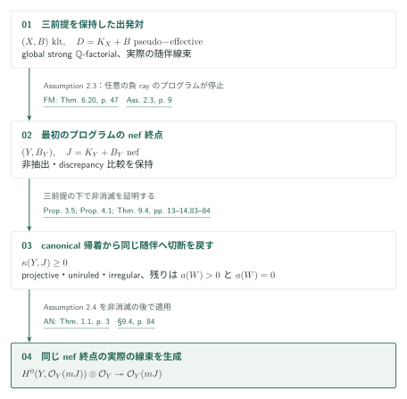
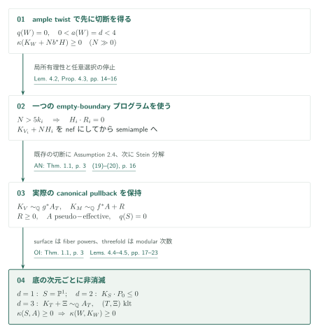
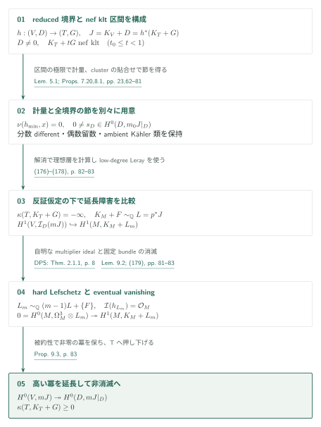
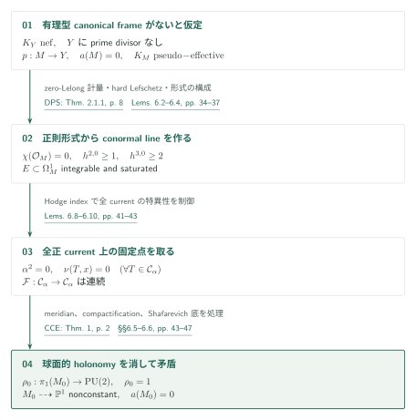

# Conditional good minimal models for compact Kähler fourfolds

**三つの前提の下で、指定したnef終点へ非消滅を戻す**

全orbifold劣加法性、指定した四次元MMP、非消滅後のabundanceを前提とする。論証の中心は最初の切断を作る部分であり、正の代数次元では底の計算、代数次元零では全被約境界からの延長とfoliationを用いる。

## 1. 主要結果

### Theorem 1.1 — 条件付き良い極小モデル

以下では**Assumptions 2.2、2.3、2.4をすべて仮定する**。[Theorem 1.1、p.4][C]の対象は、正規・連結・コンパクトKähler四次元空間$X$、有効な有理Weil因子$B$からなるklt対である。さらに$X$はglobally strongly $\mathbb Q$-factorial、実際の随伴線束$D=K_X+B$は$\mathbb Q$-Cartierかつ解析的にpseudo-effectiveとする。

結論は、同じglobal strong条件を持つ正規連結コンパクトKähler四次元空間$Y$と双有理型写像$\phi:X\dashrightarrow Y$の存在であり、次を満たす。

1. $\phi$はprime divisorを抽出せず、$B_Y=\phi_*B$。
2. $(Y,B_Y)$はkltで、実際の$\mathbb Q$-Cartier随伴$D_Y=K_Y+B_Y$は解析的にnef。
3. すべての上のprime divisor $E$について$a(E;Y,B_Y)\geq a(E;X,B)$。$X$上のprimeで$\phi$が縮約するものには不等号が厳密。
4. ある$m>0$で$mD_Y$はCartierとなり、$\mathcal O_Y(mD_Y)$は大域生成される。

次数$m$の一様性は主張しない。Definition 2.1（p.7）のglobal strong条件は、**空間全体上のすべてのcoherent rank-one reflexive sheafが可逆な正の反射的冪を持つ**ことをいう。各解析開集合での局所$\mathbb Q$-factorialityに置き換えない。また$\sim_{\mathbb Q}$は正則線束の実際の同型を表し、Bott–Chern類の一致だけでは代用しない。

[Theorem 1.1 · p. 4; Definition 2.1 · p. 7][C]

### Theorem 1.2 — nef終点での非消滅

同じ3前提の下で[Theorem 1.2、p.4][C]は、global strong条件を持つ正規連結コンパクトKähler四次元のordinary klt対$(Y,\Delta)$、有効有理$\Delta$、解析的にnefな実際の$\mathbb Q$-Cartier随伴$J=K_Y+\Delta$について、$\kappa(Y,J)\geq0$を主張する。最初のMMPで得た$(Y,B_Y)$へこの定理を適用してから、Assumption 2.4を使う。

[Theorem 1.2 · p. 4][C]

### Assumptions 2.2–2.4 — 保持する三つの前提

| 前提 | 原典が要求する範囲 | 供給元と今回の照合 |
|---|---|---|
| Assumption 2.2（pp.7–8） | 任意次元のFujiki class $\mathcal C$、有理SNC境界の係数$[0,1]$、連結fiberの正則全射に対するfull orbifold Iitaka subadditivity | OI（カタログ033）Thm.1.1、p.3と基底不変量の定義pp.2–3を照合。証明は未検証 |
| Assumption 2.3（pp.8–9） | 指定したpseudo-effective ordinary klt四次元から始めるMMP。任意の負の極端半直線を選べ、任意の有限prefixを延長でき、すべてのプログラムが停止 | FM（カタログ056）Thm.6.20、p.47；Prop.3.4、pp.12–14；Lem.3.2、p.11の記述・必要な証明箇所を照合。全停止証明は未検証 |
| Assumption 2.4（p.9） | 実際のnefな$\mathbb Q$-Cartier klt随伴で$\kappa\geq0$なら大域生成。strong factorialityは不要 | AN（034内14）Thm.1.1、p.3の記述を照合。最初の切断の存在は仮定 |

Assumption 2.2の不等式は
\[
\kappa(Z,K_Z+\Gamma)\geq
\kappa(F,K_F+\Gamma|_F)+\kappa(g\mid\Gamma).
\]
基底は任意のモデルのorbifold因子ではなく、原典式(2)–(5)の不変量を使う。すなわち
$m(g,\Gamma;P)=\min_{E\mapsto P}\{\operatorname{ord}_E(g^*P)/(1-\gamma_E)\}$、
$B(g,\Gamma)=\sum_P(1-1/m(g,\Gamma;P))P$とし、指定されたorbifold modificationsの同値類で$\kappa(K_S+B)$の下限を取る。係数1ではmultiplicityを$\infty$とする。neat modelの存在とそこでの計算も前提に含む。特に§4のfiber powersでは四次元を超える次元に適用する。[pp.7–8,18][C] [OI pp.2–3][OI]

Assumption 2.3では初期modificationを挿入せず、負のrayを切り出すnef supporting classとKähler margin、連結fiberを持つ射影的双有理型縮約、負側の相対Bott–Chern次元1、smallの場合の実際のcanonical algebraの相対analytic Projを要求する。klt・Kähler・global strong条件・pseudo-effectivityを各段階で保持し、非抽出とdiscrepancy比較を伴う。非pseudo-effectiveプログラムやdlt・generalized pairのMMPがこの仮定から一括して与えられるわけではない。供給元の定理文を照合できても、この概説では3前提を成立済みの無条件な定理へ置き換えない。

[Assumptions 2.2–2.4 · pp. 7–9][C]

## 図の矢印に付した引用

略号のない定理・補題・節・式番号は本原稿を指す。主要な外部入力には次の略号を使う。

- [OI] *Orbifold and logarithmic Iitaka subadditivity* · catalogue 033 · September 26, 2026 · [PDF][OI].
- [FM] *Finite ordinary minimal model programs on compact Kähler fourfolds* · catalogue 056 · October 5, 2026 · [PDF][FM].
- [AN] *Abundance after nonvanishing for compact Kähler fourfolds* · catalogue 034 · September 27, 2026 · [PDF][AN].
- [Ou] Ou · Theorem 1.1 · [arXiv v1][Ou].
- [DO] Das–Ou · Corollary 1.3 · [arXiv v4][DO].
- [DPS] Demailly–Peternell–Schneider · hard Lefschetz · [arXiv v2][DPS].
- [CCE] Campana–Claudon–Eyssidieux · Theorem 1 · [arXiv v3][CCE].

## 2. Theorems 1.1–1.2 の証明の帰着

まずMMPの終点を取り、その上の非消滅をTheorem 1.2で示す。三つの前提が使われる段階を分け、最後まで同じ随伴線束の切断を追う。

### 1. MMPで指定されたnef終点を固定する

Assumption 2.3はTheorem 1.1の(i)–(iii)を満たす終点を与える。任意の負のrayの選択で停止するという前提を使い、以後この終点の実際の随伴線束を保つ。残る(iv)には最初の切断が必要であり、MMPの停止だけでは得られない。

[Assumption 2.3 · p. 9; §9.4 · p. 84][C]

### 2. 非消滅を滑らかなモデルの二つの場合へ帰着する

§3のprojective分岐は、Assumption 2.2からLemma 3.1で対数的Iitaka前提を導き、同じ原稿のTheorem A.2（p.85）を適用する。Appendices A–Iはその条件付きprojective abundanceの証明であり、追加の独立な前提ではない。uniruled分岐はrational quotient、irregular分岐はAlbanese写像と、次元$\leq3$の非消滅を組み合わせる。Ouの[Theorem 1.1、p.1][Ou]はsmooth Kählerの場合のnon-unirulednessとcanonical pseudo-effectivityを結ぶ入力である。[§3、pp.10–14][C]

これらを除くと、滑らかなnon-uniruled、non-Moishezon四次元 $W$ で $q(W)=0$ に帰着する。$a(W)>0$ をProposition 4.1、$a(W)=0$ をTheorem 9.4で扱う。以下の図と説明はこの二つの分岐を追う。

[Proposition 3.5 · pp. 13–14; Proposition 4.1 · p. 14; Theorem 9.4 · pp. 83–84][C]

### 3. 切断を元の随伴へ戻して最後の前提を使う

$W$ 上のcanonical切断を $Y$ へ押し下げ、有効境界の切断を掛けると、指定したnef対の $J$ に非消滅が得られる。ここで初めてAssumption 2.4の $\kappa(Y,J)\geq0$ という条件が満たされる。同じ実際の $J$ にその前提を適用し、大域生成を得る。

[Proposition 3.5 · pp. 13–14; §9.4 · p. 84][C] · [AN, Theorem 1.1 · p. 3][AN]

## 3. Proposition 4.1 の証明：正の代数次元

$W$ は滑らかなnon-uniruled、non-Moishezon四次元で $q(W)=0$、$0<a(W)=d<4$ とする。代数的reductionの底へcanonical束を移し、その底の次元ごとに最初の切断を作る。

### 1. twistの切断から実際のcanonical pullbackを作る

$0<a(W)=d<4$では代数的reductionを解消し、射影底$S_0$のvery ample $H$を取る。低次元fiberの非消滅とample twistから、十分大きい全整数$N$について$\kappa(K_W+Nb^*H)\geq0$が**先に**得られる。各段階のcanonical Cartier indexを$k_i$として$N>5k_i$を選ぶ。$K_{V_i}+NH_i$に負のrayなら局所有理性により$H_i\cdot R_i=0$となり、そのstepは固定したempty-boundary $K$-programのstepでもある。$N$を選び直してもprogramの境界は変わらない。任意選択の停止とAssumption 2.4からtwistがsemiampleとなり、Stein分解で
\[
K_V\sim_{\mathbb Q}g^*A_T,\qquad
K_M\sim_{\mathbb Q}f^*A+R,\quad R\geq0
\]
を**実際の線束の同型**として得る。ここで$S\to T$は滑らかな射影解消、$A$は$A_T$の引戻し、$q(S)=0$、$A$はpseudo-effectiveである。[Proposition 4.3、pp.15–16][C]

[Proposition 4.3 · pp. 15–16][C]

### 2. 次元1と2の底で非消滅を得る

$d=1$なら$S=\mathbb P^1$。$d=2$では曲線上の$r$重fiber powerにAssumption 2.2を適用する。局所形$t=x^e$と例外因子の係数$h$を先に固定して、底の係数の極を$mrh/e$で抑える。$r\to\infty$により
\[
\left(A-K_S+\sum_{P\ {\rm exceptional}}c_PP\right)\cdot H'\geq0
\]
を得る（Lemma 4.4、pp.17–19）。Zariski分解$A=P_0+N_0$の残る場合$P_0^2=0$では$K_S\cdot P_0\leq0$となり、Riemann–Rochと$q(S)=0$から切断が出る。

[Lemma 4.4; §4.3 · pp. 17–19][C]

### 3. genus-one fibreからklt三次元随伴を作る

$d=3$のgeneric fibreはgenus oneである。Hodge line $\mathcal H$について$\mathcal H^{\otimes m}\simeq\mathcal O_S(m(A-K_S))$を得て、$12\mid m$の下で$E_4^{m/4}$と$\Delta_{\rm mod}^{m/12}$を用いる。integration threshold
\[
t_P=\min_{E\mapsto P}\frac{1+\operatorname{coeff}_E R}
{\operatorname{ord}_E(f^*P)}
\]
と二つの節の共通次数$\ell_P$が$\ell_P/m=1-t_P$で一致することを、**例外的な底valuationを含むすべての必要なモデル上で**示す。一般の線形結合から、元の正規底$T$に有効$\Xi$とklt対$(T,\Xi)$、$K_T+\Xi\sim_{\mathbb Q}A_T$を作る。$K_T$単独の$\mathbb Q$-Cartier性は仮定しない。projective三次元非消滅で得た切断を引き戻す。[Lemma 4.5、§4.4、pp.19–23][C]

[Lemma 4.5; §4.4 · pp. 19–23][C]

## 4. Proposition 9.3 の証明：全被約境界からの延長

代数次元と不正則数が零の場合、まず全被約境界上に非零切断を作る。非消滅の否定を使って延長障害の $H^1$ を消し、その切断を全空間へ持ち上げて矛盾させる。

### 1. reduced boundaryからnef区間と計量を得る

Proposition 7.20（pp.62–65）はreduced boundary $(T_0,G_0)$から非抽出的に$(T,G)$を作り、
\[
A=K_T+G\ {\rm nef},\qquad
K_T+tG\ {\rm nef\ and\ klt}\quad(t_0\leq t<1)
\]
という区間と、射影的crepant dlt modification
$h:(V,D)\to(T,G)$、$J=K_V+D=h^*A$を与える。4次元dlt停止を仮定へ追加するのではなく、§7のspecial terminationとordinary kltプログラムへの帰着を使う。Lemma 5.1（p.23）のzero-Lelong minimal metricを区間内で適用し、$(1-t)G$を足して$t\to1$とすることで$J$の引戻しにもzero-Lelong metricを得る。

Lemma 5.1の解析的証明は§5内にある。体積で正規化したcapacity評価、Monge–Ampère方程式のパラメータ微分、残差を残したBochner評価を組み合わせる。最後は同じsublevel集合上で残余測度を相殺する式(89)と、固定$t$での極限後のLelong上界(90)を、正の下界(93)と衝突させる。[pp.25–33][C] 先のprojective論文MMの定理をそのまま非projectiveの場合へ適用しているのではない。

[Proposition 7.20 · pp. 62–65; Lemma 5.1; (89)–(93) · pp. 23–33][C]

### 2. 正規化成分の切断をcluster内で合わせる

Proposition 8.1（pp.65–81）は$D\ne0$なら$H^0(D,\mathcal O_D(mJ))\ne0$を与える。正規化した各成分のdifferentは分数係数も保持し、[Das–Ou Corollary 1.3、p.4][DO]でsemiample系を作る。しかし成分ごとのabundanceだけでは貼り合わない。系の像の次元が最大の成分を選び、dominant conductorのcluster上で偶数留数を合わせ、nondominant branchesでは消える節を作る。有限のloop作用の下で運ばれる節をすべて掛けるLemma 8.4が、非零性と所要の消滅を保存する。

[Proposition 8.1; Lemmas 8.3–8.4 · pp. 65–72][C] · [DO, Corollary 1.3 · p. 4][DO]

### 3. 一つのambient Kähler類で閉路を制御する

非projectiveのtorsion clusterでは、原空間$V$の**一つのKähler類**を各surfaceへ運ぶ。閉路の自己同型$\varphi$と正の平方を持つ類$v$について
$\varphi^*v-v\in\operatorname{NS}(Q)_{\mathbb R}$を得る。Hodge indexと整格子の作用によりtop formの倍率がroot of unityとなり、共通冪で留数を合わせられる。これは任意のKähler surface自己同型の指標を無条件に有限とする議論ではない。[Lemma 8.9、pp.73–74][C] 最後に他のclusterを零とし、$S_2$とcodimension-oneの照合で$D$全体へ降ろす。[Lemma 8.2；§8.6、pp.66–67,81][C]

[Lemma 8.9 · pp. 73–74; §8.6 · p. 81][C]

### 4. 反証仮定から延長障害を消す

ここでは$a=q=0$の滑らかなモデルを使う。Lemma 9.1（p.81）はprime divisorの有限性とそのcohomology類の実線形独立性を示す。$\kappa(M,L)=-\infty$なら、任意の固定vector bundle $\mathcal E$について
$H^0(M,\mathcal E\otimes\mathcal O_M(mL))=0$が大きい可除次数$m$で成立する（Lemma 9.2、pp.81–82）。証明は最大generic rankの切断のdeterminantを取り、有限個のprimeに沿う非負整数係数を比較する。global meromorphic frameを最初から仮定しない。

Proposition 9.3では$\kappa(T,A)=-\infty$と仮定して延長障害を消す。$p:M\to V$上で$K_M+F\sim_{\mathbb Q}L=p^*J$と書く。$F$はSNC、係数$\leq1$で負の係数を許す。重要な比較は
\[
p_*\mathcal O_M(mL-\lfloor F\rfloor)
=\mathcal I_D\otimes\mathcal O_V(mJ),
\]
\[
H^1(V,\mathcal I_D(mJ))
\hookrightarrow H^1(M,K_M+L_m),\qquad
L_m\sim_{\mathbb Q}(m-1)L+\{F\}.
\]
後者はlow-degree Lerayからの単射であり、高次直接像の消滅は要求しない。zero-Lelong性と$\{F\}$の係数の積分余裕からmultiplier idealは自明となる。[DPSのhard Lefschetz定理][DPS]は
$H^0(M,\Omega_M^3\otimes L_m)\twoheadrightarrow H^1(M,K_M+L_m)$を与える。左辺をLemma 9.2で消せば、全被約$D$上の非零節の高い冪が$V$へ延長され、反証仮定に矛盾する。[式(176)–(179)、pp.82–83][C]

[Lemmas 9.1–9.2; Proposition 9.3; (176)–(179) · pp. 81–83][C] · [DPS, Theorem 2.1.1 · arXiv PDF p. 8][DPS]

## 5. Theorem 9.4 の証明：代数次元零の完結

非零有理型pluricanonical tensorの有無で場合を分ける。図はtensorがない側の障害を表し、最後の段階で符号付きcanonical frameがある側を処理する。

### 1. frameがない場合をprime divisorのないモデルへ移す

Theorem 9.4（pp.83–84）は、非零の有理型pluricanonical tensorが存在するか否かを分ける。存在しない場合、$G_0$に全primeを入れてProposition 7.20を使う。非零$G$なら前節の切断を割り戻して禁止された有理型tensorが得られるため、$G=0$。するとprime divisorがなくnef canonicalを持つモデルが残り、Proposition 6.1がこれを排除する。

[Theorem 9.4 · pp. 83–84][C]

### 2. 微分形式からfoliationと球面構造を作る

Proposition 6.1の証明は、nef canonicalのzero-Lelong metricとDPSから$\chi(\mathcal O_M)=0$、$h^{2,0}\geq1$、$h^{3,0}\geq2$を得る。2-formと3-formからintegrable saturated conormal lineを取り出す。正currentのHodge index比較により$\alpha^2=0$を導き、仮定の下で$\alpha$内の**すべて**の正currentのLelong数が零となることを示す。これによって正current全体のcompact convex集合上の写像が連続になり、固定点がtransverse spherical構造を与える。[§6.1–§6.4、pp.34–43][C]

[Proposition 6.1; §§6.1–6.4 · pp. 34–43][C]

### 3. holonomyから非定数有理型関数を得て矛盾させる

index chartsでboundary meridianのholonomyが有限であることを示し、Selbergの有限被覆とcompactificationを経てtorsion-freeな$\operatorname{PU}(2)$表現を得る。Zariski denseの場合は[Campana–Claudon–Eyssidieux Theorem 1、p.2][CCE]のprojective Shafarevich底が$a=0$に反する。proper closureの場合はvirtually solvableであり、全有限étale被覆の$q=0$から像を有限、従って自明にする。developing mapを局所chartとtraceで有理型延長すると非定数関数が生じ、再び$a=0$に反する。[§6.5–§6.6、pp.43–47][C]

[§§6.5–6.6 · pp. 43–47][C] · [CCE, Theorem 1 · p. 2][CCE]

### 4. frameがある場合は負の部分を消して滑らかなモデルへ戻る

有理型frameが存在する場合は$K_{T_0}\sim_{\mathbb Q}P-N$、$P,N\geq0$、台が互いに素と書き、$G_0=(\operatorname{Supp}P)_{\rm red}$を使う。$G=0$ならpseudo-effectivityが$N_T=0$を強制する。$G\ne0$なら前節の切断と$a(T)=0$による有理型divisorの一意性が同じ結論を与える。さらに$(T,0)$のMMPとAssumption 2.4でcanonicalを実際のtorsionにする。解消上の符号付き例外divisorは、正currentのsupportとprime類の独立性から有効と分かり、滑らかなモデルのcanonical nonvanishingへ戻る。[式(180)–(181)、p.84][C]

[Theorem 9.4; (180)–(181) · p. 84][C]

## 6. どの論文が、どの段階を担うか

| 結果 | 使用箇所と役割 | 確認範囲 |
|---|---|---|
| [OI Thm.1.1、p.3][OI] | Assumption 2.2、§§3–4、Lemma 6.2、Lemma 8.3：不変なorbifold底を使うsubadditivity | 定理文・基底定義・記載の適用を照合。neatモデル理論と入力の証明は未検証 |
| [FM Thm.6.20、p.47；Prop.3.4、pp.12–14][FM] | Assumption 2.3、Prop.4.3、Prop.7.20、§9.4 | 任意rayの停止、canonical algebra、global strong条件の保存を照合。停止証明の全依存は対象外 |
| [AN Thm.1.1、p.3][AN] | Assumption 2.4、Prop.4.3、Thm.9.4、Thm.1.1の最終段階 | $\kappa\geq0$を得た後の使用を照合。ANの証明は対象外 |
| [Ou Thm.1.1、p.1][Ou] | Prop.3.5、§8等：smooth Kähler canonicalのpseudo-effectivity | 指定v1の記述を照合 |
| [DO Cor.1.3、p.4][DO] | Lem.8.3：正規threefold成分のsemiample系 | 指定v4の記述を照合。付随するdlt modificationの別論文は未照合 |
| [DPS hard Lefschetz][DPS] | Lem.6.3、Prop.9.3：twisted formsからcohomologyへの全射 | arXiv v2の無番号導入定理p.2 / Thm.2.1.1 p.8で内容を照合。本稿は出版版Thm.0.1として引用 |
| [CCE Thm.1、p.2][CCE] | Lem.6.13：semisimple holonomyのprojective底 | arXiv v3の定理文・torsion-free条件を照合 |

## 7. 原典を読む入口と確認範囲

[§4 · pp. 14–23][C] · [Proposition 7.20 · pp. 62–65][C] · [§8 · pp. 65–81][C] · [§9 · pp. 81–84][C]

主定理・3前提・§3の帰着・§4のcanonical pullbackと底の計算・§5のcapacityから残差処理への主要箇所・§6のforms/Hodge/fixed-point/holonomyの主要箇所・Proposition 7.20・§8のclusterとambient class・§9全体を読解した。§7の相対有限生成・抽出・special terminationの全証明、§8のprojective cluster各場合の詳細、Appendices A–I全体は未検証である。metricの全極限操作、singular chartの全延長、Fujinoの局所有理性・相対MMP等の元論文も独立検証していない。これらは未確認であり、「依存なし」や「条件が解消済み」を意味しない。

改訂では主定理と三つの前提、全境界からの延長、最後のcanonical frameの分岐を再照合し、各証明の説明と出典を整理した。外部入力については初稿の照合範囲を保持する。原稿は2026年10月5日版、PDF頁、参照commit `adc7f1241b42e322a6451854ab7e4b4c146bf78a`。

[C]: https://github.com/openai/math/blob/adc7f1241b42e322a6451854ab7e4b4c146bf78a/preprints/Conditional-good-minimal-models-for-compact-Kahler-fourfolds-October-5-2026/paper.pdf
[OI]: https://github.com/openai/math/blob/adc7f1241b42e322a6451854ab7e4b4c146bf78a/preprints/Orbifold-and-logarithmic-Iitaka-subadditivity-September-26-2026/paper.pdf
[FM]: https://github.com/openai/math/blob/adc7f1241b42e322a6451854ab7e4b4c146bf78a/preprints/Finite-ordinary-minimal-model-programs-on-compact-Kahler-fourfolds-October-5-2026/paper.pdf
[AN]: https://github.com/openai/math/blob/adc7f1241b42e322a6451854ab7e4b4c146bf78a/preprints/Abundance-after-nonvanishing-for-compact-Kahler-fourfolds-September-27-2026/paper.pdf
[Ou]: https://arxiv.org/pdf/2501.18088v1
[DO]: https://arxiv.org/pdf/2306.00671v4
[DPS]: https://arxiv.org/pdf/math/0006205v2
[CCE]: https://arxiv.org/pdf/1302.5016v3
