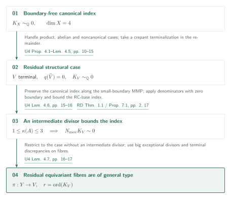
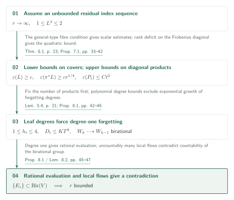

# Uniform effective log Iitaka fibrations for fourfolds

**From canonical indices to effective log Iitaka systems in dimension four**

The manuscript bounds canonical indices of boundary-free klt fourfolds and incorporates that bound into effective log Iitaka systems for lc pairs with finite rational coefficients. The index argument contrasts local positivity on covers with jet estimates on diagonal products. The final uniform degree combines qualitative nonvanishing, semiample models and relative denominators.

## 1. Main results

### Theorem 1.1 — Uniform canonical index

There is a positive integer $N_4$ such that every normal projective klt complex fourfold $X$ with $K_X\sim_{\mathbb Q}0$ satisfies

$$N_4K_X\sim 0.$$

This is a trivialization as an integral principal Weil divisor. The theorem has no boundary and does not assume that $X$ is smooth.

[Theorem 1.1 · p. 1][Ufour]

### Theorem 1.2 — Uniform effective log Iitaka fibrations

Fix a finite set $\Phi\subset[0,1]\cap\mathbb Q$. There is a positive integer $m$ depending only on $\Phi$ such that, for every normal integral projective complex fourfold $X$ and effective rational Weil divisor $\Delta$ with nonzero coefficients in $\Phi$, if $(X,\Delta)$ is lc and $D=K_X+\Delta$ is rational Cartier and pseudo-effective, the complete system $|\lfloor mD\rfloor|$ is nonempty and its section ratios generate the entire embedded Iitaka field $K(D)\subset\mathbb C(X)$. The same $m$ works for every canonical representative.

Here $\mathcal O_X(\lfloor mD\rfloor)$ is a rank-one reflexive divisorial sheaf; there is no additional requirement that $mD$ be Cartier. The conclusion includes birationality when $\kappa(D)=4$ and nonvanishing in a uniform degree when $\kappa(D)=0$. The coefficient hypothesis is a **finite rational set**, not an arbitrary DCC set or real coefficients.

[Theorem 1.2 · p. 2][Ufour]

## References on the arrows

Unprefixed references denote this manuscript. External inputs use the following keys.

- [LA][LA]: Log abundance in characteristic zero (September 24, 2026).
- [SL][SL]: Lifting sections from the reduced support of an adjoint (September 27, 2026).
- [RD][RD]: Relative denominators and effective systems for log Calabi–Yau fibrations (September 27, 2026).
- [CT][CT]: fourfold flip termination (arXiv:2011.02236v2, Theorem 1.1).
- [JL][JL]: non-klt fourfold index (arXiv:2002.11928v1, Corollary 1.7).
- [Xu][Xu]: klt fourfold index with nonzero boundary (arXiv:1905.00297v2, Theorem 1.14).

## 2. Proof of Theorem 1.1: structural reduction

Reduce the index problem in Theorem 1.1 to terminal fourfolds with general-type equivariant fibres and countable birational automorphism groups. In the structural cases using relative denominators, the crucial point is to preserve the boundary-free canonical index.

### 1. Separate product and rationally connected cases using the cover decomposition

The first reduction uses a decomposition on a finite quasi-étale cover and characters on volume forms. After separating product and abelian cases, the remaining single nonflat four-dimensional factor has the property that its positive-dimensional proper rational images are rationally connected ([Ufour, Proposition 4.1–Lemma 4.2, pp. 10–14][Ufour]). In the noncanonical case the canonical divisor on a resolution is not pseudo-effective. Uniruledness, the MRC quotient, and the restriction on rational images then imply rational connectedness; the passage from non-pseudo-effectivity to uniruledness follows Corollary 4.4 (p. 15).

[Proposition 4.1–Corollary 4.4 · pp. 10–15][Ufour]

### 2. Use relative denominators when an intermediate divisor exists

In the canonical case a crepant terminalization preserves the index. If an effective Weil divisor $A$ has $1\leq\kappa(A)\leq3$, use a semiample model for $(V,\delta A)$ with $\delta>0$ small. The proof checks **crepancy for the boundary-free canonical divisor separately** along this MMP. Pushing forward $rK_V=\operatorname{Div}(h)$ preserves the index, and the relative denominator theorem is applied to $(V',0)$, not to the varying coefficient $\delta$. On the rationally connected base, [RD, Proposition 7.1, p. 17][RD] gives an integral principal multiple of the generalized adjoint. The denominator of $\delta$ therefore does not enter the constant ([Ufour, Lemma 4.6, pp. 15–16][Ufour]).

[Lemmas 4.5–4.6 · pp. 15–16][Ufour]

### 3. Make residual equivariant fibres general type

For the remaining terminal fourfold and its canonical cyclic cover, the relevant intermediate equivariant rational fibrations have general-type smooth geometric generic fibres. Lemma 4.7 (pp. 16–17) uses bigness of a divisor pulled back from a descended base and positive terminal discrepancies to make the canonical divisor of the fibre big. This is the hypothesis needed for the next uniform estimates.

[Lemma 4.7 · pp. 16–17][Ufour]

## 3. Proof of Theorem 1.1: excluding the residual high indices

Assume that the index $r$ is unbounded in the residual case. Compare the Seshadri lower bound on the canonical cover $\pi:Y\to V$ with the upper bound on the diagonal product $Z_t=Y^t/\mu_{r,\mathrm{diag}}$ through projection-compatible chain leaves.

The chain quotient, projection compatibility and degree estimates (Lemmas 5.1, 5.4 and Corollary 5.2), and the tracking lemmas (Lemmas 6.3–6.4), are stated in arbitrary dimension. They must be distinguished from **the four-dimensional Theorem 6.1 and main theorems**, which use volume estimates on lower-dimensional fibres.

[Lemmas 5.1, 5.4・Corollary 5.2・Lemmas 6.3–6.4 · pp. 18–27][Ufour]

### 1. Apply scalar bounds using the general-type condition

Let $\gamma(P;V)$ be the supremum of section order divided by degree at a general point, using sufficiently divisible degrees. The scalar bounds of Theorem 6.1 (p. 23) assume the preceding general-type condition on equivariant fibrations. Applied to a normalized polarization $1\leq L^4\leq2$ and the canonical cyclic cover $\pi:Y\to V$ of index $r$, they give $\varepsilon(L)\geq c$ and $\varepsilon(\pi^*L)\geq cr^{1/4}$.

[Definition 5.3・Theorem 6.1 · pp. 21, 23][Ufour]

### 2. Turn diagonal rank loss into contradictory vanishing orders

In contrast, Proposition 7.1 (pp. 33–42) bounds $\varepsilon(P_t)\leq Ct^2$ for the external-sum polarization $P_t$ on $Z_t=Y^t/\mu_{r,\mathrm{diag}}$. In characteristic $p$, a surplus of ordinary jets produces a matrix of full rank at a general point, but of rank at most $R/4$ on the Frobenius diagonal. A nonzero maximal minor must vanish there to order at least $3R/4$; slotwise scalar bounds and Lemma 7.4 give a strictly smaller order. LA §9 is a methodological predecessor here; its abundance conclusion is not an input to this jet calculation.

[Proposition 7.1・Lemma 7.4 · pp. 33–42][Ufour]

### 3. Obtain degree-one forgetting from chain leaves

Proposition 8.1 (pp. 42–46) applies the two Seshadri estimates to chain leaves. Fix finitely many products $2\leq t\leq T$ before increasing the covering order $r$. Each leaf then maps generically finitely to any single slot, so its dimension lies between $1$ and $4$. Leaf degrees are bounded by $KT^8$. If every forgetting map along a constant-dimensional stretch had degree at least two, the degrees would grow exponentially. Some forgetting map must consequently have degree one.

[Proposition 8.1 · pp. 42–45][Ufour]

### 4. Extend local flows birationally and bound the index

Degree one is essential: it converts evaluation of the missing coordinate from a finite correspondence into a rational map. Tangent transport and local flows then produce birational self-maps. A positive-dimensional flow gives uncountably many such maps, contradicting Lemma 8.2 (pp. 46–47), which proves countability of $\operatorname{Bir}(V)$ using irregularity zero on a smooth model. Section 9 (pp. 47–48) excludes unbounded index sequences and takes a common multiple of the bounded orders in all cases.

[Proposition 8.1・Lemma 8.2・§9 · pp. 45–48][Ufour]

## 4. Proof of Theorem 1.2

For lc fourfold pairs with coefficients in the fixed finite set $\Phi$, first take a semiample model preserving sections in every integer degree. A positive-dimensional Iitaka base calls for relative denominators and effective systems; a point base calls for index theorems.

### 1. Construct a semiample model after qualitative nonvanishing

Initial nonvanishing comes from good models and semiampleness in [LA, Theorems 11.1, 1.1][LA]. The degree of the resulting nonzero section depends on the input and is not yet uniform ([Ufour, §10, p. 48][Ufour]). Proposition 2.2 (pp. 6–7) next uses a crepant dlt modification, termination of fourfold flips, and abundance after nonvanishing from [SL, Theorem 1.2, p. 2][SL] to obtain a model $(X',\Delta')$ with coefficient set $\Phi'=\Phi\cup\{1\}$.

[Proposition 2.2・§10 · pp. 6–7, 48][Ufour]

### 2. Identify rounded section spaces in every integer degree

The comparison in every integer degree is

$$H^0\!\left(X,\mathcal O_X(\lfloor kD\rfloor)\right)=H^0\!\left(X',\mathcal O_{X'}(\lfloor kD'\rfloor)\right)\quad(k\geq0).$$

This is equation (2.1), checked through the pole inequality $\operatorname{Div}(v)+kD\geq0$ in (2.2) and an effective exceptional difference on a common resolution. A comparison only in selected Cartier degrees would not suffice. For the semiample contraction $f:X'\to Z$, one has $D'\sim_{\mathbb Q}f^*A$ with $A$ ample. Relative algebraic closedness for the contraction places every section ratio in $\mathbb C(Z)$.

[(2.1)–(2.2)・Lemma 2.3 · pp. 6–8][Ufour]

### 3. Use effective systems with fixed denominators on a positive-dimensional base

When $\dim Z>0$, [RD, Theorem 1.1, p. 2][RD] gives an exact canonical bundle formula with fixed denominators, and [RD, Proposition 6.1, pp. 15–17][RD] recovers the entire base field in **every positive multiple** of a uniform degree. These appear as Ufour Theorem 3.1 and Proposition 3.2 (p. 8). The birational contraction case $\dim Z=4$ is included.

[Theorem 3.1・Proposition 3.2・§10 · pp. 8, 48–49][Ufour]

### 4. Separate three cases over a point base

When $Z$ is a point, $D'\sim_{\mathbb Q}0$. The index is bounded by [JL, Corollary 1.7, p. 2][JL] in the non-klt case, by [Xu, Theorem 1.14, p. 3][Xu] when the pair is klt with $\Delta'\neq0$, and by the present Theorem 1.1 when it is klt with $\Delta'=0$. Xu's hyperstandard convention includes the given finite set by using $\{1-b:b\in\Phi'\}$ and denominator one. Take a common multiple of these degrees and the positive-base degree; the latter permits this because its conclusion holds for every positive multiple. Equation (2.1) returns to the original complete systems.

[§10 · p. 49][Ufour]

### 5. Preserve section ratios under a change of canonical representative

Replacing the canonical divisor by $K_X+\operatorname{Div}(h)$ changes the floor divisor by $m\operatorname{Div}(h)$. Multiplication of sections by $h^{-m}$ identifies the systems without changing their ratios, so the uniform degree is independent of the representative ([Ufour, p. 49][Ufour]).

[§10 · p. 49][Ufour]

## 5. Which papers supply which steps

- **[LA]** Theorem 11.1 (p. 73), Theorem 1.1 (p. 1): qualitative nonvanishing in Ufour §10 (p. 48). The reference to its Frobenius method in §7 is a separate methodological relation.
- **[SL]** Theorem 1.2 (p. 2): semiampleness of the nef model in Ufour Theorem 2.1 and Proposition 2.2 (pp. 6–7). The main Fourfold nonvanishing theorem is not added as an input to that proposition.
- **[RD]** Theorem 1.1, Propositions 6.1, 7.1 (pp. 2, 15, 17): Ufour §3 (pp. 8–9). The first two supply effective systems; the last controls the generalized index over the rationally connected base in Lemma 4.6.
- **[CT]** Theorem 1.1 (arXiv v2, p. 2): flip termination for pseudo-effective NQC lc generalized fourfold pairs. Proposition 2.2 applies it with zero nef data. Its statement and applicability were compared.
- **[JL] / [Xu]** The index statements above: the two point-base cases in Ufour §10 (p. 49). Their original statements were compared; their proofs are outside this check.

## 6. Return to the sources

The source is the [fixed Ufour PDF][Ufour], commit `adc7f1241b42e322a6451854ab7e4b4c146bf78a`. Page references use printed PDF pages. GitHub's PDF viewer does not retain page positions, so use the displayed page and result numbers after following a link.

The editors read the main statements, all-degree comparison in §2, inputs in §3, the intermediate-fibration reductions in §4, the statement of Theorem 6.1, the setup and final determinant comparison in §7, the leaf-degree, degree-one forgetting and rational-flow connections in §8, and the assembly in §§9–10. The directly used RD, SL and LA statements and the three existing index/termination statements above were compared with their sources.

**Unresolved:** original-source checking of all decomposition and holonomy inputs in §4; all local calculations in the scalar estimates of §6; all spread, semicontinuity and Frobenius-bundle constructions in §7; proofs of external results including Matsumura's theorem. These connections are not claimed to be independently verified.

[Ufour]: https://github.com/openai/math/blob/adc7f1241b42e322a6451854ab7e4b4c146bf78a/preprints/Uniform-effective-log-Iitaka-fibrations-for-fourfolds-September-26-2026/paper.pdf
[RD]: https://github.com/openai/math/blob/adc7f1241b42e322a6451854ab7e4b4c146bf78a/preprints/Relative-denominators-and-effective-systems-for-log-Calabi-Yau-fibrations-September-27-2026/paper.pdf
[SL]: https://github.com/openai/math/blob/adc7f1241b42e322a6451854ab7e4b4c146bf78a/preprints/Lifting-sections-from-the-reduced-support-of-an-adjoint-September-27-2026/paper.pdf
[LA]: https://github.com/openai/math/blob/adc7f1241b42e322a6451854ab7e4b4c146bf78a/preprints/Log-abundance-in-characteristic-zero-September-24-2026/paper.pdf
[JL]: https://arxiv.org/pdf/2002.11928v1
[Xu]: https://arxiv.org/pdf/1905.00297v2
[CT]: https://arxiv.org/pdf/2011.02236v2
