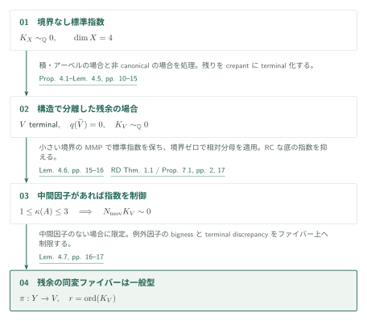
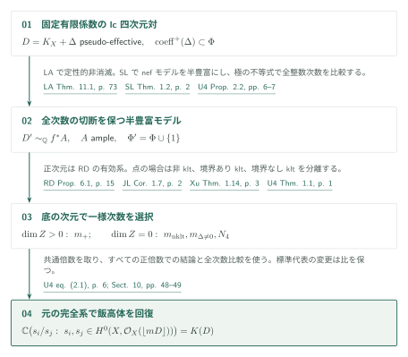

# 四次元の標準指数から有効 log Iitaka 系へ

Uniform effective log Iitaka fibrations for fourfolds — 2026年9月26日版、52頁。公式カタログ034内の掲載順13、記事ID `effective-log-iitaka-fourfolds`。

本稿は、境界なしklt四次元多様体の標準指数を一様化し、それを有限有理係数のlc対の有効log Iitaka系へ組み込む。指数の核心は被覆上の局所正値性と対角積のjet評価の矛盾であり、最終的な一様次数には定性的非消滅・半豊富モデル・相対分母の三つの入力を使う。

> AI生成の概説初稿。以下の定理は著者の主張であり、編集側が独立に証明を認定したものではない。証明本文の読解範囲と未確認点を末尾に記す。数学的な利用には原典を確認されたい。

## 主結果（原典順）

**Theorem 1.1（[U4, p. 1][U4]）.** 正規射影的klt複素四次元多様体 $X$ で $K_X\sim_{\mathbb Q}0$ を満たすものすべてに対し、共通の正整数 $N_4$ が存在して

$$N_4K_X\sim 0.$$

ここでは整数主Weil因子としての自明化をいう。境界を伴わない定理であり、$X$ の滑らかさは仮定しない。

**Theorem 1.2（[U4, p. 2][U4]）.** 有限集合 $\Phi\subset[0,1]\cap\mathbb Q$ を固定する。正規整射影的複素四次元多様体 $X$ と、有効有理Weil因子 $\Delta$ で非零係数が $\Phi$ に属し、$(X,\Delta)$ がlc、$D=K_X+\Delta$ が有理Cartierかつpseudo-effectiveであるものに対して、$\Phi$ のみに依存する正整数 $m$ が存在し、完全系 $|\lfloor mD\rfloor|$ は空でなく、その切断比が埋め込まれた飯高体 $K(D)\subset\mathbb C(X)$ の全体を生成する。同じ $m$ が標準因子のすべての代表に対して使える。

$\mathcal O_X(\lfloor mD\rfloor)$ は階数1反射的因子層であり、$mD$ がCartierになるという追加条件はない。$\kappa(D)=4$ では写像の双有理性を、$\kappa(D)=0$ では一様次数での非消滅を含む。係数条件は**有限有理集合**であり、任意のDCC集合や実係数への拡張はこの主張に含めない。

## Theorem 1.1：構造的帰着と、残る指数の排除

図の最初の帰着は、有限準エタール被覆上の分解と体積形式の指標を用いる。積・アーベル部分から来るケースを分離すると、残る単一の非平坦四次元因子には「正の次元の真の有理像は有理連結」という制約が付く（[U4, Proposition 4.1–Lemma 4.2, pp. 10–14][U4]）。非canonicalの場合、解消上の標準因子がpseudo-effectiveでないことから単線織性を得て、MRC商と有理像の制約によって有理連結性へ帰着する。ここで使う非pseudo-effectiveから単線織性への接続は原典のCorollary 4.4（p. 15）に従う。

canonicalの場合は指数を変えないcrepant terminalizationを取る。もし有効Weil因子 $A$ に $1\leq\kappa(A)\leq3$ のものがあれば、小さい $\delta>0$ に対する $(V,\delta A)$ の半豊富モデルを使う。ただし、このMMPで**境界なし標準因子のcrepancyを別に確認する**。$rK_V=\operatorname{Div}(h)$ を各段階へ押し出すことで指数を保ち、相対分母定理は変動する係数 $\delta$ ではなく $(V',0)$ に適用する。得られる有理連結な底上で [RD, Proposition 7.1, p. 17][RD] が一般化adjointの整数主倍数を与える。したがって定数に $\delta$ の分母は入らない（[U4, Lemma 4.6, pp. 15–16][U4]）。

残るterminal四次元多様体とその標準巡回被覆では、関連する中間的同変有理ファイブレーションの滑らかな幾何学的生成ファイバーが一般型になる。Lemma 4.7（pp. 16–17）は、降下した底から引いた因子のbignessとterminal discrepancyを使い、ファイバー上の例外的部分から標準因子のbignessを導く。この条件が次の一様評価の仮定である。

$\gamma(P;V)$ を十分可除な次数で測った一般点の切断消滅次数／次数の上限とする。Theorem 6.1（p. 23）のscalar評価は、同変ファイブレーションについて上記の一般型条件を仮定する。正規化した偏極 $1\leq L^4\leq2$ と指数 $r$ の標準巡回被覆 $\pi:Y\to V$ に適用すると、$\varepsilon(L)\geq c$ と $\varepsilon(\pi^*L)\geq cr^{1/4}$ が得られる。

一方、$Z_t=Y^t/\mu_{r,\mathrm{diag}}$ 上の外積和偏極 $P_t$ について、Proposition 7.1（pp. 33–42）は $\varepsilon(P_t)\leq Ct^2$ を与える。証明では、標数 $p$ で通常jetの余剰から一般点で全階数の行列を作り、Frobenius対角上では階数が高々 $R/4$ と評価する。非零最大小行列式の対角上の消滅次数は少なくとも $3R/4$ となるが、各スロットのscalar評価とLemma 7.4によりそれ未満となり矛盾する。ここでLAの§9は方法の先行例であり、そのabundance結論をこのjet計算の入力にしているわけではない。

Proposition 8.1（pp. 42–46）は二つのSeshadri評価を鎖の葉に適用する。$2\leq t\leq T$ の有限個の積を先に固定し、被覆次数 $r$ を大きくすると、各葉から一つのスロットへの射影が生成有限になり、葉の次元は $1$ から $4$ に入る。葉の次数は $KT^8$ 以下だが、同じ次元の葉の間の忘却写像がすべて次数2以上なら次数が指数的に増える。従ってどこかの忘却写像は次数1となる。

次数1は必要な強さである。これは最後の座標の評価を有限対応から有理写像へ変え、接空間の移送と局所流を有理双自己写像へ変換する。正次元の流から非可算個の双自己写像が生じ、Lemma 8.2（pp. 46–47）の $\operatorname{Bir}(V)$ の可算性に矛盾する。後者は滑らかなモデルのirregularityゼロを用いる。§9（pp. 47–48）はこれで指数の非有界列を排除し、全ケースの指数の最小公倍数を取る。

鎖の商・射影整合性・次数評価（Lemmas 5.1, 5.4、Corollary 5.2）と追跡補題（Lemmas 6.3–6.4）は任意次元の道具として述べられる。これを、低次元ファイバーの体積評価を使う**四次元のTheorem 6.1や主定理**と同一視しない。

## Theorem 1.2：定性的なモデルから一様な完全系へ

最初の非消滅は [LA, Theorems 11.1, 1.1][LA] による良いモデルと半豊富性から得る。この段階の非零切断の次数は入力に依存し、一様ではない（[U4, §10, p. 48][U4]）。続いてProposition 2.2（pp. 6–7）はcrepant dlt modification、四次元flip停止、そして [SL, Theorem 1.2, p. 2][SL] の非消滅後の半豊富性を用い、$\Phi'=\Phi\cup\{1\}$ を係数集合とするモデル $(X',\Delta')$ を作る。

全整数次数で成立する比較は

$$H^0\!\left(X,\mathcal O_X(\lfloor kD\rfloor)\right)=H^0\!\left(X',\mathcal O_{X'}(\lfloor kD'\rfloor)\right)\quad(k\geq0).$$

これは原典の式(2.1)であり、式(2.2)の極の不等式 $\operatorname{Div}(v)+kD\geq0$ と、共通解消上の有効例外差で確認する。特定のCartier倍数でだけ成り立つ比較では不十分である。半豊富収縮 $f:X'\to Z$ に対して $D'\sim_{\mathbb Q}f^*A$、$A$ はampleであり、収縮の相対代数閉性によってすべての切断比は $\mathbb C(Z)$ に入る。

$\dim Z>0$ では [RD, Theorem 1.1, p. 2][RD] が固定分母の正確な標準束公式を与え、[RD, Proposition 6.1, pp. 15–17][RD] が一様次数の**すべての正倍数**で完全な底の体を回復する。U4ではTheorem 3.1とProposition 3.2（p. 8）として使う。$\dim Z=4$ の双有理収縮も含む。

$Z$ が点なら $D'\sim_{\mathbb Q}0$ である。非kltは [JL, Corollary 1.7, p. 2][JL]、kltかつ $\Delta'\neq0$ は [Xu, Theorem 1.14, p. 3][Xu]、kltかつ $\Delta'=0$ は本稿のTheorem 1.1で指数を抑える。Xuのhyperstandard係数条件には $\{1-b:b\in\Phi'\}$ と分母1で有限係数集合を埋め込む。これらと正次元の次数の共通倍数を取れるのは、後者がすべての正倍数を許すためである。最後に式(2.1)で元の完全系へ戻す。

標準因子を $K_X+\operatorname{Div}(h)$ に替えると丸めた因子は $m\operatorname{Div}(h)$ だけ変わる。切断の $h^{-m}$ 倍が系を同定し、比を変えないので、一様次数は代表に依存しない（[U4, p. 49][U4]）。

## 直接入力と使用箇所

- **[LA]** Theorem 11.1（p. 73）、Theorem 1.1（p. 1）：U4 §10（p. 48）の定性的非消滅。§7のFrobenius法への参照は別の方法上の関係。
- **[SL]** Theorem 1.2（p. 2）：U4 Theorem 2.1・Proposition 2.2（pp. 6–7）のnefモデルの半豊富性。Fourfold nonvanishingの主定理をこの命題の入力として追加しない。
- **[RD]** Theorem 1.1、Propositions 6.1, 7.1（pp. 2, 15, 17）：U4 §3（pp. 8–9）。前二者は有効系、最後はLemma 4.6の有理連結な底上の指数制御。
- **[CT]** Theorem 1.1（arXiv v2, p. 2）：pseudo-effectiveなNQC lc一般化四次元対のflip停止。U4 Proposition 2.2ではnefデータゼロとして適用する。定理の記述と適用条件を照合した。
- **[JL] / [Xu]** 上記指数定理：U4 §10（p. 49）の底が点の二ケース。原典の記述を照合したが、それらの証明は検証対象外。

## 原典・確認範囲

出典は [U4の固定版PDF][U4]（commit `adc7f1241b42e322a6451854ab7e4b4c146bf78a`、SHA-256は `sources.json`）。頁はPDFの印刷頁。GitHubのPDF表示では頁位置が保持されないため、リンク先で記載頁・番号へ移動する。

編集側は主定理、§2の全次数比較、§3の入力、§4の中間ファイブレーションによる帰着、Theorem 6.1の記述、§7の設定と最終行列式比較、§8の葉の次数・次数1忘却・有理流の接続、§§9–10の組立てを読んだ。RD・SL・LAの直接使用定理と上記三つの既存指数／停止定理の記述を照合した。

**未確認**：§4の分解・holonomyの全補助結果の原典照合、§6のscalar評価の全局所計算、§7のspread・半連続性・Frobenius束の全構成、Matsumura等の外部定理の証明。これらの接続を独立に検証済みとはしない。図と数式の生成・日英整合性を確認した範囲は `status.md` に記録する。サイト組込み後の画面確認は本部作業として残る。

[U4]: https://github.com/openai/math/blob/adc7f1241b42e322a6451854ab7e4b4c146bf78a/preprints/Uniform-effective-log-Iitaka-fibrations-for-fourfolds-September-26-2026/paper.pdf
[RD]: https://github.com/openai/math/blob/adc7f1241b42e322a6451854ab7e4b4c146bf78a/preprints/Relative-denominators-and-effective-systems-for-log-Calabi-Yau-fibrations-September-27-2026/paper.pdf
[SL]: https://github.com/openai/math/blob/adc7f1241b42e322a6451854ab7e4b4c146bf78a/preprints/Lifting-sections-from-the-reduced-support-of-an-adjoint-September-27-2026/paper.pdf
[LA]: https://github.com/openai/math/blob/adc7f1241b42e322a6451854ab7e4b4c146bf78a/preprints/Log-abundance-in-characteristic-zero-September-24-2026/paper.pdf
[JL]: https://arxiv.org/pdf/2002.11928v1
[Xu]: https://arxiv.org/pdf/1905.00297v2
[CT]: https://arxiv.org/pdf/2011.02236v2
