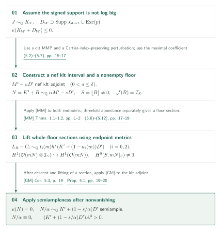
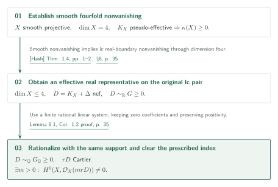

# Fourfold nonvanishing by minimal metrics and moving jets

> AI-generated first-pass exposition of claims and arguments by the manuscript's author, OpenAI. This is not a certification of correctness. Consult the original for important statements and proofs.

Official position 06 within catalog 034; internal ID: fourfold-nonvanishing. We use the September 27, 2026 version, 38 PDF pages, at commit adc7f1241b42e322a6451854ab7e4b4c146bf78a. [Source PDF][FN].

A hypothetical minimal fourfold counterexample has positive canonical degree on every curve through a very general point. This gives small scalar vanishing orders, while a projective bundle over two factors has large jet generation. The proof fixes finite witnesses for both and forces incompatible orders on a Frobenius evaluation determinant. Zero-Lelong metrics and interior injectivity enter the intermediate signed-boundary argument.

## Main results

### Theorem 1.1 — Smooth fourfold nonvanishing (p. 2)

Let $X$ be a smooth connected projective complex fourfold. If $K_X$ is pseudo-effective, then for some positive integer $m$,

\[
H^0(X,mK_X)\ne0.
\]

There is no assumption on numerical dimension, irregularity or Euler characteristic. The result does not give a uniform bound on $m$. [Theorem 1.1, p. 2][FN]

### Corollary 1.2 — The original lc pair and a prescribed Cartier index (p. 2)

Let $(X,\Delta)$ be a connected normal projective complex lc pair, $\dim X\leq4$, with effective rational boundary. Suppose $D=K_X+\Delta$ is nef and $\mathbb Q$-Cartier. For **every positive integer $r$ with $rD$ Cartier**, some positive integer $m$ satisfies

\[
H^0(X,\mathcal O_X(mrD))\ne0.
\]

No $\mathbb Q$-factoriality is required, and the section is on the original $X$. [Corollary 1.2, p. 2][FN]

## Theorem 1.1: counterexample geometry and finite data

Proposition 2.1 replaces a counterexample by one fixed projective $\mathbb Q$-factorial terminal fourfold $Y$, with $K=K_Y$ nef, $\kappa(K)=-\infty$, $K^4=0$, $q(Y)=0$, and nef dimension $n(K)=4$. A fixed Cartier index $\iota$ gives $K\cdot C\geq1/\iota$ for every curve through a very general point. Nef dimension here is distinct from numerical dimension $\nu(K)$. Using abundance in dimensions at most three, Proposition 2.2 makes every proper positive-dimensional subvariety through that locus of general type on resolution.

For fixed small $\varepsilon>0$, take $L_t=r_t(K+tA)$ with $L_t^4\to\varepsilon^4$ and $r_t\to\infty$. Curve degrees satisfy $L_t\cdot C\geq r_t/\iota\to\infty$ although volume stays bounded. Moving high-order sections create base components. The moving-multiplicity input from [LA] controls ordinary powers of their ideals for the **entire high-jet kernel**. A general-type center with bounded degree and canonical intersection produces a curve of bounded degree, contradicting the diverging curve degrees. Proposition 3.5 therefore gives, for every allowed Cartier degree,

\[
P_s=2r_t(K+2tA),\qquad
\operatorname{ord}_x(s)\leq4k(P_s^4)^{1/4}\leq32k\varepsilon
\]

(pp. 10–12).

For the two-factor argument, set $S_0=\iota K$ and

\[
Z=\mathbb P(\mathcal O(S_0)_1\oplus\mathcal O(S_0)_2)\longrightarrow Y\times Y,
\qquad P=L_{t,1}+L_{t,2}+q\xi.
\]

The analytic SNC hypothesis is not imposed directly on this bundle. Restrict moving base components to slices and exclude, in turn, a proper generically finite image, the entire bundle over a proper image, and a non-axis multisection over all of $Y$ (§6.4, pp. 26–29). In the last case, intersection with the axes gives

\[
D_0-D_\infty\sim e\iota K,
\]

and Proposition 5.1 below controls its signed support. Remaining correspondences with both projections dominant and generically finite are excluded by Proposition 6.4. First rule out sweeping branch divisors; then [LA, Lemma 7.5, p. 51][LA] gives finitely many finite étale covers of a fixed open. A degree bound alone is not used to assert finiteness. Birational automorphism groups would then produce a dominant map from an abelian variety to $Y$, again contradicting positive canonical curve degree.

This gives $\epsilon(P;z)>10$ in Proposition 6.3 and one finite $10k_0$-jet surjection in Corollary 6.5. Section 7 now fixes $t,r_t$, a resolution $W$, an ample perturbation $H$, a complete-intersection flag with $\mu_{\min}(\Omega_W^1|_C)\geq0$, and a concrete strongly movable curve $\gamma$ on the blowup of a point. The numerical conditions are

\[
H^4\leq(2\varepsilon)^4,\quad K_WH^3\leq2H^4/r_t,\quad
(2L+qS_0)H^3\leq4H^4,\quad
(14\varepsilon)^4<1/4,\quad80\varepsilon<3/4.
\]

They are supplemented by $J_x\gamma>0$ and

\[
\pi_x^*(L+K_W/2+\lambda S_0)\gamma\leq40\varepsilon J_x\gamma
\quad(0\leq\lambda\leq q).
\]

The curve is the pushforward of an ample complete intersection on one fixed birational model. This permits testing effective divisors after reduction without assuming specialization of an effective cone.

Theorem 7.1 restates [LA, Theorem 9.1, p. 62][LA], which rules out coexistence of these fixed data. In §7.3 the characteristic-$p$ evaluation has generic rank $R=p^8$ but diagonal rank less than $R/4$. Testing the two actual determinant factors with $\gamma$ gives the conflicting inequalities

\[
\operatorname{ord}_{(x',x')}\sigma\leq R(80\varepsilon+O(p^{-1})),
\qquad
\operatorname{ord}_{(x',x')}\sigma\geq3R/4
\]

for a nonzero determinant $\sigma$. The jet point $z_*$ need not lie over the independently chosen point $x$. All finite data must be fixed over $\mathbb C$ before varying $p$.

## Proposition 5.1: signed supports

The hypotheses are that $Y$ is a projective $\mathbb Q$-factorial terminal fourfold, $K_Y$ is nef with $\kappa(K_Y)=-\infty$, and every proper positive-dimensional subvariety through a very general locus is of general type on resolution. Let $J\sim_{\mathbb Q}K_Y$ be a rational Weil divisor with either sign, $p:W\to Y$ a log resolution, and $D_W$ a reduced SNC divisor containing the strict support of $J$ and every exceptional divisor. Then $K_W+D_W$ is big. [Proposition 5.1, p. 14][FN]

Assume it is not big. Positive Iitaka dimension, combined with general-type general fibers, would force bigness, so $\kappa(K_W+D_W)\leq0$. A dlt MMP and a small crepant perturbation preserving a Cartier index produce $M'\sim_{\mathbb Q}G'$, $\kappa(M')\leq0$, and a nef klt interval $M'-uD'$ for $0<u\leq\delta$. The signed divisor $G'$ is supported on $D'$. Its largest positive coefficient $a$ and small $s>0$ give

\[
B=(1-s)D'+(s/a)G',\quad \alpha=1+s/a,\quad
N=K'+B\sim_{\mathbb Q}\alpha M'-sD',\quad S=\lfloor B\rfloor\ne0.
\]

Here $0\leq B\leq D'$, $(Z',B)$ is lc, $N$ is nef, and $\mathcal J(Z',B)=\mathcal I_S$.

Fix $0<b_0<1<b_2$ and construct effective SNC boundaries $C_i$ on a resolution. The endpoint residuals in (5.9) satisfy

\[
L_R-C_i\sim_{\mathbb Q}
t_i(m)h^*(K'+(1-u_i(m))D'),\qquad
t_i(m)>0,\quad u_i(m)\to s/\alpha\in(0,\delta).
\]

[MM, Theorem 1.1][MM] supplies zero-Lelong metrics on the actual endpoint bundles. [MM, Theorem 1.2][MM] and local vanishing then give

\[
H^1(Z',\mathcal O(mN)\otimes\mathcal I_S)\hookrightarrow H^1(Z',\mathcal O(mN)).
\]

Thus $H^0(Z',mN)\to H^0(S,mN|_S)$ is surjective for sufficiently large divisible $m$.

A nonzero boundary section is constructed separately. Apply adjunction and threefold semi-dlt abundance to the entire floor $T$ of a dlt blowup. Local vanishing in (5.12), giving $g_*\mathcal O_T=\mathcal O_S$, descends a **whole-floor** section, including conductor compatibility, to $S$ and then lifts it. Only now does $\kappa(N)=0$ follow. Finally apply [GM, Corollary 5.3, p. 19][GM] to $N/\alpha\sim_{\mathbb Q}K'+(1-s/\alpha)D'$. Semiampleness and Iitaka dimension zero give numerical triviality, contradicting its positive intersection with an ample cube because $K'$ is pseudo-effective, $D'\ne0$, and $1-s/\alpha>0$. The nonvanishing assumption of GM is obtained before its use.

## Corollary 1.2: return to the lc pair

[Hash, Theorem 1.4, p. 2][Hash] takes smooth fourfold canonical nonvanishing to nonvanishing for projective lc pairs of dimension at most four. Since nef $D$ is pseudo-effective, it gives $D\sim_{\mathbb R}G\geq0$ on the original normal variety. Lemma 8.1 writes this as a rational linear system involving finitely many prime and principal divisors. Fixing the zero coefficients and approximating the positive ones by a rational solution gives $D\sim_{\mathbb Q}G_{\mathbb Q}\geq0$ with the same support. Clearing denominators together with the prescribed $r$ produces a section of $mrD$ on $X$ itself, rather than only on a $\mathbb Q$-factorial model.

## External inputs and catalog connections

| Input | Use and supplied content | Checking scope |
|---|---|---|
| [MM, Theorems 1.1–1.2, pp. 1–2][MM] | Theorems 4.1–4.2, pp. 13–14, and Proposition 5.1, pp. 18–20: endpoint metrics, ordinary injectivity and the final klt metric. | Statements, endpoint formulas and application compared; MM proof passages were also read for the preceding draft, without certification of the full analytic proofs. |
| [LA, Lemmas 7.1–7.5, pp. 45–52][LA] | §3 center/degree estimates and §6 slices and fixed branch complement. | Input statements and principal uses compared; complete proofs excluded. |
| [LA, Theorem 9.1, p. 62][LA] | Theorem 7.1 and §§7.1–7.3, pp. 31–34: finite-data Frobenius incompatibility. | Hypotheses compared; the present flag, curve, jets and determinant comparison read. Full LA proof unverified. |
| [CT, Theorem 1.1, p. 2][CT] | Proposition 2.1 and §5: termination of the MMPs. | v2 statement and ordinary-pair specialization with zero nef part checked. |
| [Fuj, Corollary 4.10][Fuj] | §5, p. 19: semi-dlt threefold abundance on the entire reduced floor. | Target adjunction and descent read. The specified external corollary could not be retrieved and remains pending. |
| [GM, Corollary 5.3, p. 19][GM] | End of Proposition 5.1, pp. 19–20: klt semiampleness after nonvanishing. | v2 statement and application compared. |
| [Hash, Theorem 1.4, pp. 1–2][Hash] | §8, p. 35: smooth nonvanishing implies lc real-boundary nonvanishing. | v4 statement, Conjectures 1.1–1.3 and application compared. |

The abundance main theorem of [LA] and logarithmic Iitaka subadditivity are not inputs here. The introduction, p. 3, combines Corollary 1.2 with the results after nonvanishing in [Supported lifting][Lift] as a **consequence**; this must not become a reverse dependency in the proof of smooth nonvanishing.

## Source guide and checking scope

Passages read: §2, pp. 5–7, fixed counterexample; §§3.4–3.5, pp. 10–12, degree obstruction and scalar orders; §§4–5, pp. 13–20, analytic inputs and signed support; §§6.3–6.5, pp. 23–30, correspondences, case analysis and finite jets; §7, pp. 30–34, finite data and determinant; §8, pp. 34–35, rationalization. All numerical conditions of Theorem 7.1 were also compared with the image of PDF p. 31.

Outstanding items include the full local ideal calculations for moving centers, external proofs about covers and birational groups, original statements of HMX effective birationality, generic semipositivity and the restriction theorem for the flag, Fujino's specified threefold corollary, and complete Frobenius/slope arguments. Their validity is not certified by this draft. Bilingual formulas and diagrams have been checked; site integration and final page inspection are handed to the central editor.

[FN]: https://github.com/openai/math/blob/adc7f1241b42e322a6451854ab7e4b4c146bf78a/preprints/Fourfold-nonvanishing-by-minimal-metrics-and-moving-jets-September-27-2026/paper.pdf
[MM]: https://github.com/openai/math/blob/adc7f1241b42e322a6451854ab7e4b4c146bf78a/preprints/Minimal-metrics-and-interior-injectivity-for-nef-adjoints-September-27-2026/paper.pdf
[LA]: https://github.com/openai/math/blob/adc7f1241b42e322a6451854ab7e4b4c146bf78a/preprints/Log-abundance-in-characteristic-zero-September-24-2026/paper.pdf
[Lift]: https://github.com/openai/math/blob/adc7f1241b42e322a6451854ab7e4b4c146bf78a/preprints/Lifting-sections-from-the-reduced-support-of-an-adjoint-September-27-2026/paper.pdf
[CT]: https://arxiv.org/pdf/2011.02236v2
[Fuj]: https://www.math.kyoto-u.ac.jp/~fujino/Abundance.pdf
[GM]: https://arxiv.org/pdf/1406.6132v2
[Hash]: https://arxiv.org/pdf/1609.00121v4
