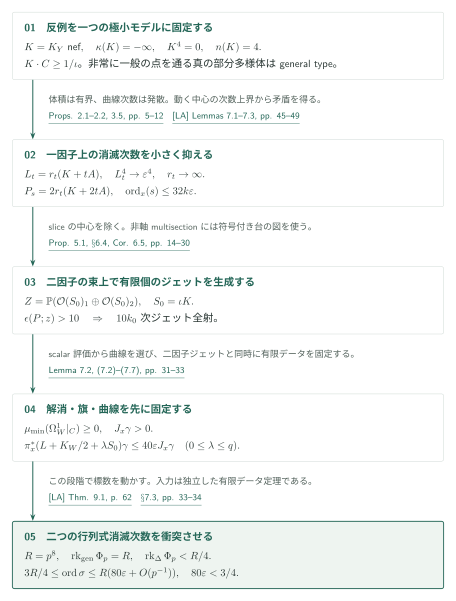
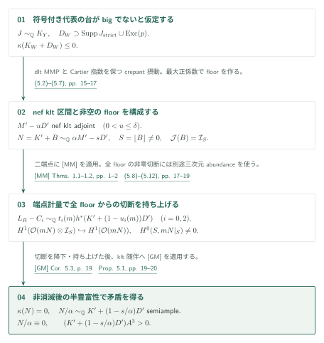
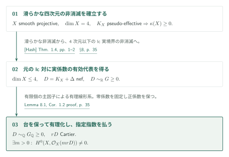

# Fourfold nonvanishing by minimal metrics and moving jets

**一因子の消滅次数と二因子のジェット生成を衝突させる**

反例の四次元極小モデルでは、非常に一般の点を通る曲線の標準次数が正である。この性質から一因子上の切断の消滅次数を小さく抑える一方、二因子上の射影束では大きなジェット生成を得る。両者を固定した有限データに落とし、Frobenius評価行列の行列式に相反する消滅次数を課すのが主証明である。零Lelong数計量と内部単射性は、途中の符号付き境界の議論を支える。

## 1. 主要結果

### Theorem 1.1 — 滑らかな四次元の非消滅（p. 2）

$X$ を滑らかで連結な複素射影四次元多様体とする。$K_X$ がpseudo-effectiveならば、ある正整数 $m$ に対して

\[
H^0(X,mK_X)\ne0.
\]

数値次元、不正則数、Euler標数への仮定はない。$m$ の一様な上界を与える結果ではない。[Theorem 1.1, p. 2][FN]

### Corollary 1.2 — 元のlc対と指定したCartier指数（p. 2）

$(X,\Delta)$ は連結・正規な複素射影lc対、$\dim X\leq4$、$\Delta\geq0$ は有理境界とする。$D=K_X+\Delta$ がnefかつ $\mathbb Q$-Cartierならば、**$rD$ がCartierとなる任意の正整数 $r$** に対し、ある正整数 $m$ が存在して

\[
H^0(X,\mathcal O_X(mrD))\ne0.
\]

$X$ の $\mathbb Q$-factorial性を仮定せず、結論は元の $X$ 上で成り立つ。[Corollary 1.2, p. 2][FN]

### Proposition 5.1 — 符号付き代表の台（証明の中間命題）

原典の仮定は、$Y$ が射影的 $\mathbb Q$-factorial terminal四次元、$K_Y$ がnef、$\kappa(K_Y)=-\infty$、非常に一般の点を通る真の正次元部分多様体が解消上general typeであること。符号を許す有理Weil因子 $J\sim_{\mathbb Q}K_Y$ と対数解消 $p:W\to Y$ を取り、$D_W$ を $J$ のstrict supportと全例外因子を含む被約SNC因子とする。結論は $K_W+D_W$ がbigである。[Proposition 5.1, p. 14][FN]

## 図の矢印に付した引用

略号のない定理・補題・節・式番号は本原稿を指す。主要な外部入力には次の略号を使う。

- [MM] *Minimal metrics and interior injectivity for nef adjoints* · September 27, 2026 · [PDF][MM].
- [LA] *Log abundance in characteristic zero* · September 24, 2026 · [PDF][LA].
- [CT] · Theorem 1.1 · [arXiv v2][CT].
- [Fuj] Fujino, *Abundance theorem for semi log canonical threefolds* · [PDF][Fuj].
- [GM] Gongyo–Matsumura · Corollary 5.3 · [arXiv v2][GM].
- [Hash] Hashizume · Theorem 1.4 · [arXiv v4][Hash].

## 2. Theorem 1.1 の証明

**証明の道筋。** 滑らかな四次元の非消滅を本節で示し、[Corollary 1.2](#proof-3)で lc 対へ移す。途中の符号付き台の枝だけを [Proposition 5.1](#proof-2)へ分け、そこで得た結論を二因子 jet の構成へ戻す。

非消滅の反例を仮定し、一因子での小消滅次数と二因子での大きなジェット生成を同時に作る。最後に[LA]の独立したFrobenius道具へ入力する。$A$ は反例モデル上の固定ample因子、$\varepsilon>0$ は後で十分小さく選ぶ。

### 1. 固定した極小反例の曲線次数を使う

Proposition 2.1は反例を固定した射影的 $\mathbb Q$-factorial terminal四次元 $Y$ に移し、$K=K_Y$ をnef、$\kappa(K)=-\infty$、$K^4=0$、$q(Y)=0$、nef dimension $n(K)=4$ とする。固定Cartier指数 $\iota$ により、非常に一般の点を通るすべての曲線で $K\cdot C\geq1/\iota$。このnef dimensionは数値次元 $\nu(K)$ とは別である。Proposition 2.2は三次元以下のabundanceを使い、その点を通る真の正次元部分多様体をgeneral typeにする。

[Propositions 2.1–2.2 · pp. 5–7][FN]

### 2. 有界体積と発散する次数から消滅次数を抑える

固定した小さい $\varepsilon>0$ に対し $L_t=r_t(K+tA)$ を選び、$L_t^4\to\varepsilon^4$、$r_t\to\infty$ とする。曲線次数は $L_t\cdot C\geq r_t/\iota\to\infty$ だが体積は有界である。高消滅切断が動くと、[LA]からのmoving-multiplicity補題は、**高次ジェット条件を満たす全切断空間**の基底イデアルに通常のイデアル冪の包含を与える。次数と標準交点数の上界を持つgeneral type中心からは有界次数の曲線が得られるため、曲線次数の発散に反する。これがProposition 3.5の全Cartier次数にわたる評価

\[
P_s=2r_t(K+2tA),\qquad
\operatorname{ord}_x(s)\leq4k(P_s^4)^{1/4}\leq32k\varepsilon
\]

となる（pp. 10–12）。

[§§3.4–3.5; Proposition 3.5 · pp. 10–12][FN]

### 3. sliceと対応を除き、二因子でジェットを生成する

二因子では $S_0=\iota K$ と

\[
Z=\mathbb P(\mathcal O(S_0)_1\oplus\mathcal O(S_0)_2)\longrightarrow Y\times Y,
\qquad P=L_{t,1}+L_{t,2}+q\xi
\]

を用いる。台がSNCという解析的条件をこの射影束に直接課すのではない。動く基底成分を各因子のsliceへ制限し、真の像、像上の射影束全体、$Y$ 全体上の非軸multisectionをそれぞれ除く（§6.4, pp. 26–29）。最後のmultisectionの場合に、軸との交差が

\[
D_0-D_\infty\sim e\iota K
\]

という符号付き代表を作り、次節のProposition 5.1を使う。両射影が優勢でgenerically finiteとなる残りの対応は、Proposition 6.4で処理する。分岐因子が全体を掃くことを先に除いてから、[LA, Lemma 7.5, p. 51][LA]で固定開集合上の有限étale被覆を有限個にする。次数の上界だけで被覆の有限性を結論してはいない。Birational automorphism群の議論で得るアーベル多様体から $Y$ への優勢写像は、再び正の標準曲線次数と矛盾する。

[Propositions 6.3–6.4; Corollary 6.5 · pp. 23–30][FN]

この枝で使う [Proposition 5.1 の証明](#proof-2)では、計量による制限全射と、三次元 semi-dlt abundance による境界上の非零切断を別々に用意する。

### 4. 標数を動かす前に有限データを固定する

これによりProposition 6.3の $\epsilon(P;z)>10$、Corollary 6.5の一つの有限な $10k_0$ 次ジェット全射を得る。§7は以後 $t,r_t$ を固定し、解消 $W$、ample摂動 $H$、$\mu_{\min}(\Omega_W^1|_C)\geq0$ の完全交叉旗、点のblowup上の具体的なstrongly movable曲線 $\gamma$ を選ぶ。必要な数値条件は

\[
H^4\leq(2\varepsilon)^4,\quad K_WH^3\leq2H^4/r_t,\quad
(2L+qS_0)H^3\leq4H^4,\quad
(14\varepsilon)^4<1/4,\quad80\varepsilon<3/4.
\]

さらに $J_x\gamma>0$ および

\[
\pi_x^*(L+K_W/2+\lambda S_0)\gamma\leq40\varepsilon J_x\gamma
\quad(0\leq\lambda\leq q)
\]

を満たす。曲線は一つの固定双有理モデル上のample完全交叉の押し出しとして選ぶ。数値錐の特殊化を仮定せず、還元後の有効因子にも交点評価を使うためである。

[Theorem 7.1; §§7.1–7.2 · pp. 31–33][FN]

### 5. 同じ行列式の上下界を比較する

Theorem 7.1は[LA, Theorem 9.1, p. 62][LA]の再記述であり、これらの固定データの共存を否定する。§7.3の比較では標数 $p$ で一般点の階数は $R=p^8$、対角上は $R/4$ 未満となる。非零行列式 $\sigma$ の二つの因子束を $\gamma$ で評価すると

\[
\operatorname{ord}_{(x',x')}\sigma\leq R(80\varepsilon+O(p^{-1})),
\qquad
\operatorname{ord}_{(x',x')}\sigma\geq3R/4,
\]

となり、大きな $p$ で矛盾する。ジェットを評価する点 $z_*$ とこの対角点を定める $x$ は一致を要求されない。有限データをすべて複素数体上で固定してから $p$ を動かす順序が必要である。

[§7.3 · pp. 33–34][FN]

## 3. Proposition 5.1 の証明

符号付き代表の台を含む被約SNC境界 $D_W$ に対して、$K_W+D_W$ がbigでないと仮定する。空でない floor上の切断を先に構成・持ち上げ、その後にklt半豊富性の判定へ進む。

### 1. 空でない floorを持つnef境界を作る

bigでないと仮定すると、正の小平次元は一般ファイバーのgeneral type性によってbigを強制するため、$\kappa(K_W+D_W)\leq0$。dlt MMPとCartier指数を保つcrepantな小摂動MMPを経て、$M'\sim_{\mathbb Q}G'$、$\kappa(M')\leq0$ と、nef klt随伴の区間 $M'-uD'$（$0<u\leq\delta$）を得る。$G'$ は $D'$ 上の符号付き因子である。最大の正係数を $a$ とし、小さい $s>0$ で

\[
B=(1-s)D'+(s/a)G',\quad \alpha=1+s/a,\quad
N=K'+B\sim_{\mathbb Q}\alpha M'-sD',\quad S=\lfloor B\rfloor\ne0
\]

を作る。$0\leq B\leq D'$、$(Z',B)$ はlc、$N$ はnef、$\mathcal J(Z',B)=\mathcal I_S$ である。

[§5; (5.2)–(5.7) · pp. 15–17][FN]

### 2. 端点計量から全floorへの制限全射を得る

$0<b_0<1<b_2$ を固定して解消上の有効SNC境界 $C_i$ を構成する。式(5.9)の端点残余束は

\[
L_R-C_i\sim_{\mathbb Q}
t_i(m)h^*(K'+(1-u_i(m))D'),\qquad
t_i(m)>0,\quad u_i(m)\to s/\alpha\in(0,\delta)
\]

となる。[MM, Theorem 1.1][MM]が実際の端点束へ零Lelong数計量を与え、[MM, Theorem 1.2][MM]と局所消滅が

\[
H^1(Z',\mathcal O(mN)\otimes\mathcal I_S)\hookrightarrow H^1(Z',\mathcal O(mN))
\]

を与える。従って十分大きく可除な $m$ で $H^0(Z',mN)\to H^0(S,mN|_S)$ は全射である。

[(5.9)–(5.10) · p. 18][FN] · [MM, Theorems 1.1–1.2 · pp. 1–2][MM]

### 3. 全floor上の非零切断を降ろして持ち上げる

非零切断は別途作る。dlt blowupの全floor $T$ に随伴し、三次元semi-dlt abundanceを適用する。式(5.12)の局所消滅と $g_*\mathcal O_T=\mathcal O_S$ で、conductor上の一致を含む**全体の**切断を $S$ へ降ろして持ち上げる。こうして初めて $\kappa(N)=0$ が分かる。

[(5.11)–(5.12) · p. 19][FN]

### 4. 非消滅を得た後にklt半豊富性を使う

最後に $N/\alpha\sim_{\mathbb Q}K'+(1-s/\alpha)D'$ へ[GM, Corollary 5.3, p. 19][GM]を適用し、semiampleかつ小平次元0から数値的自明性を得る。$K'$ がpseudo-effective、$D'\ne0$、$1-s/\alpha>0$ なのでample立方との交点は正となり、矛盾する。GMの非消滅仮定を先取りしない順序である。

[§5, final klt adjoint · pp. 19–20][FN] · [GM, Corollary 5.3 · p. 19][GM]

この矛盾で符号付き台を持つ枝を処理し、[主証明の slice・対応の排除](#proof-1-step-3)へ戻る。その後の二因子 jet と Frobenius の比較が滑らかな非消滅を閉じる。

## 4. Corollary 1.2 の証明

滑らかなcanonical非消滅をlc対へ移し、得られた実係数の有効代表を有理化する。指定した指数 $r$ を保ったまま元の多様体上で切断を得る。

### 1. 滑らかな非消滅をlc非消滅へ渡す

[Hash, Theorem 1.4, p. 2][Hash]は滑らかな四次元のcanonical nonvanishingから、四次元以下の射影lc対の非消滅を導く。nefな $D$ はpseudo-effectiveなので、元の正規多様体上で $D\sim_{\mathbb R}G\geq0$ を得る。

[§8 · pp. 34–35][FN] · [Hash, Theorem 1.4 · pp. 1–2][Hash]

### 2. 台を保って有理化し、指定指数の分母を払う

Lemma 8.1はこの同値を有限個の主因子と素因子による有理係数線形系へ書き直し、零係数を固定して正係数を保つ有理解を取る。従って同じ台を持つ $G_{\mathbb Q}\geq0$ に対し $D\sim_{\mathbb Q}G_{\mathbb Q}$。係数の分母と指定済みの $r$ を同時に払えば、元の $X$ 上に $mrD$ の切断が得られる。$\mathbb Q$-factorial化したモデル上だけの結論ではない。

[Lemma 8.1; Corollary 1.2 proof · pp. 34–35][FN]

## 5. どの論文が、どの段階を担うか

**Supported lifting への二つの入力。** [Corollary 1.2 → Corollary 1.4](https://masataka123.github.io/OpenAI-Math-Digest/ja/papers/lifting-adjoint-sections/#proof-3-step-2) は四次元で最初の切断を供給する。[Lemma 8.1 → Theorem 1.3](https://masataka123.github.io/OpenAI-Math-Digest/ja/papers/lifting-adjoint-sections/#proof-3-step-1) は有効な実係数表示の有理化だけを供給し、全次元の滑らかな非消滅の前提を置き換えない。

| 入力 | 使用箇所と供給内容 | 確認範囲 |
|---|---|---|
| [MM, Theorems 1.1–1.2, pp. 1–2][MM] | Theorems 4.1–4.2, pp. 13–14、Proposition 5.1, pp. 18–20。端点計量、通常の単射性、最後のklt計量。 | 記述・端点式・適用を照合。MM本文も前稿で読解したが解析的全証明の認定ではない。 |
| [LA, Lemmas 7.1–7.5, pp. 45–52][LA] | §3の中心・次数評価、§6のsliceと固定分岐補集合。 | 入力の記述と主要使用箇所を照合。補題全証明は対象外。 |
| [LA, Theorem 9.1, p. 62][LA] | Theorem 7.1、§§7.1–7.3, pp. 31–34。有限データのFrobenius矛盾。 | 仮定を照合し、本稿の旗・曲線・ジェット・行列式比較を読解。LAの証明全体は未検証。 |
| [CT, Theorem 1.1, p. 2][CT] | Proposition 2.1と§5のMMP停止。 | v2の記述とnef部分0の通常対への適用を照合。 |
| [Fuj, Corollary 4.10][Fuj] | §5, p. 19。被約floor全体のsemi-dlt三次元abundance。 | 利用先の随伴・降下を読解。指定Corollaryの外部原記述は取得できず保留。 |
| [GM, Corollary 5.3, p. 19][GM] | Proposition 5.1末尾, pp. 19–20。非消滅後のklt半豊富性。 | v2の記述と適用を照合。 |
| [Hash, Theorem 1.4, pp. 1–2][Hash] | §8, p. 35。滑らかな非消滅からlc実境界へ。 | v4の記述・関連Conjectures 1.1–1.3と適用を照合。 |

[LA]のabundance主定理やlogarithmic Iitaka subadditivityを本稿の入力としていない。[Supported lifting][Lift]との関係は、Corollary 1.2をその非消滅後の結果と組み合わせる**帰結**として序論p. 3に記される。本稿の滑らかな非消滅の証明へ逆向きの依存を作らない。

## 6. 原典を読む入口と確認範囲

[§§2–3 · pp. 5–12][FN] · [§§4–5 · pp. 13–20][FN] · [§§6–7 · pp. 21–34][FN] · [§8 · pp. 34–35][FN]

§2, pp. 5–7の固定反例、§3.4–3.5, pp. 10–12の次数障害とscalar order、§§4–5, pp. 13–20の解析入力と符号付き台、§6.3–6.5, pp. 23–30の対応・場合分け・有限ジェット、§7, pp. 30–34の有限データと行列式、§8, pp. 34–35の有理化を読解した。Theorem 7.1の全数値条件はPDF p. 31の画像でも照合した。

未完了なのは、moving-centerの全局所イデアル計算、有限被覆・birational群構造の外部証明、HMX有効双有理性、generic semipositivityと旗の制限定理の原記述照合、Fujinoの指定三次元Corollary、Frobenius・傾き評価の全証明である。これらを成立済みとして編集側が保証するものではない。今回の改訂はこれらの未確認を維持し、主要結果・証明導入・番号付き説明と出典を揃えた。

原稿は2026年9月27日版。頁はPDF頁、参照commitは `adc7f1241b42e322a6451854ab7e4b4c146bf78a`。

[FN]: https://github.com/openai/math/blob/adc7f1241b42e322a6451854ab7e4b4c146bf78a/preprints/Fourfold-nonvanishing-by-minimal-metrics-and-moving-jets-September-27-2026/paper.pdf

[MM]: https://github.com/openai/math/blob/adc7f1241b42e322a6451854ab7e4b4c146bf78a/preprints/Minimal-metrics-and-interior-injectivity-for-nef-adjoints-September-27-2026/paper.pdf
[LA]: https://github.com/openai/math/blob/adc7f1241b42e322a6451854ab7e4b4c146bf78a/preprints/Log-abundance-in-characteristic-zero-September-24-2026/paper.pdf
[Lift]: https://github.com/openai/math/blob/adc7f1241b42e322a6451854ab7e4b4c146bf78a/preprints/Lifting-sections-from-the-reduced-support-of-an-adjoint-September-27-2026/paper.pdf
[CT]: https://arxiv.org/pdf/2011.02236v2
[Fuj]: https://www.math.kyoto-u.ac.jp/~fujino/Abundance.pdf
[GM]: https://arxiv.org/pdf/1406.6132v2
[Hash]: https://arxiv.org/pdf/1609.00121v4
