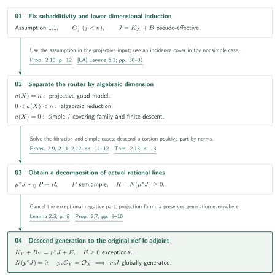
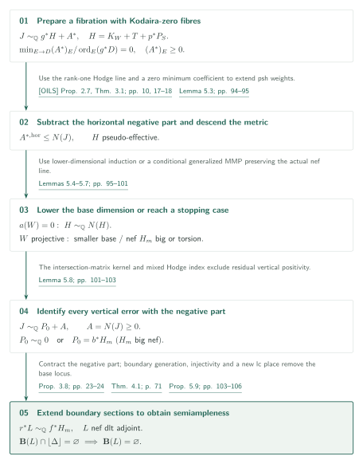
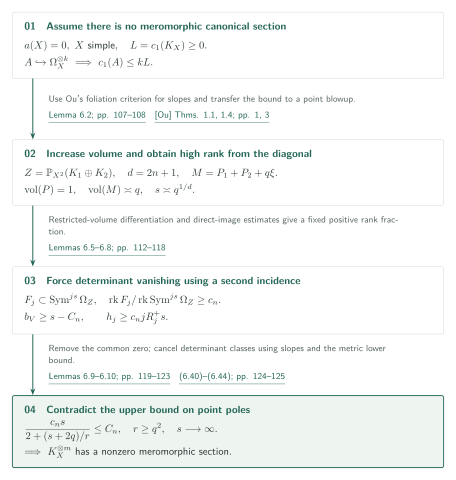
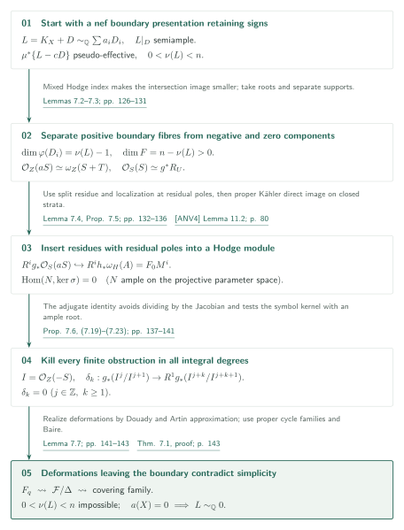

# Compact Kähler log abundance under logarithmic Iitaka subadditivity

**Source:** OpenAI, *Log abundance for compact Kähler spaces under logarithmic Iitaka subadditivity*, 4 October 2026 version, 148 pages. [Pinned PDF][P], commit `adc7f1241b42e322a6451854ab7e4b4c146bf78a`. 034 is the official catalog number, 01 the position within it, and `kahler-log-abundance` the site's internal identifier.

> AI-generated draft. The authors' conditional claims are distinguished from the editorial verification scope. This is not a certification of the entire proof. Consult the original and the outstanding connections recorded below.

## Assumption 1.1 and Theorem 1.2

The paper assumes that for every surjective morphism $f:X\to Y$ with connected fibres between smooth connected complex projective varieties, and reduced effective SNC divisors $D_X,D_Y$, including zero divisors,

$$
\operatorname{Supp}(f^*D_Y)\subseteq\operatorname{Supp}(D_X)
\quad\Longrightarrow\quad
\kappa(X,K_X+D_X)\ge\kappa(F,K_F+D_F)+\kappa(Y,K_Y+D_Y)
$$

([Assumption 1.1, p. 3][P]). Here $F$ is a very general smooth fibre and $D_F=D_X|_F$. The source's convention for $\kappa=-\infty$ is retained.

**Theorem 1.2 ([p. 3][P]).** Assume Assumption 1.1. Let $X$ be a normal irreducible compact Kähler complex analytic space, and let $\Delta\ge0$ be a rational boundary such that $(X,\Delta)$ is lc and $J=K_X+\Delta$ is $\mathbb Q$-Cartier. If $J$ is analytically nef, there is a positive integer $m$ such that $mJ$ is Cartier and the evaluation map

$$
H^0(X,\mathcal O_X(mJ))\otimes_{\mathbb C}\mathcal O_X
\longrightarrow\mathcal O_X(mJ)
$$

is surjective everywhere. This includes every finite dimension and zero boundary, but remains **conditional on subadditivity**. It asserts generation of an actual holomorphic line bundle, a stronger conclusion than expressing its Chern class as the pullback of a Kähler class.

The assumption enters through the projective good-model statement [Proposition 2.10, p. 12][P]. That proposition invokes the induction in [LA], Proposition 2.5, Theorem 9.6 and §10, and identifies its subadditivity use in [LA, Lemma 6.1, pp. 30–31][LA]: a resolved projective Albanese fibration with both boundaries zero. This is the stated entry point of the condition in the present paper.

## Theorem 2.13 — A good divisorial decomposition of actual lines

The inductive assertion $G_n$ concerns a smooth connected compact Kähler $n$-fold, an SNC boundary $B$ with coefficients in $[0,1]\cap\mathbb Q$, and a pseudo-effective adjoint $J=K_X+B$. It asks for a smooth Kähler modification $\mu:Y\to X$ and

$$
\mu^*J\sim_{\mathbb Q}P+R,
\qquad P\text{ semiample},\qquad R=N(c_1(\mu^*J))\ge0
$$

([Definition 2.1, p. 6][P]). Here $R$ is a rational divisor, $N$ is the analytic divisorial negative part, and $\sim_{\mathbb Q}$ means an isomorphism of actual rational holomorphic lines. [Theorem 2.13, p. 13][P] asserts all $G_n$ under Assumption 1.1.

If the algebraic dimension is $a(X)=n$, Kähler–Moishezon makes $X$ projective and Proposition 2.10 applies. If $0<a(X)<n$, algebraic reduction gives a nontrivial fibration. When $a(X)=0$ and $X$ is not simple, [Cam, Lemma 17 / Corollary 18, p. 10][Cam] supplies an incidence space with a nontrivial fibration and a generically finite evaluation onto $X$. Its algebraic dimension is still zero, so a semiample positive part there is torsion. Finite analytic norms and uniqueness of the negative part descend this purely negative decomposition ([Proposition 2.9, p. 11][P]). A space is simple when no positive-dimensional proper compact subvariety passes through a very general point.

The final passage to the main theorem is [Proposition 2.7, pp. 9–10][P]. Giving exceptional divisors coefficient one on an lc resolution yields $K_Y+B_Y=p^*J+E$, with $E\ge0$ exceptional. Lemma 2.3 shows that $E$ is added unchanged to the negative part, so it can be cancelled in the actual line identity. If the original $J$ is nef, its remaining negative part is zero. Normality, $p_*\mathcal O_Y=\mathcal O_X$, and the projection formula identify sections and descend generation to the original singular space.

## Sections 3–4 — Programs and generation on the boundary

[Proposition 3.8, pp. 23–24][P] starts with an actual presentation $J\sim_{\mathbb Q}P+E$, where $P$ is nef and $E$ remains the entire negative part on a resolution. It contracts $E$ while descending a fixed Cartier multiple of $P$ at every step. With only a signed presentation, [Theorem 3.13 / Corollary 3.14, pp. 29–32][P] apply. Lower-dimensional $G_j$ supplies one model carrying a nef parameter interval; every divisorial negative multiplicity is affine there. A nontrivial wall changes its slope, so such walls cannot remain in that interval. Curves away from the floor have zero intersection with an adjoint represented on the floor, precluding further negative operations after special termination.

**Theorem 4.1 ([p. 71][P])** assumes $G_j$ for $j<n$. Let $(V,B)$ be a normal irreducible compact Kähler dlt $n$-fold, globally $\mathbb Q$-factorial, with effective rational boundary and analytically nef $J=K_V+B$. Under the lc-strata resolution condition of Definition 3.1, an actual Cartier multiple of $J|_{\lfloor B\rfloor}$ is generated on the **whole reduced boundary**. The resolution condition asks for a resolution with exceptional crepant coefficients strictly below one, which is an isomorphism at the generic point of every lc centre.

Generation on individual adjunction components does not immediately descend to their union. The source uses residue comparisons in divisible even degree, compatibility on every lower stratum, and finite images of self-comparisons on vertical strata. Products over those finite images give invariant generating tuples in a common degree. Gluing them produces sections on the whole boundary ([Proposition 4.11 and the conclusion of Theorem 4.1, pp. 88–89][P]). The full auxiliary proofs of the restricted model theory in §3 and boundary theory in §4 are outside this draft's independent audit.

## Proposition 5.1 — The fibration case

Assume Assumption 1.1 and $G_j$ for $j<n$. Let $X$ be a smooth connected compact Kähler $n$-fold, $B$ a rational SNC boundary, and $J=K_X+B$ pseudo-effective. Suppose there are a modification $\pi:\widetilde X\to X$ and a base $W$, both smooth compact Kähler, such that $\widetilde B=\pi_*^{-1}B+\operatorname{Exc}(\pi)_{\mathrm{red}}$ has SNC support. Suppose the proper surjective holomorphic map $g:(\widetilde X,\widetilde B)\to W$ has connected fibres, $0<\dim W<n$, the base is projective or has $a(W)=0$, and $\kappa(F,K_F+\widetilde B_F)=0$ on very general fibres. [Proposition 5.1, p. 90][P] gives $G_n$ in this situation. Algebraic reduction and relative Iitaka construction reduce general nontrivial fibrations to this rank-one case. If $a(X)=0$ and the fibre is of log general type, slightly lowering horizontal coefficients below one allows a stable-family comparison that produces a positive-dimensional projective factor, contradicting algebraic dimension zero ([pp. 90–91][P]).

The rank-one Hodge line and period positivity from [OILS] give a prepared model with

$$
J\sim_{\mathbb Q}g^*H+A^*,\qquad
H=K_W+T+M,\qquad M=p^*P_S
$$

where $T$ is a rational SNC boundary, $p:W\to S$ contracts onto a smooth projective variety, and $P_S$ is a nef rational line. If $S$ is a point, $M\sim_{\mathbb Q}0$; otherwise $K_S+a_0P_S$ is big for some $a_0>0$. [Lemma 5.2, pp. 91–94][P] retains nonnegative coefficients $(A^*)_E$ at primes dominating a base divisor, with minimum normalized coefficient zero. Signs at primes mapping into codimension at least two are not yet determined.

Fibre induction puts the horizontal part $A^{*,\mathrm{hor}}$ inside $N(J)$. Subtracting it from a positive curvature current leaves a metric whose weight is constant on connected smooth fibres and descends to the base. The zero coefficient above each base prime gives local upper boundedness and extension of the descended weight, proving that $H$ is pseudo-effective ([Lemma 5.3, pp. 94–95][P]).

If $a(W)=0$, then $S$ is a point and lower-dimensional induction gives $H\sim_{\mathbb Q}N(H)$. For projective $W$, a chosen conditional generalized MMP either lowers the base dimension or reaches a nef $H_m$ that is big or torsion. In a second program decreasing the nef data, adding a sufficiently large fixed multiple of $H_{\mathrm{nef}}$ combines the extremal-ray length bound with Cartier integrality to force every contraction to be $H_{\mathrm{nef}}$-trivial ([Lemmas 5.6–5.7, pp. 95–101][P]). Semiampleness of the Hodge line itself is not assumed.

[Lemma 5.8, pp. 101–103][P] proves that the resulting divisor $A$, including the pulled-back base error, is effective and equals $N(J)$. Mixed Hodge index handles images of codimension at least two. For divisorial images, the intersection matrix has only whole-fibre multiples in its kernel; the zero minimum coefficient excludes the residual vertical part. A torsion positive part finishes the argument. In the big nef case, Proposition 3.8 contracts the negative part and [Proposition 5.9, pp. 103–106][P] applies. It extends the boundary sections of Theorem 4.1 through analytic injectivity [FM], then creates a new floor over any remaining base locus using an lc threshold. Boundary generation for this new pair gives a contradiction, proving semiampleness of the actual adjoint.

## Theorem 6.1 — Meromorphic nonvanishing on a simple space

[Theorem 6.1, p. 107][P] states that a smooth connected simple compact Kähler manifold with $a(X)=0$ has a nonzero **meromorphic** section of $K_X^{\otimes m}$ for some $m>0$. Its proof is independent of Assumption 1.1. It does not assert a holomorphic section or an effective canonical representative.

Assuming no canonical power has a meromorphic section, the Albanese map and simplicity give $H^1(\mathcal O_X)=0$. Uniruledness and foliation criteria [Ou] make $L=c_1(K_X)$ pseudo-effective and imply $c_1(A)\le kL$ for every line subsheaf $A\to\Omega_X^{\otimes k}$. Countably many line bundles can be handled simultaneously, carrying the estimate to a blowup at a very general point ([Lemma 6.2, pp. 107–108][P]).

Write $K_i,P_i$ for pullbacks from the two factors of $X^2$, and $\xi=c_1(\mathcal O_Z(1))$. A big class $P$ normalized to volume one has point-pole threshold $\tau(P,x)\le C_n$. On the other hand, on $Z=\mathbb P_{X^2}(K_1\oplus K_2)$, with $d=2n+1$, the class $M=P_1+P_2+q\xi$ has volume comparable to $q$. Blowing up the diagonal in $Z^2$ and differentiating restricted volumes produces, for $s\asymp q^{1/d}$, a subsheaf occupying a fixed positive proportion of the rank of $\operatorname{Sym}^{js}\Omega_Z$ ([Lemmas 6.5–6.8, pp. 112–118][P]).

An incidence arising from the diagonal in $X^2$ then converts the pole bound $b_V\ge s-C_n$ into vanishing of coefficients. A fixed positive proportion of the rows in each high-rank determinant must vanish to high order. After factoring out the common zero, restrict the determinant to a point blowup and apply the cotangent slope estimate again. The normalized determinant classes cancel, giving

$$
\frac{c_n s}{2+(s+2q)/r}\le C_n,
\qquad r\ge q^2,\qquad s\asymp q^{1/(2n+1)}
$$

([equations (6.40)–(6.44), pp. 124–125][P]). The left side diverges, a contradiction. The order of limits matters: fix the geometric data for each $q$ before taking the divisible integer $j$ large.

## Theorem 7.1 — From a signed boundary to torsion

[Theorem 7.1, p. 125][P] assumes a normal irreducible, globally $\mathbb Q$-factorial, simple compact Kähler space $X$ with $a(X)=0$, a dlt pair with reduced boundary $D=\sum D_i$, and the resolution condition of Definition 3.1. Suppose $L=K_X+D$ is analytically nef; $L\sim_{\mathbb Q}\sum a_iD_i$ as actual rational lines, allowing negative $a_i\in\mathbb Q$; the pullback of $\{L-cD\}$ to a projective resolution with smooth compact Kähler source is pseudo-effective for some $c>0$; and $L|_D$ is semiample on the whole reduced boundary. Then $L$ is torsion.

Suppose $0<\nu(L)<n$. Mixed Hodge index and the intersection matrix of the signed coefficients produce a positive-coefficient component whose boundary-map image has dimension $\nu(L)-1$. Its general fibres avoid the negative- and zero-coefficient components ([Lemma 7.2, pp. 126–127][P]). Taking roots and separating the positive and negative supports gives local neighborhoods with a reduced Cartier divisor $S$, a residual boundary $T$, and an actual isomorphism $\mathcal O_Z(aS)\simeq\omega_Z(S+T)$. Residue on a resolution yields a split injection retaining the residual poles $A$,

$$
R^i g_*\mathcal O_S(aS)\hookrightarrow R^i h_*\omega_H(A)
$$

([Lemmas 7.3–7.4, pp. 128–133][P]). The divisors $A$ and $H$ may intersect, so these extra poles must be retained.

[Proposition 7.5, pp. 133–136][P] localizes SNC local cohomology along the residual poles. Decomposition into proper Kähler closed strata supplies the lowest Hodge filtration and symbol-kernel vanishing. [Proposition 7.6, pp. 137–141][P] makes

$$
g_*(I^j/I^{j+k+1})\longrightarrow g_*(I^j/I^{j+k})
\quad (j\in\mathbb Z,\ k\ge1)
$$

surjective for $I=\mathcal O_Z(-S)$, in every integral degree and at every finite order. The obstruction is a degree-$k$ derivation. An adjugate identity on a coordinate-power cover sends it into the symbol kernel without dividing by the Jacobian. Maps from the ample root line to that kernel vanish, killing even obstructions supported at special parameters. This extends the lifting method of [ANV4] to residual poles.

Lift the boundary-fibre equations and normal direction through all finite orders. Douady space and analytic Artin approximation then produce compact deformations leaving the boundary. Scheme-theoretic images under finite maps and cycles of bounded volume allow proper incidence images that include limits. Countability and Baire's theorem give a covering family of positive-dimensional proper subvarieties, contradicting simplicity ([Lemma 7.7 and the conclusion of Theorem 7.1, pp. 141–143][P]). The case $\nu=0$ gives torsion through the signed identity; $\nu=n>0$ gives bigness and $a(X)=n$, which is excluded.

In the [proof of Proposition 2.12, pp. 144–145][P], enlarge to a reduced SNC boundary $D$ containing the signed canonical divisor from Theorem 6.1, then use Corollary 3.14 to reach a nef dlt model. Theorem 4.1 supplies boundary generation; [Ou] and exceptional negative-part subtraction supply pseudo-effectivity with $c=1$. After Theorem 7.1 gives torsion, uniqueness of the positive current in [Lemma 2.6, p. 9][P] allows subtraction of the added boundary, recovering a purely negative decomposition of the original $J$. This closes the simple case, then Theorem 2.13 and finally Theorem 1.2.

## Inputs and verification scope

| Input | Direct use | Editorial comparison |
|---|---|---|
| [LA] *Log abundance in characteristic zero*, 2026-09-24 | Proposition 2.10 here; input Proposition 2.5 p. 9, Theorem 9.6 p. 69, §10 p. 72, Lemma 6.1 pp. 30–31 | Statements, completion of induction, and subadditivity use compared; entire input proof outside scope |
| [OILS] *Orbifold and logarithmic Iitaka subadditivity*, 2026-09-26 | Lemma 5.2 and §§5.1 / 5.4 here; input Lemma 2.6 p. 9, Proposition 2.7 p. 10, Theorem 3.1 pp. 17–18, Lemma 3.3 p. 18, Lemma 5.2 p. 32 | Hypotheses, conclusions and uses compared; proofs of Hodge-line construction, positivity and stable-family comparison outside scope |
| [CGM4] *Conditional good minimal models…*, 2026-10-05 | Adjunction and strict comparison on strata in §3; input Lemmas 7.16–7.17 pp. 58–60 | Dimension-free lemma statements compared; its four-dimensional main theorem is not an all-dimensional input |
| [ANV4] *Abundance after nonvanishing…*, 2026-09-27 | Root neighborhoods, residue, filtered direct image and obstruction derivations in §7; input Lemma 10.1 p. 66, Proposition 10.4 p. 71, Proposition 11.1 p. 75, Lemma 11.2 p. 80, Lemmas 12.1–12.2 pp. 82–84 | Statements compared; extension to residual poles is made here in Lemma 7.4 / Proposition 7.5 |
| [HX] Hacon–Xie, arXiv:2607.24986v1 | Theorem 1.3 p. 2: analytic cone and length bound, used here on p. 16 | Statement compared; the entire restricted model theory here is not independently audited |
| [TX] arXiv:2301.09186v3 / [Xie] arXiv:2211.10800v1 | Proposition 5.5, p. 97. TX Theorems A (=4.2), B (=5.4), D (=5.2), p. 2; Xie Theorem 1.5, pp. 2–3 | Compared relative smooth-model induction, NQC decompositions, scaling hypotheses and descent of actual lines; input proofs outside scope |
| [Ou] arXiv:2501.18088v1 | Theorems 1.1 / 1.4 pp. 1, 3; Lemma 6.2 and canonical pseudo-effectivity on p. 144 | Statements and applications compared; not all slope-related auxiliary inputs compared |
| [FM] Fujino–Matsumura, author version 2021-07-15 | Theorem A p. 3; section extension in Proposition 5.9, p. 105 | Curvature lower bound, multiplier ideal and multiplying-section hypotheses compared |
| [Sai] arXiv:2204.09026v5 | Theorem 1 p. 1; applied to smooth closed strata in Proposition 7.5, p. 135 | Constant-source proper Kähler direct-image statement compared; independent verification of mixed/localized transitions remains open |
| [Cam] arXiv:2605.19713v2 | Lemma 17 / Corollary 18 p. 10; Theorem 2.13, p. 13 here | Generically finite incidence statement and use compared |

The editorial reading covers the main theorem and the selected routes in §§2, 5 and 7; the two contraction/termination connections in §3; the generating-tuple conclusion in §4; and the slope, two-diagonal and determinant-cancellation passages in §6. **This is not a record of verifying all 148 pages.** The detailed reading list is in `sources.json`.

Further editorial checks concern the restricted model induction and finite geography in §3.8; the full residue-comparison and finite-image proofs in §§4.2–4.4; the direct-image estimate in §6.3 and all local calculations of Lemma 6.10; and strictness of the residual-pole filtered direct image in §7.3 and its connection to Sabbah–Schnell vanishing. Uses of Boucksom's negative-part theory, mixed Hodge index and Douady/Artin/Fujiki results were read here, but independent comparison of all their original hypotheses is incomplete. Uninvestigated catalog relations remain uninvestigated, rather than being recorded as absent.

[P]: https://github.com/openai/math/blob/adc7f1241b42e322a6451854ab7e4b4c146bf78a/preprints/Log-abundance-for-compact-Kahler-spaces-under-logarithmic-Iitaka-subadditivity-October-4-2026/main.pdf
[LA]: https://github.com/openai/math/blob/adc7f1241b42e322a6451854ab7e4b4c146bf78a/preprints/Log-abundance-in-characteristic-zero-September-24-2026/paper.pdf
[OILS]: https://github.com/openai/math/blob/adc7f1241b42e322a6451854ab7e4b4c146bf78a/preprints/Orbifold-and-logarithmic-Iitaka-subadditivity-September-26-2026/paper.pdf
[CGM4]: https://github.com/openai/math/blob/adc7f1241b42e322a6451854ab7e4b4c146bf78a/preprints/Conditional-good-minimal-models-for-compact-Kahler-fourfolds-October-5-2026/paper.pdf
[ANV4]: https://github.com/openai/math/blob/adc7f1241b42e322a6451854ab7e4b4c146bf78a/preprints/Abundance-after-nonvanishing-for-compact-Kahler-fourfolds-September-27-2026/paper.pdf
[HX]: https://arxiv.org/pdf/2607.24986v1
[Ou]: https://arxiv.org/pdf/2501.18088v1
[FM]: https://www.math.kyoto-u.ac.jp/~fujino/fm_injectivity_Transaction_AMS_v8.pdf
[Sai]: https://arxiv.org/pdf/2204.09026v5
[Cam]: https://arxiv.org/pdf/2605.19713v2
[TX]: https://arxiv.org/pdf/2301.09186v3
[Xie]: https://arxiv.org/pdf/2211.10800v1
