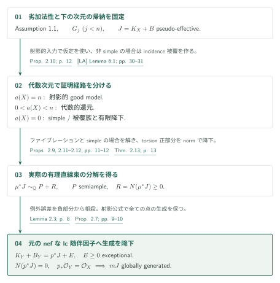
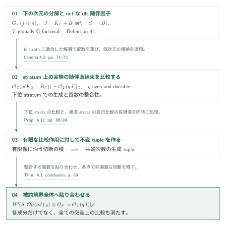
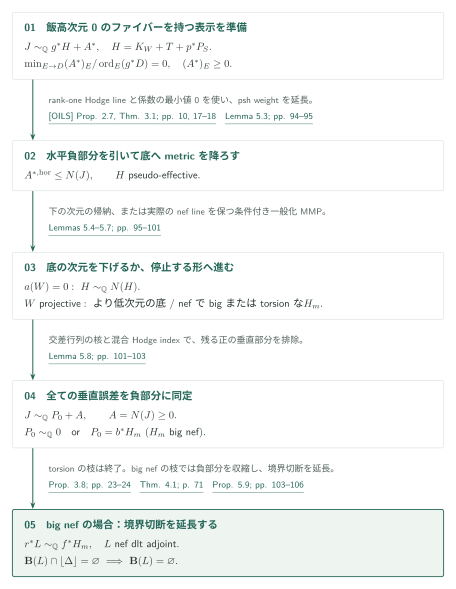
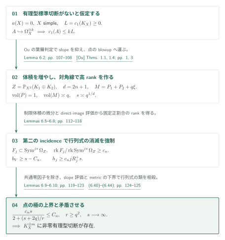
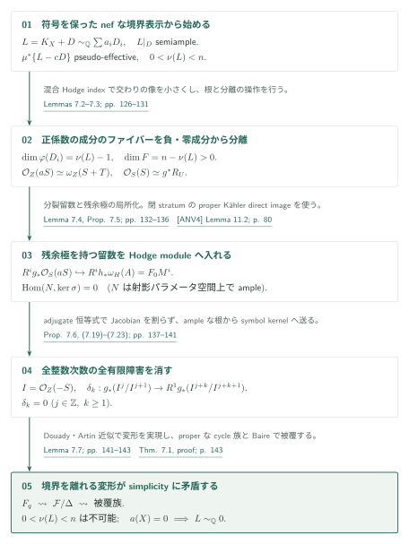

# Log abundance for compact Kähler spaces under logarithmic Iitaka subadditivity

**条件付きの次元帰納と、実際の直線束の生成への帰着**

対数飯高劣加法性を仮定し、全ての有限次元のコンパクトKähler lc対でnefな随伴因子の半豊富性を示す原稿である。良い因子的分解を次元帰納で作り、ファイブレーションのHodge lineとsimple空間の符号付き境界を通じて、実際の正則直線束の生成へ進む。

## 1. 主要結果

以下は、前提の Assumption 1.1、最終目標の Theorem 1.2、帰納命題の Theorem 2.13、四つの証明用の道具の順に並ぶ。原典の順序と各結果の適用範囲を保つ。

### Assumption 1.1 — 対数飯高劣加法性

本稿の仮定は、滑らかな連結複素射影多様体間の連結ファイバーを持つ全射 $f:X\to Y$、零因子を許す被約有効SNC因子 $D_X,D_Y$ について

$$
\operatorname{Supp}(f^*D_Y)\subseteq\operatorname{Supp}(D_X)
\quad\Longrightarrow\quad
\kappa(X,K_X+D_X)\ge\kappa(F,K_F+D_F)+\kappa(Y,K_Y+D_Y)
$$

が成り立つこと、すなわち [Assumption 1.1、p. 3][P] である。$F$ はvery generalな滑らかなファイバー、$D_F=D_X|_F$。$\kappa=-\infty$ の規約も原典のままとする。

[Assumption 1.1 · p. 3][P]

### Theorem 1.2 — コンパクトKähler空間のlog abundance

Assumption 1.1を仮定する。$X$ は正規既約コンパクトKähler複素解析空間、$\Delta\ge0$ は有理境界、$(X,\Delta)$ はlc、$J=K_X+\Delta$ は $\mathbb Q$-Cartierとする。$J$ が解析的nefなら、ある正整数 $m$ に対し $mJ$ はCartierで、評価写像

$$
H^0(X,\mathcal O_X(mJ))\otimes_{\mathbb C}\mathcal O_X
\longrightarrow\mathcal O_X(mJ)
$$

が全ての点で全射となる。有限次元すべてと零境界を含むが、**劣加法性を仮定する条件付き定理**である。結論は実際の正則直線束の生成であり、そのChern類がKähler類の引き戻しであるという結論より強い。

[Theorem 1.2 · p. 3][P]

### Theorem 2.13 — 良い因子的分解

帰納命題 $G_n$ は、滑らかな連結コンパクトKähler $n$ 次元多様体、係数 $[0,1]\cap\mathbb Q$ のSNC境界 $B$、pseudo-effectiveな $J=K_X+B$ に対して、滑らかなKähler modification $\mu:Y\to X$ と

$$
\mu^*J\sim_{\mathbb Q}P+R,
\qquad P\text{ semiample},\qquad R=N(c_1(\mu^*J))\ge0
$$

を与えることをいう（[Definition 2.1、p. 6][P]）。$R$ は有理因子、$N$ は解析的因子的負部分であり、$\sim_{\mathbb Q}$ は実際の有理正則直線束の同型を表す。[Theorem 2.13、p. 13][P] はAssumption 1.1の下で全ての $G_n$ を主張する。

[Definition 2.1; Theorem 2.13 · pp. 6, 13][P]

### Theorem 4.1 — 被約境界全体の生成

$G_j$（$j<n$）を仮定する。大域的に $\mathbb Q$-factorialな正規既約コンパクトKähler dlt $n$ 次元対 $(V,B)$、有効有理境界、解析的nefな $J=K_V+B$、Definition 3.1のlc strataに適合した解消を仮定すると、あるCartier倍の $J|_{\lfloor B\rfloor}$ が**被約境界全体**で生成される。この解消条件は、例外crepant係数が1未満で、各lc中心の一般点で同型となる解消の存在である。

[Theorem 4.1 · p. 71][P]

### Proposition 5.1 — rank-oneのファイブレーション

Assumption 1.1と $G_j$（$j<n$）を仮定する。$X$ は滑らかな連結コンパクトKähler $n$ 次元多様体、$B$ は有理SNC境界で、$J=K_X+B$ はpseudo-effectiveとする。滑らかなコンパクトKähler modification $\pi:\widetilde X\to X$ と滑らかなコンパクトKähler底 $W$ があり、$\widetilde B=\pi_*^{-1}B+\operatorname{Exc}(\pi)_{\mathrm{red}}$ はSNC支持を持つとする。proper全射 $g:(\widetilde X,\widetilde B)\to W$ が連結ファイバーを持ち、$0<\dim W<n$、$W$ は射影的または $a(W)=0$、very generalファイバーで $\kappa(F,K_F+\widetilde B_F)=0$ とする。[Proposition 5.1、p. 90][P] はこの場合に $G_n$ を与える。

[Proposition 5.1 · p. 90][P]

### Theorem 6.1 — simple空間の有理型非消滅

滑らかな連結simpleコンパクトKähler多様体で $a(X)=0$ なら、ある $m>0$ に対し $K_X^{\otimes m}$ に非零**有理型**切断がある、というのが [Theorem 6.1、p. 107][P] である。この定理はAssumption 1.1から独立して証明される。正則切断や有効な標準因子を結論してはいない。

[Theorem 6.1 · p. 107][P]

### Theorem 7.1 — 符号付き剛性

[Theorem 7.1、p. 125][P] は、正規既約・大域的 $\mathbb Q$-factorialなsimpleコンパクトKähler空間 $X$、$a(X)=0$、被約境界 $D=\sum D_i$ のdlt対とDefinition 3.1の解消条件を仮定する。$L=K_X+D$ が解析的nefで、実際の有理直線束として $L\sim_{\mathbb Q}\sum a_iD_i$（$a_i\in\mathbb Q$、負も許す）、ある $c>0$ に対し滑らかなコンパクトKähler空間を始域とする射影的解消上の $\{L-cD\}$ の引き戻しがpseudo-effective、かつ $L|_D$ が被約境界全体でsemiampleなら、$L$ はtorsionとなる。

[Theorem 7.1 · p. 125][P]

## 図の矢印に付した引用

略号なしは本原稿 [P] の結果を指す。カタログ内の[LA]、[CGM4]、[ANV4]は使用する結果を限定して記す。[OILS]はrank-one Hodge lineとperiodの入力、その他はカタログ外の道具である。

- [LA, Proposition 2.5 / Theorem 9.6 / §10][LA]
- [CGM4, Lemmas 7.16–7.17][CGM4] / [ANV4, §§10–12][ANV4]
- [OILS, Proposition 2.7 / Theorem 3.1][OILS]
- [Ou, Theorems 1.1 / 1.4][Ou] / [FM, Theorem A][FM]
- [Sai, Theorem 1][Sai] / [Cam, Lemma 17 / Corollary 18][Cam]

## 2. Theorems 2.13・1.2の証明：次元帰納の全体経路

**証明の道筋。** 最終目標は Theorem 1.2、帰納命題は Theorem 2.13 である。[境界全体の生成](#proof-2)を共通の道具として、[正次元のファイブレーション](#proof-3)と、simple な場合の[有理型非消滅](#proof-4)・[符号付き剛性](#proof-5)を全体図に戻す。

下の次元の $G_j$ を仮定して $G_n$ を示す。代数次元とsimplicityで場合分けし、最後にnefな元のlc随伴因子へ切断の生成を降下する。

### 1. 劣加法性が使われる入口を固定する

仮定の使用箇所は [Proposition 2.10、p. 12][P] の射影的good modelである。同命題は[LA]の Proposition 2.5、Theorem 9.6、§10の帰納を引用し、その中で劣加法性を使うのは [LA, Lemma 6.1、pp. 30–31][LA] の解消したAlbaneseファイブレーション、しかも両境界が0の場合であると指定する。本稿の条件はこの入口を通じて保持される。

[Proposition 2.10 · p. 12][P] · [LA, Lemma 6.1 · pp. 30–31][LA]

### 2. 正の代数次元では射影的入力か代数的還元へ進む

代数次元 $a(X)=n$ ならKähler–Moishezonにより射影的となり、Proposition 2.10を使う。$0<a(X)<n$ では代数的還元が非自明なファイブレーションを与える。

[Propositions 2.10–2.11; Theorem 2.13 · pp. 12–13][P]

### 3. 代数次元0の非simpleな場合は被覆とnormを使う

$a(X)=0$ かつ非simpleなら、[Cam, Lemma 17 / Corollary 18、p. 10][Cam] の被覆族から、非自明なファイブレーションを持ち $X$ へgenerically finiteに写るincidence空間を作る。上の空間も代数次元0なのでsemiampleな正部分はtorsionになる。有限解析的normと負部分の一意性により、この純粋に負の分解を降下する（[Proposition 2.9、p. 11][P]）。simpleとはvery general点を通る正次元の真のコンパクト部分多様体がないことである。

[Proposition 2.9; Theorem 2.13 · pp. 11, 13][P] · [Cam, Lemma 17 / Corollary 18][Cam]

### 4. simpleな場合を符号付き剛性で閉じる

simpleで $a(X)=0$ の場合は、Theorem 6.1で符号を許す標準因子を作り、境界を追加してnefモデルへ移る。境界生成とTheorem 7.1からtorsionを得て、追加境界を負部分から差し引くのがProposition 2.12である。この経路は第5・6節で説明する。

[Proposition 2.12, proof · pp. 144–145][P]

### 5. 例外誤差を消し、特異な元の空間へ生成を降下する

最後の主定理への移行は [Proposition 2.7、pp. 9–10][P]。lc解消で例外因子に係数1を置くと $K_Y+B_Y=p^*J+E$、$E\ge0$ は例外的となる。Lemma 2.3はこの $E$ が負部分へそのまま加わることを示すので、直線束の恒等式から差し引ける。元の $J$ がnefなら残る負部分は0である。正規性による $p_*\mathcal O_Y=\mathcal O_X$ と射影公式が切断を一致させ、生成を元の特異空間へ降下する。

[Lemma 2.3; Proposition 2.7 · pp. 8–10][P]

## 3. §§3–4の接続：モデルと被約境界全体の生成

**strata 上で何を比較するか。** [CGM4 Lemmas 7.16–7.17](https://masataka123.github.io/OpenAI-Math-Digest/ja/papers/conditional-kahler-fourfolds/#strata-input)は、実際の随伴線束と、small dlt step の両側の厳密比較を与え、本稿 Theorem 3.13 に入る。さらに [ANV4 Lemma 7.1](https://masataka123.github.io/OpenAI-Math-Digest/ja/papers/abundance-after-nonvanishing/#torsion-free-input) の torsion-freeness を本稿 Lemma 4.3 で使い、留数の整合から切断の延長へ進む。これは、後の §7 が ANV4 §§10–12 の持ち上げを使う接続とは別である。 [Theorem 3.13 · pp. 29–30; Lemma 4.3 · p. 74][P]

既知の負部分を収縮する操作と、境界全体に切断を貼り合わせる操作を区別する。前者は実際のnef lineを保ち、後者は下位strataの帰納と留数の整合性から生成を得る。

### 1. 既知の負部分を収縮し、nef lineを保存する

[Proposition 3.8、pp. 23–24][P] は、実際の表示 $J\sim_{\mathbb Q}P+E$ で $P$ がnef、$E$ が解消上でも全負部分であるとき、$P$ の固定Cartier倍を各段階で降下しながら $E$ を収縮する。

[Proposition 3.8 · pp. 23–24][P]

### 2. 符号付き表示では下位strataの帰納で停止する

signedな表示だけがある場合には [Theorem 3.13 / Corollary 3.14、pp. 29–32][P] を使う。下の次元の $G_j$ から一つのモデル上にnefなパラメータ区間を作り、その上では各付値の負部分係数がaffineになる。一方、非自明な壁はその傾きを変えるため、区間内に壁は残らない。floorを避ける曲線はfloor支持のsigned adjointと交わらず、special termination後の負の操作が不可能になる。

[Theorem 3.13; Corollary 3.14 · pp. 29–32][P]

### 3. 留数の比較を全下位stratumで揃える

成分ごとの随伴による生成をそのまま和へ降ろすことはできない。原典は、偶数の可除次数における留数比較、全ての下位stratumとの整合性、垂直stratumの自己比較作用の有限像を用いる。有限像に対する切断の積を取り、共通の次数で不変な生成tupleを作る。これを接合して境界全体の切断にするのが [Proposition 4.11とTheorem 4.1の結論、pp. 88–89][P] である。§3の制限されたモデル理論と§4の全補助証明は、今回の独立な精査の範囲には含めない。

[Lemma 4.2; Proposition 4.11; Theorem 4.1, conclusion · pp. 71–73, 88–89][P]

## 4. Proposition 5.1の証明：ファイブレーションに沿う降下

一般の非自明なファイブレーションは、代数的還元と相対飯高写像でこのrank-oneの場合へ帰着する。$a(X)=0$ でファイバーがlog general typeなら、係数を1未満へ少し下げたstable family比較が正次元射影因子を生み、代数次元0に矛盾する（[pp. 90–91][P]）。

底のrank-one表示を作り、誤差を全負部分へ同定してから正部分を生成する。

### 1. Hodge lineと誤差の係数を準備する

[OILS]のrank-one Hodge lineとperiodの正値性を用い、準備したモデル上で

$$
J\sim_{\mathbb Q}g^*H+A^*,\qquad
H=K_W+T+M,\qquad M=p^*P_S
$$

とする。$T$ は有理SNC境界、$p:W\to S$ は滑らかな射影多様体への収縮、$P_S$ はnef有理直線束である。$S$ が点なら $M\sim_{\mathbb Q}0$、正次元ならある $a_0>0$ に対し $K_S+a_0P_S$ がbig。[Lemma 5.2、pp. 91–94][P] は、底の素因子を支配する各 $E$ で $(A^*)_E\ge0$ かつその正規化係数の最小値が0であることを保つ。底の余次元2以上へ写る素因子での符号はこの段階では未確定である。

[Lemma 5.2 · pp. 91–94][P] · [OILS, Proposition 2.7 / Theorem 3.1][OILS]

### 2. 水平負部分を引き、底の擬有効性を得る

ファイバーの $G_j$ により水平部分 $A^{*,\mathrm{hor}}$ は $N(J)$ に含まれる。正の曲率currentからこれを差し引くと、連結な滑らかなファイバー上でweightが定数となり、底へ降りる。各底素因子の上の係数0の成分が、降りたweightの上有界性と延長を保証し、$H$ がpseudo-effectiveになる（[Lemma 5.3、pp. 94–95][P]）。

[Lemma 5.3 · pp. 94–95][P]

### 3. 底の次元を下げるか、bigまたはtorsionへ進む

$a(W)=0$ なら $S$ は点で、下の次元の帰納により $H\sim_{\mathbb Q}N(H)$。射影的 $W$ では条件付き一般化MMPを選び、底次元を下げるか、nefでbigまたはtorsionな $H_m$ に到達する。nef dataを減らす第二のMMPでも、十分大きい固定倍の $H_{\mathrm{nef}}$ を加え、extremal rayの長さとCartier整性で全収縮を $H_{\mathrm{nef}}$-trivialにする（[Lemmas 5.6–5.7、pp. 95–101][P]）。ここでHodge line自身のsemiamplenessは仮定しない。

[Lemmas 5.4–5.7 · pp. 95–101][P]

### 4. 全ての垂直誤差を負部分に同定する

[Lemma 5.8、pp. 101–103][P] は底から引き戻した誤差を含む $A$ が有効で、しかも $A=N(J)$ であることを示す。余次元2以上の像には混合Hodge index、因子的な像には交差行列の核が全ファイバーの倍数だけであることと係数の最小値0を用い、未検出の余分な垂直部分を消す。

[Lemma 5.8 · pp. 101–103][P]

### 5. 境界切断を延長してbase locusを消す

torsionの場合はこれで終わる。big nefの場合はProposition 3.8で負部分を収縮し、[Proposition 5.9、pp. 103–106][P] を適用する。Theorem 4.1の境界切断を[FM]の解析的injectivityから延長し、残るbase locusにはlc thresholdで新しいfloorを作る。同じ境界生成に矛盾させ、実際のadjointをsemiampleにする。

[Proposition 3.8; Theorem 4.1; Proposition 5.9 · pp. 23–24, 71, 103–106][P]

## 5. Theorem 6.1の証明：二つの対角線と有理型非消滅

標準冪に有理型切断がないと仮定して矛盾を導く。一方の対角線で大きいrankを作り、もう一方でその行列式の消滅を強制し、点に許される極の上界と比較する。

### 1. 切断がないという仮定からslopeを抑える

全ての標準冪に有理型切断がないと仮定すると、Albanese写像とsimplicityから $H^1(\mathcal O_X)=0$ となる。[Ou]のuniruledness判定と葉層定理により、$L=c_1(K_X)$ はpseudo-effectiveで、直線部分層 $A\to\Omega_X^{\otimes k}$ に対して $c_1(A)\le kL$ が得られる。可算個の直線束を同時に扱い、very general点のblowupにもこの評価を運ぶ（[Lemma 6.2、pp. 107–108][P]）。

[Lemma 6.2 · pp. 107–108][P] · [Ou, Theorems 1.1 / 1.4][Ou]

### 2. 第一の対角線で高rankの部分層を作る

$K_i,P_i$ は $X^2$ の各因子からの引き戻し、$\xi=c_1(\mathcal O_Z(1))$ とする。体積1に正規化したbig類 $P$ は点での極の閾値 $\tau(P,x)\le C_n$ を満たす。一方、$Z=\mathbb P_{X^2}(K_1\oplus K_2)$、$d=2n+1$ 上に $M=P_1+P_2+q\xi$ を作ると $\operatorname{vol}(M)\asymp q$。$Z^2$ の対角線のblowupと制限体積の微分を用い、$s\asymp q^{1/d}$ で $\operatorname{Sym}^{js}\Omega_Z$ の固定正割合のrankを占める部分層を得る（[Lemmas 6.5–6.8、pp. 112–118][P]）。

[Lemmas 6.5–6.8 · pp. 112–118][P]

### 3. 第二のincidenceで行列式の消滅を強制する

次に $X^2$ の対角線に由来するincidenceを使い、極の下界 $b_V\ge s-C_n$ を係数の消滅次数へ変換する。高rankの行列式では正割合の行が必ず大きく消える。

[Lemmas 6.9–6.10 · pp. 119–123][P]

### 4. 行列式の類を相殺し、点の極の上界に矛盾させる

共通因子を除いた後の行列式を点のblowupへ制限し、cotangentのslope評価を再適用すると、正規化した行列式の類が相殺されて

$$
\frac{c_n s}{2+(s+2q)/r}\le C_n,
\qquad r\ge q^2,\qquad s\asymp q^{1/(2n+1)}
$$

を得る（[式 (6.40)–(6.44)、pp. 124–125][P]）。左辺は発散するので矛盾する。各 $q$ の幾何データを先に固定してから可除な $j$ を大きくする、という極限の順序を保つ議論である。

[(6.40)–(6.44) · pp. 124–125][P]

## 6. Theorem 7.1とProposition 2.12の証明：符号付き境界からtorsionへ

中間の数値次元 $0<\nu(L)<n$ を、境界を離れるコンパクト変形で排除する。$\nu=0$ と最大次元の場合は別に処理し、得たtorsionからsimpleな場合の帰納命題を回収する。

### 1. 正の境界ファイバーを負と零の支持から分離する

$0<\nu(L)<n$ を仮定する。混合Hodge indexとsigned係数の交差行列により、正係数の成分上で境界写像の像次元が $\nu(L)-1$ となり、その一般ファイバーは負係数・零係数の成分を避ける（[Lemma 7.2、pp. 126–127][P]）。根を取って正負の支持を分離すると、局所近傍に被約Cartier因子 $S$ と残余境界 $T$ ができ、$\mathcal O_Z(aS)\simeq\omega_Z(S+T)$ を実際の同型として保てる。

[Lemmas 7.2–7.3 · pp. 126–131][P]

### 2. 残余極を保持した留数をHodge理論へ入れる

解消上の留数は残余極 $A$ を含む

$$
R^i g_*\mathcal O_S(aS)\hookrightarrow R^i h_*\omega_H(A)
$$

という分裂単射になる（[Lemmas 7.3–7.4、pp. 128–133][P]）。$A$ と $H$ は交わり得るので、残余極を捨てることはできない。

[Proposition 7.5、pp. 133–136][P] はSNCの局所cohomologyを残余極に沿って局所化し、proper Kählerな閉stratumへの分解から最低Hodge filtrationとsymbol kernelの消滅を得る。

[Lemma 7.4; Proposition 7.5 · pp. 132–136][P]

### 3. 全ての整数次数と有限段階で障害を消す

[Proposition 7.6、pp. 137–141][P] は $I=\mathcal O_Z(-S)$ の全ての整数次数・全有限段階で

$$
g_*(I^j/I^{j+k+1})\longrightarrow g_*(I^j/I^{j+k})
\quad (j\in\mathbb Z,\ k\ge1)
$$

を全射にする。障害を次数 $k$ のderivationとして表し、座標冪被覆のJacobianを割らないadjugate恒等式でsymbol kernelへ送る。ampleな根の直線束からそのkernelへの写像は0なので、特殊パラメータに支持された障害も消える。[ANV4]の持ち上げ法を残余極付きへ拡張した部分である。

[Proposition 7.6 · pp. 137–141][P]

### 4. 境界を離れる変形からsimplicityに矛盾させる

境界ファイバーの方程式と法方向を全有限次数で持ち上げ、Douady空間と解析的Artin近似により、境界を離れるコンパクト変形を得る。有限写像のscheme-theoretic像と有界体積のcycleを使うことで、極限も含むproperなincidenceの像を取れる。可算性とBaireの議論から正次元の真の部分多様体の被覆族が生じ、simplicityに矛盾する（[Lemma 7.7とTheorem 7.1の結論、pp. 141–143][P]）。$\nu=0$ はsigned同型からtorsion、$\nu=n>0$ はbigにより $a(X)=n$ となって除外される。

[Lemma 7.7; Theorem 7.1, conclusion · pp. 141–143][P]

### 5. 追加境界を引き、元の随伴因子へ戻す

[Proposition 2.12の証明、pp. 144–145][P] では、Theorem 6.1のsigned canonical divisorを含む被約SNC境界 $D$ を追加し、Corollary 3.14でnef dlt modelへ移る。Theorem 4.1が境界生成を、[Ou]と例外的負部分の除去が $c=1$ のpseudo-effectivityを与える。Theorem 7.1でtorsionを得た後、[Lemma 2.6、p. 9][P] の正currentの一意性で追加境界を差し引き、元の $J$ の純粋に負の分解を回収する。これでsimpleの場合を閉じ、Theorem 2.13、さらにTheorem 1.2へ戻る。

[Proof of Proposition 2.12; Lemma 2.6 · pp. 144–145, 9][P]

## 7. どの論文が、どの段階を担うか

| 略号・入力 | 直接の使用箇所 | 編集側の照合 |
|---|---|---|
| [LA] *Log abundance in characteristic zero*、2026-09-24 | 本稿 Proposition 2.10。入力 Proposition 2.5 p. 9、Theorem 9.6 p. 69、§10 p. 72、Lemma 6.1 pp. 30–31 | 定理記述・帰納の終段・劣加法性の使用箇所を照合。入力の全証明は対象外 |
| [OILS] *Orbifold and logarithmic Iitaka subadditivity*、2026-09-26 | 本稿 Lemma 5.2と§5.1 / §5.4。入力 Lemma 2.6 p. 9、Proposition 2.7 p. 10、Theorem 3.1 pp. 17–18、Lemma 3.3 p. 18、Lemma 5.2 p. 32 | 仮定・結論と使用箇所を照合。Hodge lineの構成・正値性・stable familyの証明は対象外 |
| [CGM4] *Conditional good minimal models…*、2026-10-05 | §3のstrataへの随伴・strict comparison。入力 Lemmas 7.16–7.17 pp. 58–60 | 次元制限のない補題の記述を照合。四次元の主定理を全次元の入力にはしない |
| [ANV4] *Abundance after nonvanishing…*、2026-09-27 | §7の根の近傍、留数、filtered direct image、障害derivation。入力 Lemma 10.1 p. 66、Proposition 10.4 p. 71、Proposition 11.1 p. 75、Lemma 11.2 p. 80、Lemmas 12.1–12.2 pp. 82–84 | 記述を照合。残余極への拡張は本稿 Lemma 7.4 / Proposition 7.5で行う |
| [HX] Hacon–Xie, arXiv:2607.24986v1 | Theorem 1.3 p. 2のanalytic cone・長さ評価を本稿 p. 16で使用 | 記述を照合。本稿の制限付きモデル理論の全証明は未精査 |
| [TX] arXiv:2301.09186v3 / [Xie] arXiv:2211.10800v1 | 本稿 Proposition 5.5、p. 97。TXのTheorems A (=4.2), B (=5.4), D (=5.2) p. 2、XieのTheorem 1.5 pp. 2–3 | 相対的な滑らかな最小モデルの帰納、NQC分解、scalingの仮定と直線束の降下を照合。入力の証明は対象外 |
| [Ou] arXiv:2501.18088v1 | Theorems 1.1 / 1.4 pp. 1, 3。Lemma 6.2とp. 144のcanonical pseudo-effectivity | 記述と適用を照合。slope関連の全補助結果は未照合 |
| [FM] Fujino–Matsumura、2021-07-15著者版 | Theorem A p. 3。本稿 Proposition 5.9 p. 105の切断延長 | 曲率下界・乗数イデアル・掛ける切断の仮定を照合 |
| [Sai] arXiv:2204.09026v5 | Theorem 1 p. 1。本稿 Proposition 7.5 p. 135で滑らかな閉stratumに適用 | constant-sourceのproper Kähler direct imageの記述を照合。混合・局所化への接続の独立検証は保留 |
| [Cam] arXiv:2605.19713v2 | Lemma 17 / Corollary 18 p. 10。本稿 Theorem 2.13 p. 13 | generically finiteなincidenceの記述と使用箇所を照合 |

## 8. 原典を読む入口と確認範囲

編集側は主定理と §§2、5、7の上記経路、§3の二つの停止・収縮の接続、§4の生成tupleによる終段、§6のslope・二対角線・行列式相殺の該当箇所を読んだ。**148頁の全証明を検証したという記録ではない。** 上記の引用箇所を原典への入口として示した。

残る未確認は、§3.8の制限付きモデル帰納・finite geography、§4.2–4.4の留数比較と有限像の証明全体、§6.3のdirect-image評価とLemma 6.10の全局所計算、§7.3の残余極を持つfiltered direct imageのstrictnessとSabbah–Schnell vanishingへの接続である。Boucksomの負部分・混合Hodge index・Douady/Artin/Fujikiの外部定理は本稿の使用箇所を読んだが、原文の全仮定との独立な照合を完了していない。未調査のカタログ関係は「依存なし」とせず未調査のままとする。

[P]: https://github.com/openai/math/blob/adc7f1241b42e322a6451854ab7e4b4c146bf78a/preprints/Log-abundance-for-compact-Kahler-spaces-under-logarithmic-Iitaka-subadditivity-October-4-2026/main.pdf
[LA]: https://github.com/openai/math/blob/adc7f1241b42e322a6451854ab7e4b4c146bf78a/preprints/Log-abundance-in-characteristic-zero-September-24-2026/paper.pdf
[OILS]: https://github.com/openai/math/blob/adc7f1241b42e322a6451854ab7e4b4c146bf78a/preprints/Orbifold-and-logarithmic-Iitaka-subadditivity-September-26-2026/paper.pdf
[CGM4]: https://github.com/openai/math/blob/adc7f1241b42e322a6451854ab7e4b4c146bf78a/preprints/Conditional-good-minimal-models-for-compact-Kahler-fourfolds-October-5-2026/paper.pdf
[ANV4]: https://github.com/openai/math/blob/adc7f1241b42e322a6451854ab7e4b4c146bf78a/preprints/Abundance-after-nonvanishing-for-compact-Kahler-fourfolds-September-27-2026/paper.pdf
[HX]: https://arxiv.org/pdf/2607.24986v1
[Ou]: https://arxiv.org/pdf/2501.18088v1
[FM]: https://www.math.kyoto-u.ac.jp/~fujino/fm_injectivity_Transaction_AMS_v8.pdf
[Sai]: https://arxiv.org/pdf/2204.09026v5
[Cam]: https://arxiv.org/pdf/2605.19713v2
[TX]: https://arxiv.org/pdf/2301.09186v3
[Xie]: https://arxiv.org/pdf/2211.10800v1
