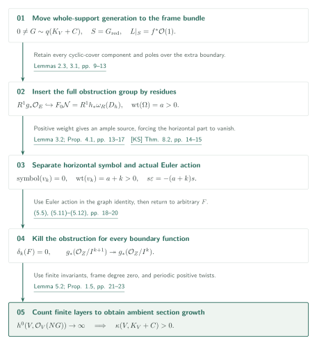
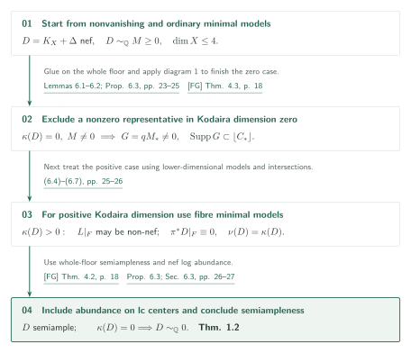
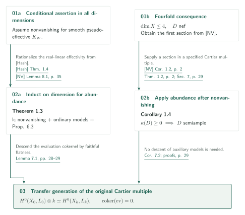

# Lifting sections from the reduced support of an adjoint

**From generation on the whole reduced support to finite-order lifting and section growth**

OpenAI, September 27, 2026 version, 40 pages; item 07 within official catalog 034. Fixed commit: `adc7f1241b42e322a6451854ab7e4b4c146bf78a`. This AI-generated exposition reports the [manuscript's claims][S], without certifying the full proof. Consult the source for important claims and arguments.

The paper seeks ambient sections from generation on the reduced support of an effective adjoint multiple. It retains gluing across the entire support and uses positive frame weight to eliminate obstructions on finite neighborhoods. Supported lifting holds in every dimension; fourfold nonvanishing is neither a hypothesis nor an input to its proof.

## Main results (source order, all on p. 2)

### Theorem 1.1 — Supported boundary lifting

Let $(V,C)$ be a normal projective $\mathbb Q$-factorial dlt pair over an algebraically closed field of characteristic zero, with effective rational boundary $C$, and put $A=K_V+C$. For a sufficiently divisible positive integer $q$, suppose a nonzero effective Cartier divisor $G$ satisfies
$$0\ne G\ge0,\qquad G\sim qA,\qquad\operatorname{Supp}G\subseteq\operatorname{Supp}\lfloor C\rfloor.$$
If $\mathcal O_V(G)|_{G_{\mathrm{red}}}$ is semiample on the **whole reduced scheme**, then $\kappa(V,A)>0$. [Theorem 1.1][S]

No additional nefness is assumed. The support inclusion can be strict: writing $C=S+H+C_0$, with $S=G_{\mathrm{red}}$, the extra coefficient-one divisor $H$ may meet $S$ and its strata. Semiampleness separately on normalized components cannot replace the whole-support hypothesis.

### Theorem 1.2 — Abundance after nonvanishing

For a projective lc pair $(X,\Delta)$ over $\mathbb C$ of dimension at most four with effective rational boundary, suppose $D=K_X+\Delta$ is $\mathbb Q$-Cartier, nef, and $\kappa(X,D)\ge0$. Then $D$ is semiample; if $\kappa(X,D)=0$, then $D\sim_{\mathbb Q}0$. No uniform index is asserted. The extension to arbitrary algebraically closed characteristic-zero fields is separately stated as Corollary 7.2 (p. 29). [Theorem 1.2 and Corollary 7.2][S]

### Theorem 1.3 — Reduction to smooth canonical nonvanishing

Assume, **in every dimension**, that every smooth connected projective complex variety $W$ with pseudo-effective $K_W$ has $H^0(W,mK_W)\ne0$ for some $m>0$. Then every normal projective lc pair $(X,\Delta)$ over any algebraically closed characteristic-zero field, with effective rational boundary and nef $\mathbb Q$-Cartier adjoint $D=K_X+\Delta$, has semiample $D$. The premise is not restricted to nef canonical divisors. [Theorem 1.3][S]

### Corollary 1.4 — Fourfold log abundance

For a normal projective lc pair $(X,\Delta)$ over an algebraically closed characteristic-zero field, of dimension at most four with effective rational boundary and nef $\mathbb Q$-Cartier adjoint $D=K_X+\Delta$, the divisor $D$ is semiample. If $\kappa(X,D)=0$, then $D\sim_{\mathbb Q}0$. This is where [NV] Corollary 1.2 adds fourfold lc nonvanishing. [Corollary 1.4; proof on p. 29][S]

## Proof diagram 1 — Kill the supported lifting obstruction

Replace $G$ by a multiple so that $L=\mathcal O_V(G)$ satisfies $L|_S=f^*\mathcal O_{\mathbb P^\ell}(1)$. Pass to the nonzero-frame bundle $P=L^\times$ and construct two cyclic covers, **retaining every component when the algebras split**. On a resolution there is a logarithmic form $\sigma$ of positive frame weight $a$, with residue $\Omega$. The polar divisor $D_h$ retains poles above intersections with $H$. Lemma 2.3 inserts the obstruction group into
$$\iota:R^1g_*\mathcal O_E\hookrightarrow R^1h_*\omega_R(D_h)=F_0\mathcal N\hookrightarrow\mathcal N.$$
Here $g:E\to B$, $h:R\to B$, and $B=\mathcal O_{\mathbb P^\ell}(1)^\times$. The lowest piece $F_0\mathcal N$ of a mixed Hodge module on the boundary graph retains cohomology concentrated on smaller supports. [§2, Lemmas 2.3, 3.1, pp. 5–13][S]

With $I=(y)$, divide the obstruction from order $k$ to $k+1$ by $y^k$. This gives a derivation $\delta_k:g_*\mathcal O_E\to R^1g_*\mathcal O_E$: the product of two lifting errors vanishes modulo $y^{k+1}$. The graph-residue computation gives, for **every** boundary function $F$,
$$\iota(\delta_k(F))+\sum_i\iota(F\delta_k(t_i))\partial_{t_i}=0,$$
using the right $\mathscr D$-module action, as in (5.5). Set $F=1$ and take the first symbol. The resulting zero-symbol tensor has weight $a+k>0$. A transverse finite cover and the adjugate of its differential turn a nonzero horizontal part into a nonzero map from an ample line into the lowest symbol kernel. Lemma 3.2, derived from Kodaira–Saito vanishing, excludes it. [Proposition 4.1, Lemma 4.2, Proposition 5.1, pp. 13–20][S]

For the vertical part, vanishing of the symbol alone is insufficient. The **actual** Euler action $s\varepsilon=-(a+k)s$ and the residue identity kill that part; returning to arbitrary $F$ then gives $\delta_k(F)=0$. This separation is the core of the lifting argument. [§4.3, (5.11)–(5.12), pp. 17, 20][S]

Finite-group invariants and frame degree zero descend the construction to divisorial layers on $V$. The periodicity $Q_{j-r}=Q_j\otimes\mathcal O(1)$ accumulates positive twists. Higher cohomology remains bounded while sections grow. Passing from finite neighborhoods to the ambient variety loses at most the fixed number $h^1(V,\mathcal O_V)$:
$$h^0(V,\mathcal O_V(NG))\ge h^0(V,\mathcal O_V(NG)/\mathcal O_V)-h^1(V,\mathcal O_V)\longrightarrow\infty.$$
When $\ell=0$, the number of layers still grows. No convergent formal neighborhood or extension of the boundary morphism to a whole neighborhood is assumed. [Lemma 5.2 and proof of Proposition 1.5, pp. 21–23][S]

## Proof diagram 2 — Abundance after nonvanishing

Proposition 6.3 assumes **ordinary** minimal models for effective lc pairs through dimension $d$, and full lc abundance below $d$. It deduces abundance after nonvanishing in dimension $d$; good minimal models are not assumed at the outset. [pp. 23–24][S]

For $\kappa(D)=0$, suppose $0\ne M\ge0$ and $M\sim_{\mathbb Q}D$. Raise support coefficients to one on a resolution, then pass to an ordinary minimal model $(V_*,C_*)$. Kodaira dimension zero and an effective representative $M_*$ are retained. Nefness of the original $D$ and negativity ensure $M_*$ does not disappear. Lower-dimensional abundance and [FG] normalization gluing give semiampleness on the **whole floor**. Diagram 1 applied to $G=qM_*$ contradicts Kodaira dimension zero, so $D\sim_{\mathbb Q}0$. [Lemmas 6.1–6.2 and Proposition 6.3, pp. 23–25][S]

For $\kappa(D)=k>0$, on a resolution write $L=K_W+\Gamma=\pi^*D+N$, with effective exceptional $N$. The fibre adjoint $L|_F$ need not be nef. Take an ordinary minimal model of that effective fibre pair and apply lower-dimensional abundance there. Comparison (6.6) and nonnegative intersections yield $\pi^*D|_F\equiv0$, and then $\nu(D)=\kappa(D)$. Whole-floor semiampleness also gives abundance on normalized lc centers. [FG] Theorem 4.2 now applies. [Proposition 6.3, pp. 25–27][S]

For $d=4$, insert known lower-dimensional abundance and Birkar's ordinary minimal-model theorem for effective lc fourfolds to obtain Theorem 1.2. Transfer to other characteristic-zero fields descends and extends a specified Cartier multiple of the original divisor and its evaluation map; it does not assert preservation of $\mathbb Q$-factoriality under field descent. [§§6.3, 7, pp. 27–29][S]

## Proof diagram 3 — Separate the conditional and fourfold consequences

For Theorem 1.3, assume smooth canonical nonvanishing **in all dimensions**. [Hash] Theorem 1.4 supplies lc nonvanishing and ordinary minimal models. The passage from real-linear to rational-linear effectivity uses only the finite rational linear algebra in [NV] Lemma 8.1, separately from that paper's fourfold nonvanishing theorem. Proposition 6.3 then closes dimension induction. [§6.3, p. 27][S]

For Corollary 1.4, [NV] Corollary 1.2 supplies a nonzero section in a multiple of a prescribed Cartier multiple on the original normal lc variety; Theorem 1.2 and field transfer finish the argument. That nonvanishing input does not enter the proofs of Theorems 1.1–1.2. Appendix A gives a separate conormal–period method, not an input to diagram 1. [§7, p. 29; Appendix A, pp. 30–38][S]

## External inputs and checks

| Input | Use | Scope checked |
|---|---|---|
| [KS] Kodaira–Saito vanishing | Lemma 3.2, p. 13: negative hypercohomology with an inverse ample twist | Compared Popa author's PDF Theorem 8.2, PDF pp. 14–15. The manuscript cites published Theorem 28, a different numbering scheme |
| [Saito] Projective direct-image strictness for mixed Hodge modules | Lemma 3.1, pp. 12–13: the entire coherent lowest piece | Read the application and local calculation; rechecking Saito 1990 Theorem 2.14 / Proposition 2.15 is pending |
| [FG] Theorems 4.3 / 4.2, final author PDF p. 18 | Whole-floor gluing in Lemma 6.2 and nef log abundance in Proposition 6.3 | Compared statements, hypotheses, and uses; proofs excluded |
| [Bir] Corollary 1.6, accessed arXiv PDF p. 3 | §6.3, p. 27: ordinary minimal models of effective lc fourfolds | Statement checked; distinguished from good models |
| [Hash] Theorem 1.4, arXiv v4 §1 | Theorem 1.3 only: smooth nonvanishing gives lc nonvanishing and ordinary models | Compared Conjectures 1.1–1.3 and the implication |
| [NV] Corollary 1.2, p. 2; Lemma 8.1, p. 35 | The former feeds Corollary 1.4; the latter rationalizes Theorem 1.3 | Statements and uses on pp. 27, 29 checked; full nonvanishing proof excluded |

Theorem 1.2 also occurs in the final assembly of fourfold log Iitaka in [Ufour], §10, pp. 48–49; its detailed use belongs to that article. Classical threefold abundance and its correction, and all external splitting/vanishing theory used for residue insertion, are not collectively certified here.

## Source guide and verification scope

[pp. 8–13][S] treat extra coefficient-one poles, residue injection, and the entire coherent lowest piece. [pp. 14–23][S] treat transverse covers, Euler action, the graph identity, finite-layer lifting, and growth. [pp. 23–29][S] treat ordinary model comparison, the whole floor, Iitaka fibres, and field transfer. These core passages were read and the main statements and listed direct inputs compared.

Pending work includes all details of the cyclic covers and split residue insertion in §2, independent reconstruction of each Hodge-filtration identification from external theory, proofs of classical lower-dimensional abundance, Appendix A, and full external proofs. Diagram arrows present the manuscript's logical connections; they do not certify those connections independently. Japanese and English text, diagrams, references, and limitations are aligned.

[S]: https://github.com/openai/math/blob/adc7f1241b42e322a6451854ab7e4b4c146bf78a/preprints/Lifting-sections-from-the-reduced-support-of-an-adjoint-September-27-2026/paper.pdf
[NV]: https://github.com/openai/math/blob/adc7f1241b42e322a6451854ab7e4b4c146bf78a/preprints/Fourfold-nonvanishing-by-minimal-metrics-and-moving-jets-September-27-2026/paper.pdf
[FG]: https://www.math.kyoto-u.ac.jp/~fujino/fg-comp-final.pdf
[KS]: https://people.math.harvard.edu/~mpopa/papers/oxford.pdf
[Hash]: https://arxiv.org/html/1609.00121v4
[Bir]: https://arxiv.org/pdf/0706.1792
[Saito]: https://doi.org/10.2977/PRIMS/1195171082
[Ufour]: https://github.com/openai/math/blob/adc7f1241b42e322a6451854ab7e4b4c146bf78a/preprints/Uniform-effective-log-Iitaka-fibrations-for-fourfolds-September-26-2026/paper.pdf
