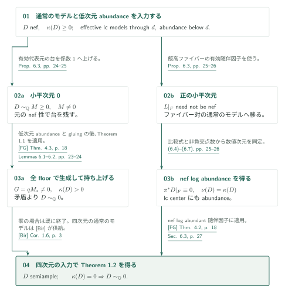
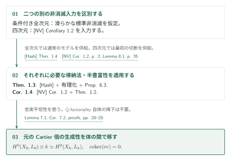

# Lifting sections from the reduced support of an adjoint

**全被約台の生成性から、有限近傍の障害消滅と切断増大へ**

随伴因子の有効倍数の被約台で切断が生成されるとき、そこから周囲の切断を増やすのが本稿の主題である。全被約台の gluing を保持し、frame bundle 上の正の重みを用いて有限近傍の持ち上げ障害を消す。得られるのは全次元の supported lifting であり、四次元の非消滅はその定理の仮定や証明には入らない。

## 1. 主要結果

### Theorem 1.1 — Supported boundary lifting

$(V,C)$ を標数0の代数閉体上の normal projective $\mathbb Q$-factorial dlt 対とし、$C$ は有効有理境界、$A=K_V+C$ とする。十分可除な正整数 $q$ と非零有効 Cartier 因子 $G$ が
$$0\ne G\ge0,\qquad G\sim qA,\qquad\operatorname{Supp}G\subseteq\operatorname{Supp}\lfloor C\rfloor$$
を満たすとする。$\mathcal O_V(G)|_{G_{\mathrm{red}}}$ が**全被約スキーム**上で semiample なら $\kappa(V,A)>0$ である。

[Theorem 1.1 · p. 2][S]

追加の nef 仮定はない。台の包含は真の包含でよく、$C=S+H+C_0$、$S=G_{\mathrm{red}}$ と書いたとき、余分な係数1成分 $H$ が $S$ やその strata と交わることも許される。各正規化成分上の半豊富性だけを仮定に置き換えてはいけない。

### Theorem 1.2 — Abundance after nonvanishing

$(X,\Delta)$ を複素射影 lc 対、$\dim X\le4$、$\Delta$ を有効有理境界とする。$D=K_X+\Delta$ が $\mathbb Q$-Cartier、nef、$\kappa(X,D)\ge0$ なら $D$ は semiample。さらに $\kappa(X,D)=0$ なら $D\sim_{\mathbb Q}0$。この結果は一様な指数を与えない。標数0の任意の代数閉体への移行は別掲の Corollary 7.2（p. 29）である。

[Theorem 1.2 · p. 2；Corollary 7.2 · p. 29][S]

### Theorem 1.3 — Reduction to smooth canonical nonvanishing

**全次元**の滑らかな連結複素射影多様体 $W$ について、$K_W$ が擬有効ならある $m>0$ で $H^0(W,mK_W)\ne0$ と仮定する。この前提の下、標数0の任意の代数閉体上の normal projective lc 対 $(X,\Delta)$、有効有理境界 $\Delta$、nef $\mathbb Q$-Cartier 随伴因子 $D=K_X+\Delta$ に対し $D$ は semiample となる。前提は nef な標準因子だけに限定されない。

[Theorem 1.3 · p. 2][S]

### Corollary 1.4 — Fourfold log abundance

標数0の代数閉体上の normal projective lc 対 $(X,\Delta)$、$\dim X\le4$、有効有理境界、$D=K_X+\Delta$ が nef $\mathbb Q$-Cartier なら $D$ は semiample。$\kappa(X,D)=0$ なら $D\sim_{\mathbb Q}0$。ここで初めて [NV] Corollary 1.2 の四次元 lc 非消滅を追加する。

[Corollary 1.4 · p. 2；証明 · p. 29][S]

## 図の矢印に付した引用

略号なしは本原稿の結果。外部入力には次の略号を使う。

- [KS][KS]: Popa, Kodaira–Saito vanishing and applications (author PDF).
- [Saito][Saito]: Mixed Hodge Modules (1990).
- [FG][FG]: Fujino–Gongyo, Log pluricanonical representations and abundance conjecture (final author PDF).
- [Bir][Bir]: Birkar, On existence of log minimal models (arXiv:0706.1792).
- [Hash][Hash]: Hashizume, On the non-vanishing conjecture and existence of log minimal models (arXiv:1609.00121v4).
- [NV][NV]: Fourfold nonvanishing by minimal metrics and moving jets (September 27, 2026).

## 2. Theorem 1.1 の証明

全被約台 $S=G_{\mathrm{red}}$ 上の生成性から、周囲の $h^0(V,\mathcal O_V(NG))$ が非有界であることを示す。有限近傍の持ち上げ障害を消す段階では、水平 symbol と垂直な Euler 作用を分けて扱う。

### 1. 循環被覆と留数で障害群を保持する

$G$ を倍して $L=\mathcal O_V(G)$、$L|_S=f^*\mathcal O_{\mathbb P^\ell}(1)$ とする。非零 frame の束 $P=L^\times$ に移り、二段階の循環被覆を**分裂した場合も全成分を残して**構成する。解消上には正の frame 重み $a$ の対数的形式 $\sigma$ と留数 $\Omega$ がある。$H$ との交わりの上の極も $D_h$ に残す。Lemma 2.3 の留数挿入により障害群を
$$\iota:R^1g_*\mathcal O_E\hookrightarrow R^1h_*\omega_R(D_h)=F_0\mathcal N\hookrightarrow\mathcal N$$
へ単射で送る。ここで $g:E\to B$、$h:R\to B$、$B=\mathcal O_{\mathbb P^\ell}(1)^\times$。$F_0\mathcal N$ は境界写像の graph 上で作る混合 Hodge 加群の最下層であり、小さい台に集中するコホモロジーも捨てない。

[§2、Lemma 2.3、Lemma 3.1、pp. 5–13][S]

### 2. 任意の境界関数の恒等式から水平部分を消す

$I=(y)$ とし、次数 $k$ までの持ち上げから $k+1$ への障害を $y^k$ で割ると、導分 $\delta_k:g_*\mathcal O_E\to R^1g_*\mathcal O_E$ となる。積の二つの誤差が $y^{k+1}$ を法として消えることが Leibniz 則の理由である。graph の留数計算は、**任意の**境界関数 $F$ に対し
$$\iota(\delta_k(F))+\sum_i\iota(F\delta_k(t_i))\partial_{t_i}=0$$
を与える（右 $\mathscr D$-加群の作用、式(5.5)）。$F=1$ として first symbol を取ると、重み $a+k>0$ の零-symbol tensor が得られる。横断的有限被覆と微分の adjugate により、その水平部分が非零なら ample line から最下 symbol の核への非零写像を作れる。Kodaira–Saito vanishing に由来する Lemma 3.2 がそれを排除する。

[Proposition 4.1、Lemma 4.2、Proposition 5.1、pp. 13–20][S]

### 3. 実際の Euler 作用で垂直部分も消す

残る垂直方向では symbol の消滅だけでは足りない。実際の Euler 作用 $s\varepsilon=-(a+k)s$ と留数恒等式を使って垂直部分を消し、再び任意の $F$ の式へ戻って $\delta_k(F)=0$ を得る。この区別が lifting の核心である。

[§4.3、式(5.11)–(5.12)、pp. 17, 20][S]

### 4. 有限層の持ち上げを周囲の切断増大に変える

有限群不変部と frame の次数0部分を取り、$V$ 上の divisorial layer に降ろす。周期関係 $Q_{j-r}=Q_j\otimes\mathcal O(1)$ により正の twist が蓄積し、高次コホモロジーは有界、切断数は非有界となる。境界近傍から周囲へ移す際の損失は固定値 $h^1(V,\mathcal O_V)$ 以下なので
$$h^0(V,\mathcal O_V(NG))\ge h^0(V,\mathcal O_V(NG)/\mathcal O_V)-h^1(V,\mathcal O_V)\longrightarrow\infty.$$
$\ell=0$ の場合も層の個数が増える。収束する形式近傍や、境界写像が近傍全体に延長することは仮定しない。

[Lemma 5.2、Proposition 1.5の証明、pp. 21–23][S]

## 3. Theorem 1.2 の証明

Proposition 6.3 は、次元 $d$ 以下の effective lc 対の**通常の**極小モデル存在と、$d$ 未満の full lc abundance を仮定して、次元 $d$ の abundance after nonvanishing を導く。良い極小モデルの存在を最初から仮定して結論を先取りしてはいない。

[Proposition 6.3 · pp. 23–24][S]

### 1. 小平次元0で非零有効代表元を排除する

$\kappa(D)=0$ で $0\ne M\ge0$、$M\sim_{\mathbb Q}D$ と仮定する。解消で台の係数を1へ上げ、通常の極小モデル $(V_*,C_*)$ に移しても、小平次元0と有効代表元 $M_*$ を保つ。元の $D$ の nef 性と negativity lemma により $M_*$ は消えない。低次元 abundance と [FG] の normalization gluing から**全 floor**上の半豊富性を得るので、$G=qM_*$ に図1を適用すると $\kappa>0$ の矛盾になる。従って $D\sim_{\mathbb Q}0$。

[Lemmas 6.1–6.2、Proposition 6.3、pp. 23–25][S]

### 2. 正の小平次元では飯高ファイバー上のモデルを使う

$\kappa(D)=k>0$ では、解消上 $L=K_W+\Gamma=\pi^*D+N$、$N\ge0$ exceptional と書く。飯高ファイバー上の $L|_F$ は非 nef でもよい。effective なファイバー対の通常の極小モデルを作り、低次元 abundance をそちらに適用する。比較式(6.6)と非負交点数から $\pi^*D|_F\equiv0$、さらに $\nu(D)=\kappa(D)$ を得る。全 floor の半豊富性は各 lc center の正規化にも降りるので log abundance の仮定が揃い、[FG] Theorem 4.2 が半豊富性を与える。

[Proposition 6.3、pp. 25–27][S]

### 3. 四次元の入力と基礎体の移行を適用する

$d=4$ では低次元 abundance と Birkar の effective lc 四次元極小モデル定理を代入して Theorem 1.2 を得る。一般の標数0体へは、元の因子の指定 Cartier 倍と評価写像を降下・拡大する。$\mathbb Q$-factoriality 自体が体の降下で保存されるとは主張しない。

[§§6.3, 7、pp. 27–29][S]

## 4. Theorem 1.3 と Corollary 1.4 の証明

Theorem 1.3 の全次元の条件付き命題と、Corollary 1.4 の四次元の帰結では、非消滅の供給元が異なる。図の二経路はどちらも最後に元の随伴因子の Cartier 倍の生成性を体の間で移す。

### 1. 全次元の仮定から通常のモデルを供給する

Theorem 1.3 では滑らかな標準非消滅を**全次元で仮定**し、[Hash] Theorem 1.4 が lc 非消滅と通常の極小モデルを供給する。実線形有効性を有理線形有効性にする箇所では [NV] Lemma 8.1 の有限次元有理線形代数だけを使う。これは [NV] の四次元非消滅定理への依存とは別である。これらを Proposition 6.3 の次元帰納法へ入れる。

[§6.3、p. 27][S]

### 2. 四次元の最初の切断を別の入力から得る

Corollary 1.4 では [NV] Corollary 1.2 が元の normal lc 対の指定 Cartier 倍に非零切断を与え、Theorem 1.2 と体の移行が結論を与える。

[NV] の入力は Theorems 1.1–1.2 の証明へ逆流しない。付録Aの conormal–period 法は別手法であり、図1への入力ではない。

[§7、p. 29；付録A、pp. 30–38][S]

## 5. どの論文が、どの段階を担うか

| 入力 | 使用箇所・役割 | 確認範囲 |
|---|---|---|
| [KS] Kodaira–Saito vanishing | Lemma 3.2、p. 13。ample inverse twist の負次数 hypercohomology 消滅 | Popa 著者PDF Theorem 8.2、PDF pp. 14–15 の記述を照合。原稿は刊行版 Theorem 28 を引用しており番号体系が違う |
| [Saito] 混合 Hodge 加群の射影直像 strictness | Lemma 3.1、pp. 12–13 の全 coherent 最下層 | 使用箇所と本稿の計算を読解。Saito 1990 Theorem 2.14 / Proposition 2.15 の原記述の再照合は保留 |
| [FG] Theorems 4.3 / 4.2、著者最終PDF p. 18 | Lemma 6.2 の全floor gluing／Proposition 6.3 の nef log abundant adjoint | 両結果の記述・仮定・適用箇所を照合。外部証明は対象外 |
| [Bir] Corollary 1.6、参照arXiv PDF p. 3 | §6.3、p. 27。effective lc 四次元の通常の極小モデル | 原記述を照合。良いモデルの供給と区別 |
| [Hash] Theorem 1.4、arXiv v4 §1 | Theorem 1.3 のみ。滑らかな非消滅から lc 非消滅・通常の極小モデル | Conjectures 1.1–1.3と定理の含意を照合 |
| [NV] Corollary 1.2、p. 2；Lemma 8.1、p. 35 | 前者は Corollary 1.4、後者は Theorem 1.3 の有理化 | 記述と本稿 pp. 27, 29 の適用を照合。非消滅の全証明は未検証 |

本稿 Theorem 1.2 は [Ufour] の四次元 log Iitaka の最終組立てにも現れる（§10、pp. 48–49）。受け手の詳細は別記事の対象とする。古典的三次元 abundance とその訂正、留数挿入での消滅・split の全外部理論は、今回一括して検証済みとはしない。

## 6. 原典を読む入口と確認範囲

[pp. 8–13][S] は余分な係数1境界の極、留数単射、全 coherent 最下層の扱い。[pp. 14–23][S] は横断的被覆、Euler作用、graph identity、全有限層の持ち上げと切断増大。[pp. 23–29][S] は通常の極小モデルとの比較、全floor、飯高ファイバー、基礎体の移行である。今回これらの核心箇所を読み、主要結果と上表の直接入力を照合した。

未確認は、§2の循環被覆・split 留数挿入の全詳細、混合 Hodge 加群の各フィルトレーション同定を外部理論から独立に再構成すること、古典的低次元 abundance の証明、付録A、外部入力の全証明である。図の矢印は原稿が述べる論証接続を示し、その接続の独立な証明認定を意味しない。日英本文・図・出典・保留点を対応させている。

[S]: https://github.com/openai/math/blob/adc7f1241b42e322a6451854ab7e4b4c146bf78a/preprints/Lifting-sections-from-the-reduced-support-of-an-adjoint-September-27-2026/paper.pdf
[NV]: https://github.com/openai/math/blob/adc7f1241b42e322a6451854ab7e4b4c146bf78a/preprints/Fourfold-nonvanishing-by-minimal-metrics-and-moving-jets-September-27-2026/paper.pdf
[FG]: https://www.math.kyoto-u.ac.jp/~fujino/fg-comp-final.pdf
[KS]: https://people.math.harvard.edu/~mpopa/papers/oxford.pdf
[Hash]: https://arxiv.org/html/1609.00121v4
[Bir]: https://arxiv.org/pdf/0706.1792
[Saito]: https://doi.org/10.2977/PRIMS/1195171082
[Ufour]: https://github.com/openai/math/blob/adc7f1241b42e322a6451854ab7e4b4c146bf78a/preprints/Uniform-effective-log-Iitaka-fibrations-for-fourfolds-September-26-2026/paper.pdf
