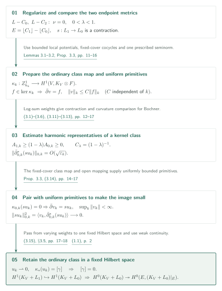
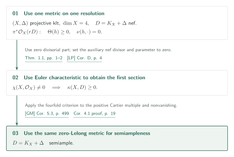

# Minimal metrics and interior injectivity for nef adjoints

> AI-generated first-pass exposition. The results below are claims of the manuscript's author, OpenAI; this article does not certify their correctness. Consult the original paper for important statements and proofs.

Official position 05 within catalog 034; internal ID: minimal-metrics-injectivity. We use the September 27, 2026 manuscript, 21 PDF pages, at commit adc7f1241b42e322a6451854ab7e4b4c146bf78a. [Source PDF viewer][MM].

The paper supplies two analytic inputs. It proves vanishing of the Lelong numbers of minimal metrics on nef klt adjoints by localizing extremal sections with one fixed ample twist. Independently, it proves ordinary $H^1$ injectivity for interior boundaries with zero-Lelong endpoint metrics, returning weighted harmonic estimates to a fixed Hilbert space and ordinary cohomology. The second proof does not use the first theorem.

## Main results

### Theorem 1.1 — Minimal metrics on nef klt adjoints (pp. 1–2)

Let $(H,\Theta)$ be a normal connected projective complex klt pair with effective rational divisor $\Theta$, and suppose $D_H=K_H+\Theta$ is nef and $\mathbb Q$-Cartier. On every projective log resolution $\pi:V\to H$, the actual rational line bundle $N=\pi^*D_H$ admits a semipositive singular Hermitian metric with minimal singularities, and every such metric has zero Lelong number at every point. Neither $K_H$ nor $\Theta$ is separately required to be $\mathbb Q$-Cartier. [Theorem 1.1, pp. 1–2][MM]

### Theorem 1.2 — Interior injectivity (p. 2)

Let $V$ be smooth projective over $\mathbb C$, $L$ an integral divisor, and $0\leq C_0\leq C_2$ effective rational divisors with combined SNC support. Assume that **both actual rational line bundles** $L-C_0,L-C_2$ admit semipositive singular Hermitian metrics with zero Lelong numbers everywhere. For rational $0<\lambda<1$, put

\[
C_1=(1-\lambda)C_0+\lambda C_2,\qquad L_i=L-\lfloor C_i\rfloor\quad(i=0,1).
\]

The natural inclusion induces an injection

\[
H^1(V,\mathcal O_V(K_V+L_1))\longrightarrow H^1(V,\mathcal O_V(K_V+L_0)).
\]

[Theorem 1.2, p. 2][MM]

### Corollary 2.4 — Multiplier ideals (pp. 10–11)

Under Theorem 1.1, every minimal weight $\varphi$ satisfies $\mathcal I(t\varphi)=\mathcal O_V$ for every real $t>0$. This is independent of the minimal metric and of the Cartier multiple used to normalize its weights. [Corollary 2.4, pp. 10–11][MM]

### Corollary 4.1 — Fourfolds with nonzero Euler characteristic (p. 18)

Let $(X,\Delta)$ be a projective complex klt fourfold with effective rational boundary and nef $D=K_X+\Delta$. If $\chi(X,\mathcal O_X)\ne0$, then $D$ is semiample. No numerical-dimension restriction is imposed; the Euler hypothesis produces the first section. [Corollary 4.1, pp. 18–19][MM]

## Proof strategy for Theorem 1.1

On the resolution, $N=K_V+B$, every coefficient of $B$ is less than one, and its negative part is $\pi$-exceptional. This negative part must be retained. The density $e^{-b}$, with $b=[B]$, is integrable, and $A=\pi^*((n+1)H_0)$ makes $mN+A$ globally generated for every allowed $m$, meaning that $mD_H$ is Cartier. Section 2.2 uses Nadel vanishing and Castelnuovo–Mumford regularity.

Assuming a positive Lelong number at $p$, maximize evaluation at $p$ among sections $s_m$ normalized by

\[
Q_m(s)=\int_V|s|^{2/m}e^{-a/m-b}=1.
\]

A subsequential limit of $\tau_m=m^{-1}\log|s_m|^2$, together with minimality $\tau_\infty\leq\varphi+C$, makes the adjoint mass $\varepsilon_m$ on the fixed sublevel set $\{g_m<-R\}$ tend to zero, where $g_m=\varphi+a/m-\tau_m$ (Claim 2.2 and (2.5)).

Lemma 2.3 corrects the $\bar\partial$ error of a cutoff section with a constant independent of $m$. Choose a weight $e^{-c\varphi-b}$ that is nonintegrable at $p$, using the assumed positive Lelong number. The resulting holomorphic section $w_m$ must have $w_m(p)=s_m(p)$. Extension across negative exceptional components proceeds on the normal base in the actual Cartier bundle, by Hartogs extension over codimension two, followed by pullback; a local estimate across those components is not asserted (§2.4, pp. 9–10).

The final Hölder estimate is $Q_m(w_m)^m\leq C'\varepsilon_m(1+I)^d\to0$, with fixed $d$ and $I=\int_Ve^{\varphi-b}<\infty$. Renormalizing $w_m$ to gauge one increases evaluation at $p$, contradicting extremality. Corollary 2.4 follows by Skoda integrability. This draft does not independently verify all singular-limit operations in the localization lemma.

## Proof strategy for Theorem 1.2

Regularize both endpoints with curvature loss $\varepsilon_k\to0$, retaining uniform exponential integrability for every fixed exponent (Lemma 3.1). The log-sum modification in (3.1)–(3.3) makes multiplication $s:L_1\to L_0$ by the canonical section of $E=\lfloor C_1\rfloor-\lfloor C_0\rfloor\geq0$ a contraction. On the complement of the SNC support it gives

\[
\theta_{1,k}+\varepsilon_k\omega_c\geq(1-\lambda)(\theta_{0,k}+\varepsilon_k\omega_c)\geq0.
\]

The strict inequality $\lambda<1$ keeps the Bochner comparison constant $C_\lambda=(1-\lambda)^{-1}$ finite. The statement does not extend the argument to the endpoint $\lambda=1$.

Proposition 3.3 is the main bridge. Differences of local $L^2$ primitives on a fixed finite cover extend across the SNC divisor to holomorphic Čech cocycles. The continuous class map $\kappa_k$ to ordinary $H^1(V,K_V\otimes F)$ kills the closure of exact forms. On its kernel, one fixed Fréchet open-mapping argument supplies global primitives with norms uniformly bounded in $k$. It does not assert simultaneous bounded lifting for every Fréchet seminorm.

For harmonic representatives $u_k$ of a kernel class, the Bochner comparison gives $\|\bar\partial^*_{0,k}(su_k)\|=O(\sqrt{\varepsilon_k})$. Pairing with uniformly bounded primitives $v_k$, $\bar\partial v_k=su_k$, from Proposition 3.3 gives $\|su_k\|_{0,k}\to0$. This alone does not dispose of the original ordinary class. Equation (3.15) puts every representative in one fixed Hilbert space; weak convergence $u_k\rightharpoonup0$ and the continuous fixed class map $\kappa_*u_k=[\gamma]$ then force $[\gamma]=0$ (§3.5, pp. 17–18).

The restriction consequence requires only the exact sequence

\[
0\to\mathcal O_V(K_V+L_1)\to\mathcal O_V(K_V+L_0)\to\mathcal O_V(K_V+L_0)|_E\to0.
\]

Its connecting map vanishes, so for $E\ne0$ restriction $H^0(V,K_V+L_0)\to H^0(E,(K_V+L_0)|_E)$ is surjective ((1.1), p. 2). This concerns the **entire divisor scheme**, including nonreduced $E$.

## Proof strategy for Corollary 4.1

Take a tensor power of Theorem 1.1's metric on the actual bundle $\pi^*\mathcal O_X(rD)$. It satisfies the generalized algebraic singularities condition of [LP, Corollary D, p. 4][LP], with zero divisorial part. Set the auxiliary nef divisor and parameter to zero to obtain $\kappa(D)\geq0$. The same zero-Lelong metric and nonvanishing meet [GM, Corollary 5.3, p. 499][GM], giving semiampleness. Theorem 1.2 of this paper is not used here.

## External inputs and catalog connections

| Input | Use in the paper | Checking scope |
|---|---|---|
| [Fuj, Theorem 3.2, p. 734 (PDF p. 8)][Fuj] | §2.2, p. 6: the klt multiplier ideal is trivial; the nef adjoint and ample difference give vanishing and, by regularity, the fixed globally generated twist. | Statement and substitution checked. The original regularity theorem was not checked. |
| [Dem, Theorem 5.1, p. 33][Dem] | Lemma 2.1, p. 5, then Lemma 2.3 and Proposition 3.3: complete Kähler solvability controlled by the inverse-curvature integral. | Restatement and use read in the target. External PDF retrieval failed; comparison with the original theorem remains pending. |
| [Reg, Main Theorem 1.1][Reg], and Skoda integrability | Lemma 3.1, pp. 11–12: smooth approximation, small curvature loss, and uniform integrability at fixed exponents. | Target proof read. Original regularization and integrability statements not compared. |
| [LP, Corollary D, p. 4][LP] | Theorem 4.2 and Corollary 4.1, p. 19: the first section using nonzero Euler characteristic. | May 7, 2019 v4 statement and the $N=0,t=0$ specialization checked; proof excluded. |
| [GM, Corollary 5.3, p. 499][GM] | Theorem 4.3 and Corollary 4.1, p. 19: nonvanishing and a zero-Lelong metric imply semiampleness. | Published 2017 statement and application checked; proof excluded. |

Within 034, [Fourfold nonvanishing][FN], Theorems 4.1–4.2, restates these two theorems and uses them in the proof of Proposition 5.1, (5.9)–(5.10), pp. 18–19. It identifies the endpoint residual bundles on a resolution with **positive rational multiples of nef klt adjoints**, applies Theorem 1.1, and pushes down Theorem 1.2's ordinary $H^1$ injection using multiplier-ideal local vanishing. This yields restriction surjectivity to the entire reduced non-klt locus. Producing a nonzero section there additionally requires threefold semi-dlt abundance, gluing and descent in [FN]; these are not supplied by the present analytic theorem alone.

## Source guide and checking scope

- Statements: Theorems 1.1–1.2, pp. 1–2; Corollary 2.4, pp. 10–11; Corollary 4.1, pp. 18–19.
- Proof passages read: §§2.2–2.4, pp. 5–10, for the fixed twist, localization, extension and extremal contradiction; §§3.1–3.5, pp. 11–18, for endpoint comparison, class maps and the fixed-space limit; §4 for the two external criteria. The main formulas were also compared with the image of PDF p. 2.
- Editorial checking concerns the correspondence between these statements, proof passages and cited applications. All localization limits, operator-domain issues and uniform constants, external regularization/integrability statements, and complete external proofs have not been independently verified. Other catalog relations are uninvestigated, which does not mean absent.
- Bilingual SVGs, TeX/TikZ sources and checking records are included. Site integration and final page inspection belong to the central editor.

[MM]: https://github.com/openai/math/blob/adc7f1241b42e322a6451854ab7e4b4c146bf78a/preprints/Minimal-metrics-and-interior-injectivity-for-nef-adjoints-September-27-2026/paper.pdf
[FN]: https://github.com/openai/math/blob/adc7f1241b42e322a6451854ab7e4b4c146bf78a/preprints/Fourfold-nonvanishing-by-minimal-metrics-and-moving-jets-September-27-2026/paper.pdf
[Fuj]: https://ems.press/content/serial-article-files/41145
[Dem]: https://www-fourier.univ-grenoble-alpes.fr/~demailly/manuscripts/analmeth_book.pdf
[Reg]: https://www-fourier.univ-grenoble-alpes.fr/~demailly/manuscripts/regularization.pdf
[LP]: https://arxiv.org/pdf/1809.02500v4
[GM]: https://www.numdam.org/item/10.24033/asens.2325.pdf
