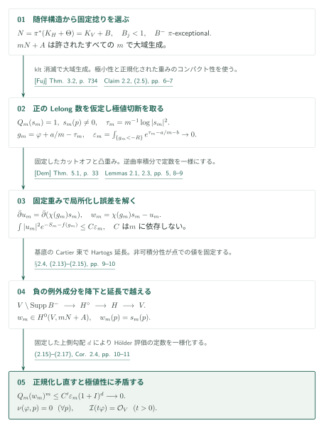
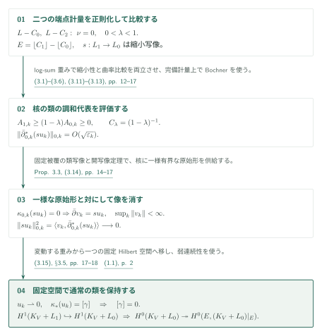
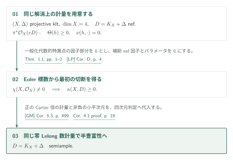

# Minimal metrics and interior injectivity for nef adjoints

**固定捻りの極値切断と、通常のコホモロジーへ戻る単射性**

本稿は二つの解析的入力を供給する。第一はnefなklt随伴束の極小特異計量のLelong数消滅であり、固定したample捻りを持つ極値切断の局所化から導く。第二は零Lelong数の端点計量を仮定する内部境界の通常の $H^1$ 単射性であり、重み付き調和代表の評価を固定Hilbert空間と通常のコホモロジーへ戻して証明する。第二の証明は第一を用いない。

## 1. 主要結果

### Theorem 1.1 — nef klt随伴の極小計量（pp. 1–2）

$(H,\Theta)$ を正規・連結な複素射影klt対、$\Theta\geq0$ を有理因子とし、$D_H=K_H+\Theta$ はnefな $\mathbb Q$-Cartier因子とする。任意の射影的対数解消 $\pi:V\to H$ に対し、実際の有理線束 $N=\pi^*D_H$ 上に半正曲率を持つ極小特異計量が存在し、そのような計量はすべて各点でLelong数が0となる。$K_H$ と $\Theta$ を個別に $\mathbb Q$-Cartierと仮定しない。[Theorem 1.1, pp. 1–2][MM]

### Theorem 1.2 — 内部境界の単射性（p. 2）

$V$ は滑らかな複素射影多様体、$L$ は整因子、$0\leq C_0\leq C_2$ は合併した台がSNCとなる有効有理因子とする。**双方の実際の有理線束** $L-C_0,L-C_2$ が、半正曲率かつ全点で零Lelong数の特異Hermite計量を持つと仮定する。有理数 $0<\lambda<1$ に対し

\[
C_1=(1-\lambda)C_0+\lambda C_2,\qquad L_i=L-\lfloor C_i\rfloor\quad(i=0,1)
\]

とおけば、自然な包含が誘導する写像

\[
H^1(V,\mathcal O_V(K_V+L_1))\longrightarrow H^1(V,\mathcal O_V(K_V+L_0))
\]

は単射である。[Theorem 1.2, p. 2][MM]

### Corollary 2.4 — 乗数イデアル（pp. 10–11）

Theorem 1.1の仮定の下で極小重み $\varphi$ に対し $\mathcal I(t\varphi)=\mathcal O_V$ がすべての実数 $t>0$ で成り立つ。極小計量の選択にも、重みを正規化するCartier倍にも依存しない。[Corollary 2.4, pp. 10–11][MM]

### Corollary 4.1 — Euler標数が非零の四次元（p. 18）

$(X,\Delta)$ は複素射影klt四次元対、$\Delta\geq0$ は有理境界、$D=K_X+\Delta$ はnefとする。$\chi(X,\mathcal O_X)\ne0$ ならば $D$ はsemiampleである。数値次元への制限はなく、Euler標数の仮定は最初の切断を得る段階に用いる。[Corollary 4.1, pp. 18–19][MM]

## 図の矢印に付した引用

略号のない定理・補題・節・式番号は本原稿を指す。主要な外部入力には次の略号を使う。

- [Fuj] Fujino, *Fundamental theorems for the log minimal model program* · Theorem 3.2 · [PDF][Fuj].
- [Dem] Demailly, *Analytic Methods in Algebraic Geometry* · July 2011 · Theorem 5.1 · [PDF][Dem].
- [Reg] Demailly, *Regularization of closed positive currents and intersection theory* · Main Theorem 1.1 · [PDF][Reg].
- [LP] Lazić–Peternell · Corollary D · [arXiv v4][LP].
- [GM] Gongyo–Matsumura · Corollary 5.3 · [2017 published version][GM].

## 2. Theorem 1.1 の証明

**証明の道筋。** Theorem 1.1 の零 Lelong 数計量と [Theorem 1.2 の内部単射性](#proof-2)は独立した二つの結果である。[Corollary 4.1](#proof-3)では、計量の結果を既存の非消滅・半豊富性の判定へ渡す。

$N=\pi^*(K_H+\Theta)$、$n=\dim V$ とする。正のLelong数を仮定し、固定捻りを持つ極値切断を、同じ点で同じ値を持つが質量の小さい切断に置き換える。

### 1. 固定捻りで極値切断を選ぶ

$N=K_V+B$ と書くと、$B$ の全係数は1未満で、負の部分 $B^-$ は $\pi$-例外的である。従って $b=[B]$ に対して $e^{-b}$ は可積分となる。非常に豊富な $H_0$ を固定し、$A=\pi^*((n+1)H_0)$ と取る。$mD_H$ がCartierとなるすべての $m$ について、klt消滅とCastelnuovo–Mumford正則性が $mN+A$ の大域生成を与える。極小重み $\varphi$ が正のLelong数を持つ点 $p$ を仮定すると、

\[
Q_m(s)=\int_V|s|^{2/m}e^{-a/m-b}=1
\]

の下で $|s(p)|$ を最大化する $s_m$ を選べる。大域生成により $s_m(p)\ne0$ であり、後に同じ値を持つ小質量の切断を作れば矛盾となる。

[§2.2 · pp. 5–6][MM] · [Fuj, Theorem 3.2 · PDF p. 8][Fuj]

### 2. 固定した劣位集合上で局所化し、誤差を解く

$\tau_m=m^{-1}\log|s_m|^2$ の部分列極限と極小性 $\tau_\infty\leq\varphi+C$ を使い、$R$ を一度固定する。すると $g_m=\varphi+a/m-\tau_m$ に対し

\[
\varepsilon_m=\int_{\{g_m<-R\}}e^{\tau_m-a/m-b}\longrightarrow0.
\]

正のLelong数から、$e^{-c\varphi-b}$ が $p$ で非可積分となる $c$ も固定できる。負の係数を含む $B$ を保持してこの局所評価を行う。カットオフ $\chi$ と凸関数 $f$ の勾配範囲 $c\leq f'\leq d$ を固定し、$B$ と $s_m$ の零点を除く滑らかなaffine開集合上でLemma 2.3を適用する。$S_m=(m-1)\tau_m+a/m+b$ に対し、

\[
\bar\partial u_m=\bar\partial(\chi(g_m)s_m),\qquad
\int|u_m|^2e^{-S_m-f(g_m)}\leq C\varepsilon_m
\]

を得る。$C$ は $\chi,f$ のみから定まり、$m$ と開集合に依存しない。入力は[Dem]の滑らかな逆曲率評価であり、特異重みへの移行は本稿の減少近似と固定した先行重みにおける弱極限で行う。

[Claim 2.2; (2.5)–(2.12); Lemmas 2.1, 2.3 · pp. 5–9][MM] · [Dem, Theorem 5.1 · p. 33][Dem]

### 3. 負の例外成分を越えて延長し、点での値を保つ

$w_m=\chi(g_m)s_m-u_m$ は開集合上で正則である。$G_m=S_m+d\max(0,g_m)$ の上界と $L^2$ 評価でまず $V\setminus\operatorname{Supp}B^-$ へ延長する。負の例外成分上で同じ上界を仮定せず、基底 $H$ の余次元2の集合を除いた部分へ降ろす。$mD_H+A_H$ が実際のCartier因子であり $H$ が正規なので、Hartogs延長後に引き戻して $w_m\in H^0(V,mN+A)$ を得る。

$p$ の近くで $s_m$ は消えず、$\chi(g_m)=1$、$S_m+f(g_m)=b+c\varphi+O_m(1)$ となる。もし $(s_m-w_m)(p)\ne0$ なら、先に固定した非可積分性が補正項の有限ノルムと矛盾する。従って $w_m(p)=s_m(p)$。ここで $O_m(1)$ は各 $m$ ごとの局所比較であり、一様定数を与える箇所とは区別する。

[§2.4; (2.13)–(2.15) · pp. 9–10][MM]

### 4. 一様なHölder評価を極値性と衝突させる

$m>d+1$ とし、$I=\int_Ve^{\varphi-b}<\infty$ を使う。Hölder評価で現れる指数 $d/(m-1)$ が最後の $(m-1)$ 乗と相殺し、

\[
Q_m(w_m)^m\leq C'\varepsilon_m(1+I)^d\longrightarrow0
\]

となる。$R,c,d,\chi,f,C',I$ はすべて $m$ に依存しない。大きな $m$ で $0<Q_m(w_m)<1$ だから、$Q_m(w_m)^{-m/2}w_m$ は質量1で $p$ の値が $s_m$ より大きい。これが極値性への矛盾であり、$\nu(\varphi,p)=0$ を得る。Corollary 2.4はSkoda可積分性による帰結である。

[(2.16)–(2.17); Corollary 2.4 · pp. 10–11][MM]

## 3. Theorem 1.2 の証明

この証明は二つの端点計量を入力とし、Theorem 1.1を使わない。乗法写像の核の通常の類を取り、その重み付き代表を評価してから、一つの固定空間で元の類を消す。

### 1. 端点を正則化して縮小性と曲率を揃える

[Reg]の減少する平滑近似では、零Lelong数により特異集合が空になる。Diniの定理が曲率損失を一様に0へ送り、減少性とSkoda可積分性が固定指数での一様積分評価を与える。端点の重みにlog-sumを施す式(3.1)–(3.3)により、$E=\lfloor C_1\rfloor-\lfloor C_0\rfloor\geq0$ の標準切断による $s:L_1\to L_0$ を縮小写像にし、SNC台の補集合上で

\[
\theta_{1,k}+\varepsilon_k\omega_c\geq(1-\lambda)(\theta_{0,k}+\varepsilon_k\omega_c)\geq0
\]

を得る。$\lambda<1$ がBochner比較の定数 $C_\lambda=(1-\lambda)^{-1}$ を有限にするため、端点 $\lambda=1$ へ拡張した主張ではない。

[Lemma 3.1; (3.1)–(3.6) · pp. 11–13][MM] · [Reg, Main Theorem 1.1 · p. 2][Reg]

### 2. 通常の類写像と一様な原始形を構成する

Lemma 3.2でSNC補集合 $U$ に固定した完備Kähler計量 $\omega_c$ を取る。その局所ポテンシャルが有界なので、固定有限被覆上で重みに加えて曲率を正にしても、ノルム比較定数は $k$ に依存しない。[Dem]による局所原始形の差は正則であり、重みの一様上界によって通常の $L^2$ 延長が使える。従って差のČech cocycleは通常の $H^1(V,K_V\otimes F)$ の類を定める。

Proposition 3.3の連続写像 $\kappa_k$ は完全形式の閉包を殺す。核のcocycleを分解する際は、一つの固定Fréchet開写像に対し、縮めた被覆上のsupノルムだけを指定する。cocycle族は必要な有限個のcompact seminormで一様有界なので、そのsupノルムを一様に抑えた分解が得られる。重みの一様可積分性と合わせ、$\bar\partial v=f$、$\|v\|_k\leq C\|f\|_k$ を得る。全seminormで同時に有界な持ち上げや、大域原始形の線形な選択は主張しない。

[Lemmas 2.1, 3.2; Proposition 3.3; (3.7)–(3.8) · pp. 5, 13–16][MM]

本段階が与えるのは変動する重みに一様な原始形の評価である。[次の Bochner 評価](#proof-2-step-3)で像のノルムを消し、[固定 Hilbert 空間との比較](#proof-2-step-4)で初めて元の通常のコホモロジー類を消す。

### 3. Bochner評価と一様な原始形から像のノルムを消す

核の通常の類の滑らかな代表 $\gamma$ を、完全形式の閉包に直交する $u_k$ へ射影する。完備計量のカットオフと曲率比較を使うと、$\|\bar\partial^*_{0,k}(su_k)\|_{0,k}=O(\sqrt{\varepsilon_k})$ となる。原稿はこの形式がHilbert随伴の定義域に入ることもカットオフで扱う。類写像が閉包を殺すため $\kappa_{0,k}(su_k)=0$ であり、前段から $\bar\partial v_k=su_k$、$\sup_k\|v_k\|_{0,k}<\infty$ を得る。従って

\[
\|su_k\|_{0,k}^2=\langle v_k,\bar\partial^*_{0,k}(su_k)\rangle\longrightarrow0.
\]

これは変動する重みでの評価であり、通常の類を消すには次の比較が必要となる。

[§§3.4–3.5; (3.9)–(3.14) · pp. 16–17][MM]

### 4. 固定Hilbert空間に戻して元の類を消す

固定した滑らかな重み $h_*$ に対し $h_{1,k}\leq h_*+C_*$ なので、次数0と1の両方で固定Hilbert空間への有界な包含がある。$s$ は $U$ 上で消えず、前段の評価から $u_k$ はcompact集合上で強く0へ収束する。固定空間での大域有界性と合わせて $u_k\rightharpoonup0$ を得る。

$\gamma-u_k$ を近似する完全形式もこの固定空間に移せる。Proposition 3.3を固定重みに適用した連続な類写像は、すべての $k$ で $\kappa_*(u_k)=[\gamma]$ を保つ。有限次元の通常のコホモロジーへの弱連続性により $[\gamma]=0$。これでTheorem 1.2の単射性が従う。式(1.1)の完全列から、$E\ne0$ なら $H^0(V,K_V+L_0)\to H^0(E,(K_V+L_0)|_E)$ は全射となる。結論は非被約も許す因子スキーム全体に関するものである。

[(3.15), §3.5 · pp. 17–18; (1.1) · p. 2][MM]

## 4. Corollary 4.1 の証明

Theorem 1.1が供給する計量を固定し、非消滅と非消滅後の半豊富性という二つの外部判定を順に適用する。

### 1. 零Lelong数計量とEuler標数から非消滅を得る

Theorem 1.1の計量を実際の束 $\pi^*\mathcal O_X(rD)$ へテンソル冪で移す。この計量は[LP]のgeneralized algebraic singularities条件を因子部分0で満たす。補助nef因子を0、パラメータを0とし、$\chi(X,\mathcal O_X)\ne0$ を使うと $\kappa(D)\geq0$ を得る。

[Theorem 4.2; Corollary 4.1 proof · p. 19][MM] · [LP, Corollary D · p. 4][LP]

### 2. 同じ計量と非消滅を半豊富性の判定へ渡す

[GM]は、四次元klt対のnef随伴について、正のCartier倍上の零Lelong数計量と非消滅からsemiamplenessを与える。前段で非消滅を得てから同じ計量を入力する。Theorem 1.2はこの帰結には使わない。

[Theorem 4.3; Corollary 4.1 proof · p. 19][MM] · [GM, Corollary 5.3 · printed p. 499 / PDF p. 23][GM]

## 5. どの論文が、どの段階を担うか

**二定理を合わせる用途。** [Fourfold nonvanishing の Proposition 5.1](https://masataka123.github.io/OpenAI-Math-Digest/ja/papers/fourfold-nonvanishing/#proof-2-step-2)は、本稿 Theorem 1.1 の端点計量と Theorem 1.2 の内部単射性を合わせて全 floor への制限全射を得る。境界上の非零切断は、その次の三次元 semi-dlt abundance の段階で別に用意する。

| 入力 | 本稿の使用箇所と役割 | 今回の照合 |
|---|---|---|
| [Fuj, Theorem 3.2, p. 734（PDF p. 8）][Fuj] | §2.2, p. 6。kltなので乗数イデアルは自明。nef随伴とample差から消滅を得て固定捻りを大域生成にする。 | 入力の記述・代入を照合。正則性定理自体の原典は未照合。 |
| [Dem, Theorem 5.1, p. 33][Dem] | Lemma 2.1, p. 5 → Lemma 2.3およびProposition 3.3。完備Kähler上の逆曲率積分による解。 | 著者公開2011年7月版Theorem 5.1（PDF p. 33）の完備性・正定値曲率作用素・閉形式・逆曲率積分の条件と、Lemma 2.1の $(n,1)$ 特殊化を照合。特異極限は本稿内の追加議論。 |
| [Reg, Main Theorem 1.1][Reg] とSkoda可積分性 | Lemma 3.1, pp. 11–12。零Lelong数から平滑近似・小曲率損失・固定指数での一様可積分性。 | 著者公開版Main Theorem 1.1（PDF p. 2）の減少近似・曲率下界・Lelong上位集合を照合。Diniによる一様化をLemma 3.1と対応させた。Skodaの原典は未照合。 |
| [LP, Corollary D, p. 4][LP] | Theorem 4.2とCorollary 4.1, p. 19。非零Euler標数から最初の切断。 | 2019年5月7日v4の記述と $N=0,t=0$ の適用を照合。証明自体は対象外。 |
| [GM, Corollary 5.3, p. 499][GM] | Theorem 4.3とCorollary 4.1, p. 19。零Lelong数計量と非消滅からsemiampleness。 | 2017年刊行版の記述・適用を照合。証明自体は対象外。 |

034内では[Fourfold nonvanishing][FN]のTheorems 4.1–4.2が本稿Theorems 1.1–1.2を再記述し、Proposition 5.1の証明、式(5.9)–(5.10), pp. 18–19で使用する。具体的には解消上の端点残余束を**nef klt随伴の正の有理倍**と同定してTheorem 1.1を適用し、Theorem 1.2の通常の $H^1$ 単射性を乗数イデアルの局所消滅で押し下げる。これが被約非klt locus全体からの制限写像の全射性になる。さらにその上に非零切断を作る三次元semi-dlt abundance・貼り合わせ・降下は[FN]側の追加論証であり、本稿の解析定理だけで供給されるものではない。

## 6. 原典を読む入口と確認範囲

[Theorems 1.1–1.2 · pp. 1–2][MM]から、[§2.2–2.4 · pp. 5–10][MM]の局所化・延長・極値矛盾、[§3.1–3.5 · pp. 11–18][MM]の類写像と固定空間への移行、[§4 · pp. 18–19][MM]の外部判定へ進める。

改訂では上記証明箇所を再読し、[Dem] Theorem 5.1（2011年7月版、p. 33）と[Reg] Main Theorem 1.1（p. 2）の記述・適用条件を新たに照合した。[Fuj]、[LP]、[GM]については初稿で行った記述・適用の照合を引き継ぐ。

局所化の全極限操作、調和形式の作用素領域と全一様定数、Skoda・包絡構成・正則性等の未照合の原典、および外部定理の全証明は独立検証していない。固定空間の接続を説明したことは、解析的全証明の正しさの認定を意味しない。カタログ内の他の関係は未調査である。専門家の査読・形式検証は未実施。

原稿は2026年9月27日版、PDFページを用い、参照commitを `adc7f1241b42e322a6451854ab7e4b4c146bf78a` に固定する。

[MM]: https://github.com/openai/math/blob/adc7f1241b42e322a6451854ab7e4b4c146bf78a/preprints/Minimal-metrics-and-interior-injectivity-for-nef-adjoints-September-27-2026/paper.pdf

[FN]: https://github.com/openai/math/blob/adc7f1241b42e322a6451854ab7e4b4c146bf78a/preprints/Fourfold-nonvanishing-by-minimal-metrics-and-moving-jets-September-27-2026/paper.pdf
[Fuj]: https://ems.press/content/serial-article-files/41145
[Dem]: https://www-fourier.univ-grenoble-alpes.fr/~demailly/manuscripts/analmeth_book.pdf
[Reg]: https://www-fourier.univ-grenoble-alpes.fr/~demailly/manuscripts/regularization.pdf
[LP]: https://arxiv.org/pdf/1809.02500v4
[GM]: https://www.numdam.org/item/10.24033/asens.2325.pdf
