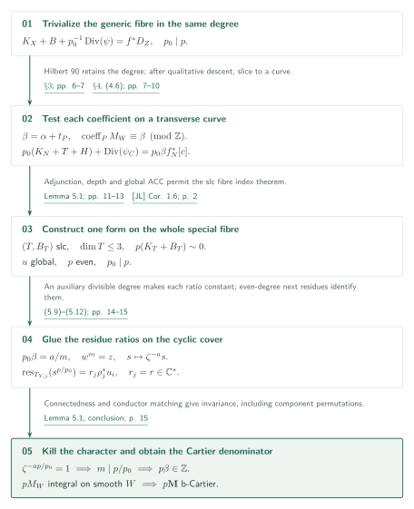
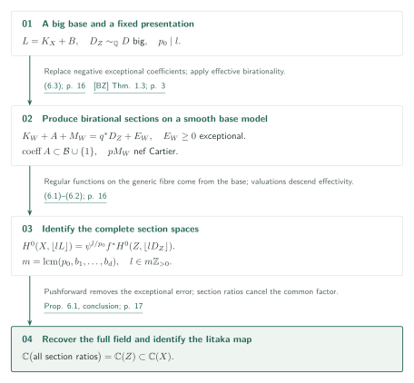
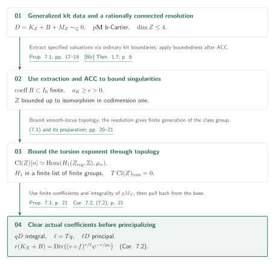

# Relative denominators and effective systems for log Calabi–Yau fibrations

**Source**: OpenAI, *Relative denominators and effective systems for log Calabi-Yau fibrations*, September 27, 2026 version, 23 pages. Position 11 within Catalog 034; internal ID `relative-denominators`. Source commit: `adc7f1241b42e322a6451854ab7e4b4c146bf78a`.

> AI-generated exposition of the manuscript's claims and proof strategy, not a certification of the entire proof. Check important statements and arguments in the [original manuscript][RD].

For lc-trivial fibrations with total dimension at most four, the manuscript uniformly controls a generic-fibre trivializing degree and a Cartier denominator of the moduli b-divisor. The key is a form on the **whole reduced special fibre** after reduction to a curve. Its conductor compatibility kills the cyclic character recording the denominator. Separate applications recover complete systems over a big base and control torsion over a rationally connected base.

## Main results (in source order)

### Theorem 1.1 ([RD], p. 2)

Fix a finite set $\Phi\subset[0,1]\cap\mathbb Q$ and an integer $1\le d\le4$. There are positive integers $p_0\mid p$, with $p_0$ clearing $\Phi$, and a rational DCC set $\mathcal B\subset[0,1]$, depending only on $d,\Phi$. Suppose $(X,B)$ is a projective complex lc pair of dimension $d$ with $B\ge0$ and coefficients in $\Phi$, and $f:X\to Z$ is a contraction onto a positive-dimensional normal projective base, with

$$
K_X+B\sim_{\mathbb Q}f^*D
$$

for a $\mathbb Q$-Cartier divisor $D$. There exist $\psi\in\mathbb C(X)^*$ and $D_Z\sim_{\mathbb Q}D$ giving an equality of actual divisors

$$
K_X+B+\frac1{p_0}\operatorname{Div}(\psi)=f^*D_Z,
\qquad D_Z=K_Z+B_Z+M_Z.
$$

The effective boundary $B_Z$ has coefficients in $\mathcal B$; $(Z,B_Z+M_Z)$ is generalized lc; $\mathbf M$ is b-nef and $p\mathbf M$ is b-Cartier. If $(X,B)$ is klt, the base pair is generalized klt.

The bound concerns the **chosen exact presentation**, not every rationally linearly equivalent representative of $D_Z$. The integer $p_0$ trivializes the generic adjoint and controls the principal correction; $p$ makes the moduli part b-Cartier. No uniform basepoint-freeness follows as part of this statement.

### Proposition 6.1 ([RD], pp. 15–17)

If, in addition, $D$ is big, there is $m=m(d,\Phi)>0$ such that for every positive multiple $l\in m\mathbb Z_{>0}$ the complete system

$$
\left|\left\lfloor l(K_X+B)\right\rfloor\right|
$$

is nonempty and its section ratios generate exactly $\mathbb C(Z)\subset\mathbb C(X)$. Its rational map is birationally equivalent to $f$ and to the Iitaka fibration of $K_X+B$. This recovers the embedded field, including its finite part. Sections belong to the reflexive divisorial sheaf; $l(K_X+B)$ need not be Cartier.

### Proposition 7.1 ([RD], p. 17; proof pp. 17–21)

Fix $1\le e\le4$, a rational DCC set $I\subset[0,1]$, and an integer $p>0$. Let $Z$ be a normal projective complex variety of dimension $e$ with a rationally connected smooth projective resolution. Assume $(Z,B+M_Z)$ is generalized klt, $B\ge0$ has coefficients in $I$, and $\mathbf M$ is rational b-nef with $p\mathbf M$ b-Cartier. There is $\ell=\ell(e,I,p)>0$ such that

$$
D=K_Z+B+M_Z\sim_{\mathbb Q}0
\quad\Longrightarrow\quad
\ell D\text{ is an integral principal divisor}.
$$

Thus every $a\ell D$, $a\ge1$, is principal and $h^0(Z,\mathcal O_Z(a\ell D))=1$. One can take a common integer for any fixed subset of the stated dimensions.

### Corollary 7.2 ([RD], p. 21)

For a finite rational coefficient set $\Phi$, there is $r=r(\Phi)>0$ with the following property. Let $(X,B)$ be a projective klt fourfold pair, $B\ge0$, with coefficients in $\Phi$ and $K_X+B\sim_{\mathbb Q}0$. If a contraction $f:X\to Z$ has positive-dimensional base admitting a rationally connected smooth projective resolution, then $r(K_X+B)$ is an integral principal divisor. This includes $B=0$, and every positive multiple is principal.

## Theorem 1.1: exact presentation and special-fibre residues

The geometric generic fibre has dimension at most three. The low-dimensional slc index theorem principalizes its adjoint in a uniform degree. Ratios of conjugate principalizing functions are constants, so Hilbert 90 descends the function to $\mathbb C(Z)$ in the **same degree** $p_0$. Comparison with the original pullback relation produces the exact equality (1.1), since a function with vertical divisor is constant on the generic fibre. The effective lc boundary gives the rank-one condition for an lc-trivial fibration. The qualitative canonical bundle formula then descends $\mathbf M$ to a nef divisor on a smooth model $W$ (§3, pp. 6–7).

For $P\subset W$, put $\alpha=\operatorname{coeff}_P D_W$ and let $t_P$ be the threshold for the crepant sub-pair. The coefficient of $M_W$ differs from $\alpha+t_P$ by an integer. It suffices to show $p(\alpha+t_P)\in\mathbb Z$. A transverse curve slice retains $\alpha$ by specifying canonical representatives through residues. After a relative dlt MMP, the error $E_N$ is vertical by generic-fibre negativity, and nefness plus fibre connectedness makes it proportional to the fibre. The original threshold-attaining component has zero error coefficient, forcing that proportionality constant to vanish. Locally one obtains

$$
p_0(K_N+T+H)+\operatorname{Div}(\psi_C)
=p_0\beta f_N^*[c],\qquad \beta=\alpha+t_P.
$$

Pseudo-effectivity is used in the four-dimensional termination input (§4, pp. 7–10).

Lemma 5.1 (pp. 10–15) clears the denominator in this identity. A depth theorem and conductor adjunction make the reduced fibre $T$ slc. Global ACC puts the different coefficients in a finite set. The [JL] index theorem supplies a nowhere-vanishing form $u$ of uniform even degree $p$ on the log pluricanonical line of **all of $T$**.

Write $p_0\beta=a/m$ in lowest terms and normalize the base change $w^m=z$, obtaining $\pi:Y\to N$. Coefficient comparison makes every fibre multiplicity divisible by $m$, so $\pi$ is étale in codimension one. The form $s=(\pi^*\theta)^{\otimes p_0}\pi^*\psi_Cw^{-a}$ carries character $\zeta^{-a}$. On each normalized component, compare $\operatorname{res}(s^{p/p_0})$ with $\pi^*u$. Adjunction in a sufficiently divisible auxiliary degree shows their ratio is constant. This auxiliary degree may depend on the pair. Back in the uniform degree $p$, the next residues at a double crossing agree because $p$ is even, forcing the constants to agree across components. Connectedness handles the group action even when it permutes components. Thus $\zeta^{-ap/p_0}=1$, giving $m\mid p/p_0$ and $p\beta\in\mathbb Z$.

## Proposition 6.1: complete section spaces recover the full base field

Set $L=K_X+B$ and assume $p_0\mid l$. The exact presentation yields an equality inside $\mathbb C(X)$:

$$
H^0(X,\mathcal O_X(\lfloor lL\rfloor))
=\psi^{l/p_0}f^*H^0(Z,\mathcal O_Z(\lfloor lD_Z\rfloor)).
$$

For the reverse inclusion, divide a source section by $\psi^{l/p_0}$. It is regular on the generic fibre and hence belongs to $\mathbb C(Z)$. Effectivity descends by testing a pullback component of positive multiplicity dominating each prime of the base. This valuation argument applies to reflexive sheaves ((6.1)–(6.2), p. 16).

On a resolution $q:W\to Z$, the potentially negative exceptional coefficients of the crepant boundary are replaced as follows. Let $A$ be the strict transform of $B_Z$ plus the reduced exceptional divisor. Then

$$
K_W+A+M_W=q^*D_Z+E_W,\qquad E_W\ge0\text{ is }q\text{-exceptional}.
$$

The left side is big, the boundary coefficients lie in a fixed DCC set, and $pM_W$ is nef Cartier. Apply [BZ, Theorem 1.3], push its birational sections to $Z$, and transfer them to $X$. The common factor $\psi^{l/p_0}$ cancels in ratios, which generate the entire base field. Taking $m=\operatorname{lcm}(p_0,b_1,\ldots,b_d)$ works for every positive multiple (pp. 16–17).

## Proposition 7.1 and Corollary 7.2: coefficients and class-group torsion

Construct ordinary klt boundaries to obtain small $\mathbb Q$-factorializations and extractions of specified valuations for the generalized pair. Applying global ACC also after extraction gives a finite boundary coefficient set and a uniform positive lower bound on generalized log discrepancies. A numerically trivial nef part is treated separately by ordinary global ACC. [Bir, Theorem 1.7] then bounds the bases up to isomorphism in codimension one (pp. 17–19).

For $U=Z_{\mathrm{reg}}$, the group $H_1(U(\mathbb C),\mathbb Z)$ is unchanged upon removing codimension-two subsets. Semialgebraic triviality in a bounded family gives only finitely many such groups. A rationally connected resolution $Y$ has $\operatorname{Pic}^0(Y)=0$, so $\operatorname{Cl}(Z)$ is finitely generated. Kummer theory gives

$$
\operatorname{Cl}(Z)[n]\simeq
\operatorname{Hom}(H_1(U(\mathbb C),\mathbb Z),\mu_n).
$$

For fixed $Z$, the orders on the left stay bounded as $n$ varies. Hence $H_1$ has no free summand. The finite list of finite groups supplies a uniform torsion exponent $T$. Separately, the finite boundary coefficient set and integrality of $pM_Z$ give an integral actual divisor $qD$. Its class is torsion, so $\ell=Tq$ makes it principal (pp. 20–21). Corollary 7.2 applies Theorem 1.1 with $D=0$ and pulls back the resulting principalization, choosing $r$ divisible by $\ell,p$:

$$
r(K_X+B)=\operatorname{Div}\bigl((v\circ f)^{r/\ell}\psi^{-r/p_0}\bigr).
$$

## External inputs and role within the catalog

| Input | Use | Verification |
|---|---|---|
| [JL, Corollary 1.6, v1 p. 2][JL] | §§2–3 and Lemma 5.1: uniform indices for projective slc log Calabi–Yau pairs of dimension at most three, including a global form with gluing. | Statement and application compared. |
| [FG, Theorem 3.6, p. 1726 / PDF p. 7][FG] | §3: qualitative b-nefness and descent after checking rank one. | Statement and use compared. |
| [CT, Theorems 1.1–1.2, v2 p. 2][CT] | §4, p. 9: flip termination for pseudo-effective four-dimensional NQC lc pairs, and for three-dimensional pairs. | Dimension and pseudo-effectivity conditions compared; full details of Remark 2.11 not compared. |
| [HMX, Theorems 1.1 / 1.5, PDF pp. 2–3][HMX] | Threshold ACC in §3, finite different coefficients in §5, and ordinary global ACC in §7. | Statements and uses compared. |
| [BZ, Theorem 1.3, p. 3; Theorem 1.6, pp. 4–5][BZ] | Effective birationality for big polarized pairs in §6 and generalized global ACC in §7. | Statements, rounding convention, and applications compared. |
| [Bir, Theorem 1.7, v2 p. 6][Bir] | §7: boundedness up to codimension-one isomorphism for rationally connected generalized $\epsilon$-lc Calabi–Yau varieties. | Statement and application compared. |

The manuscript's uses of Kollár's depth, adjunction and gluing theorems, Delfs–Knebusch semialgebraic triviality, Kummer theory, and Riemann existence were read; the individual external theorem texts were not separately compared.

Section 3 (pp. 8–9) of the [fourfold Iitaka manuscript][FI] takes this paper's Theorem 1.1, Proposition 6.1, and Proposition 7.1 as Theorem 3.1, Proposition 3.2, and Proposition 3.3. All three restatements were compared; all downstream applications were not investigated. The low-dimensional slc input here is [JL]; it must not be replaced by the high-dimensional slc index manuscript in Catalog 034.

## Source and scope of checks

Read the proof text of §§2–7 (pp. 4–21), tracing the exact presentation, disappearance of the dlt-model error, the character argument in Lemma 5.1, and the complete-section-space equality (6.1). In §7, read the extraction–ACC–topology–torsion sequence. Visually checked the character exponent, $p\beta$, and Proposition 6.1 on PDF p. 15.

The complete proofs of external inputs, external foundations for depth and pluriresidue gluing, and an independent audit of all topological hypotheses in §7 remain outside this check. Japanese and English versions retain the same statements, formulas, section structure, and verification status. Source links use the fixed-commit GitHub viewer; pages are stated in the labels.

[RD]: https://github.com/openai/math/blob/adc7f1241b42e322a6451854ab7e4b4c146bf78a/preprints/Relative-denominators-and-effective-systems-for-log-Calabi-Yau-fibrations-September-27-2026/paper.pdf
[FI]: https://github.com/openai/math/blob/adc7f1241b42e322a6451854ab7e4b4c146bf78a/preprints/Uniform-effective-log-Iitaka-fibrations-for-fourfolds-September-26-2026/paper.pdf
[JL]: https://arxiv.org/pdf/2002.11928v1
[FG]: https://www.numdam.org/item/10.5802/aif.2894.pdf
[CT]: https://arxiv.org/pdf/2011.02236v2
[HMX]: https://arxiv.org/pdf/1208.4150
[BZ]: https://arxiv.org/pdf/1410.0938
[Bir]: https://arxiv.org/pdf/2305.18770v2
