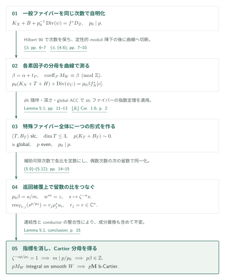
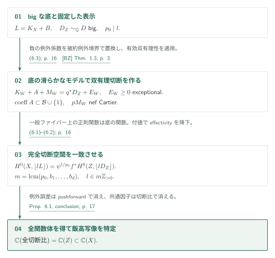
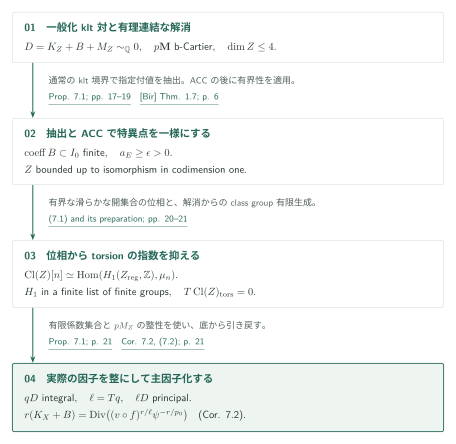

# Relative denominators and effective systems for log Calabi-Yau fibrations

**正確な引き戻し表示、全特殊ファイバーの留数、完全切断空間**

本稿は、全空間の次元が4以下のlc-trivialな状況で、一般ファイバーの自明化次数とmoduli b-divisorのCartier分母を一様に選ぶ。核心は、曲線上へ切断した後の**被約特殊ファイバー全体**に一様次数の形式を作り、そのconductorでの整合性から分母を記録する巡回指標を消すことにある。さらに、bigな底の完全線形系と、有理連結な底のtorsionに別々の応用を与える。

## 1. 主要結果

### Theorem 1.1（[RD] p. 2）

**正確な表示と moduli 分母。**

有限集合 $\Phi\subset[0,1]\cap\mathbb Q$ と整数 $1\le d\le4$ を固定する。$d,\Phi$ のみに依存する正整数 $p_0\mid p$（$p_0$ は $\Phi$ の分母を払う）と有理DCC集合 $\mathcal B\subset[0,1]$ が存在する。複素数体上の射影的lc対 $(X,B)$、$B\ge0$、$\dim X=d$、$\operatorname{coeff}B\subset\Phi$ と、正次元の正規射影的底への縮約 $f:X\to Z$ が

$$
K_X+B\sim_{\mathbb Q}f^*D
$$

を満たし、$D$ が $\mathbb Q$-Cartierなら、$\psi\in\mathbb C(X)^*$ と $D_Z\sim_{\mathbb Q}D$ を選んで、実際の因子の等式

$$
K_X+B+\frac1{p_0}\operatorname{Div}(\psi)=f^*D_Z,
\qquad D_Z=K_Z+B_Z+M_Z
$$

が成り立つ。$B_Z\ge0$ の係数は $\mathcal B$ に入り、$(Z,B_Z+M_Z)$ はgeneralized lc、$\mathbf M$ はb-nefかつ $p\mathbf M$ はb-Cartierである。$(X,B)$ がkltなら底もgeneralized kltである。

この結論は**選んだ正確な表示**に対するもので、任意の $\mathbb Q$-線形同値な $D_Z$ の分母を抑えるものではない。$p_0$ は一般ファイバーのprincipalizationと補正関数の次数、$p$ はmoduli部分のb-Cartier倍である。b-Cartier性から一様basepoint-freenessは主張しない。

[Theorem 1.1 · p. 2][RD]

### Proposition 6.1（[RD] pp. 15–17）

**big な底の全関数体。**

Theorem 1.1の仮定に加えて $D$ がbigなら、$m=m(d,\Phi)>0$ が存在し、任意の正の倍数 $l\in m\mathbb Z_{>0}$ について

$$
\left|\left\lfloor l(K_X+B)\right\rfloor\right|
$$

は非空で、その全切断比が正確に $\mathbb C(Z)\subset\mathbb C(X)$ を生成する。この有理写像は $f$ および $K_X+B$ の飯高ファイブレーションと双有理同値である。単に像の次元が一致するという結論ではない。切断は反射的因子層の完全線形系で取り、$l(K_X+B)$ のCartier性は仮定しない。

[Proposition 6.1 · pp. 15–17][RD]

### Proposition 7.1（[RD] p. 17、証明 pp. 17–21）

**有理連結な底の主因子倍。**

$1\le e\le4$、有理DCC集合 $I\subset[0,1]$、正整数 $p$ を固定する。正規射影的複素多様体 $Z$、$\dim Z=e$ は有理連結な滑らかな射影的解消を持つとする。$(Z,B+M_Z)$ はgeneralized klt、$B\ge0$ の係数は $I$ に入り、$\mathbf M$ は有理b-nefで $p\mathbf M$ はb-Cartierとする。

$$
D=K_Z+B+M_Z\sim_{\mathbb Q}0
\quad\Longrightarrow\quad
\ell D\text{ は整な主因子}
$$

となる $\ell=\ell(e,I,p)>0$ が存在する。従って、すべての $a\ge1$ で $a\ell D$ は主因子、$h^0(Z,\mathcal O_Z(a\ell D))=1$。次元の有限範囲に共通の $\ell$ を取れる。

[Proposition 7.1 · pp. 17–21][RD]

### Corollary 7.2（[RD] p. 21）

有限有理係数集合 $\Phi$ に対して $r=r(\Phi)>0$ が存在する。$(X,B)$ が射影的klt四次元対、$B\ge0$、$\operatorname{coeff}B\subset\Phi$、$K_X+B\sim_{\mathbb Q}0$ であり、有理連結な滑らかな射影的解消を持つ正次元の底への縮約 $f:X\to Z$ があれば、$r(K_X+B)$ は整な主因子である。$B=0$ を含み、すべての正の倍数も主因子となる。

[Corollary 7.2 · p. 21][RD]

## 図の矢印に付した引用

略号なしは本原稿 [RD] の結果を指す。主要な外部入力は次の通り。

- [JL, Corollary 1.6 · slc indices][JL]
- [FG, Theorem 3.6 · canonical bundle formula][FG]
- [CT, Theorems 1.1–1.2 · termination][CT]
- [HMX, Theorems 1.1 / 1.5 · ACC][HMX]
- [BZ, Theorems 1.3 / 1.6 · effective birationality / generalized ACC][BZ]
- [Bir, Theorem 1.7 · boundedness][Bir]

## 2. Theorem 1.1：正確な表示と特殊ファイバーの留数

**証明の道筋。** Theorem 1.1 で正確な表示と moduli 分母を固定する。その後は、[big な底の全関数体](#proof-2)を得る Proposition 6.1 と、[有理連結な底の主因子倍](#proof-3)を得る Proposition 7.1・Corollary 7.2 に分かれる。

一般ファイバーで次数 $p_0$ の正確な表示を固定し、滑らかな底モデル上の各素因子で $pM_W$ の整性を示す。局所的な分母は、曲線上の特殊ファイバー全体の留数が持つ巡回指標として読む。

### 1. 同じ次数で降下し、正確な表示を選ぶ

まず $\dim X_\eta\le3$ なので、低次元slc指数定理を幾何学的一般ファイバーに適用する。そのprincipalization関数のGalois共役の比は定数であり、Hilbert 90により**同じ次数** $p_0$ で $\mathbb C(Z)$ へ降下する。これと元の引戻し関係を比較すると、余分な関数は一般ファイバー上で定数となり、(1.1)の正確な表示を選べる。係数が有効なlc境界であることからlc-trivial fibrationのrank-one条件を確認し、定性的canonical bundle formulaで $\mathbf M$ を滑らかなモデル $W$ 上のnef因子に降下させる（§3、pp. 6–7）。

[§3 · pp. 6–7][RD] · [JL, Corollary 1.6][JL] · [FG, Theorem 3.6][FG]

### 2. 分母を測る曲線へ移し、誤差を消す

$P\subset W$ に対して $\alpha=\operatorname{coeff}_P D_W$、$t_P$ をcrepant sub-pairに対する閾値とすると、$\operatorname{coeff}_P M_W$ は $\alpha+t_P$ と整数だけ異なる。したがって目標は $p(\alpha+t_P)\in\mathbb Z$。横断曲線へ切断するときにも標準因子の代表を留数で指定し、$\alpha$ を保存する。相対dlt MMPの後の誤差 $E_N$ は、一般ファイバー上の負性補題で垂直となり、nef性とファイバーの連結性からファイバーの有理数倍になる。元の閾値を達成する成分で係数が0であることがその倍数を0にし、近傍で

$$
p_0(K_N+T+H)+\operatorname{Div}(\psi_C)
=p_0\beta f_N^*[c],\qquad \beta=\alpha+t_P
$$

を得る（§4、pp. 7–10）。四次元MMPの停止には擬有効性が使われる。

[§4, (4.1)–(4.6) · pp. 7–10][RD] · [CT, Theorems 1.1–1.2][CT]

### 3. 特殊ファイバー全体の形式を得る

Lemma 5.1（pp. 10–15）はこの等式から分母を消す。$T$ がslcになることを深さ定理とconductorでの随伴から確認し、global ACCでdifferentの係数を有限集合へ落とす。[JL]の指数定理が、$T$ **全体**のlog pluricanonical線上に、一様な偶数次数 $p$ の非消滅形式 $u$ を与える。

[Lemma 5.1, (5.1)–(5.4) · pp. 10–13][RD] · [JL, Corollary 1.6][JL]

### 4. 巡回被覆上で各留数の比を定数にする

$p_0\beta=a/m$ を既約分数とし、$w^m=z$ の正規化基底変換 $\pi:Y\to N$ を取る。係数比較からファイバーの各重複度が $m$ で割れ、$\pi$ は余次元1でétaleになる。$s=(\pi^*\theta)^{\otimes p_0}\pi^*\psi_Cw^{-a}$ は指標 $\zeta^{-a}$ を持つ。各正規化成分上で $\operatorname{res}(s^{p/p_0})$ と $\pi^*u$ の比を取ると、十分可除な補助次数で随伴を行うことで、その比は定数と分かる。補助次数は対に依存してよい。

[Lemma 5.1, (5.9)–(5.11) · p. 14][RD]

### 5. 二重交差で定数を揃え、指標を消す

一様次数 $p$ に戻って二重交差上の次の留数を比べると、偶数性により符号が消え、すべての比が同じ定数になる。連結性により成分を置換する群作用にも対応し、$\zeta^{-ap/p_0}=1$、従って $m\mid p/p_0$、$p\beta\in\mathbb Z$ を得る。

[Lemma 5.1, (5.12), conclusion · p. 15][RD]

## 3. Proposition 6.1：完全切断空間から底の全関数体を回復する

正確な表示が全切断空間を同一視し、底上の有効双有理性がその切断比の体を特定する。$L=K_X+B$ とし、図では $p_0\mid l$ を仮定する。

### 1. 完全切断空間を底へ移す

$L=K_X+B$ とし、$p_0\mid l$ とする。正確な表示から、$\mathbb C(X)$ 内で

$$
H^0(X,\mathcal O_X(\lfloor lL\rfloor))
=\psi^{l/p_0}f^*H^0(Z,\mathcal O_Z(\lfloor lD_Z\rfloor))
$$

が成り立つ。逆包含には、任意の切断を $\psi^{l/p_0}$ で割ると一般ファイバー上で正則、従って $\mathbb C(Z)$ の元になることを使う。底へのeffectivityの降下は、各素因子を支配する引戻し成分の正の重複度で判定するので、反射的層にも適用できる（式(6.1)–(6.2)、p. 16）。

[(6.1)–(6.2) · p. 16][RD]

### 2. 有効な境界を持つ底モデルで双有理系を作る

解消 $q:W\to Z$ 上で、crepant境界の負の例外係数をそのまま有効双有理性定理へ入れない。$A$ を $B_Z$ のstrict transformと被約例外因子の和とすれば、

$$
K_W+A+M_W=q^*D_Z+E_W,\qquad E_W\ge0\text{ は }q\text{-例外的}
$$

となる。固定DCC係数、$pM_W$ nef Cartier、左辺bigという条件で[BZ, Theorem 1.3]を適用する。

[(6.3) · p. 16][RD] · [BZ, Theorem 1.3][BZ]

### 3. 全切断比で底の埋め込まれた関数体を得る

その双有理系の切断を $Z$ へpushforwardし、上式で $X$ へ移す。共通因子 $\psi^{l/p_0}$ は切断比で消え、全底体を生成する。$m=\operatorname{lcm}(p_0,b_1,\ldots,b_d)$ とすれば、すべての正の倍数で成立する（pp. 16–17）。

[Proposition 6.1, conclusion · pp. 16–17][RD]

## 4. Proposition 7.1とCorollary 7.2：係数の分母とclass groupのtorsion

係数を整にする整数と、因子類のtorsionを消す整数を別々に得る。前者はACCと $p\mathbf M$ から、後者は有界性と有理連結な解消から得て、最後に掛け合わせる。

### 1. 抽出とACCで有界性の仮定を作る

一般化対の小さな $\mathbb Q$-factorial化と指定付値の抽出を、通常のklt境界を作って実行する。global ACCを抽出後の対にも適用すると、境界係数が有限集合に入り、generalized log discrepancyに一様正下限が得られる。nef partが数値的に0の場合は通常のglobal ACCへ分ける。[Bir, Theorem 1.7]から、底は余次元1の同型を除いて有界となる（pp. 17–19）。

[Proposition 7.1 · pp. 17–19][RD] · [Bir, Theorem 1.7][Bir]

### 2. 有界な位相からtorsionの指数を抑える

$U=Z_{\mathrm{reg}}$ の $H_1(U(\mathbb C),\mathbb Z)$ は、余次元2を除いても変わらず、有界族の半代数的自明化から有限種類になる。一方、有理連結な解消 $Y$ により $\operatorname{Pic}^0(Y)=0$、従って $\operatorname{Cl}(Z)$ は有限生成である。Kummer理論は

$$
\operatorname{Cl}(Z)[n]\simeq
\operatorname{Hom}(H_1(U(\mathbb C),\mathbb Z),\mu_n)
$$

を与える。左辺の位数は固定した $Z$ で $n$ に関して有界なので、$H_1$ に自由部分はなく、有限種類の有限群からtorsionの一様指数 $T$ が得られる。

[Proposition 7.1, (7.1) · pp. 20–21][RD]

### 3. 実際の因子を整にしてから主因子化する

これとは別に、有限境界係数集合と $pM_Z$ の整性から、実際の因子 $qD$ を整にする。そのclassがtorsionなので $\ell=Tq$ で主因子になる（pp. 20–21）。

[Proposition 7.1, conclusion · p. 21][RD]

### 4. 底の主因子を全空間へ引き戻す

Corollary 7.2は $D=0$ でTheorem 1.1を使い、$r$ を $\ell,p$ の公倍数として

$$
r(K_X+B)=\operatorname{Div}\bigl((v\circ f)^{r/\ell}\psi^{-r/p_0}\bigr)
$$

へ引き戻す（p. 21）。

[Corollary 7.2, (7.2) · p. 21][RD]

## 5. どの論文が、どの段階を担うか

**Fourfold Iitaka での用途を分ける。** [Theorem 1.1](https://masataka123.github.io/OpenAI-Math-Digest/ja/papers/relative-denominators/#theorem-1-1) の正確な表示と [Proposition 6.1](https://masataka123.github.io/OpenAI-Math-Digest/ja/papers/relative-denominators/#proof-2) の完全線形系は [主定理の有効性の段階](https://masataka123.github.io/OpenAI-Math-Digest/ja/papers/effective-log-iitaka-fourfolds/#proof-3)へ入る。[Proposition 7.1](https://masataka123.github.io/OpenAI-Math-Digest/ja/papers/relative-denominators/#proof-3) の有理連結な底の主因子倍は、同論文 Lemma 4.6（pp. 15–16）の別の指数評価に使われる。

| 略号・入力 | 使用箇所と役割 | 確認範囲 |
|---|---|---|
| [JL, Corollary 1.6, v1 p. 2][JL] | §2、§3、Lemma 5.1。次元3以下の射影的slc log Calabi–Yau対の一様指数。全ファイバー上のgluing付き形式を供給。 | 定理の記述と適用を照合。 |
| [FG, Theorem 3.6, p. 1726 / PDF p. 7][FG] | §3。rank-one条件確認後の定性的b-nef性と降下。 | 記述と用途を照合。 |
| [CT, Theorems 1.1–1.2, v2 p. 2][CT] | §4、p. 9。擬有効な四次元NQC lc対と三次元対のflip停止。 | 記述と次元・擬有効性条件を照合。Remark 2.11の全詳細は未照合。 |
| [HMX, Theorems 1.1 / 1.5, PDF pp. 2–3][HMX] | §3の閾値ACC、§5の有限different係数、§7の通常のglobal ACC。 | 定理記述と用途を照合。 |
| [BZ, Theorem 1.3, p. 3; Theorem 1.6, pp. 4–5][BZ] | §6のbigな偏極対の有効双有理性、§7のgeneralized global ACC。 | 記述・切捨ての規約・適用を照合。 |
| [Bir, Theorem 1.7, v2 p. 6][Bir] | §7。有理連結なgeneralized $\epsilon$-lc Calabi–Yau多様体の余次元1までの有界性。 | 記述と用途を照合。 |

Kollárの深さ・随伴・gluing定理、Delfs–Knebuschの半代数的自明化、Kummer理論・Riemann存在定理などは本稿内の使用箇所を読んだが、外部の指定定理本文は個別照合していない。

[四次元Iitaka原稿][FI]の§3（pp. 8–9）は、本稿Theorem 1.1 / Proposition 6.1 / Proposition 7.1をそれぞれTheorem 3.1 / Proposition 3.2 / Proposition 3.3として入力にする。三つの再掲を照合したが、利用先の全適用は未調査。本稿の低次元slc入力は[JL]であり、カタログ034の高次元slc指数原稿を主定理の入力として置き換えない。

## 6. 原典を読む入口と確認範囲

§§2–7（pp. 4–21）の証明本文を読み、§§3–6の正確な表示、dltモデル上の誤差消滅、Lemma 5.1の指標消去、式(6.1)の全切断空間の一致を追った。§7では抽出・ACC・位相・torsionの接続を読解した。PDF p. 15で指標の指数と $p\beta$、Proposition 6.1の結論を画像照合した。

外部入力の全証明、深さ・pluriresidue gluingの外部基礎、§7の位相的道具の全仮定の独立検証は範囲外。日英は同じ主張、数式、節構成、確認状況を持つ。参照は固定commitのGitHub閲覧URLであり、PDFページはラベルで示す。

[RD]: https://github.com/openai/math/blob/adc7f1241b42e322a6451854ab7e4b4c146bf78a/preprints/Relative-denominators-and-effective-systems-for-log-Calabi-Yau-fibrations-September-27-2026/paper.pdf
[FI]: https://github.com/openai/math/blob/adc7f1241b42e322a6451854ab7e4b4c146bf78a/preprints/Uniform-effective-log-Iitaka-fibrations-for-fourfolds-September-26-2026/paper.pdf
[JL]: https://arxiv.org/pdf/2002.11928v1
[FG]: https://www.numdam.org/item/10.5802/aif.2894.pdf
[CT]: https://arxiv.org/pdf/2011.02236v2
[HMX]: https://arxiv.org/pdf/1208.4150
[BZ]: https://arxiv.org/pdf/1410.0938
[Bir]: https://arxiv.org/pdf/2305.18770v2
