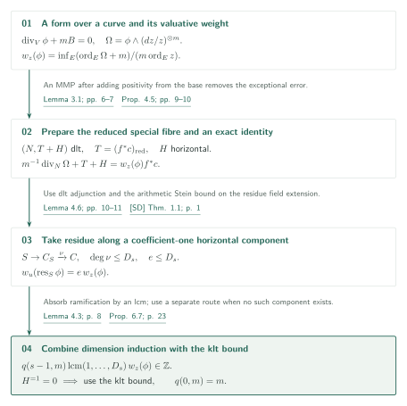
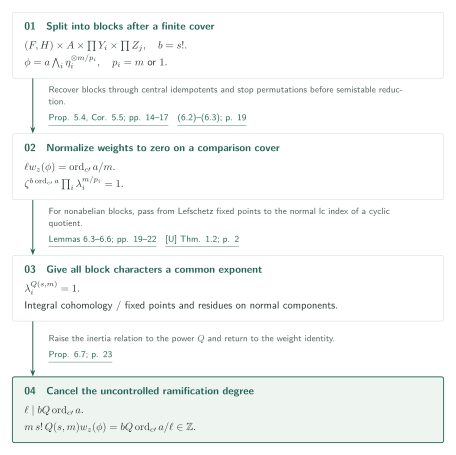
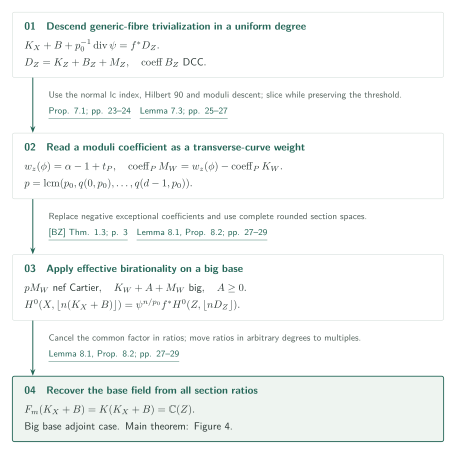
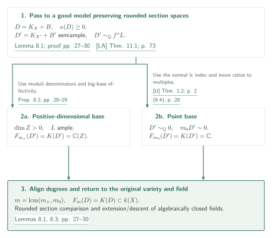

# Uniform log Iitaka fibrations and bounded moduli denominators

**Residue induction, inertia characters, and recovery of the entire Iitaka field**

The manuscript seeks one degree, depending only on dimension and a finite rational coefficient set, that determines the Iitaka fibration of an lc pair. It bounds curve-weight denominators through horizontal residues and klt block characters, then uses an exact canonical bundle formula to recover the full field of section ratios.

## 1. Main results

### Theorem 1.1 — Generating the entire Iitaka field in one degree

Fix $d\ge5$ and a finite set $\Phi\subset[0,1]\cap\mathbb Q$. Let $X$ be a normal integral projective $d$-fold over an algebraically closed field $k$ of characteristic zero, and let $B$ be an effective rational boundary. Assume that $(X,B)$ is lc, the nonzero coefficients of $B$ belong to $\Phi$, $D=K_X+B$ is $\mathbb Q$-Cartier, and $\kappa(X,D)\ge0$. The authors assert that there is a positive integer $m$, depending only on $d,\Phi$, such that

$$
V_m(D):=H^0(X,\mathcal O_X(\lfloor mD\rfloor))\ne0,
\qquad F_m(D)=K(D)\subset k(X)
$$

([Theorem 1.1, p. 2][P]). Here $F_m(D)$ is generated by all ratios of degree-$m$ sections, and $K(D)$ by section ratios in all positive degrees. The conclusion identifies subfields of $k(X)$, rather than merely their transcendence degrees. It is an existence statement for $m$, without a numerical bound or a uniform Cartier index for $K_X+B$ itself. The coefficient set in the main theorem is finite.

[Theorem 1.1 · p. 2][P]

### Theorem 4.2 — Valuative weights over a curve

Fix integers $s\ge0$ and $m\ge1$. Let $C$ be a smooth complex projective curve, $K=\mathbb C(C)$, and $z$ a rational uniformizer at $c\in C$. Suppose that $V/K$ is normal, geometrically integral, projective of dimension $s$, that $(V,B)$ is geometrically lc with an effective rational boundary, and that a rational $m$-canonical form $\phi$ satisfies $\operatorname{div}_V\phi+mB=0$. Taking all divisorial valuations $E$ over $c$, set

$$
w_z(\phi)=\inf_E\frac{\operatorname{ord}_E(\phi\wedge(dz/z)^{\otimes m})+m}{m\operatorname{ord}_E z}.
$$

[Theorem 4.2, pp. 7–8][P] asserts the existence of a positive integer $q(s,m)>0$ with $q(s,m)w_z(\phi)\in\mathbb Z$. This integer is independent of the curve, pair and form; no separate coefficient set is fixed. The assumptions already make $mB$ integral.

[Theorem 4.2 · pp. 7–8][P]

### Theorem 7.2 — Moduli denominators with an exact presentation fixed

Fix $d\ge1$ and a finite rational coefficient set $\Phi$. Let $f:X\to Z$ be a contraction of normal complex projective varieties, with $\dim X\le d$ and $\dim Z>0$. Assume that $(X,B)$ is lc, $B\ge0$ has nonzero coefficients in $\Phi$, and the $\mathbb Q$-Cartier divisor $K_X+B$ is $\mathbb Q$-linearly equivalent to $f^*L$ for a $\mathbb Q$-Cartier divisor $L$. [Proposition 7.1, pp. 23–24][P] supplies a uniform $p_0(d,\Phi)$ and a rational function $\psi$ such that

$$
K_X+B+\frac1{p_0}\operatorname{div}\psi=f^*D_Z,
\qquad D_Z\sim_{\mathbb Q}L,
\qquad D_Z=K_Z+B_Z+M_Z
$$

For the moduli b-divisor defined by an exact presentation of this degree, [Theorem 7.2, p. 25][P] asserts that a uniform $p(d,\Phi)$, divisible by $p_0$, makes $pM_W$ nef Cartier on every smooth projective determination of the moduli part. This does not bound denominators of representatives modified by arbitrary rational principal divisors, nor assert b-semiampleness.

[Proposition 7.1; Theorem 7.2 · pp. 23–25][P]

## References on the arrows

Unprefixed numbers refer to this manuscript [P]. Direct catalog inputs are [U] for normal lc indices, [LA] for projective good models, and [SD] for boundary-component Stein degrees. These are distinct from the external decomposition and effectivity inputs.

- [U, Theorem 1.2 · p. 2][U]
- [LA, Theorem 11.1 · p. 73][LA]
- [SD, Theorem 1.1 · p. 1][SD]
- [MW, Theorem 1.3][MW] / [TX, Theorem A][TX]
- [FG, Theorem 3.6][FG] / [HMX, Theorem 1.1][HMX] / [BZ, Theorem 1.3][BZ]

## 2. Proof of Theorem 4.2: induction along horizontal boundary

Induct on relative dimension $s$, starting with $q(0,m)=m$. For $s>0$, realize the weight as a divisor identity on a dlt model. A horizontal coefficient-one component permits residue induction; its absence leads to the independent klt bound.

### 1. Realize the weight on a relative dlt model

[Proposition 4.5, pp. 9–10][P] first produces a relative dlt model $(N,T+H)$, where $T$ is the reduced special fibre and $H$ the horizontal boundary, on which the weight appears in an actual divisor identity. Removing negative crepant coefficients introduces an effective exceptional error. After a relative MMP this error is vertical; comparison with a relative principal divisor makes it a scalar multiple of the fibre, and the threshold defining the weight forces the scalar to vanish. The relative MMP is justified through [Lemma 3.1, pp. 6–7][P]: add a sufficiently positive divisor from the base, use projective log abundance, and use the length bound for lc extremal rays to force every contraction to be vertical.

[Lemma 3.1; Proposition 4.5 · pp. 6–7, 9–10][P]

### 2. Bound the Stein degree before taking a horizontal residue

If $H$ has a coefficient-one component $S$, dlt adjunction and residue reduce the dimension. Applying [SD] on the generic fibre bounds the finite degree in the Stein factorization $S\to C_S\to C$ by $D_s$. With ramification index $e\le D_s$, the residue weight is $e\,w_z(\phi)$, so $q(s-1,m)\operatorname{lcm}(1,\ldots,D_s)$ clears the original denominator ([Lemma 4.6, pp. 10–11][P]).

[Lemma 4.6 · pp. 10–11][P] · [SD, Theorem 1.1 · p. 1][SD]

### 3. Use the klt bound in the remaining case and combine the integers

When no coefficient-one horizontal component remains, the prepared generic fibre is $\mathbb Q$-Gorenstein klt. That case requires a separate character bound.

Choose $q(s,m)$ as a common multiple of the two branch bounds to close the induction.

[Proof of Theorem 4.2 · p. 11][P]

## 3. Proof of Proposition 6.7: uniform klt character bounds

Work in the setting of Theorem 4.2 with $s\ge1$, geometrically klt generic pair, and $\mathbb Q$-Cartier $K_V$. Give the block characters a common exponent, then cancel the covering degree introduced by decomposition and semistable reduction.

### 1. Transfer block decompositions to actions on a comparison cover

The decomposition in [MW] gives, after a finite quasi-étale cover, a rationally connected block carrying the boundary, an abelian variety, Calabi–Yau blocks and irreducible symplectic blocks. The other blocks carry no boundary. Vanishing of logarithmic tangent vector fields on the rationally connected block ([Lemma 5.2, pp. 12–13][P]) supports the comparison of product decompositions. The argument does not assume that a finite Galois closure is itself a product. [Proposition 5.4, pp. 14–15][P] recovers block function fields from central idempotents in the endomorphism algebra of the tangent sheaf, kills permutations by an $s!$-th power, and constructs a common finite comparison cover with actions on its blocks.

[Lemmas 5.2–5.3; Proposition 5.4 · pp. 12–15][P] · [MW, Theorem 1.3][MW]

### 2. Normalize to weight zero and obtain the inertia relation

After semistable base change and normalization to weight zero, write $\phi=a\bigwedge_i\eta_i^{\otimes m/p_i}$, with $p_i=m$ on the rationally connected block and $p_i=1$ otherwise. If $\ell$ is the ramification index and $b=s!$, [equations (6.2)–(6.3), p. 19][P] give

$$
\ell w_z(\phi)=\frac{\operatorname{ord}_{c'}a}{m},
\qquad \zeta^{b\operatorname{ord}_{c'}a}\prod_i\lambda_i^{m/p_i}=1
$$

[(6.2)–(6.3) · p. 19][P]

### 3. Kill characters through fixed points and residues on normal components

For abelian blocks, finite-rank integral cohomology bounds the character order. On the other blocks, Du Bois base change compares $H^j(\mathcal O)$ on the generic and special fibres, and coherent Lefschetz traces produce a fixed point for a bounded power. A further bounded power fixes a coefficient-one component through that point. Adjunction and residue on this **normal component**, followed by the normal lc index theorem [U] on its cyclic quotient, kill the residue character uniformly ([Lemmas 6.5–6.6, pp. 21–22][P]). An slc index theorem for the whole special fibre is not the input here.

[Lemmas 6.3–6.6 · pp. 19–22][P] · [U, Theorem 1.2][U]

### 4. Eliminate ramification using the divisibility relation

A common $Q(s,m)$ with $\lambda_i^Q=1$ for every block yields $\ell\mid bQ\operatorname{ord}_{c'}a$. Consequently

$$
q_{\rm klt}(s,m)=m\,s!\,Q(s,m),
\qquad q_{\rm klt}(s,m)w_z(\phi)\in\mathbb Z.
$$

This is [Proposition 6.7, p. 23][P]. The decisive connection is the cancellation of the uncontrolled ramification degree introduced by semistable reduction.

[Proposition 6.7 · p. 23][P]

## 4. Proofs of Theorem 7.2 and Proposition 8.2: denominators and complete section spaces

After fixing the generic-fibre index $p_0$, use curve weights to bound moduli denominators. When the base adjoint is big, combine effective birationality with exact section comparison to recover the entire base field.

### 1. Descend in the same index and choose an exact presentation

The normal lc index theorem [U] on the geometric generic fibre, followed by Hilbert 90 in the same degree, supplies the uniform $p_0$. Qualitative moduli descent uses [FG], while the DCC property of discriminant coefficients uses [HMX].

[Proposition 7.1 · pp. 23–24][P] · [U, Theorem 1.2][U] · [FG, Theorem 3.6][FG]

### 2. Measure the moduli coefficient as a curve weight

A transverse curve through the generic point of a prime divisor $P\subset W$ preserves its coefficient $\alpha$ and threshold $t_P$, including negative coefficients in the crepant subboundary. The relative form has weight $w_z(\phi)=\alpha-1+t_P$, differing from the moduli coefficient only by the integral coefficient of $K_W$ ([Lemma 7.3, pp. 25–27][P]). A common multiple of $q(s,p_0)$ over all relative dimensions makes $pM_W$ integral and hence Cartier on smooth $W$.

[Theorem 7.2; Lemma 7.3 · pp. 25–27][P]

### 3. Combine base effectivity with complete section spaces

When $L$ is big, effective birationality [BZ] applies on the base. Negative exceptional crepant coefficients are first replaced by the reduced exceptional boundary to produce an effective generalized pair. For $p_0\mid n$, the complete section spaces satisfy

$$
H^0(X,\lfloor n(K_X+B)\rfloor)
=\psi^{n/p_0}f^*H^0(Z,\lfloor nD_Z\rfloor)
$$

[Lemma 8.1, pp. 27–28][P] proves this identification and its birational invariance for rounded divisors, without introducing the Cartier index of the total space. A ratio in any degree can be moved to a degree divisible by $p_0$ by multiplying numerator and denominator by a power of one section. Thus the entire Iitaka field equals the base field ([Proposition 8.2, pp. 28–29][P]).

[Lemma 8.1; Proposition 8.2 · pp. 27–29][P] · [BZ, Theorem 1.3][BZ]

## 5. Proof of Theorem 1.1: from a good model to the full Iitaka field

Return to the main theorem using the index, denominator, and effectivity bounds. Over the complex numbers, choose a good model and split by the dimension of its semiample base. Then use invariance of the ratio-field equality under field extension.

### 1. Preserve rounded section spaces on the way to a good model

The assumption $\kappa(X,D)\ge0$ makes $D$ pseudo-effective. After a crepant dlt modification, [LA] and [TX] give a good model with semiample $D'=K_{X'}+B'$. Its coefficients remain in $\Phi\cup\{1\}$. On a common resolution, the difference between the pullback of the original adjoint and the pullback of $D'$ is effective and exceptional. Lemma 8.1 identifies all rounded section spaces inside the common function field.

[Lemma 8.1(ii); proof of Theorem 1.1 · pp. 27–28, 29][P] · [LA, Theorem 11.1][LA] · [TX, Theorem A][TX]

### 2. Use big-base effectivity in positive Iitaka dimension

If the semiample contraction $f:X'\to Z$ has positive-dimensional base, then $D'\sim_{\mathbb Q}f^*L$ with $L$ ample. Apply Proposition 8.2 with the fixed coefficient set $\Phi\cup\{1\}$. The complete ratios in one uniform degree generate $k(Z)=K(D')$. This identifies the embedded function field, including the finite information of the map.

[Proposition 8.2; proof of Theorem 1.1 · pp. 28–30][P]

### 3. Use the index theorem in dimension zero and align degrees

If $Z$ is a point, then $D'\sim_{\mathbb Q}0$. The normal lc index theorem [U] gives a uniform principal multiple. Its section ratios are constants. A ratio in any other degree can be moved to a common multiple by multiplying numerator and denominator by powers of a section, so $K(D')=\mathbb C$. Take a common multiple of the two branch degrees and return to $X$ by rounded section comparison. No uniform Cartier index of the total space is needed.

[(8.4); proof of Theorem 1.1 · pp. 28, 30][P] · [U, Theorem 1.2][U]

### 4. Transfer the ratio-field equality to arbitrary characteristic-zero fields

The algebraic closure $k_0$ of a finitely generated field of definition embeds into $\mathbb C$. Lemma 8.3 uses base change of rounded divisorial sections and an intersection identity for intermediate fields $F\subset k(X)$. It shows that nonemptiness and $F_m(D)=K(D)$ hold if and only if they hold after an extension of algebraically closed fields. Descend the complex conclusion to $k_0$ and extend to the original $k$, retaining the same integer.

[Lemma 8.3, (8.5)–(8.6); proof of Theorem 1.1 · pp. 29–30][P]

## 6. Which papers supply which steps

| Input | Original statement and role here | Editorial check |
|---|---|---|
| [U] *Uniform Pluricanonical Iitaka Fibrations* | 2026-10-03, Theorem 1.2, p. 2: uniform integral principal multiples for normal lc pairs with rational DCC coefficients and rationally trivial adjoint divisor. Used in Theorem 2.1, Lemma 6.5, Proposition 7.1 and the $\kappa=0$ case | Statement and application passages compared; the input's proof is outside scope |
| [LA] *Log abundance in characteristic zero* | 2026-09-24, Theorem 11.1, p. 73: good models for complex projective lc pairs with pseudo-effective adjoint divisor. Used in Lemmas 3.1, 6.4 and §8 | Statement and uses compared, retaining the rational-boundary semiampleness conclusion needed here |
| [SD] *Arithmetic Stein-degree bounds…* | 2026-09-25, Theorem 1.1, p. 1; bounds the Stein-curve degree of a coefficient-one horizontal component in Lemma 4.6 | Statement and use compared; a separate catalog article outlines its proof |
| [MW] Matsumura–Wang | arXiv:2105.14308v3, Theorem 1.3, p. 4; quasi-étale product decomposition in Proposition 5.1 | Statement compared; proof outside scope |
| [TX] Tsakanikas–Xie | arXiv:2301.09186v3, Theorem A, p. 2; existence of a terminating scaling MMP when a minimal model exists | Statement compared; ordinary pairs here have zero nef part |
| [FG], [HMX], [BZ] | [FG] Theorem 3.6 (PDF p. 7, journal p. 1726), moduli descent; [HMX] Theorem 1.1 (p. 2), ACC for thresholds; [BZ] Theorem 1.3 (p. 3), effective birationality; used in §§7–8 | Statements and application passages compared; input proofs outside scope |

## 7. Return to the sources

The editorial reading covers the pinned main statement and the proof route in §§3–8, pp. 6–30, including equations (6.2)–(6.3), cancellation of the ramification degree in Proposition 6.7, the coefficient comparison in Lemma 7.3, and the argument with rounded section ratios. The TeX diagrams compress this route. This revision rechecked the two induction branches and the cases after passing to a good model, aligning diagrams with the numbered explanations.

Remaining checks include independent scrutiny of the transition from logarithmic-volume rigidity in Lemma 5.2 to the comparison-cover decomposition; reducedness of the marked special fibre after the quotient MMP in Lemma 6.4; and comparison with the original Du Bois base-change and coherent Lefschetz statements invoked in Lemma 6.6. Their uses in this paper were read, but input proofs and every auxiliary citation were not recursively verified. The background reference [HP] was located without a statement-level comparison. The low-dimensional *Relative denominators…* paper is a methodological predecessor for curve preparation; its low-dimensional conclusion is not recorded as an input proving the higher-dimensional denominator theorem.

[P]: https://github.com/openai/math/blob/adc7f1241b42e322a6451854ab7e4b4c146bf78a/preprints/Uniform-log-Iitaka-fibrations-and-bounded-moduli-denominators-October-4-2026/uniform-log-iitaka.pdf
[U]: https://github.com/openai/math/blob/adc7f1241b42e322a6451854ab7e4b4c146bf78a/preprints/Uniform-Pluricanonical-Iitaka-Fibrations-October-3-2026/paper.pdf
[LA]: https://github.com/openai/math/blob/adc7f1241b42e322a6451854ab7e4b4c146bf78a/preprints/Log-abundance-in-characteristic-zero-September-24-2026/paper.pdf
[SD]: https://github.com/openai/math/blob/adc7f1241b42e322a6451854ab7e4b4c146bf78a/preprints/Arithmetic-Stein-degree-bounds-for-log-Calabi-Yau-pairs-September-25-2026/paper.pdf
[MW]: https://arxiv.org/pdf/2105.14308v3
[TX]: https://arxiv.org/pdf/2301.09186v3
[FG]: https://www.numdam.org/item/10.5802/aif.2894.pdf
[HMX]: https://arxiv.org/pdf/1208.4150
[BZ]: https://arxiv.org/pdf/1410.0938
[HP]: https://arxiv.org/pdf/1710.06183
