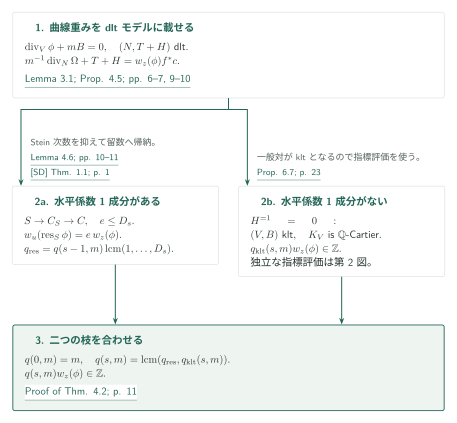
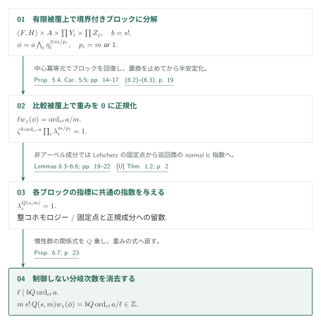
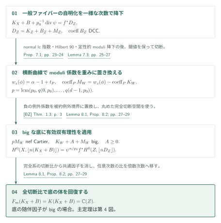
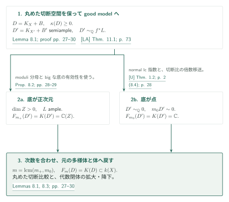

# Uniform log Iitaka fibrations and bounded moduli denominators

**留数による次元帰納、慣性指標、全飯高体の回復**

有限有理係数を持つlc対の飯高写像を、次元と係数集合だけで決まる一つの次数で捉える。証明の中心は、曲線上の重みの分母を水平境界の留数とkltブロックの指標で抑え、正確な標準束公式から全切断比の体へ戻すことである。

## 1. 主要結果

### Theorem 1.1 — 一つの次数で全飯高体を生成する

$d\ge5$ と有限集合 $\Phi\subset[0,1]\cap\mathbb Q$ を固定する。標数0の代数閉体 $k$ 上の正規整射影 $d$ 次元多様体 $X$ と有効な有理境界 $B$ が、$(X,B)$ lc、$B$ の非零係数が $\Phi$ に属すること、$D=K_X+B$ が $\mathbb Q$-Cartier、$\kappa(X,D)\ge0$ を満たすとする。著者は、$d,\Phi$ のみに依存する正整数 $m$ について

$$
V_m(D):=H^0(X,\mathcal O_X(\lfloor mD\rfloor))\ne0,
\qquad F_m(D)=K(D)\subset k(X)
$$

を主張する（[Theorem 1.1、p. 2][P]）。$F_m(D)$ は次数 $m$ の全切断比が生成する体、$K(D)$ は全正次数の切断比が生成する体である。結論は像の次元の一致にとどまらず、$k(X)$ 内の部分体の一致である。整数 $m$ の存在定理であり、数値的な上界や $K_X+B$ 自体の一様Cartier指数を与える主張ではない。主定理の係数集合は有限である。

[Theorem 1.1 · p. 2][P]

### Theorem 4.2 — 曲線上の付値的重み

整数 $s\ge0$、$m\ge1$ を固定する。$C$ を滑らかな複素射影曲線、$K=\mathbb C(C)$、$z$ を $c\in C$ の有理一様化元とする。$V/K$ は正規・幾何的整・射影の $s$ 次元多様体、$(V,B)$ は幾何的lc、$B\ge0$ は有理境界とし、有理 $m$ 重標準形式 $\phi$ が $\operatorname{div}_V\phi+mB=0$ を満たすとする。$c$ の上にある全因子的付値 $E$ に対し

$$
w_z(\phi)=\inf_E\frac{\operatorname{ord}_E(\phi\wedge(dz/z)^{\otimes m})+m}{m\operatorname{ord}_E z}.
$$

著者の [Theorem 4.2、pp. 7–8][P] は $q(s,m)w_z(\phi)\in\mathbb Z$ となる 正整数 $q(s,m)>0$ の存在を主張する。曲線、対、形式に依存せず、境界係数も別に固定しない。この条件では既に $mB$ が整である。

[Theorem 4.2 · pp. 7–8][P]

### Theorem 7.2 — 正確な表示を固定したmoduli分母

$d\ge1$、有限有理係数集合 $\Phi$ を固定する。複素数上の正規射影多様体間の収縮 $f:X\to Z$、$\dim X\le d$、$\dim Z>0$、有効lc対 $(X,B)$、非零係数 $\Phi$、$\mathbb Q$-Cartier因子 $L$ に対する $\mathbb Q$-Cartierな $K_X+B\sim_{\mathbb Q}f^*L$ を考える。[Proposition 7.1、pp. 23–24][P] は、一様な $p_0(d,\Phi)$ と有理関数 $\psi$ により

$$
K_X+B+\frac1{p_0}\operatorname{div}\psi=f^*D_Z,
\qquad D_Z\sim_{\mathbb Q}L,
\qquad D_Z=K_Z+B_Z+M_Z
$$

とできると述べる。この次数 $p_0$ の正確な表示から定めたmoduli b-divisorについて、[Theorem 7.2、p. 25][P] は $p_0\mid p(d,\Phi)$ を満たす一様な $p$ を与え、moduliが降下する全ての滑らかな射影モデル上で $pM_W$ がnef Cartierになると主張する。任意の有理主因子の加算を許した代表に対する分母評価でも、b-semiamplenessの主張でもない。

[Proposition 7.1; Theorem 7.2 · pp. 23–25][P]

## 図の矢印に付した引用

略号なしは本原稿 [P] の結果を指す。[U]はnormal lc指数、[LA]は射影的good model、[SD]は境界成分のStein次数を供給する。これらの直接入力と、外部の分解・有効性を区別する。

- [U, Theorem 1.2 · p. 2][U]
- [LA, Theorem 11.1 · p. 73][LA]
- [SD, Theorem 1.1 · p. 1][SD]
- [MW, Theorem 1.3][MW] / [TX, Theorem A][TX]
- [FG, Theorem 3.6][FG] / [HMX, Theorem 1.1][HMX] / [BZ, Theorem 1.3][BZ]

## 2. Theorem 4.2の証明：水平境界に沿う次元帰納

相対次元 $s$ で帰納する。$s=0$ では $q(0,m)=m$。$s>0$ では重みをdltモデル上の因子等式にし、水平係数1成分があれば留数へ、なければ独立なklt評価へ分岐する。

### 1. 相対dltモデルで重みを因子等式にする

最初に [Proposition 4.5、pp. 9–10][P] で相対dltモデル $(N,T+H)$ を用意し、$T$ を被約特殊ファイバー、$H$ を水平境界として重みを実際の因子恒等式にする。負のcrepant係数を除くと生じる有効例外誤差は、相対MMP後に垂直になる。相対主因子との比較からファイバーのスカラー倍となり、閾値の定義でそのスカラーが消える。相対MMPは射影的log abundanceをそのまま相対版として引用するのでなく、底の十分大きい因子を加え、lc extremal rayの長さ評価で各収縮を垂直にする [Lemma 3.1、pp. 6–7][P] を経由する。

[Lemma 3.1; Proposition 4.5 · pp. 6–7, 9–10][P]

### 2. 水平係数1成分があれば、Stein次数を抑えて留数を取る

$H$ に係数1の成分 $S$ があれば、dlt随伴と留数で次元を下げる。[SD]のStein次数評価を一般ファイバー上で適用し、$S\to C_S\to C$ の有限部分の次数を $D_s$ で抑える。分岐指数 $e\le D_s$ に対して留数の重みは $e\,w_z(\phi)$ となり、$q(s-1,m)\operatorname{lcm}(1,\ldots,D_s)$ で元の分母も消える（[Lemma 4.6、pp. 10–11][P]）。

[Lemma 4.6 · pp. 10–11][P] · [SD, Theorem 1.1 · p. 1][SD]

### 3. 水平成分がなければklt評価を使い、二つの整数を合わせる

係数1の水平成分がなければ、準備した一般ファイバーは $\mathbb Q$-Gorenstein kltとなる。ここから先は別の指標評価である。

二つの枝で得た整数の公倍数を $q(s,m)$ に選べば、帰納法が閉じる。

[Proof of Theorem 4.2 · p. 11][P]

## 3. Proposition 6.7の証明：klt指標の一様評価

Theorem 4.2の設定で $s\ge1$、一般対が幾何学的klt、$K_V$ が $\mathbb Q$-Cartierの場合を扱う。分解と半安定化で導入する被覆次数を直接抑えず、各ブロックの指標に共通の指数を与えて最後に消去する。

### 1. ブロック分解を比較被覆上の作用へ移す

[MW]の分解により、有限quasi-étale被覆の上で、有理連結な境界付きブロック、アーベル多様体、Calabi–Yauブロック、既約symplecticブロックへ分ける。非有理連結ブロックには境界を残さない。有理連結ブロックの対数接ベクトル場を消す [Lemma 5.2、pp. 12–13][P] が、後の積の比較を支える。有限ガロア閉包自体が積であるとは仮定しない。[Proposition 5.4、pp. 14–15][P] は接層の自己準同型代数の中心冪等元からブロックの関数体を回復し、$s!$ 乗で置換を止め、共通の有限比較被覆と各ブロック上の作用を作る。

[Lemmas 5.2–5.3; Proposition 5.4 · pp. 12–15][P] · [MW, Theorem 1.3][MW]

### 2. 重み0への正規化で慣性関係式を得る

その上で半安定化と重み0への正規化を行い、$\phi=a\bigwedge_i\eta_i^{\otimes m/p_i}$ と書く。$p_i=m$ は有理連結ブロック、その他では $p_i=1$ である。分岐指数を $\ell$、$b=s!$ とすると、[式 (6.2)–(6.3)、p. 19][P] は

$$
\ell w_z(\phi)=\frac{\operatorname{ord}_{c'}a}{m},
\qquad \zeta^{b\operatorname{ord}_{c'}a}\prod_i\lambda_i^{m/p_i}=1
$$

となる。

[(6.2)–(6.3) · p. 19][P]

### 3. 固定点と正規成分の留数で指標を消す

アーベルブロックでは有限階の整係数コホモロジーに対する作用から指標の位数を抑える。他のブロックでは、Du Bois型base changeで一般・特殊ファイバーの $H^j(\mathcal O)$ を比較し、coherent Lefschetzの交代跡から有界な冪に固定点を得る。固定点を通る係数1の成分をさらに有界な冪で固定し、その**正規成分**に随伴して留数を取る。[U]のnormal lc指数定理を巡回商へ適用すると、留数の指標が一様な冪で消える（[Lemmas 6.5–6.6、pp. 21–22][P]）。特殊ファイバー全体のslc指数定理はここでの入力ではない。

[Lemmas 6.3–6.6 · pp. 19–22][P] · [U, Theorem 1.2][U]

### 4. 分岐次数を整除関係から消去する

共通の $Q(s,m)$ で全ての $\lambda_i^Q=1$ が得られると、$\ell\mid bQ\operatorname{ord}_{c'}a$ となる。したがって

$$
q_{\rm klt}(s,m)=m\,s!\,Q(s,m),
\qquad q_{\rm klt}(s,m)w_z(\phi)\in\mathbb Z.
$$

これは [Proposition 6.7、p. 23][P] の結論である。制御しない半安定化の分岐次数が最後に消去されることが重要な接続である。

[Proposition 6.7 · p. 23][P]

## 4. Theorem 7.2とProposition 8.2の証明：分母から全切断空間へ

一般ファイバーの指数 $p_0$ を固定した後、曲線重みからmoduli係数の分母を抑える。底の随伴因子がbigの場合は、有効双有理性と正確な切断比較を合わせて底の全関数体を得る。

### 1. 同じ指数で降下し、正確な表示を選ぶ

[U]のnormal lc指数定理を幾何的一般ファイバーに適用し、Hilbert 90で同じ次数の自明化を降下させることで、$p_0$ を一様にする。定性的なmoduli降下は[FG]、判別係数のDCCは[HMX]に依存する。

[Proposition 7.1 · pp. 23–24][P] · [U, Theorem 1.2][U] · [FG, Theorem 3.6][FG]

### 2. moduli係数を曲線重みとして測る

素因子 $P\subset W$ の一般点を通る曲線への切断では、crepant境界の負係数を保持したまま係数 $\alpha$ と閾値 $t_P$ を保つ。相対形式の重みは $w_z(\phi)=\alpha-1+t_P$ となり、moduli係数との差は $K_W$ の整係数だけである（[Lemma 7.3、pp. 25–27][P]）。全相対次元について $q(s,p_0)$ の公倍数を取れば $pM_W$ は整となり、滑らかさからCartierになる。

[Theorem 7.2; Lemma 7.3 · pp. 25–27][P]

### 3. 底の有効双有理性と全切断空間を結ぶ

$L$ がbigなら、[BZ]の有効双有理性を底に適用する。ただしcrepant境界の負の例外係数は被約例外境界で置き換え、有効な一般化対にしてから適用する。切断空間は $p_0\mid n$ に対して

$$
H^0(X,\lfloor n(K_X+B)\rfloor)
=\psi^{n/p_0}f^*H^0(Z,\lfloor nD_Z\rfloor)
$$

と一致する。[Lemma 8.1、pp. 27–28][P] はこの丸めた完全切断空間の一致と双有理不変性を扱い、全空間のCartier指数を導入しない。任意次数の切断比は切断の冪を掛けて $p_0$ の倍数次数へ移せるので、全飯高体も底の関数体に一致する（[Proposition 8.2、pp. 28–29][P]）。

[Lemma 8.1; Proposition 8.2 · pp. 27–29][P] · [BZ, Theorem 1.3][BZ]

## 5. Theorem 1.1の証明：good modelから全飯高体へ

ここまでの指数・分母・有効性を主定理へ戻す。まず複素数体上でgood modelを選び、その半豊富な随伴因子が定める底の次元で分ける。最後に体の拡大に対する切断比の等式を使う。

### 1. 丸めた切断空間を保ってgood modelへ移る

$\kappa(X,D)\ge0$ から $D$ は擬有効である。crepant dlt改変後に[LA]と[TX]を適用し、半豊富な $D'=K_{X'}+B'$ を持つgood modelへ進む。係数は $\Phi\cup\{1\}$ に留まる。共通解消上で元の随伴因子の引戻しと $D'$ の引戻しとの差は有効例外因子であり、Lemma 8.1が丸めた全切断空間を同じ関数体内で一致させる。

[Lemma 8.1(ii); proof of Theorem 1.1 · pp. 27–28, 29][P] · [LA, Theorem 11.1][LA] · [TX, Theorem A][TX]

### 2. 正の飯高次元では、bigな底の有効系を使う

半豊富な縮約 $f:X'\to Z$ の底が正次元なら、$D'\sim_{\mathbb Q}f^*L$ で $L$ は豊富である。Proposition 8.2を固定係数集合 $\Phi\cup\{1\}$ に適用し、一様な次数の全切断比が $k(Z)=K(D')$ を生成する。主張は底と同じ次元の像ではなく、この埋め込まれた関数体の一致である。

[Proposition 8.2; proof of Theorem 1.1 · pp. 28–30][P]

### 3. 飯高次元0では指数定理を使い、次数を揃える

$Z$ が点なら $D'\sim_{\mathbb Q}0$。[U]のnormal lc指数定理が一様な主因子倍を与える。その次数の切断比は定数であり、任意の次数の比も分子分母に切断の冪を掛けて共通倍数次数へ移せるので、$K(D')=\mathbb C$ である。両枝の次数の公倍数を取り、丸めた切断比較で $X$ へ戻す。全空間のCartier指数を一様化する必要はない。

[(8.4); proof of Theorem 1.1 · pp. 28, 30][P] · [U, Theorem 1.2][U]

### 4. 切断比の体の等式を任意の標数0体へ移す

有限生成の定義体を代数閉化した $k_0$ は $\mathbb C$ に埋め込める。Lemma 8.3は丸めた因子層の切断のbase changeと、中間体 $F\subset k(X)$ に対する交わりの等式を使い、非空性と $F_m(D)=K(D)$ が代数閉体の拡大の前後で同値であることを示す。複素数上の同じ整数を $k_0$ に降下し、元の $k$ へ拡大して主定理を得る。

[Lemma 8.3, (8.5)–(8.6); proof of Theorem 1.1 · pp. 29–30][P]

## 6. どの論文が、どの段階を担うか

| 略号・入力 | 原典と本稿での役割 | 編集側の確認 |
|---|---|---|
| [U] *Uniform Pluricanonical Iitaka Fibrations* | 2026-10-03版 Theorem 1.2、p. 2。normal lc対・有理DCC係数・対数標準因子の有理線形自明性から一様な整主因子倍。本稿 Theorem 2.1、Lemma 6.5、Proposition 7.1、$\kappa=0$ に使用 | 入力の定理記述と使用箇所を照合。入力自身の証明は対象外 |
| [LA] *Log abundance in characteristic zero* | 2026-09-24版 Theorem 11.1、p. 73。複素射影lc対のpseudo-effective随伴因子にgood model。本稿 Lemma 3.1、Lemma 6.4、§8 | 定理記述と適用を照合。有理境界を使う本稿のsemiample結論を区別 |
| [SD] *Arithmetic Stein-degree bounds…* | 2026-09-25版 Theorem 1.1、p. 1。本稿 Lemma 4.6で係数1の水平成分のStein曲線次数を評価 | 定理と使用箇所を照合。同カタログの独立記事で証明経路を概説 |
| [MW] Matsumura–Wang | arXiv:2105.14308v3 Theorem 1.3、p. 4。本稿 Proposition 5.1のquasi-étale積分解 | 定理記述を照合。分解定理の証明は対象外 |
| [TX] Tsakanikas–Xie | arXiv:2301.09186v3 Theorem A、p. 2。minimal model存在下のscaling付きMMPの停止 | 記述を照合。本稿の通常対はnef part 0の場合 |
| [FG], [HMX], [BZ] | [FG] Theorem 3.6（PDF p. 7、誌面1726）のmoduli降下、[HMX] Theorem 1.1（p. 2）の閾値ACC、[BZ] Theorem 1.3（p. 3）の有効双有理性。§§7–8で使用 | 記述と使用箇所を照合。各入力の証明は対象外 |

## 7. 原典を読む入口と確認範囲

編集側は固定版の主定理と §§3–8、pp. 6–30の上記証明経路を読み、式 (6.2)–(6.3)、Proposition 6.7の分岐次数の消去、Lemma 7.3の係数対応、丸めた切断比の議論を確認した。TeX図はこの経路を圧縮したものである。今回の改訂では帰納の二つの枝とgood model後の場合分けを再照合し、図と段階別説明を対応させた。

残る確認点は、Lemma 5.2の対数体積測度による剛性から比較被覆のブロック分解へ至る議論の独立な精査、Lemma 6.4の商MMP後の被約特殊ファイバー、Lemma 6.6が参照するDu Bois base changeとcoherent Lefschetzの外部定理の原文照合である。これらの本稿での使用箇所は読んだが、入力定理の証明や全ての補助引用を再帰的に検証してはいない。[HP]の積分解の背景は参照先を特定した段階にとどめる。既存の低次元 *Relative denominators…* は曲線準備の方法上の先行作として区別し、その低次元結論を高次元の分母評価の入力とする矢印は付けない。

[P]: https://github.com/openai/math/blob/adc7f1241b42e322a6451854ab7e4b4c146bf78a/preprints/Uniform-log-Iitaka-fibrations-and-bounded-moduli-denominators-October-4-2026/uniform-log-iitaka.pdf
[U]: https://github.com/openai/math/blob/adc7f1241b42e322a6451854ab7e4b4c146bf78a/preprints/Uniform-Pluricanonical-Iitaka-Fibrations-October-3-2026/paper.pdf
[LA]: https://github.com/openai/math/blob/adc7f1241b42e322a6451854ab7e4b4c146bf78a/preprints/Log-abundance-in-characteristic-zero-September-24-2026/paper.pdf
[SD]: https://github.com/openai/math/blob/adc7f1241b42e322a6451854ab7e4b4c146bf78a/preprints/Arithmetic-Stein-degree-bounds-for-log-Calabi-Yau-pairs-September-25-2026/paper.pdf
[MW]: https://arxiv.org/pdf/2105.14308v3
[TX]: https://arxiv.org/pdf/2301.09186v3
[FG]: https://www.numdam.org/item/10.5802/aif.2894.pdf
[HMX]: https://arxiv.org/pdf/1208.4150
[BZ]: https://arxiv.org/pdf/1410.0938
[HP]: https://arxiv.org/pdf/1710.06183
