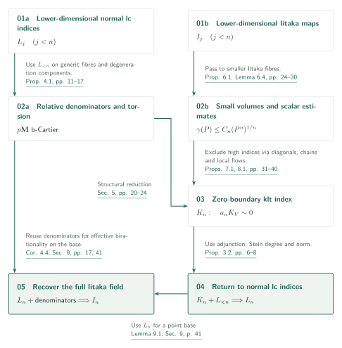
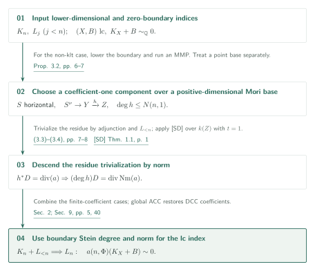
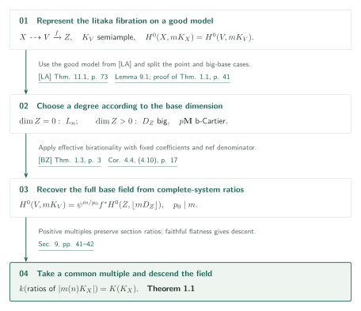

# Uniform Pluricanonical Iitaka Fibrations

**Simultaneous induction on Iitaka degrees and normal lc indices**

The manuscript claims that one pluricanonical degree depending only on dimension defines every Iitaka fibration of a smooth projective variety of nonnegative Kodaira dimension. The induction also proves a common exponent killing the **actual linear divisor class** of a normal lc log Calabi–Yau pair. Its central mechanisms are bounds on volume-form characters rather than on semistable ramification itself, and a contradiction between positivity on high-index canonical covers and jet estimates on diagonal products.

## 1. Main results

### Theorem 1.1 — Uniform pluricanonical degree (p. 2)

For every integer $d\ge1$ there is an integer $m(d)>0$ such that, over every algebraically closed field of characteristic zero, the complete system $|m(d)K_X|$ defines the Iitaka fibration of every smooth integral projective $d$-fold $X$ with $\kappa(X)\ge0$.

The system is nonempty and its section-ratio field **equals** the full Iitaka field $K(K_X)\subset k(X)$ generated over all pluricanonical degrees. Having an image of dimension $\kappa(X)$ alone is weaker. The statement includes nonvanishing in a common degree when $\kappa=0$, and birationality when $\kappa=d$. Every positive multiple works; no practical numerical value of $m(d)$ is supplied.

[Theorem 1.1 and §9, pp. 2, 40–42][U]

### Theorem 1.2 — Uniform log canonical index (p. 2)

Fix $d\ge0$ and a rational DCC set $\Phi\subset[0,1]\cap\mathbb Q$. There is an integer $a(d,\Phi)>0$ such that every normal integral projective lc pair $(X,B)$ over an algebraically closed field of characteristic zero, with $\dim X=d$, effective boundary having coefficients in $\Phi$, and $\mathbb Q$-Cartier adjoint $K_X+B\sim_{\mathbb Q}0$, satisfies
$$a(d,\Phi)(K_X+B)\sim0.$$
This multiple is an integral principal divisor. The statement controls more than numerical triviality or the Cartier index, and does not cover nonnormal slc pairs.

[Theorem 1.2 and §§2, 9.1, pp. 2, 4–5, 41–42][U]

## References on the arrows

Unprefixed references denote results of this manuscript. External references use the following keys.

- [LA][LA]: Log abundance in characteristic zero, September 24, 2026.
- [SD][SD]: Arithmetic Stein-degree bounds for log Calabi–Yau pairs, September 25, 2026.
- [Ufour][Ufour]: Uniform effective log Iitaka fibrations for fourfolds, September 26, 2026. Its chain and tracking lemmas used here are stated in arbitrary dimension.
- [BZ][BZ]: Birkar–Zhang, Effectivity of Iitaka fibrations and pluricanonical systems of polarized pairs, arXiv:1410.0938v2.

## 2. Organizing the simultaneous induction

Let $I_j$ denote Theorem 1.1 in dimension $j$, and $L_j$ Theorem 1.2 in dimension $j$ for every rational DCC coefficient set. Write $K_n$ for the zero-boundary klt index assertion: one integer makes $a_nK_V\sim0$ for every projective klt $n$-fold with $K_V\sim_{\mathbb Q}0$. Starting in dimension zero, the step assumes $I_j,L_j$ for $j<n$ and proves $K_n,L_n,I_n$ in that order.

### 1. Control relative denominators with lower-dimensional indices

Apply $L_{<n}$ to generic fibres and degeneration components over positive-dimensional bases. The resulting moduli denominator and torsion control over rationally connected bases support the structural reduction for $K_n$. The same denominator bound is reused for $I_n$, as the separate route in the diagram records.

[Notation 2.2 and Figure 1 · pp. 4–5; Proposition 4.1 and §5 · pp. 11–24][U]

### 2. Exclude high indices using lower-dimensional Iitaka maps

The hypotheses $I_{<n}$ enter the passage from small-volume covering members to smaller Iitaka fibres in Lemma 6.4 and the scalar estimates. Apply these estimates to canonical covers and diagonal products; the degree and local-flow argument in §8 then gives $K_n$. The assertion $I_n$ is not assumed at this stage.

[Proposition 6.1, Lemma 6.4 and §§7–8 · pp. 24–40][U]

### 3. Prove the normal lc index before returning to Iitaka maps

Adjunction, Stein degree and norm give $L_n$ from $K_n$ and $L_{<n}$. On a good model the Iitaka base is either a point, where $L_n$ applies, or positive-dimensional, where denominators and effective birationality apply. Global ACC reduces DCC coefficients to finite sets for $L_n$; descent to arbitrary algebraically closed characteristic-zero fields is performed at the end.

[Proposition 3.2 and §9 · pp. 6–8, 40–42][U]

## 3. Bounding moduli denominators

For a boundary-free klt contraction over a positive-dimensional base, seek a common Cartier multiple of the base moduli part. The input is $L_{<n}$: this bound is obtained before the index assertion in the current dimension.

### 1. Turn the generic-fibre index into an exact pullback equality

Write $L_j$ for Theorem 1.2 in dimension $j$. This step uses only $j<n$. Consider a contraction $f:X\to Z$ from a boundary-free klt $n$-fold, with $\dim Z>0$ and $K_X$ rationally linearly pulled back from the base. A common $p_0$ kills the canonical class of the geometric generic fibre. Descending that trivialization yields an equality of **actual rational divisors**
$$K_X+\frac1{p_0}\operatorname{div}(\psi)=f^*D_Z,\qquad D_Z=K_Z+B_Z+M_Z.$$
Qualitative canonical bundle formula theory supplies DCC coefficients for $B_Z$ and b-nefness of $\mathbf M$. The remaining issue is a uniform Cartier denominator.

[Proposition 4.1, pp. 11–12][U]

### 2. Reduce denominators to volume-form characters

Slice transversely to a prime divisor on the base and take semistable degenerations of the Beauville–Bogomolov factors of the generic fibre. Normalize the weights of their volume forms to zero. Equation (4.7) relates the ramification degree $\ell$ to central characters $\lambda_i$. A common exponent $N$ killing these characters makes $p=p_0n!N$ clear the moduli coefficients: no bound on $\ell$ itself is needed.

[Lemma 4.2 and (4.5)–(4.7), pp. 13–14][U]

### 3. Kill degeneration characters with lower-dimensional residues

Lemma 4.3 uses LA to obtain a relatively semiample dlt degeneration, and applies $L_j$ to residues on normal components of its special fibre. Structure-sheaf cohomology traces and a Lefschetz argument produce a bounded power preserving a component. Neither $L_n$ nor an slc index theorem enters this step. Equivariant semistable reduction and coherent Lefschetz details have not been independently verified here.

[Lemma 4.3 and §4.4, pp. 14–17][U]

## 4. Excluding a high-index sequence

After the structural reduction of Proposition 5.1, consider canonical covers $\pi:Y\to V$ with indices $r\to\infty$. Set $G=\mu_r$, $Z_t=Y^t/G_{\mathrm{diag}}$, $\theta_t:Z_t\to V^t$ and $P_t=\theta_t^*(L^{\boxplus t})$. This argument takes place over the complex numbers, as required for its later use of local flows.

### 1. Supply the structural hypotheses for scalar estimates

The terminal variety $V$ supplied by the reduction has countable $\operatorname{Bir}(V)$. Every $G$-equivariant rational fibration of $Y$ with positive-dimensional base and fibre has a general-type smooth geometric generic fibre. Proposition 6.1 uses this condition and $I_{<n}$. Normalize $1\le L^n\le2$, and apply it to $V$ and to $Y$ with its $G$-invariant polarization $\pi^*L$:
$$\gamma(L;V)\le C_n,\qquad \varepsilon(L)\ge c_n,\qquad \varepsilon(\pi^*L)\ge c_nr^{1/n}.$$
Here $\gamma$ measures normalized orders of **all sections** on resolutions in sufficiently divisible degrees, not just restrictions of ambient sections. The chain and tracking lemmas from [Ufour] are statements in arbitrary dimension; its fourfold main theorem is not being applied in all dimensions.

[Propositions 5.1, 6.1 and Lemmas 6.2–6.4 · pp. 20, 24–30][U] · [Ufour, Lemmas 5.1, 5.4, 6.3–6.4 · pp. 18, 21, 25, 27][Ufour]

### 2. Turn rank loss along the Frobenius diagonal into a determinant contradiction

Section 7 deduces $\varepsilon(P_t)\le C_2t^2$ from the scalar upper bound. Under the opposite inequality, specialize to positive characteristic and construct a nonzero determinant from evaluation along the Frobenius diagonal. If its rank is $R$, at least $R-\lfloor R/4\rfloor$ rows can be made to vanish on the diagonal, giving order at least $3R/4$. Scalar estimates on the coordinate sections bound the same order by $Rb_0(C_1+1)<3R/4$. This contradiction gives the quadratic diagonal-product bound; it does not yet bound the canonical index.

[Proposition 7.1, (7.18)–(7.19) and the proof's conclusion · pp. 31, 36–37][U]

### 3. Form projection-compatible leaves from low-cost curves

First fix a finite $T$ and take a tail where the estimates hold simultaneously for $2\le t\le T$. With $B=C_2T^2+1$, the strict inequality $\varepsilon(P_t)<B$ supplies marked covering curves whose degree divided by marked multiplicity is at most $B$. Close the finite family lists under deck transformations, coordinate permutations and nonconstant coordinate projections. Projection does not increase this ratio. Retaining generic parameters along chains permits Lemma 6.2 to apply. The leaves $H_t$ and their images $W_t=\theta_t(H_t)$ are projection-compatible, and for $h_t=\dim H_t>0$ satisfy
$$P_t^{h_t}\cdot H_t\le(h_tB)^{h_t}.$$
Geometric integrality of generic leaves will also be needed for the later field-degree comparison.

[Lemma 6.2 and Proposition 8.1, (8.1) · pp. 25, 37–38][U] · [Ufour, Corollary 5.2 and Lemma 5.4 · pp. 20–21][Ufour]

### 4. Force every single-coordinate projection to be generically finite

Suppose one coordinate image is $I$, with $j=\dim I$ and $a=h_t-j>0$. The Seshadri bound at a very general mark gives $L^j\cdot I\ge c^j$. Fixing that coordinate identifies the geometric generic fibre of $Z_t$ with $Y^{t-1}$, where the remaining polarization has lower bound $cr^{1/n}$. The projection formula and nefness therefore give
$$P_t^{h_t}\cdot H_t\ge c^j(cr^{1/n})^a.$$
For fixed $T$, this contradicts the preceding upper bound as $r\to\infty$. Every single-coordinate projection is thus generically finite onto its image, and $1\le h_t\le n$.

[Proposition 8.1, (8.2)–(8.3) · p. 38][U]

### 5. Extract a degree-one forgetting map from a polynomial bound

Let $d_t$ be the degree of $W_t$ over its first-coordinate image. The previous bounds give $d_t\le KT^{2n}$, with $K$ independent of $T$. Projection compatibility and single-coordinate finiteness imply $h_t\le h_{t-1}$. When equality holds, $W_t\dashrightarrow W_{t-1}$ is dominant of degree $d_t/d_{t-1}$. Since $1\le h_t\le n$, a large $T$ provides a long constant-dimensional stretch. If all its adjacent degrees were at least two, exponential growth would contradict the polynomial bound. Thus for some $k\ge3$, every single-coordinate omission has degree one.

[Proposition 8.1, (8.4)–(8.6) · p. 39][U]

### 6. Convert rational coordinate recovery into birational local flows

Degree one and separability make the leaf tangent distribution inject into each coordinate tangent space and map isomorphically to every omitted-coordinate distribution. Intersecting function fields of independent product variables shows that tangent transport is a rational map $R(x,y)$ in two variables, satisfying $R(y,z)R(x,y)=R(x,z)$. Transport a basis from a reference point to obtain rational vector fields; commutativity is not required.

Geometric integrality of the generic leaf preserves the forgetting-map degree after algebraically closing the generic base field. The last coordinate can therefore be recovered rationally from the remaining coordinates and the leaf's name. Write $\mathrm{ev}$ for this recovery map, $\xi$ for the quotient, and $E_z$ for an ordered composition of local flows. Then
$$E_z(y)=\mathrm{ev}\bigl(E_z(u),\xi(u,y)\bigr).$$
For fixed small $z$ the right side is rational in $y$, and the reversed negative-time flows give a rational inverse. Their inverse identities on an analytic open imply $E_z\in\operatorname{Bir}(V)$. The positive-rank distribution makes $E_z(y_0)$ assume uncountably many values, contradicting the countability supplied by the structural reduction.

[Proposition 8.1, (8.7)–(8.8) and the start of §9 · pp. 39–40][U]

## 5. Returning to normal lc indices

Now combine the zero-boundary assertion $K_n$ with $L_{<n}$ to prove $L_n$. The diagram focuses on the non-klt case with positive-dimensional Mori base. The klt reduction and the log Fano case over a point are separate cases in Proposition 3.2.

### 1. Trivialize residues on a horizontal component

After proving $K_n$, Proposition 3.2 recovers $L_n$. In the non-klt case an MMP with a slightly reduced boundary produces a Mori fibre space and a horizontal coefficient-one component $S$. Adjunction to $S^\nu$ and lower-dimensional indices trivialize its residue.

[Proposition 3.2 · pp. 6–7][U]

### 2. Use the bounded Stein degree as the norm multiplier

For the Stein factorization $S^\nu\to Y\xrightarrow{h}Z$, the norm gives
$$h^*D=\operatorname{div}(a)\quad\Longrightarrow\quad(\deg h)D=\operatorname{div}\operatorname{Nm}(a).$$
Apply [SD] Theorem 1.1 over $k(Z)$ with coefficient threshold $t=1$ to bound $\deg h$. This is not a gluing-index argument on the entire reduced boundary. Global ACC reduces the DCC coefficient statement to finite coefficient sets.

[Proposition 3.2, pp. 6–8; §9, p. 40][U]

## 6. Recovering the full Iitaka field in one degree

Use the Iitaka contraction $f:V\to Z$ on a good model. The complete system must generate the entire Iitaka field, rather than merely have the correct image dimension.

### 1. Transfer every integer degree to the good model

[LA] supplies a terminal good minimal model $V$ of the smooth variety $X$. Lemma 9.1 identifies pluricanonical section spaces in every integer degree $m\ge0$, interpreting the spaces on $V$ divisorially even when $mK_V$ is not Cartier. If the Iitaka base is a point, the already established $L_n$ supplies a common nonvanishing degree.

[Lemma 9.1, p. 41][U]

### 2. Apply effective birationality on the base with fixed denominator

For a positive-dimensional base, apply [BZ] Theorem 1.3 to the big base adjoint with the fixed DCC coefficients and fixed nef denominator from the denominator diagram. On a smooth determination it is an ordinary lc pair with a nef Cartier multiple, which verifies the effective theorem's hypotheses. For $p_0\mid m$, equation (4.10) gives
$$H^0(X,mK_X)=\psi^{m/p_0}f^*H^0(Z,\lfloor mD_Z\rfloor).$$
The birational system downstairs therefore recovers its full function field. Passing to a common multiple preserves ratios because $s/s_0=(s s_0^{q-1})/s_0^q$. Descent to a field of definition and faithful flatness extend the conclusions to all algebraically closed fields of characteristic zero.

[Corollary 4.4, p. 17; §9, pp. 41–42][U]

## 7. Which papers supply which steps

| Input or relation | Content and use | Check made here |
|---|---|---|
| [LA] Theorem 11.1, p. 73 | Good models for complex projective lc pairs with pseudo-effective adjoint; used in Theorem 2.1, Lemma 4.3, Lemma 9.1 | Input statement and application compared; LA's full proof is outside scope |
| [SD] Theorem 1.1, p. 1 | Constant-field degree of a coefficient-one component of a normal integral lc log CY pair over any characteristic-zero field; Proposition 3.2, pp. 7–8 | Checked $H^0(X_\eta,\mathcal O)=k(Z)$, $t=1$, and the norm step |
| [Ufour] Lemmas 5.1, 5.4, Corollary 5.2 (pp. 18, 20–21), Lemmas 6.3–6.4 (pp. 25, 27) | Chain quotients, degree bounds, tracking and covering; Lemmas 6.2–6.3 and §8 | These statements have arbitrary dimension; the fourfold main theorem is not used in arbitrary dimension |
| [BZ] Theorem 1.3, arXiv v2 p. 3 | Effective birationality for big polarized lc adjoints with fixed dimension, DCC coefficients and nef Cartier denominator; Corollary 4.4, p. 17 | Original statement and use on the smooth determination compared; proof not reviewed |
| [R] §§3–7 | Earlier fourfold method for denominators and RC torsion, developed in §§4–5 here | Methodological predecessor; no edge asserting that a fourfold conclusion holds in every dimension |
| This paper → [Log] Theorem 2.1 (p. 5), [SLC] Theorem 2.2 (p. 5) | They restate and use the normal lc index Theorem 1.2 | Recipient input statements checked; recipient full proofs not investigated |

Other inputs include Xu's klt index induction, Birkar's complements and RC boundedness, Ambro's canonical bundle formula, global ACC, and weak positivity. Their original statements have not all been cross-checked in this draft. They remain unresolved entries in the verification record, rather than being treated as absent dependencies.

## 8. Return to the sources

Start with [§3 (pp. 6–8), §4 (pp. 11–19), §6 (pp. 24–30), and §§7–9 (pp. 31–42)][U]. We read the main statements, the normal-lc norm reduction, the weight/residue/component-fixing parts of the denominator argument, scalar and diagonal statements and their main connections, the leaf/degree-one/flow argument in §8, and the section comparison and closing induction in §9. We did not independently verify the entire structural reduction in §5, all weak-positivity and flattening calculations in §6, all positive-characteristic estimates in §7, or the proofs of external inputs.

[U]: https://github.com/openai/math/blob/adc7f1241b42e322a6451854ab7e4b4c146bf78a/preprints/Uniform-Pluricanonical-Iitaka-Fibrations-October-3-2026/paper.pdf
[LA]: https://github.com/openai/math/blob/adc7f1241b42e322a6451854ab7e4b4c146bf78a/preprints/Log-abundance-in-characteristic-zero-September-24-2026/paper.pdf
[SD]: https://github.com/openai/math/blob/adc7f1241b42e322a6451854ab7e4b4c146bf78a/preprints/Arithmetic-Stein-degree-bounds-for-log-Calabi-Yau-pairs-September-25-2026/paper.pdf
[Ufour]: https://github.com/openai/math/blob/adc7f1241b42e322a6451854ab7e4b4c146bf78a/preprints/Uniform-effective-log-Iitaka-fibrations-for-fourfolds-September-26-2026/paper.pdf
[R]: https://github.com/openai/math/blob/adc7f1241b42e322a6451854ab7e4b4c146bf78a/preprints/Relative-denominators-and-effective-systems-for-log-Calabi-Yau-fibrations-September-27-2026/paper.pdf
[Log]: https://github.com/openai/math/blob/adc7f1241b42e322a6451854ab7e4b4c146bf78a/preprints/Uniform-log-Iitaka-fibrations-and-bounded-moduli-denominators-October-4-2026/uniform-log-iitaka.pdf
[SLC]: https://github.com/openai/math/blob/adc7f1241b42e322a6451854ab7e4b4c146bf78a/preprints/Uniform-indices-for-semi-log-canonical-log-Calabi-Yau-pairs-October-5-2026/uniform-slc-index.pdf
[BZ]: https://arxiv.org/pdf/1410.0938v2
