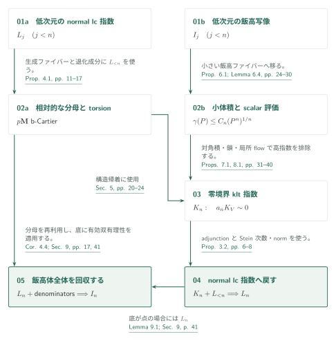
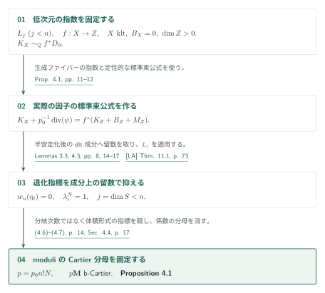
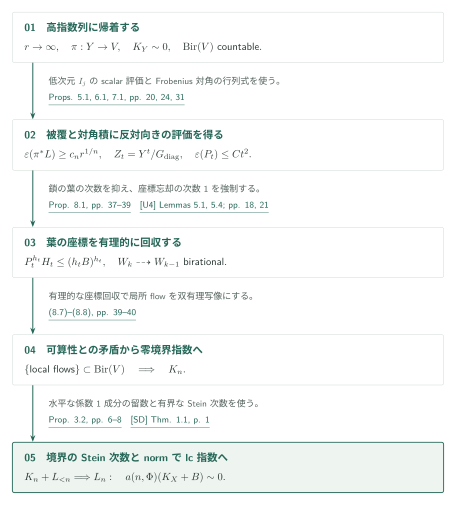
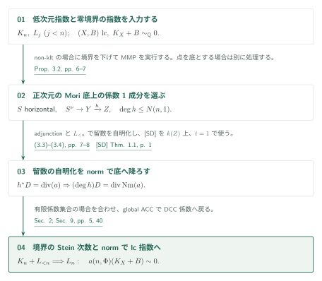
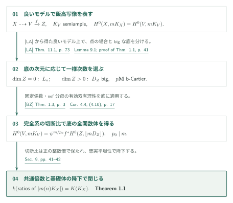

# Uniform Pluricanonical Iitaka Fibrations

**多重標準飯高写像と normal lc 指数の同時帰納法**

本稿は、次元だけで決まる一つの多重標準次数が、非負の小平次元を持つすべての滑らかな射影多様体の飯高写像を定めると主張する。証明は飯高写像の有効性を直接帰納するだけでは閉じず、normal lc log Calabi–Yau 対の**実際の線形同値類を殺す共通指数**も同時に示す。核心は、退化の分岐次数そのものを抑える代わりに体積形式への指標を抑えることと、高指数の標準被覆上の局所正値性を対角積のジェット評価と衝突させることにある。

## 1. 主要結果

### Theorem 1.1 — Uniform pluricanonical degree（p. 2）

各整数 $d\ge1$ に対し整数 $m(d)>0$ が存在し、任意の標数0の代数閉体上の、滑らか・整・射影的な $d$ 次元多様体 $X$ で $\kappa(X)\ge0$ を満たすものについて、完全線形系 $|m(d)K_X|$ が飯高写像を定める。

ここで結論は、系が非空で、その切断比の体が、全次数の多重標準切断比で定義される飯高体 $K(K_X)\subset k(X)$ に**等しい**という意味である。像の次元が $\kappa(X)$ に等しいだけでは足りない。$\kappa=0$ では同次数の非消滅、$\kappa=d$ では双有理性を含む。正の整数倍の次数も使えるが、実用的な $m(d)$ の数値は与えていない。

[Theorem 1.1、§9、pp. 2, 40–42][U]

### Theorem 1.2 — Uniform log canonical index（p. 2）

$d\ge0$、有理 DCC 集合 $\Phi\subset[0,1]\cap\mathbb Q$ を固定する。標数0の代数閉体上の normal integral projective lc 対 $(X,B)$ で、$\dim X=d$、$B\ge0$、係数が $\Phi$ に属し、$K_X+B$ が $\mathbb Q$-Cartier かつ $K_X+B\sim_{\mathbb Q}0$ であるものすべてに対し、共通整数 $a(d,\Phi)>0$ が存在して
$$a(d,\Phi)(K_X+B)\sim0$$
となる。この倍数は整係数の主因子である。数値的自明性や Cartier 指数だけの主張ではなく、nonnormal slc 対は対象に含まない。

[Theorem 1.2、§§2, 9.1、pp. 2, 4–5, 41–42][U]

## 図の矢印に付した引用

略号なしは本原稿の結果を指す。外部文献には次の略号を使う。

- [LA][LA]：Log abundance in characteristic zero、2026年9月24日版。
- [SD][SD]：Arithmetic Stein-degree bounds for log Calabi–Yau pairs、2026年9月25日版。
- [Ufour][Ufour]：Uniform effective log Iitaka fibrations for fourfolds、2026年9月26日版。ここで使う鎖・追跡の補題は任意次元の記述である。
- [BZ][BZ]：Birkar–Zhang, Effectivity of Iitaka fibrations and pluricanonical systems of polarized pairs、arXiv:1410.0938v2。

## 2. 同時帰納法の組み立て

**証明の道筋。** 下の次元の指数から [moduli 分母](#proof-2)、下の次元の飯高写像から [高指数列の排除](#proof-3)へ進む。これを [normal lc 指数](#proof-4)へ戻して Theorem 1.2 を得てから、[全飯高体の回収](#proof-5)で Theorem 1.1 を得る。

$I_j$ を Theorem 1.1 の次元 $j$ の命題、$L_j$ を Theorem 1.2 の次元 $j$ の全有理 DCC 係数集合に対する命題とする。$K_n$ は $n$ 次元の零境界 klt の指数命題、すなわち $K_V\sim_{\mathbb Q}0$ を満たす射影 klt $V$ に共通の $a_nK_V\sim0$ を与える主張である。次元0を出発点として、$I_j,L_j$（$j<n$）から $K_n,L_n,I_n$ をこの順で証明する。

### 1. 低次元の指数で相対的な分母を制御する

$L_{<n}$ は、正次元の底を持つファイブレーションの生成ファイバーと退化成分に適用する。これによる moduli 分母と有理連結な底上の torsion の制御が、$K_n$ の構造帰着を支える。同じ分母評価は最後の $I_n$ にも再利用するため、図ではこの経路を別に残した。

[Notation 2.2・Figure 1 · pp. 4–5；Proposition 4.1・§5 · pp. 11–24][U]

### 2. 低次元の飯高写像で高指数の列を排除する

$I_{<n}$ は、小体積の被覆族をより小さい飯高ファイバーへ移す Lemma 6.4 と scalar 評価に用いる。その評価を標準被覆と対角積に適用し、§8 の次数と局所 flow の議論で $K_n$ を得る。この段階で同次元の $I_n$ は仮定しない。

[Proposition 6.1・Lemma 6.4・§§7–8 · pp. 24–40][U]

### 3. normal lc 指数を得てから飯高写像へ戻る

$K_n$ と $L_{<n}$ から、adjunction と Stein 次数・norm によって $L_n$ を証明する。次に良いモデルの飯高底を点と正次元に分け、前者には $L_n$、後者には分母評価と有効双有理性を使う。global ACC による有限係数集合への帰着は $L_n$ の DCC 版を保ち、任意の標数0の代数閉体への降下は最後に行う。

[Proposition 3.2・§9 · pp. 6–8, 40–42][U]

## 3. moduli 分母を制御する証明

正次元の底を持つ零境界 klt の contraction に対し、底の moduli 部分に共通の Cartier 倍を与える。入力は $L_{<n}$ であり、同次元の指数を使わずにこの評価を先に得る。

### 1. 生成ファイバーの指数を実際の引き戻し等式にする

図の出発点 $L_j$ は Theorem 1.2 の次元 $j$ の主張であり、ここでは $j<n$ だけを使う。境界を持たない klt $n$-fold の contraction $f:X\to Z$（$\dim Z>0$、$K_X$ は底から $\mathbb Q$-線形に引き戻される）に対し、幾何学的生成ファイバーの指数を $p_0$ で殺す。この自明化を元の生成体へ降ろし、
$$K_X+\frac1{p_0}\operatorname{div}(\psi)=f^*D_Z,\qquad D_Z=K_Z+B_Z+M_Z$$
という**実際の有理因子の等式**を作る。$B_Z$ の係数の DCC 性と $\mathbf M$ の b-nef 性は定性的な標準束公式から得られる。残る課題は Cartier 分母の一様化である。

[Proposition 4.1、pp. 11–12][U]

### 2. 体積形式の指標に分母の問題を移す

底の素因子を横断する曲線へ切り、生成ファイバーの Beauville–Bogomolov 因子を半安定退化させる。体積形式の weight を0に規格化すると、分岐次数 $\ell$ と退化指標 $\lambda_i$ は式(4.7)で結ばれる。各 $\lambda_i$ を殺す共通 $N$ があれば $p=p_0 n!N$ が moduli 係数の分母を消す。$\ell$ 自体を一様に抑える必要はない。

[Lemma 4.2、式(4.5)–(4.7)、pp. 13–14][U]

### 3. 低次元の留数で退化指標を殺す

Lemma 4.3 は、LA を用いて退化を相対的に半豊富な dlt モデルへ運び、特殊ファイバーの正規成分への留数に $L_j$ を適用する。成分を保存する有界な冪は構造層コホモロジーの trace と Lefschetz の議論で選ぶ。したがって、この段階で同次元 $L_n$ や slc 指数定理を入力してはいない。等変半安定化・coherent Lefschetz の細部は今回独立検証していない。

[Lemma 4.3、§4.4、pp. 14–17][U]

## 4. 高指数列を排除する証明

本節は $K_n$ に至る高指数排除の段階である。説明は [scalar・Frobenius 評価](#proof-3-step-1)（1–2）、[鎖の次数と次数1の忘却](#proof-3-step-3)（3–5）、[有理 flow による矛盾](#proof-3-step-6)（6）の三つのまとまりで読む。

Proposition 5.1 の構造帰着後に残る、指数 $r\to\infty$ の標準被覆 $\pi:Y\to V$ を考える。$G=\mu_r$、$Z_t=Y^t/G_{\mathrm{diag}}$、$\theta_t:Z_t\to V^t$、$P_t=\theta_t^*(L^{\boxplus t})$ と置く。以下は複素数体上の議論であり、局所 flow を使う前提でもある。

### 1. 構造帰着の仮定を scalar 評価へ渡す

帰着で得た terminal $V$ は $\operatorname{Bir}(V)$ が可算であり、$Y$ の正次元の底とファイバーを持つ $G$-同変有理ファイブレーションの滑らかな幾何学的生成ファイバーは一般型である。Proposition 6.1 はこの条件と $I_{<n}$ を使う。$L$ を $1\le L^n\le2$ に規格化し、$V$ および $G$-不変偏極 $\pi^*L$ を持つ $Y$ に適用すると
$$\gamma(L;V)\le C_n,\qquad \varepsilon(L)\ge c_n,\qquad \varepsilon(\pi^*L)\ge c_nr^{1/n}$$
を得る。$\gamma$ は解消上の十分可除な次数の**全切断**の正規化消滅次数であり、周囲からの制限切断だけに限定しない。鎖・追跡には [Ufour] の任意次元の補題を使い、四次元の主定理を全次元へ適用してはいない。

[Propositions 5.1, 6.1・Lemmas 6.2–6.4 · pp. 20, 24–30][U] · [Ufour, Lemmas 5.1, 5.4, 6.3–6.4 · pp. 18, 21, 25, 27][Ufour]

### 2. Frobenius 対角の階数低下を行列式の矛盾にする

§7 は scalar 上界から $\varepsilon(P_t)\le C_2t^2$ を導く。反対の不等式を仮定して正標数へ移し、Frobenius 対角の評価写像から非零行列式を作る。その階数を $R$ とすると、対角で少なくとも $R-\lfloor R/4\rfloor$ 行を消せるため、行列式の消滅次数は $3R/4$ 以上となる。一方、各座標の切断次数を scalar 評価で抑えると同じ消滅次数は $Rb_0(C_1+1)<3R/4$ となる。矛盾が与えるのは対角積上の二次の上界であり、まだ指数の有界性そのものではない。

[Proposition 7.1・(7.18)–(7.19)と証明末尾 · pp. 31, 36–37][U]

### 3. 射影と両立する低次数曲線の葉を作る

まず有限の $T$ を固定し、$2\le t\le T$ の評価が同時に成立する列の末尾を取る。$B=C_2T^2+1$ とすると、$\varepsilon(P_t)<B$ から、次数を標点の重複度で割った値が $B$ 以下の marked covering curves が得られる。族の有限リストを deck 変換・座標置換・非定数な座標射影で閉じる。射影はこの値を増やさず、生成パラメータを保持した鎖に Lemma 6.2 を適用できる。葉 $H_t$ とその像 $W_t=\theta_t(H_t)$ は射影と両立し、$h_t=\dim H_t>0$ に対して
$$P_t^{h_t}\cdot H_t\le(h_tB)^{h_t}$$
を満たす。幾何学的生成葉の整性は、後の体の次数比較にも使う。

[Lemma 6.2・Proposition 8.1, (8.1) · pp. 25, 37–38][U] · [Ufour, Corollary 5.2・Lemma 5.4 · pp. 20–21][Ufour]

### 4. 被覆次数を増やして各一座標射影を有限にする

$H_t$ のある一座標への像を $I$、$j=\dim I$、$a=h_t-j>0$ と仮定する。非常に一般の標点での Seshadri 下界は $L^j\cdot I\ge c^j$ を与える。この座標を固定した $Z_t$ の幾何学的生成ファイバーは $Y^{t-1}$ と同一視でき、残る偏極には $cr^{1/n}$ の下界がある。従って射影公式と nef 性から
$$P_t^{h_t}\cdot H_t\ge c^j(cr^{1/n})^a.$$
$T$ を固定したまま $r\to\infty$ とすると前段の上界に反する。したがって各一座標射影は像の上で generically finite となり、$1\le h_t\le n$ を得る。

[Proposition 8.1, (8.2)–(8.3) · p. 38][U]

### 5. 多項式の次数上界から次数1の忘却を取り出す

$W_t$ の第一座標像への次数を $d_t$ とする。前二段の評価から $d_t\le KT^{2n}$（$K$ は $T$ に依存しない）。射影の両立性と一座標への有限性により $h_t\le h_{t-1}$ であり、等号なら $W_t\dashrightarrow W_{t-1}$ は全射で、その次数は $d_t/d_{t-1}$ となる。$1\le h_t\le n$ なので、$T$ を大きくすると次元一定の長い区間が存在する。この区間の全次数が2以上なら $d_t$ は指数的に増大して多項式上界に反する。よって、ある $k\ge3$ で各一座標を忘れる写像が次数1となる。

[Proposition 8.1, (8.4)–(8.6) · p. 39][U]

### 6. 有理的な座標回収を双有理な局所 flow へ変える

次数1と可分性から、葉の接分布は各座標方向へ単射に、各忘却後の分布へ同型に写る。独立な積変数の関数体の共通部分を取ると、接方向間の移送は二変数の有理写像 $R(x,y)$ となり、$R(y,z)R(x,y)=R(x,z)$ を満たす。基点の基底を移送して得る有理ベクトル場の可換性は不要である。

幾何学的生成葉の整性により、生成底の代数閉包へ移しても忘却の体次数は変わらない。従って最後の座標は、残りの座標と葉の名前から有理的に回収できる。回収写像を $\mathrm{ev}$、商写像を $\xi$、ベクトル場の順序付き局所 flow の合成を $E_z$ とすると
$$E_z(y)=\mathrm{ev}\bigl(E_z(u),\xi(u,y)\bigr).$$
固定した小さい $z$ ごとに右辺は $y$ の有理写像であり、逆順の負時間 flow も同様に有理である。解析的開集合上の逆写像関係から $E_z\in\operatorname{Bir}(V)$。正の階数の分布により $E_z(y_0)$ は非可算個の値を取り、構造帰着で得た可算性に反する。

[Proposition 8.1, (8.7)–(8.8)・§9冒頭 · pp. 39–40][U]

## 5. normal lc 指数へ戻す証明

零境界の $K_n$ が得られたので、$L_{<n}$ と合わせて $L_n$ を証明する。図は non-klt の正次元の Mori 底の場合を中心に示す。klt の帰着と底が点の log Fano の場合は Proposition 3.2 の別の場合分けである。

図に入る前の二つの枝もここで処理する。klt の場合は零境界の指数 $K_n$ から Xu の klt 帰納定理を使う。Mori 底が点なら、有界補完 $B^+\geq B$ を取り、$B^+-B$ の有効性と数値的自明性から差を0にする。以下の留数・norm は残る non-klt・正次元底の枝である。 [Proposition 3.2 · pp. 6–8][U]

### 1. 水平な成分で留数を自明化する

$K_n$ が得られると Proposition 3.2 で $L_n$ へ戻す。non-klt の場合、境界を少し下げた MMP の Mori ファイバー空間上で水平な係数1成分 $S$ を選び、$S^\nu$ への adjunction と低次元指数で留数を自明化する。

[Proposition 3.2 · pp. 6–7][U]

### 2. 有界な Stein 次数を norm の倍数に使う

$S^\nu\to Y\xrightarrow{h}Z$ を Stein 分解すると、norm は
$$h^*D=\operatorname{div}(a)\quad\Longrightarrow\quad(\deg h)D=\operatorname{div}\operatorname{Nm}(a)$$
を与える。

[SD] Theorem 1.1 を生成ファイバーの基礎体 $k(Z)$、係数閾値 $t=1$ で使い、$\deg h$ を抑える。被約境界全体の gluing 指数をここへ混入させない。DCC 係数への拡張は global ACC による有限部分集合への帰着である。

[Proposition 3.2、pp. 6–8；§9、p. 40][U]

## 6. 一様次数で飯高体全体を回収する証明

良いモデル上の飯高 contraction $f:V\to Z$ を使う。必要なのは像の次元の一致だけでなく、完全系の切断比が飯高体全体を生成することである。

### 1. 全整数次数の切断を良いモデルへ移す

[LA] の良いモデル存在を使い、滑らかな $X$ を terminal good minimal model $V$ に移す。Lemma 9.1 は、$mK_V$ が Cartier でない次数も含む全整数 $m\ge0$ で、多重標準切断空間を reflexive divisorial section として同定する。底が点なら、既に得た $L_n$ が共通の非消滅次数を与える。

[Lemma 9.1、p. 41][U]

### 2. 固定分母の底で有効双有理性を使う

正次元の底では、分母の図による固定分母と固定 DCC 係数を持つ big な底の随伴因子に [BZ] Theorem 1.3 を適用する。滑らかな determination 上で通常の lc 対と nef Cartier 倍を作ることが適用の要点である。$p_0\mid m$ では
$$H^0(X,mK_X)=\psi^{m/p_0}f^*H^0(Z,\lfloor mD_Z\rfloor)$$
という式(4.10)が成立し、底の双有理系の全関数体を回収する。共通倍数への移行でも、$s/s_0=(s s_0^{q-1})/s_0^q$ により切断比を失わない。最後に定義体への降下・忠実平坦性で任意の標数0の代数閉体へ移す。

[Corollary 4.4、p. 17；§9、pp. 41–42][U]

## 7. どの論文が、どの段階を担うか

| 入力・関係 | 供給内容と使用箇所 | 今回の確認 |
|---|---|---|
| [LA] Theorem 11.1、p. 73 | 複素射影 lc 対の擬有効随伴因子に良いモデル。本稿 Theorem 2.1、Lemma 4.3、Lemma 9.1 | 入力の記述と本稿での適用を照合。LA の全証明は対象外 |
| [SD] Theorem 1.1、p. 1 | 任意の標数0体上、normal integral lc log CY 対の係数1成分の定数体次数。本稿 Proposition 3.2、pp. 7–8 | $H^0(X_\eta,\mathcal O)=k(Z)$、$t=1$、norm の使用を照合 |
| [Ufour] Lemmas 5.1, 5.4、Corollary 5.2（pp. 18, 20–21）；Lemmas 6.3–6.4（pp. 25, 27） | 鎖の商・次数評価・追跡・被覆族。本稿 Lemmas 6.2–6.3、§8 | 記述は任意次元。四次元の主定理を全次元で使うわけではない |
| [BZ] Theorem 1.3、arXiv v2 p. 3 | 次元・DCC 係数・nef 部分の Cartier 分母を固定した big polarized lc adjoint の有効双有理性。Corollary 4.4、p. 17 | 原記述と smooth determination 上の適用を照合。証明は対象外 |
| [R] §§3–7 | 分母と RC torsion の先行する四次元の方法。本稿 §§4–5 が全次元へ展開 | 方法上の先行関係。四次元の結論を全次元への入力とする矢印は作らない |
| 本稿 → [Log] Theorem 2.1（p. 5）、[SLC] Theorem 2.2（p. 5） | 本稿 Theorem 1.2 の normal lc 指数を再掲して利用 | 受け手の入力記述を確認。受け手の全証明は未調査 |

原稿はさらに Xu の klt 指数帰納法、Birkar の complements・RC boundedness、Ambro の標準束公式、global ACC、弱正値性等を使う。今回はその全入力の原記述を網羅照合していない。これらを「依存なし」と扱わず、未確認の入力として残す。

## 8. 原典を読む入口と確認範囲

主要入口は [§3（pp. 6–8）、§4（pp. 11–19）、§6（pp. 24–30）、§§7–9（pp. 31–42）][U]。今回読んだのは、主定理、normal lc への norm 帰着、分母証明の weight・留数・成分固定の箇所、scalar／diagonal 命題の記述と主要接続、§8 の葉・次数1・flow の論証、§9 の切断比較と帰納法の閉じ方である。§5 の構造帰着全体、§6 の弱正値性・flattening 計算全体、§7 の正標数評価全体、外部入力の全証明は独立検証していない。

[U]: https://github.com/openai/math/blob/adc7f1241b42e322a6451854ab7e4b4c146bf78a/preprints/Uniform-Pluricanonical-Iitaka-Fibrations-October-3-2026/paper.pdf
[LA]: https://github.com/openai/math/blob/adc7f1241b42e322a6451854ab7e4b4c146bf78a/preprints/Log-abundance-in-characteristic-zero-September-24-2026/paper.pdf
[SD]: https://github.com/openai/math/blob/adc7f1241b42e322a6451854ab7e4b4c146bf78a/preprints/Arithmetic-Stein-degree-bounds-for-log-Calabi-Yau-pairs-September-25-2026/paper.pdf
[Ufour]: https://github.com/openai/math/blob/adc7f1241b42e322a6451854ab7e4b4c146bf78a/preprints/Uniform-effective-log-Iitaka-fibrations-for-fourfolds-September-26-2026/paper.pdf
[R]: https://github.com/openai/math/blob/adc7f1241b42e322a6451854ab7e4b4c146bf78a/preprints/Relative-denominators-and-effective-systems-for-log-Calabi-Yau-fibrations-September-27-2026/paper.pdf
[Log]: https://github.com/openai/math/blob/adc7f1241b42e322a6451854ab7e4b4c146bf78a/preprints/Uniform-log-Iitaka-fibrations-and-bounded-moduli-denominators-October-4-2026/uniform-log-iitaka.pdf
[SLC]: https://github.com/openai/math/blob/adc7f1241b42e322a6451854ab7e4b4c146bf78a/preprints/Uniform-indices-for-semi-log-canonical-log-Calabi-Yau-pairs-October-5-2026/uniform-slc-index.pdf
[BZ]: https://arxiv.org/pdf/1410.0938v2
