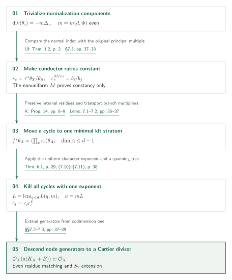
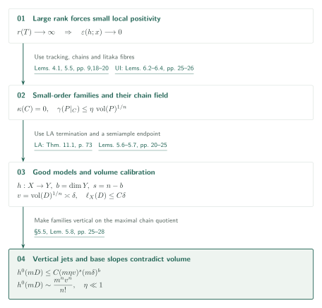
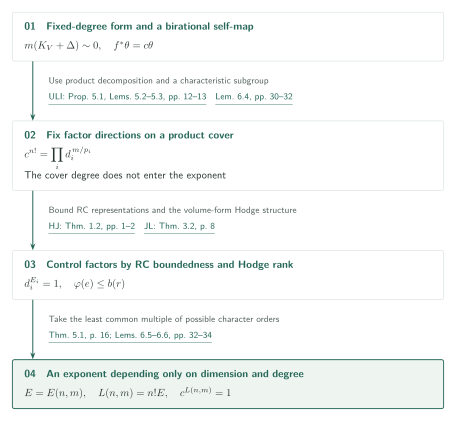

# Uniform slc indices: controlling residue cycles by klt characters

Catalog 034, item 02 / Internal ID: `uniform-slc-indices`

Source: OpenAI, *Uniform indices for semi-log-canonical log Calabi–Yau pairs*, October 5, 2026, 42 pages; [fixed PDF][S]. Page references agree with PDF pagination. This AI-generated exposition presents the manuscript's claims and proof structure. The editorial checks are limited to the scope recorded below; consult the source for mathematical use.

## Theorem 1.1: Cartier trivialization independent of component count

Fix $d\geq4$ and a finite set $\Phi\subset[0,1]\cap\mathbb Q$. [Theorem 1.1, p.2][S] asserts that an integer $a=a(d,\Phi)>0$ works for every connected, projective, equidimensional slc pair $(X,B)$ of dimension $d$ over any algebraically closed field of characteristic zero satisfying
\[
K_X+B\sim_{\mathbb Q}0,\qquad
\{\text{nonzero coefficients of }B\}\subset\Phi:
\]
the divisor $a(K_X+B)$ is Cartier and
\[
\mathcal O_X\!\left(a(K_X+B)\right)\simeq\mathcal O_X.
\]
The theorem's stated range $d\geq4$ is distinct from the consequence obtained by adding established lower-dimensional results. The exponent is independent of the numbers of normalization components and lc strata.

For the normalization $\nu:\coprod X_i\to X$, write
$K_{X_i}+\Delta_i=\nu^*(K_X+B)|_{X_i}$. The conductor enters $\Delta_i$ with coefficient one. The normal lc index theorem, [UI Theorem 1.2, p.2][UI], supplies an **even** common integer $m$, depending only on $d,\Phi$, and rational $m$-canonical forms with $\operatorname{div}(\theta_i)=-m\Delta_i$. This trivializes the normalization components; descent remains to be proved.

Form the finite graph whose vertices are normalization components and whose edges are generic conductor nodes. For an edge $e:i\to j$, the branch correspondence $\tau$ compares the residues by $r_e=\tau^*\theta_T/\theta_S$. The original rational linear triviality supplies a possibly nonuniform principal Cartier degree $M$, divisible by $m$. Comparing its trivialization with the $\theta_i$ gives
\[
r_e^{M/m}=b_i/b_j,
\]
which proves that $r_e$ is constant. This step does not bound $M$. [§7.3, pp.37–38][S]

Uniformity comes from transporting these constants to minimal klt strata. Within one dlt component, the $\mathbb P^1$-links of [Kollár Theorem 10 and Proposition 14, pp.6,8–9][K] preserve residues: evenness removes the sign. Across the conductor, Lemma 7.2 constructs a $B$-birational map of minimal strata carrying the same multiplier $r_e$. It does not simply restrict an arbitrary birational map to a stratum. On a common SNC model, it compares residue fields and proves that the relevant local monomial matrix has determinant $\pm1$. [Lemmas 7.1–7.2, pp.35–37][S]

A closed walk therefore gives a $B$-birational self-map of one minimal klt stratum with character $\prod_e r_e$. Theorem 6.1 below gives
\[
L=\operatorname{lcm}_{0\leq q\leq d-1}L(q,m),\qquad a=mL,
\]
so every closed walk satisfies $\prod_e r_e^L=1$. Constants chosen along a spanning tree then satisfy $c_i=c_jr_e^L$ on every edge, and the forms $c_i\theta_i^L$ glue. Loops and multiple edges are included. No factor equal to the length of a cycle enters the exponent. [Equations (7.10)–(7.11), p.38][S]

One must obtain a Cartier generator, not merely a descended section. At the split node $F[[x,y]]/(xy)$, the canonical generator has branches $(dx/x,-dy/y)$; matching even-degree residues matches generators. Nonsplit nodes are checked after a quadratic extension and descended. The $S_2$ extension of these codimension-one generators identifies the degree-$a$ reflexive extension itself with $\mathcal O_X$. Finally, descent to a finitely generated field and faithfully flat base change transfer the conclusion from $\mathbb C$ to any algebraically closed characteristic-zero field. [§§7.2–7.3, pp.37–39][S]

## Theorem 5.1: the Hodge rank containing the volume form

The character bound uses a particular Hodge rank, not all Betti numbers. For a smooth projective $n$-fold $U$, let $T(U)\subset H^n(U,\mathbb Q)$ be the smallest rational Hodge substructure containing $H^{n,0}(U)$, and let $r(U)=\dim_{\mathbb Q}T(U)$. In [Theorem 5.1, p.16][S], $n\geq2$ and $T$ is a complex projective $\mathbb Q$-factorial terminal $n$-fold with $K_T\sim0$. A smooth resolution $U$ satisfies $h^1(U,\mathcal O_U)=0$, and **every rational image $Y$ with $0<\dim Y<n$ has rationally connected smooth projective resolution**. The asserted bound is $r(T):=r(U)\leq R_n$.

Lemma 4.1 bounds $r(T)$ from a Seshadri lower bound for a normalized ample class on a canonical model with $K\sim0$. Its diagonal argument uses the quantitative Hodge norm gap of Lemma 3.2. Unbounded rank would force small local positivity. Tracking, generic chains, and the small-volume Iitaka-fibre estimate of [UI Lemmas 6.2–6.4, pp.25–26][UI] then produce covering families of $\kappa=0$ subvarieties with small vanishing order for their complete section systems. [Lemma 5.5, pp.18–20][S]

The chain field is realized as a morphism on a small terminal model. Applying [LA Theorem 11.1, p.73][LA] to $(T,\epsilon J)$ for a movable $J$ supplies termination and a semiample endpoint. This is an actual use of LA abundance. [Lemma 5.6, pp.20–21][S] The proof maximizes the dimension of a proper chain quotient and bounds its base using the rational-image hypothesis and UI's moduli-denominator and boundedness inputs. It then removes divisors mapping into codimension at least two in the base. Lemma 5.7 calibrates a big divisor $D$ and a linear functional $\ell_X$. With $v=\operatorname{vol}(D)^{1/n}$, $b=\dim Y$, and $s=n-b$, the scale is
\[
c\delta\leq v\leq C\delta,\qquad \ell_X(D)\leq C\delta.
\]
[pp.21–25][S]

Comparison with a base hyperplane makes the small-order families vertical; maximality makes their chain leaves fill the generic fibre. Vertical jets bound the generic rank by $C(m\eta v)^s$. Determinants and cotangent slopes on the bounded base give
\[
h^0(X,mD)\leq C(m\eta v)^s(m\delta)^b.
\]
For sufficiently small $\eta$, this contradicts the volume leading term $m^nv^n/n!$. The section estimate on $\mathbb P^b$ in Lemma 5.8 must be linear in the rank for this comparison. [§5.5, pp.25–28][S]

## Theorem 6.1: bounding a character, not the order of the map

For $n\geq0,m\geq1$, [Theorem 6.1, p.29][S] asserts an integer $L(n,m)>0$ for integral complex projective klt pairs $(V,\Delta)$ of dimension $n$, with $\Delta\geq0$ and **$m(K_V+\Delta)$ an integral principal divisor**. If a rational $m$-canonical form satisfies $\operatorname{div}(\theta)=-m\Delta$, then every $B$-birational self-map satisfies
\[
f^*\theta=c\theta\quad\Longrightarrow\quad c^{L(n,m)}=1.
\]
The map $f$ need not have finite order.

After crepant terminalization, [ULI Proposition 5.1 and Lemmas 5.2–5.3, pp.12–13][ULI] provide a quasi-étale product cover. It has a rationally connected factor carrying all the boundary, an abelian factor, and boundary-free Calabi–Yau or symplectic factors. Lemma 6.4 uses a characteristic subgroup of the smooth-locus fundamental group to lift the map, and its $n!$-th power fixes the factor directions. The cover degree need not be bounded. For factor multipliers $d_i$ and form degrees $p_i$, the comparison is
\[
c^{n!}=\prod_i d_i^{\,m/p_i};
\]
the cover degree does not enter this exponent. [pp.30–32][S]

For the RC factor, fixed-index boundedness from [Han–Jiang Theorem 1.2, pp.1–2][HJ] leads to the bounded-family representation theorem [Jiang–Liu Theorem 3.2, p.8][JL]. For the nonabelian boundary-free factors, [UI Lemma 5.2, pp.21–22][UI] supplies the rational-image property needed in Theorem 5.1. Abelian factors have the cohomology rank bound $\binom{2r}{r}$. The action on an integral polarized Hodge structure constrains a character of order $e$ by $\varphi(e)\leq b(r)$; take the least common multiple of the possible orders. Combining this with the RC bound yields $L(n,m)=n!E(n,m)$. [Lemmas 6.5–6.6, pp.32–34][S]

## Inputs and their use

| Input | Role here | Check performed |
|---|---|---|
| [UI Thm.1.2, p.2][UI] | Thm.2.2 and §7.3: common normal lc index | Input statement and application compared |
| [UI Thm.1.1, Props.4.1,4.5][UI] | Prop.2.4: bounded chain-quotient bases | Target's input description read; proofs outside scope |
| [UI Lems.6.2–6.4, pp.25–26][UI] | Inputs 5.2–5.4 and Lemma 5.5: chains and small volumes | Input statements and uses compared |
| [LA Thm.11.1, p.73][LA] | Thm.2.3, Lemma 5.6 and §5.4: good models | Statement and rational-boundary applications compared; proof outside scope |
| [ULI Prop.5.1, Lems.5.2–5.3, pp.12–13][ULI] | Input 6.3 and Lemma 6.4: product structure stable under further covers | Original statements and uses compared |
| [HJ Thm.1.2][HJ] and [JL Thm.3.2][JL] | Lemma 6.5: RC character bound | Original statements compared; promotion from bounded varieties to log bounded pairs read only here |
| [UI Lem.5.2, pp.21–22][UI] | Lemma 6.6: applying Thm.5.1 to nonabelian factors | Input and application compared; also an indirect dependence on LA nonvanishing |
| [K Thm.10, Prop.14][K] | Lemma 7.1: residue-preserving maps within a component | Original statements and even-degree sign calculation compared |

U4 is also cited in Inputs 5.2–5.4 as the source of geometric lemmas used through UI. Its original lemmas were not rechecked for this draft. A bibliography entry alone is not a dependency edge.

## Sources and scope of the checks

The source commit is `adc7f1241b42e322a6451854ab7e4b4c146bf78a` and the SHA-256 is `588f61707a03040f0265823b76aa32e17f238bfed772f79bdcd8f9867746a126`. See the [source record](sources.json) and [work record](status.md).

Editorial reading covered the main statements, §§2–3, the chain quotient, calibration statement and vertical–horizontal jet comparison in §5, factor characters in §6, and residues, cycles, nodes and $S_2$ descent in §7. It did not check all diagonal calculations in Lemma 4.1, every calibration estimate in Lemma 5.7, or independently validate the fundamental-group lift and local valuation argument. Original slope inputs such as Campana–Păun, the underlying singular Beauville–Bogomolov literature, and the proofs of the UI and LA input theorems remain unchecked. This draft traces citations and applications; it does not certify the theorem.

[S]: https://github.com/openai/math/blob/adc7f1241b42e322a6451854ab7e4b4c146bf78a/preprints/Uniform-indices-for-semi-log-canonical-log-Calabi-Yau-pairs-October-5-2026/uniform-slc-index.pdf
[UI]: https://github.com/openai/math/blob/adc7f1241b42e322a6451854ab7e4b4c146bf78a/preprints/Uniform-Pluricanonical-Iitaka-Fibrations-October-3-2026/paper.pdf
[LA]: https://github.com/openai/math/blob/adc7f1241b42e322a6451854ab7e4b4c146bf78a/preprints/Log-abundance-in-characteristic-zero-September-24-2026/paper.pdf
[ULI]: https://github.com/openai/math/blob/adc7f1241b42e322a6451854ab7e4b4c146bf78a/preprints/Uniform-log-Iitaka-fibrations-and-bounded-moduli-denominators-October-4-2026/uniform-log-iitaka.pdf
[HJ]: https://arxiv.org/pdf/2204.04946v2
[JL]: https://arxiv.org/pdf/2002.11928
[K]: https://arxiv.org/pdf/1107.2863v3
