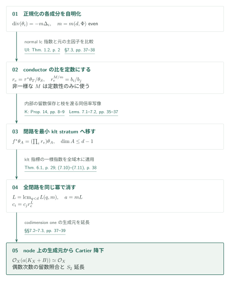
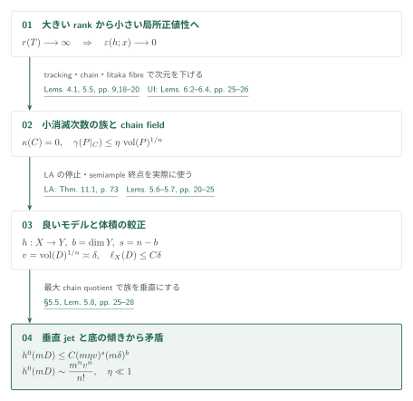
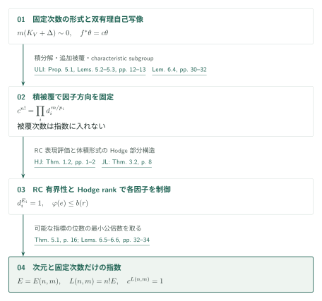

# Uniform indices for semi-log-canonical log Calabi–Yau pairs

**正規化上の自明化を、留数の閉路を通して降ろす**

正規化成分の共通指数だけでは、conductor上の貼り合わせは得られない。本稿はHodge rankからklt指標を抑え、その一様指数で留数の閉路を消すことで、成分数に依存しないslc指数を得る。

## 1. 主要結果

### Theorem 1.1 — 成分数によらないCartier自明化

$d\geq4$と有限集合$\Phi\subset[0,1]\cap\mathbb Q$を固定する。原典の[Theorem 1.1、p.2][S]は、これらだけに依存する整数$a=a(d,\Phi)>0$が存在し、標数零の任意の代数閉体上の連結・射影的・純$d$次元slc対$(X,B)$で
\[
K_X+B\sim_{\mathbb Q}0,\qquad
\{\text{$B$の非零係数}\}\subset\Phi
\]
を満たすものに対し、$a(K_X+B)$がCartierかつ
\[
\mathcal O_X\!\left(a(K_X+B)\right)\simeq\mathcal O_X
\]
となると主張する。既知の低次元結果と合わせた帰結と、この論文自身の$d\geq4$という定理の範囲を区別する。$a$は正規化成分・lc strataの個数に依存しない。

[Theorem 1.1 · p. 2][S]

### Theorem 5.1 — 体積形式を含むHodge部分構造のrank（指標への入力）

指標の次数を抑える入力は全Betti数の有界性ではない。滑らかな射影$n$-fold $U$について、$T(U)\subset H^n(U,\mathbb Q)$を$H^{n,0}(U)$を含む最小の有理Hodge部分構造、$r(U)=\dim_{\mathbb Q}T(U)$とする。[Theorem 5.1、p.16][S]の仮定は、$n\geq2$、$T$が複素射影$\mathbb Q$-factorial terminal $n$-fold、$K_T\sim0$、滑らかな解消$U$で$h^1(U,\mathcal O_U)=0$、かつ**$0<\dim Y<n$を満たす任意の有理像$Y$の滑らかな射影解消がrationally connected**というものである。このとき$r(T):=r(U)\leq R_n$と主張する。

[Theorem 5.1 · p. 16][S]

### Theorem 6.1 — klt pluricanonical指標の一様指数

$n\geq0,m\geq1$に対し$L(n,m)>0$が存在し、複素射影的なintegral klt対$(V,\Delta)$、$\dim V=n$、$\Delta\geq0$で、**$m(K_V+\Delta)$が整主因子**となるものを考える。$\operatorname{div}(\theta)=-m\Delta$を満たす有理$m$-canonical形式と任意の$B$-双有理自己写像$f$について
\[
f^*\theta=c\theta\quad\Longrightarrow\quad c^{L(n,m)}=1
\]
というのが[Theorem 6.1、p.29][S]である。$f$自身の有限位数は仮定しない。

[Theorem 6.1 · p. 29][S]

## 図の矢印に付した引用

略号のない定理・補題・節・式番号は本原稿を指す。主要な外部入力には次の略号を使う。

- [UI] *Uniform Pluricanonical Iitaka Fibrations* · October 3, 2026 · [PDF][UI].
- [LA] *Log abundance in characteristic zero* · September 24, 2026 · [PDF][LA].
- [ULI] *Uniform log Iitaka fibrations and bounded moduli denominators* · October 4, 2026 · [PDF][ULI].
- [HJ] Han–Jiang · Theorem 1.2 · [arXiv v2][HJ].
- [JL] Jiang–Liu · Theorem 3.2 · [arXiv][JL].
- [K] Kollár, *Sources of log canonical centers* · [arXiv v3][K].

## 2. Theorem 1.1 の証明

まず複素数体上で正規化成分を自明化する。残る問題は、conductorの枝における留数比を同時に消し、降下した形式が実際のCartier生成元になることを示すことである。

### 1. 正規化成分を共通の偶数次数で自明化する

正規化$\nu:\coprod X_i\to X$に対して
$K_{X_i}+\Delta_i=\nu^*(K_X+B)|_{X_i}$と置く。$\Delta_i$にはconductorが係数1で加わる。[UI Theorem 1.2、p.2][UI]によるnormal lc指数を用い、$d,\Phi$だけで定まる**偶数**$m$を選んで、各成分上に
$\operatorname{div}(\theta_i)=-m\Delta_i$となる有理$m$-canonical形式を取る。これは正規化上の自明化であり、まだ$X$上の自明化ではない。

[Theorem 2.2; §7.3 · pp. 5, 37–38][S]

### 2. 既存の非一様な自明化で留数比を定数にする

conductorのgeneric nodeを辺、正規化成分を頂点とする有限グラフを考える。辺$e:i\to j$の両枝の留数を$\theta_S,\theta_T$と書くと、枝の対応$\tau$による比
$r_e=\tau^*\theta_T/\theta_S$が現れる。ここで原典は、もともとの$\mathbb Q$-線形自明性から得られる非一様な主因子次数$M$（$m\mid M$）を一度使い、
\[
r_e^{M/m}=b_i/b_j
\]
を導いて$r_e$が定数であることを示す。$M$そのものを一様に抑える論法ではない。[§7.3、pp.37–38][S]

[§7.3; (7.8) · p. 38][S]

### 3. 留数比を最小klt stratumへ運ぶ

次の接続が一様性の要点である。同一のdlt成分の最小lc strata間では、[Kollár Theorem 10・Proposition 14、pp.6,8–9][K]の$\mathbb P^1$-linkが留数を保つ。偶数$m$が符号を消す。他方、conductorを渡る写像については本稿Lemma 7.2が、同じ$r_e$を保つ最小strata間の$B$-双有理写像を作る。これは双有理写像をstratumへ単純に制限する操作ではない。共通SNCモデル上の局所単項式行列の行列式$\pm1$と留数体の比較を使う。[Lemmas 7.1–7.2、pp.35–37][S]

[Lemmas 7.1–7.2 · pp. 35–37][S]

### 4. 閉路の指標を一つの指数で消す

したがって任意の閉路に沿う積$\prod_e r_e$は、一つのklt最小stratum上の$B$-双有理自己写像の指標になる。後述のTheorem 6.1から
\[
L=\operatorname{lcm}_{0\leq q\leq d-1}L(q,m),\qquad
a=mL
\]
とすれば、全閉路について$\prod_e r_e^L=1$である。全域木に沿って定数$c_i$を選ぶと$c_i=c_jr_e^L$がすべての辺で成立し、$c_i\theta_i^L$が貼り合う。自己ループ・多重辺もこの議論に含まれる。閉路長を冪に掛けないため、成分数への依存が生じない。[式(7.10)–(7.11)、p.38][S]

[(7.10)–(7.11) · p. 38][S]

### 5. nodeで生成元を合わせ、S2で延長する

最後に節が降りるだけでは足りず、Cartier性を得る必要がある。split node
$F[[x,y]]/(xy)$ではcanonical生成元の二枝が$(dx/x,-dy/y)$となり、偶数次数で留数の一致が生成元の一致を与える。非split nodeは二次拡大後に照合して降下する。codimension oneで得た生成元を$S_2$性で延長して、次数$a$の反射的延長そのものを$\mathcal O_X$と同一視する。標数零の一般の代数閉体への移行は、有限生成体への降下と忠実平坦な基底変換を用いる。[§7.2–§7.3、pp.37–39][S]

[§§7.2–7.3 · pp. 37–39][S]

## 3. Theorem 5.1 の証明

$r(T)$ が一様に抑えられないと仮定する。対角線評価から得る小消滅次数の被覆族をchain quotientで整理し、最後に切断数の上界を体積の漸近式と衝突させる。

### 1. 大きなrankから小消滅次数の被覆族を得る

Lemma 4.1は、$K\sim0$のcanonicalモデルに対する、正規化したample類のSeshadri下界から$r(T)$の上界を与える対角線評価である。その前段に、primitive成分に対する定量的Hodge norm差を置く（Lemma 3.2）。rankが無制限なら局所正値性が小さくなり、[UI Lemmas 6.2–6.4、pp.25–26][UI]のtracking・generic chain・Iitaka fibreの小体積評価を通して、完全線形系の消滅次数が小さい$\kappa=0$部分多様体の被覆族を得る。[Lemma 5.5、pp.18–20][S]

[Lemma 4.1 · pp. 9–16; Lemma 5.5 · pp. 18–20][S]

### 2. chain fieldをモデル上の射にする

原典はこれらのchain fieldを小さいterminalモデル上の射として実現する。movable $J$から作る$(T,\epsilon J)$に[LA Theorem 11.1、p.73][LA]を適用し、MMPの停止とsemiample終点を使う。この箇所はLAの豊富性を実際に入力する。[Lemma 5.6、pp.20–21][S]。

[Lemma 5.6 · pp. 20–21][S] · [LA, Theorem 11.1 · p. 73][LA]

### 3. 最大の底に合わせて体積と次数を較正する

適切なchain quotientの次元を最大化し、有理像の仮定とUIのmoduli分母・有界性入力で底を制御する。さらに底のcodimension $\geq2$へ写る因子を処理し、Lemma 5.7でbigな$D$と線形汎関数$\ell_X$を較正する。$v=\operatorname{vol}(D)^{1/n}$、$b=\dim Y$、$s=n-b$として、その尺度は
\[
c\delta\leq v\leq C\delta,\qquad
\ell_X(D)\leq C\delta
\]
である。[pp.21–25][S]

[Lemma 5.7; §5.4 · pp. 21–25][S]

### 4. 垂直jetと水平切断数を体積に比較する

小消滅次数の族は底の超平面との比較から垂直になり、最大性によってchain leafはgeneric fibreを埋める。垂直jet評価でgeneric rankを$C(m\eta v)^s$に抑え、底ではdeterminantとcotangentの傾きを用いて
\[
h^0(X,mD)\leq C(m\eta v)^s(m\delta)^b
\]
を得る。十分小さい$\eta$について、これは体積による$m^nv^n/n!$という主要項と矛盾する。Lemma 5.8の$\mathbb P^b$上の切断評価ではrankが係数に一次で現れることが、この比較に必要である。[§5.5、pp.25–28][S]

[Lemma 5.8; §5.5 · pp. 25–28][S]

## 4. Theorem 6.1 の証明

自己写像の位数ではなく、体積形式への倍率を評価する。積被覆への持ち上げで失う指数を次元だけで制御し、各因子の指標を別々の入力で抑える。

### 1. 写像を積被覆へ持ち上げ、因子を固定する

crepant terminal化の後、[ULI Proposition 5.1・Lemmas 5.2–5.3、pp.12–13][ULI]によるquasi-étale積被覆を用いる。境界を持つrationally connected因子、abelian因子、境界のないCalabi–Yau・symplectic因子に分かれ、境界は最初の因子だけから来る。Lemma 6.4は基本群のcharacteristic subgroupを用いて写像を被覆へ持ち上げ、接方向の分解を$n!$乗で固定する。被覆次数は一様でなくてよい。因子形式への倍率$d_i$、次数$p_i$を用いた比較は
\[
c^{n!}=\prod_i d_i^{\,m/p_i}
\]
であり、被覆次数をこの冪に持ち込まない。[pp.30–32][S]

[Lemma 6.4 · pp. 30–32][S] · [ULI, Proposition 5.1; Lemmas 5.2–5.3 · pp. 12–13][ULI]

### 2. RC因子の指標を有界族で抑える

RC因子は[Han–Jiang Theorem 1.2、pp.1–2][HJ]のfixed-index有界性を経て、[Jiang–Liu Theorem 3.2、p.8][JL]の有界族におけるpluricanonical表現の評価に渡す。

[Lemma 6.5 · pp. 32–33][S] · [HJ, Theorem 1.2 · pp. 1–2][HJ] · [JL, Theorem 3.2 · p. 8][JL]

### 3. Hodge rankから残る指標の次数を抑える

境界なしの非abelian因子では[UI Lemma 5.2、pp.21–22][UI]の有理像の性質を使い、Theorem 5.1を適用する。abelian因子には$\binom{2r}{r}$というcohomology rank上界がある。整係数のpolarized Hodge構造への作用を通じて、固有値の位数$e$に$\varphi(e)\leq b(r)$を課し、可能な$e$の最小公倍数を取る。これをRC因子の指数と合わせると$L(n,m)=n!E(n,m)$が得られる。[Lemmas 6.5–6.6、pp.32–34][S]

[Lemma 6.6; Theorem 6.1 proof · pp. 33–34][S]

## 5. どの論文が、どの段階を担うか

| 入力 | 本稿での役割 | 今回の照合 |
|---|---|---|
| [UI Thm.1.2、p.2][UI] | Thm.2.2、§7.3：normal lc成分の共通次数 | 入力の定理文・適用を照合 |
| [UI Thm.1.1、Prop.4.1,4.5][UI] | Prop.2.4：chain quotientの底の有界性 | 本稿の入力記述を読解。各証明は対象外 |
| [UI Lem.6.2–6.4、pp.25–26][UI] | Inputs 5.2–5.4、Lemma 5.5：generic chainと小体積 | 入力の定理文・使用箇所を照合 |
| [LA Thm.11.1、p.73][LA] | Thm.2.3、Lemma 5.6および§5.4：良いモデルの構成 | 入力の定理文・有理境界での適用を照合。証明は対象外 |
| [ULI Prop.5.1, Lem.5.2–5.3、pp.12–13][ULI] | Input 6.3・Lemma 6.4：積分解と追加被覆での安定性 | 原典の記述・使用箇所を照合 |
| [HJ Thm.1.2][HJ] と [JL Thm.3.2][JL] | Lemma 6.5：RC因子の指標 | 原典の定理文を照合。bounded varietyからlog bounded pairへの補助論法は本稿のみ |
| [UI Lem.5.2、pp.21–22][UI] | Lemma 6.6：非abelian因子にThm.5.1を適用 | 入力記述と適用を照合。ここにもLA非消滅への間接依存がある |
| [K Thm.10, Prop.14][K] | Lemma 7.1：同一成分内の留数を保存する写像 | 原典の定理文・偶数次数の符号計算を照合 |

U4はUIの幾何補題の出所として本稿Inputs 5.2–5.4にも挙げられる。今回U4原典の該当補題は再照合していない。参考文献にあるだけの論文へ依存の矢印を追加しない。

## 6. 原典を読む入口と確認範囲

[Theorem 5.1; §5 · pp. 16–28][S] · [Theorem 6.1; §6 · pp. 29–34][S] · [§7 · pp. 35–39][S]

編集側では主定理、§§2–3、§5のchain quotient・較正の主張・垂直水平jet比較、§6の因子別指標、§7の留数・閉路・node・$S_2$降下を読んだ。Lemma 4.1の対角線計算全体、Lemma 5.7の体積較正の全推定、基本群を使う持ち上げと局所valuation議論の完全な検算はしていない。Campana–Păun等の傾き入力、特異Beauville–Bogomolov分解の元論文、UI・LAの入力定理自体の証明は未検証である。これは引用・適用関係を追った初稿であり、定理の正しさの保証ではない。

改訂では主要結果と§7の降下の記述を再照合し、証明の導入・段階・引用を整理した。外部入力の照合範囲は初稿の記録を保持する。原稿は2026年10月5日版、PDF頁、参照commit `adc7f1241b42e322a6451854ab7e4b4c146bf78a`。

[S]: https://github.com/openai/math/blob/adc7f1241b42e322a6451854ab7e4b4c146bf78a/preprints/Uniform-indices-for-semi-log-canonical-log-Calabi-Yau-pairs-October-5-2026/uniform-slc-index.pdf
[UI]: https://github.com/openai/math/blob/adc7f1241b42e322a6451854ab7e4b4c146bf78a/preprints/Uniform-Pluricanonical-Iitaka-Fibrations-October-3-2026/paper.pdf
[LA]: https://github.com/openai/math/blob/adc7f1241b42e322a6451854ab7e4b4c146bf78a/preprints/Log-abundance-in-characteristic-zero-September-24-2026/paper.pdf
[ULI]: https://github.com/openai/math/blob/adc7f1241b42e322a6451854ab7e4b4c146bf78a/preprints/Uniform-log-Iitaka-fibrations-and-bounded-moduli-denominators-October-4-2026/uniform-log-iitaka.pdf
[HJ]: https://arxiv.org/pdf/2204.04946v2
[JL]: https://arxiv.org/pdf/2002.11928
[K]: https://arxiv.org/pdf/1107.2863v3
