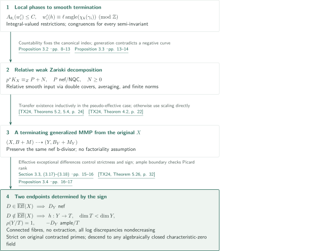
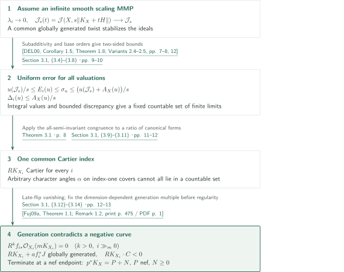
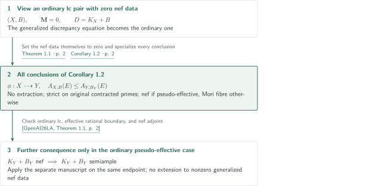

# Minimal models and Mori fibre spaces for generalized log canonical Q-pairs

**Fixed nef b-data, local character congruences, and relative weak Zariski decompositions**

The manuscript claims existence of a minimal model or a Mori fibre space according to the sign of the adjoint of a generalized lc $\mathbb Q$-pair. The proof controls characters of local valuations to terminate smooth canonical programs, constructs relative weak Zariski decompositions, and transfers to the generalized MMP. This is an account of the authors' argument, not an independent verification of all 79 pages.

## 1. Main results

### Theorem 1.1 — Models preserving fixed generalized nef data

Let $k$ be algebraically closed of characteristic zero and $(X,B+M)$ a projective generalized lc $\mathbb Q$-pair. Thus $X$ is normal, integral and projective, $B$ is an effective rational boundary, $M$ is the trace of a nef rational Cartier divisor on a higher projective birational model, and $D=K_X+B+M$ is $\mathbb Q$-Cartier. Fix this nef b-divisor.

There exist a normal integral projective $Y$ and a birational map $\phi:X\dashrightarrow Y$ whose inverse contracts no divisors. With $B_Y=\phi_*B$ and $M_Y$ the trace of the same nef b-divisor, $(Y,B_Y+M_Y)$ is generalized lc and, for every prime divisor $E$ over the common function field,

$$A_{X,B+M}(E)\le A_{Y,B_Y+M_Y}(E).$$

The inequality is strict for prime divisors on $X$ contracted by $\phi$. Moreover:

1. If $D$ is pseudo-effective, then $K_Y+B_Y+M_Y$ is nef.
2. Otherwise there is a projective contraction $h:Y\to T$ to a normal projective variety with connected fibres, $\dim T<\dim Y$, $\rho(Y/T)=1$, and $-(K_Y+B_Y+M_Y)$ ample over $T$.

Neither $X$ nor $Y$ is required to be $\mathbb Q$-factorial. The discrepancy is the log discrepancy, taking value $1-b$ on a boundary component of coefficient $b$. The nef conclusion does not assert semiampleness or a good minimal model. The theorem does not assert termination of every arbitrarily chosen MMP.

<!-- cite:main-result -->[Theorem 1.1 · p. 2](https://github.com/openai/math/blob/1581d4cbdd69a0faf34b2089614fe2a814316a6a/preprints/Minimal-models-and-Mori-fibre-spaces-for-generalized-log-canonical-Q-pairs-September-24-2026/paper.pdf)<!-- /cite -->

### Corollary 1.2 — Ordinary lc pairs

For a projective lc $\mathbb Q$-pair $(X,B)$ over an algebraically closed field of characteristic zero, there is a birational map $\phi:X\dashrightarrow Y$ extracting no divisors, with $B_Y=\phi_*B$, such that $(Y,B_Y)$ is lc and $A_{X,B}\le A_{Y,B_Y}$ for all prime divisors, strictly for prime divisors on $X$ contracted by $\phi$. If $K_X+B$ is pseudo-effective, $K_Y+B_Y$ is nef. Otherwise $Y$ has a Mori fibre contraction of relative Picard number one with relatively anti-ample adjoint.

<!-- cite:ordinary-result -->[Corollary 1.2 · p. 2](https://github.com/openai/math/blob/1581d4cbdd69a0faf34b2089614fe2a814316a6a/preprints/Minimal-models-and-Mori-fibre-spaces-for-generalized-log-canonical-Q-pairs-September-24-2026/paper.pdf)<!-- /cite -->

## References on the arrows

<!-- reference-guide -->
Unprefixed theorem, lemma, section and equation numbers refer to [Minimal models and Mori fibre spaces for generalized log canonical Q-pairs](https://github.com/openai/math/blob/1581d4cbdd69a0faf34b2089614fe2a814316a6a/preprints/Minimal-models-and-Mori-fibre-spaces-for-generalized-log-canonical-Q-pairs-September-24-2026/paper.pdf). External inputs use the following keys.

- [TX24](https://d-nb.info/1335765638/34) Nikolaos Tsakanikas; Lingyao Xie — *Remarks on the existence of minimal models of log canonical generalized pairs*: Transfer from relative NQC weak Zariski decompositions and choose a terminating MMP from X; good models with ample boundary check relative Picard rank. Mathematische Zeitschrift 307 (2024), Article 20; published 26 April 2024.
- [DEL00](https://www-fourier.univ-grenoble-alpes.fr/~demailly/manuscripts/subaddmult.pdf) Jean-Pierre Demailly; Lawrence Ein; Robert Lazarsfeld — *A subadditivity property of multiplier ideals*: Global generation of twists of asymptotic multiplier ideals and subadditivity. Prépublication de l’Institut Fourier no. 494 (2000), author PDF, 19 pages; pagination differs from Michigan Math. J. publication.
- [Fuj09a](https://www.math.kyoto-u.ac.jp/~fujino/effective-final.pdf) Osamu Fujino — *Effective base point free theorem for log canonical pairs—Kollár type theorem*: Fix a dimension-dependent globally generated multiple of a nef Cartier divisor on a klt pair. Tohoku Mathematical Journal 61 (2009), 475–481, published version.
- [BDPP13](https://arxiv.org/pdf/math/0405285v1) Sébastien Boucksom; Jean-Pierre Demailly; Mihai Păun; Thomas Peternell — *The pseudo-effective cone of a compact Kähler manifold and varieties of negative Kodaira dimension*: Obtain canonical pseudo-effectivity from non-uniruledness of a smooth projective cover. arXiv:math/0405285v1, 14 May 2004; statement numbering checked in this version.
- [BCHM10](https://arxiv.org/pdf/math/0610203v2) Caucher Birkar; Paolo Cascini; Christopher D. Hacon; James McKernan — *Existence of minimal models for varieties of log general type*: Finiteness of ample models for a klt boundary polytope; external proof excluded. arXiv:math/0610203v2, archive label 14 August 2008; downloaded PDF title-page date November 26, 2024 retained.
- [OpenAI26LA](https://github.com/openai/math/blob/1581d4cbdd69a0faf34b2089614fe2a814316a6a/preprints/Log-abundance-in-characteristic-zero-September-24-2026/paper.pdf) OpenAI — *Log abundance in characteristic zero*: Post-theorem semiampleness for ordinary pairs only; the reverse use occurs in the finite-generation proof of Corollary 12.1(i). September 24, 2026; fixed catalog commit 1581d4cbdd69a0faf34b2089614fe2a814316a6a.
- [KM98](https://doi.org/10.1017/CBO9780511662560) János Kollár; Shigefumi Mori — *Birational geometry of algebraic varieties*: Relative Kawamata–Viehweg vanishing for late flips; the application was read, but the original book passage remains unchecked. Cambridge Tracts in Mathematics 134 (1998); source passage not directly checked.

Each citation gives the result and pages. When printed pagination differs from the PDF position, both are shown. GitHub previews do not automatically jump to the cited page.
<!-- /reference-guide -->

## 2. Theorem 1.1 — Proof overview of the main theorem

<!-- proof-target:1 -->Proof target：[Theorem 1.1 · p. 2](https://github.com/openai/math/blob/1581d4cbdd69a0faf34b2089614fe2a814316a6a/preprints/Minimal-models-and-Mori-fibre-spaces-for-generalized-log-canonical-Q-pairs-September-24-2026/paper.pdf)<!-- /proof-target -->

**Proof route.** We follow every conclusion through local characters, smooth termination, relative reduction, transfer to generalized pairs, exact discrepancies and endpoints, and descent of the ground field. The first diagram gives the full route; the next expands the local-to-global termination argument.

### 1. Passing local characters to global termination

The local input, Theorem 3.1, concerns Gorenstein klt germs $(V_i,o_i)$ of fixed dimension $n\ge2$, cyclic groups $G_i$ fixing $o_i$, semi-invariant canonical generators $\theta_i$, and arbitrary elements $\gamma_i\in G_i$. After a subsequence it supplies divisorial valuations $w'_i$ centred at $o_i$, a constant $C>0$ and a positive integer $\ell$, constant along the subsequence, such that $A_{\theta_i}(w'_i)\le C$ and, for **every** nonzero rational semi-invariant $h$,

$$w'_i(h)\equiv\ell\,\mathrm{angle}(\chi_h(\gamma_i))\pmod{\mathbb Z}.$$

The restriction to the invariant field is therefore integral-valued; these valuations need not be primitive. The construction bounds finite-window lengths using the degree-product estimate $\operatorname{vol}(v)d_1\cdots d_n\le C$ for independent cone degrees. Valuative optimization and logarithmic Cartier selection in positive characteristic complete a tuple and round its characters. The germ and finite test data are fixed before increasing the characteristic; all finite recursive budgets precede the final common integer.

<!-- cite:phase -->[Theorem 3.1 · p. 8](https://github.com/openai/math/blob/1581d4cbdd69a0faf34b2089614fe2a814316a6a/preprints/Minimal-models-and-Mori-fibre-spaces-for-generalized-log-canonical-Q-pairs-September-24-2026/paper.pdf)<!-- /cite -->
<!-- cite:local-chain -->[Proposition 5.1; Lemma 6.1; Section 8 · pp. 22, 29–30, 39–44](https://github.com/openai/math/blob/1581d4cbdd69a0faf34b2089614fe2a814316a6a/preprints/Minimal-models-and-Mori-fibre-spaces-for-generalized-log-canonical-Q-pairs-September-24-2026/paper.pdf)<!-- /cite -->

Congruences on a completed tuple alone would not suffice. In §8.3, for any regular eigenfunction $h$, the functions $h^jf^\alpha$ are placed in one finite window. Their number exceeds the window length, forcing cancellation among terms of the same character and lowest valuation. The Gauss property forces two distinct powers $j\ne j'$ of $h$, with $1\le|j-j'|\le D_{\rm fin}$, to annihilate the congruence error. One choice $\ell=\operatorname{lcm}(1,\dots,D_{\rm fin})$ works for all $h$. Products of group translates supply invariant regular denominators for rational functions. This gives the strength needed for a ratio of canonical forms below.

<!-- cite:all-characters -->[Section 8.3, (8.16)–(8.20) · pp. 44–45](https://github.com/openai/math/blob/1581d4cbdd69a0faf34b2089614fe2a814316a6a/preprints/Minimal-models-and-Mori-fibre-spaces-for-generalized-log-canonical-Q-pairs-September-24-2026/paper.pdf)<!-- /cite -->

### 2. Relative reduction and transfer to the generalized MMP

Proposition 3.3 constructs an NQC weak Zariski decomposition $p^*K_X\equiv_Z P+N$ with rational Cartier parts when smooth complex quasi-projective $X$ is projective over normal quasi-projective $Z$ and $K_X$ is pseudo-effective over $Z$. This is **relative numerical equivalence**.

Compactify the morphism and take a sufficiently positive double cover of its base, making the canonical divisor of a smooth projective cover $X^\sharp$ pseudo-effective. BDPP is used through non-uniruledness of the general fibres and of the new general-type base. Apply Proposition 3.2, average the resulting decomposition under the covering involution, and descend to the quotient, retaining $\mathbb Q$-Cartierness by the finite norm argument. The base twist becomes numerically zero over $Z$.

<!-- cite:relative -->[Proposition 3.3 · pp. 13–14](https://github.com/openai/math/blob/1581d4cbdd69a0faf34b2089614fe2a814316a6a/preprints/Minimal-models-and-Mori-fibre-spaces-for-generalized-log-canonical-Q-pairs-September-24-2026/paper.pdf)<!-- /cite -->
<!-- cite:bdpp -->[&#91;BDPP13, Theorem 0.2; Corollary 0.3, p. 2&#93;](https://arxiv.org/pdf/math/0405285v1#page=2)<!-- /cite -->

Apply TX24 Theorem 5.2 to these relative smooth decompositions, inductively on dimension, to obtain smooth minimal models. Theorem 5.4 transfers to NQC generalized lc pairs; Theorem 2.7 translates existence into the Birkar–Shokurov sense. Rational nef Cartier b-data are NQC. In the non-pseudo-effective case this existence input is unnecessary. In both cases choose a sufficiently positive ample $A$ with small general coefficients so that $(X,B+A+M)$ is generalized lc and $D+A$ is nef. Theorem 4.2 then supplies a terminating MMP from the original $X$.

<!-- cite:transfer -->[Section 3.3 · p. 14](https://github.com/openai/math/blob/1581d4cbdd69a0faf34b2089614fe2a814316a6a/preprints/Minimal-models-and-Mori-fibre-spaces-for-generalized-log-canonical-Q-pairs-September-24-2026/paper.pdf)<!-- /cite -->
<!-- cite:tx-wzd -->[&#91;TX24, Theorems 5.2, 5.4, p. 24&#93;](https://d-nb.info/1335765638/34)<!-- /cite -->
<!-- cite:tx-models -->[&#91;TX24, Theorem 2.7, p. 9&#93;](https://d-nb.info/1335765638/34)<!-- /cite -->
<!-- cite:tx-program -->[&#91;TX24, Theorem 4.2, p. 22&#93;](https://d-nb.info/1335765638/34)<!-- /cite -->

### 3. No extraction, discrepancies, and every Mori fibre condition

On a common resolution of each birational step put $F=p^*D-q^*D^+$. It is $q$-exceptional and anti-nef over $q$, so negativity gives $F\ge0$. A zero coefficient along a contracted prime would allow a contracted curve through its general point to have both nonnegative intersection by effectivity and negative intersection from $D$. The same nef b-divisor occurs on both pullbacks, so its contribution cancels: coefficients of $F$ are precisely increases in log discrepancy. Composition gives nondecrease everywhere and strict increase on original contracted primes. Smallness of each positive model excludes extraction by the inverse; generalized lc is preserved.

At a fibre-type endpoint, connectedness, dimension drop and relative anti-ampleness follow from the extremal contraction. Relative Picard number one requires a further check without factoriality. For a Cartier divisor $L$ of degree zero on the contracted ray, add a small general effective boundary $A\sim_{\mathbb Q}L+h^*H-D_Y$. Its adjoint is nef, so the MMP in TX24 Theorem 5.26 has no negative step and that adjoint is semiample over $T$ on $Y$ itself. A relatively numerically trivial semiample divisor contracts every connected fibre to a point. Thus $L$ is numerically pulled back from $T$, and the annihilator of the contracted ray is exactly $h^*N^1(T)_{\mathbb R}$, of codimension one. This auxiliary semiampleness does not assert semiampleness of the original $D_Y$.

<!-- cite:exact-output -->[Section 3.3, (3.17)–(3.18) · pp. 15–16](https://github.com/openai/math/blob/1581d4cbdd69a0faf34b2089614fe2a814316a6a/preprints/Minimal-models-and-Mori-fibre-spaces-for-generalized-log-canonical-Q-pairs-September-24-2026/paper.pdf)<!-- /cite -->
<!-- cite:tx-good -->[&#91;TX24, Theorem 5.26, p. 32&#93;](https://d-nb.info/1335765638/34)<!-- /cite -->

Effective exceptional pullback differences preserve pseudo-effectivity in both directions. A nef endpoint forces the original $D$ to be pseudo-effective; a pseudo-effective $D$ cannot end in an anti-ample restriction to a general positive-dimensional fibre. This identifies the two alternatives in Theorem 1.1.

### 4. Descent of the ground field

Proposition 3.4 descends the pair, nef data and a log resolution carrying them to a countable algebraically closed $F\subset k$, embeds $F$ into $\mathbb C$, and takes the finite complex MMP. Spread and specialize the line bundle and generating sections defining each contraction. Equality of contracted curves identifies its Stein target. Recover the positive model as $\operatorname{Proj}_T\bigoplus_{m\ge0}f_*\mathcal O_S(mbD)$ for suitable $b$. The argument checks descent of divisorial sheaves, finite generation and relative Proj before extending to $k$. Nefness, relative Picard number, relative ampleness and effective pullback differences persist, giving all conclusions.

<!-- cite:descent -->[Proposition 3.4 · pp. 16–17](https://github.com/openai/math/blob/1581d4cbdd69a0faf34b2089614fe2a814316a6a/preprints/Minimal-models-and-Mori-fibre-spaces-for-generalized-log-canonical-Q-pairs-September-24-2026/paper.pdf)<!-- /cite -->

## 3. Proposition 3.2 — Smooth scaling termination

<!-- proof-target:2 -->Proof target：[Proposition 3.2 · pp. 8–13](https://github.com/openai/math/blob/1581d4cbdd69a0faf34b2089614fe2a814316a6a/preprints/Minimal-models-and-Mori-fibre-spaces-for-generalized-log-canonical-Q-pairs-September-24-2026/paper.pdf)<!-- /proof-target -->

<!-- statement:proposition-3-2 -->
### Proposition 3.2 — Termination assuming the local phase theorem

Assume Theorem 3.1. Let $X$ be smooth projective complex with pseudo-effective $K_X$, and choose an effective ample rational $H$ such that $(X,H)$ is klt and $K_X+H$ is ample. Proposition 3.2 asserts termination of this scaling MMP and a decomposition $p^*K_X=P+N$ on a smooth birational model $p:U\to X$, with $P$ nef rational Cartier and $N\ge0$ rational Cartier. 

<!-- cite:smooth -->[Proposition 3.2 · pp. 8–13](https://github.com/openai/math/blob/1581d4cbdd69a0faf34b2089614fe2a814316a6a/preprints/Minimal-models-and-Mori-fibre-spaces-for-generalized-log-canonical-Q-pairs-September-24-2026/paper.pdf)<!-- /cite -->
<!-- /statement -->

### 1. Uniform ideal estimates

Dimensions zero and one are immediate. In dimension at least two, suppose the MMP is infinite. Only finitely many divisorial contractions occur, leaving a tail of flips. If the positive scaling numbers do not tend to zero, finiteness of ample models for a fixed rational polytope of klt boundaries gives a contradiction. The common ample part and klt hypothesis needed for BCHM are obtained by small rational perturbations on one log resolution.

<!-- cite:bchm -->[&#91;BCHM10, Corollary 1.1.5, p. 7&#93;](https://arxiv.org/pdf/math/0610203v2#page=7)<!-- /cite -->

Put $A_i(u)=A_{X_i}(u)$, $E_i(u)=A_i(u)-A_X(u)$ and $\Delta_i(u)=A_{i+1}(u)-A_i(u)$. A sufficiently positive twist makes the asymptotic multiplier ideals $\mathcal J_s(t)$ of $L_t=K_X+tH$ uniformly globally generated as $t\downarrow0$. Their section spaces stabilize inside a fixed finite-dimensional space, so the ideals stabilize to $\mathcal J_s$. This uses generation, not a descending chain condition for ideals. Subadditivity and valuation estimates give, for $i$ sufficiently large depending on $s$, and **every** divisorial $u$,

$$\frac{u(\mathcal J_s)}s\le E_i(u)\le\sigma_u\le\frac{u(\mathcal J_s)+A_X(u)}s,
\qquad0\le\Delta_i(u)\le\frac{A_X(u)}s.$$

<!-- cite:ideals -->[Section 3.1, (3.4)–(3.8) · pp. 9–10](https://github.com/openai/math/blob/1581d4cbdd69a0faf34b2089614fe2a814316a6a/preprints/Minimal-models-and-Mori-fibre-spaces-for-generalized-log-canonical-Q-pairs-September-24-2026/paper.pdf)<!-- /cite -->
<!-- cite:del -->[&#91;DEL00, Corollary 1.5; Theorem 1.8; Variants 2.4–2.5, pp. 7–8, 12&#93;](https://www-fourier.univ-grenoble-alpes.fr/~demailly/manuscripts/subaddmult.pdf#page=7)<!-- /cite -->

### 2. Countability and canonical index

For integral-valued valuations with bounded $A_X(u)$, finite limits of $E_i(u)$ lie in one fixed countable set. The manuscript descends $X$ and the countably many ideals to a countable algebraically closed field and takes a diagonal limiting valuation. Repeatedly blowing up a centre of codimension at least two raises the Jacobian value by at least one, contradicting bounded discrepancy. The limit is thus trivial or divisorial.

If canonical indices are unbounded, cyclic index-one covers allow the characters of canonical generators to approach any $\alpha\in\mathbb R/\mathbb Z$. Restricting the $w'_i$ of Theorem 3.1 downstairs gives integral-valued valuations with bounded discrepancy. Applying the congruence to a ratio of canonical forms forces a limiting discrepancy change to have residue $\ell\alpha$. The union, over positive integers, of inverse images of a countable set under multiplication remains countable and cannot contain every $\alpha$. Thus one $R>0$ makes every $RK_{X_i}$ Cartier.

<!-- cite:index -->[Section 3.1, (3.9)–(3.11) · pp. 11–12](https://github.com/openai/math/blob/1581d4cbdd69a0faf34b2089614fe2a814316a6a/preprints/Minimal-models-and-Mori-fibre-spaces-for-generalized-log-canonical-Q-pairs-September-24-2026/paper.pdf)<!-- /cite -->

### 3. A fixed Cartier index contradicts a negative curve

For a late flip $f_i:X_i\to Z_i$, the $\Delta_i$ estimate and relative Kawamata–Viehweg vanishing imply $R^kf_{i*}\mathcal O_{X_i}(mK_{X_i})=0$ for $k>0$ and each fixed $m>0$. On a common resolution the coefficient to be rounded is $A_i-1-(m-1)\Delta_i>-1$, identifying the required pushforward with $\mathcal O(mK_{X_i})$. No stage uniform in all $m$ is asserted.

Choose $J$ sufficiently ample on $Z_i$ so that $D_i=-RK_{X_i}+f_i^*J$ and $D_i-K_{X_i}$ are ample. Fujino's effective base point free theorem, with $a=1$, gives a dimension-dependent $N$ for which $ND_i$ is globally generated. Fix $N$ first and then choose a stage admitting vanishing for the finite list $m=R+jNR$, $1\le j\le n$. Regularity makes $RK_{X_i}+a f_i^*J$ globally generated, although it has negative degree on an $f_i$-contracted curve. This contradiction proves termination. Pseudo-effectivity excludes a fibre-type endpoint.

<!-- cite:vanishing -->[Section 3.1, (3.12)–(3.14) · pp. 12–13](https://github.com/openai/math/blob/1581d4cbdd69a0faf34b2089614fe2a814316a6a/preprints/Minimal-models-and-Mori-fibre-spaces-for-generalized-log-canonical-Q-pairs-September-24-2026/paper.pdf)<!-- /cite -->
<!-- cite:fujino -->[&#91;Fuj09a, Theorem 1.1; Remark 1.2, print p. 475 / PDF p. 1&#93;](https://www.math.kyoto-u.ac.jp/~fujino/effective-final.pdf#page=1)<!-- /cite -->
## 4. Corollary 1.2 — Specializing to zero nef data

<!-- proof-target:3 -->Proof target：[Corollary 1.2 · p. 2](https://github.com/openai/math/blob/1581d4cbdd69a0faf34b2089614fe2a814316a6a/preprints/Minimal-models-and-Mori-fibre-spaces-for-generalized-log-canonical-Q-pairs-September-24-2026/paper.pdf)<!-- /proof-target -->

### 1. Ordinary discrepancies and endpoints

Adding the fixed zero nef b-divisor to an ordinary lc pair makes the generalized crepant discrepancy equation the ordinary one. Every conclusion of Theorem 1.1 therefore remains: no extraction, nondecrease and strict increase of discrepancies, a nef endpoint in the pseudo-effective case, and a Mori fibre space otherwise. The operation sets the nef data themselves to zero; it does not choose a different numerically equivalent divisor.

<!-- cite:ordinary-result -->[Corollary 1.2 · p. 2](https://github.com/openai/math/blob/1581d4cbdd69a0faf34b2089614fe2a814316a6a/preprints/Minimal-models-and-Mori-fibre-spaces-for-generalized-log-canonical-Q-pairs-September-24-2026/paper.pdf)<!-- /cite -->

### 2. Separating the link with Log abundance

Only in the ordinary pseudo-effective case, Theorem 1.1 of the separate Log abundance manuscript makes $K_Y+B_Y$ semiample on the same endpoint. This is a further consequence after the present main theorem. It gives no semiampleness assertion for nonzero generalized nef data.

In the other direction, the proof of Corollary 12.1(i) in Log abundance uses the present Corollary 1.2. The effective exceptional difference on a common resolution identifies sections in every rounded degree, leading to finite generation of the lc log canonical ring. This edge must be distinguished from an input to the main abundance theorem itself.

<!-- cite:la-main -->[&#91;OpenAI26LA, Theorem 1.1, p. 2&#93;](https://github.com/openai/math/blob/1581d4cbdd69a0faf34b2089614fe2a814316a6a/preprints/Log-abundance-in-characteristic-zero-September-24-2026/paper.pdf)<!-- /cite -->
<!-- cite:la-ring -->[&#91;OpenAI26LA, Corollary 12.1(i), proof and (67), p. 76&#93;](https://github.com/openai/math/blob/1581d4cbdd69a0faf34b2089614fe2a814316a6a/preprints/Log-abundance-in-characteristic-zero-September-24-2026/paper.pdf)<!-- /cite -->

## 5. Direct dependencies and their use

| Input | Used at | Role and hypotheses | Checking scope |
|---|---|---|---|
| <!-- cite:bchm -->[&#91;BCHM10, Corollary 1.1.5, p. 7&#93;](https://arxiv.org/pdf/math/0610203v2#page=7)<!-- /cite --> | [Start of termination](#proof-1-step-1) | Finitely many ample models of a klt boundary polytope with a common ample part force scaling to zero | Statement compared with the perturbation on p.9; external proof excluded |
| <!-- cite:del -->[&#91;DEL00, Corollary 1.5; Theorem 1.8; Variants 2.4–2.5, pp. 7–8, 12&#93;](https://www-fourier.univ-grenoble-alpes.fr/~demailly/manuscripts/subaddmult.pdf#page=7)<!-- /cite --> | [Uniform estimates](#proof-1-step-1) | Uniform generation of twists and subadditivity for smooth $X$ and big $K_X+tH$ | Author manuscript pp.7–8,12 compared with pp.9–10 |
| <!-- cite:fujino -->[&#91;Fuj09a, Theorem 1.1; Remark 1.2, print p. 475 / PDF p. 1&#93;](https://www.math.kyoto-u.ac.jp/~fujino/effective-final.pdf#page=1)<!-- /cite --> | [Termination contradiction](#proof-1-step-3) | Dimension-dependent generation for klt $X_i$, nef Cartier $D_i$, and ample $D_i-K_{X_i}$ | Print p.475/PDF p.1 compared with p.12 |
| <!-- cite:bdpp -->[&#91;BDPP13, Theorem 0.2; Corollary 0.3, p. 2&#93;](https://arxiv.org/pdf/math/0405285v1#page=2)<!-- /cite --> | [Relative reduction](#proof-overview-step-2) | Non-uniruledness and canonical pseudo-effectivity for smooth projective varieties | arXiv v1 p.2 compared with pp.13–14 |
| <!-- cite:tx-transfer-all -->[&#91;TX24, Theorem 2.7, p. 9; Theorem 4.2, p. 22; Theorems 5.2, 5.4, p. 24&#93;](https://d-nb.info/1335765638/34)<!-- /cite --> | [Generalized transfer](#proof-overview-step-2) | Relative smooth input, NQC, generalized lc, and a suitable scaling ample divisor | Published pp.9,22,24 compared with p.14 |
| <!-- cite:tx-good -->[&#91;TX24, Theorem 5.26, p. 32&#93;](https://d-nb.info/1335765638/34)<!-- /cite --> | [Relative Picard number](#proof-overview-step-3) | Relative semiampleness after adding effective relatively ample boundary to obtain a nef adjoint | Published p.32 compared with p.15 |
| <!-- cite:la-main -->[&#91;OpenAI26LA, Theorem 1.1, p. 2&#93;](https://github.com/openai/math/blob/1581d4cbdd69a0faf34b2089614fe2a814316a6a/preprints/Log-abundance-in-characteristic-zero-September-24-2026/paper.pdf)<!-- /cite --> | [Ordinary further consequence](#proof-2-step-2) | Ordinary lc, effective rational boundary and nef $\mathbb Q$-Cartier adjoint | Statement p.2 compared with p.2; proof excluded |

## 6. Return to the sources

<!-- reading-list -->
- [Theorem 1.1 · p. 2](https://github.com/openai/math/blob/1581d4cbdd69a0faf34b2089614fe2a814316a6a/preprints/Minimal-models-and-Mori-fibre-spaces-for-generalized-log-canonical-Q-pairs-September-24-2026/paper.pdf) — Hypotheses, all discrepancy conditions, and both endpoints.
- [Theorem 3.1 · p. 8](https://github.com/openai/math/blob/1581d4cbdd69a0faf34b2089614fe2a814316a6a/preprints/Minimal-models-and-Mori-fibre-spaces-for-generalized-log-canonical-Q-pairs-September-24-2026/paper.pdf) — The local congruence for every semi-invariant.
- [Proposition 3.2 · pp. 8–13](https://github.com/openai/math/blob/1581d4cbdd69a0faf34b2089614fe2a814316a6a/preprints/Minimal-models-and-Mori-fibre-spaces-for-generalized-log-canonical-Q-pairs-September-24-2026/paper.pdf) — Ideal stabilization, countability, index bound and termination contradiction.
- [Proposition 3.3 · pp. 13–14](https://github.com/openai/math/blob/1581d4cbdd69a0faf34b2089614fe2a814316a6a/preprints/Minimal-models-and-Mori-fibre-spaces-for-generalized-log-canonical-Q-pairs-September-24-2026/paper.pdf) — Relative numerical decomposition by double covers, averaging and norms.
- [Section 3.3, (3.17)–(3.18) · pp. 15–16](https://github.com/openai/math/blob/1581d4cbdd69a0faf34b2089614fe2a814316a6a/preprints/Minimal-models-and-Mori-fibre-spaces-for-generalized-log-canonical-Q-pairs-September-24-2026/paper.pdf) — Fixed-nef-data differences, strictness and nonfactorial relative Picard rank.
- [Proposition 3.4 · pp. 16–17](https://github.com/openai/math/blob/1581d4cbdd69a0faf34b2089614fe2a814316a6a/preprints/Minimal-models-and-Mori-fibre-spaces-for-generalized-log-canonical-Q-pairs-September-24-2026/paper.pdf) — Ground-field descent of the finite MMP and relative Proj.
- [Section 8.3, (8.16)–(8.20) · pp. 44–45](https://github.com/openai/math/blob/1581d4cbdd69a0faf34b2089614fe2a814316a6a/preprints/Minimal-models-and-Mori-fibre-spaces-for-generalized-log-canonical-Q-pairs-September-24-2026/paper.pdf) — Extension from tuple congruences to all rational eigenfunctions.
- [Theorems 9.1, 10.1; Section 13.4 · pp. 45, 50, 77](https://github.com/openai/math/blob/1581d4cbdd69a0faf34b2089614fe2a814316a6a/preprints/Minimal-models-and-Mori-fibre-spaces-for-generalized-log-canonical-Q-pairs-September-24-2026/paper.pdf) — Entry to the deeper uniform estimates left unverified in this account.
<!-- /reading-list -->

We read Theorem 1.1, Corollary 1.2 and §3 (pp.8–17), including the reductions, discrepancies, Mori fibre endpoint and ground-field descent, and compared the statements of the direct inputs listed above with their sources. For the local input we read Theorem 3.1, the degree-product and window statements, and §8.3 extending to all semi-invariants. The full selection and continuation arguments of §§4–8 and the uniform lifting, mixing, trait comparison and lc-incidence proofs of §§9–13 remain unverified. In particular, Theorem 10.1→Theorem 9.1→Proposition 5.2→Proposition 5.1 is recorded at the level of roles and calls; its entire chain has not been verified.

The manuscript's application conditions for relative Kawamata–Viehweg vanishing were checked, but the corresponding Kollár–Mori passage was not directly compared in this pass. External normalized-volume, bounded-complement and b-semiampleness inputs in the local argument also remain unchecked. This work does not recursively verify external proofs, certify the whole manuscript, or constitute expert peer review or formal verification. The article and diagrams are AI-generated; important claims should be checked in the original sources.
